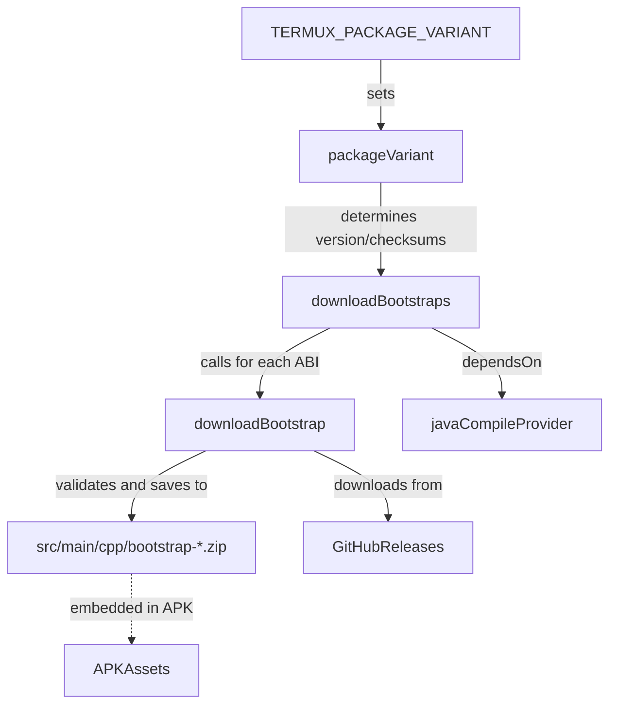
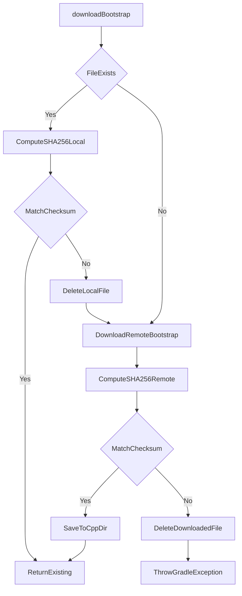
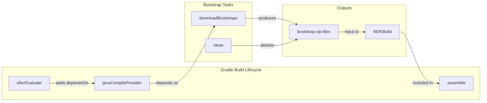
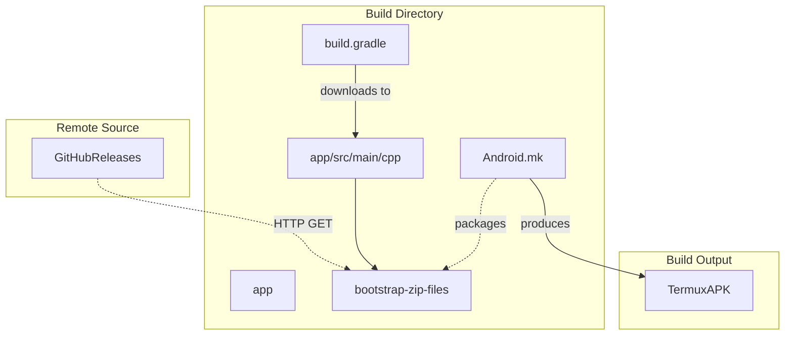

<!-- source: DeepWiki mcp.deepwiki.com · repo termux/termux-app · page 2.3 Bootstrap Package Management · fetched 2026-10-26 -->

# Bootstrap Package Management

<details>
<summary>Relevant source files</summary>

The following files were used as context for generating this wiki page:

- [.gitignore](.gitignore)
- [app/build.gradle](app/build.gradle)
- [app/src/main/cpp/Android.mk](app/src/main/cpp/Android.mk)
- [app/src/main/cpp/termux-bootstrap-zip.S](app/src/main/cpp/termux-bootstrap-zip.S)
- [app/src/main/cpp/termux-bootstrap.c](app/src/main/cpp/termux-bootstrap.c)
- [build.gradle](build.gradle)
- [gradle.properties](gradle.properties)
- [jitpack.yml](jitpack.yml)
- [terminal-emulator/build.gradle](terminal-emulator/build.gradle)
- [terminal-view/build.gradle](terminal-view/build.gradle)
- [termux-shared/build.gradle](termux-shared/build.gradle)
- [termux-shared/src/main/java/com/termux/shared/reflection/ReflectionUtils.java](termux-shared/src/main/java/com/termux/shared/reflection/ReflectionUtils.java)
- [termux-shared/src/main/java/com/termux/shared/termux/TermuxBootstrap.java](termux-shared/src/main/java/com/termux/shared/termux/TermuxBootstrap.java)

</details>


## Purpose and Scope

This document describes the bootstrap package management system used during the Termux APK build process. Bootstrap packages contain the core Unix environment (binaries, libraries, package manager) that is embedded into the APK and extracted on first launch. This page covers the download mechanism, SHA-256 checksum validation, package variants, and build system integration.

For information about runtime bootstrap installation and extraction, see [Bootstrap Installation](#5.1). For general build configuration and variant management, see [Gradle Build Configuration](#2.2).

Sources: [app/build.gradle:1-166](), [termux-shared/src/main/java/com/termux/shared/termux/TermuxBootstrap.java:1-44]()

---

## Bootstrap Package Overview

### Package Variants

Termux supports bootstrap package variants, defined by the `packageVariant` property in `app/build.gradle` [app/build.gradle:5-13]():

| Variant | Target Android | Default | Environment Variable |
|---------|---------------|---------|---------------------|
| `apt-android-7` | Android 7+ (API 24+) | Yes | `TERMUX_PACKAGE_VARIANT` |
| `apt-android-5` | Android 5-6 (API 21-23) | No | `TERMUX_PACKAGE_VARIANT` |

The variant is determined at build time via the `TERMUX_PACKAGE_VARIANT` environment variable, defaulting to `"apt-android-7"` [app/build.gradle:12](). This value is embedded into the APK as `BuildConfig.TERMUX_PACKAGE_VARIANT` [app/build.gradle:52]() for runtime access by `TermuxBootstrap.PackageVariant` [termux-shared/src/main/java/com/termux/shared/termux/TermuxBootstrap.java:23-28]().

**Critical Constraint**: The bootstrap variant is permanently tied to the APK. Users cannot manually replace `$PREFIX` with a different variant's bootstrap after installation, as app code dependencies are variant-specific and will cause crashes [app/build.gradle:6-10]().

### Package Contents

Each bootstrap package is a ZIP archive containing:
- **Core Unix binaries**: `bash`, `coreutils`, `apt`, package manager tools
- **Shared libraries**: `libc`, `libm`, runtime dependencies
- **Package metadata**: `SYMLINKS.txt` for symlink creation during extraction
- **Initial package database**: Pre-configured `apt` repository state

Sources: [app/build.gradle:5-13](), [app/build.gradle:52](), [termux-shared/src/main/java/com/termux/shared/termux/TermuxBootstrap.java:23-28]()

---

## Download Process

### Build Task Orchestration



**Download Task Orchestration Diagram**

The `downloadBootstraps` task is automatically invoked before Java compilation for all application variants. It delegates to the `downloadBootstrap()` function four times (once per supported ABI).

Sources: [app/build.gradle:1-166]()

### Download and Validation Flow



**Bootstrap Download and Validation Flow**

The `downloadBootstrap()` function implements a two-stage validation process:

1. **Local file check**: If the file exists in `src/main/cpp/`, compute its SHA-256 hash. If it matches `expectedChecksum`, reuse it. Otherwise, delete it and proceed to download.

2. **Remote download**: Download from the GitHub releases URL using `DigestInputStream` for streaming hash computation. If the checksum mismatches, delete the file and throw a `GradleException`.

Sources: [app/build.gradle:1-166]()

---

## Architecture-Specific Artifacts

### Supported ABIs

The build system downloads bootstrap packages for four ABIs:

| ABI | Architecture | Termux Name |
|-----|--------------|-------------|
| `arm64-v8a` | 64-bit ARM | `aarch64` |
| `armeabi-v7a` | 32-bit ARM | `arm` |
| `x86_64` | 64-bit x86 | `x86_64` |
| `x86` | 32-bit x86 | `i686` |

Each ABI has a separate bootstrap ZIP with a unique SHA-256 checksum [app/src/main/cpp/termux-bootstrap-zip.S:1-18]().

Sources: [app/src/main/cpp/termux-bootstrap-zip.S:1-18]()

---

## Build Integration

### Task Dependencies



**Build Task Dependency Chain**

The `afterEvaluate` block configures all application variants to depend on `downloadBootstraps` before Java compilation. This ensures bootstrap ZIPs are available before the NDK build (which embeds them in the APK via `termux-bootstrap-zip.S`) and before Java compilation (which needs `BuildConfig.TERMUX_PACKAGE_VARIANT`).

Sources: [app/build.gradle:1-166](), [app/src/main/cpp/termux-bootstrap-zip.S:1-18]()

### BuildConfig Field Generation

The selected `packageVariant` is exposed to application code via `BuildConfig.TERMUX_PACKAGE_VARIANT` [app/build.gradle:52]():

```groovy
buildConfigField "String", "TERMUX_PACKAGE_VARIANT", "\"" + project.ext.packageVariant + "\""
```

This allows runtime code (e.g., `TermuxApplication`, `TermuxBootstrap.PackageVariant` [termux-shared/src/main/java/com/termux/shared/termux/TermuxBootstrap.java:23-28]()) to verify the bootstrap variant and perform variant-specific logic during installation.

Sources: [app/build.gradle:52](), [termux-shared/src/main/java/com/termux/shared/termux/TermuxBootstrap.java:23-28]()

---

## File System Layout



**Bootstrap File System Layout**

Downloaded bootstrap ZIPs are stored in `app/src/main/cpp/` alongside the `Android.mk` NDK build script and assembly files (`termux-bootstrap-zip.S`). The NDK build process packages the appropriate bootstrap ZIP matching the target ABI into the APK as an asset.

Sources: [app/build.gradle:1-166](), [app/src/main/cpp/termux-bootstrap-zip.S:1-18]()

---

## Environment Variables

| Variable | Purpose | Default | Example |
|----------|---------|---------|---------|
| `TERMUX_PACKAGE_VARIANT` | Selects bootstrap variant | `"apt-android-7"` [app/build.gradle:12]() | `"apt-android-5"` |

The environment variable is read once during build configuration [app/build.gradle:12]() and cannot be changed after compilation.

Sources: [app/build.gradle:12]()

---

