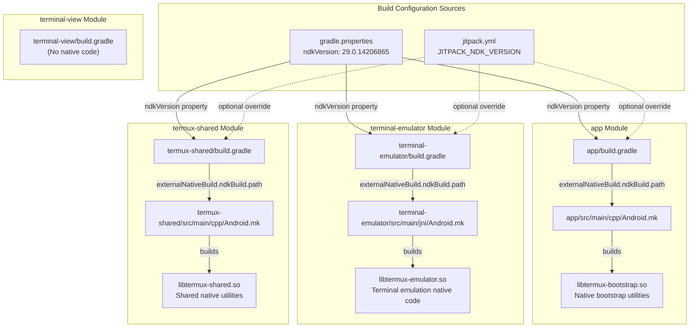
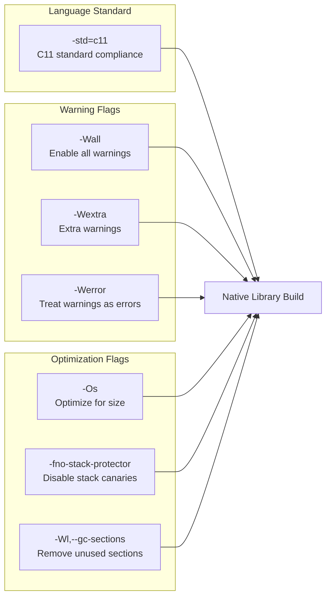
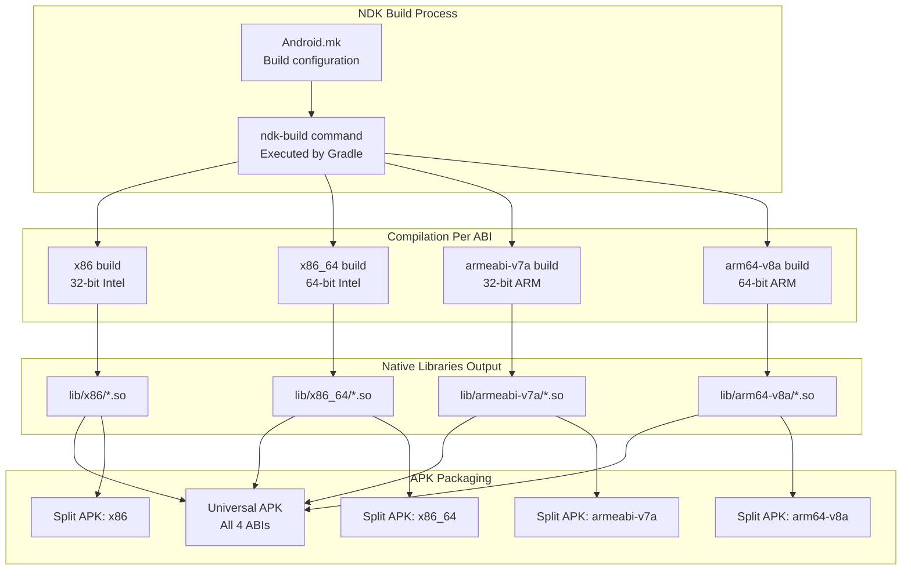
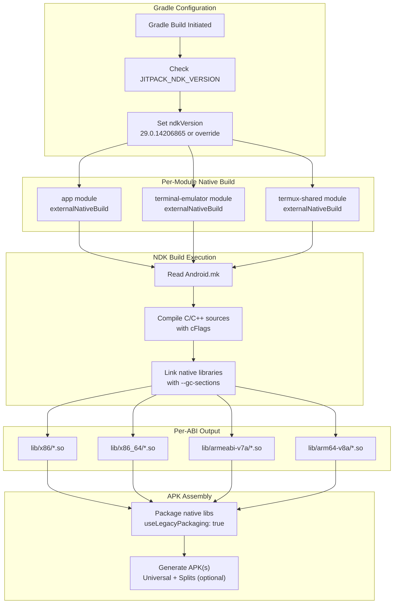

<!-- source: DeepWiki mcp.deepwiki.com · repo termux/termux-app · page 2.4 Native Code and NDK Build · fetched 2026-10-26 -->

# Native Code and NDK Build

<details>
<summary>Relevant source files</summary>

The following files were used as context for generating this wiki page:

- [.gitignore](.gitignore)
- [app/src/main/cpp/Android.mk](app/src/main/cpp/Android.mk)
- [app/src/main/cpp/termux-bootstrap-zip.S](app/src/main/cpp/termux-bootstrap-zip.S)
- [app/src/main/cpp/termux-bootstrap.c](app/src/main/cpp/termux-bootstrap.c)
- [terminal-emulator/src/main/java/com/termux/terminal/JNI.java](terminal-emulator/src/main/java/com/termux/terminal/JNI.java)
- [terminal-emulator/src/main/java/com/termux/terminal/TerminalSession.java](terminal-emulator/src/main/java/com/termux/terminal/TerminalSession.java)
- [terminal-emulator/src/main/java/com/termux/terminal/TerminalSessionClient.java](terminal-emulator/src/main/java/com/termux/terminal/TerminalSessionClient.java)
- [terminal-emulator/src/main/jni/termux.c](terminal-emulator/src/main/jni/termux.c)
- [termux-shared/src/main/cpp/Android.mk](termux-shared/src/main/cpp/Android.mk)
- [termux-shared/src/main/cpp/Application.mk](termux-shared/src/main/cpp/Application.mk)
- [termux-shared/src/main/cpp/local-socket.cpp](termux-shared/src/main/cpp/local-socket.cpp)
- [termux-shared/src/main/java/com/termux/shared/jni/models/JniResult.java](termux-shared/src/main/java/com/termux/shared/jni/models/JniResult.java)
- [termux-shared/src/main/java/com/termux/shared/net/socket/local/PeerCred.java](termux-shared/src/main/java/com/termux/shared/net/socket/local/PeerCred.java)
- [termux-shared/src/main/java/com/termux/shared/termux/terminal/TermuxTerminalSessionClientBase.java](termux-shared/src/main/java/com/termux/shared/termux/terminal/TermuxTerminalSessionClientBase.java)

</details>


## Purpose and Scope

This document describes the Native Development Kit (NDK) configuration and native code compilation across the Termux codebase. It covers NDK version management, compiler flags, ABI variants, and the integration of native libraries into each module's build process. For information about the overall module structure, see [Module Dependencies](#2.1). For details about build variants and APK configuration, see [Gradle Build Configuration](#2.2).

## NDK Version Configuration

The NDK version is centrally defined and can be overridden for different build environments. The primary version specification is in `gradle.properties` [gradle.properties:20]():

```
ndkVersion=29.0.14206865
```

This version is referenced by modules that contain native code. An environment variable override mechanism exists for JitPack builds, as defined in `jitpack.yml` [jitpack.yml:4]():

```
JITPACK_NDK_VERSION: "29.0.14206865"
```

Each module's build script checks for this environment variable and falls back to the property file version:

- **app module**: `app/build.gradle` [app/build.gradle:19]()
- **terminal-emulator module**: `terminal-emulator/build.gradle` [terminal-emulator/build.gradle:8]()
- **termux-shared module**: `termux-shared/build.gradle` [termux-shared/build.gradle:8]()

The override pattern is:
```groovy
ndkVersion = System.getenv("JITPACK_NDK_VERSION") ?: project.properties.ndkVersion
```

**Sources:** [gradle.properties:20](), [jitpack.yml:4](), [app/build.gradle:19](), [terminal-emulator/build.gradle:8](), [termux-shared/build.gradle:8]()

## Modules With Native Code

Three of the four modules in the Termux build system contain native code components. The following diagram shows the relationship between modules and their native build configurations:

**Module Native Build Configuration**



**Sources:** [app/build.gradle:109-113](), [terminal-emulator/build.gradle:32-36](), [termux-shared/build.gradle:61-65]()

## Android.mk File Locations

Each module with native code specifies the path to its `Android.mk` file via the `externalNativeBuild` block:

| Module | Android.mk Path | Configuration Location |
|--------|----------------|------------------------|
| app | `src/main/cpp/Android.mk` | [app/build.gradle:111]() |
| terminal-emulator | `src/main/jni/Android.mk` | [terminal-emulator/build.gradle:34]() |
| termux-shared | `src/main/cpp/Android.mk` | [termux-shared/build.gradle:63]() |

Note the inconsistent directory naming convention: the app and termux-shared modules use `cpp/` while terminal-emulator uses `jni/`. Both are valid NDK conventions, though `jni/` is the older standard.

**Sources:** [app/build.gradle:109-113](), [terminal-emulator/build.gradle:32-36](), [termux-shared/build.gradle:61-65]()

## Compiler Flags and Optimization Settings

### Standard Compiler Flags

The app and terminal-emulator modules use identical compiler flags specified in the `defaultConfig.externalNativeBuild.ndkBuild` block:

**app module** `app/build.gradle`:
```groovy
externalNativeBuild {
    ndkBuild {
        cFlags "-std=c11", "-Wall", "-Wextra", "-Werror", "-Os", "-fno-stack-protector", "-Wl,--gc-sections"
    }
}
```

**terminal-emulator module** `terminal-emulator/build.gradle`:
```groovy
externalNativeBuild {
    ndkBuild {
        cFlags "-std=c11", "-Wall", "-Wextra", "-Werror", "-Os", "-fno-stack-protector", "-Wl,--gc-sections"
    }
}
```

**Compiler Flag Breakdown**



**Flag Explanations:**

| Flag | Purpose | Rationale |
|------|---------|-----------|
| `-std=c11` | Enforce C11 standard | Modern C features while maintaining compatibility |
| `-Wall` | Enable all standard warnings | Catch common programming errors |
| `-Wextra` | Enable extra warnings | Additional static analysis |
| `-Werror` | Treat warnings as errors | Enforce code quality standards |
| `-Os` | Optimize for size | Minimize APK size (critical for mobile) |
| `-fno-stack-protector` | Disable stack canaries | Reduce overhead in size-constrained environments |
| `-Wl,--gc-sections` | Remove unused code sections | Further size optimization at link time |

The termux-shared module uses a minimal configuration `termux-shared/build.gradle`:
```groovy
externalNativeBuild {
    ndkBuild {
        cppFlags ''
    }
}
```

This empty `cppFlags` configuration indicates that the module either has minimal native code or relies on defaults specified in its `Android.mk` file.

**Sources:** [app/build.gradle](), [terminal-emulator/build.gradle](), [termux-shared/build.gradle]()

## ABI Variants

### Supported ABIs

The terminal-emulator module explicitly declares supported ABIs using the `ndk.abiFilters` configuration `terminal-emulator/build.gradle`:

```groovy
ndk {
    abiFilters 'x86', 'x86_64', 'armeabi-v7a', 'arm64-v8a'
}
```

These four ABIs cover all modern Android devices:

| ABI | Architecture | Devices |
|-----|-------------|---------|
| `x86` | 32-bit Intel | Emulators, tablets, older Intel devices |
| `x86_64` | 64-bit Intel | Modern emulators, Intel-based devices |
| `armeabi-v7a` | 32-bit ARM | Older phones and tablets |
| `arm64-v8a` | 64-bit ARM | Modern Android phones and tablets |

The app module's ABI handling is more complex due to split APK support. See [Gradle Build Configuration](#2.2) for details on the split APK mechanism.

**ABI Build and Packaging Flow**



**Sources:** [terminal-emulator/build.gradle](), [app/build.gradle]()

### Split APK Configuration

The app module configures ABI splits through the `splits.abi` block `app/build.gradle`:

```groovy
splits {
    abi {
        enable ((gradle.startParameter.taskNames.any { it.contains("Debug") } && splitAPKsForDebugBuilds == "1") ||
            (gradle.startParameter.taskNames.any { it.contains("Release") } && splitAPKsForReleaseBuilds == "1"))
        reset ()
        include 'x86', 'x86_64', 'armeabi-v7a', 'arm64-v8a'
        universalApk true
    }
}
```

This configuration:
- Enables splits conditionally based on build type and environment variables
- Includes the same four ABIs as terminal-emulator
- Always generates a universal APK containing all ABIs (`universalApk true`)

The split behavior is controlled by environment variables:
- `TERMUX_SPLIT_APKS_FOR_DEBUG_BUILDS` (default: "1") [app/build.gradle:22]()
- `TERMUX_SPLIT_APKS_FOR_RELEASE_BUILDS` (default: "0") [app/build.gradle:23]()

Debug builds split by default (producing 5 APKs: 4 ABI-specific + 1 universal), while release builds do not split by default (F-Droid requirement, as noted in the comment).

**Sources:** [app/build.gradle:22-23]()

## JNI Library Packaging and Bridges

### Legacy Packaging Mode

The app module uses legacy JNI packaging to ensure compatibility with older Android versions `app/build.gradle`:

```groovy
packagingOptions {
    jniLibs {
        useLegacyPackaging true
    }
}
```

This setting affects how native libraries are stored in the APK:
- **Legacy mode (`true`)**: Libraries are stored uncompressed in the APK
- **Modern mode (`false`)**: Libraries are compressed, extracted at install time

Legacy packaging increases APK size but improves installation reliability and runtime performance on older Android versions, as the libraries can be memory-mapped directly from the APK without extraction.

### JNI Bridges & Process Spawning

The terminal emulation core bridges Java and native code via `com.termux.terminal.JNI` [terminal-emulator/src/main/java/com/termux/terminal/JNI.java:1]() and `terminal-emulator/src/main/jni/termux.c` [terminal-emulator/src/main/jni/termux.c:1](). 

`TerminalSession` [terminal-emulator/src/main/java/com/termux/terminal/TerminalSession.java:31]() initializes a pseudo-terminal subprocess through native functions:

```mermaid
graph TD
    TS[TerminalSession.java<br/>com.termux.terminal.TerminalSession] -->|Calls JNI| JNI[JNI.java<br/>com.termux.terminal.JNI]
    JNI -->|Loads libtermux.so| TC[termux.c<br/>Java_com_termux_terminal_JNI_createSubprocess]
    TC -->|Opens| PTMX["/dev/ptmx"]
    TC -->|Forks process| Fork[fork()]
    Fork -->|Executes command| Exec[execvp]
```

**Sources:** [app/build.gradle](), [terminal-emulator/src/main/java/com/termux/terminal/JNI.java:1-41](), [terminal-emulator/src/main/jni/termux.c:1-190](), [terminal-emulator/src/main/java/com/termux/terminal/TerminalSession.java:31-166]()

## Build Integration Summary

The following diagram shows the complete integration of native code compilation into the Gradle build process:

**Native Code Build Integration**



**Sources:** [app/build.gradle:19](), [app/build.gradle:63-67](), [app/build.gradle:109-113](), [terminal-emulator/build.gradle:8](), [terminal-emulator/build.gradle:14-18](), [terminal-emulator/build.gradle:32-36](), [termux-shared/build.gradle:8](), [termux-shared/build.gradle:61-65]()

## Module-Specific Native Code Roles

While this document describes the build configuration, the actual purpose and implementation of the native code varies by module:

| Module | Native Code Purpose | Build Configuration |
|--------|-------------------|---------------------|
| **app** | Bootstrap utilities and helper functions | [app/build.gradle:63-67](), [app/build.gradle:109-113]() |
| **terminal-emulator** | Terminal emulation logic, escape sequence processing | [terminal-emulator/build.gradle:14-18](), [terminal-emulator/build.gradle:32-36]() |
| **termux-shared** | Shared native utilities used across modules | [termux-shared/build.gradle:39-43](), [termux-shared/build.gradle:61-65]() |
| **terminal-view** | No native code (pure Java/Kotlin) | [terminal-view/build.gradle]() |

**Sources:** [app/build.gradle](), [terminal-emulator/build.gradle](), [termux-shared/build.gradle](), [terminal-view/build.gradle]()

---

