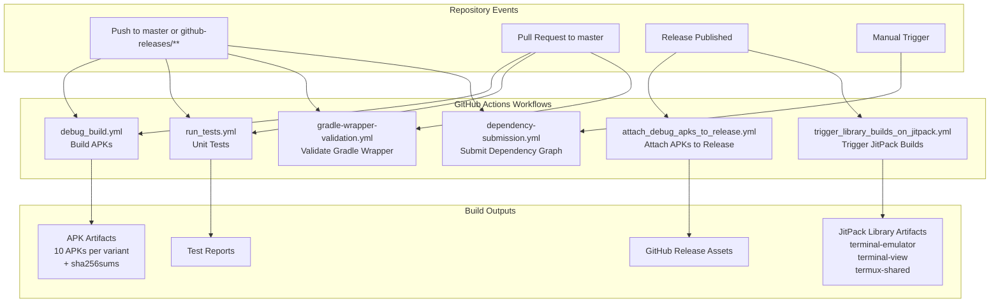
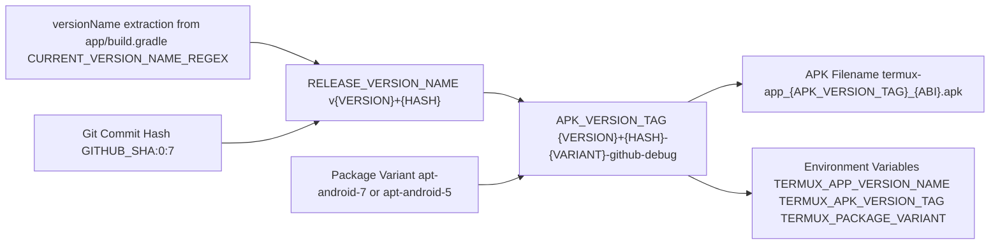
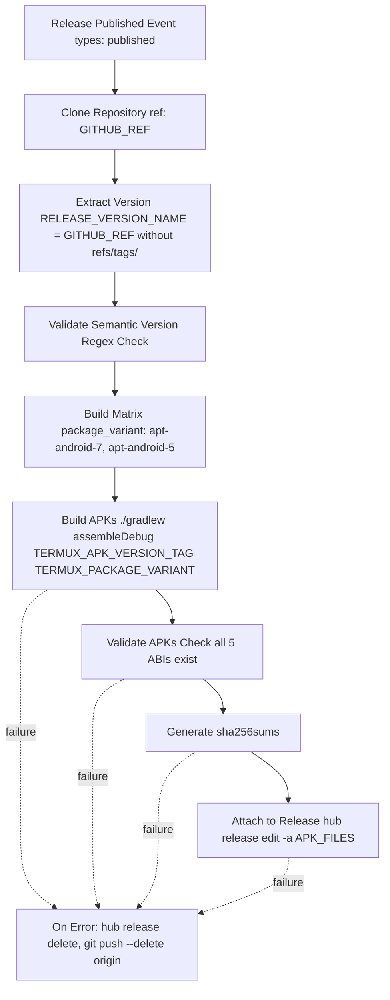
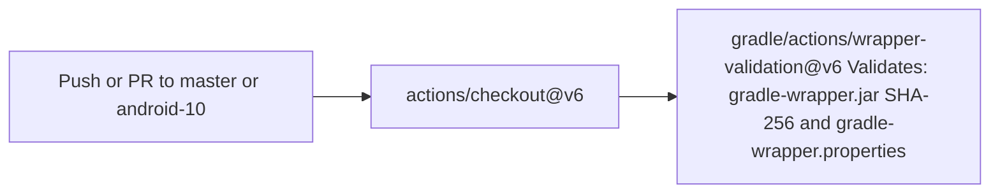
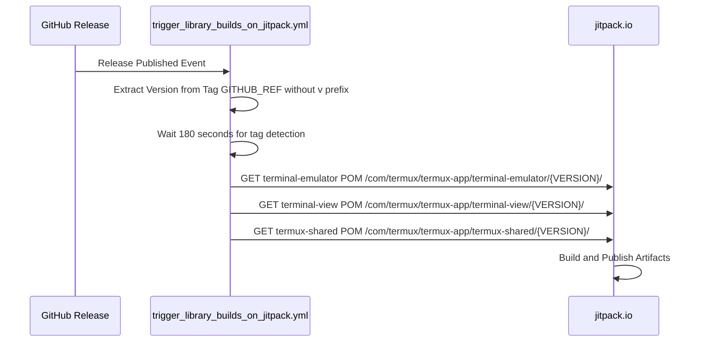

<!-- source: DeepWiki mcp.deepwiki.com · repo termux/termux-app · page 2.5 CI/CD Pipeline · fetched 2026-10-26 -->

# CI/CD Pipeline

Relevant source files

The following files were used as context for generating this wiki page:

- [.github/FUNDING.yml](.github/FUNDING.yml)
- [.github/ISSUE_TEMPLATE/01-bug-report.yml](.github/ISSUE_TEMPLATE/01-bug-report.yml)
- [.github/ISSUE_TEMPLATE/02-feature-request.yml](.github/ISSUE_TEMPLATE/02-feature-request.yml)
- [.github/ISSUE_TEMPLATE/config.yml](.github/ISSUE_TEMPLATE/config.yml)
- [.github/dependabot.yml](.github/dependabot.yml)
- [.github/workflows/attach_debug_apks_to_release.yml](.github/workflows/attach_debug_apks_to_release.yml)
- [.github/workflows/debug_build.yml](.github/workflows/debug_build.yml)
- [.github/workflows/dependency-submission.yml](.github/workflows/dependency-submission.yml)
- [.github/workflows/gradle-wrapper-validation.yml](.github/workflows/gradle-wrapper-validation.yml)
- [.github/workflows/run_tests.yml](.github/workflows/run_tests.yml)
- [.github/workflows/trigger_library_builds_on_jitpack.yml](.github/workflows/trigger_library_builds_on_jitpack.yml)
- [app/src/main/java/com/termux/app/activities/HelpActivity.java](app/src/main/java/com/termux/app/activities/HelpActivity.java)

## Purpose and Scope

This document describes the GitHub Actions-based continuous integration and continuous delivery (CI/CD) pipeline for the Termux application. The pipeline automates APK building, testing, release attachment, dependency submission, package management via dependabot, issue templates, and library distribution. It produces debug APKs for multiple ABI variants and package variants, validates the Gradle wrapper, runs unit tests, and triggers downstream builds on JitPack.

For information about the Gradle build configuration that the CI/CD pipeline executes, see [Gradle Build Configuration](#2.2). For details on bootstrap package management during builds, see [Bootstrap Package Management](#2.3).

Sources: [.github/workflows/debug_build.yml:1-133](), [.github/workflows/attach_debug_apks_to_release.yml:1-84](), [.github/dependabot.yml:1-9]()

## Workflow Architecture

The CI/CD system consists of multiple GitHub Actions workflows and configuration files, triggered by different repository events:

Diagram: Workflow Architecture Overview

Sources: [.github/workflows/debug_build.yml:1-133](), [.github/workflows/attach_debug_apks_to_release.yml:1-84](), [.github/workflows/run_tests.yml:1-26](), [.github/workflows/gradle-wrapper-validation.yml:1-20](), [.github/workflows/dependency-submission.yml:1-23](), [.github/workflows/trigger_library_builds_on_jitpack.yml:1-21]()

## Build Workflow (debug_build.yml)

The primary build workflow executes on every push to `master` or `github-releases/**` branches and on pull requests to `master` [.github/workflows/debug_build.yml:1-11](). It builds debug APKs for all supported ABIs and both package variants.

### Build Matrix

The workflow uses a matrix strategy to build APKs for two package variants in parallel [.github/workflows/debug_build.yml:15-19]():

| Matrix Dimension | Values |
|-----------------|---------|
| `package_variant` | `apt-android-7`, `apt-android-5` |
| ABIs (per variant) | `universal`, `arm64-v8a`, `armeabi-v7a`, `x86_64`, `x86` |
| **Total APKs per run** | **10** (5 ABIs × 2 variants) |

The `fail-fast: false` configuration ensures that if one variant fails, the other continues building [.github/workflows/debug_build.yml:16-18]().

Sources: [.github/workflows/debug_build.yml:13-18]()

### Version Naming Scheme

The workflow generates semantic version names by combining the version from `app/build.gradle` with the Git commit hash:

Diagram: Version Naming Generation Flow

The version naming follows semantic versioning 2.0.0 specification and is validated using a regex pattern [.github/workflows/debug_build.yml:44-49](). For pull requests, the workflow uses the PR head SHA instead of the merge commit SHA [.github/workflows/debug_build.yml:39-41]().

Sources: [.github/workflows/debug_build.yml:43-63]()

### Build Steps

The workflow executes the following steps:

1. **Repository Clone**: Uses `actions/checkout@v6` [.github/workflows/debug_build.yml:21-22]()
2. **Java Setup**: Installs Temurin JDK 17 via `actions/setup-java@v5` [.github/workflows/debug_build.yml:24-28]()
3. **Version Configuration**: Extracts current version from `app/build.gradle` and generates `RELEASE_VERSION_NAME` [.github/workflows/debug_build.yml:43-49]()
4. **Environment Export**: Sets `TERMUX_APP_VERSION_NAME`, `TERMUX_APK_VERSION_TAG`, and `TERMUX_PACKAGE_VARIANT` environment variables consumed by `app/build.gradle` [.github/workflows/debug_build.yml:61-63]()
5. **APK Build**: Executes `./gradlew assembleDebug` [.github/workflows/debug_build.yml:64-66]()
6. **APK Validation**: Verifies all five ABI-specific APKs were generated [.github/workflows/debug_build.yml:68-74]()
7. **Checksum Generation**: Generates `sha256sums` file for all APKs [.github/workflows/debug_build.yml:76-85]()
8. **Artifact Upload**: Uploads each APK and the checksums file as separate workflow artifacts using `actions/upload-artifact@v6` [.github/workflows/debug_build.yml:87-133]()

Sources: [.github/workflows/debug_build.yml:20-133]()

### Build Output Structure

The workflow generates the following files in `./app/build/outputs/apk/debug`:

| File Pattern | Description |
|-------------|-------------|
| `termux-app_{VERSION_TAG}_universal.apk` | Universal APK containing all ABIs |
| `termux-app_{VERSION_TAG}_arm64-v8a.apk` | ARM64 APK (64-bit ARM) |
| `termux-app_{VERSION_TAG}_armeabi-v7a.apk` | ARMv7 APK (32-bit ARM) |
| `termux-app_{VERSION_TAG}_x86_64.apk` | x86-64 APK (64-bit Intel) |
| `termux-app_{VERSION_TAG}_x86.apk` | x86 APK (32-bit Intel) |
| `termux-app_{VERSION_TAG}_sha256sums` | SHA-256 checksums for all APKs |
| `output-metadata.json` | Gradle metadata (attached to each artifact) |

Sources: [.github/workflows/debug_build.yml:51-53](), [.github/workflows/debug_build.yml:87-133]()

## Release Attachment Workflow (attach_debug_apks_to_release.yml)

This workflow triggers when a GitHub release is published and automatically builds and attaches debug APKs to the release [.github/workflows/attach_debug_apks_to_release.yml:1-8]().

### Release Build Process

Diagram: Release Attachment and Error Rollback Logic

Unlike the debug build workflow, this workflow uses the `hub` CLI tool to attach APK files directly to the GitHub release [.github/workflows/attach_debug_apks_to_release.yml:74-84](). The version tag is extracted from `GITHUB_REF` without modification, and the APK version tag format is `{RELEASE_VERSION_NAME}+{PACKAGE_VARIANT}-github-debug` [.github/workflows/attach_debug_apks_to_release.yml:38-45]().

### Error Handling and Rollback

The workflow includes comprehensive error handling with an `exit_on_error()` function that:
1. Prints the error message [.github/workflows/attach_debug_apks_to_release.yml:30]()
2. Deletes the created release using `hub release delete` [.github/workflows/attach_debug_apks_to_release.yml:32]()
3. Deletes the Git tag using `git push --delete origin` [.github/workflows/attach_debug_apks_to_release.yml:33]()
4. Exits with status code 1 [.github/workflows/attach_debug_apks_to_release.yml:34]()

Sources: [.github/workflows/attach_debug_apks_to_release.yml:1-84]()

## Unit Test Workflow (run_tests.yml)

The test workflow executes on pushes and pull requests to `master` and `android-10` branches [.github/workflows/run_tests.yml:1-12](). It runs Gradle test tasks across all modules.

### Test Execution

The workflow performs the following steps:
1. Clones the repository with `actions/checkout@v6` [.github/workflows/run_tests.yml:17-18]()
2. Sets up Temurin JDK 17 via `actions/setup-java@v5` [.github/workflows/run_tests.yml:19-23]()
3. Executes `./gradlew test` to run unit tests for all modules [.github/workflows/run_tests.yml:24-26]()

Sources: [.github/workflows/run_tests.yml:1-26]()

## Gradle Wrapper Validation

The Gradle wrapper validation workflow ensures the integrity and authenticity of the Gradle wrapper files to prevent supply chain attacks [.github/workflows/gradle-wrapper-validation.yml:1-13]().

### Validation Process

Diagram: Gradle Wrapper Validation Flow

The workflow uses the official `gradle/actions/wrapper-validation@v6` action to verify that `gradle/wrapper/gradle-wrapper.jar` matches the expected SHA-256 checksum and properties configuration [.github/workflows/gradle-wrapper-validation.yml:20]().

Sources: [.github/workflows/gradle-wrapper-validation.yml:1-20]()

## JitPack Library Build Trigger

When a release is published, this workflow triggers JitPack to build and publish the three library modules as Maven artifacts [.github/workflows/trigger_library_builds_on_jitpack.yml:1-7]().

### Trigger Mechanism

Diagram: JitPack Trigger Sequence

The workflow extracts the version, waits 180 seconds for tag detection, and requests the Maven POM files for `terminal-emulator`, `terminal-view`, and `termux-shared` to prompt building on JitPack [.github/workflows/trigger_library_builds_on_jitpack.yml:12-21]().

Sources: [.github/workflows/trigger_library_builds_on_jitpack.yml:1-21]()

## Dependency Submission Workflow

This workflow generates and submits a dependency graph to GitHub's Dependency Graph feature, enabling Dependabot security alerts and dependency insights [.github/workflows/dependency-submission.yml:1-11]().

The workflow uses `gradle/actions/dependency-submission@v6` to analyze all Gradle dependencies and submit them under `contents: write` permissions [.github/workflows/dependency-submission.yml:8-23]().

Sources: [.github/workflows/dependency-submission.yml:1-23]()

## Dependabot Configuration

Dependabot is configured via `.github/dependabot.yml` to automatically manage updates for GitHub Actions workflows on a daily schedule [.github/dependabot.yml:1-6](). All commits generated by dependabot are prefixed with `"Changed"` [.github/dependabot.yml:7-9]().

Sources: [.github/dependabot.yml:1-9]()

## Issue Templates and Repository Configuration

The repository maintains standard issue templates under `.github/ISSUE_TEMPLATE/`:
- **Bug Report (`01-bug-report.yml`)**: Mandates problem descriptions, reproduction steps, expected behavior, and system environment info (Termux version, Android OS version, device model) [.github/ISSUE_TEMPLATE/01-bug-report.yml:1-45]().
- **Feature Request (`02-feature-request.yml`)**: Guides users in submitting new feature suggestions [.github/ISSUE_TEMPLATE/02-feature-request.yml:1-19]().
- **Config (`config.yml`)**: Disables blank issues and directs users to GitHub Discussions [.github/ISSUE_TEMPLATE/config.yml:1-5]().

Sources: [.github/ISSUE_TEMPLATE/01-bug-report.yml:1-45](), [.github/ISSUE_TEMPLATE/config.yml:1-5]()

## Build Environment Configuration

All build workflows share common environment setup:

| Component | Version | Action / Source |
|-----------|---------|-----------------|
| **Runner OS** | `ubuntu-latest` | GitHub-hosted runner [.github/workflows/debug_build.yml:14]() |
| **Java Distribution** | Temurin (Eclipse Adoptium) | `actions/setup-java@v5` [.github/workflows/debug_build.yml:25]() |
| **Java Version** | 17 | Required by Gradle and Android build tools [.github/workflows/debug_build.yml:28]() |
| **Checkout Action** | `actions/checkout@v6` | Repository cloning [.github/workflows/debug_build.yml:22]() |
| **Artifact Upload** | `actions/upload-artifact@v6` | Debug build workflow only [.github/workflows/debug_build.yml:88]() |

Sources: [.github/workflows/debug_build.yml:14](), [.github/workflows/debug_build.yml:24-28](), [.github/workflows/attach_debug_apks_to_release.yml:10](), [.github/workflows/run_tests.yml:15-23]()

## Artifact Retention and Distribution

### Workflow Artifacts

Debug build workflow artifacts are uploaded with default retention:
- Each of the 5 ABI-specific APKs is uploaded as a separate artifact [.github/workflows/debug_build.yml:87-125]()
- Each artifact includes `output-metadata.json` from Gradle [.github/workflows/debug_build.yml:93]()
- The `sha256sums` file is uploaded as a separate artifact [.github/workflows/debug_build.yml:127-133]()

### Release Assets

Release attachment workflow directly adds assets to GitHub releases using `hub release edit` [.github/workflows/attach_debug_apks_to_release.yml:74-84]() containing all 5 ABI-specific APKs and the `sha256sums` file.

Sources: [.github/workflows/debug_build.yml:87-133](), [.github/workflows/attach_debug_apks_to_release.yml:74-84]()

---

