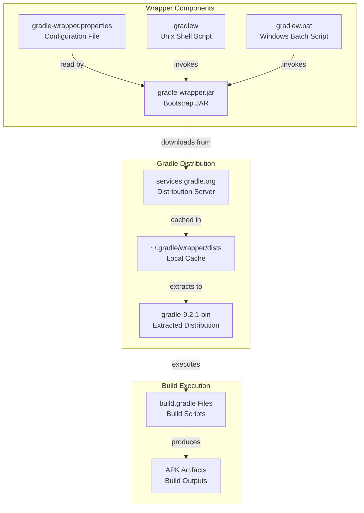
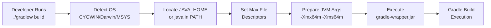
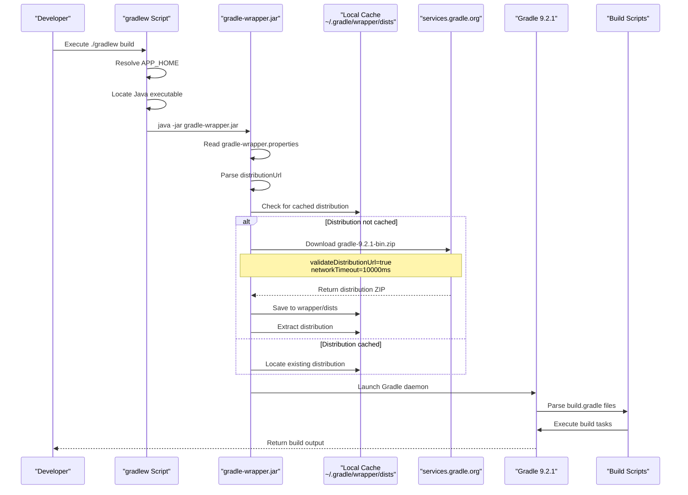
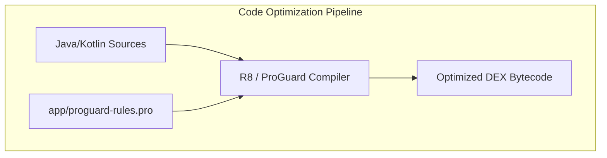
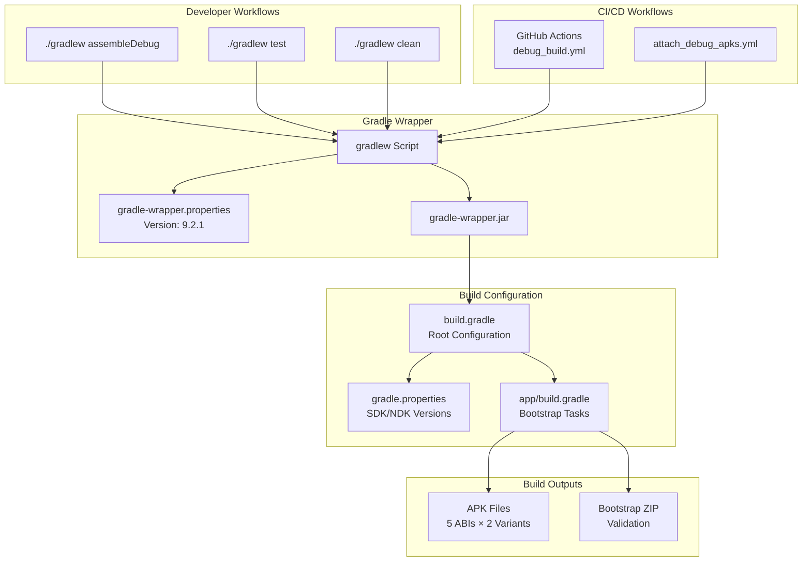

<!-- source: DeepWiki mcp.deepwiki.com · repo termux/termux-app · page 2.6 Gradle Wrapper · fetched 2026-10-26 -->

# Gradle Wrapper

<details>
<summary>Relevant source files</summary>

The following files were used as context for generating this wiki page:

- [app/proguard-rules.pro](app/proguard-rules.pro)
- [gradle/wrapper/gradle-wrapper.jar](gradle/wrapper/gradle-wrapper.jar)
- [gradle/wrapper/gradle-wrapper.properties](gradle/wrapper/gradle-wrapper.properties)
- [gradlew](gradlew)
- [gradlew.bat](gradlew.bat)

</details>


## Purpose and Scope

This document describes the Gradle Wrapper system used in the Termux application repository. The Gradle Wrapper is a standardized mechanism for distributing Gradle with the project, ensuring all developers, contributors, and CI/CD systems use the identical Gradle version (9.2.1) without requiring manual installation. This eliminates "works on my machine" issues caused by Gradle version mismatches and provides a consistent, reproducible build environment.

This page also outlines the ProGuard configuration rules applied during code shrinking and minification for the application modules.

For information about the broader build configuration and module structure, see [Gradle Build Configuration](#2.2). For details on CI/CD pipeline integration, see [CI/CD Pipeline](#2.5).

---

## Wrapper Components

The Gradle Wrapper system consists of four key components that work together to bootstrap and execute Gradle builds:



**Sources:** [gradle/wrapper/gradle-wrapper.properties:1-7](), [gradle/wrapper/gradle-wrapper.jar:1-1](), [gradlew:1-248](), [gradlew.bat:1-93]()

---

## Configuration File

The `gradle-wrapper.properties` file defines the Gradle distribution parameters and wrapper behavior:

| Property | Value | Description |
|----------|-------|-------------|
| `distributionBase` | `GRADLE_USER_HOME` | Base directory for Gradle distributions |
| `distributionPath` | `wrapper/dists` | Subdirectory path within the base |
| `distributionUrl` | `https://services.gradle.org/distributions/gradle-9.2.1-bin.zip` | URL to download Gradle 9.2.1 binary distribution |
| `networkTimeout` | `10000` | Network timeout in milliseconds (10 seconds) |
| `validateDistributionUrl` | `true` | Enables URL validation for security |
| `zipStoreBase` | `GRADLE_USER_HOME` | Base directory for downloaded ZIP files |
| `zipStorePath` | `wrapper/dists` | Subdirectory for storing downloaded ZIPs |

The `distributionUrl` specifies Gradle version **9.2.1** with the `-bin` distribution variant, which includes only the Gradle binaries without source code or documentation. This reduces download size while providing all necessary build functionality.

The `validateDistributionUrl` property set to `true` ensures that the wrapper will verify the distribution URL against a list of known-safe Gradle distribution servers, preventing potential supply chain attacks where a malicious distribution could be substituted.

**Sources:** [gradle/wrapper/gradle-wrapper.properties:1-7]()

---

## Wrapper Scripts

### Unix/Linux/macOS Script (gradlew)

The `gradlew` shell script is a POSIX-compliant executable that bootstraps the Gradle build on Unix-like systems. Key characteristics:



- **Lines 67-89**: Resolves symlinks to determine `APP_HOME` directory [gradlew:67-89]()
- **Lines 119-142**: Locates Java executable from `JAVA_HOME` or system `PATH` [gradlew:119-142]()
- **Lines 144-161**: Adjusts file descriptor limits on Unix systems (not on Cygwin/Darwin/NonStop) [gradlew:144-161]()
- **Lines 172-199**: Converts paths to Windows format for Cygwin/MSYS environments [gradlew:172-199]()
- **Lines 202-214**: Sets JVM options (`-Xmx64m -Xms64m`) and constructs command to execute `gradle-wrapper.jar` [gradlew:202-214]()

The script uses modest heap sizes (64MB max/min) for the wrapper process itself, as the wrapper's only job is to download and launch the actual Gradle daemon, which will use its own memory configuration.

**Sources:** [gradlew:67-214]()

### Windows Script (gradlew.bat)

The `gradlew.bat` batch script provides equivalent functionality for Windows systems:

- **Lines 26-36**: Sets up environment variables and resolves `APP_HOME` directory [gradlew.bat:26-36]()
- **Lines 38-39**: Configures default JVM options matching the Unix script [gradlew.bat:38-39]()
- **Lines 41-68**: Locates Java executable from `JAVA_HOME` or system `PATH`, with error handling [gradlew.bat:41-68]()
- **Lines 76-88**: Executes the wrapper JAR with configured JVM options and propagates exit codes [gradlew.bat:76-88]()

Both scripts share the same JVM configuration (`-Xmx64m -Xms64m`) and execute the same `gradle-wrapper.jar` with identical command-line structure, ensuring consistent behavior across platforms.

**Sources:** [gradlew.bat:26-88]()

---

## Bootstrap JAR

The `gradle-wrapper.jar` is a small executable JAR file containing the wrapper implementation classes. Key classes visible in the JAR structure:

| Package | Class | Purpose |
|---------|-------|---------|
| `org.gradle.wrapper` | `GradleWrapperMain` | Main entry point for wrapper execution |
| `org.gradle.wrapper` | `Download` | Handles distribution download with proxy support |
| `org.gradle.wrapper` | `Install` | Manages distribution extraction and validation |
| `org.gradle.wrapper` | `WrapperExecutor` | Orchestrates the wrapper execution flow |
| `org.gradle.wrapper` | `WrapperConfiguration` | Parses wrapper properties configuration |
| `org.gradle.wrapper` | `PathAssembler` | Constructs file system paths for distributions |
| `org.gradle.cli` | `CommandLineParser` | Parses command-line arguments |
| `org.gradle.internal.file` | `PathTraversalChecker` | Security validation for file paths |

The JAR is committed to version control and should not be modified manually. When upgrading Gradle versions, the wrapper JAR should be regenerated using the `gradle wrapper` task from an existing Gradle installation.

**Sources:** [gradle/wrapper/gradle-wrapper.jar:1-1]()

---

## Execution Flow

The following sequence diagram illustrates the complete wrapper execution lifecycle:



The wrapper implements a caching strategy where distributions are stored in `$GRADLE_USER_HOME/wrapper/dists/gradle-9.2.1-bin/` using a hash-based directory structure to prevent conflicts between different distribution URLs.

**Sources:** [gradle/wrapper/gradle-wrapper.properties:1-7](), [gradlew:211-214](), [gradlew.bat:76]()

---

## ProGuard Rules

The project defines specific code shrinking and optimization configurations via ProGuard rules files, such as `app/proguard-rules.pro`. 



Key ProGuard configurations in `app/proguard-rules.pro` include:
- `-dontobfuscate`: Disables class and member name obfuscation to preserve stack trace readability and reflection compatibility with external scripts or plugins [app/proguard-rules.pro:10-10]().
- Commented-out attributes for source file preservation (`-renamesourcefileattribute SourceFile`, `-keepattributes SourceFile,LineNumberTable`) [app/proguard-rules.pro:11-12]().

**Sources:** [app/proguard-rules.pro:1-12]()

---

## Distribution Validation

The wrapper configuration includes security measures to prevent malicious distribution substitution:

### URL Validation

The `validateDistributionUrl=true` property enables the wrapper to verify that the `distributionUrl` points to a trusted Gradle distribution server. The wrapper maintains an internal allowlist of valid distribution domains, which includes:

- `https://services.gradle.org/distributions/`
- Other officially recognized Gradle CDN endpoints

If the distribution URL points to an untrusted domain, the wrapper will refuse to download and report an error.

### Network Timeout

The `networkTimeout=10000` property (10 seconds) prevents indefinite hangs when downloading the distribution. If the download does not complete within this timeframe, the wrapper terminates with an error, allowing developers to retry or diagnose network issues.

### Checksum Verification

While not explicitly visible in the properties file, the Gradle Wrapper performs SHA-256 checksum verification of downloaded distributions. The wrapper compares the downloaded file's checksum against expected values embedded in the wrapper JAR or fetched from Gradle's servers, ensuring the distribution has not been tampered with during transit.

**Sources:** [gradle/wrapper/gradle-wrapper.properties:4-5]()

---

## Version Management

The current Gradle version is **9.2.1**, specified in the distribution URL. This version was chosen to match the project's compatibility requirements with:

- Android Gradle Plugin version (as defined in module build.gradle files)
- Java/Kotlin compiler versions
- Android SDK build tools
- Gradle feature requirements (configuration cache, composite builds, etc.)

### Upgrading the Wrapper

To upgrade the Gradle Wrapper to a new version:

1. Run the wrapper task with the desired version from an existing Gradle installation:
   ```
   gradle wrapper --gradle-version X.Y.Z
   ```

2. This regenerates:
   - `gradle/wrapper/gradle-wrapper.properties` (updated distributionUrl)
   - `gradle/wrapper/gradle-wrapper.jar` (updated wrapper implementation)
   - `gradlew` and `gradlew.bat` (potentially updated scripts)

3. Commit all four modified files to version control

The wrapper version should be coordinated with changes to the root `build.gradle` file and `gradle.properties` to ensure compatibility across the entire build system.

**Sources:** [gradle/wrapper/gradle-wrapper.properties:3]()

---

## Integration with Build System

The Gradle Wrapper serves as the execution foundation for all build operations in the Termux project:



**CI/CD Integration**: The GitHub Actions workflows rely on the wrapper to ensure consistent builds across different runner environments. The workflow files do not specify a Gradle version; instead, they invoke `./gradlew`, which automatically uses the version defined in the wrapper configuration.

**Module Builds**: Each module (`app`, `terminal-emulator`, `terminal-view`, `termux-shared`) is built using tasks executed through the wrapper. The wrapper ensures that all modules use the same Gradle version, preventing dependency resolution conflicts.

**Bootstrap Management**: The wrapper executes custom Gradle tasks defined in `app/build.gradle` that download and validate bootstrap packages. These tasks rely on Gradle 9.2.1-specific APIs and features.

**Sources:** [gradle/wrapper/gradle-wrapper.properties:1-7](), [gradlew:1-248]()

---

## File System Layout

The Gradle Wrapper creates the following directory structure on first execution:

```
~/.gradle/
├── wrapper/
│   └── dists/
│       └── gradle-9.2.1-bin/
│           └── <hash>/
│               ├── gradle-9.2.1/          # Extracted distribution
│               │   ├── bin/
│               │   │   ├── gradle          # Gradle executable
│               │   │   └── gradle.bat      # Windows executable
│               │   ├── lib/                # Gradle core libraries
│               │   └── ...
│               └── gradle-9.2.1-bin.zip    # Downloaded ZIP
└── caches/                                 # Build cache (separate)
```

The `<hash>` directory name is computed from the distribution URL to prevent collisions when multiple projects use different Gradle distributions or URLs. This allows multiple Gradle versions to coexist peacefully on the same machine.

**Sources:** [gradle/wrapper/gradle-wrapper.properties:1-2](), [gradle/wrapper/gradle-wrapper.properties:6-7]()

---

## Relationship to Build Configuration

While the Gradle Wrapper provides the Gradle runtime, it does not define build logic or project configuration. The wrapper delegates to:

- **Root `build.gradle`**: Defines plugin versions, repositories, and cross-module configuration (see [Gradle Build Configuration](#2.2))
- **`gradle.properties`**: Specifies SDK versions, NDK paths, and build toggles (see [Gradle Build Configuration](#2.2))
- **Module `build.gradle` files**: Define module-specific dependencies, compilation settings, and custom tasks (see [Module Dependencies](#2.1))

The wrapper ensures these configuration files are processed by the correct Gradle version, maintaining build reproducibility across all environments.

**Sources:** [gradle/wrapper/gradle-wrapper.properties:1-7]()

---

