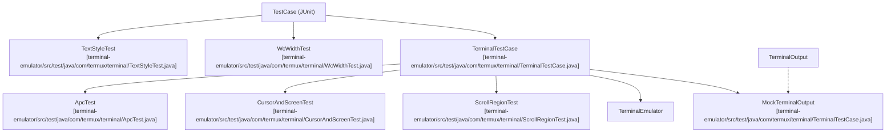
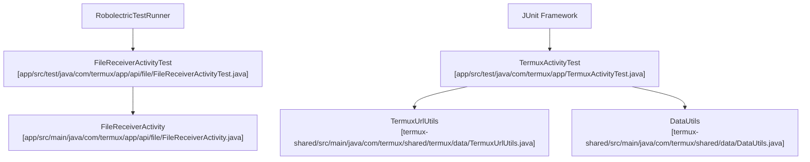

<!-- source: DeepWiki mcp.deepwiki.com · repo termux/termux-app · page 2.7 Testing Infrastructure · fetched 2026-10-26 -->

# Testing Infrastructure

<details>
<summary>Relevant source files</summary>

The following files were used as context for generating this wiki page:

- [app/src/main/java/com/termux/app/api/file/FileReceiverActivity.java](app/src/main/java/com/termux/app/api/file/FileReceiverActivity.java)
- [app/src/test/java/com/termux/app/TermuxActivityTest.java](app/src/test/java/com/termux/app/TermuxActivityTest.java)
- [app/src/test/java/com/termux/app/api/file/FileReceiverActivityTest.java](app/src/test/java/com/termux/app/api/file/FileReceiverActivityTest.java)
- [terminal-emulator/src/main/java/com/termux/terminal/TerminalOutput.java](terminal-emulator/src/main/java/com/termux/terminal/TerminalOutput.java)
- [terminal-emulator/src/test/java/com/termux/terminal/ApcTest.java](terminal-emulator/src/test/java/com/termux/terminal/ApcTest.java)
- [terminal-emulator/src/test/java/com/termux/terminal/ByteQueueTest.java](terminal-emulator/src/test/java/com/termux/terminal/ByteQueueTest.java)
- [terminal-emulator/src/test/java/com/termux/terminal/CursorAndScreenTest.java](terminal-emulator/src/test/java/com/termux/terminal/CursorAndScreenTest.java)
- [terminal-emulator/src/test/java/com/termux/terminal/DecSetTest.java](terminal-emulator/src/test/java/com/termux/terminal/DecSetTest.java)
- [terminal-emulator/src/test/java/com/termux/terminal/ScrollRegionTest.java](terminal-emulator/src/test/java/com/termux/terminal/ScrollRegionTest.java)
- [terminal-emulator/src/test/java/com/termux/terminal/TerminalRowTest.java](terminal-emulator/src/test/java/com/termux/terminal/TerminalRowTest.java)
- [terminal-emulator/src/test/java/com/termux/terminal/TerminalTestCase.java](terminal-emulator/src/test/java/com/termux/terminal/TerminalTestCase.java)
- [terminal-emulator/src/test/java/com/termux/terminal/TextStyleTest.java](terminal-emulator/src/test/java/com/termux/terminal/TextStyleTest.java)
- [terminal-emulator/src/test/java/com/termux/terminal/WcWidthTest.java](terminal-emulator/src/test/java/com/termux/terminal/WcWidthTest.java)
- [termux-shared/src/main/java/com/termux/shared/data/DataUtils.java](termux-shared/src/main/java/com/termux/shared/data/DataUtils.java)
- [termux-shared/src/main/java/com/termux/shared/data/IntentUtils.java](termux-shared/src/main/java/com/termux/shared/data/IntentUtils.java)
- [termux-shared/src/main/java/com/termux/shared/termux/data/TermuxUrlUtils.java](termux-shared/src/main/java/com/termux/shared/termux/data/TermuxUrlUtils.java)

</details>


## Purpose and Scope
This page details the testing infrastructure across the Termux codebase. It covers the pure Java unit test suites for the terminal emulator (`terminal-emulator`), Android-dependent app-level tests (`app`), and shared utility and URL parsing tests (`termux-shared`), along with how these tests are structured and executed in local environments and CI/CD pipelines.

---

## 1. Terminal Emulator Test Suites

The `terminal-emulator` module contains a comprehensive suite of JUnit tests verifying the VT100/xterm terminal emulation logic, screen buffer management, cursor movements, text styling, and control sequences without requiring an Android runtime environment.

### `TerminalTestCase` Base Class
All terminal emulator tests inherit from `TerminalTestCase` [terminal-emulator/src/test/java/com/termux/terminal/TerminalTestCase.java:14](), which extends JUnit's `TestCase`. It initializes a `MockTerminalOutput` [terminal-emulator/src/test/java/com/termux/terminal/TerminalTestCase.java:19-60]() instance to capture output bytes, window title changes, clipboard actions, bell events, and color changes.

Key methods provided by `TerminalTestCase`:
- `withTerminalSized(int columns, int rows)`: Initializes a `TerminalEmulator` instance with specified dimensions, default cell sizes, and scrollback capacity [terminal-emulator/src/test/java/com/termux/terminal/TerminalTestCase.java:112-116]().
- `enterString(String s)`: Feeds UTF-8 encoded byte strings into the terminal emulator and invokes internal invariant checks [terminal-emulator/src/test/java/com/termux/terminal/TerminalTestCase.java:93-98]().
- `assertInvariants()`: Validates internal terminal buffer invariants, ensuring line uniqueness, valid surrogate pairs, assigned character types, matching screen widths, and valid alternate buffer properties [terminal-emulator/src/test/java/com/termux/terminal/TerminalTestCase.java:144-181]().
- `assertLinesAre(String... lines)`: Asserts that the current visible screen buffer matches expected row strings [terminal-emulator/src/test/java/com/termux/terminal/TerminalTestCase.java:195-204]().

### Specialized Test Subclasses
- `ScrollRegionTest`: Validates vertical and horizontal scrolling regions (`DECSTBM`, `DECSLRM`), origin modes (`DECOM`), and line wrapping behavior within margins [terminal-emulator/src/test/java/com/termux/terminal/ScrollRegionTest.java:8-148]().
- `CursorAndScreenTest`: Tests line deletion/insertion, character deletion (`DCH`), insert mode (`SM`/`RM` 4), horizontal position absolute (`HPA`), and cursor forwarding with style preservation [terminal-emulator/src/test/java/com/termux/terminal/CursorAndScreenTest.java:5-116]().
- `ApcTest`: Ensures Application Program Command (APC) sequences (such as those used by protocols like Kitty graphics or Yazi) are properly consumed without corrupting the screen buffer [terminal-emulator/src/test/java/com/termux/terminal/ApcTest.java:3-21]().
- `WcWidthTest`: Verifies Unicode character width calculations across ASCII, combining characters, wide CJK characters, emojis, and soft hyphens [terminal-emulator/src/test/java/com/termux/terminal/WcWidthTest.java:5-81]().
- `TextStyleTest`: Validates the encoding and decoding of text attributes, 256-indexed colors, 24-bit TrueColor RGB values, and character effects (bold, italic, underline, strikethrough, etc.) [terminal-emulator/src/test/java/com/termux/terminal/TextStyleTest.java:5-65]().


*Sources: [terminal-emulator/src/test/java/com/termux/terminal/TerminalTestCase.java](), [terminal-emulator/src/test/java/com/termux/terminal/ScrollRegionTest.java](), [terminal-emulator/src/test/java/com/termux/terminal/CursorAndScreenTest.java](), [terminal-emulator/src/test/java/com/termux/terminal/ApcTest.java](), [terminal-emulator/src/test/java/com/termux/terminal/WcWidthTest.java](), [terminal-emulator/src/test/java/com/termux/terminal/TextStyleTest.java]()*

---

## 2. App-Level and Shared Utility Test Suites

The `app` and `termux-shared` modules contain unit tests that validate URL extraction, intent handling, file sharing logic, and helper utilities. Because these components interact with Android framework classes (like `Uri`, `Bundle`, or `Intent`), tests utilize Robolectric or pure Java assertions where appropriate.

### URL Extraction and TermuxActivity Tests
`TermuxActivityTest` verifies URL extraction logic implemented in `TermuxUrlUtils` [termux-shared/src/main/java/com/termux/shared/termux/data/TermuxUrlUtils.java:7-104](). It checks regex matching against complex plain text strings containing multiple HTTP/HTTPS schemes, anchors, and parameters [app/src/test/java/com/termux/app/TermuxActivityTest.java:11-32]().

```java
// Example from TermuxActivityTest.java
private void assertUrlsAre(String text, String... urls) {
    LinkedHashSet<String> expected = new LinkedHashSet<>();
    Collections.addAll(expected, urls);
    Assert.assertEquals(expected, TermuxUrlUtils.extractUrls(text));
}
```

### File Receiver Activity Tests
`FileReceiverActivityTest` uses the `RobolectricTestRunner` to test Android activity logic without physical device execution [app/src/test/java/com/termux/app/api/file/FileReceiverActivityTest.java:13-36](). Specifically, it validates `FileReceiverActivity.isSharedTextAnUrl(String)` to ensure valid web URLs and magnet links are correctly classified [app/src/test/java/com/termux/app/api/file/FileReceiverActivityTest.java:17-34]().


*Sources: [app/src/test/java/com/termux/app/TermuxActivityTest.java](), [app/src/test/java/com/termux/app/api/file/FileReceiverActivityTest.java](), [termux-shared/src/main/java/com/termux/shared/termux/data/TermuxUrlUtils.java](), [termux-shared/src/main/java/com/termux/shared/data/DataUtils.java]()*

---

## 3. Test Execution and CI/CD Integration

### Running Tests Locally
Tests can be executed via Gradle from the command line across all modules or targeted to specific modules:

```bash
# Run all unit tests across the project
./gradlew test

# Run tests for the terminal-emulator module specifically
./gradlew :terminal-emulator:test

# Run tests for the main app module with Robolectric
./gradlew :app:testDebugUnitTest
```

### Continuous Integration (CI)
Automated testing is integrated into the GitHub Actions workflows (`.github/workflows/`). On every push and pull request, the CI pipeline performs:
1. **Module Compilation**: Builds `termux-shared`, `terminal-view`, `terminal-emulator`, and `app`.
2. **Unit Test Execution**: Executes `./gradlew test` to ensure terminal emulation invariants, scrolling logic, character widths, and URL parsing remain regression-free.
3. **Artifact Generation**: Produces debug and release APK variants upon successful validation.

*Sources: [terminal-emulator/src/test/java/com/termux/terminal/TerminalTestCase.java](), [app/src/test/java/com/termux/app/TermuxActivityTest.java]()*

---

