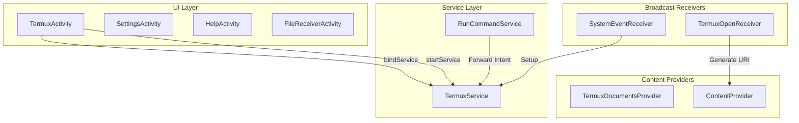

<!-- source: DeepWiki mcp.deepwiki.com · repo termux/termux-app · page 3 Application Components · fetched 2026-10-26 -->

# Application Components

Relevant source files

The following files were used as context for generating this wiki page:

- [app/src/main/java/com/termux/app/RunCommandService.java](app/src/main/java/com/termux/app/RunCommandService.java)
- [app/src/main/java/com/termux/app/TermuxActivity.java](app/src/main/java/com/termux/app/TermuxActivity.java)
- [app/src/main/java/com/termux/app/TermuxApplication.java](app/src/main/java/com/termux/app/TermuxApplication.java)
- [app/src/main/java/com/termux/app/TermuxOpenReceiver.java](app/src/main/java/com/termux/app/TermuxOpenReceiver.java)
- [app/src/main/java/com/termux/app/TermuxService.java](app/src/main/java/com/termux/app/TermuxService.java)
- [app/src/main/java/com/termux/app/event/SystemEventReceiver.java](app/src/main/java/com/termux/app/event/SystemEventReceiver.java)
- [app/src/main/res/values/strings.xml](app/src/main/res/values/strings.xml)
- [termux-shared/src/main/java/com/termux/shared/shell/command/environment/ShellEnvironmentUtils.java](termux-shared/src/main/java/com/termux/shared/shell/command/environment/ShellEnvironmentUtils.java)
- [termux-shared/src/main/java/com/termux/shared/shell/command/environment/ShellEnvironmentVariable.java](termux-shared/src/main/java/com/termux/shared/shell/command/environment/ShellEnvironmentVariable.java)
- [termux-shared/src/main/java/com/termux/shared/termux/shell/command/environment/TermuxShellEnvironment.java](termux-shared/src/main/java/com/termux/shared/termux/shell/command/environment/TermuxShellEnvironment.java)

This page provides an overview of the main Android application components in the Termux app, their lifecycle management, and the architectural patterns used for component interaction. As a parent page, this section offers a high-level summary of each sub-topic. For deep technical details, implementation specifics, and code flows, refer to the respective child pages linked below.

## Component Architecture Overview

The Termux application follows a classic Android foreground service architecture where the UI layer (`TermuxActivity`) binds to a long-running service layer (`TermuxService`). This design allows terminal sessions to persist beyond the activity lifecycle, surviving configuration changes and temporary activity destruction.

**Sources:** [app/src/main/AndroidManifest.xml:52-208](), [app/src/main/java/com/termux/app/TermuxActivity.java:80-88]()

---

## 3.1 TermuxActivity

`TermuxActivity` is the primary terminal emulator activity (`[app/src/main/java/com/termux/app/TermuxActivity.java]()`) that manages the user interface, terminal sessions, touch/keyboard events, context menus, and interaction with `TermuxService` via the `ServiceConnection` interface. It coordinates with `TermuxTerminalViewClient` and `TermuxTerminalSessionActivityClient` to render terminal views and handle session-specific callbacks.

For details, see [TermuxActivity](#3.1).

**Sources:** [app/src/main/java/com/termux/app/TermuxActivity.java:80-110]()

---

## 3.2 TermuxService

`TermuxService` is a foreground service (`[app/src/main/java/com/termux/app/TermuxService.java]()`) that manages the lifecycle of terminal sessions (`TermuxSession`) and background tasks (`AppShell`) through `TermuxShellManager`. It maintains foreground notifications, wake locks, and Wi-Fi locks to ensure that long-running tasks and shell processes survive when the UI activity is backgrounded or destroyed.

For details, see [TermuxService](#3.2).

**Sources:** [app/src/main/java/com/termux/app/TermuxService.java:68-124]()

---

## 3.3 RunCommandService

`RunCommandService` (`[app/src/main/java/com/termux/app/RunCommandService.java]`) exposes an external command execution API to third-party apps and plugins. It validates intent actions, checks the `allow-external-apps` security property, verifies executable file existence and permissions, and forwards execution requests to `TermuxService`.

For details, see [RunCommandService](#3.3).

**Sources:** [app/src/main/java/com/termux/app/RunCommandService.java:36-126]()

---

## 3.4 Android Manifest

The application manifest (`[app/src/main/AndroidManifest.xml]()`) declares all core Android components, custom permissions such as `RUN_COMMAND`, intent filters, providers, and broadcast receivers. It sets up activity aliases for file sharing and configures security boundaries for exported components.

For details, see [Android Manifest](#3.4).

**Sources:** [app/src/main/AndroidManifest.xml:1-208]()

---

## 3.5 UI Layout and Root View

The UI layout architecture centers around custom view hierarchies including `TermuxActivityRootView` (`[app/src/main/java/com/termux/app/terminal/TermuxActivityRootView.java]()`), activity layout XML files, theme managers (`TermuxThemeUtils`), and soft keyboard management logic. It handles dynamic window insets, terminal toolbars, extra keys rows, and screen padding.

For details, see [UI Layout and Root View](#3.5).

**Sources:** [app/src/main/java/com/termux/app/TermuxActivity.java:31-35]()

---

## 3.6 Application Startup and System Events

Application initialization begins in `TermuxApplication` (`[app/src/main/java/com/termux/app/TermuxApplication.java]()`), which configures crash handlers, logging, shell environments, and the `termux-am-socket` server. System-level events, including device boot completion and package updates, are intercepted by `SystemEventReceiver` (`[app/src/main/java/com/termux/app/event/SystemEventReceiver.java]()`) to trigger environment updates and background task orchestration.

For details, see [Application Startup and System Events](#3.6).

**Sources:** [app/src/main/java/com/termux/app/TermuxApplication.java:20-75](), [app/src/main/java/com/termux/app/event/SystemEventReceiver.java:19-52]()

---

