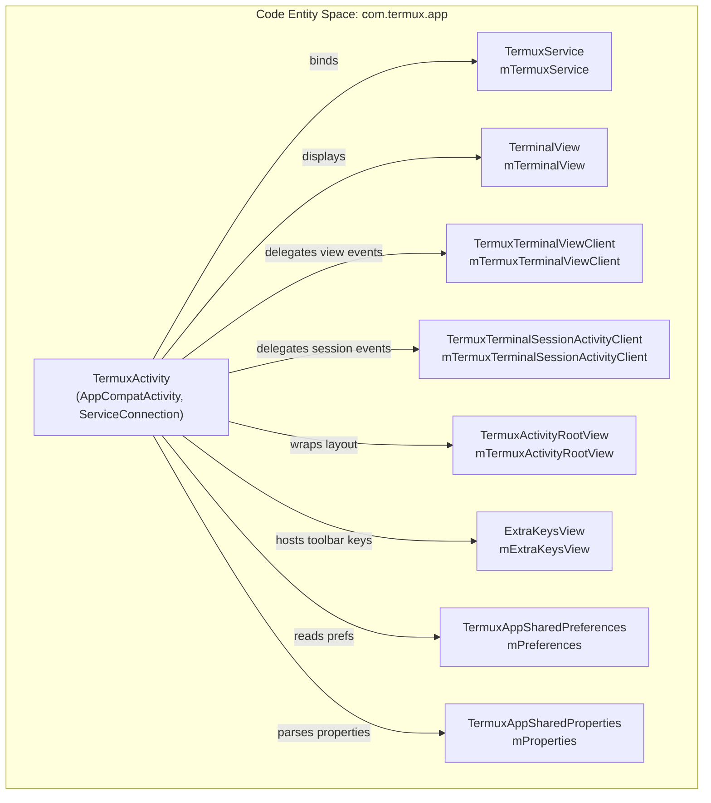
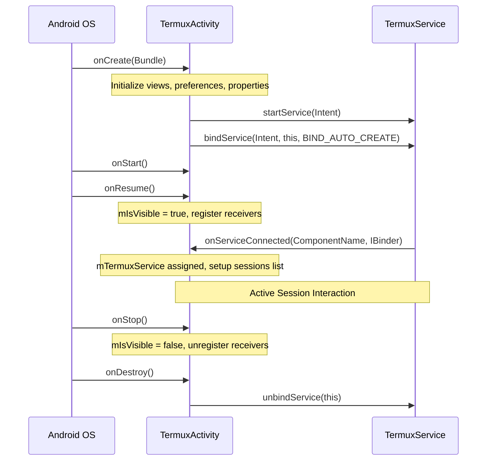
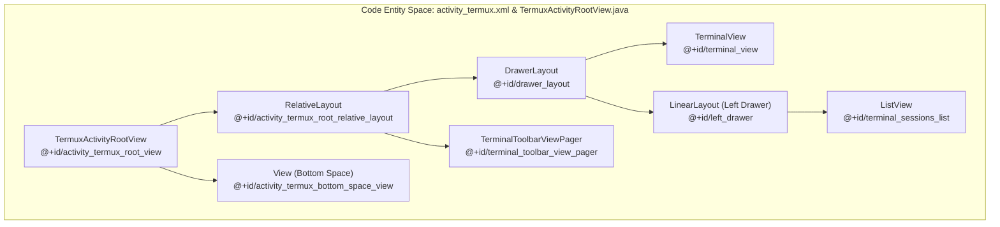
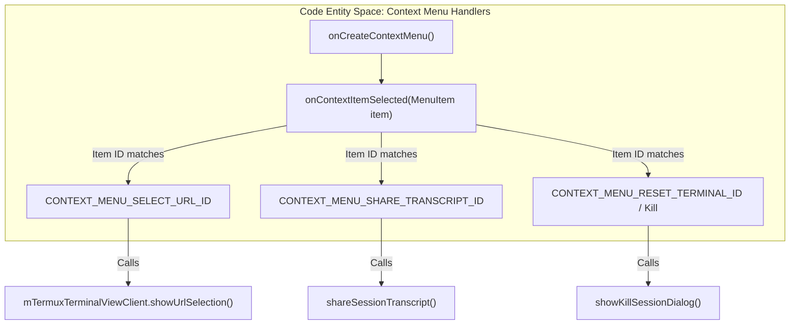
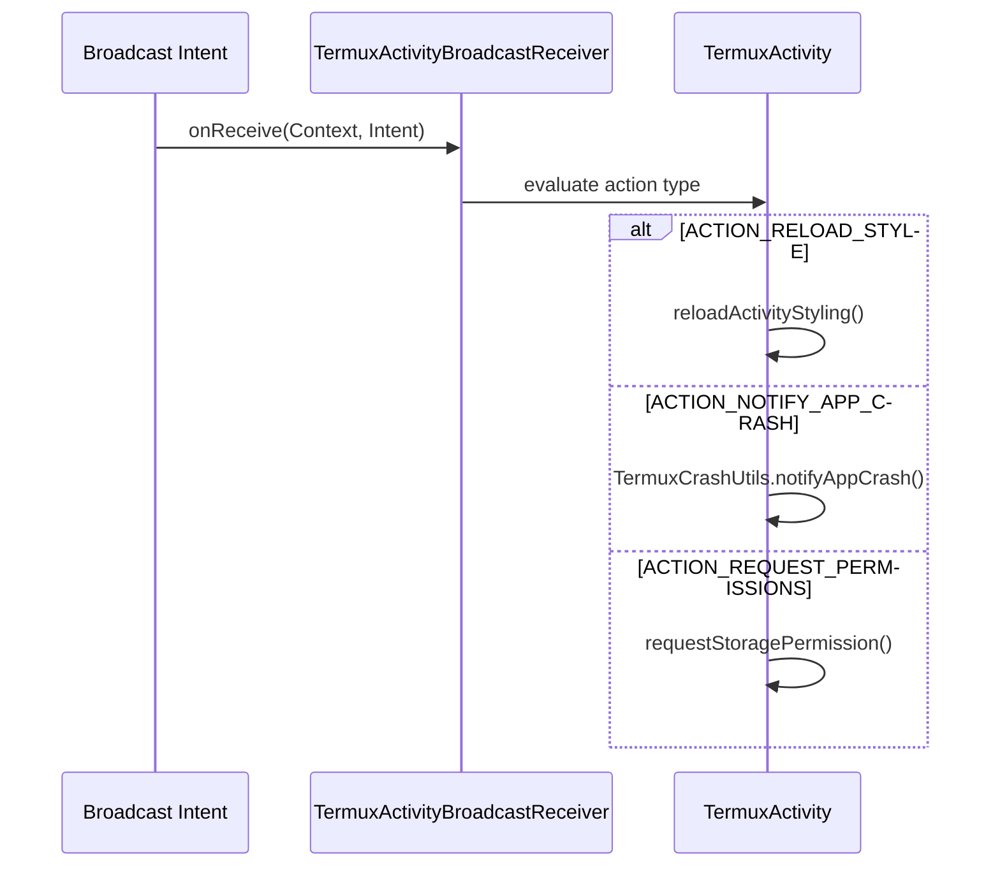

<!-- source: DeepWiki mcp.deepwiki.com · repo termux/termux-app · page 3.1 TermuxActivity · fetched 2026-10-26 -->

# TermuxActivity

Relevant source files

The following files were used as context for generating this wiki page:

- [app/src/main/java/com/termux/app/RunCommandService.java](app/src/main/java/com/termux/app/RunCommandService.java)
- [app/src/main/java/com/termux/app/TermuxActivity.java](app/src/main/java/com/termux/app/TermuxActivity.java)
- [app/src/main/java/com/termux/app/TermuxOpenReceiver.java](app/src/main/java/com/termux/app/TermuxOpenReceiver.java)
- [app/src/main/java/com/termux/app/TermuxService.java](app/src/main/java/com/termux/app/TermuxService.java)
- [app/src/main/java/com/termux/app/terminal/TermuxActivityRootView.java](app/src/main/java/com/termux/app/terminal/TermuxActivityRootView.java)
- [app/src/main/res/layout/activity_termux.xml](app/src/main/res/layout/activity_termux.xml)
- [app/src/main/res/values/strings.xml](app/src/main/res/values/strings.xml)
- [termux-shared/src/main/java/com/termux/shared/view/KeyboardUtils.java](termux-shared/src/main/java/com/termux/shared/view/KeyboardUtils.java)
- [termux-shared/src/main/java/com/termux/shared/view/ViewUtils.java](termux-shared/src/main/java/com/termux/shared/view/ViewUtils.java)

## Purpose and Scope

This document details `TermuxActivity`, the main Android Activity class for the Termux application (`[app/src/main/java/com/termux/app/TermuxActivity.java:80]()`). It serves as the primary terminal emulator user interface, managing terminal view rendering, lifecycle synchronization with `TermuxService`, session switching, navigation drawers, and context menus.

Sources: [app/src/main/java/com/termux/app/TermuxActivity.java:70-100]()

---

## Architecture and Core Member Variables

`TermuxActivity` extends `AppCompatActivity` and implements the `ServiceConnection` interface to maintain a bound connection to `TermuxService` `[app/src/main/java/com/termux/app/TermuxActivity.java:80]`.

*Diagram: Association of `TermuxActivity` core fields with codebase classes.*

### Core Fields Summary

- `mTermuxService`: Stores the bound instance of `TermuxService` `[app/src/main/java/com/termux/app/TermuxActivity.java:87]`.
- `mTerminalView`: The core terminal window widget [app/src/main/java/com/termux/app/TermuxActivity.java:92]().
- `mTermuxTerminalViewClient`: Implements `TerminalViewClient` to handle view-level shortcuts and touch behavior [app/src/main/java/com/termux/app/TermuxActivity.java:98]().
- `mTermuxTerminalSessionActivityClient`: Implements `TerminalSessionClient` for session lifecycle updates [app/src/main/java/com/termux/app/TermuxActivity.java:104]().
- `mPreferences` & `mProperties`: Manage app settings and `termux.properties` configurations [app/src/main/java/com/termux/app/TermuxActivity.java:109-114]().

Sources: [app/src/main/java/com/termux/app/TermuxActivity.java:80-115]()

---

## Activity Lifecycle Management

`TermuxActivity` coordinates closely with Android's activity lifecycle and binds to `TermuxService` during initialization.

*Diagram: Lifecycle and Service Binding Flow with `TermuxActivity`.*

### Lifecycle State Flags

- `mIsVisible`: Boolean flag tracking whether the activity is between `onResume()` and `onStop()` [app/src/main/java/com/termux/app/TermuxActivity.java:155]().
- `mIsOnResumeAfterOnCreate`: Tracks initial post-creation resume state [app/src/main/java/com/termux/app/TermuxActivity.java:160]().
- `mIsActivityRecreated`: Indicates if the activity was recreated due to configuration changes or style reloads [app/src/main/java/com/termux/app/TermuxActivity.java:167]().

Sources: [app/src/main/java/com/termux/app/TermuxActivity.java:150-175]()

---

## UI Component Structure

The activity layout is defined in `activity_termux.xml` and is anchored by a custom root view (`TermuxActivityRootView`) that handles layout resize adjustments when the soft keyboard appears.

*Diagram: UI View Hierarchy matching `activity_termux.xml` structure.*

### Root View Adjustments (`TermuxActivityRootView`)
`TermuxActivityRootView` extends `LinearLayout` and implements `ViewTreeObserver.OnGlobalLayoutListener` [app/src/main/java/com/termux/app/terminal/TermuxActivityRootView.java:64](). It monitors global layout changes to adjust bottom margins dynamically when soft keyboards or candidate suggestion rows obscure terminal view elements [app/src/main/java/com/termux/app/terminal/TermuxActivityRootView.java:55-63]().

Sources: [app/src/main/res/layout/activity_termux.xml:1-113](), [app/src/main/java/com/termux/app/terminal/TermuxActivityRootView.java:64-125]()

---

## Context Menu and User Interactions

`TermuxActivity` registers and handles context menus for terminal transcript sharing, URL selection, and process management.

*Diagram: Context Menu Dispatch Flow in `TermuxActivity`.*

### Menu Actions
- **URL Selection**: Scans terminal rows for URIs and presents a selection dialog [app/src/main/java/com/termux/app/TermuxActivity.java:666]().
- **Transcript Sharing**: Permits exporting the scrollback buffer via standard `Intent.ACTION_SEND` [app/src/main/java/com/termux/app/TermuxActivity.java:670-690]().
- **Process Termination**: Prompts the user to confirm killing active `TerminalSession` instances [app/src/main/java/com/termux/app/TermuxActivity.java:713-725]().

Sources: [app/src/main/java/com/termux/app/TermuxActivity.java:179-190](), [app/src/main/java/com/termux/app/TermuxActivity.java:629-735]()

---

## Service Integration and Broadcast Receivers

`TermuxActivity` registers an internal broadcast receiver (`TermuxActivityBroadcastReceiver`) to listen for styling reloads, crash notifications, and permission grant requests.

*Diagram: Broadcast Receiver message handling inside `TermuxActivity`.*

### Storage Permission Management
The activity requests runtime storage permissions (`requestStoragePermission()`), initializing bootstrap storage symlinks via `TermuxInstaller.setupStorageSymlinks()` upon user grant [app/src/main/java/com/termux/app/TermuxActivity.java:768-790]().

Sources: [app/src/main/java/com/termux/app/TermuxActivity.java:768-808](), [app/src/main/java/com/termux/app/TermuxActivity.java:918-965]()

---

