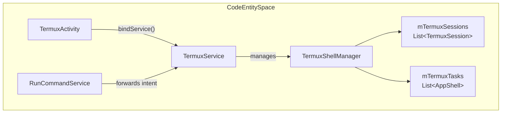
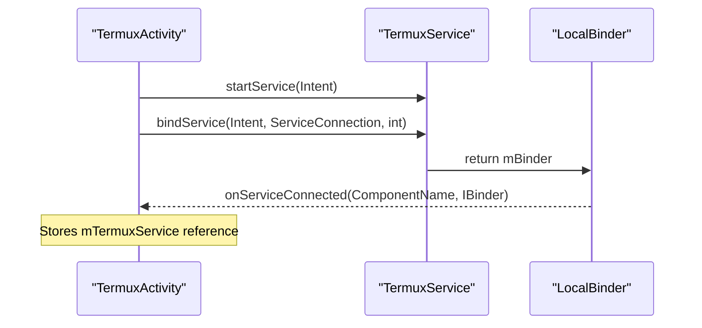
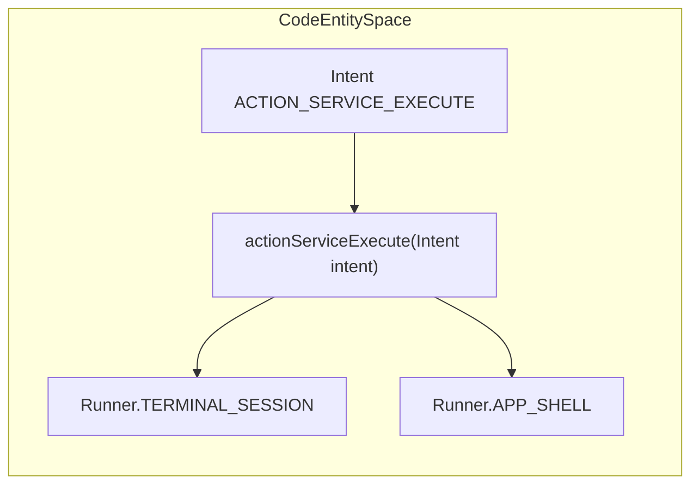

<!-- source: DeepWiki mcp.deepwiki.com · repo termux/termux-app · page 3.2 TermuxService · fetched 2026-10-26 -->

# TermuxService

Relevant source files

The following files were used as context for generating this wiki page:

- [app/src/main/java/com/termux/app/RunCommandService.java](app/src/main/java/com/termux/app/RunCommandService.java)
- [app/src/main/java/com/termux/app/TermuxActivity.java](app/src/main/java/com/termux/app/TermuxActivity.java)
- [app/src/main/java/com/termux/app/TermuxOpenReceiver.java](app/src/main/java/com/termux/app/TermuxOpenReceiver.java)
- [app/src/main/java/com/termux/app/TermuxService.java](app/src/main/java/com/termux/app/TermuxService.java)
- [app/src/main/res/values/strings.xml](app/src/main/res/values/strings.xml)
- [termux-shared/src/main/java/com/termux/shared/crash/CrashHandler.java](termux-shared/src/main/java/com/termux/shared/crash/CrashHandler.java)
- [termux-shared/src/main/java/com/termux/shared/markdown/MarkdownUtils.java](termux-shared/src/main/java/com/termux/shared/markdown/MarkdownUtils.java)
- [termux-shared/src/main/java/com/termux/shared/notification/NotificationUtils.java](termux-shared/src/main/java/com/termux/shared/notification/NotificationUtils.java)
- [termux-shared/src/main/java/com/termux/shared/termux/crash/TermuxCrashUtils.java](termux-shared/src/main/java/com/termux/shared/termux/crash/TermuxCrashUtils.java)
- [termux-shared/src/main/java/com/termux/shared/termux/notification/TermuxNotificationUtils.java](termux-shared/src/main/java/com/termux/shared/termux/notification/TermuxNotificationUtils.java)
- [termux-shared/src/main/java/com/termux/shared/termux/plugins/TermuxPluginUtils.java](termux-shared/src/main/java/com/termux/shared/termux/plugins/TermuxPluginUtils.java)

## Purpose and Scope

This document explains the foreground service architecture, session and task management, wake lock handling, notification systems, and command execution orchestration implemented by `TermuxService` and its companion gateway `RunCommandService`. These components ensure that terminal sessions and spawned background processes persist even when the user exits the UI or when Android disposes of `TermuxActivity`.

Sources: [app/src/main/java/com/termux/app/TermuxService.java:55-67](), [app/src/main/java/com/termux/app/RunCommandService.java:29-35]()

---

## Core Service Architecture & Components

`TermuxService` acts as the central execution and persistence engine for the application. It extends Android's `Service` class and implements both `AppShell.AppShellClient` and `TermuxSession.TermuxSessionClient` to monitor background shell tasks and terminal sessions respectively.

*Diagram 1: Code Entity Space mapping for `TermuxService` orchestration.*

Sources: [app/src/main/java/com/termux/app/TermuxService.java:55-75](), [app/src/main/java/com/termux/app/TermuxService.java:97-100]()

---

## Service Binding and Lifecycle

`TermuxService` is bound exclusively from within the same process (`TermuxActivity`) using a local binder pattern without inter-process communication (IPC) overhead.

*Diagram 2: Binding Lifecycle between `TermuxActivity` and `TermuxService`.*

Upon creation in `onCreate()`, the service initializes properties, retrieves the singleton shell manager instance, promotes itself to a foreground service via `runStartForeground()`, and registers package update broadcast receivers.

Sources: [app/src/main/java/com/termux/app/TermuxService.java:70-75](), [app/src/main/java/com/termux/app/TermuxService.java:110-123]()

---

## Command Execution & Orchestration

Commands passed to `TermuxService` via explicit intents (such as `TERMUX_SERVICE.ACTION_SERVICE_EXECUTE`) are processed through `ExecutionCommand` models, dispatching work either to terminal session runners or background shell executors (`AppShell`).

*Diagram 3: Execution dispatching inside `TermuxService`.*

Sources: [app/src/main/java/com/termux/app/TermuxService.java:125-156](), [app/src/main/java/com/termux/app/RunCommandService.java:107-116]()

---

## Wake Lock and Wi-Fi Lock Management

To prevent the CPU and Wi-Fi radio from sleeping during long-running tasks, `TermuxService` supports acquiring and releasing wake locks and Wi-Fi locks (`PowerManager.WakeLock` and `WifiManager.WifiLock`). These locks are acquired and released in tandem, and their status directly alters the persistent foreground notification text and action buttons.

Sources: [app/src/main/java/com/termux/app/TermuxService.java:101-104](), [app/src/main/java/com/termux/app/TermuxService.java:145-152]()

---

## Inter-Service Communication and Plugin Integration

Third-party plugins and external applications communicate with `TermuxService` indirectly through `RunCommandService`. `RunCommandService` receives `RUN_COMMAND` action intents, verifies arguments, sanitizes escape characters or comma-alternatives, and translates them into execution payloads that are safely forwarded to `TermuxService`.

Sources: [app/src/main/java/com/termux/app/RunCommandService.java:29-36](), [app/src/main/java/com/termux/app/RunCommandService.java:74-102]()

---

