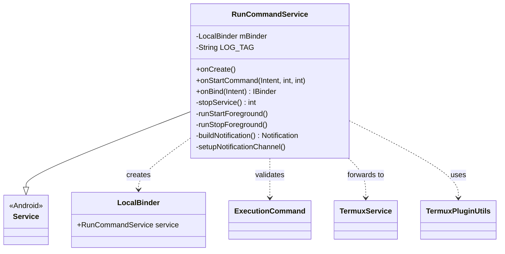
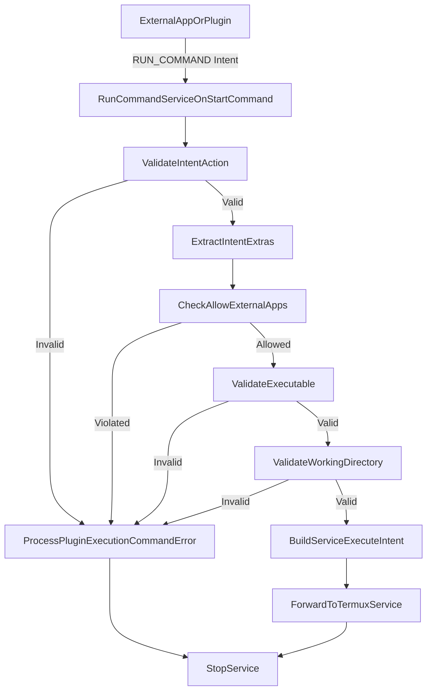
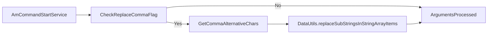
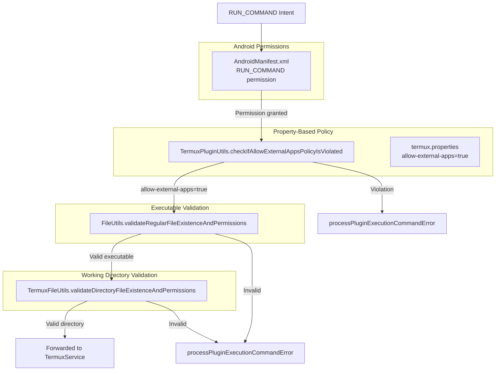
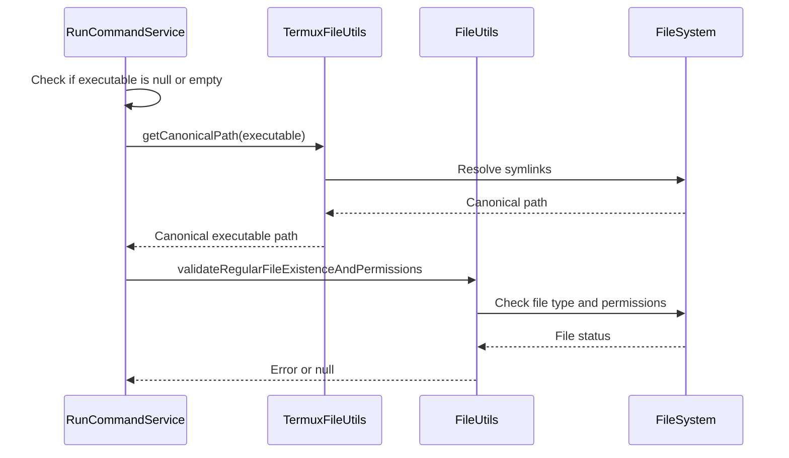
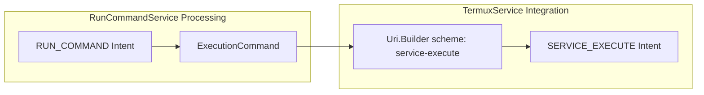

<!-- source: DeepWiki mcp.deepwiki.com · repo termux/termux-app · page 3.3 RunCommandService · fetched 2026-10-26 -->

# RunCommandService

Relevant source files

The following files were used as context for generating this wiki page:

- [app/src/main/java/com/termux/app/RunCommandService.java](app/src/main/java/com/termux/app/RunCommandService.java)
- [app/src/main/java/com/termux/app/TermuxActivity.java](app/src/main/java/com/termux/app/TermuxActivity.java)
- [app/src/main/java/com/termux/app/TermuxOpenReceiver.java](app/src/main/java/com/termux/app/TermuxOpenReceiver.java)
- [app/src/main/java/com/termux/app/TermuxService.java](app/src/main/java/com/termux/app/TermuxService.java)
- [app/src/main/res/values/strings.xml](app/src/main/res/values/strings.xml)
- [termux-shared/src/main/java/com/termux/shared/termux/TermuxConstants.java](termux-shared/src/main/java/com/termux/shared/termux/TermuxConstants.java)
- [termux-shared/src/main/java/com/termux/shared/termux/TermuxUtils.java](termux-shared/src/main/java/com/termux/shared/termux/TermuxUtils.java)
- [termux-shared/src/main/res/values/strings.xml](termux-shared/src/main/res/values/strings.xml)

`RunCommandService` is an Android Service that serves as the external command execution API for Termux. It receives `RUN_COMMAND` intents from third-party applications and plugin apps, validates command execution requests against security policies, and forwards validated commands to `TermuxService` for actual execution.

For information about the actual command execution after validation, see [TermuxService](#3.2). For details on the permission system and access control policies, see [Property-Based Access Control](#8.3).

---

## Purpose and Scope

`RunCommandService` acts as a security gateway for external command execution. It is responsible for:

1. Receiving `ACTION_RUN_COMMAND` intents from external apps [app/src/main/java/com/termux/app/RunCommandService.java:29-35]()
2. Enforcing the `allow-external-apps` property policy [app/src/main/java/com/termux/app/RunCommandService.java:135-145]()
3. Validating executable paths and working directories [app/src/main/java/com/termux/app/RunCommandService.java:149-191]()
4. Transforming RUN_COMMAND intent extras into TermuxService-compatible format [app/src/main/java/com/termux/app/RunCommandService.java:68-133]()
5. Managing foreground service lifecycle for Android O+ compatibility [app/src/main/java/com/termux/app/RunCommandService.java:52-55]()

The service does **not** execute commands itself; it performs validation and intent forwarding only.

Sources: [app/src/main/java/com/termux/app/RunCommandService.java:29-35]()

---

## Service Architecture

### Class Structure

Sources: [app/src/main/java/com/termux/app/RunCommandService.java:36-126]()

### Lifecycle Pattern

`RunCommandService` follows a transient service pattern:

1. **`onCreate()`**: Service starts in foreground mode (Android O+) [app/src/main/java/com/termux/app/RunCommandService.java:52-55]()
2. **`onStartCommand()`**: Processes intent, validates, forwards [app/src/main/java/com/termux/app/RunCommandService.java:58-126]()
3. **`stopService()`**: Immediately stops foreground and returns `START_NOT_STICKY` [app/src/main/java/com/termux/app/RunCommandService.java:58-61]()

This pattern ensures the service does not persist after processing each intent.

Sources: [app/src/main/java/com/termux/app/RunCommandService.java:52-126]()

---

## Intent Processing Flow

### High-Level Flow Diagram

Sources: [app/src/main/java/com/termux/app/RunCommandService.java:58-126]()

### Intent Extra Processing

The following table shows how `RUN_COMMAND_SERVICE` intent extras are mapped to `ExecutionCommand` fields and then to `TERMUX_SERVICE` intent extras:

| RUN_COMMAND Extra | ExecutionCommand Field | TERMUX_SERVICE Extra |
|-------------------|------------------------|----------------------|
| `EXTRA_COMMAND_PATH` | `executable` | `DATA` (URI) + `EXTRA_ARGUMENTS` [app/src/main/java/com/termux/app/RunCommandService.java:82-83]() |
| `EXTRA_ARGUMENTS` | `arguments` | `EXTRA_ARGUMENTS` [app/src/main/java/com/termux/app/RunCommandService.java:83]() |
| `EXTRA_STDIN` | `stdin` | `EXTRA_STDIN` [app/src/main/java/com/termux/app/RunCommandService.java:104]() |
| `EXTRA_WORKDIR` | `workingDirectory` | `EXTRA_WORKDIR` [app/src/main/java/com/termux/app/RunCommandService.java:105]() |
| `EXTRA_RUNNER` | `runner` | `EXTRA_RUNNER` [app/src/main/java/com/termux/app/RunCommandService.java:108-109]() |
| `EXTRA_BACKGROUND` | Converted to `runner` | `EXTRA_RUNNER` [app/src/main/java/com/termux/app/RunCommandService.java:108-109]() |
| `EXTRA_BACKGROUND_CUSTOM_LOG_LEVEL` | `backgroundCustomLogLevel` | `EXTRA_BACKGROUND_CUSTOM_LOG_LEVEL` [app/src/main/java/com/termux/app/RunCommandService.java:117]() |
| `EXTRA_SESSION_ACTION` | `sessionAction` | `EXTRA_SESSION_ACTION` [app/src/main/java/com/termux/app/RunCommandService.java:118]() |
| `EXTRA_SHELL_NAME` | `shellName` | `EXTRA_SHELL_NAME` [app/src/main/java/com/termux/app/RunCommandService.java:119]() |
| `EXTRA_SHELL_CREATE_MODE` | `shellCreateMode` | `EXTRA_SHELL_CREATE_MODE` [app/src/main/java/com/termux/app/RunCommandService.java:120]() |
| `EXTRA_COMMAND_LABEL` | `commandLabel` | `EXTRA_COMMAND_LABEL` [app/src/main/java/com/termux/app/RunCommandService.java:121]() |
| `EXTRA_PENDING_INTENT` | `resultConfig.resultPendingIntent` | `EXTRA_PENDING_INTENT` [app/src/main/java/com/termux/app/RunCommandService.java:125]() |

Sources: [app/src/main/java/com/termux/app/RunCommandService.java:82-125]()

### Comma Alternative Character Replacement

`RunCommandService` supports replacing alternative comma characters in arguments when commands are sent via the `am` command-line tool, which uses commas as argument separators:

This feature enables external tools to pass arguments containing actual commas without the `am` command splitting them incorrectly.

Sources: [app/src/main/java/com/termux/app/RunCommandService.java:85-102]()

---

## Security and Permission Model

### Multi-Layer Security Architecture

Sources: [app/src/main/java/com/termux/app/RunCommandService.java:58-126]()

### Security Policy Enforcement

#### allow-external-apps Policy

The `allow-external-apps` property in `termux.properties` acts as a master control switch:

- **Default value**: `false` (deny all external execution)
- **Checked by**: `TermuxPluginUtils.checkIfAllowExternalAppsPolicyIsViolated()`
- **Enforcement**: If violated, command fails with `ERRNO_FAILED` and forced notifications are displayed.

Sources: [app/src/main/java/com/termux/app/RunCommandService.java:58-126]()

---

## Validation Pipeline

### Executable Validation

**Symlink Handling**: If the original executable path (before canonicalization) is a symlink, it is used instead of the canonical path. This preserves applet names for BusyBox/coreutils.

Sources: [app/src/main/java/com/termux/app/RunCommandService.java:58-126]()

### Working Directory Validation

Working directory validation checks path accessibility and permissions under allowed directories (`TERMUX_FILES_DIR_PATH` or external storage). If under allowed paths, directories can be auto-created and permissions initialized.

Sources: [app/src/main/java/com/termux/app/RunCommandService.java:58-126]()

---

## Integration with TermuxService

### Intent Transformation and Forwarding

Sources: [app/src/main/java/com/termux/app/RunCommandService.java:58-126]()

### URI Scheme

`RunCommandService` constructs a URI with the custom scheme `service-execute://` for the intent data, passing parameters via intent extras [app/src/main/java/com/termux/app/RunCommandService.java:203-209]().

Sources: [app/src/main/java/com/termux/app/RunCommandService.java:58-126]()

### Service Startup

On Android O and above, `startForegroundService()` is used; on older versions, `startService()` [app/src/main/java/com/termux/app/RunCommandService.java:233-237]().

Sources: [app/src/main/java/com/termux/app/RunCommandService.java:58-287]()

---

## Notification Management

On Android O+, `RunCommandService` runs as a foreground service during intent processing using a dedicated notification channel `TERMUX_RUN_COMMAND_NOTIFICATION_CHANNEL_ID` and notification ID `TERMUX_RUN_COMMAND_NOTIFICATION_ID` [app/src/main/java/com/termux/app/RunCommandService.java:247-285]().

Sources: [app/src/main/java/com/termux/app/RunCommandService.java:247-287]()

---

## Error Handling

Errors such as invalid actions, missing mandatory extras, runner validation failures, or policy violations are processed via `TermuxPluginUtils.processPluginExecutionCommandError()` and sent back via pending intents if configured [app/src/main/java/com/termux/app/RunCommandService.java:76-125]().

Sources: [app/src/main/java/com/termux/app/RunCommandService.java:76-125](), [app/src/main/res/values/strings.xml:117-122]()

---

