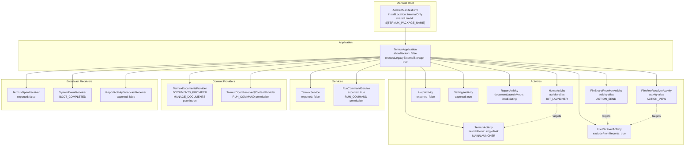
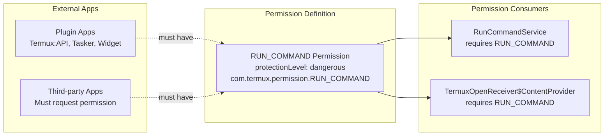
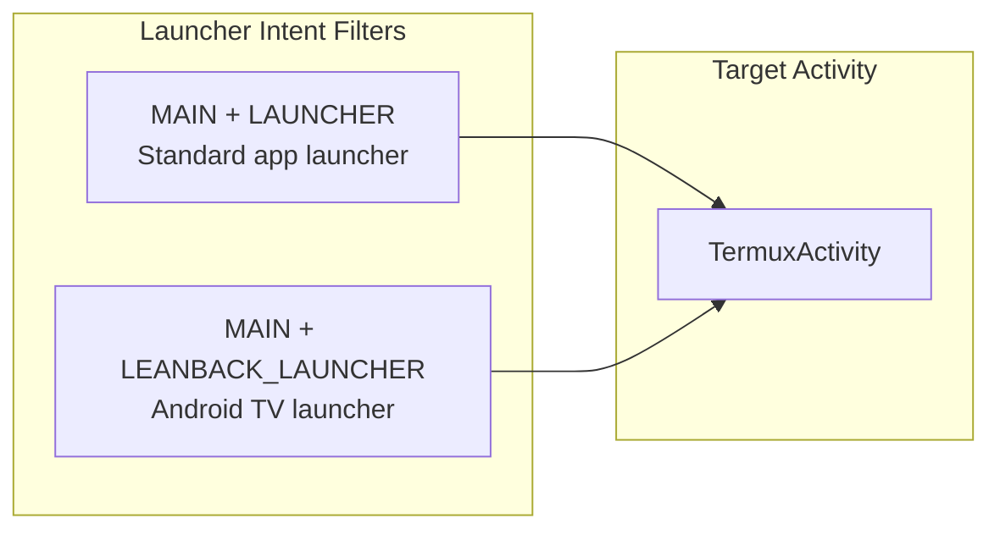
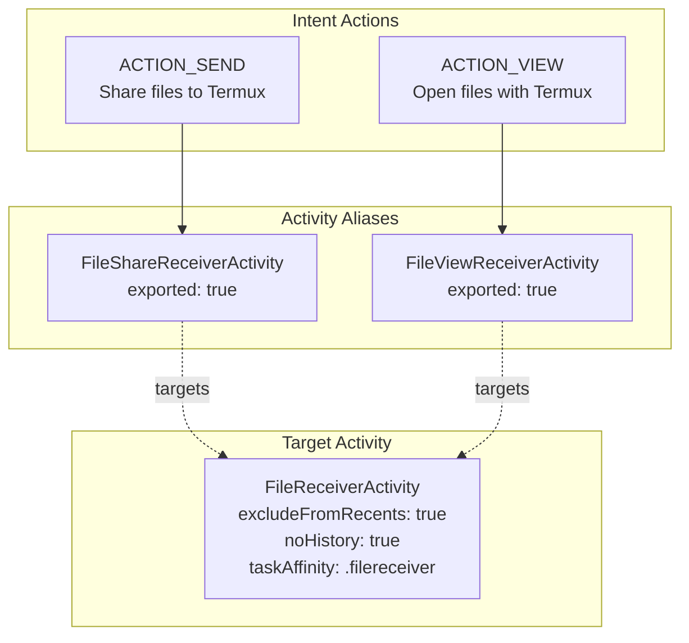
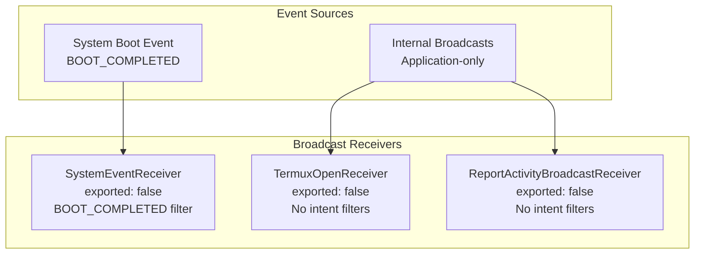
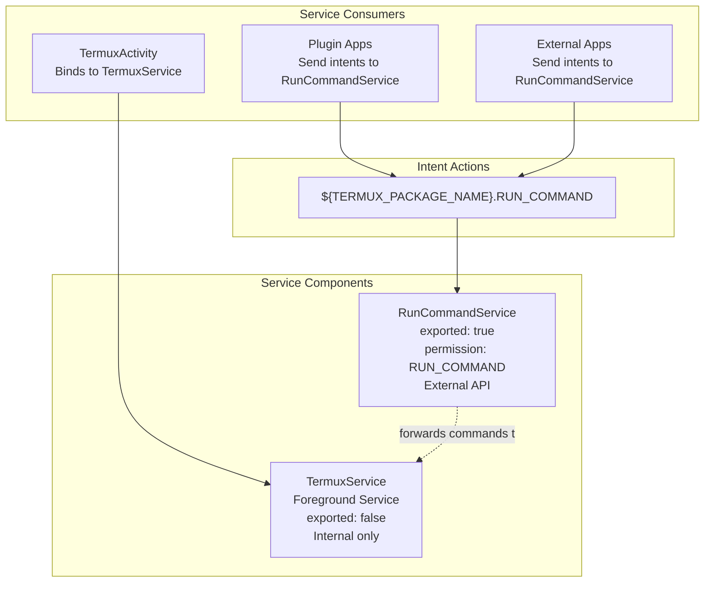
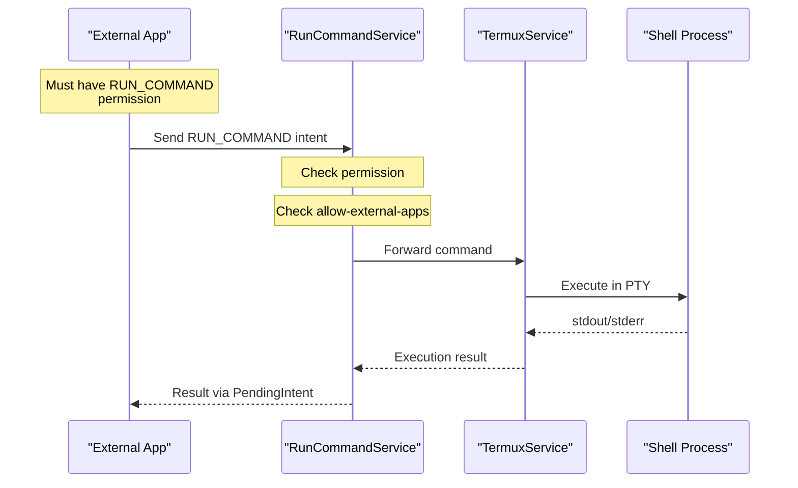
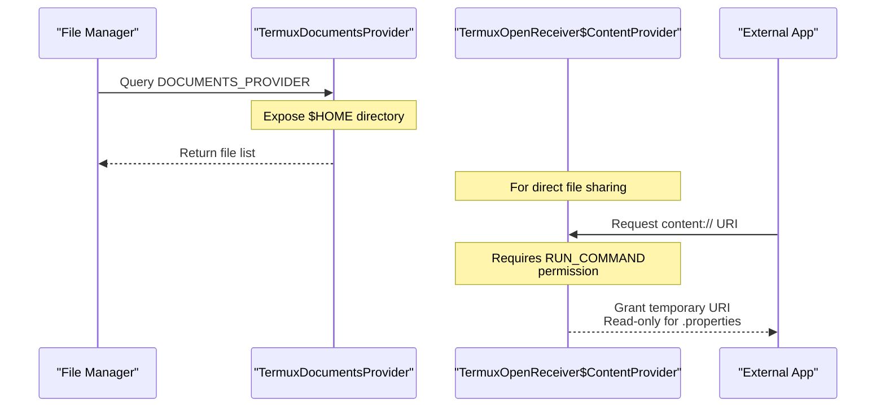

<!-- source: DeepWiki mcp.deepwiki.com · repo termux/termux-app · page 3.4 Android Manifest · fetched 2026-10-26 -->

# Android Manifest

<details>
<summary>Relevant source files</summary>

The following files were used as context for generating this wiki page:

- [app/src/main/AndroidManifest.xml](app/src/main/AndroidManifest.xml)
- [app/src/main/java/com/termux/filepicker/TermuxDocumentsProvider.java](app/src/main/java/com/termux/filepicker/TermuxDocumentsProvider.java)
- [app/src/main/res/drawable/ic_new_session.xml](app/src/main/res/drawable/ic_new_session.xml)
- [app/src/main/res/drawable/ic_settings.xml](app/src/main/res/drawable/ic_settings.xml)
- [app/src/main/res/xml/shortcuts.xml](app/src/main/res/xml/shortcuts.xml)
- [termux-shared/src/main/AndroidManifest.xml](termux-shared/src/main/AndroidManifest.xml)

</details>


## Purpose and Scope

This document describes the Android Manifest configuration for the Termux application, located at [app/src/main/AndroidManifest.xml](). The manifest defines all application components (activities, services, content providers, broadcast receivers), permissions, and configuration metadata required for the app to function. 

For information about how components interact at runtime, see [Application Components](#3). For build-time configuration that generates manifest values, see [Gradle Build Configuration](#2.2).

---

## Manifest Structure Overview

The Android Manifest serves as the central configuration file that declares all components and capabilities of the Termux application. It uses placeholder variables (e.g., `${TERMUX_PACKAGE_NAME}`) that are replaced during the build process based on the selected package variant.

### Component Architecture



Sources: [app/src/main/AndroidManifest.xml:1-235]()

---

## Package Configuration

### Shared User ID

The manifest declares a `sharedUserId` that enables process and data sharing between the main Termux app and its plugin applications.

| Attribute | Value | Description |
|-----------|-------|-------------|
| `android:sharedUserId` | `${TERMUX_PACKAGE_NAME}` | Package name variable replaced at build time |
| `android:sharedUserLabel` | `@string/shared_user_label` | User-visible label for shared UID |
| `android:installLocation` | `internalOnly` | Prevents installation to external storage |

The `sharedUserId` is critical for the plugin ecosystem, as it allows plugins like Termux:API, Termux:Boot, and Termux:Widget to access the Termux file system and shared preferences. All apps sharing the same `sharedUserId` must be signed with the same key.

Sources: [app/src/main/AndroidManifest.xml:4-6]()

### Hardware Features

The manifest declares optional hardware features to maximize device compatibility:

```xml
<uses-feature android:name="android.hardware.touchscreen" android:required="false" />
<uses-feature android:name="android.software.leanback" android:required="false" />
```

Both features are marked as `required="false"` to allow installation on devices without touchscreens (e.g., Android TV, tablets with keyboards) and devices without Android TV leanback UI support.

Sources: [app/src/main/AndroidManifest.xml:8-13]()

---

## Permissions

### Custom Permissions

The manifest defines a custom permission to control external access to command execution functionality:



| Attribute | Value |
|-----------|-------|
| `android:name` | `${TERMUX_PACKAGE_NAME}.permission.RUN_COMMAND` |
| `android:protectionLevel` | `dangerous` |
| `android:label` | `@string/permission_run_command_label` |
| `android:description` | `@string/permission_run_command_description` |
| `android:icon` | `@mipmap/ic_launcher` |

The `dangerous` protection level requires explicit user consent and is enforced at runtime. This permission gates access to `RunCommandService` and `TermuxOpenReceiver$ContentProvider`, preventing unauthorized command execution.

Sources: [app/src/main/AndroidManifest.xml:15-20]()

### Standard Android Permissions

The manifest requests 15 standard Android permissions to support various functionality:

| Permission | Purpose | API Requirements |
|------------|---------|------------------|
| `ACCESS_NETWORK_STATE` | Query network connectivity status | Normal protection |
| `INTERNET` | Network access for package downloads | Normal protection |
| `READ_EXTERNAL_STORAGE` | Read shared storage (deprecated API 33+) | Dangerous |
| `WRITE_EXTERNAL_STORAGE` | Write to shared storage (deprecated API 33+) | Dangerous |
| `MANAGE_EXTERNAL_STORAGE` | Full file system access (API 30+) | Special |
| `WAKE_LOCK` | Keep CPU running for background processes | Normal protection |
| `VIBRATE` | Terminal bell vibration | Normal protection |
| `FOREGROUND_SERVICE` | Run `TermuxService` as foreground service | Normal protection (API 28+) |
| `REQUEST_IGNORE_BATTERY_OPTIMIZATIONS` | Prevent aggressive battery optimization | Normal protection |
| `SYSTEM_ALERT_WINDOW` | Display overlay windows (Termux:Float) | Special |
| `READ_LOGS` | Access system logs | Signature/privileged |
| `DUMP` | Dump system state | Signature/privileged |
| `WRITE_SECURE_SETTINGS` | Modify secure settings | Signature/privileged |
| `REQUEST_INSTALL_PACKAGES` | Install APK packages | Special |
| `RECEIVE_BOOT_COMPLETED` | Receive boot completion broadcast | Normal protection |
| `PACKAGE_USAGE_STATS` | Query app usage statistics | Signature/privileged |

The storage permissions (`READ_EXTERNAL_STORAGE`, `WRITE_EXTERNAL_STORAGE`, `MANAGE_EXTERNAL_STORAGE`) are critical for accessing user files and setting up storage symlinks. The `MANAGE_EXTERNAL_STORAGE` permission is marked with `tools:ignore="ScopedStorage"` to suppress lint warnings about scoped storage restrictions.

Sources: [app/src/main/AndroidManifest.xml:22-38]()

---

## Application Configuration

The `<application>` element configures global application settings:

| Attribute | Value | Purpose |
|-----------|-------|---------|
| `android:name` | `.app.TermuxApplication` | Custom Application subclass |
| `android:allowBackup` | `false` | Disables automatic backup to prevent data corruption |
| `android:icon` | `@mipmap/ic_launcher` | App launcher icon |
| `android:roundIcon` | `@mipmap/ic_launcher_round` | Rounded icon for adaptive icons |
| `android:banner` | `@drawable/banner` | Android TV banner image |
| `android:label` | `@string/application_name` | User-visible app name |
| `android:requestLegacyExternalStorage` | `true` | Request legacy storage access (API 29-32) |
| `android:supportsRtl` | `false` | Disables right-to-left layout mirroring |
| `android:theme` | `@style/Theme.TermuxApp.DayNight.DarkActionBar` | Default theme with action bar |

The `TermuxApplication` class serves as the entry point for application-wide initialization. The `allowBackup="false"` setting prevents Android's automatic backup mechanism from backing up the Termux file system, which could lead to inconsistent state.

Sources: [app/src/main/AndroidManifest.xml:40-50]()

---

## Activities

### TermuxActivity

The main terminal activity serves as the primary user interface:

```xml
<activity
    android:name=".app.TermuxActivity"
    android:exported="true"
    android:configChanges="orientation|screenSize|..."
    android:launchMode="singleTask"
    android:resizeableActivity="true">
```

**Key Attributes:**

| Attribute | Value | Behavior |
|-----------|-------|----------|
| `android:exported` | `true` | Allows external apps to launch |
| `android:launchMode` | `singleTask` | Ensures single instance; new intents delivered to existing instance |
| `android:configChanges` | Multiple values | Prevents activity restart on configuration changes |
| `android:resizeableActivity` | `true` | Enables multi-window and freeform mode |
| `android:theme` | `Theme.TermuxActivity.DayNight.NoActionBar` | Custom theme without action bar |

**Intent Filters:**



The activity handles two launcher categories: `LAUNCHER` for standard Android devices and `LEANBACK_LAUNCHER` for Android TV devices.

**App Shortcuts:**

The activity references `@xml/shortcuts` metadata, which defines three app shortcuts accessible via long-press on the launcher icon:

1. **New Session** - Opens a new terminal session
2. **New Failsafe Session** - Opens a failsafe session with minimal initialization
3. **Settings** - Opens settings activity

Sources: [app/src/main/AndroidManifest.xml:52-75](), [app/src/main/res/xml/shortcuts.xml:1-54]()

### Activity Aliases

#### HomeActivity (IoT Launcher)

An activity-alias targeting `TermuxActivity` for Android Things IoT devices:

```xml
<activity-alias
    android:name=".HomeActivity"
    android:targetActivity=".app.TermuxActivity">
    <intent-filter>
        <action android:name="android.intent.action.MAIN" />
        <category android:name="android.intent.category.IOT_LAUNCHER" />
        <category android:name="android.intent.category.DEFAULT" />
    </intent-filter>
</activity-alias>
```

This enables automatic app launch on boot for Android Things devices.

Sources: [app/src/main/AndroidManifest.xml:77-89]()

#### FileShareReceiverActivity and FileViewReceiverActivity

Two activity-aliases target `FileReceiverActivity` to handle file sharing and viewing:



**Supported MIME Types:**

Both aliases accept multiple MIME type categories:
- `application/*` - Generic application files
- `audio/*` - Audio files
- `image/*` - Image files  
- `text/*` - Text files
- `video/*` - Video files
- `message/*`, `multipart/*` - Message formats (SEND only)

The `FileReceiverActivity` is configured with `excludeFromRecents="true"` and `noHistory="true"` to prevent it from appearing in the recent apps list, and uses a dedicated task affinity (`${TERMUX_PACKAGE_NAME}.filereceiver`) to run in a separate task.

Sources: [app/src/main/AndroidManifest.xml:105-158]()

### Supporting Activities

| Activity | Purpose | Exported |
|----------|---------|----------|
| `HelpActivity` | Display documentation via WebView | `false` |
| `SettingsActivity` | User preferences and configuration | `true` |
| `ReportActivity` | Crash/error reporting and markdown display | `false` (implicit) |

The `HelpActivity` declares `TermuxActivity` as its parent via `android:parentActivityName`, enabling the back button to return to the main activity. The `ReportActivity` uses `documentLaunchMode="intoExisting"` to ensure multiple reports open in the same document task.

Sources: [app/src/main/AndroidManifest.xml:91-108]()

---

## Content Providers

### TermuxDocumentsProvider

Implements the Storage Access Framework (SAF) to expose the Termux home directory to external file managers:

```xml
<provider
    android:name=".filepicker.TermuxDocumentsProvider"
    android:authorities="${TERMUX_PACKAGE_NAME}.documents"
    android:exported="true"
    android:grantUriPermissions="true"
    android:permission="android.permission.MANAGE_DOCUMENTS">
    <intent-filter>
        <action android:name="android.content.action.DOCUMENTS_PROVIDER" />
    </intent-filter>
</provider>
```

**Key Attributes:**

| Attribute | Value | Purpose |
|-----------|-------|---------|
| `android:authorities` | `${TERMUX_PACKAGE_NAME}.documents` | Content URI authority |
| `android:exported` | `true` | Allows external file managers to access |
| `android:permission` | `android.permission.MANAGE_DOCUMENTS` | Restricts access to document UI |
| `android:grantUriPermissions` | `true` | Enables temporary URI permission grants |

The provider exposes the `TERMUX_HOME_DIR` directory (`/data/data/com.termux/files/home`) and implements standard document operations (query, create, delete, search). Path validation prevents access outside the home directory.

Sources: [app/src/main/AndroidManifest.xml:160-169](), [app/src/main/java/com/termux/filepicker/TermuxDocumentsProvider.java:34-268]()

### TermuxOpenReceiver$ContentProvider

A nested content provider for file sharing operations:

```xml
<provider
    android:name=".app.TermuxOpenReceiver$ContentProvider"
    android:authorities="${TERMUX_PACKAGE_NAME}.files"
    android:exported="true"
    android:grantUriPermissions="true"
    android:permission="${TERMUX_PACKAGE_NAME}.permission.RUN_COMMAND" />
```

This provider requires the custom `RUN_COMMAND` permission and is used by `TermuxOpenReceiver` to generate `content://` URIs for files that need to be shared with external apps. Property files (`.properties`, `font.ttf`) are automatically opened in read-only mode.

Sources: [app/src/main/AndroidManifest.xml:171-176]()

---

## Broadcast Receivers

### Component Hierarchy



### SystemEventReceiver

Handles system-level events, primarily boot completion:

```xml
<receiver
    android:name=".app.event.SystemEventReceiver"
    android:exported="false">
    <intent-filter>
        <action android:name="android.intent.action.BOOT_COMPLETED" />
    </intent-filter>
</receiver>
```

This receiver enables the app to respond to device boot events, though the primary boot automation functionality is provided by the Termux:Boot plugin app.

Sources: [app/src/main/AndroidManifest.xml:183-189]()

### TermuxOpenReceiver

Handles file operation broadcasts sent within the app:

```xml
<receiver
    android:name=".app.TermuxOpenReceiver"
    android:exported="false" />
```

With `exported="false"` and no intent filters, this receiver only responds to explicit broadcasts sent internally by the Termux app itself. It works in conjunction with its nested `ContentProvider` to handle file sharing.

Sources: [app/src/main/AndroidManifest.xml:179-181]()

### ReportActivityBroadcastReceiver

A nested broadcast receiver within `ReportActivity`:

```xml
<receiver
    android:name=".shared.activities.ReportActivity$ReportActivityBroadcastReceiver"
    android:exported="false" />
```

This receiver handles communication for the error/crash reporting system.

Sources: [app/src/main/AndroidManifest.xml:191-193]()

---

## Services

### Service Architecture



### TermuxService

The core foreground service that manages terminal sessions and background tasks:

```xml
<service
    android:name=".app.TermuxService"
    android:exported="false" />
```

With `exported="false"`, this service can only be accessed by the Termux app itself (or apps sharing the same `sharedUserId`). The service runs in the foreground to prevent the system from killing it, displaying a persistent notification. See [TermuxService](#3.2) for detailed implementation.

Sources: [app/src/main/AndroidManifest.xml:196-198]()

### RunCommandService

The external command execution API service:

```xml
<service
    android:name=".app.RunCommandService"
    android:exported="true"
    android:permission="${TERMUX_PACKAGE_NAME}.permission.RUN_COMMAND">
    <intent-filter>
        <action android:name="${TERMUX_PACKAGE_NAME}.RUN_COMMAND" />
    </intent-filter>
</service>
```

**Security Model:**

1. Requires the custom `RUN_COMMAND` permission (dangerous protection level)
2. Checks the `allow-external-apps` property in `termux.properties`
3. Validates package signatures for apps with `sharedUserId`

The service accepts intents with the `RUN_COMMAND` action and forwards them to `TermuxService` for execution. See [RunCommandService](#3.3) for implementation details.

Sources: [app/src/main/AndroidManifest.xml:200-207]()

---

## Metadata and Configuration

### Samsung DeX Support

The manifest includes metadata for Samsung DeX multi-display support:

```xml
<!-- Version < 3.0. DeX Mode and Screen Mirroring support -->
<meta-data
    android:name="com.samsung.android.keepalive.density"
    android:value="true" />

<!-- Version >= 3.0. DeX Dual Mode support -->
<meta-data
    android:name="com.samsung.android.multidisplay.keep_process_alive"
    android:value="true" />
```

These entries ensure the app remains responsive when used with Samsung DeX, maintaining process lifecycle across display transitions.

Sources: [app/src/main/AndroidManifest.xml:219-227]()

### Multi-Window Support

```xml
<meta-data
    android:name="com.sec.android.support.multiwindow"
    android:value="true" />

<meta-data
    android:name="android.max_aspect"
    android:value="10.0" />
```

The `multiwindow` metadata enables Samsung multi-window features. The `max_aspect` value of `10.0` allows the app to utilize the full screen on devices with tall aspect ratios (e.g., Samsung Galaxy S8+), preventing letterboxing.

Sources: [app/src/main/AndroidManifest.xml:212-231]()

### App Shortcuts Configuration

The `TermuxActivity` references the shortcuts XML resource:

```xml
<meta-data
    android:name="android.app.shortcuts"
    android:resource="@xml/shortcuts" />
```

The shortcuts configuration file defines static shortcuts that appear when long-pressing the app icon:

| Shortcut ID | Label | Target | Intent Data |
|-------------|-------|--------|-------------|
| `new_session` | New Session | `TermuxActivity` | `android.intent.action.RUN` |
| `new_failsafe_session` | New Failsafe Session | `TermuxActivity` | `android.intent.action.RUN` + extra |
| `settings` | Settings | `SettingsActivity` | `android.intent.action.VIEW` |

The failsafe session includes an intent extra `com.termux.app.failsafe_session=true` to trigger minimal initialization.

Sources: [app/src/main/AndroidManifest.xml:72-74](), [app/src/main/res/xml/shortcuts.xml:13-52]()

---

## Component Interaction Flow

### External App to Internal Execution



Sources: [app/src/main/AndroidManifest.xml:200-207]()

### File Sharing Flow



Sources: [app/src/main/AndroidManifest.xml:160-176]()

---

## Build-Time Variable Replacement

The manifest uses placeholder variables that are replaced during the Gradle build process:

| Variable | Build Source | Typical Value |
|----------|--------------|---------------|
| `${TERMUX_PACKAGE_NAME}` | `build.gradle` manifestPlaceholders | `com.termux` or `com.termux.dev` |

These placeholders ensure the same manifest template works for multiple build variants (production, debug, F-Droid) with different package names. The build system generates the final manifest by substituting these values before APK compilation.

Sources: [app/src/main/AndroidManifest.xml:5,16,116,162,173,176,203,205]()

---

