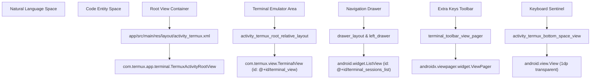
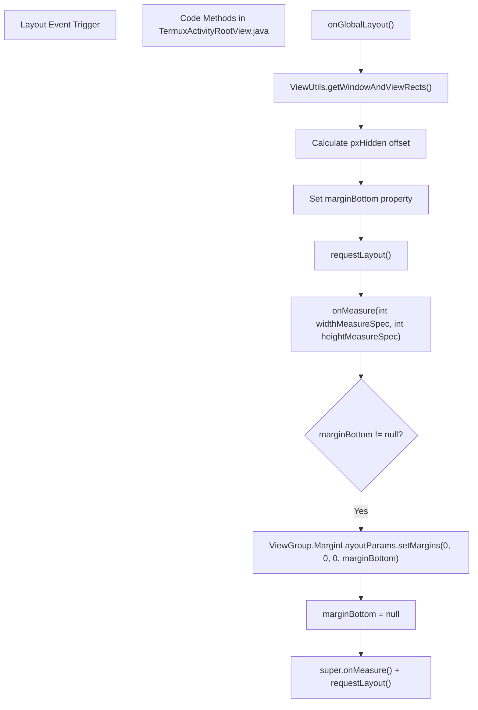

<!-- source: DeepWiki mcp.deepwiki.com · repo termux/termux-app · page 3.5 UI Layout and Root View · fetched 2026-10-26 -->

# UI Layout and Root View

Relevant source files

The following files were used as context for generating this wiki page:

- [app/src/main/java/com/termux/app/terminal/TermuxActivityRootView.java](app/src/main/java/com/termux/app/terminal/TermuxActivityRootView.java)
- [app/src/main/res/drawable/current_session.xml](app/src/main/res/drawable/current_session.xml)
- [app/src/main/res/drawable/current_session_black.xml](app/src/main/res/drawable/current_session_black.xml)
- [app/src/main/res/drawable/session_ripple.xml](app/src/main/res/drawable/session_ripple.xml)
- [app/src/main/res/drawable/session_ripple_black.xml](app/src/main/res/drawable/session_ripple_black.xml)
- [app/src/main/res/layout/activity_termux.xml](app/src/main/res/layout/activity_termux.xml)
- [app/src/main/res/mipmap-anydpi-v26/ic_launcher.xml](app/src/main/res/mipmap-anydpi-v26/ic_launcher.xml)
- [app/src/main/res/mipmap-anydpi-v26/ic_launcher_round.xml](app/src/main/res/mipmap-anydpi-v26/ic_launcher_round.xml)
- [app/src/main/res/values/styles.xml](app/src/main/res/values/styles.xml)
- [termux-shared/src/main/java/com/termux/shared/termux/theme/TermuxThemeUtils.java](termux-shared/src/main/java/com/termux/shared/termux/theme/TermuxThemeUtils.java)
- [termux-shared/src/main/java/com/termux/shared/theme/NightMode.java](termux-shared/src/main/java/com/termux/shared/theme/NightMode.java)
- [termux-shared/src/main/java/com/termux/shared/theme/ThemeUtils.java](termux-shared/src/main/java/com/termux/shared/theme/ThemeUtils.java)
- [termux-shared/src/main/java/com/termux/shared/view/KeyboardUtils.java](termux-shared/src/main/java/com/termux/shared/view/KeyboardUtils.java)
- [termux-shared/src/main/java/com/termux/shared/view/ViewUtils.java](termux-shared/src/main/java/com/termux/shared/view/ViewUtils.java)

## Purpose and Scope

This document details the UI layout architecture of `TermuxActivity`, focusing on the custom root view component (`TermuxActivityRootView`), the soft keyboard management logic, theme styles, and application icons. The layout defines the visual hierarchy including the terminal view, navigation drawer, toolbar components, and adaptive icons. For terminal view rendering internals, see [TerminalView](#4.1). For activity lifecycle and service binding, see [TermuxActivity](#3.1).

**Sources:** [app/src/main/res/layout/activity_termux.xml:1-113](), [app/src/main/java/com/termux/app/terminal/TermuxActivityRootView.java:64-117]()

---

## Layout Structure Overview

The activity layout uses a custom root view component `TermuxActivityRootView` defined in `app/src/main/res/layout/activity_termux.xml`. It extends `LinearLayout` and implements sophisticated soft keyboard overlap detection. 

The following diagram bridges the natural language UI layout concepts to their concrete code entities (`xml` files, custom classes, and view IDs):

**Sources:** [app/src/main/res/layout/activity_termux.xml:1-113](), [app/src/main/java/com/termux/app/terminal/TermuxActivityRootView.java:64-64]()

### Layout XML Structure

The root element is `TermuxActivityRootView` with the ID `@+id/activity_termux_root_view`. It uses a vertical `LinearLayout` orientation with `android:fitsSystemWindows="true"` to process window insets:

| Component | XML ID | Code / Class Mapping | Purpose |
|-----------|--------|---------------------|---------|
| Root View | `activity_termux_root_view` | `TermuxActivityRootView` | Custom layout container with soft keyboard offset correction |
| Relative Layout | `activity_termux_root_relative_layout` | `RelativeLayout` | Main content frame with 3dp horizontal margin |
| Drawer Layout | `drawer_layout` | `DrawerLayout` | Houses terminal view and side navigation panel |
| Terminal View | `terminal_view` | `TerminalView` | Main terminal rendering surface |
| Left Drawer | `left_drawer` | `LinearLayout` (240dp width) | Navigation panel for sessions and actions |
| Toolbar ViewPager | `terminal_toolbar_view_pager` | `ViewPager` | Extra keys container (37.5dp height, initially hidden) |
| Bottom Space View | `activity_termux_bottom_space_view` | `View` (1dp height) | Sentinel view for soft keyboard visibility/overlap detection |

**Sources:** [app/src/main/res/layout/activity_termux.xml:1-113]()

---

## TermuxActivityRootView Component

The `TermuxActivityRootView` class (`[app/src/main/java/com/termux/app/terminal/TermuxActivityRootView.java:64-117]()`) extends `LinearLayout` and implements `ViewTreeObserver.OnGlobalLayoutListener`. It dynamically applies bottom margins during measure passes when the soft keyboard occludes the terminal or extra keys.

### Class Structure and Data Flow

**Sources:** [app/src/main/java/com/termux/app/terminal/TermuxActivityRootView.java:64-117]()

### Key Instance Variables

| Variable | Type | Role |
|----------|------|------|
| `mActivity` | `TermuxActivity` | Reference to parent activity (`[app/src/main/java/com/termux/app/terminal/TermuxActivityRootView.java:66]()`) |
| `marginBottom` | `Integer` | Pending bottom offset to apply in the next `onMeasure()` pass (`[app/src/main/java/com/termux/app/terminal/TermuxActivityRootView.java:67]()`) |
| `lastMarginBottom` | `Integer` | Cached margin value from the previous layout adjustment (`[app/src/main/java/com/termux/app/terminal/TermuxActivityRootView.java:68]()`) |
| `mStatusBarHeight` | `int` | Static field capturing system status bar height from window insets (`[app/src/main/java/com/termux/app/terminal/TermuxActivityRootView.java:77]()`) |

**Sources:** [app/src/main/java/com/termux/app/terminal/TermuxActivityRootView.java:64-77]()

---

## Soft Keyboard Management Logic

Android's default `SOFT_INPUT_ADJUST_RESIZE` window mode often fails to accommodate extended keyboard layouts, clipboard suggestion rows, or custom candidate views (such as Gboard's number row and suggestion bar). This causes the soft keyboard to overlap the lower portion of the terminal or extra keys.

### Detection and Offset Correction Pipeline

`TermuxActivityRootView` uses the 1dp `activity_termux_bottom_space_view` as a sentinel to detect when the window is resized incorrectly:

1. **Global Layout Notification**: When the soft keyboard or view visibility changes, `onGlobalLayout()` executes (`[app/src/main/java/com/termux/app/terminal/TermuxActivityRootView.java:120-125]()`).
2. **Rectangle Evaluation**: `ViewUtils.getWindowAndViewRects()` retrieves the window available display frame and the bounds of the bottom space sentinel (`[termux-shared/src/main/java/com/termux/shared/view/ViewUtils.java:66-105]()`).
3. **Overlap Calculation**: If the sentinel's bottom coordinate falls below the window's available display rectangle, the overlapping pixel height (`pxHidden`) is computed (`[app/src/main/java/com/termux/app/terminal/TermuxActivityRootView.java:227-235]()`).
4. **Margin Injection**: `marginBottom` is populated with `pxHidden`, and `requestLayout()` triggers `onMeasure()`, which applies the bottom margin to push the view tree upward (`[app/src/main/java/com/termux/app/terminal/TermuxActivityRootView.java:104-117]()`).

### Keyboard Utility Helpers

The `KeyboardUtils` class (`[termux-shared/src/main/java/com/termux/shared/view/KeyboardUtils.java:23-139]()`) manages programmatic input method operations:
- `toggleSoftKeyboard(Context)`: Toggles soft keyboard state using `InputMethodManager.SHOW_FORCED` (`[termux-shared/src/main/java/com/termux/shared/view/KeyboardUtils.java:44-49]()`).
- `showSoftKeyboard(Context, View)`: Force-shows the input method for `TerminalView` (`[termux-shared/src/main/java/com/termux/shared/view/KeyboardUtils.java:67-72]()`).
- `hideSoftKeyboard(Context, View)`: Dismisses the soft keyboard window token (`[termux-shared/src/main/java/com/termux/shared/view/KeyboardUtils.java:74-79]()`).
- `disableSoftKeyboard(Activity, View)`: Applies `WindowManager.LayoutParams.FLAG_ALT_FOCUSABLE_IM` to suppress automatic soft keyboard popups (`[termux-shared/src/main/java/com/termux/shared/view/KeyboardUtils.java:81-90]()`).

**Sources:** [app/src/main/java/com/termux/app/terminal/TermuxActivityRootView.java:104-299](), [termux-shared/src/main/java/com/termux/shared/view/KeyboardUtils.java:23-139](), [termux-shared/src/main/java/com/termux/shared/view/ViewUtils.java:37-146]()

---

## Themes, Styles, and Icons

Termux applies light/dark themes and styling resources across its activities, dialogs, and navigation drawers.

### Styles and Attributes

Dialog boxes and navigation buttons use centralized style definitions:
- `TermuxAlertDialogStyle`: Inherits from `@android:style/Theme.Material.Light.Dialog.Alert` with an overridden `#212121` accent color (`[app/src/main/res/values/styles.xml:4-7]()`).
- `TermuxActivity.Drawer.ButtonBarStyle.Light` and `Dark`: Extends Material Components text button styles to enforce black or white text colors in the navigation drawer (`[app/src/main/res/values/styles.xml:9-15]()`).

### Application Icons

Adaptive icons are defined for API 26+ compatibility under `mipmap-anydpi-v26/`:
- `ic_launcher.xml` and `ic_launcher_round.xml`: Configure solid black backgrounds (`@android:color/black`) with vector foregrounds (`@drawable/ic_foreground`) supporting monochrome theming (`[app/src/main/res/mipmap-anydpi-v26/ic_launcher.xml:1-6]()`, `[app/src/main/res/mipmap-anydpi-v26/ic_launcher_round.xml:1-6]`).

### Theme and Night Mode Management

The shared module manages application-wide themes using `NightMode` and `ThemeUtils`:
- `NightMode`: An enum representing `TRUE`, `FALSE`, and `SYSTEM` states, wrapping `AppCompatDelegate` night mode integers (`[termux-shared/src/main/java/com/termux/shared/theme/NightMode.java:10-44]()`).
- `ThemeUtils`: Evaluates system night mode configurations via `Configuration.UI_MODE_NIGHT_MASK` and extracts theme attributes such as `textColorPrimary` (`[termux-shared/src/main/java/com/termux/shared/theme/ThemeUtils.java:21-84]()`).

**Sources:** [app/src/main/res/values/styles.xml:1-17](), [app/src/main/res/mipmap-anydpi-v26/ic_launcher.xml:1-6](), [termux-shared/src/main/java/com/termux/shared/theme/NightMode.java:10-91](), [termux-shared/src/main/java/com/termux/shared/theme/ThemeUtils.java:1-86]()

---

## Window Insets Handling

`TermuxActivityRootView` implements `View.OnApplyWindowInsetsListener` (`[app/src/main/java/com/termux/app/terminal/TermuxActivityRootView.java:275-282]()`) to capture window insets:
- Converts raw `WindowInsets` to `WindowInsetsCompat` (`[app/src/main/java/com/termux/app/terminal/TermuxActivityRootView.java:279-280]()`).
- Extracts the top status bar height and caches it in `mStatusBarHeight` for `ViewUtils` calculations (`[app/src/main/java/com/termux/app/terminal/TermuxActivityRootView.java:281-282]()`).

**Sources:** [app/src/main/java/com/termux/app/terminal/TermuxActivityRootView.java:275-282]()

---

