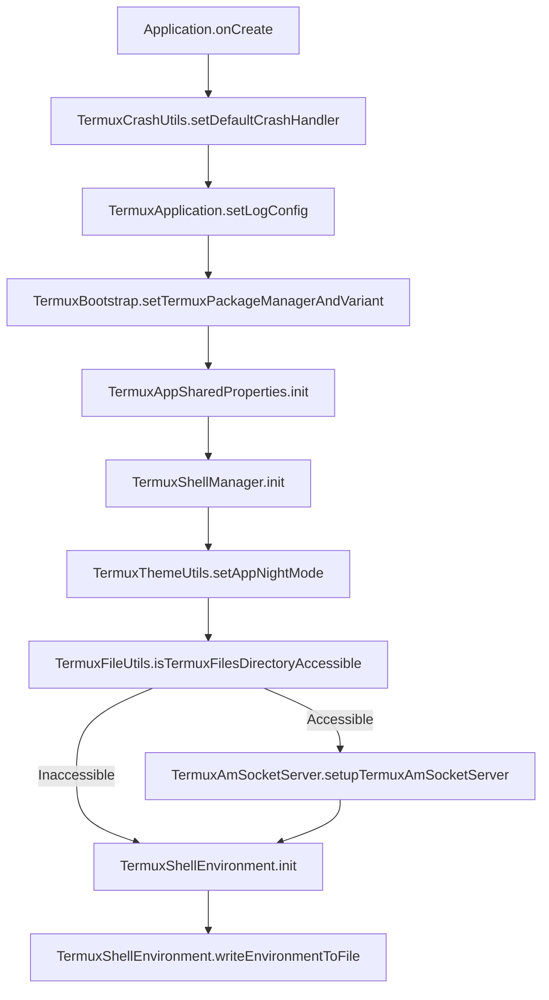
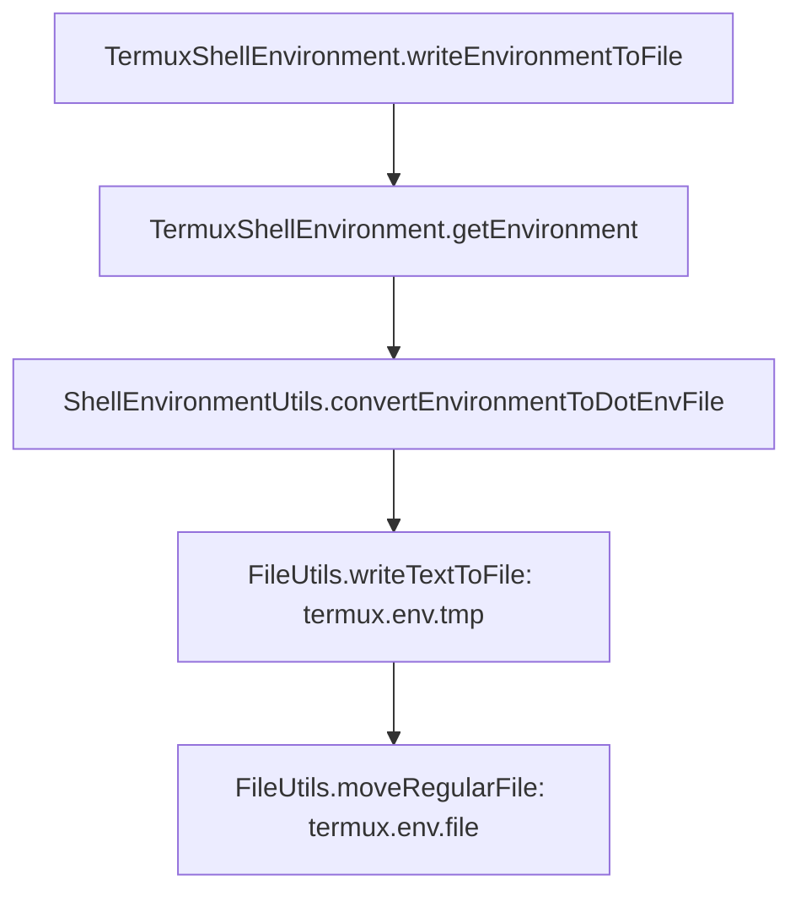
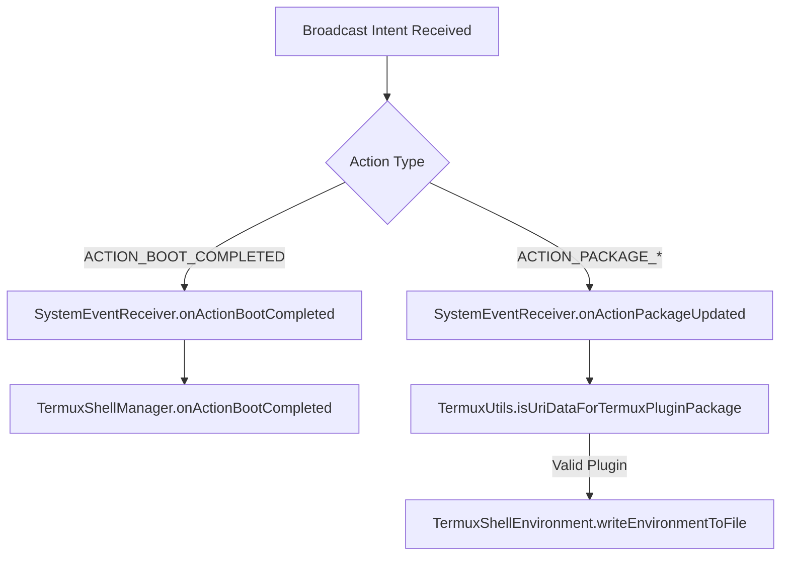
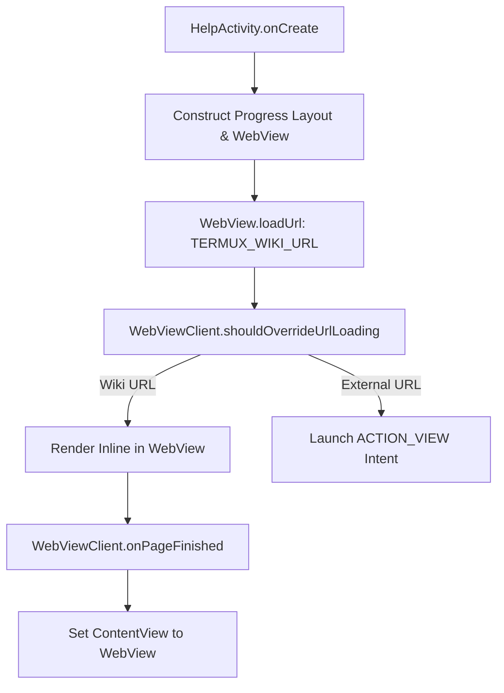

<!-- source: DeepWiki mcp.deepwiki.com · repo termux/termux-app · page 3.6 Application Startup and System Events · fetched 2026-10-26 -->

# Application Startup and System Events

Relevant source files

The following files were used as context for generating this wiki page:

- [.github/workflows/attach_debug_apks_to_release.yml](.github/workflows/attach_debug_apks_to_release.yml)
- [.github/workflows/debug_build.yml](.github/workflows/debug_build.yml)
- [.github/workflows/dependency-submission.yml](.github/workflows/dependency-submission.yml)
- [.github/workflows/gradle-wrapper-validation.yml](.github/workflows/gradle-wrapper-validation.yml)
- [.github/workflows/run_tests.yml](.github/workflows/run_tests.yml)
- [.github/workflows/trigger_library_builds_on_jitpack.yml](.github/workflows/trigger_library_builds_on_jitpack.yml)
- [app/src/main/java/com/termux/app/TermuxApplication.java](app/src/main/java/com/termux/app/TermuxApplication.java)
- [app/src/main/java/com/termux/app/activities/HelpActivity.java](app/src/main/java/com/termux/app/activities/HelpActivity.java)
- [app/src/main/java/com/termux/app/event/SystemEventReceiver.java](app/src/main/java/com/termux/app/event/SystemEventReceiver.java)
- [termux-shared/src/main/java/com/termux/shared/shell/command/environment/ShellEnvironmentUtils.java](termux-shared/src/main/java/com/termux/shared/shell/command/environment/ShellEnvironmentUtils.java)
- [termux-shared/src/main/java/com/termux/shared/shell/command/environment/ShellEnvironmentVariable.java](termux-shared/src/main/java/com/termux/shared/shell/command/environment/ShellEnvironmentVariable.java)
- [termux-shared/src/main/java/com/termux/shared/termux/shell/command/environment/TermuxShellEnvironment.java](termux-shared/src/main/java/com/termux/shared/termux/shell/command/environment/TermuxShellEnvironment.java)

## Purpose and Scope
This document details the application startup sequence, environment configuration, system broadcast handling, and embedded help facilities in the Termux application. It covers `TermuxApplication` initialization routines, shell environment mapping and export via `TermuxShellEnvironment`, system event reception and boot/package update management via `SystemEventReceiver`, and the embedded documentation browser provided by `HelpActivity`.

---

## 1. TermuxApplication Initialization

The application entry point is `TermuxApplication`, which extends `android.app.Application` [app/src/main/java/com/termux/app/TermuxApplication.java:20](). When the application process launches, `TermuxApplication.onCreate()` [app/src/main/java/com/termux/app/TermuxApplication.java:24]() executes a synchronous sequence of configuration steps to prepare logging, crash handling, bootstrap states, property configurations, and shell sockets before any activity or service is created.

### Initialization Flow
1. **Crash Handling**: Configures the default application crash handler using `TermuxCrashUtils.setDefaultCrashHandler(this)` [app/src/main/java/com/termux/app/TermuxApplication.java:30]().
2. **Logging Configuration**: Invokes `setLogConfig(context)` [app/src/main/java/com/termux/app/TermuxApplication.java:33]() to initialize the default log tag (`TermuxConstants.TERMUX_APP_NAME`) and load persistent log levels from `TermuxAppSharedPreferences` [app/src/main/java/com/termux/app/TermuxApplication.java:76-83]().
3. **Bootstrap and Package Variant Configuration**: Sets up package manager and variant parameters via `TermuxBootstrap.setTermuxPackageManagerAndVariant(BuildConfig.TERMUX_PACKAGE_VARIANT)` [app/src/main/java/com/termux/app/TermuxApplication.java:38]().
4. **Properties and Shell Manager**: Loads app-wide properties from `termux.properties` using `TermuxAppSharedProperties.init(context)` [app/src/main/java/com/termux/app/TermuxApplication.java:41]() and initializes shell management via `TermuxShellManager.init(context)` [app/src/main/java/com/termux/app/TermuxApplication.java:44]().
5. **UI Night Mode**: Applies the user's theme configuration using `TermuxThemeUtils.setAppNightMode(properties.getNightMode())` [app/src/main/java/com/termux/app/TermuxApplication.java:47]().
6. **Files Directory Validation**: Validates whether the Termux files directory is accessible via `TermuxFileUtils.isTermuxFilesDirectoryAccessible(this, true, true)` [app/src/main/java/com/termux/app/TermuxApplication.java:51](). If accessible, it provisions the internal app apps directory and sets up the `TermuxAmSocketServer` [app/src/main/java/com/termux/app/TermuxApplication.java:56-63]().
7. **Environment Initialization**: Initializes `TermuxShellEnvironment` constants and writes out the environment file [app/src/main/java/com/termux/app/TermuxApplication.java:68-73]().

*Sources: [app/src/main/java/com/termux/app/TermuxApplication.java:24-74]()*

---

## 2. Shell Environment Setup

The shell environment configuration is orchestrated by `TermuxShellEnvironment`, which extends `AndroidShellEnvironment` [termux-shared/src/main/java/com/termux/shared/shell/command/environment/TermuxShellEnvironment.java:24](). It aggregates variables from base Android environments, Termux application defaults, and Termux API plugins.

### Key Environment Variables and Paths
- `PREFIX`: Set to `TermuxConstants.TERMUX_PREFIX_DIR_PATH` [termux-shared/src/main/java/com/termux/shared/shell/command/environment/TermuxShellEnvironment.java:28-29]().
- `HOME`: Set to `TermuxConstants.TERMUX_HOME_DIR_PATH` [termux-shared/src/main/java/com/termux/shared/shell/command/environment/TermuxShellEnvironment.java:78]().
- `TMPDIR`: Set to `TermuxConstants.TERMUX_TMP_PREFIX_DIR_PATH` [termux-shared/src/main/java/com/termux/shared/shell/command/environment/TermuxShellEnvironment.java:83]() (when not in fail-safe mode).
- `PATH`: Configured with `TermuxConstants.TERMUX_BIN_PREFIX_DIR_PATH` [termux-shared/src/main/java/com/termux/shared/shell/command/environment/TermuxShellEnvironment.java:90](). For Android 5/6 variants (`apt-android-5`), an applets folder is included [termux-shared/src/main/java/com/termux/shared/shell/command/environment/TermuxShellEnvironment.java:84-86]().
- `LD_LIBRARY_PATH`: Maintained for Android 5/6 legacy packages (`TermuxConstants.TERMUX_LIB_PREFIX_DIR_PATH`) [termux-shared/src/main/java/com/termux/shared/shell/command/environment/TermuxShellEnvironment.java:87]() but removed for Android 7+ binaries relying on `DT_RUNPATH` [termux-shared/src/main/java/com/termux/shared/shell/command/environment/TermuxShellEnvironment.java:89-91]().

### Environment File Export
`TermuxShellEnvironment.writeEnvironmentToFile(Context)` converts the calculated environment map into shell-compatible export expressions using `ShellEnvironmentUtils.convertEnvironmentToDotEnvFile()` [termux-shared/src/main/java/com/termux/shared/shell/command/environment/TermuxShellEnvironment.java:43-45](). To prevent race conditions where files are read while being written, the utility writes to a temporary file (`termux.env.tmp`) before moving it atomically to its final location (`TermuxConstants.TERMUX_ENV_FILE_PATH`) [termux-shared/src/main/java/com/termux/shared/shell/command/environment/TermuxShellEnvironment.java:47-59]().

*Sources: [termux-shared/src/main/java/com/termux/shared/shell/command/environment/TermuxShellEnvironment.java:43-60](), [termux-shared/src/main/java/com/termux/shared/shell/command/environment/ShellEnvironmentUtils.java:50-84]*

---

## 3. SystemEventReceiver Boot Handling and Package Updates

System events such as device boot completion and package modifications are handled by `SystemEventReceiver`, which extends `BroadcastReceiver` [app/src/main/java/com/termux/app/event/SystemEventReceiver.java:19]().

### Broadcast Actions Handled
- `Intent.ACTION_BOOT_COMPLETED`: Forwarded to `TermuxShellManager.onActionBootCompleted(context, intent)` [app/src/main/java/com/termux/app/event/SystemEventReceiver.java:41-55]().
- `Intent.ACTION_PACKAGE_ADDED`, `Intent.ACTION_PACKAGE_REMOVED`, `Intent.ACTION_PACKAGE_REPLACED`: Evaluated by `onActionPackageUpdated()` to check whether the updated package is a recognized Termux plugin (`TermuxUtils.isUriDataForTermuxPluginPackage(data)`) [app/src/main/java/com/termux/app/event/SystemEventReceiver.java:44-65](). If accessibility checks pass, the environment file is regenerated [app/src/main/java/com/termux/app/event/SystemEventReceiver.java:63-64]().

Due to Android restriction policies (Android 8+), package update broadcasts must be registered dynamically rather than statically in the manifest [app/src/main/java/com/termux/app/event/SystemEventReceiver.java:70-77](). This is managed via `registerPackageUpdateEvents(Context)` and `unregisterPackageUpdateEvents(Context)` [app/src/main/java/com/termux/app/event/SystemEventReceiver.java:78-89]().

*Sources: [app/src/main/java/com/termux/app/event/SystemEventReceiver.java:32-66]()*

---

## 4. HelpActivity Implementation

`HelpActivity` is an `AppCompatActivity` subclass that provides an embedded browser for rendering local or remote Termux wiki help pages [app/src/main/java/com/termux/app/activities/HelpActivity.java:19]().

### Key Implementation Details
- **UI Structure**: Dynamically constructs a progress bar container view during initial load and switches to a full-screen `WebView` once page loading completes [app/src/main/java/com/termux/app/activities/HelpActivity.java:27-38]().
- **WebView Configuration**: Disables cache storage (`WebSettings.LOAD_NO_CACHE`) and clears existing caches on creation [app/src/main/java/com/termux/app/activities/HelpActivity.java:36-39]().
- **URL Navigation Rules**: Implements a custom `WebViewClient` where requests matching `TermuxConstants.TERMUX_WIKI_URL` are rendered inline [app/src/main/java/com/termux/app/activities/HelpActivity.java:41-48](). External links spawn an `Intent.ACTION_VIEW` activity task, with graceful fallbacks for environments lacking external web browsers (such as Android TV) [app/src/main/java/com/termux/app/activities/HelpActivity.java:50-57]().
- **Back Button Handling**: Intercepts `onBackPressed()` to allow intra-document history traversal via `mWebView.goBack()` before terminating the activity [app/src/main/java/com/termux/app/activities/HelpActivity.java:68-75]().

*Sources: [app/src/main/java/com/termux/app/activities/HelpActivity.java:24-66]()*

---

