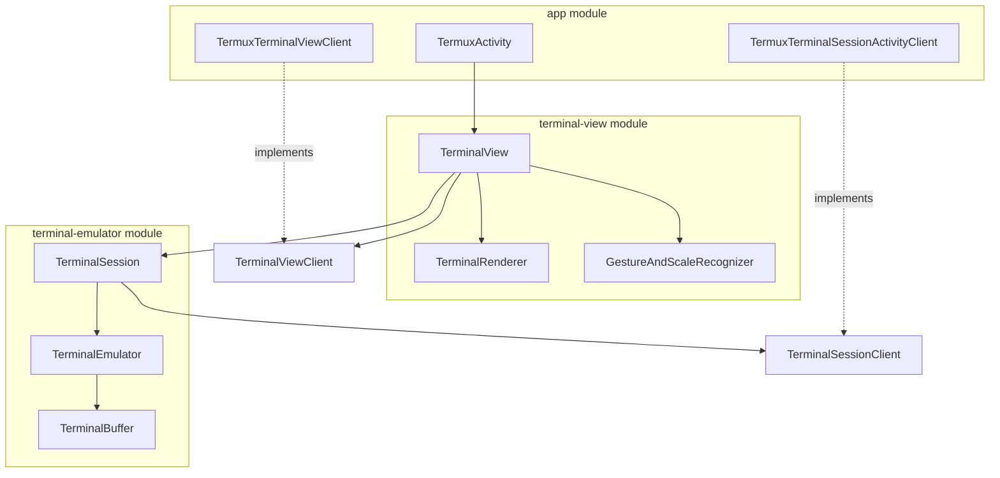

<!-- source: DeepWiki mcp.deepwiki.com · repo termux/termux-app · page 4 Terminal Emulation System · fetched 2026-10-26 -->

# Terminal Emulation System

Relevant source files

The following files were used as context for generating this wiki page:

- [app/src/main/java/com/termux/app/activities/SettingsActivity.java](app/src/main/java/com/termux/app/activities/SettingsActivity.java)
- [app/src/main/java/com/termux/app/terminal/TermuxTerminalSessionActivityClient.java](app/src/main/java/com/termux/app/terminal/TermuxTerminalSessionActivityClient.java)
- [app/src/main/java/com/termux/app/terminal/TermuxTerminalViewClient.java](app/src/main/java/com/termux/app/terminal/TermuxTerminalViewClient.java)
- [terminal-emulator/src/main/java/com/termux/terminal/TerminalEmulator.java](terminal-emulator/src/main/java/com/termux/terminal/TerminalEmulator.java)
- [terminal-emulator/src/test/java/com/termux/terminal/ControlSequenceIntroducerTest.java](terminal-emulator/src/test/java/com/termux/terminal/ControlSequenceIntroducerTest.java)
- [terminal-emulator/src/test/java/com/termux/terminal/HistoryTest.java](terminal-emulator/src/test/java/com/termux/terminal/HistoryTest.java)
- [terminal-emulator/src/test/java/com/termux/terminal/ResizeTest.java](terminal-emulator/src/test/java/com/termux/terminal/ResizeTest.java)
- [terminal-emulator/src/test/java/com/termux/terminal/TerminalTest.java](terminal-emulator/src/test/java/com/termux/terminal/TerminalTest.java)
- [terminal-view/src/main/java/com/termux/view/TerminalView.java](terminal-view/src/main/java/com/termux/view/TerminalView.java)
- [terminal-view/src/main/java/com/termux/view/TerminalViewClient.java](terminal-view/src/main/java/com/termux/view/TerminalViewClient.java)
- [termux-shared/src/main/java/com/termux/shared/interact/ShareUtils.java](termux-shared/src/main/java/com/termux/shared/interact/ShareUtils.java)

## Purpose and Scope

The Terminal Emulation System provides VT100/xterm-compatible terminal emulation for the Termux application. This system coordinates view rendering, touch event handling, keyboard shortcuts, escape sequence parsing, terminal session lifecycles, and toolbars/extra keys. 

As a parent page, this document provides a high-level architectural overview of the terminal emulation subsystem. For deep technical details, refer to the child pages:
- **[TerminalView](#4.1)** — Document the `TerminalView` component, rendering pipeline, touch event handling, gesture recognition, and text selection [terminal-view/src/main/java/com/termux/view/TerminalView.java:46-154]()
- **[TerminalViewClient Interface](#4.2)** — Explain the `TerminalViewClient` interface, `TermuxTerminalViewClient` implementation, keyboard shortcuts, `KeyHandler` and soft keyboard management [app/src/main/java/com/termux/app/terminal/TermuxTerminalViewClient.java:56-177]()
- **[TerminalEmulator](#4.3)** — Document the terminal emulator core logic, escape sequence processing, state machine, dual buffer system, and VT100/xterm compatibility [terminal-emulator/src/main/java/com/termux/terminal/TerminalEmulator.java:31-133]()
- **[Terminal Sessions](#4.4)** — Explain terminal session lifecycle, `TerminalSession`/JNI pty creation, `TermuxTerminalSessionActivityClient`, session switching, and `TermuxShellManager` [app/src/main/java/com/termux/app/terminal/TermuxTerminalSessionActivityClient.java:40-106]()
- **[Extra Keys and Terminal Toolbar](#4.5)** — Document the `ExtraKeysView`, extra keys configuration/constants, terminal toolbar view pager, text input view, and sessions list controller

Sources: [terminal-view/src/main/java/com/termux/view/TerminalView.java:46-154](), [terminal-emulator/src/main/java/com/termux/terminal/TerminalEmulator.java:31-133](), [app/src/main/java/com/termux/app/terminal/TermuxTerminalViewClient.java:56-177](), [app/src/main/java/com/termux/app/terminal/TermuxTerminalSessionActivityClient.java:40-106]()

---

## Architecture Overview

The terminal emulation architecture is organized into distinct layers across multiple modules (`terminal-emulator`, `terminal-view`, and `app`). 

### Subsystem Dependency & Control Flow

Sources: [terminal-view/src/main/java/com/termux/view/TerminalView.java:46-60](), [terminal-emulator/src/main/java/com/termux/terminal/TerminalEmulator.java:31-45](), [app/src/main/java/com/termux/app/terminal/TermuxTerminalViewClient.java:56-79]()

---

## 4.1 TerminalView

The `TerminalView` class (`[terminal-view/src/main/java/com/termux/view/TerminalView.java]()`) is an Android `View` responsible for drawing the terminal screen grid onto a `Canvas`, handling touch inputs, pinch-to-zoom scaling via `GestureAndScaleRecognizer`, long-press detection, and text selection modes.

For details, see [TerminalView](#4.1).

Sources: [terminal-view/src/main/java/com/termux/view/TerminalView.java:46-154]()

---

## 4.2 TerminalViewClient Interface

The `TerminalViewClient` interface (`[terminal-view/src/main/java/com/termux/view/TerminalViewClient.java]()`) defines callbacks between `TerminalView` and its host application. Its primary implementation, `TermuxTerminalViewClient` (`[app/src/main/java/com/termux/app/terminal/TermuxTerminalViewClient.java]()`), manages keyboard shortcuts, modifier keys (`Ctrl`, `Alt`, `Shift`, `Fn`), soft keyboard visibility, and IME integration.

For details, see [TerminalViewClient Interface](#4.2).

Sources: [terminal-view/src/main/java/com/termux/view/TerminalViewClient.java:1-83](), [app/src/main/java/com/termux/app/terminal/TermuxTerminalViewClient.java:56-177]()

---

## 4.3 TerminalEmulator

The `TerminalEmulator` class (`[terminal-emulator/src/main/java/com/termux/terminal/TerminalEmulator.java]()`) contains the core terminal emulation logic, maintaining a state machine for VT100/xterm escape sequence parsing (CSI, OSC, DCS), character set selections, and managing dual screen buffers (main and alternate buffers).

For details, see [TerminalEmulator](#4.3).

Sources: [terminal-emulator/src/main/java/com/termux/terminal/TerminalEmulator.java:31-133]()

---

## 4.4 Terminal Sessions

`TerminalSession` coordinates the lifecycle of a PTY process and communicates output and state changes through the `TerminalSessionClient` interface. `TermuxTerminalSessionActivityClient` (`[app/src/main/java/com/termux/app/terminal/TermuxTerminalSessionActivityClient.java]()`) implements these callbacks to update the activity UI, handle session exits, manage notification sounds (bell), and persist active session states.

For details, see [Terminal Sessions](#4.4).

Sources: [app/src/main/java/com/termux/app/terminal/TermuxTerminalSessionActivityClient.java:40-106]()

---

## 4.5 Extra Keys and Terminal Toolbar

The extra keys subsystem provides an on-screen macro/key toolbar (`ExtraKeysView`) allowing users to easily send special keys (`CTRL`, `ALT`, `ESC`, `TAB`, arrow keys) and custom shortcuts configured via `termux.properties`.

For details, see [Extra Keys and Terminal Toolbar](#4.5).

---

