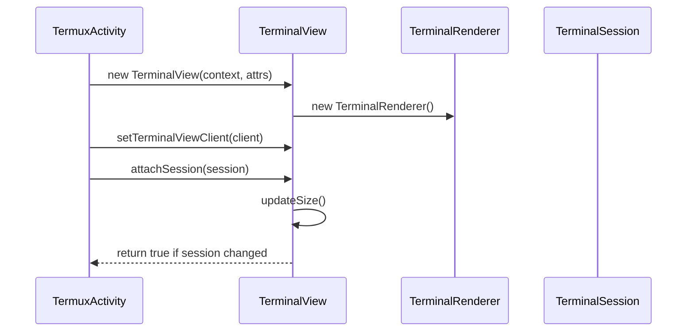
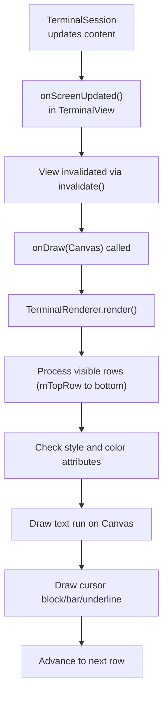
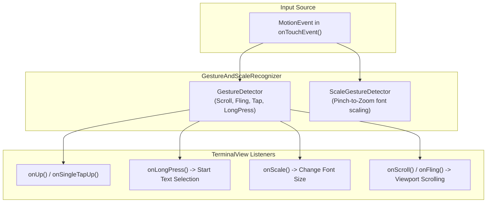
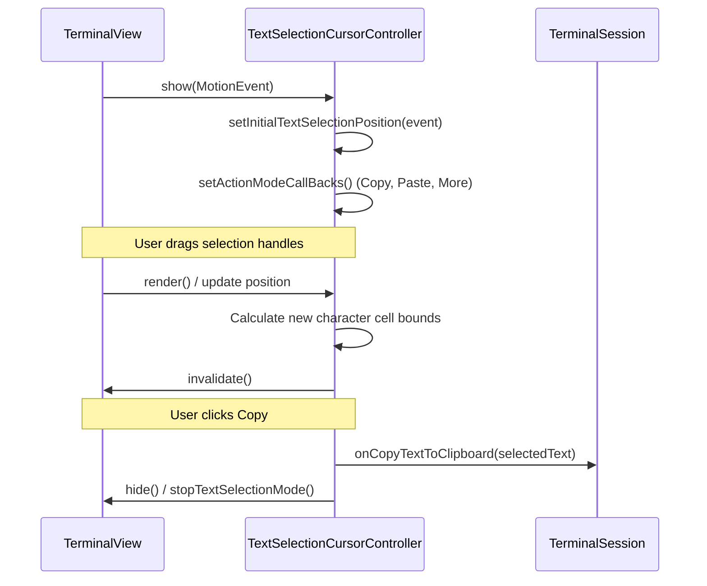

<!-- source: DeepWiki mcp.deepwiki.com · repo termux/termux-app · page 4.1 TerminalView · fetched 2026-10-26 -->

# TerminalView

<details>
<summary>Relevant source files</summary>

The following files were used as context for generating this wiki page:

- [app/src/main/java/com/termux/app/activities/SettingsActivity.java](app/src/main/java/com/termux/app/activities/SettingsActivity.java)
- [app/src/main/java/com/termux/app/terminal/TermuxTerminalSessionActivityClient.java](app/src/main/java/com/termux/app/terminal/TermuxTerminalSessionActivityClient.java)
- [app/src/main/java/com/termux/app/terminal/TermuxTerminalViewClient.java](app/src/main/java/com/termux/app/terminal/TermuxTerminalViewClient.java)
- [terminal-view/src/main/java/com/termux/view/GestureAndScaleRecognizer.java](terminal-view/src/main/java/com/termux/view/GestureAndScaleRecognizer.java)
- [terminal-view/src/main/java/com/termux/view/TerminalView.java](terminal-view/src/main/java/com/termux/view/TerminalView.java)
- [terminal-view/src/main/java/com/termux/view/TerminalViewClient.java](terminal-view/src/main/java/com/termux/view/TerminalViewClient.java)
- [terminal-view/src/main/java/com/termux/view/support/PopupWindowCompatGingerbread.java](terminal-view/src/main/java/com/termux/view/support/PopupWindowCompatGingerbread.java)
- [terminal-view/src/main/java/com/termux/view/textselection/TextSelectionCursorController.java](terminal-view/src/main/java/com/termux/view/textselection/TextSelectionCursorController.java)
- [terminal-view/src/main/java/com/termux/view/textselection/TextSelectionHandleView.java](terminal-view/src/main/java/com/termux/view/textselection/TextSelectionHandleView.java)
- [termux-shared/src/main/java/com/termux/shared/interact/ShareUtils.java](termux-shared/src/main/java/com/termux/shared/interact/ShareUtils.java)

</details>


This document explains the `TerminalView` component of the Termux application, which is responsible for displaying terminal content, handling user input, managing touch gestures, and providing text selection capabilities. `TerminalView` acts as the primary visual interface between the user and the underlying `TerminalSession` and `TerminalEmulator`. For information about the core terminal emulation logic, see [TerminalEmulator](#4.3), and for session management, see [Terminal Sessions](#4.4).

## Architecture Overview

The `TerminalView` system relies on several core classes across the `terminal-view` library and the app module to manage rendering, touch tracking, text handles, and client communications.

```mermaid
classDiagram
    class TerminalView {
        +TerminalSession mTermSession
        +TerminalEmulator mEmulator
        +TerminalRenderer mRenderer
        +TerminalViewClient mClient
        +GestureAndScaleRecognizer mGestureRecognizer
        +onKeyDown(int, KeyEvent)
        +onTouchEvent(MotionEvent)
        +onDraw(Canvas)
        +updateSize()
    }
    
    class TerminalRenderer {
        +int mTextSize
        +Typeface mTypeface
        +float mFontWidth
        +render(TerminalEmulator, Canvas, int, int)
    }
    
    class TextSelectionCursorController {
        +show(MotionEvent)
        +hide()
        +getSelectedText()
        +render()
    }

    class GestureAndScaleRecognizer {
        +onTouchEvent(MotionEvent)
        +isInProgress()
    }
    
    class TermuxTerminalViewClient {
        +onSingleTapUp(MotionEvent)
        +onScale(float)
        +onLongPress(MotionEvent)
        +onCodePoint(int, boolean, TerminalSession)
    }
    
    TerminalView --> TerminalRenderer : uses
    TerminalView --> TextSelectionCursorController : uses
    TerminalView --> GestureAndScaleRecognizer : uses
    TerminalView <--> TermuxTerminalViewClient : communicates via client interface
    TerminalView --> "TerminalSession" : attaches to
    TerminalView --> "TerminalEmulator" : references
```

Sources:
- [terminal-view/src/main/java/com/termux/view/TerminalView.java:45-75]()
- [terminal-view/src/main/java/com/termux/view/textselection/TextSelectionCursorController.java:21-43]()
- [terminal-view/src/main/java/com/termux/view/GestureAndScaleRecognizer.java:9-31]()
- [app/src/main/java/com/termux/app/terminal/TermuxTerminalViewClient.java:56-83]()

## TerminalView Class and Initialization

The `TerminalView` class extends Android's standard `View` class [terminal-view/src/main/java/com/termux/view/TerminalView.java:46] and provides viewport management, input dispatching, and cursor blinker orchestration. 

When an activity initializes the view, it binds a `TerminalViewClient` and attaches a `TerminalSession`:



Sources:
- [terminal-view/src/main/java/com/termux/view/TerminalView.java:136-154]()
- [terminal-view/src/main/java/com/termux/view/TerminalView.java:290-304]()

## Terminal Rendering Pipeline

The rendering pipeline is driven by `TerminalRenderer`, which computes font dimensions, processes row buffers, and draws character cells onto the Android `Canvas`.

### Layout and Font Metrics

The renderer tracks metrics such as:
- `mFontWidth`: Width of a single monospaced character cell.
- `mFontLineSpacing`: Vertical span between consecutive lines.
- `mFontAscent`: Distance from baseline to the top of the font bounding box.

Sources:
- [terminal-view/src/main/java/com/termux/view/TerminalView.java:453-499]()

### Rendering Flow

When the screen updates or view invalidation occurs, `onDraw()` executes the renderer pipeline:



Sources:
- [terminal-view/src/main/java/com/termux/view/TerminalView.java:453-499]()

## Input Handling (Keyboard and IME)

`TerminalView` handles user input through hardware key events, software input connections via `BaseInputConnection`, and raw codepoint injection.

1. **Hardware Keyboard (`onKeyDown` / `onKeyUp`)**: Intercepts physical key combinations (e.g., Ctrl+C, navigation keys) and dispatches them to the `KeyHandler` or `TerminalSession`.
2. **Software Keyboard (`InputConnection`)**: Implements `onCreateInputConnection(EditorInfo)` to process text composition, commit text, and handle backspace events from virtual IMEs.
3. **Codepoint Injection (`onCodePoint`)**: Translates character sequences into terminal escape sequences or raw input bytes.

Sources:
- [terminal-view/src/main/java/com/termux/view/TerminalView.java:306-436]()
- [terminal-view/src/main/java/com/termux/view/TerminalView.java:645-767]()

## Touch and Gesture Recognition

Touch events are intercepted and processed by a combined gesture detector (`GestureAndScaleRecognizer`) which coordinates scaling, scrolling, flinging, taps, and long presses.



Sources:
- [terminal-view/src/main/java/com/termux/view/GestureAndScaleRecognizer.java:9-112]()
- [terminal-view/src/main/java/com/termux/view/TerminalView.java:138-258]()

## Text Selection System

Text selection is managed via `TextSelectionCursorController` and `TextSelectionHandleView`. Users initiate selection via a long press gesture.



Sources:
- [terminal-view/src/main/java/com/termux/view/textselection/TextSelectionCursorController.java:21-165]()
- [terminal-view/src/main/java/com/termux/view/textselection/TextSelectionHandleView.java:56-113]()

## Cursor Blinking & Accessibility

`TerminalView` manages cursor blinking via a `Handler` and `TerminalCursorBlinkerRunnable` running at configurable rates (`TERMINAL_CURSOR_BLINK_RATE_MIN` to `MAX`). Blinking pauses automatically when the view or activity loses focus or visibility. Accessibility services are supported via standard content descriptions and focus traversal hooks.

Sources:
- [terminal-view/src/main/java/com/termux/view/TerminalView.java:61-68]()
- [app/src/main/java/com/termux/app/terminal/TermuxTerminalViewClient.java:112-135]()

---

