<!-- source: DeepWiki mcp.deepwiki.com · repo termux/termux-app · page 4.2 TerminalViewClient Interface · fetched 2026-10-26 -->

# TerminalViewClient Interface

Relevant source files

The following files were used as context for generating this wiki page:

- [app/src/main/java/com/termux/app/activities/SettingsActivity.java](app/src/main/java/com/termux/app/activities/SettingsActivity.java)
- [app/src/main/java/com/termux/app/terminal/TermuxTerminalSessionActivityClient.java](app/src/main/java/com/termux/app/terminal/TermuxTerminalSessionActivityClient.java)
- [app/src/main/java/com/termux/app/terminal/TermuxTerminalViewClient.java](app/src/main/java/com/termux/app/terminal/TermuxTerminalViewClient.java)
- [app/src/main/java/com/termux/app/terminal/io/FullScreenWorkAround.java](app/src/main/java/com/termux/app/terminal/io/FullScreenWorkAround.java)
- [app/src/main/java/com/termux/app/terminal/io/KeyboardShortcut.java](app/src/main/java/com/termux/app/terminal/io/KeyboardShortcut.java)
- [terminal-emulator/src/main/java/com/termux/terminal/KeyHandler.java](terminal-emulator/src/main/java/com/termux/terminal/KeyHandler.java)
- [terminal-emulator/src/test/java/com/termux/terminal/KeyHandlerTest.java](terminal-emulator/src/test/java/com/termux/terminal/KeyHandlerTest.java)
- [terminal-view/src/main/java/com/termux/view/TerminalView.java](terminal-view/src/main/java/com/termux/view/TerminalView.java)
- [terminal-view/src/main/java/com/termux/view/TerminalViewClient.java](terminal-view/src/main/java/com/termux/view/TerminalViewClient.java)
- [termux-shared/src/main/java/com/termux/shared/interact/ShareUtils.java](termux-shared/src/main/java/com/termux/shared/interact/ShareUtils.java)

## Purpose and Scope

The `TerminalViewClient` interface defines the contract for communication between `TerminalView` and its client application. It serves as a callback and configuration provider that decouples generic terminal view rendering logic in the `terminal-view` module from application-specific behaviors in the `app` module. This interface allows `TerminalView` to delegate key handling, gesture processing, configuration queries, and event notifications to the hosting activity without creating a direct dependency on Android `Activity` classes.

For information about `TerminalView` rendering and input handling, see [TerminalView](#4.1). For terminal session lifecycle management, see [Terminal Sessions](#4.4).

Sources: `[terminal-view/src/main/java/com/termux/view/TerminalViewClient.java:10-83]()`, `[app/src/main/java/com/termux/app/terminal/TermuxTerminalViewClient.java:56-79]()`

## Interface Architecture

The following diagram illustrates how `TerminalViewClient` bridges the generic `terminal-view` module with the Termux app implementation:

Title: TerminalViewClient Architecture and Module Boundaries
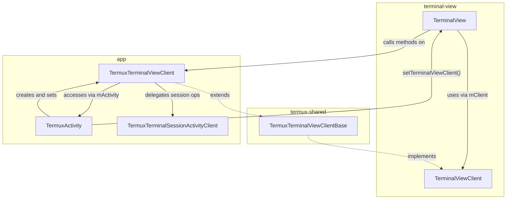

Sources: `[terminal-view/src/main/java/com/termux/view/TerminalViewClient.java:1-83]()`, `[app/src/main/java/com/termux/app/terminal/TermuxTerminalViewClient.java:56-79]()`, `[terminal-view/src/main/java/com/termux/view/TerminalView.java:58,270-272]()`

## Interface Method Categories

The `TerminalViewClient` interface defines methods organized into functional categories:

| Category | Methods | Purpose |
|----------|---------|---------|
| **Gesture Callbacks** | `onScale()`, `onSingleTapUp()`, `onLongPress()` | Handle user touch gestures |
| **Configuration Queries** | `shouldBackButtonBeMappedToEscape()`, `shouldEnforceCharBasedInput()`, `shouldUseCtrlSpaceWorkaround()`, `isTerminalViewSelected()` | Provide terminal behavior configuration |
| **Mode Notifications** | `copyModeChanged()`, `onEmulatorSet()` | Notify client of state changes |
| **Key Event Processing** | `onKeyDown()`, `onKeyUp()`, `onCodePoint()` | Process keyboard input before terminal |
| **Modifier Key State** | `readControlKey()`, `readAltKey()`, `readShiftKey()`, `readFnKey()` | Query modifier key states |
| **Logging** | `logError()`, `logWarn()`, `logInfo()`, `logDebug()`, `logVerbose()`, `logStackTraceWithMessage()`, `logStackTrace()` | Delegate logging to client |

Sources: `[terminal-view/src/main/java/com/termux/view/TerminalViewClient.java:17-83]()`

## Gesture and Scale Handling

### onScale

Title: Scale Gesture Data Flow
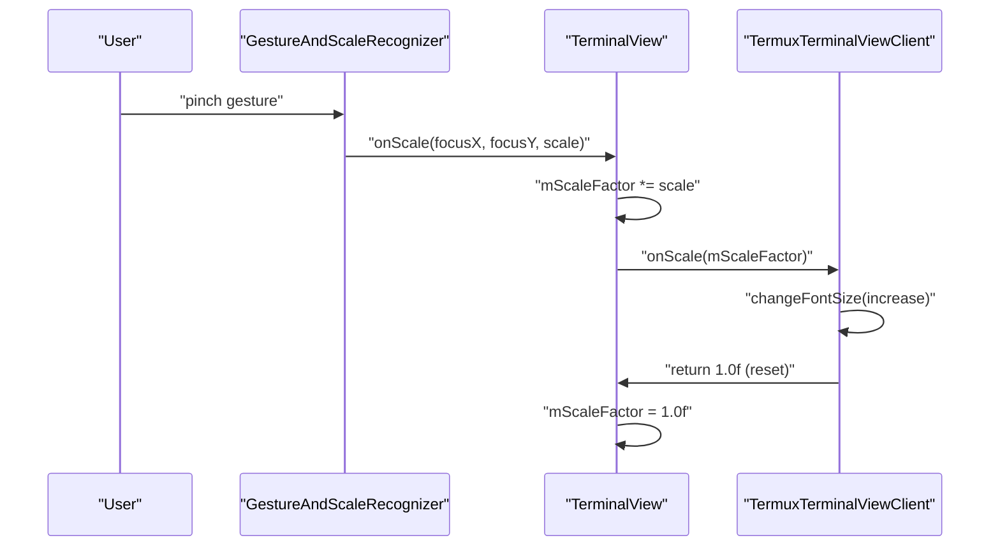

The `onScale()` method is called when the user performs a pinch-to-zoom gesture. The implementation in `TermuxTerminalViewClient` converts scale gestures to discrete font size increments rather than continuous scaling. If the scale factor exceeds the 0.9-1.1 range, it calls `changeFontSize()` and returns `1.0f` to reset the accumulator.

Sources: `[terminal-view/src/main/java/com/termux/view/TerminalView.java:189-194]`, `[app/src/main/java/com/termux/app/terminal/TermuxTerminalViewClient.java:173-181,519-522]()`

### onSingleTapUp

The `onSingleTapUp()` method handles tap events when text selection is not active and mouse tracking is disabled. The Termux implementation performs URL detection and keyboard visibility toggling:

1. **URL Opening:** If `open-terminal-transcript-url-on-click` property is enabled, it extracts URLs from the tapped word using `TermuxUrlUtils.extractUrls()` and opens the first match.
2. **Keyboard Display:** Shows the soft keyboard via `KeyboardUtils.showSoftKeyboard()` if not disabled.

Sources: `[terminal-view/src/main/java/com/termux/view/TerminalView.java:157-167]`, `[app/src/main/java/com/termux/app/terminal/TermuxTerminalViewClient.java:185-207]()`

### onLongPress

The default implementation returns `false`, allowing `TerminalView` to proceed with text selection mode initiation. Clients can return `true` to prevent text selection.

Sources: `[terminal-view/src/main/java/com/termux/view/TerminalView.java:250-257]`, `[app/src/main/java/com/termux/app/terminal/TermuxTerminalViewClient.java:354-356]()`

## Configuration Queries

These methods allow `TerminalView` to query runtime configuration from the client:

Title: Configuration Query Flow
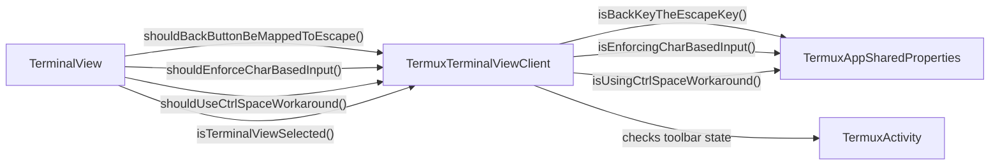

| Method | Property Queried | Default | Purpose |
|--------|-----------------|---------|---------|
| `shouldBackButtonBeMappedToEscape()` | `back-key` | `escape` | Maps BACK key to ESC instead of system back |
| `shouldEnforceCharBasedInput()` | `enforce-char-based-input` | `true` | Uses `TYPE_TEXT_VARIATION_VISIBLE_PASSWORD` input type |
| `shouldUseCtrlSpaceWorkaround()` | `ctrl-space-workaround` | `false` | Fixes Ctrl+Space on some ROMs |
| `isTerminalViewSelected()` | N/A | Runtime | Whether terminal has focus vs toolbar input |

Sources: `[app/src/main/java/com/termux/app/terminal/TermuxTerminalViewClient.java:210-227]`, `[terminal-view/src/main/java/com/termux/view/TerminalView.java:312,654,663]()`

## Key Event Processing

### Hardware Key Processing

The `onKeyDown()` method intercepts hardware key events before they reach the terminal emulator, enabling keyboard shortcuts:

Title: Hardware Key Processing Flow
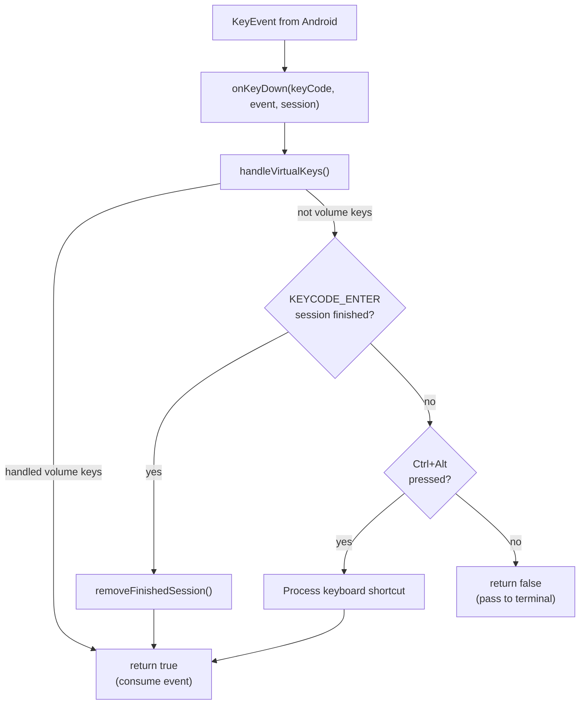

**Ctrl+Alt Keyboard Shortcuts:**

| Shortcut | Unicode Char | Action | Implementation |
|----------|--------------|--------|----------------|
| Ctrl+Alt+C | `c` | Create new session | `addNewSession(false, null)` |
| Ctrl+Alt+N | `n` | Next session | `switchToSession(true)` |
| Ctrl+Alt+P | `p` | Previous session | `switchToSession(false)` |
| Ctrl+Alt+R | `r` | Rename session | `renameSession(currentSession)` |
| Ctrl+Alt+K | `k` | Toggle keyboard | `onToggleSoftKeyboardRequest()` |
| Ctrl+Alt+M | `m` | Show context menu | `showContextMenu()` |
| Ctrl+Alt+U | `u` | Show URL selection | `showUrlSelection()` |
| Ctrl+Alt+V | `v` | Paste | `doPaste()` |
| Ctrl+Alt+Plus | `+` | Increase font size | `changeFontSize(true)` |
| Ctrl+Alt+Minus | `-` | Decrease font size | `changeFontSize(false)` |
| Ctrl+Alt+1-9 | `1`-`9` | Switch to session N | `switchToSession(index)` |
| Ctrl+Alt+↓ | DPAD_DOWN | Next session | `switchToSession(true)` |
| Ctrl+Alt+↑ | DPAD_UP | Previous session | `switchToSession(false)` |
| Ctrl+Alt+→ | DPAD_RIGHT | Open drawer | `openDrawer(Gravity.LEFT)` |
| Ctrl+Alt+← | DPAD_LEFT | Close drawer | `closeDrawers()` |

Sources: `[app/src/main/java/com/termux/app/terminal/TermuxTerminalViewClient.java:241-287]`, `[terminal-view/src/main/java/com/termux/view/TerminalView.java:769-826]()`

### Code Point Processing

The `onCodePoint()` method processes Unicode code points from the soft keyboard or hardware keyboard:

Title: Code Point Processing Flow
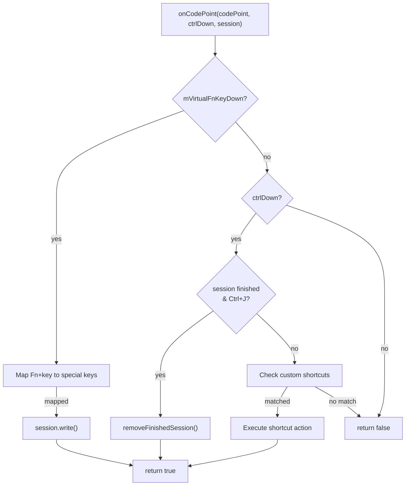

Sources: `[app/src/main/java/com/termux/app/terminal/TermuxTerminalViewClient.java:361-494]`, `[terminal-view/src/main/java/com/termux/view/TerminalView.java:861-909]()`

## Virtual Key Handling

Virtual keys allow volume buttons to act as Ctrl (`KEYCODE_VOLUME_DOWN`) and Fn (`KEYCODE_VOLUME_UP`) modifiers when a hardware keyboard is not present:

Title: Virtual Key Handling Flow
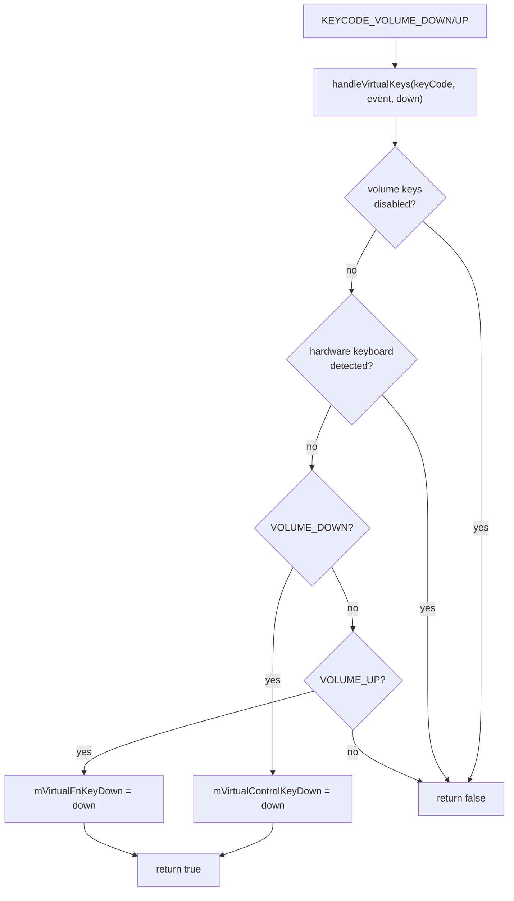

Sources: `[app/src/main/java/com/termux/app/terminal/TermuxTerminalViewClient.java:303-319,324-351,62-63]`, `[terminal-view/src/main/java/com/termux/view/TerminalView.java:793-835]()`

## Soft Keyboard Management

The client manages soft keyboard visibility based on application states and user preferences:

Title: Soft Keyboard Toggle Behavior
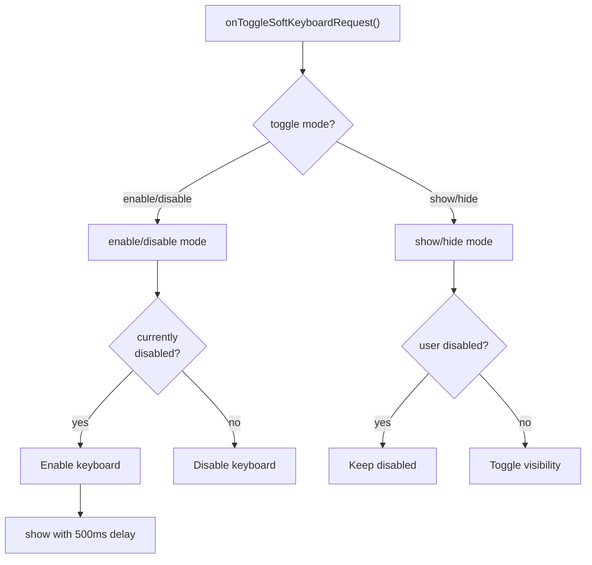

Sources: `[app/src/main/java/com/termux/app/terminal/TermuxTerminalViewClient.java:530-655]()`

## Terminal Cursor Blinking

The client controls cursor blinking state based on activity visibility and configuration:

Title: Terminal Cursor Blinking Sequence
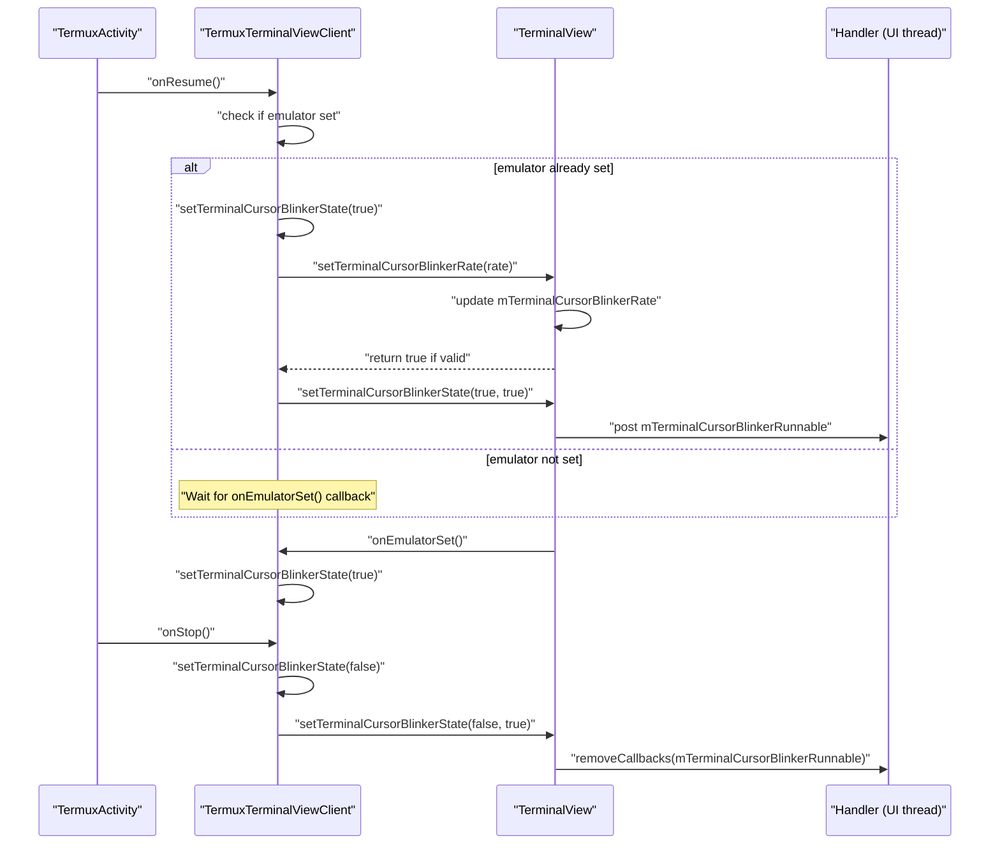

Sources: `[app/src/main/java/com/termux/app/terminal/TermuxTerminalViewClient.java:112-126,130-134,146-152,157-169,659-670]`, `[terminal-view/src/main/java/com/termux/view/TerminalView.java:62-67]()`

## Custom Keyboard Shortcuts

Custom keyboard shortcuts can be defined via `termux.properties`:

Title: Custom Keyboard Shortcuts Resolution
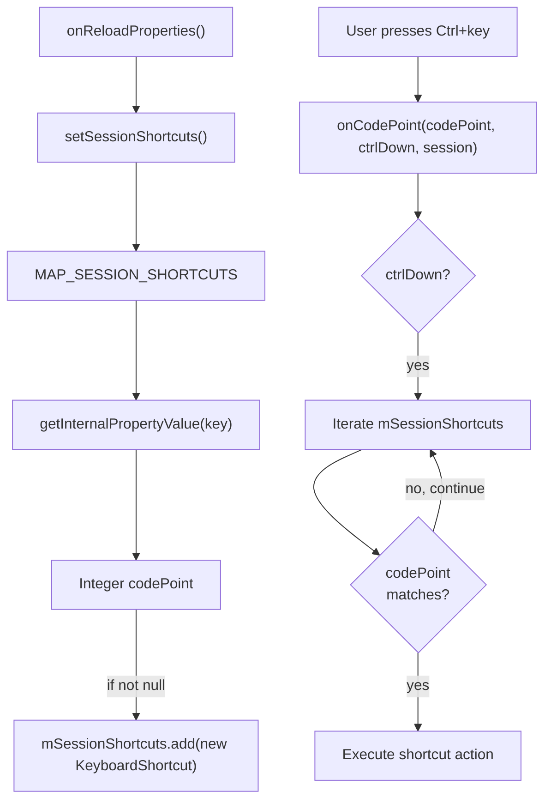

Sources: `[app/src/main/java/com/termux/app/terminal/TermuxTerminalViewClient.java:139-141,468-513]`, `[app/src/main/java/com/termux/app/terminal/io/KeyboardShortcut.java:1-13]()`

## Lifecycle Integration

The `TermuxTerminalViewClient` lifecycle is synchronized with `TermuxActivity`:

Title: Lifecycle Integration Sequence
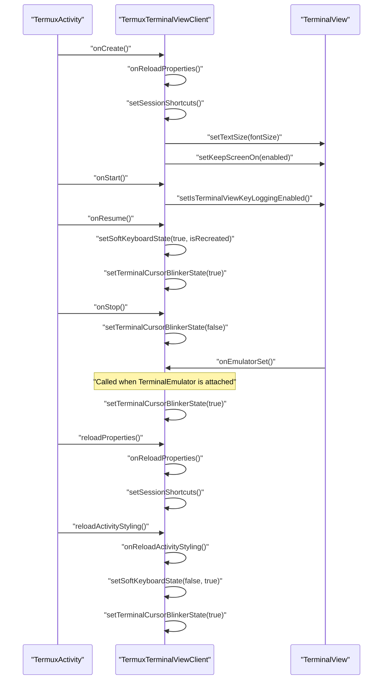

Sources: `[app/src/main/java/com/termux/app/terminal/TermuxTerminalViewClient.java:86-152]()`

## Logging Delegation

Logging methods called by `TerminalView` are delegated to the `Logger` utility in `termux-shared`:

Title: Logging Delegation Architecture
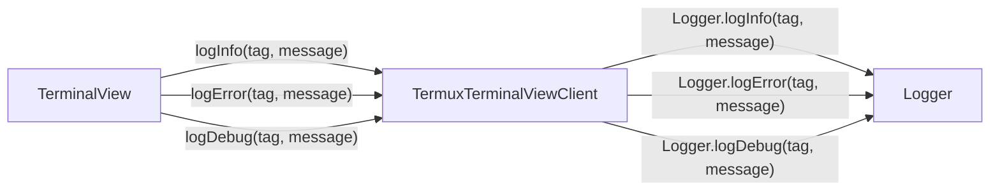

Sources: `[terminal-view/src/main/java/com/termux/view/TerminalViewClient.java:69-82]`, `[terminal-view/src/main/java/com/termux/view/TerminalView.java:345,356,648,771]()`, `[app/src/main/java/com/termux/app/terminal/TermuxTerminalViewClient.java:37]()`

---

