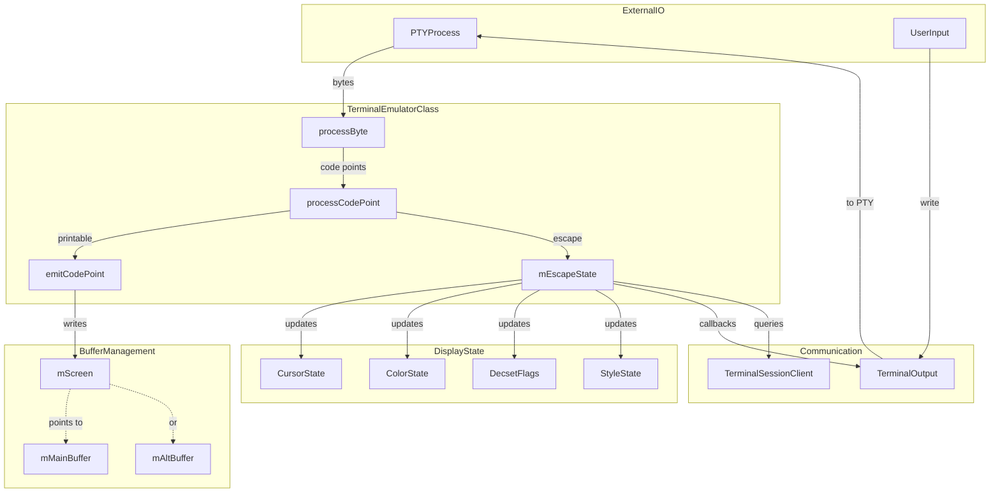
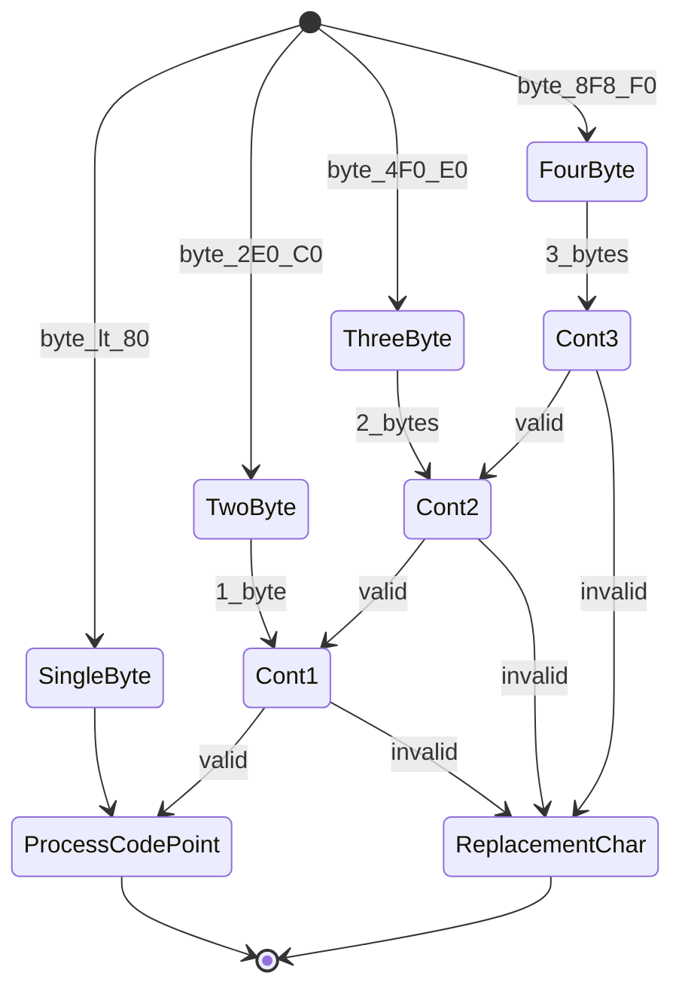
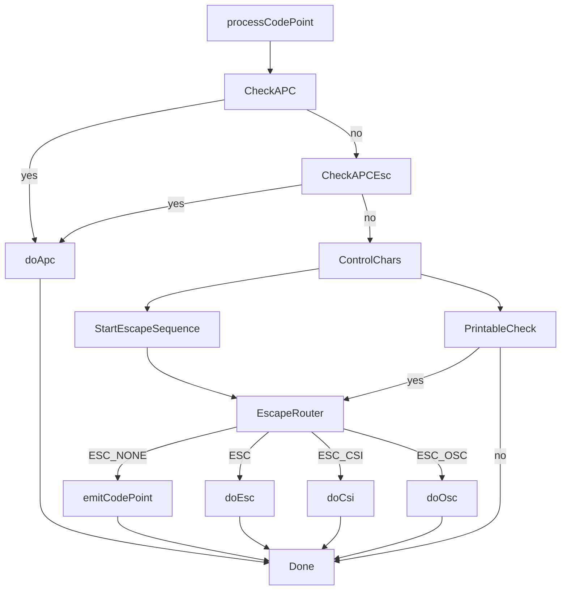

<!-- source: DeepWiki mcp.deepwiki.com · repo termux/termux-app · page 4.3 TerminalEmulator · fetched 2026-10-26 -->

# TerminalEmulator

Relevant source files

The following files were used as context for generating this wiki page:

- [terminal-emulator/src/main/java/com/termux/terminal/TerminalEmulator.java](terminal-emulator/src/main/java/com/termux/terminal/TerminalEmulator.java)
- [terminal-emulator/src/main/java/com/termux/terminal/TerminalOutput.java](terminal-emulator/src/main/java/com/termux/terminal/TerminalOutput.java)
- [terminal-emulator/src/test/java/com/termux/terminal/ControlSequenceIntroducerTest.java](terminal-emulator/src/test/java/com/termux/terminal/ControlSequenceIntroducerTest.java)
- [terminal-emulator/src/test/java/com/termux/terminal/HistoryTest.java](terminal-emulator/src/test/java/com/termux/terminal/HistoryTest.java)
- [terminal-emulator/src/test/java/com/termux/terminal/ResizeTest.java](terminal-emulator/src/test/java/com/termux/terminal/ResizeTest.java)
- [terminal-emulator/src/test/java/com/termux/terminal/ScrollRegionTest.java](terminal-emulator/src/test/java/com/termux/terminal/ScrollRegionTest.java)
- [terminal-emulator/src/test/java/com/termux/terminal/TerminalRowTest.java](terminal-emulator/src/test/java/com/termux/terminal/TerminalRowTest.java)
- [terminal-emulator/src/test/java/com/termux/terminal/TerminalTest.java](terminal-emulator/src/test/java/com/termux/terminal/TerminalTest.java)
- [terminal-emulator/src/test/java/com/termux/terminal/TerminalTestCase.java](terminal-emulator/src/test/java/com/termux/terminal/TerminalTestCase.java)

## Purpose and Scope

`TerminalEmulator` is the core terminal emulation engine in the `terminal-emulator` module located at `[terminal-emulator/src/main/java/com/termux/terminal/TerminalEmulator.java:31-3569]()`. It implements a subset of the xterm terminal specification, which itself emulates the Digital Equipment Corporation VT100 terminal `[terminal-emulator/src/main/java/com/termux/terminal/TerminalEmulator.java:11-13]()`. This class is responsible for processing byte streams from shell processes, interpreting ANSI escape sequences, managing terminal screen states, and updating display buffers.

For information about screen buffers, terminal rows, text styling, character widths, color schemes, Sixel graphics, and the rendering pipeline, see [Screen Buffers and Rendering](#4.3.1). For session lifecycle management and PTY process wrapping, see [Terminal Sessions](#4.4). For view-level event handling and keyboard shortcuts, see [TerminalViewClient Interface](#4.2).

**Sources:** [terminal-emulator/src/main/java/com/termux/terminal/TerminalEmulator.java:11-30]()

## Architecture Overview

### Component Relationships

**Sources:** [terminal-emulator/src/main/java/com/termux/terminal/TerminalEmulator.java:164-177](), [terminal-emulator/src/main/java/com/termux/terminal/TerminalEmulator.java:328-339]()

### Key Class Members

| Member | Type | Purpose |
|--------|------|---------|
| `mMainBuffer` | `TerminalBuffer` | Main screen buffer with scrollback history |
| `mAltBuffer` | `TerminalBuffer` | Alternate screen buffer (no scrollback) |
| `mScreen` | `TerminalBuffer` | Points to currently active buffer |
| `mSession` | `TerminalOutput` | Callback interface for output to shell |
| `mClient` | `TerminalSessionClient` | Callback interface for UI events |
| `mEscapeState` | `int` | Current state in escape sequence parser |
| `mCursorRow`, `mCursorCol` | `int` | Current cursor position |
| `mForeColor`, `mBackColor` | `int` | Current foreground/background colors |
| `mEffect` | `int` | Current text style effects (bold, underline, etc.) |
| `mCurrentDecSetFlags` | `int` | Bit flags for terminal modes |

**Sources:** [terminal-emulator/src/main/java/com/termux/terminal/TerminalEmulator.java:134-274]()

## Input Processing Pipeline

### UTF-8 Byte Processing

The emulator accepts raw bytes from the shell process and decodes them into Unicode code points using a state machine implemented in `[terminal-emulator/src/main/java/com/termux/terminal/TerminalEmulator.java:505-568]()`.

**Sources:** [terminal-emulator/src/main/java/com/termux/terminal/TerminalEmulator.java:505-568]()

### Code Point Processing Flow

**Sources:** [terminal-emulator/src/main/java/com/termux/terminal/TerminalEmulator.java:570-662]()

## Escape Sequence State Machine

### State Constants and Transitions

The emulator uses a state machine with 24 distinct states to parse escape sequences (`[terminal-emulator/src/main/java/com/termux/terminal/TerminalEmulator.java:44-133]()`).

| State Constant | Value | Description |
|----------------|-------|-------------|
| `ESC_NONE` | 0 | Not in an escape sequence |
| `ESC` | 1 | Received ESC character |
| `ESC_POUND` | 2 | ESC # |
| `ESC_SELECT_LEFT_PAREN` | 3 | ESC ( - G0 charset select |
| `ESC_SELECT_RIGHT_PAREN` | 4 | ESC ) - G1 charset select |
| `ESC_CSI` | 6 | ESC [ - Control Sequence Introducer |
| `ESC_CSI_QUESTIONMARK` | 7 | ESC [ ? |
| `ESC_CSI_DOLLAR` | 8 | ESC [ $ |
| `ESC_PERCENT` | 9 | ESC % |
| `ESC_OSC` | 10 | ESC ] - Operating System Controls |
| `ESC_OSC__ESC` | 11 | ESC ] ... ESC |
| `ESC_CSI_BIGGERTHAN` | 12 | ESC [ > |
| `ESC_DCS` | 13 | ESC P - Device Control String |

**Sources:** [terminal-emulator/src/main/java/com/termux/terminal/TerminalEmulator.java:44-133]()

### CSI and OSC Processing

Control Sequence Introducer (CSI) sequences are handled via `doCsi(int b)` (`[terminal-emulator/src/main/java/com/termux/terminal/TerminalEmulator.java:1258-1670]()`), DECSET/DECRST via `doCsiQuestionMark(int b)` (`[terminal-emulator/src/main/java/com/termux/terminal/TerminalEmulator.java:1672-1716]()`), and SGR parameter parsing via `doSelectGraphicRendition(int code)` (`[terminal-emulator/src/main/java/com/termux/terminal/TerminalEmulator.java:1916-2097]()`). Operating System Controls (OSC) handle titles, clipboard, and palette colors (`[terminal-emulator/src/main/java/com/termux/terminal/TerminalEmulator.java:2099-2288]()`).

**Sources:** [terminal-emulator/src/main/java/com/termux/terminal/TerminalEmulator.java:1258-2288]()

## Dual Buffer System

### Main Buffer vs Alternate Buffer

The emulator maintains two independent screen buffers: `mMainBuffer` (with scrollback history) and `mAltBuffer` (without scrollback history, used by full-screen programs like vim) (`[terminal-emulator/src/main/java/com/termux/terminal/TerminalEmulator.java:164-174]`, `[terminal-emulator/src/main/java/com/termux/terminal/TerminalEmulator.java:330-339]()`).

For details on `TerminalBuffer` implementation, allocation, rows, and rendering, see [Screen Buffers and Rendering](#4.3.1).

**Sources:** [terminal-emulator/src/main/java/com/termux/terminal/TerminalEmulator.java:164-174](), [terminal-emulator/src/main/java/com/termux/terminal/TerminalEmulator.java:328-339]()

## Cursor and Display State Management

### DECSET Mode Flags

Terminal mode settings are stored as bit flags in `mCurrentDecSetFlags` (`[terminal-emulator/src/main/java/com/termux/terminal/TerminalEmulator.java:97-132]`, `[terminal-emulator/src/main/java/com/termux/terminal/TerminalEmulator.java:296-326]()`), covering application cursor keys, origin mode, autowrap, cursor visibility, mouse tracking protocols, and bracketed paste mode.

**Sources:** [terminal-emulator/src/main/java/com/termux/terminal/TerminalEmulator.java:97-132](), [terminal-emulator/src/main/java/com/termux/terminal/TerminalEmulator.java:296-326]()

### Color and Style Management

Colors and text styles (`mForeColor`, `mBackColor`, `mEffect`) are managed and combined into encoded styles (`[terminal-emulator/src/main/java/com/termux/terminal/TerminalEmulator.java:246-257]()`). For deep details on `TextStyle`, text attributes, and color palettes, see [Screen Buffers and Rendering](#4.3.1).

**Sources:** [terminal-emulator/src/main/java/com/termux/terminal/TerminalEmulator.java:246-257]()

## Character Emission and Screen Updates

Character emission is driven by `emitCodePoint(int codePoint)` (`[terminal-emulator/src/main/java/com/termux/terminal/TerminalEmulator.java:2290-2371]()`), which handles line wrapping, combining characters, double-width characters, and scrolling region boundaries (`[terminal-emulator/src/main/java/com/termux/terminal/TerminalEmulator.java:2459-2538]()`).

**Sources:** [terminal-emulator/src/main/java/com/termux/terminal/TerminalEmulator.java:2290-2371](), [terminal-emulator/src/main/java/com/termux/terminal/TerminalEmulator.java:2459-2538]()

## Mouse Tracking and Resizing

Mouse events are dispatched via `sendMouseEvent` (`[terminal-emulator/src/main/java/com/termux/terminal/TerminalEmulator.java:365-384]`, `[terminal-emulator/src/main/java/com/termux/terminal/TerminalEmulator.java:484-487]()`), supporting legacy and SGR protocols. Terminal resizing is handled via `resize(...)` (`[terminal-emulator/src/main/java/com/termux/terminal/TerminalEmulator.java:386-422]()`), preserving screen content, reflow wrapping, and scrollback history.

**Sources:** [terminal-emulator/src/main/java/com/termux/terminal/TerminalEmulator.java:365-422](), [terminal-emulator/src/main/java/com/termux/terminal/TerminalEmulator.java:484-487]()

## Testing Infrastructure

The terminal emulator core logic is validated extensively through unit tests like `TerminalTest` (`[terminal-emulator/src/test/java/com/termux/terminal/TerminalTest.java:1-167]()`), `ControlSequenceIntroducerTest` (`[terminal-emulator/src/test/java/com/termux/terminal/ControlSequenceIntroducerTest.java:1-131]()`), and `ScrollRegionTest` (`[terminal-emulator/src/test/java/com/termux/terminal/ScrollRegionTest.java:1-148]()`) using `TerminalTestCase` (`[terminal-emulator/src/test/java/com/termux/terminal/TerminalTestCase.java:1-205]()`).

**Sources:** [terminal-emulator/src/test/java/com/termux/terminal/TerminalTest.java:1-167](), [terminal-emulator/src/test/java/com/termux/terminal/TerminalTestCase.java:1-205]()

---

