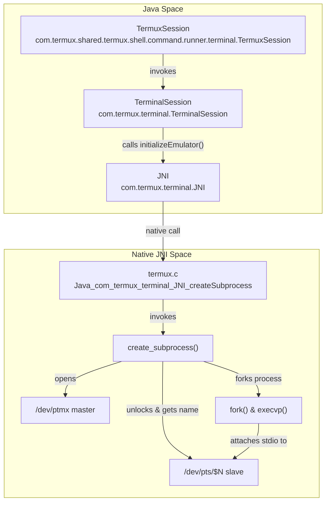
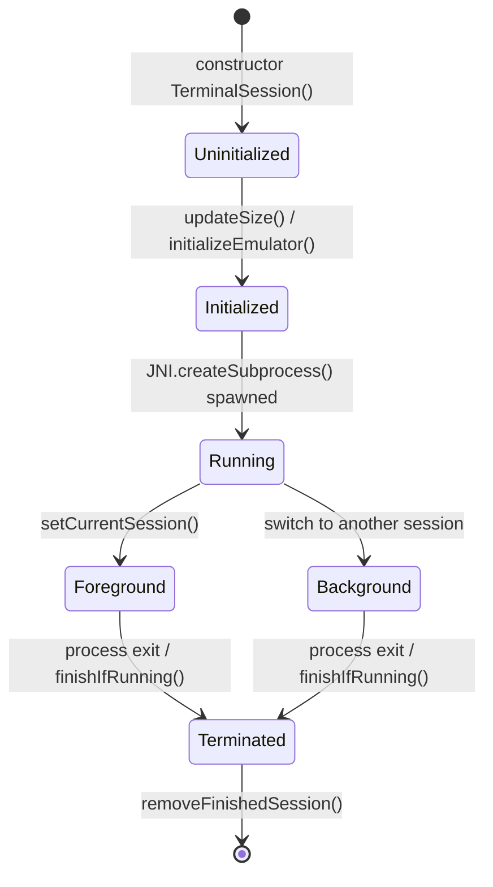
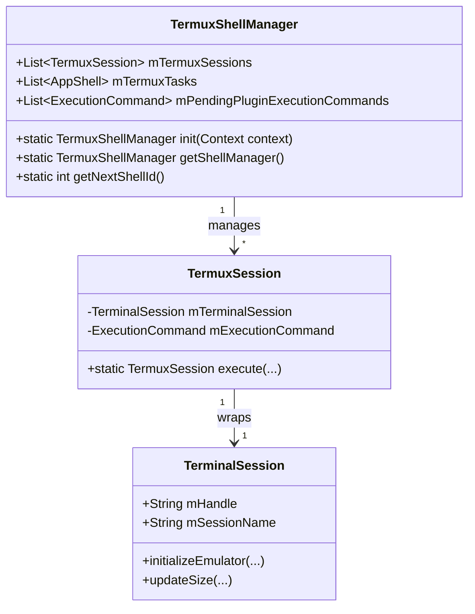
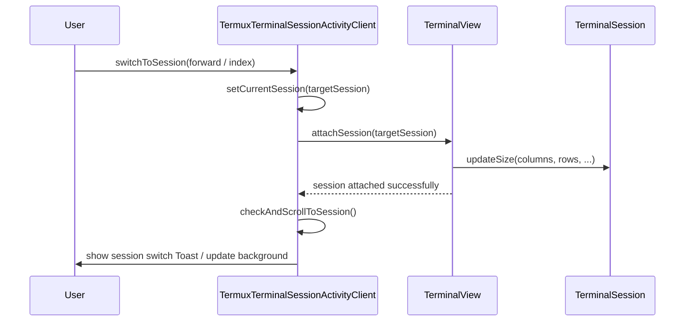

<!-- source: DeepWiki mcp.deepwiki.com · repo termux/termux-app · page 4.4 Terminal Sessions · fetched 2026-10-26 -->

# Terminal Sessions

Relevant source files

The following files were used as context for generating this wiki page:

- [terminal-emulator/src/main/java/com/termux/terminal/JNI.java](terminal-emulator/src/main/java/com/termux/terminal/JNI.java)
- [terminal-emulator/src/main/java/com/termux/terminal/TerminalSession.java](terminal-emulator/src/main/java/com/termux/terminal/TerminalSession.java)
- [terminal-emulator/src/main/java/com/termux/terminal/TerminalSessionClient.java](terminal-emulator/src/main/java/com/termux/terminal/TerminalSessionClient.java)
- [terminal-emulator/src/main/jni/termux.c](terminal-emulator/src/main/jni/termux.c)
- [termux-shared/src/main/java/com/termux/shared/settings/preferences/SharedPreferenceUtils.java](termux-shared/src/main/java/com/termux/shared/settings/preferences/SharedPreferenceUtils.java)
- [termux-shared/src/main/java/com/termux/shared/shell/command/ExecutionCommand.java](termux-shared/src/main/java/com/termux/shared/shell/command/ExecutionCommand.java)
- [termux-shared/src/main/java/com/termux/shared/shell/command/environment/AndroidShellEnvironment.java](termux-shared/src/main/java/com/termux/shared/shell/command/environment/AndroidShellEnvironment.java)
- [termux-shared/src/main/java/com/termux/shared/shell/command/environment/IShellEnvironment.java](termux-shared/src/main/java/com/termux/shared/shell/command/environment/IShellEnvironment.java)
- [termux-shared/src/main/java/com/termux/shared/shell/command/environment/ShellCommandShellEnvironment.java](termux-shared/src/main/java/com/termux/shared/shell/command/environment/ShellCommandShellEnvironment.java)
- [termux-shared/src/main/java/com/termux/shared/shell/command/environment/UnixShellEnvironment.java](termux-shared/src/main/java/com/termux/shared/shell/command/environment/UnixShellEnvironment.java)
- [termux-shared/src/main/java/com/termux/shared/shell/command/runner/app/AppShell.java](termux-shared/src/main/java/com/termux/shared/shell/command/runner/app/AppShell.java)
- [termux-shared/src/main/java/com/termux/shared/termux/extrakeys/ExtraKeysInfo.java](termux-shared/src/main/java/com/termux/shared/termux/extrakeys/ExtraKeysInfo.java)
- [termux-shared/src/main/java/com/termux/shared/termux/file/TermuxFileUtils.java](termux-shared/src/main/java/com/termux/shared/termux/file/TermuxFileUtils.java)
- [termux-shared/src/main/java/com/termux/shared/termux/settings/preferences/TermuxPreferenceConstants.java](termux-shared/src/main/java/com/termux/shared/termux/settings/preferences/TermuxPreferenceConstants.java)
- [termux-shared/src/main/java/com/termux/shared/termux/shell/TermuxShellManager.java](termux-shared/src/main/java/com/termux/shared/termux/shell/TermuxShellManager.java)
- [termux-shared/src/main/java/com/termux/shared/termux/shell/command/environment/TermuxShellCommandShellEnvironment.java](termux-shared/src/main/java/com/termux/shared/termux/shell/command/environment/TermuxShellCommandShellEnvironment.java)
- [termux-shared/src/main/java/com/termux/shared/termux/shell/command/runner/terminal/TermuxSession.java](termux-shared/src/main/java/com/termux/shared/termux/shell/command/runner/terminal/TermuxSession.java)
- [termux-shared/src/main/java/com/termux/shared/termux/terminal/TermuxTerminalSessionClientBase.java](termux-shared/src/main/java/com/termux/shared/termux/terminal/TermuxTerminalSessionClientBase.java)

This page documents the terminal session management system in Termux, covering the terminal session lifecycle, `TerminalSession` and JNI pseudo-terminal (`pty`) creation (`terminal-emulator/src/main/jni/termux.c`), `TermuxTerminalSessionActivityClient`, session switching mechanisms, and state management via `TermuxShellManager`.

## Overview

Terminal sessions represent individual shell instances running inside the Termux application. Each active session is composed of:
- A `TerminalSession` instance (`[terminal-emulator/src/main/java/com/termux/terminal/TerminalSession.java]`) managing the emulation state, character buffers, and I/O worker threads.
- A native PTY subprocess spawned via JNI (`[terminal-emulator/src/main/jni/termux.c]`).
- A `TermuxSession` wrapper (`[termux-shared/src/main/java/com/termux/shared/termux/shell/command/runner/terminal/TermuxSession.java]`) linking the terminal session to an `ExecutionCommand` (`[termux-shared/src/main/java/com/termux/shared/shell/command/ExecutionCommand.java]()`).
- A managed entry within `TermuxShellManager` (`[termux-shared/src/main/java/com/termux/shared/termux/shell/TermuxShellManager.java]()`).

Sources: [terminal-emulator/src/main/java/com/termux/terminal/TerminalSession.java:31-79](), [termux-shared/src/main/java/com/termux/shared/termux/shell/command/runner/terminal/TermuxSession.java:32-47]()

## Session Architecture and PTY Creation

The creation of a terminal session involves a bridge between Java-level configuration and native POSIX pseudo-terminal allocation via `JNI.createSubprocess` (`[terminal-emulator/src/main/java/com/termux/terminal/JNI.java]`).

Sources: [terminal-emulator/src/main/java/com/termux/terminal/TerminalSession.java:123-130](), [terminal-emulator/src/main/jni/termux.c:25-115](), [terminal-emulator/src/main/java/com/termux/terminal/JNI.java:12-26]()

### Native PTY Allocation Details
In `[terminal-emulator/src/main/jni/termux.c]()`, `create_subprocess` executes the following sequence:
1. Opens `/dev/ptmx` in `O_RDWR | O_CLOEXEC` mode to acquire the master pseudo-terminal file descriptor (`ptm`) [terminal-emulator/src/main/jni/termux.c:36-37]().
2. Calls `grantpt()`, `unlockpt()`, and `ptsname_r()` to resolve the slave pseudo-terminal path (`devname`) [terminal-emulator/src/main/jni/termux.c:44-52]().
3. Configures terminal attributes (`termios`), enabling `IUTF8` and disabling flow control flags (`IXON`, `IXOFF`) to prevent `Ctrl+S` lockups [terminal-emulator/src/main/jni/termux.c:54-59]().
4. Sets the initial terminal window size via `ioctl(ptm, TIOCSWINSZ, &sz)` [terminal-emulator/src/main/jni/termux.c:61-63]().
5. Forks the process via `fork()` [terminal-emulator/src/main/jni/termux.c:65]().
   - **Parent process**: Returns the master file descriptor `ptm` and records the child PID (`*pProcessId`) [terminal-emulator/src/main/jni/termux.c:68-70]().
   - **Child process**: Unblocks signals, closes `ptm`, calls `setsid()`, opens the slave device (`pts`), duplicates file descriptors to stdin/stdout/stderr (0, 1, 2), clears environment variables, applies working directory changes via `chdir()`, and executes the command via `execvp()` [terminal-emulator/src/main/jni/termux.c:71-114]().

Sources: [terminal-emulator/src/main/jni/termux.c:25-115]()

## Session Lifecycle

Sources: [terminal-emulator/src/main/java/com/termux/terminal/TerminalSession.java:82-129](), [termux-shared/src/main/java/com/termux/shared/termux/shell/command/runner/terminal/TermuxSession.java:77-127]()

### I/O Handling Threads
Once `TerminalSession.initializeEmulator()` spawns the subprocess, three dedicated threads are initiated:
- **`TermSessionInputReader`**: Reads output from `FileInputStream` wrapped around the terminal file descriptor and pushes incoming bytes into `mProcessToTerminalIOQueue`, notifying `MainThreadHandler` (`MSG_NEW_INPUT`) [terminal-emulator/src/main/java/com/termux/terminal/TerminalSession.java:133-148]().
- **`TermSessionOutputWriter`**: Reads from `mTerminalToProcessIOQueue` and writes user-generated interactive input down to the terminal file descriptor via `FileOutputStream` [terminal-emulator/src/main/java/com/termux/terminal/TerminalSession.java:150-164]().
- **`TermSessionWaiter`**: Waits for process termination using `JNI.waitFor(mShellPid)`.

Sources: [terminal-emulator/src/main/java/com/termux/terminal/TerminalSession.java:133-166]()

Sources: [terminal-emulator/src/main/java/com/termux/terminal/TerminalSession.java:133-166](), [terminal-emulator/src/main/jni/termux.c:25-115]()

## TermuxShellManager and Session Registry

The `TermuxShellManager` singleton (`[termux-shared/src/main/java/com/termux/shared/termux/shell/TermuxShellManager.java]`) tracks active foreground sessions, background tasks, and pending execution commands.

Sources: [termux-shared/src/main/java/com/termux/shared/termux/shell/TermuxShellManager.java:17-123](), [termux-shared/src/main/java/com/termux/shared/termux/shell/command/runner/terminal/TermuxSession.java:32-47]()

### Managing Shell Numbers and IDs
`TermuxShellManager` maintains boot counters and session incrementers such as `getAndIncrementTerminalSessionNumberSinceAppStart()` to ensure consistent environment variables (`ENV_SHELL_CMD__TERMINAL_SESSION_NUMBER_SINCE_BOOT`) across shell lifecycles [termux-shared/src/main/java/com/termux/shared/termux/shell/TermuxShellManager.java:113-121]().

Sources: [termux-shared/src/main/java/com/termux/shared/termux/shell/TermuxShellManager.java:82-123]()

## Session Switching and Client Integration

`TermuxTerminalSessionActivityClient` implements the `TerminalSessionClient` interface (`[terminal-emulator/src/main/java/com/termux/terminal/TerminalSessionClient.java]`) to handle UI-bound callbacks, clipboard requests, notifications, and view resizing.

Sources: [terminal-emulator/src/main/java/com/termux/terminal/TerminalSessionClient.java:11-51]()

Sources: [terminal-emulator/src/main/java/com/termux/terminal/TerminalSessionClient.java:11-51]()

---

