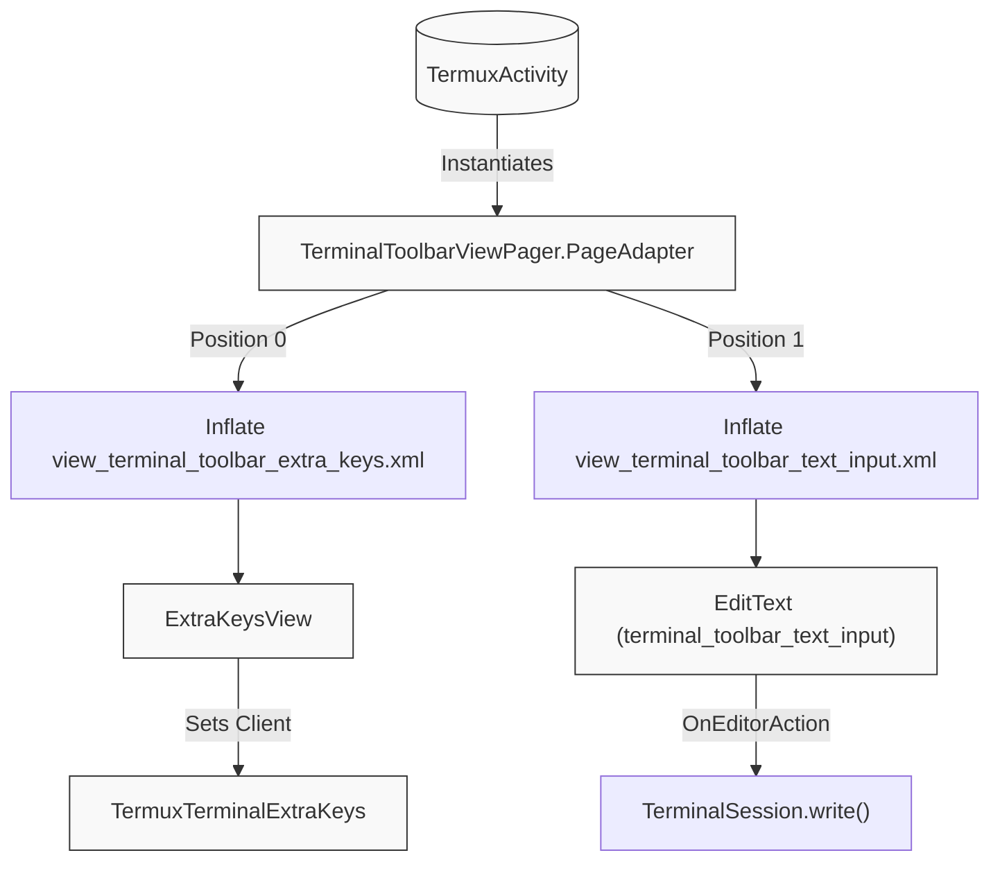
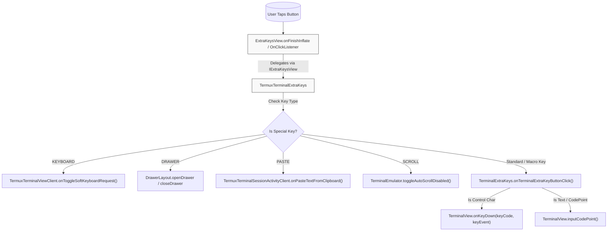

<!-- source: DeepWiki mcp.deepwiki.com · repo termux/termux-app · page 4.5 Extra Keys and Terminal Toolbar · fetched 2026-10-26 -->

# Extra Keys and Terminal Toolbar

Relevant source files

The following files were used as context for generating this wiki page:

- [app/src/main/java/com/termux/app/terminal/TermuxSessionsListViewController.java](app/src/main/java/com/termux/app/terminal/TermuxSessionsListViewController.java)
- [app/src/main/java/com/termux/app/terminal/TermuxTerminalSessionServiceClient.java](app/src/main/java/com/termux/app/terminal/TermuxTerminalSessionServiceClient.java)
- [app/src/main/java/com/termux/app/terminal/io/TerminalToolbarViewPager.java](app/src/main/java/com/termux/app/terminal/io/TerminalToolbarViewPager.java)
- [app/src/main/java/com/termux/app/terminal/io/TermuxTerminalExtraKeys.java](app/src/main/java/com/termux/app/terminal/io/TermuxTerminalExtraKeys.java)
- [app/src/main/res/layout/view_terminal_toolbar_extra_keys.xml](app/src/main/res/layout/view_terminal_toolbar_extra_keys.xml)
- [app/src/main/res/layout/view_terminal_toolbar_text_input.xml](app/src/main/res/layout/view_terminal_toolbar_text_input.xml)
- [termux-shared/src/main/java/com/termux/shared/termux/extrakeys/ExtraKeysConstants.java](termux-shared/src/main/java/com/termux/shared/termux/extrakeys/ExtraKeysConstants.java)
- [termux-shared/src/main/java/com/termux/shared/termux/extrakeys/ExtraKeysView.java](termux-shared/src/main/java/com/termux/shared/termux/extrakeys/ExtraKeysView.java)
- [termux-shared/src/main/java/com/termux/shared/termux/extrakeys/SpecialButtonState.java](termux-shared/src/main/java/com/termux/shared/termux/extrakeys/SpecialButtonState.java)
- [termux-shared/src/main/java/com/termux/shared/termux/terminal/io/TerminalExtraKeys.java](termux-shared/src/main/java/com/termux/shared/termux/terminal/io/TerminalExtraKeys.java)

## Purpose and Scope
This document details the architecture and implementation of the Termux extra keys system, the terminal toolbar view pager, text input view, and the sessions list controller. These components provide the auxiliary user interface elements above the software keyboard and within navigation drawers, enabling terminal modifier key simulation, macro execution, quick text entry, and session navigation.

---

## 1. ExtraKeysView and Configuration Architecture

The extra keys UI is driven by `ExtraKeysView`, which extends `GridLayout` to present rows and columns of virtual keys (such as `ESC`, `CTRL`, `ALT`, directional arrows, and custom macros) that are absent or cumbersome on standard software keyboards [termux-shared/src/main/java/com/termux/shared/termux/extrakeys/ExtraKeysView.java:76-76]().

### Core Components
- **`ExtraKeysView`**: Manages button layout, touch gestures, long-press behavior, special button locking, and haptic feedback. It exposes the `IExtraKeysView` interface to delegate click handling [termux-shared/src/main/java/com/termux/shared/termux/extrakeys/ExtraKeysView.java:79-109]().
- **`TerminalExtraKeys`**: Implements `ExtraKeysView.IExtraKeysView` to map extra key codes or strings to `TerminalView` input events or raw session writes [termux-shared/src/main/java/com/termux/shared/termux/terminal/io/TerminalExtraKeys.java:19-85]().
- **`TermuxTerminalExtraKeys`**: Extends `TerminalExtraKeys` to inject Termux application-specific actions such as toggling the soft keyboard (`"KEYBOARD"`), opening the navigation drawer (`"DRAWER"`), pasting text (`"PASTE"`), or toggling auto-scroll (`"SCROLL"`) [app/src/main/java/com/termux/app/terminal/io/TermuxTerminalExtraKeys.java:23-108]().
- **`SpecialButtonState`**: Tracks the toggle and lock states of modifier keys like `CTRL`, `ALT`, `SHIFT`, and `FN` across user interactions [termux-shared/src/main/java/com/termux/shared/termux/extrakeys/SpecialButtonState.java:9-51]().
- **`ExtraKeysConstants`**: Provides key code mappings (`PRIMARY_KEY_CODES_FOR_STRINGS`), repetitive key definitions (`PRIMARY_REPETITIVE_KEYS`), and character display transformation maps (`EXTRA_KEY_DISPLAY_MAPS`) [termux-shared/src/main/java/com/termux/shared/termux/extrakeys/ExtraKeysConstants.java:10-152]().

Sources:
- `termux-shared/src/main/java/com/termux/shared/termux/extrakeys/ExtraKeysView.java`
- `termux-shared/src/main/java/com/termux/shared/termux/terminal/io/TerminalExtraKeys.java`
- `app/src/main/java/com/termux/app/terminal/io/TermuxTerminalExtraKeys.java`
- `termux-shared/src/main/java/com/termux/shared/termux/extrakeys/SpecialButtonState.java`
- `termux-shared/src/main/java/com/termux/shared/termux/extrakeys/ExtraKeysConstants.java`

---

## 2. Terminal Toolbar ViewPager

The terminal toolbar sits directly above the software keyboard and uses a `ViewPager` to let users swipe between the extra keys bar and an independent text input view.

### Implementation Structure
- **`TerminalToolbarViewPager`**: Encapsulates `PageAdapter` and `OnPageChangeListener` [app/src/main/java/com/termux/app/terminal/io/TerminalToolbarViewPager.java:17-115]().
- **`PageAdapter`**: Extends `PagerAdapter` with a count of `2` [app/src/main/java/com/termux/app/terminal/io/TerminalToolbarViewPager.java:19-32]().
  - **Position `0`**: Inflates `view_terminal_toolbar_extra_keys.xml` containing `ExtraKeysView`. It attaches `TermuxTerminalExtraKeys` as the client, configures text casing based on preferences, and initializes key dimensions [app/src/main/java/com/termux/app/terminal/io/TerminalToolbarViewPager.java:41-57]().
  - **Position `1`**: Inflates `view_terminal_toolbar_text_input.xml` containing an `EditText` for pre-composing commands before sending them to the active `TerminalSession` via `session.write()` upon editor action events [app/src/main/java/com/termux/app/terminal/io/TerminalToolbarViewPager.java:58-81]().
- **`OnPageChangeListener`**: Manages focus transitions between the `TerminalView` and the toolbar text input `EditText` [app/src/main/java/com/termux/app/terminal/io/TerminalToolbarViewPager.java:95-115]().

Sources:
- `app/src/main/java/com/termux/app/terminal/io/TerminalToolbarViewPager.java`
- `app/src/main/res/layout/view_terminal_toolbar_extra_keys.xml`
- `app/src/main/res/layout/view_terminal_toolbar_text_input.xml`

---

## 3. Sessions List Controller

The session navigation drawer displays active and historical terminal sessions in a vertical list view controlled by `TermuxSessionsListViewController`.

### Key Responsibilities
- **`TermuxSessionsListViewController`**: Extends `ArrayAdapter<TermuxSession>` and implements `AdapterView.OnItemClickListener` and `AdapterView.OnItemLongClickListener` [app/src/main/java/com/termux/app/terminal/TermuxSessionsListViewController.java:30-30]().
- **Row Rendering (`getView`)**:
  - Formats session titles with numbered prefixes, user-assigned custom names, and active terminal titles using `SpannableString`, bold styles, and italic styling [app/src/main/java/com/termux/app/terminal/TermuxSessionsListViewController.java:42-80]().
  - Applies strike-through text flags to finished or dead sessions [app/src/main/java/com/termux/app/terminal/TermuxSessionsListViewController.java:82-88]().
  - Dynamically switches text color between default theme colors and red based on execution exit status [app/src/main/java/com/termux/app/terminal/TermuxSessionsListViewController.java:89-91]().
- **Interaction Handlers**:
  - `onItemClick`: Switches the current active session to the selected row's session and closes the navigation drawer [app/src/main/java/com/termux/app/terminal/TermuxSessionsListViewController.java:95-100]().
  - `onItemLongClick`: Triggers a session renaming dialog via `TermuxTerminalSessionClient` [app/src/main/java/com/termux/app/terminal/TermuxSessionsListViewController.java:102-107]().

Sources:
- `app/src/main/java/com/termux/app/terminal/TermuxSessionsListViewController.java`

---

## 4. Architecture and Data Flow Diagrams

### Diagram 1: Terminal Toolbar Initialization and Pager Setup
This diagram illustrates how `TermuxActivity` initializes the `TerminalToolbarViewPager` and instantiates either the `ExtraKeysView` or the text input `EditText`.

Sources:
- `app/src/main/java/com/termux/app/terminal/io/TerminalToolbarViewPager.java`
- `app/src/main/java/com/termux/app/terminal/io/TermuxTerminalExtraKeys.java`
- `termux-shared/src/main/java/com/termux/shared/termux/extrakeys/ExtraKeysView.java`

---

### Diagram 2: Extra Key Click Event Routing
This diagram traces the execution path from a user tapping an individual button on the `ExtraKeysView` down to the terminal session or view client.

Sources:
- `termux-shared/src/main/java/com/termux/shared/termux/extrakeys/ExtraKeysView.java`
- `termux-shared/src/main/java/com/termux/shared/termux/terminal/io/TerminalExtraKeys.java`
- `app/src/main/java/com/termux/app/terminal/io/TermuxTerminalExtraKeys.java`

---

