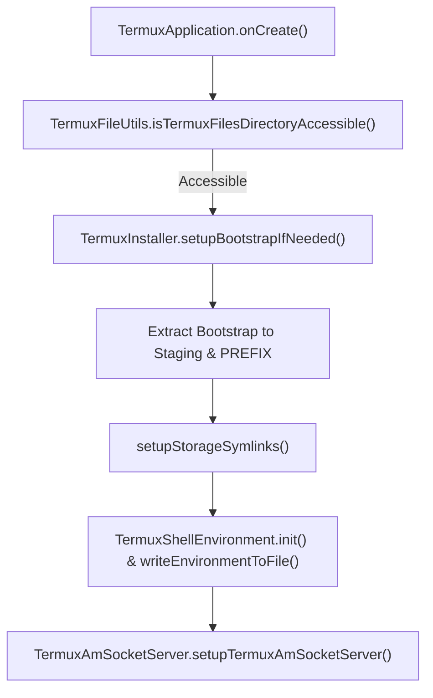
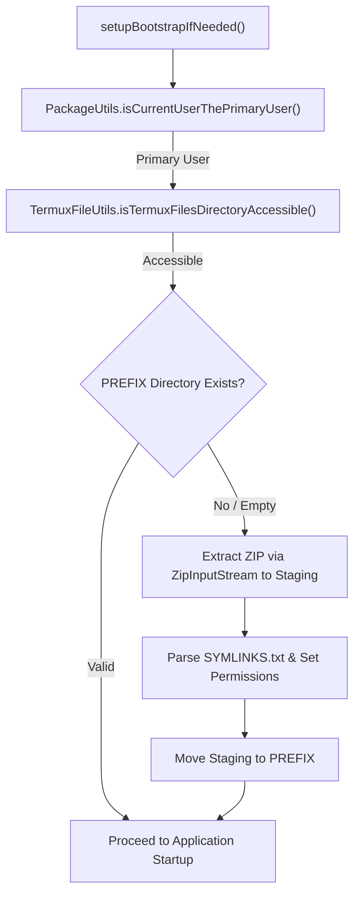
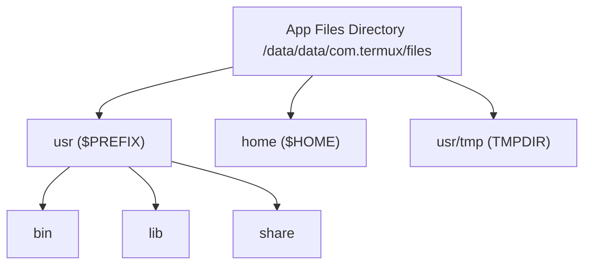
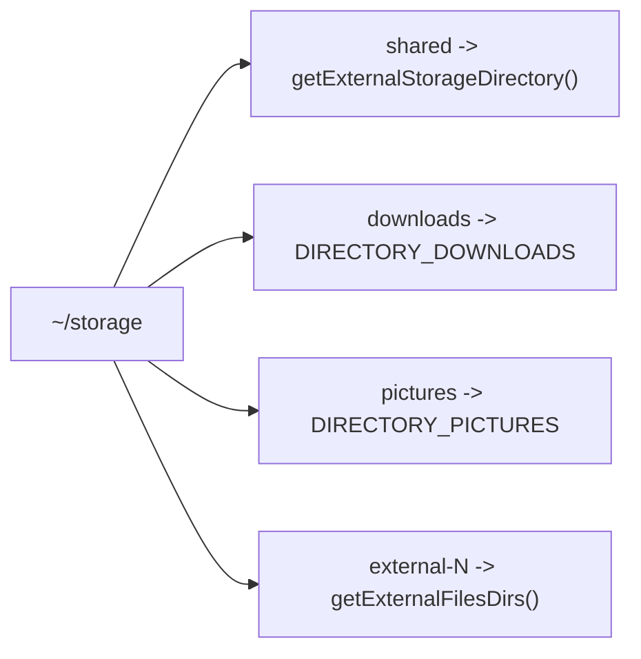
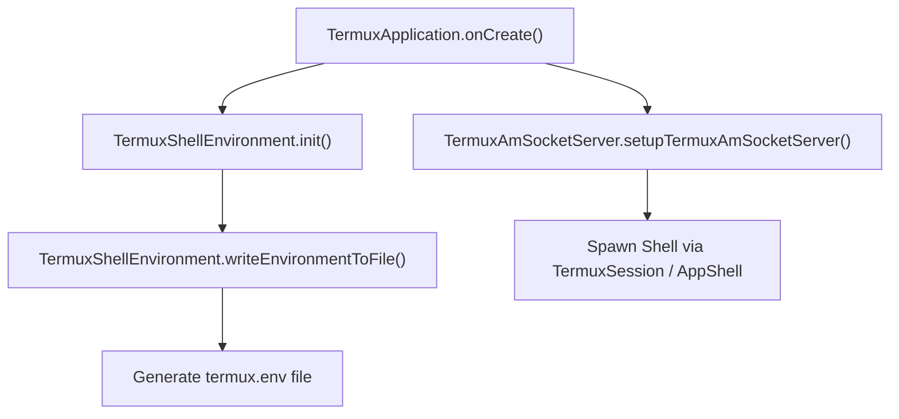

<!-- source: DeepWiki mcp.deepwiki.com · repo termux/termux-app · page 5 Bootstrap and Environment · fetched 2026-10-26 -->

# Bootstrap and Environment

Relevant source files

The following files were used as context for generating this wiki page:

- [app/src/main/java/com/termux/app/TermuxApplication.java](app/src/main/java/com/termux/app/TermuxApplication.java)
- [app/src/main/java/com/termux/app/TermuxInstaller.java](app/src/main/java/com/termux/app/TermuxInstaller.java)
- [app/src/main/java/com/termux/app/event/SystemEventReceiver.java](app/src/main/java/com/termux/app/event/SystemEventReceiver.java)
- [termux-shared/src/main/java/com/termux/shared/errors/Errno.java](termux-shared/src/main/java/com/termux/shared/errors/Errno.java)
- [termux-shared/src/main/java/com/termux/shared/file/FileUtils.java](termux-shared/src/main/java/com/termux/shared/file/FileUtils.java)
- [termux-shared/src/main/java/com/termux/shared/file/FileUtilsErrno.java](termux-shared/src/main/java/com/termux/shared/file/FileUtilsErrno.java)
- [termux-shared/src/main/java/com/termux/shared/file/tests/FileUtilsTests.java](termux-shared/src/main/java/com/termux/shared/file/tests/FileUtilsTests.java)
- [termux-shared/src/main/java/com/termux/shared/shell/command/environment/ShellEnvironmentUtils.java](termux-shared/src/main/java/com/termux/shared/shell/command/environment/ShellEnvironmentUtils.java)
- [termux-shared/src/main/java/com/termux/shared/shell/command/environment/ShellEnvironmentVariable.java](termux-shared/src/main/java/com/termux/shared/shell/command/environment/ShellEnvironmentVariable.java)
- [termux-shared/src/main/java/com/termux/shared/termux/shell/command/environment/TermuxShellEnvironment.java](termux-shared/src/main/java/com/termux/shared/termux/shell/command/environment/TermuxShellEnvironment.java)

## Purpose and Scope

This page provides a high-level architectural overview of how Termux establishes its initial Linux environment upon application startup. This encompasses bootstrap package extraction and staging via `TermuxInstaller`, setting up the required file system hierarchy and prefix directories, mapping external storage paths to symbolic links, and configuring the shell environment and command execution infrastructure. 

For deep technical details, error handling mechanisms, retry flows, specific file path hierarchies, storage integration edge cases, and shell command runner implementations, consult the corresponding child pages:
- [Bootstrap Installation](#5.1) — Details on `TermuxInstaller`, bootstrap extraction, `SYMLINKS.txt` parsing, and crash reporting.
- [File System Structure](#5.2) — Details on the file hierarchy, `PREFIX`, `HOME`, configuration paths, and XDG compliance.
- [Storage Symlinks](#5.3) — Details on external storage integration and multi-storage support.
- [Shell Environment and Command Execution](#5.4) — Details on `ExecutionCommand`, runners, and the `termux-am` socket server.

Sources: [app/src/main/java/com/termux/app/TermuxApplication.java:24-74](), [app/src/main/java/com/termux/app/TermuxInstaller.java:41-116]()

---

## 5.1 Bootstrap Installation

The bootstrap process ensures that all essential command-line utilities, package managers (`apt`), and standard library files are unpacked into the Termux prefix directory `[com/termux/shared/termux/TermuxConstants.java]()`. Handled by `TermuxInstaller`, the system verifies user privileges and file accessibility before extracting architecture-specific archives `[app/src/main/java/com/termux/app/TermuxInstaller.java:65-116]()`.

For details on the extraction lifecycle, `SYMLINKS.txt` parsing, permission setting, and error dialog recovery flows, see [Bootstrap Installation](#5.1).

Sources: [app/src/main/java/com/termux/app/TermuxInstaller.java:65-224]()

---

## 5.2 File System Structure

Termux operates within an isolated application data directory on Android, typically located at `/data/data/com.termux/files`. Within this directory, standard Linux file system hierarchies are established, including `usr` (the `$PREFIX`), `home` (`$HOME`), and `tmp`. 

For details on file hierarchy definitions, XDG base directory specifications, and filesystem attribute helpers, see [File System Structure](#5.2).

Sources: [app/src/main/java/com/termux/app/TermuxInstaller.java:41-59](), [termux-shared/src/main/java/com/termux/shared/termux/shell/command/environment/TermuxShellEnvironment.java:78-83]()

---

## 5.3 Storage Symlinks

To grant terminal sessions seamless access to shared Android storage (such as Downloads, Documents, DCIM, and external SD cards), Termux populates a `~/storage` directory with symbolic links pointing to Android's media and external storage APIs `[app/src/main/java/com/termux/app/TermuxInstaller.java:299-359]()`.

For details on how storage symlinks are configured, permission checks, and multi-storage handling, see [Storage Symlinks](#5.3).

Sources: [app/src/main/java/com/termux/app/TermuxInstaller.java:299-359]()

---

## 5.4 Shell Environment and Command Execution

Once the file system and bootstrap are ready, `TermuxShellEnvironment` constructs the runtime environment variables (`PREFIX`, `HOME`, `PATH`, `LD_LIBRARY_PATH`) required by spawned shell processes `[termux-shared/src/main/java/com/termux/shared/termux/shell/command/environment/TermuxShellEnvironment.java:65-96]()`. Concurrently, `TermuxApplication` initializes background components such as the `TermuxAmSocketServer` for handling Android Activity Manager intents from the shell `[app/src/main/java/com/termux/app/TermuxApplication.java:62-72]()`.

For details on `ExecutionCommand`, `TermuxSession` vs `AppShell` runners, argument tokenization, and socket servers, see [Shell Environment and Command Execution](#5.4).

Sources: [app/src/main/java/com/termux/app/TermuxApplication.java:24-74](), [termux-shared/src/main/java/com/termux/shared/termux/shell/command/environment/TermuxShellEnvironment.java:38-60]()

---

