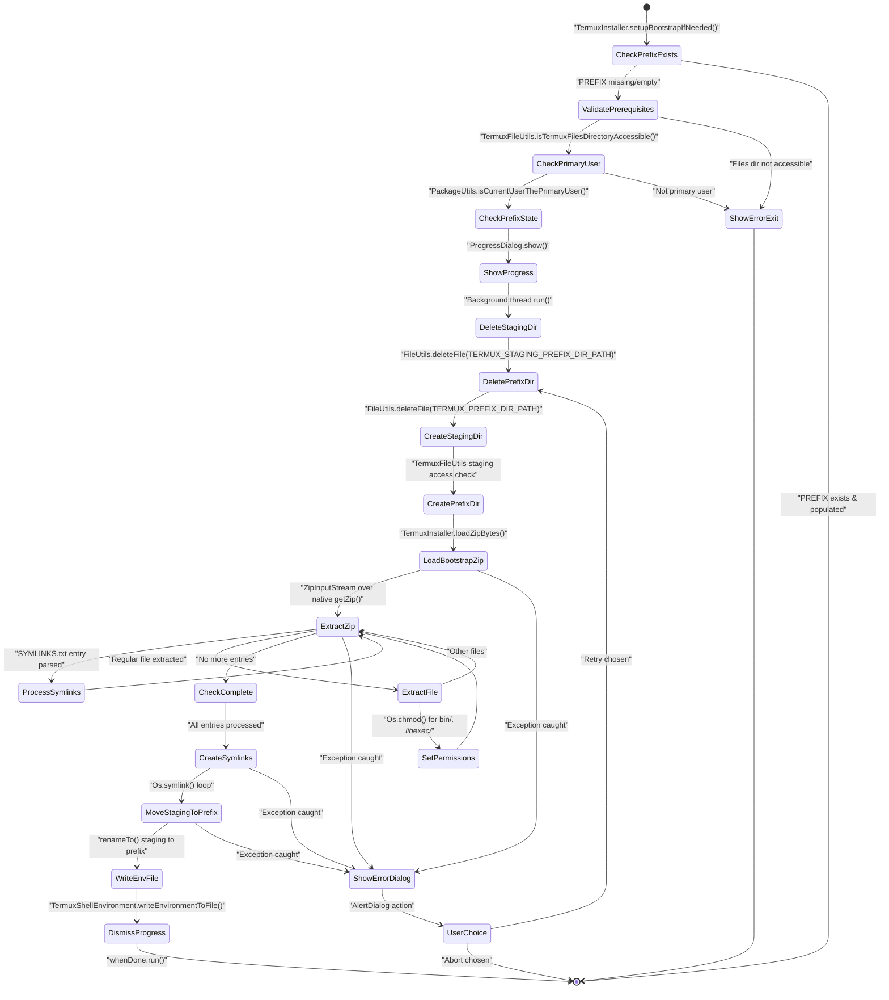
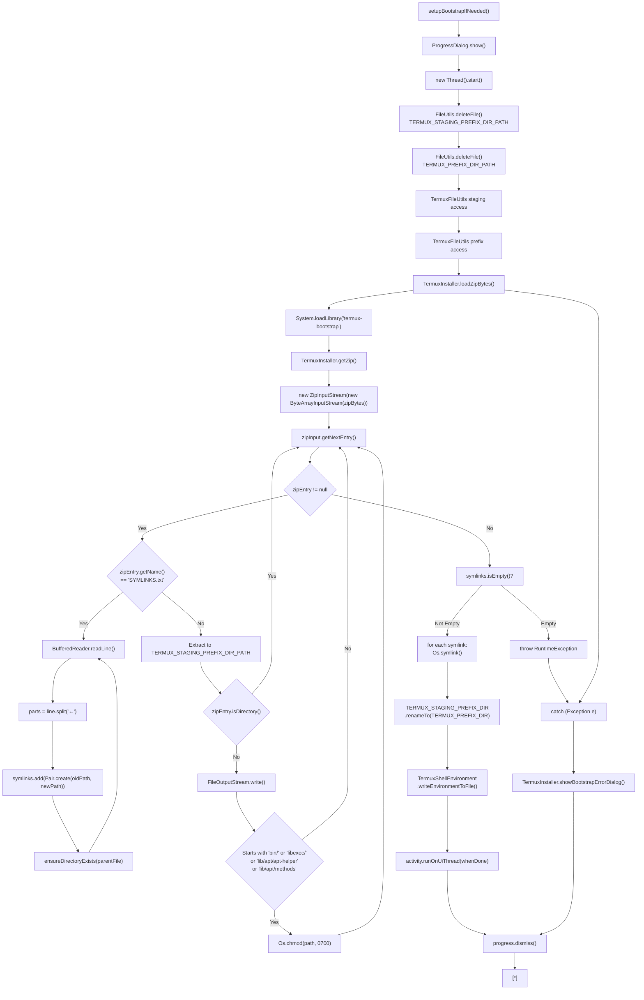
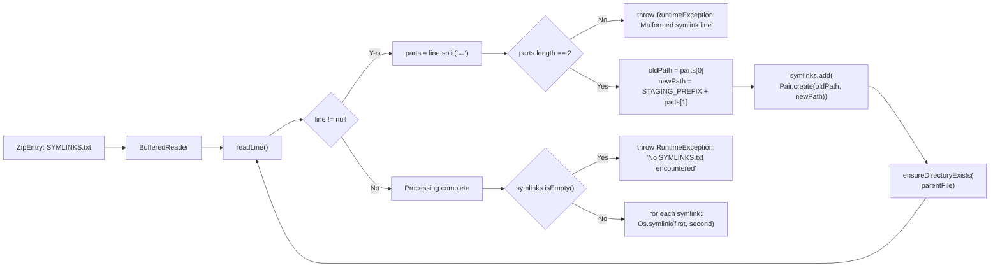
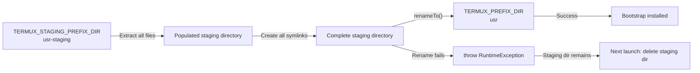
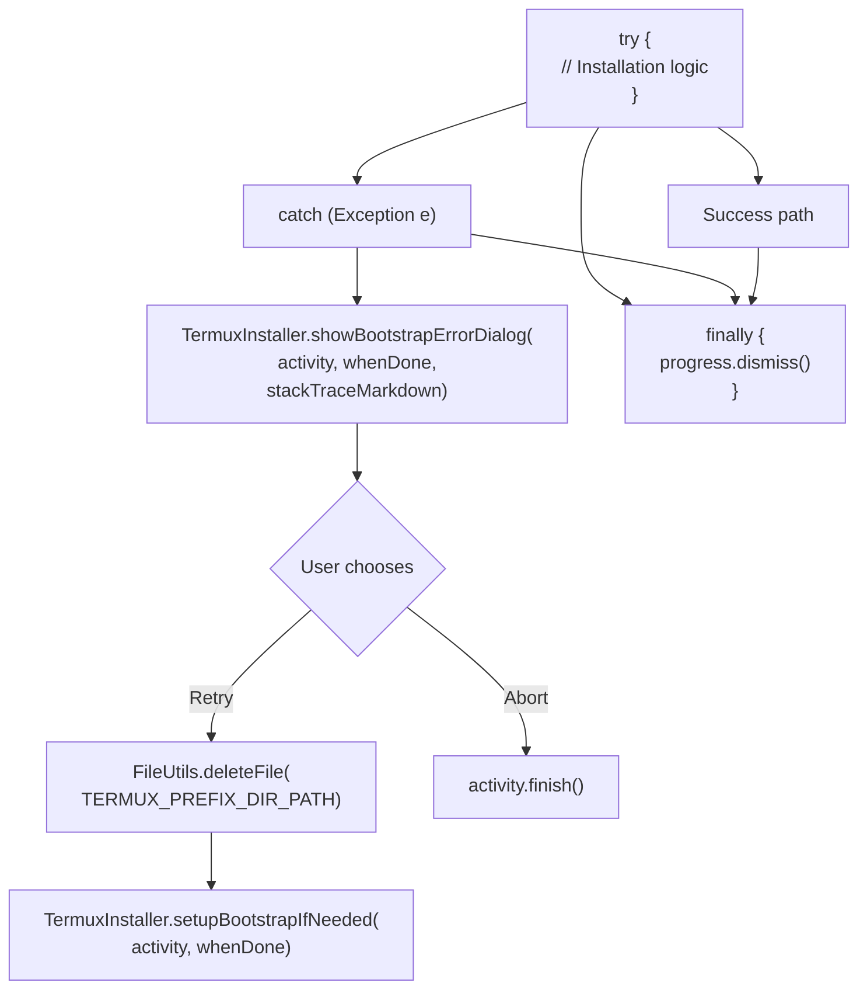
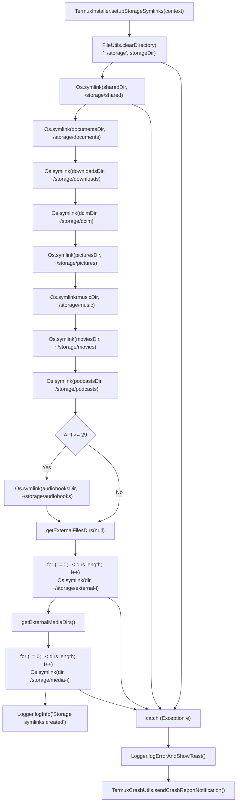

<!-- source: DeepWiki mcp.deepwiki.com · repo termux/termux-app · page 5.1 Bootstrap Installation · fetched 2026-10-26 -->

# Bootstrap Installation

<details>
<summary>Relevant source files</summary>

The following files were used as context for generating this wiki page:

- [app/src/main/java/com/termux/app/TermuxInstaller.java](app/src/main/java/com/termux/app/TermuxInstaller.java)
- [termux-shared/src/main/java/com/termux/shared/errors/Errno.java](termux-shared/src/main/java/com/termux/shared/errors/Errno.java)
- [termux-shared/src/main/java/com/termux/shared/file/FileUtils.java](termux-shared/src/main/java/com/termux/shared/file/FileUtils.java)
- [termux-shared/src/main/java/com/termux/shared/file/FileUtilsErrno.java](termux-shared/src/main/java/com/termux/shared/file/FileUtilsErrno.java)
- [termux-shared/src/main/java/com/termux/shared/file/tests/FileUtilsTests.java](termux-shared/src/main/java/com/termux/shared/file/tests/FileUtilsTests.java)
- [termux-shared/src/main/java/com/termux/shared/reflection/ReflectionUtils.java](termux-shared/src/main/java/com/termux/shared/reflection/ReflectionUtils.java)
- [termux-shared/src/main/java/com/termux/shared/termux/TermuxBootstrap.java](termux-shared/src/main/java/com/termux/shared/termux/TermuxBootstrap.java)

</details>


This document describes the bootstrap installation system that sets up the Termux Unix environment on first application launch. The bootstrap contains core packages (bash, coreutils, apt, etc.) that are extracted to the `$PREFIX` directory to establish a functional Linux-like file system hierarchy.

For information about the file system structure created by the bootstrap, see [File System Structure](#5.2). For details on storage symlinks to Android directories, see [Storage Symlinks](#5.3).

Sources: [app/src/main/java/com/termux/app/TermuxInstaller.java:41-59]()

## Purpose and Scope

The bootstrap installation process is orchestrated by the `TermuxInstaller` class and occurs when the Termux app is launched for the first time or when the `$PREFIX` directory is missing or empty. This system handles:

- Validation of installation prerequisites (`PackageUtils.isCurrentUserThePrimaryUser`, `TermuxFileUtils.isTermuxFilesDirectoryAccessible`)
- Extraction of the embedded bootstrap archive from a native library (`TermuxInstaller.loadZipBytes`, `TermuxInstaller.getZip`)
- Processing of symbolic links defined in `SYMLINKS.txt` via `Os.symlink`
- Setting appropriate file permissions for executables using `Os.chmod`
- Atomic installation using a staging directory (`TERMUX_STAGING_PREFIX_DIR_PATH`)
- Error handling with user-friendly retry mechanisms (`TermuxInstaller.showBootstrapErrorDialog`)
- Creation of storage symlinks to Android directories (`TermuxInstaller.setupStorageSymlinks`)

Sources: [app/src/main/java/com/termux/app/TermuxInstaller.java:41-59]()

## Bootstrap Installation Lifecycle

The following diagram bridges natural language installation states with concrete code entities (`TermuxInstaller` methods and system helpers) across the execution pipeline.



Sources: [app/src/main/java/com/termux/app/TermuxInstaller.java:65-240]()

## Prerequisites and Validation

Before bootstrap installation begins, `setupBootstrapIfNeeded()` validates several critical prerequisites.

### Files Directory Accessibility

The method first calls `TermuxFileUtils.isTermuxFilesDirectoryAccessible()` to verify that the app's files directory can be accessed and created. This also triggers `Context.getFilesDir()` to ensure the directory exists.

Sources: [app/src/main/java/com/termux/app/TermuxInstaller.java:69-72]()

### Primary User Verification

On Android N+ (API 24+), Termux verifies it is running as the primary user (device owner) using `PackageUtils.isCurrentUserThePrimaryUser()`. Secondary users have different file system paths that would break the expected directory structure at `$PREFIX` (`/data/data/com.termux/files/usr`).

| Check | Requirement | Failure Action | Code Reference |
|-------|-------------|----------------|----------------|
| Files Directory | Must be accessible and writable | Show error, exit app | `TermuxFileUtils.isTermuxFilesDirectoryAccessible()` |
| Primary User | Must be primary user (API 24+) | Show error with markdown formatted path, exit app | `PackageUtils.isCurrentUserThePrimaryUser()` |
| External Storage | Must NOT be installed on portable SD | Show additional warning message | `PackageUtils.isAppInstalledOnExternalStorage()` |

Sources: [app/src/main/java/com/termux/app/TermuxInstaller.java:76-103]()

### Prefix Directory State

The installation logic checks if `TERMUX_PREFIX_DIR_PATH` already exists via `FileUtils.directoryFileExists()`:

- **Exists and non-empty:** Skip installation and call `whenDone.run()` immediately
- **Exists but empty:** Proceed with installation (directory may contain only unimportant files)
- **Does not exist:** Proceed with installation

Sources: [app/src/main/java/com/termux/app/TermuxInstaller.java:106-115]()

## Bootstrap Extraction Process

The extraction process occurs in a background thread to avoid blocking the UI, with a `ProgressDialog` showing the installer body to the user.



Sources: [app/src/main/java/com/termux/app/TermuxInstaller.java:117-240]()

### Directory Cleanup and Creation

The installation process uses a staging directory pattern for atomic installation:

1. **Delete staging directory:** Remove `TERMUX_STAGING_PREFIX_DIR_PATH` using `FileUtils.deleteFile()` if it exists from a previous failed installation
2. **Delete prefix directory:** Remove `TERMUX_PREFIX_DIR_PATH` using `FileUtils.deleteFile()` to start fresh
3. **Create staging directory:** Create staging directory paths and set required permissions
4. **Create prefix directory:** Create empty prefix directory structure

Sources: [app/src/main/java/com/termux/app/TermuxInstaller.java:126-152]()

### Native Library Bootstrap Loading

The bootstrap archive is not stored as a separate asset but is embedded in a native library. The `loadZipBytes()` method loads the shared library and calls the native `getZip()` method:

```java
public static byte[] loadZipBytes() {
    System.loadLibrary("termux-bootstrap");
    return getZip();
}

public static native byte[] getZip();
```

Sources: [app/src/main/java/com/termux/app/TermuxInstaller.java:378-384]()

### File Extraction and Permission Setting

Files are extracted from the `ZipInputStream` into the staging directory. For certain executable paths, the code sets execute permissions using `Os.chmod()` with mode `0700`:

| Path Pattern | Permission | Reason |
|--------------|-----------|--------|
| `bin/*` | `0700` | User binaries (bash, ls, etc.) |
| `libexec/*` | `0700` | Library executables |
| `lib/apt/apt-helper` | `0700` | APT package manager helper |
| `lib/apt/methods/*` | `0700` | APT download methods |

Sources: [app/src/main/java/com/termux/app/TermuxInstaller.java:197-201]()

## SYMLINKS.txt Processing

The `SYMLINKS.txt` file within the bootstrap archive contains symbolic link definitions in the format `target←linkname`, where the arrow (`←`) separates the symlink target from the link path.



Sources: [app/src/main/java/com/termux/app/TermuxInstaller.java:163-211]()

### Symlink Format Example

A typical line in `SYMLINKS.txt` might look like:

```
../../bin/bash←usr/bin/sh
../../usr/share/terminfo←usr/lib/terminfo
```

This is parsed into `oldPath` and `newPath` pairs stored in an `ArrayList<Pair<String, String>>`.

Sources: [app/src/main/java/com/termux/app/TermuxInstaller.java:163-211]()

### Directory Creation for Symlinks

Before creating each symlink, the code ensures the parent directory exists by calling `ensureDirectoryExists()`, which delegates to `FileUtils.createDirectoryFile()`.

Sources: [app/src/main/java/com/termux/app/TermuxInstaller.java:174-178](), [app/src/main/java/com/termux/app/TermuxInstaller.java:374-376]()

### Symlink Creation Timing

Symlinks are created **after** all files have been extracted. The code accumulates symlink pairs during extraction, then creates them all at once using `Os.symlink()` in a loop. If the list is empty after processing the entire zip, a `RuntimeException` is thrown because `SYMLINKS.txt` is mandatory.

Sources: [app/src/main/java/com/termux/app/TermuxInstaller.java:207-211]()

## Atomic Installation with Staging Directory

The installation uses a two-phase commit pattern to ensure atomicity. Files are extracted to `TERMUX_STAGING_PREFIX_DIR_PATH` (`usr-staging`), and only after successful extraction and symlink creation is the staging directory renamed to `TERMUX_PREFIX_DIR_PATH` (`usr`).



Sources: [app/src/main/java/com/termux/app/TermuxInstaller.java:213-217]()

## Post-Installation Environment Setup

After successfully renaming the staging directory to the prefix directory, the installer performs final setup steps:

1. **Write environment file:** Calls `TermuxShellEnvironment.writeEnvironmentToFile()` to recreate the environment config file.
2. **Trigger completion callback:** Calls `activity.runOnUiThread(whenDone)` to notify the caller that installation is complete.
3. **Dismiss progress dialog:** The progress dialog is dismissed in the `finally` block.

Sources: [app/src/main/java/com/termux/app/TermuxInstaller.java:221-236]()

## Error Handling and Retry Mechanism

The bootstrap installation system provides comprehensive error handling with user-friendly retry capabilities through `showBootstrapErrorDialog()`.

### Error Dialog Components

When an error occurs during installation, `showBootstrapErrorDialog()` is called, which:

1. Logs the error message with `Logger.logErrorExtended()`
2. Sends a crash report notification via `sendBootstrapCrashReportNotification()`
3. Displays an `AlertDialog` on the UI thread with two options:

| Button | Action | Implementation |
|--------|--------|----------------|
| **Abort** | Dismiss dialog and finish activity | `dialog.dismiss(); activity.finish()` |
| **Try Again** | Delete prefix directory and restart installation | `FileUtils.deleteFile()` then call `setupBootstrapIfNeeded()` |

Sources: [app/src/main/java/com/termux/app/TermuxInstaller.java:242-264]()

### Exception Handling Pattern



Sources: [app/src/main/java/com/termux/app/TermuxInstaller.java:226-237]()

### Bootstrap Crash Report Notification

The `sendBootstrapCrashReportNotification()` method creates a detailed crash report including error details, full Termux debug information via `TermuxUtils.getTermuxDebugMarkdownString()`, and plugin app info.

Sources: [app/src/main/java/com/termux/app/TermuxInstaller.java:266-275]()

## Storage Symlinks Setup

The `setupStorageSymlinks()` method creates symbolic links in `~/storage/` pointing to various Android storage directories using `Os.symlink()`.

### Storage Symlink Mapping

| Symlink Path | Target Directory | API Level |
|--------------|------------------|-----------|
| `~/storage/shared` | `Environment.getExternalStorageDirectory()` | All |
| `~/storage/documents` | `Environment.DIRECTORY_DOCUMENTS` | All |
| `~/storage/downloads` | `Environment.DIRECTORY_DOWNLOADS` | All |
| `~/storage/dcim` | `Environment.DIRECTORY_DCIM` | All |
| `~/storage/pictures` | `Environment.DIRECTORY_PICTURES` | All |
| `~/storage/music` | `Environment.DIRECTORY_MUSIC` | All |
| `~/storage/movies` | `Environment.DIRECTORY_MOVIES` | All |
| `~/storage/podcasts` | `Environment.DIRECTORY_PODCASTS` | All |
| `~/storage/audiobooks` | `Environment.DIRECTORY_AUDIOBOOKS` | API 29+ |
| `~/storage/external-<N>` | `context.getExternalFilesDirs(null)[N]` | All |
| `~/storage/media-<N>` | `context.getExternalMediaDirs()[N]` | All |

Sources: [app/src/main/java/com/termux/app/TermuxInstaller.java:299-360]()

### Storage Setup Process



Sources: [app/src/main/java/com/termux/app/TermuxInstaller.java:277-372]()

## Key Classes and Methods Reference

| Class/Method | Purpose | Location |
|--------------|---------|----------|
| `TermuxInstaller.setupBootstrapIfNeeded()` | Main entry point for bootstrap installation | [app/src/main/java/com/termux/app/TermuxInstaller.java:65]() |
| `TermuxInstaller.loadZipBytes()` | Loads bootstrap archive from native library | [app/src/main/java/com/termux/app/TermuxInstaller.java:378]() |
| `TermuxInstaller.getZip()` | Native method returning bootstrap bytes | [app/src/main/java/com/termux/app/TermuxInstaller.java:384]() |
| `TermuxInstaller.showBootstrapErrorDialog()` | Displays error dialog with retry option | [app/src/main/java/com/termux/app/TermuxInstaller.java:242]() |
| `TermuxInstaller.sendBootstrapCrashReportNotification()` | Creates notification with error details | [app/src/main/java/com/termux/app/TermuxInstaller.java:266]() |
| `TermuxInstaller.setupStorageSymlinks()` | Creates symlinks to Android storage | [app/src/main/java/com/termux/app/TermuxInstaller.java:277]() |
| `TermuxInstaller.ensureDirectoryExists()` | Helper to create directories | [app/src/main/java/com/termux/app/TermuxInstaller.java:374]() |

Sources: [app/src/main/java/com/termux/app/TermuxInstaller.java:1-386]()

---

