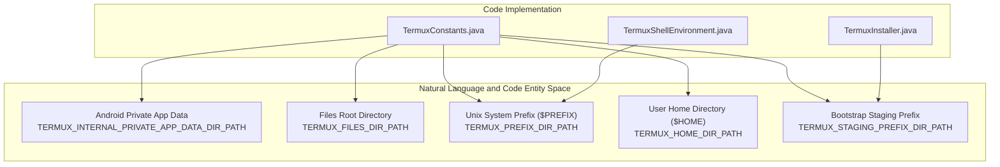
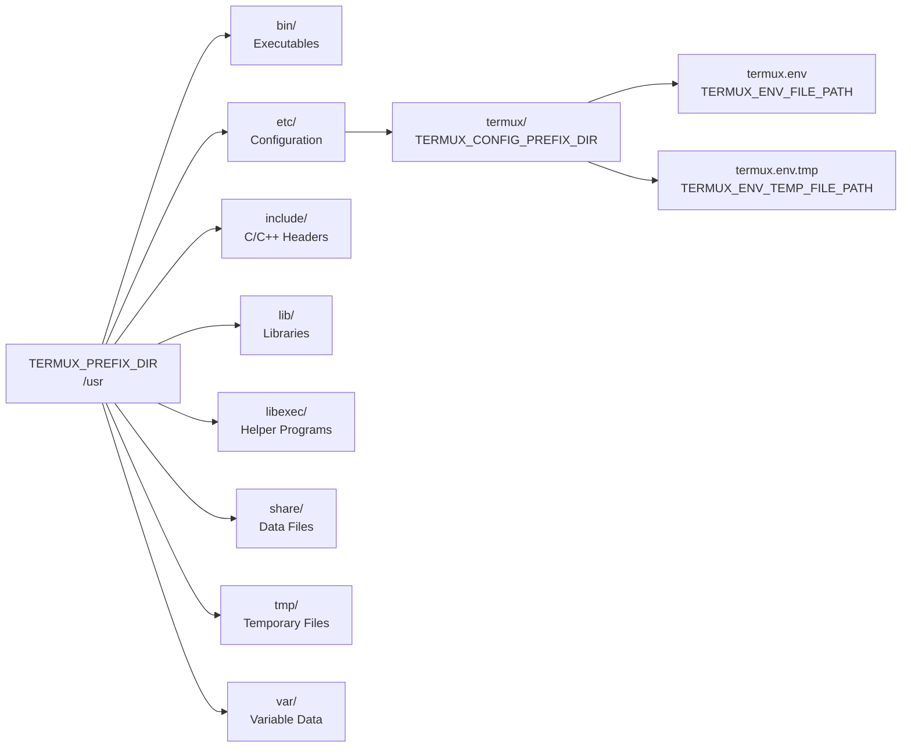
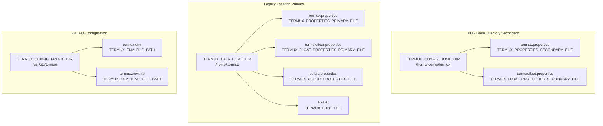
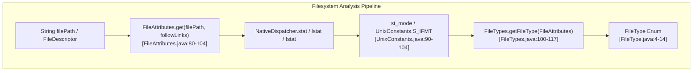

<!-- source: DeepWiki mcp.deepwiki.com · repo termux/termux-app · page 5.2 File System Structure · fetched 2026-10-26 -->

# File System Structure

<details>
<summary>Relevant source files</summary>

The following files were used as context for generating this wiki page:

- [termux-shared/src/main/java/com/termux/shared/file/filesystem/FileAttributes.java](termux-shared/src/main/java/com/termux/shared/file/filesystem/FileAttributes.java)
- [termux-shared/src/main/java/com/termux/shared/file/filesystem/FileType.java](termux-shared/src/main/java/com/termux/shared/file/filesystem/FileType.java)
- [termux-shared/src/main/java/com/termux/shared/file/filesystem/FileTypes.java](termux-shared/src/main/java/com/termux/shared/file/filesystem/FileTypes.java)
- [termux-shared/src/main/java/com/termux/shared/file/filesystem/UnixConstants.java](termux-shared/src/main/java/com/termux/shared/file/filesystem/UnixConstants.java)
- [termux-shared/src/main/java/com/termux/shared/termux/TermuxConstants.java](termux-shared/src/main/java/com/termux/shared/termux/TermuxConstants.java)
- [termux-shared/src/main/java/com/termux/shared/termux/TermuxUtils.java](termux-shared/src/main/java/com/termux/shared/termux/TermuxUtils.java)
- [termux-shared/src/main/res/values/strings.xml](termux-shared/src/main/res/values/strings.xml)

</details>


This document describes the Termux file system hierarchy, including the `PREFIX` directory structure, `HOME` directory, configuration paths, XDG Base Directory compliance, and filesystem attribute helpers. 

For information about how this file system is initially created during bootstrap installation, see [Bootstrap Installation](#5.1). For information about storage symlinks that integrate Android external storage directories, see [Storage Symlinks](#5.3).

## Overview

Termux establishes a Unix-like file system hierarchy within the Android app-private data directory. All Termux file system paths are defined as constants in [termux-shared/src/main/java/com/termux/shared/termux/TermuxConstants.java]() and are rooted at `/data/data/com.termux/files`. The file system consists of two primary hierarchies:

- **PREFIX hierarchy** (`$PREFIX` = `/data/data/com.termux/files/usr`) - Contains the Unix system directory structure with binaries, libraries, headers, and package-managed files.
- **HOME hierarchy** (`$HOME` = `/data/data/com.termux/files/home`) - Contains user data, configuration files, and storage symlinks.

Title: Termux File System Architecture and Constants Mapping

Sources: [termux-shared/src/main/java/com/termux/shared/termux/TermuxConstants.java:579-695]()

## Core Directory Constants

The following table maps Java constants to their corresponding file system paths. All constants are defined in `TermuxConstants` [termux-shared/src/main/java/com/termux/shared/termux/TermuxConstants.java]() and consist of path strings (`*_PATH`) and `File` object references (`*_DIR`).

| Constant | Path | Description |
|----------|------|-------------|
| `TERMUX_INTERNAL_PRIVATE_APP_DATA_DIR_PATH` | `/data/data/com.termux` | Android app private data directory |
| `TERMUX_FILES_DIR_PATH` | `/data/data/com.termux/files` | Termux files root directory |
| `TERMUX_PREFIX_DIR_PATH` | `/data/data/com.termux/files/usr` | Unix system directory (`$PREFIX`) |
| `TERMUX_HOME_DIR_PATH` | `/data/data/com.termux/files/home` | User home directory (`$HOME`) |
| `TERMUX_STAGING_PREFIX_DIR_PATH` | `/data/data/com.termux/files/usr-staging` | Temporary staging during bootstrap |
| `TERMUX_APPS_DIR_PATH` | `/data/data/com.termux/files/apps` | Directory for Termux and plugin apps |

Sources: [termux-shared/src/main/java/com/termux/shared/termux/TermuxConstants.java:579-695]()

## PREFIX Directory Structure

The `TERMUX_PREFIX_DIR` at `/data/data/com.termux/files/usr` follows the Unix Filesystem Hierarchy Standard (FHS). This directory is hardcoded into compiled binaries in bootstrap packages and cannot be modified without recompiling packages.

Title: PREFIX Subdirectories Hierarchy


| Constant | Path | Purpose |
|----------|------|---------|
| `TERMUX_BIN_PREFIX_DIR_PATH` | `/data/data/com.termux/files/usr/bin` | Executable binaries (bash, sh, apt, etc.) |
| `TERMUX_ETC_PREFIX_DIR_PATH` | `/data/data/com.termux/files/usr/etc` | System configuration files |
| `TERMUX_INCLUDE_PREFIX_DIR_PATH` | `/data/data/com.termux/files/usr/include` | C/C++ header files for compilation |
| `TERMUX_LIB_PREFIX_DIR_PATH` | `/data/data/com.termux/files/usr/lib` | Shared libraries (`.so` files) |
| `TERMUX_LIBEXEC_PREFIX_DIR_PATH` | `/data/data/com.termux/files/usr/libexec` | Helper executables not in `PATH` |
| `TERMUX_SHARE_PREFIX_DIR_PATH` | `/data/data/com.termux/files/usr/share` | Architecture-independent data |
| `TERMUX_TMP_PREFIX_DIR_PATH` | `/data/data/com.termux/files/usr/tmp` | Temporary directory (`$TMPDIR`) |
| `TERMUX_VAR_PREFIX_DIR_PATH` | `/data/data/com.termux/files/usr/var` | Variable data (logs, caches, state) |

During bootstrap installation, the installer sets execute permissions (`0700`) on files in specific directories using `TermuxInstaller.java`:

```java
if (zipEntryName.startsWith("bin/") || zipEntryName.startsWith("libexec") ||
    zipEntryName.startsWith("lib/apt/apt-helper") || zipEntryName.startsWith("lib/apt/methods")) {
    Os.chmod(targetFile.getAbsolutePath(), 0700);
}
```

Sources: [termux-shared/src/main/java/com/termux/shared/termux/TermuxConstants.java:600-646](), [app/src/main/java/com/termux/app/TermuxInstaller.java:197-201]()

## Configuration Directories and XDG Compliance

Termux supports both XDG Base Directory Specification paths and legacy paths for configuration files. Configuration files may exist in either location, with primary locations checked first.

Title: Configuration Directory Hierarchy


### XDG Base Directory Paths

| Constant | Path | Usage |
|----------|------|-------|
| `TERMUX_CONFIG_HOME_DIR_PATH` | `/data/data/com.termux/files/home/.config/termux` | XDG-compliant config directory |
| `TERMUX_PROPERTIES_SECONDARY_FILE_PATH` | `$HOME/.config/termux/termux.properties` | Secondary `termux.properties` location |
| `TERMUX_FLOAT_PROPERTIES_SECONDARY_FILE_PATH` | `$HOME/.config/termux/termux.float.properties` | Secondary `Termux:Float` properties |

### Legacy Paths (Primary)

| Constant | Path | Usage |
|----------|------|-------|
| `TERMUX_DATA_HOME_DIR_PATH` | `/data/data/com.termux/files/home/.termux` | Legacy config/data directory |
| `TERMUX_PROPERTIES_PRIMARY_FILE_PATH` | `$HOME/.termux/termux.properties` | Primary `termux.properties` location |
| `TERMUX_FLOAT_PROPERTIES_PRIMARY_FILE_PATH` | `$HOME/.termux/termux.float.properties` | Primary `Termux:Float` properties |
| `TERMUX_COLOR_PROPERTIES_FILE_PATH` | `$HOME/.termux/colors.properties` | Terminal color scheme |
| `TERMUX_FONT_FILE_PATH` | `$HOME/.termux/font.ttf` | Terminal font file |

The properties file lists are defined as constants to restrict external modification via ContentProviders:

```java
public static final List<String> TERMUX_PROPERTIES_FILE_PATHS_LIST = Arrays.asList(
    TERMUX_PROPERTIES_PRIMARY_FILE_PATH,
    TERMUX_PROPERTIES_SECONDARY_FILE_PATH);
```

Sources: [termux-shared/src/main/java/com/termux/shared/termux/TermuxConstants.java:662-788]()

## Filesystem Attribute Helpers and File Type Detection

To handle Unix file attributes, special file types, and permission checks reliably on Android (where standard `java.io.File` APIs can be unreliable for symlinks or special files), Termux implements a POSIX attribute helper layer under `com.termux.shared.file.filesystem`.

Title: Filesystem Attribute Helpers and POSIX File Type Detection


### Key Components

- **`FileAttributes`**: Retrieves and encapsulates POSIX status fields (`st_mode`, `st_ino`, `st_dev`, uids, gids, and timestamps) via `NativeDispatcher` [termux-shared/src/main/java/com/termux/shared/file/filesystem/FileAttributes.java:80-104]().
- **`FileTypes`**: Determines explicit file types (`REGULAR`, `DIRECTORY`, `SYMLINK`, `SOCKET`, `CHARACTER`, `FIFO`, `BLOCK`, `UNKNOWN`) using `FileAttributes` and `Os` system calls [termux-shared/src/main/java/com/termux/shared/file/filesystem/FileTypes.java:86-117]().
- **`UnixConstants`**: Maps POSIX constants from `android.system.OsConstants` ensuring architecture-safe bit flags (`O_RDONLY`, `S_IFMT`, `S_IFREG`, `R_OK`, etc.) [termux-shared/src/main/java/com/termux/shared/file/filesystem/UnixConstants.java:43-158]().
- **`FileType`**: Enum defining bitmask values for file types [termux-shared/src/main/java/com/termux/shared/file/filesystem/FileType.java:4-14]().

Sources: [termux-shared/src/main/java/com/termux/shared/file/filesystem/FileAttributes.java:80-104](), [termux-shared/src/main/java/com/termux/shared/file/filesystem/FileTypes.java:86-117](), [termux-shared/src/main/java/com/termux/shared/file/filesystem/UnixConstants.java:43-158](), [termux-shared/src/main/java/com/termux/shared/file/filesystem/FileType.java:4-14]()

## File System Access Validation and Environment Variables

The Termux shared library provides utility methods to validate file system accessibility during app initialization and when external packages attempt to access Termux resources.

### Accessibility Checks

`TermuxUtils.isTermuxAppAccessible()` performs comprehensive checks [termux-shared/src/main/java/com/termux/shared/termux/TermuxUtils.java:198-220]():

```java
public static String isTermuxAppAccessible(@NonNull final Context currentPackageContext) {
    String errmsg = isTermuxAppInstalled(currentPackageContext);
    if (errmsg == null) {
        Context termuxPackageContext = TermuxUtils.getTermuxPackageContext(currentPackageContext);
        if (termuxPackageContext == null)
            errmsg = currentPackageContext.getString(R.string.error_termux_app_package_context_not_accessible);

        if (errmsg == null) {
            Error error = TermuxFileUtils.isTermuxPrefixDirectoryAccessible(false, false);
            if (error != null)
                errmsg = currentPackageContext.getString(R.string.error_termux_prefix_dir_path_not_accessible,
                    PackageUtils.getAppNameForPackage(currentPackageContext));
        }
    }
    return errmsg;
}
```

Error strings are defined in [termux-shared/src/main/res/values/strings.xml:96-101]().

### Environment Variables

Termux file system paths are exposed to shell sessions via environment variables (`TERMUX_ENV_PREFIX_ROOT` = `"TERMUX"`) [termux-shared/src/main/java/com/termux/shared/termux/TermuxConstants.java:908]():
- `$PREFIX` → `/data/data/com.termux/files/usr`
- `$HOME` → `/data/data/com.termux/files/home`  
- `$TMPDIR` → `/data/data/com.termux/files/usr/tmp`

The environment configuration is written to `TERMUX_ENV_FILE_PATH` via `TermuxShellEnvironment.writeEnvironmentToFile()` following bootstrap installation [app/src/main/java/com/termux/app/TermuxInstaller.java:222]().

Sources: [termux-shared/src/main/java/com/termux/shared/termux/TermuxUtils.java:198-220](), [termux-shared/src/main/res/values/strings.xml:96-101](), [termux-shared/src/main/java/com/termux/shared/termux/TermuxConstants.java:907-908](), [app/src/main/java/com/termux/app/TermuxInstaller.java:222]()

---

