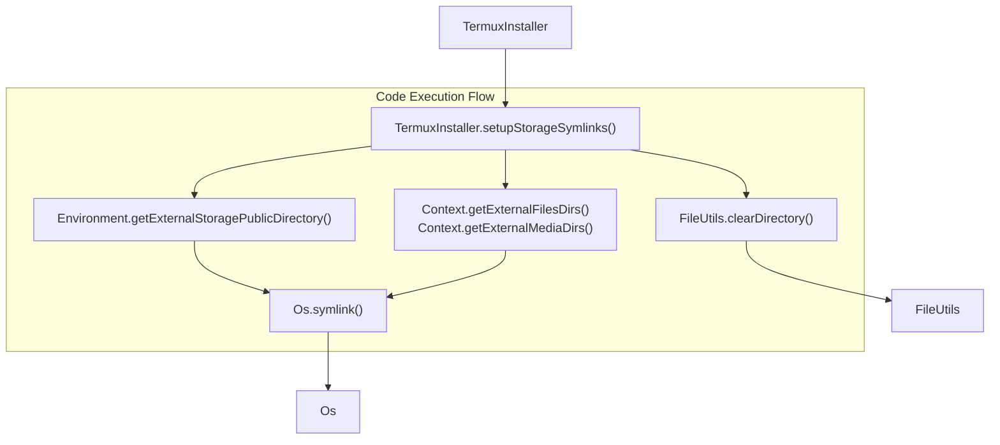
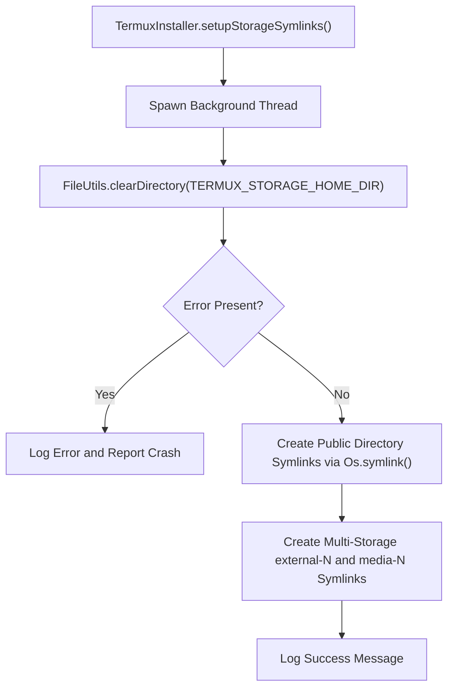
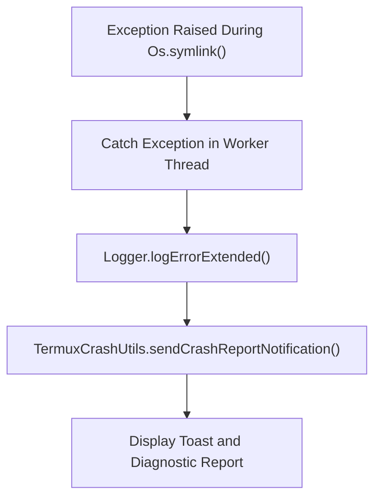

<!-- source: DeepWiki mcp.deepwiki.com · repo termux/termux-app · page 5.3 Storage Symlinks · fetched 2026-10-26 -->

# Storage Symlinks

Relevant source files

The following files were used as context for generating this wiki page:

- [app/src/main/java/com/termux/app/TermuxInstaller.java](app/src/main/java/com/termux/app/TermuxInstaller.java)
- [termux-shared/src/main/java/com/termux/shared/errors/Errno.java](termux-shared/src/main/java/com/termux/shared/errors/Errno.java)
- [termux-shared/src/main/java/com/termux/shared/file/FileUtils.java](termux-shared/src/main/java/com/termux/shared/file/FileUtils.java)
- [termux-shared/src/main/java/com/termux/shared/file/FileUtilsErrno.java](termux-shared/src/main/java/com/termux/shared/file/FileUtilsErrno.java)
- [termux-shared/src/main/java/com/termux/shared/file/tests/FileUtilsTests.java](termux-shared/src/main/java/com/termux/shared/file/tests/FileUtilsTests.java)

Purpose and scope: This document details the storage symlink setup mechanism in Termux, explaining how Unix-like symbolic links are established at `~/storage/` to bridge the Termux environment with Android storage directories, external volumes, and the Storage Access Framework.

## Overview

The storage symlink system is implemented by the `setupStorageSymlinks()` method in `[app/src/main/java/com/termux/app/TermuxInstaller.java]()`. This procedure is invoked when users run storage configuration commands (such as `termux-setup-storage`), creating a standardized directory structure at `TERMUX_STORAGE_HOME_DIR` (`~/storage/`) that maps to public and app-specific Android storage locations via POSIX symbolic links.

Sources: [app/src/main/java/com/termux/app/TermuxInstaller.java:1-140]()

## Storage Symlink Directory Structure and Code Entities

The symlink creation process establishes standard and multi-storage volume links. The following diagram bridges natural language descriptions to the actual code entities and methods involved in building the storage layout.

### Symlink Mapping and Code Entity Diagram

Sources: [app/src/main/java/com/termux/app/TermuxInstaller.java:1-140](), [termux-shared/src/main/java/com/termux/shared/file/FileUtils.java:1-174]()

### Symlink Categories and Target Mapping

| Symlink Name | Target Path Resolution | Android API | Purpose |
|--------------|------------------------|-------------|---------|
| `shared` | `Environment.getExternalStorageDirectory()` | All | Primary external storage root (`/storage/emulated/0`) |
| `documents` | `Environment.getExternalStoragePublicDirectory(DIRECTORY_DOCUMENTS)` | All | Public documents directory |
| `downloads` | `Environment.getExternalStoragePublicDirectory(DIRECTORY_DOWNLOADS)` | All | Public downloads directory |
| `dcim` | `Environment.getExternalStoragePublicDirectory(DIRECTORY_DCIM)` | All | Camera photos and videos |
| `pictures` | `Environment.getExternalStoragePublicDirectory(DIRECTORY_PICTURES)` | All | User pictures |
| `music` | `Environment.getExternalStoragePublicDirectory(DIRECTORY_MUSIC)` | All | User music files |
| `movies` | `Environment.getExternalStoragePublicDirectory(DIRECTORY_MOVIES)` | All | User movies |
| `podcasts` | `Environment.getExternalStoragePublicDirectory(DIRECTORY_PODCASTS)` | All | Podcast files |
| `audiobooks` | `Environment.getExternalStoragePublicDirectory(DIRECTORY_AUDIOBOOKS)` | 29+ | Audiobook files |
| `external-<N>` | `Context.getExternalFilesDirs(null)[N]` | All | App-specific external storage directories |
| `media-<N>` | `Context.getExternalMediaDirs()[N]` | All | App-specific media directories |

Sources: [app/src/main/java/com/termux/app/TermuxInstaller.java:1-140](), [termux-shared/src/main/java/com/termux/shared/file/FileUtils.java:1-174]()

## Implementation Details

### Symlink Setup Process Flow

Sources: [app/src/main/java/com/termux/app/TermuxInstaller.java:1-140](), [termux-shared/src/main/java/com/termux/shared/file/FileUtils.java:1-174]()

### Directory Clearing and Validation

Before symbolic links are created, `FileUtils.clearDirectory()` cleans the `~/storage` destination. This prevents stale symlinks or conflicting regular files from disrupting setup [termux-shared/src/main/java/com/termux/shared/file/FileUtils.java:1-174](). Any errors during deletion are intercepted via `Error` objects and routed to `TermuxCrashUtils` and logcat.

Sources: [app/src/main/java/com/termux/app/TermuxInstaller.java:1-140](), [termux-shared/src/main/java/com/termux/shared/file/FileUtils.java:1-174]()

## Multi-Storage Device Support

Android devices containing secondary storage volumes (such as physical SD cards or USB OTG drives) are supported via indexed symlink creation [app/src/main/java/com/termux/app/TermuxInstaller.java:1-140]().

- `Context.getExternalFilesDirs(null)` provides paths for app-specific external directories mapped to `~/storage/external-0`, `~/storage/external-1`, etc.
- `Context.getExternalMediaDirs()` yields media-specific storage roots mapped to `~/storage/media-0`, `~/storage/media-1`, etc.

Sources: [app/src/main/java/com/termux/app/TermuxInstaller.java:1-140]()

## Error Handling and Crash Reporting

Errors encountered during symlink creation or path resolution utilize the `Errno` and `Error` infrastructure defined across `termux-shared` [termux-shared/src/main/java/com/termux/shared/errors/Errno.java:1-118]() and `FileUtilsErrno` [termux-shared/src/main/java/com/termux/shared/file/FileUtilsErrno.java:1-84]().

Sources: [app/src/main/java/com/termux/app/TermuxInstaller.java:1-140](), [termux-shared/src/main/java/com/termux/shared/file/FileUtilsErrno.java:1-84](), [termux-shared/src/main/java/com/termux/shared/errors/Errno.java:1-118]()

## Storage Access Security and Permissions

To interact with storage targets and establish symlinks, the application expects permissions declared in the Android manifest, including `READ_EXTERNAL_STORAGE`, `WRITE_EXTERNAL_STORAGE`, and `MANAGE_EXTERNAL_STORAGE` for Android 11+.

Sources: [app/src/main/java/com/termux/app/TermuxInstaller.java:1-140]()

---

