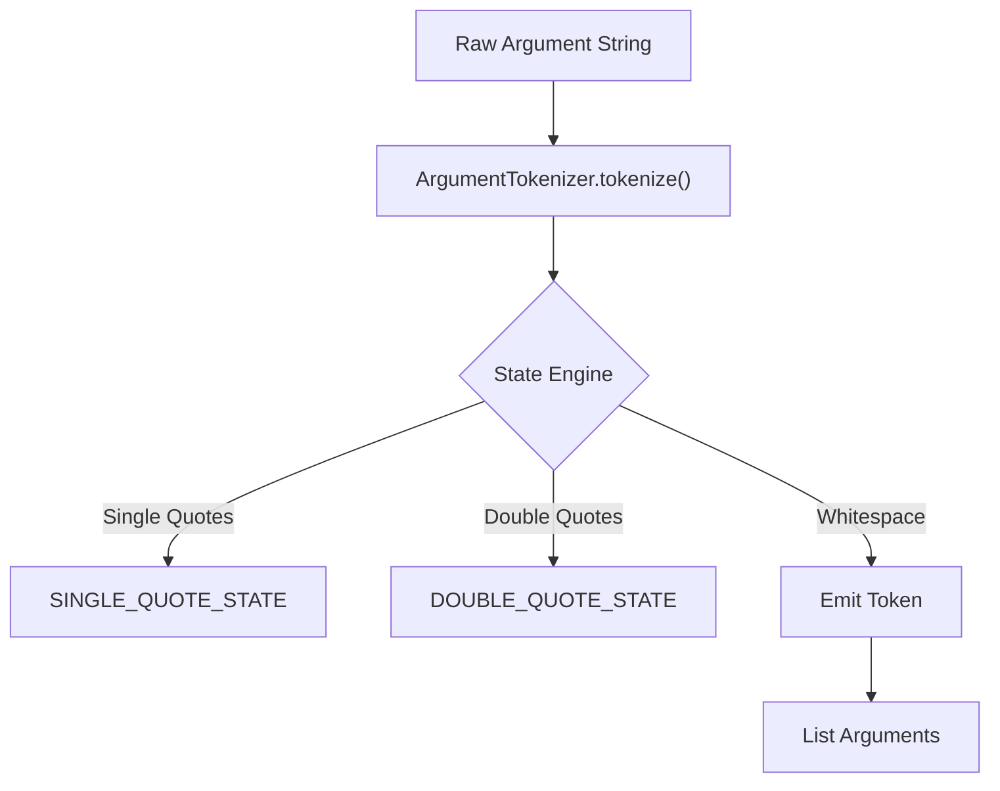
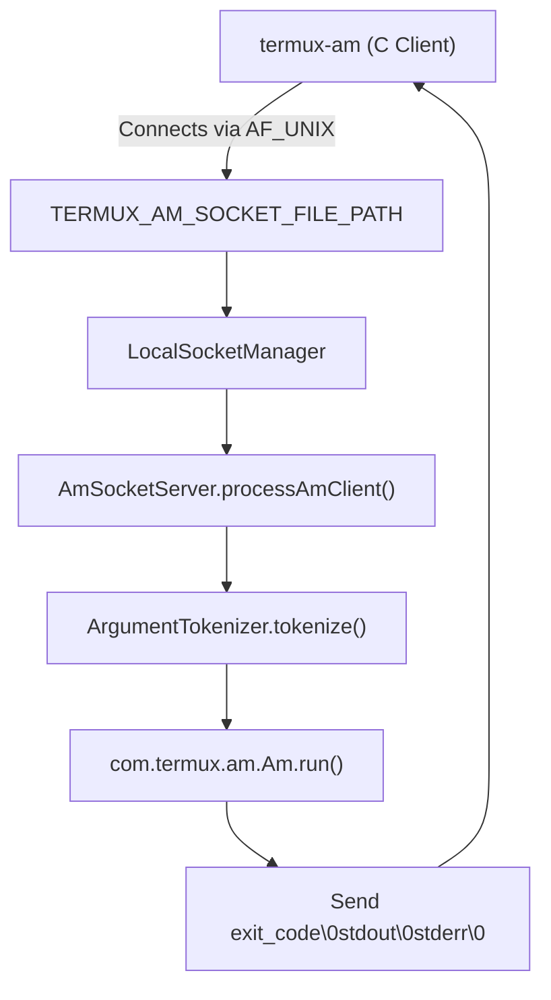

<!-- source: DeepWiki mcp.deepwiki.com · repo termux/termux-app · page 5.4 Shell Environment and Command Execution · fetched 2026-10-26 -->

# Shell Environment and Command Execution

<details>
<summary>Relevant source files</summary>

The following files were used as context for generating this wiki page:

- [termux-shared/src/main/java/com/termux/shared/net/socket/local/ILocalSocketManager.java](termux-shared/src/main/java/com/termux/shared/net/socket/local/ILocalSocketManager.java)
- [termux-shared/src/main/java/com/termux/shared/net/socket/local/LocalClientSocket.java](termux-shared/src/main/java/com/termux/shared/net/socket/local/LocalClientSocket.java)
- [termux-shared/src/main/java/com/termux/shared/net/socket/local/LocalServerSocket.java](termux-shared/src/main/java/com/termux/shared/net/socket/local/LocalServerSocket.java)
- [termux-shared/src/main/java/com/termux/shared/net/socket/local/LocalSocketErrno.java](termux-shared/src/main/java/com/termux/shared/net/socket/local/LocalSocketErrno.java)
- [termux-shared/src/main/java/com/termux/shared/net/socket/local/LocalSocketManager.java](termux-shared/src/main/java/com/termux/shared/net/socket/local/LocalSocketManager.java)
- [termux-shared/src/main/java/com/termux/shared/net/socket/local/LocalSocketManagerClientBase.java](termux-shared/src/main/java/com/termux/shared/net/socket/local/LocalSocketManagerClientBase.java)
- [termux-shared/src/main/java/com/termux/shared/net/socket/local/LocalSocketRunConfig.java](termux-shared/src/main/java/com/termux/shared/net/socket/local/LocalSocketRunConfig.java)
- [termux-shared/src/main/java/com/termux/shared/shell/ArgumentTokenizer.java](termux-shared/src/main/java/com/termux/shared/shell/ArgumentTokenizer.java)
- [termux-shared/src/main/java/com/termux/shared/shell/am/AmSocketServer.java](termux-shared/src/main/java/com/termux/shared/shell/am/AmSocketServer.java)
- [termux-shared/src/main/java/com/termux/shared/shell/am/AmSocketServerErrno.java](termux-shared/src/main/java/com/termux/shared/shell/am/AmSocketServerErrno.java)
- [termux-shared/src/main/java/com/termux/shared/shell/am/AmSocketServerRunConfig.java](termux-shared/src/main/java/com/termux/shared/shell/am/AmSocketServerRunConfig.java)
- [termux-shared/src/main/java/com/termux/shared/shell/command/ExecutionCommand.java](termux-shared/src/main/java/com/termux/shared/shell/command/ExecutionCommand.java)
- [termux-shared/src/main/java/com/termux/shared/shell/command/environment/IShellEnvironment.java](termux-shared/src/main/java/com/termux/shared/shell/command/environment/IShellEnvironment.java)
- [termux-shared/src/main/java/com/termux/shared/shell/command/environment/UnixShellEnvironment.java](termux-shared/src/main/java/com/termux/shared/shell/command/environment/UnixShellEnvironment.java)
- [termux-shared/src/main/java/com/termux/shared/shell/command/runner/app/AppShell.java](termux-shared/src/main/java/com/termux/shared/shell/command/runner/app/AppShell.java)
- [termux-shared/src/main/java/com/termux/shared/termux/extrakeys/ExtraKeysInfo.java](termux-shared/src/main/java/com/termux/shared/termux/extrakeys/ExtraKeysInfo.java)
- [termux-shared/src/main/java/com/termux/shared/termux/file/TermuxFileUtils.java](termux-shared/src/main/java/com/termux/shared/termux/file/TermuxFileUtils.java)
- [termux-shared/src/main/java/com/termux/shared/termux/shell/am/TermuxAmSocketServer.java](termux-shared/src/main/java/com/termux/shared/termux/shell/am/TermuxAmSocketServer.java)
- [termux-shared/src/main/java/com/termux/shared/termux/shell/command/environment/TermuxAPIShellEnvironment.java](termux-shared/src/main/java/com/termux/shared/termux/shell/command/environment/TermuxAPIShellEnvironment.java)
- [termux-shared/src/main/java/com/termux/shared/termux/shell/command/environment/TermuxAppShellEnvironment.java](termux-shared/src/main/java/com/termux/shared/termux/shell/command/environment/TermuxAppShellEnvironment.java)
- [termux-shared/src/main/java/com/termux/shared/termux/shell/command/runner/terminal/TermuxSession.java](termux-shared/src/main/java/com/termux/shared/termux/shell/command/runner/terminal/TermuxSession.java)

</details>


Purpose and scope: This page documents the low-level shell environment and command execution architecture in Termux. It details the `ExecutionCommand` data model, the distinction between interactive foreground runners (`TermuxSession`) and background process runners (`AppShell`), Unix and app-specific environment variable construction, command-line argument tokenization via `ArgumentTokenizer`, and the UNIX domain socket server (`TermuxAmSocketServer`) used for high-performance Android Activity Manager (`am`) command execution.

---

## 1. ExecutionCommand Data Model

The `ExecutionCommand` class serves as the central data structure for managing command execution requests across the Termux application and its shared library modules [termux-shared/src/main/java/com/termux/shared/shell/command/ExecutionCommand.java:22-207](). It encapsulates execution inputs, runtime state, configuration parameters, and result metadata.

### Execution States and Runners
An `ExecutionCommand` transitions through discrete execution lifecycle states defined in `ExecutionCommand.ExecutionState`: `PRE_EXECUTION`, `EXECUTING`, `EXECUTED`, `SUCCESS`, and `FAILED` [termux-shared/src/main/java/com/termux/shared/shell/command/ExecutionCommand.java:33-58](). Note that a non-zero shell exit code does not automatically mark an `ExecutionCommand` as failed; only internal errors or exceptions set the command state to `FAILED` [termux-shared/src/main/java/com/termux/shared/shell/command/ExecutionCommand.java:25-30]().

Commands specify a target `Runner` via `ExecutionCommand.Runner`, which supports `TERMINAL_SESSION` and `APP_SHELL` [termux-shared/src/main/java/com/termux/shared/shell/command/ExecutionCommand.java:60-106](). Shell creation modes (`ShellCreateMode`) allow callers to dictate whether a new session is forced (`ALWAYS`) or reused (`NO_SHELL_WITH_NAME`) [termux-shared/src/main/java/com/termux/shared/shell/command/ExecutionCommand.java:108-141]().

```mermaid
graph TD
    "ExecutionCommand" -->|"State"| "ExecutionState"
    "ExecutionCommand" -->|"Runner"| "RunnerEnum"
    "ExecutionState" -->|"PRE_EXECUTION"| S1["Pre-Execution"]
    "ExecutionState" -->|"EXECUTING"| S2["Executing"]
    "ExecutionState" -->|"EXECUTED"| S3["Executed"]
    "ExecutionState" -->|"SUCCESS"| S4["Success"]
    "ExecutionState" -->|"FAILED"| S5["Failed"]
    "RunnerEnum" -->|"TERMINAL_SESSION"| R1["TermuxSession"]
    "RunnerEnum" -->|"APP_SHELL"| R2["AppShell"]
```
*Diagram 1: ExecutionCommand state machine and runner mapping.*

Sources: [termux-shared/src/main/java/com/termux/shared/shell/command/ExecutionCommand.java:22-207]()

---

## 2. Command Runners: TermuxSession vs. AppShell

Termux divides execution pathways into interactive terminal sessions and non-interactive background application shells.

### TermuxSession (Foreground Terminal Sessions)
`TermuxSession` maintains information for foreground terminal sessions, binding a `TerminalSession` instance with its initiating `ExecutionCommand` [termux-shared/src/main/java/com/termux/shared/termux/shell/command/runner/terminal/TermuxSession.java:27-47](). 

The static `TermuxSession.execute()` method performs the following initialization steps [termux-shared/src/main/java/com/termux/shared/termux/shell/command/runner/terminal/TermuxSession.java:77-127]():
1. Normalizes null or empty `executable` paths.
2. Resolves working directories using shell environment clients or falls back to `/`.
3. Resolves default binary paths and checks for available login shells (`login`, `bash`, `zsh`, `fish`, `sh`) via `UnixShellEnvironment.LOGIN_SHELL_BINARIES`. If no custom shell binary is executable, it falls back to `/system/bin/sh`.
4. Tokenizes and prepares shell command arguments.

### AppShell (Background App Shells)
`AppShell` executes non-interactive background shell commands using `Runtime.exec(String[], String[], File)` within the application's user context [termux-shared/src/main/java/com/termux/shared/shell/command/runner/app/AppShell.java:32-77](). 

`AppShell.execute()` configures environment variables, establishes process streams via `StreamGobbler`, and supports synchronous execution (blocking the calling thread) or asynchronous execution (running in a background worker thread) [termux-shared/src/main/java/com/termux/shared/shell/command/runner/app/AppShell.java:78-128]().

```mermaid
graph TD
    "ExecutionCommand" -->|"runner == TERMINAL_SESSION"| TSession["TermuxSession.execute()"]
    "ExecutionCommand" -->|"runner == APP_SHELL"| AShell["AppShell.execute()"]
    TSession -->|"Allocates"| PTY["TerminalSession / PTY"]
    AShell -->|"Invokes"| RuntimeExec["Runtime.exec()"]
    RuntimeExec -->|"Captures IO"| Gobbler["StreamGobbler"]
```
*Diagram 2: Flow of command routing between TermuxSession and AppShell.*

Sources: [termux-shared/src/main/java/com/termux/shared/termux/shell/command/runner/terminal/TermuxSession.java:27-127](), [termux-shared/src/main/java/com/termux/shared/shell/command/runner/app/AppShell.java:32-128]()

---

Child pages: None (Leaf page).

---

## 3. Shell Environment Variable Construction

Shell environments are assembled through hierarchical utility classes that define standard Unix variables alongside Termux-specific parameters.

### UnixShellEnvironment
`UnixShellEnvironment` defines standard Unix environment variables [termux-shared/src/main/java/com/termux/shared/shell/command/environment/UnixShellEnvironment.java:19-54]():
* `COLORTERM`: Terminal color capabilities.
* `HOME`: Absolute path of the user's home directory.
* `LANG`: Locale setting.
* `LD_LIBRARY_PATH`: Dynamic shared library search paths.
* `PATH`: Executable search path directories separated by colons.
* `PWD`: Current working directory.
* `TERM`: Terminal emulation type (e.g., `xterm-256color`).
* `TMPDIR`: Temporary file directory.

### TermuxAppShellEnvironment
`TermuxAppShellEnvironment` injects application-specific environment variables [termux-shared/src/main/java/com/termux/shared/termux/shell/command/environment/TermuxAppShellEnvironment.java:25-78]():
* `TERM_VERSION`, `TERM_APP__VERSION_NAME`, `TERM_APP__VERSION_CODE`
* `TERM_APP__PACKAGE_NAME`, `TERM_APP__PID`, `TERM_APP__UID`, `TERM_APP__TARGET_SDK`
* `TERM_APP__SE_PROCESS_CONTEXT`, `TERM_APP__SE_FILE_CONTEXT`, `TERM_APP__SE_INFO`
* `TERM_APP__AM_SOCKET_SERVER_ENABLED`: Reflects whether the local UNIX domain socket server is active.

Sources: [termux-shared/src/main/java/com/termux/shared/shell/command/environment/UnixShellEnvironment.java:19-83](), [termux-shared/src/main/java/com/termux/shared/termux/shell/command/environment/TermuxAppShellEnvironment.java:25-114]()

---

## 4. Argument Tokenization

Command-line strings passed through intents or configuration scripts are parsed into argument arrays via `ArgumentTokenizer` [termux-shared/src/main/java/com/termux/shared/shell/ArgumentTokenizer.java:51-64](). 

The tokenizer processes input strings character-by-character using a state machine (`NO_TOKEN_STATE`, `NORMAL_TOKEN_STATE`, `SINGLE_QUOTE_STATE`, `DOUBLE_QUOTE_STATE`) to handle single quotes, double quotes, and backslash escape sequences [termux-shared/src/main/java/com/termux/shared/shell/ArgumentTokenizer.java:51-153](). Quoted strings are preserved as single tokens, and escape characters are translated so that the resulting tokenized arguments mirror standard POSIX shell argument expansion rules.


*Diagram 3: Argument tokenization state flow.*

Sources: [termux-shared/src/main/java/com/termux/shared/shell/ArgumentTokenizer.java:51-153]()

---

## 5. The Activity Manager (AM) Socket Server

To bypass the overhead of spawning a new Dalvik VM instance every time an Android Activity Manager command (`am`) is executed from shell scripts, Termux implements a high-performance UNIX domain socket server (`TermuxAmSocketServer` and `AmSocketServer`) [termux-shared/src/main/java/com/termux/shared/termux/shell/am/TermuxAmSocketServer.java:25-58](), [termux-shared/src/main/java/com/termux/shared/shell/am/AmSocketServer.java:33-60]().

### Architecture and Data Flow
1. **Server Initialization**: `TermuxAmSocketServer.setupTermuxAmSocketServer()` inspects user properties (`TermuxAppSharedProperties`). If enabled, it starts an `AmSocketServer` bound to a filesystem UNIX domain socket located at `TermuxConstants.TERMUX_APP.TERMUX_AM_SOCKET_FILE_PATH` [termux-shared/src/main/java/com/termux/shared/termux/shell/am/TermuxAmSocketServer.java:78-109]().
2. **Native Socket Management**: `LocalSocketManager` loads the native library `local-socket` via JNI (`System.loadLibrary`) and creates an `AF_UNIX`/`SOCK_STREAM` server socket [termux-shared/src/main/java/com/termux/shared/net/socket/local/LocalSocketManager.java:23-87](), [termux-shared/src/main/java/com/termux/shared/net/socket/local/LocalSocketRunConfig.java:16-43]().
3. **Client Interaction**: The `$PREFIX/bin/termux-am` client connects to the socket file `$PREFIX/bin/termux-am-socket`. It transmits the `am` command string (omitting the leading `am` token) over the output stream and reads the response from its input stream [termux-shared/src/main/java/com/termux/shared/termux/shell/am/TermuxAmSocketServer.java:36-45](), [termux-shared/src/main/java/com/termux/shared/shell/am/AmSocketServer.java:33-42]().
4. **Response Protocol**: The server parses the command string with `ArgumentTokenizer`, executes the command using `termux-am-library` (`com.termux.am.Am`), and returns results formatted as `exit_code\0stdout\0stderr\0` [termux-shared/src/main/java/com/termux/shared/shell/am/AmSocketServer.java:82-125]().


*Diagram 4: TermuxAmSocketServer execution pipeline.*

Sources: [termux-shared/src/main/java/com/termux/shared/termux/shell/am/TermuxAmSocketServer.java:25-122](), [termux-shared/src/main/java/com/termux/shared/shell/am/AmSocketServer.java:33-140](), [termux-shared/src/main/java/com/termux/shared/net/socket/local/LocalSocketManager.java:23-98](), [termux-shared/src/main/java/com/termux/shared/net/socket/local/LocalSocketRunConfig.java:16-114]()

---

