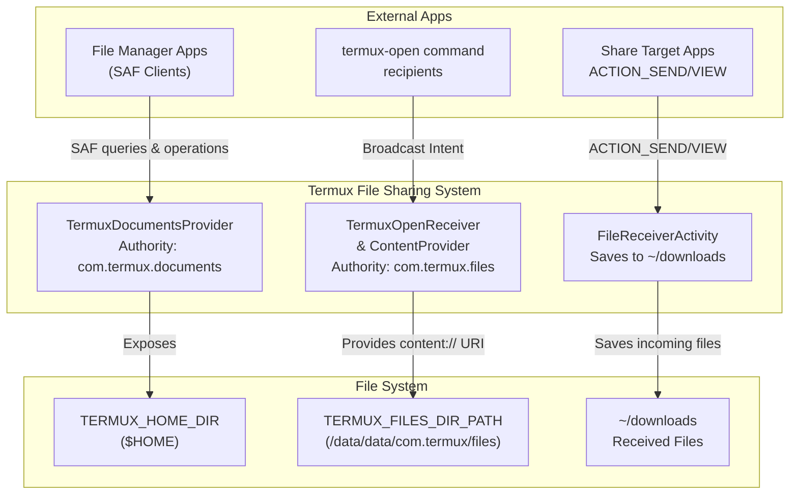

<!-- source: DeepWiki mcp.deepwiki.com · repo termux/termux-app · page 6 File Sharing and Content Providers · fetched 2026-10-26 -->

# File Sharing and Content Providers

Relevant source files

The following files were used as context for generating this wiki page:

- [app/src/main/AndroidManifest.xml](app/src/main/AndroidManifest.xml)
- [app/src/main/java/com/termux/app/api/file/FileReceiverActivity.java](app/src/main/java/com/termux/app/api/file/FileReceiverActivity.java)
- [app/src/main/java/com/termux/filepicker/TermuxDocumentsProvider.java](app/src/main/java/com/termux/filepicker/TermuxDocumentsProvider.java)
- [app/src/main/res/drawable/ic_new_session.xml](app/src/main/res/drawable/ic_new_session.xml)
- [app/src/main/res/drawable/ic_settings.xml](app/src/main/res/drawable/ic_settings.xml)
- [app/src/main/res/xml/shortcuts.xml](app/src/main/res/xml/shortcuts.xml)
- [app/src/test/java/com/termux/app/api/file/FileReceiverActivityTest.java](app/src/test/java/com/termux/app/api/file/FileReceiverActivityTest.java)

## Purpose and Scope

This page provides a high-level overview of Termux's file sharing mechanisms, content providers, and how external applications interact with files inside the Termux environment. Termux implements three primary entry points for file access and sharing:

1. **Storage Access Framework (SAF)** via `TermuxDocumentsProvider` for integration with Android document pickers and file managers. For details, see [TermuxDocumentsProvider](#6.1).
2. **Intent-based sharing and content provision** via `TermuxOpenReceiver` and its inner `ContentProvider` for the `termux-open` command and inter-app sharing. For details, see [TermuxOpenReceiver and ContentProvider](#6.2).
3. **Incoming file and text reception** via `FileReceiverActivity` for handling `ACTION_SEND` and `ACTION_VIEW` intents from external apps, storing them into `~/downloads`, and forwarding them to sessions. For details, see [FileReceiverActivity](#6.3).

**Sources:**
- [app/src/main/AndroidManifest.xml:110-176]()
- [app/src/main/java/com/termux/filepicker/TermuxDocumentsProvider.java:34-116]()
- [app/src/main/java/com/termux/app/api/file/FileReceiverActivity.java:39-126]()

---

## Content Providers and Inter-App Sharing Summary

Termux exposes its file system to the rest of the Android OS securely while adhering to sandbox constraints and user-defined policies.

### Core Components Comparison

| Component | Class | Authority / Action | Purpose |
|-----------|-------|--------------------|---------|
| SAF Provider | `TermuxDocumentsProvider` | `com.termux.documents` | Exposes `$HOME` to system file pickers and file managers via Android's Storage Access Framework. |
| Open Provider | `TermuxOpenReceiver.ContentProvider` | `com.termux.files` | Converts local `file://` URIs to shareable `content://` URIs for external applications. |
| File Receiver | `FileReceiverActivity` | `ACTION_SEND` / `ACTION_VIEW` | Receives incoming files, text, and URLs from other apps and saves them into `~/downloads`. |

**Sources:**
- [app/src/main/AndroidManifest.xml:110-176]()
- [app/src/main/java/com/termux/filepicker/TermuxDocumentsProvider.java:34-116]()
- [app/src/main/java/com/termux/app/api/file/FileReceiverActivity.java:39-126]()

---

## 6.1 TermuxDocumentsProvider

`TermuxDocumentsProvider` extends Android's `DocumentsProvider` to expose files within the Termux `$HOME` directory (`TermuxConstants.TERMUX_HOME_DIR`) to external file manager applications [app/src/main/java/com/termux/filepicker/TermuxDocumentsProvider.java:34-38](). 

It supports querying roots, listing directory contents, creating and deleting documents, searching file names, and opening file descriptors with path validation.

For full implementation details, SAF query structures, and security validation, see [TermuxDocumentsProvider](#6.1).

**Sources:**
- [app/src/main/java/com/termux/filepicker/TermuxDocumentsProvider.java:34-116]()

---

## 6.2 TermuxOpenReceiver and ContentProvider

`TermuxOpenReceiver` is a `BroadcastReceiver` that processes file-opening and sharing intents initiated by shell commands like `termux-open` [app/src/main/java/com/termux/app/api/file/FileReceiverActivity.java:39-44](). It generates secure `content://` URIs using its inner `ContentProvider` (`com.termux.files`), detects MIME types via `MimeTypeMap`, and enforces read-only access for protected configuration files (such as `termux.properties`).

For detailed documentation on intent handling, URI generation, and read-only enforcement, see [TermuxOpenReceiver and ContentProvider](#6.2).

**Sources:**
- [app/src/main/AndroidManifest.xml:110-176]()
- [app/src/main/java/com/termux/app/api/file/FileReceiverActivity.java:39-44]()

---

## 6.3 FileReceiverActivity

`FileReceiverActivity` handles incoming `ACTION_SEND` and `ACTION_VIEW` intents from external Android applications [app/src/main/AndroidManifest.xml:126-153](). It processes shared text, URLs, and file streams, prompting the user when necessary before saving them into the `~/downloads` directory (`FileReceiverActivity.TERMUX_RECEIVEDIR`) and forwarding execution or editing requests to Termux sessions [app/src/main/java/com/termux/app/api/file/FileReceiverActivity.java:39-126]().

For detailed flows on receiving files, handling URLs, and session forwarding, see [FileReceiverActivity](#6.3).

**Sources:**
- [app/src/main/AndroidManifest.xml:126-153]()
- [app/src/main/java/com/termux/app/api/file/FileReceiverActivity.java:39-126]()

---

