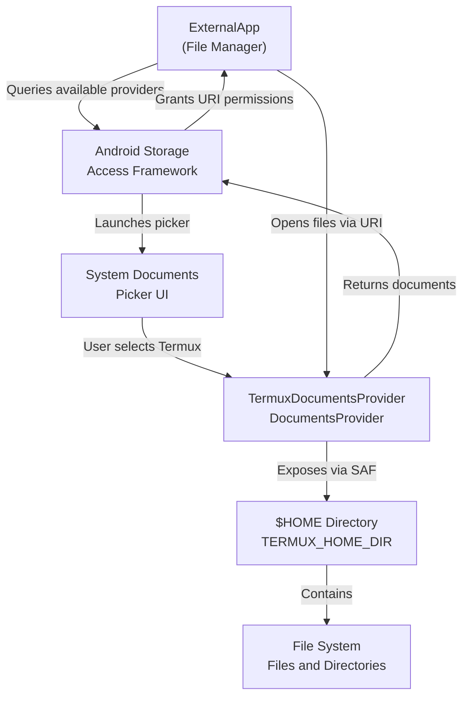
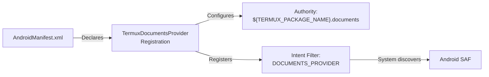
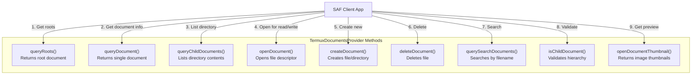
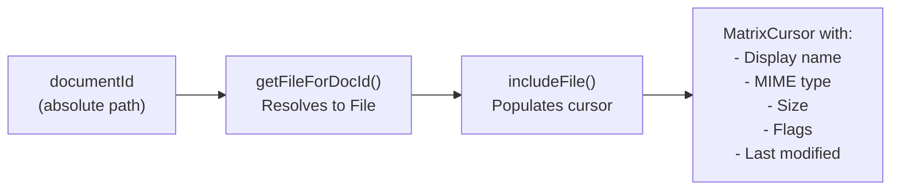
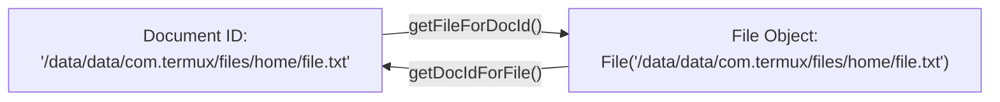
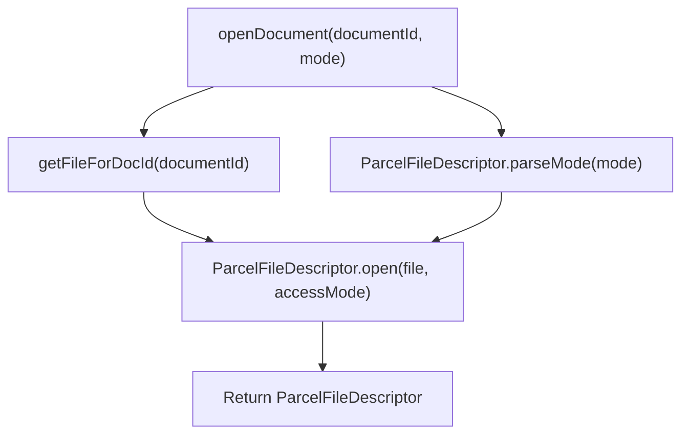

<!-- source: DeepWiki mcp.deepwiki.com · repo termux/termux-app · page 6.1 TermuxDocumentsProvider · fetched 2026-10-26 -->

# TermuxDocumentsProvider

<details>
<summary>Relevant source files</summary>

The following files were used as context for generating this wiki page:

- [app/src/main/AndroidManifest.xml](app/src/main/AndroidManifest.xml)
- [app/src/main/java/com/termux/filepicker/TermuxDocumentsProvider.java](app/src/main/java/com/termux/filepicker/TermuxDocumentsProvider.java)
- [app/src/main/res/drawable/ic_new_session.xml](app/src/main/res/drawable/ic_new_session.xml)
- [app/src/main/res/drawable/ic_settings.xml](app/src/main/res/drawable/ic_settings.xml)
- [app/src/main/res/xml/shortcuts.xml](app/src/main/res/xml/shortcuts.xml)

</details>


## Purpose and Scope

`TermuxDocumentsProvider` is an Android `DocumentsProvider` implementation that integrates Termux with the Storage Access Framework (SAF). It exposes the Termux home directory (`$HOME`) to external applications such as file managers, allowing them to browse, read, write, and manage files within the Termux environment through the standard Android document picker interface.

This document covers the SAF integration architecture, document provider API implementation, file operations, and security considerations. For information about the alternative file sharing mechanism using `content://` URIs, see [TermuxOpenReceiver and ContentProvider](#6.2).

Sources: [app/src/main/java/com/termux/filepicker/TermuxDocumentsProvider.java:1-33]()

---

## System Overview

The `TermuxDocumentsProvider` enables external apps to access Termux files without requiring direct file system permissions. When users open a file manager or document picker that supports SAF, Termux appears as a document provider, allowing seamless file access through Android's permission-granting system.

### Architecture Context



Sources: [app/src/main/java/com/termux/filepicker/TermuxDocumentsProvider.java:1-268]()

---

## Registration and Configuration

### Manifest Declaration

The provider is registered in the Android manifest with specific permissions and intent filters that enable SAF integration.

| Property | Value | Purpose |
|----------|-------|---------|
| `android:name` | `.filepicker.TermuxDocumentsProvider` | Fully qualified class name |
| `android:authorities` | `${TERMUX_PACKAGE_NAME}.documents` | Unique content provider authority |
| `android:exported` | `true` | Allows external app access |
| `android:grantUriPermissions` | `true` | Enables URI permission grants |
| `android:permission` | `android.permission.MANAGE_DOCUMENTS` | System-level permission requirement |



Sources: [app/src/main/AndroidManifest.xml:1-153]()

### Base Directory Configuration

The provider exposes a single root directory defined at compile time:

- **Constant**: `BASE_DIR = TermuxConstants.TERMUX_HOME_DIR`
- **Path**: `$HOME` directory (typically `/data/data/com.termux/files/home`)
- **Scope**: All files and subdirectories within `$HOME` are accessible

Sources: [app/src/main/java/com/termux/filepicker/TermuxDocumentsProvider.java:34-40]()

---

## Document Provider API Implementation

### Core API Methods

The `TermuxDocumentsProvider` implements the standard `DocumentsProvider` abstract methods to fulfill SAF contracts:



Sources: [app/src/main/java/com/termux/filepicker/TermuxDocumentsProvider.java:65-165]()

### Root Query Implementation

The `queryRoots()` method returns metadata about the Termux document tree root:

| Column | Value | Description |
|--------|-------|-------------|
| `COLUMN_ROOT_ID` | Absolute path of `BASE_DIR` | Unique root identifier |
| `COLUMN_DOCUMENT_ID` | Absolute path of `BASE_DIR` | Initial document ID |
| `COLUMN_TITLE` | Application name ("Termux") | Display name in picker |
| `COLUMN_MIME_TYPES` | `*/*` | All MIME types supported |
| `COLUMN_FLAGS` | `SUPPORTS_CREATE` \| `SUPPORTS_SEARCH` \| `SUPPORTS_IS_CHILD` | Capability flags |
| `COLUMN_AVAILABLE_BYTES` | `BASE_DIR.getFreeSpace()` | Available storage space |
| `COLUMN_ICON` | `R.mipmap.ic_launcher` | Termux app icon |

Sources: [app/src/main/java/com/termux/filepicker/TermuxDocumentsProvider.java:65-80]()

### Document Query Implementation

The `queryDocument()` method returns metadata for a single document identified by its document ID:



Sources: [app/src/main/java/com/termux/filepicker/TermuxDocumentsProvider.java:82-88]()

### Child Document Query

The `queryChildDocuments()` method lists all children of a directory:

1. Resolve `parentDocumentId` to a `File` object via `getFileForDocId()`
2. Call `listFiles()` on the parent directory
3. For each child file, call `includeFile()` to add to result cursor
4. Return cursor containing all children

Sources: [app/src/main/java/com/termux/filepicker/TermuxDocumentsProvider.java:89-98]()

---

## Document ID and File Path Mapping

### Document ID Format

Document IDs in `TermuxDocumentsProvider` are **absolute file paths**. This design provides a one-to-one mapping between SAF document identifiers and file system paths.



### Mapping Functions

- **`getDocIdForFile(File file)`**: Converts `File` objects to absolute path strings.
- **`getFileForDocId(String docId)`**: Converts document ID strings back to `File` objects, throwing `FileNotFoundException` if invalid.

Sources: [app/src/main/java/com/termux/filepicker/TermuxDocumentsProvider.java:1-268]()

---

## File Operations

### Opening Documents

The `openDocument()` method provides file access through Android's `ParcelFileDescriptor`:



**Supported Modes**:
- `"r"` - Read-only
- `"w"` - Write-only (truncate)
- `"wt"` - Write-only (truncate)
- `"wa"` - Write-only (append)
- `"rw"` - Read-write

Sources: [app/src/main/java/com/termux/filepicker/TermuxDocumentsProvider.java:99-105]()

### Creating Documents

The `createDocument()` method creates new files or directories with automatic conflict resolution:

| Step | Action | Implementation |
|------|--------|----------------|
| 1 | Construct new file path | `new File(parentDocumentId, displayName)` |
| 2 | Check for conflicts | `while (newFile.exists())` |
| 3 | Append conflict suffix | `displayName + " (" + noConflictId++ + ")"` |
| 4 | Create file or directory | `newFile.createNewFile()` or `newFile.mkdir()` |
| 5 | Return document ID | `newFile.getPath()` |

Sources: [app/src/main/java/com/termux/filepicker/TermuxDocumentsProvider.java:118-140]()

### Deleting Documents

The `deleteDocument()` method removes files or directories via `file.delete()`, throwing a `FileNotFoundException` upon failure.

Sources: [app/src/main/java/com/termux/filepicker/TermuxDocumentsProvider.java:141-148]()

---

## Document Metadata and Flags

### Document Flags

The provider evaluates file attributes to assign capability flags such as `FLAG_DIR_SUPPORTS_CREATE`, `FLAG_SUPPORTS_WRITE`, `FLAG_SUPPORTS_DELETE`, and `FLAG_SUPPORTS_THUMBNAIL`.

Sources: [app/src/main/java/com/termux/filepicker/TermuxDocumentsProvider.java:1-268]()

### MIME Type Resolution

The provider resolves MIME types using `MimeTypeMap` based on file extensions or defaults to `application/octet-stream` (or `vnd.android.document/directory` for directories).

Sources: [app/src/main/java/com/termux/filepicker/TermuxDocumentsProvider.java:1-268]()

---

## Search Functionality

### Search Algorithm

The `querySearchDocuments()` method performs a breadth-first search across subdirectories within `BASE_DIR`, enforcing canonical path checks to prevent symlink traversal outside `$HOME` and capping results at 50 matches.

Sources: [app/src/main/java/com/termux/filepicker/TermuxDocumentsProvider.java:155-191]()

---

## Parent-Child Validation

### `isChildDocument()` Implementation

The `isChildDocument()` method validates document hierarchy using prefix matching on absolute paths:

```java
public boolean isChildDocument(String parentDocumentId, String documentId) {
    return documentId.startsWith(parentDocumentId);
}
```

Sources: [app/src/main/java/com/termux/filepicker/TermuxDocumentsProvider.java:192-196]()

---

## Thumbnail Support

### `openDocumentThumbnail()` Implementation

For image files, `openDocumentThumbnail()` wraps the target file inside an `AssetFileDescriptor` for system thumbnail decoding.

Sources: [app/src/main/java/com/termux/filepicker/TermuxDocumentsProvider.java:106-112]()

---

## Security Considerations

### Access Control

| Security Layer | Mechanism | Protection |
|----------------|-----------|------------|
| **System Permission** | `android.permission.MANAGE_DOCUMENTS` | Restricts queries to authorized system components |
| **URI Permissions** | `android:grantUriPermissions="true"` | Temporary URI access grants |
| **Scope Restriction** | `BASE_DIR = TERMUX_HOME_DIR` | Limits access strictly to `$HOME` |
| **Symlink Protection** | Canonical path validation | Prevents traversal outside `$HOME` |

Sources: [app/src/main/AndroidManifest.xml:1-153](), [app/src/main/java/com/termux/filepicker/TermuxDocumentsProvider.java:34-40]()

---

## Related Components

1. **TermuxDocumentsProvider** (this document): Full SAF integration for browsing and managing files.
2. **TermuxOpenReceiver and ContentProvider** ([TermuxOpenReceiver and ContentProvider](#6.2)): Intent-based file sharing via `content://` URIs.

Sources: [app/src/main/java/com/termux/filepicker/TermuxDocumentsProvider.java:1-268]()

---

