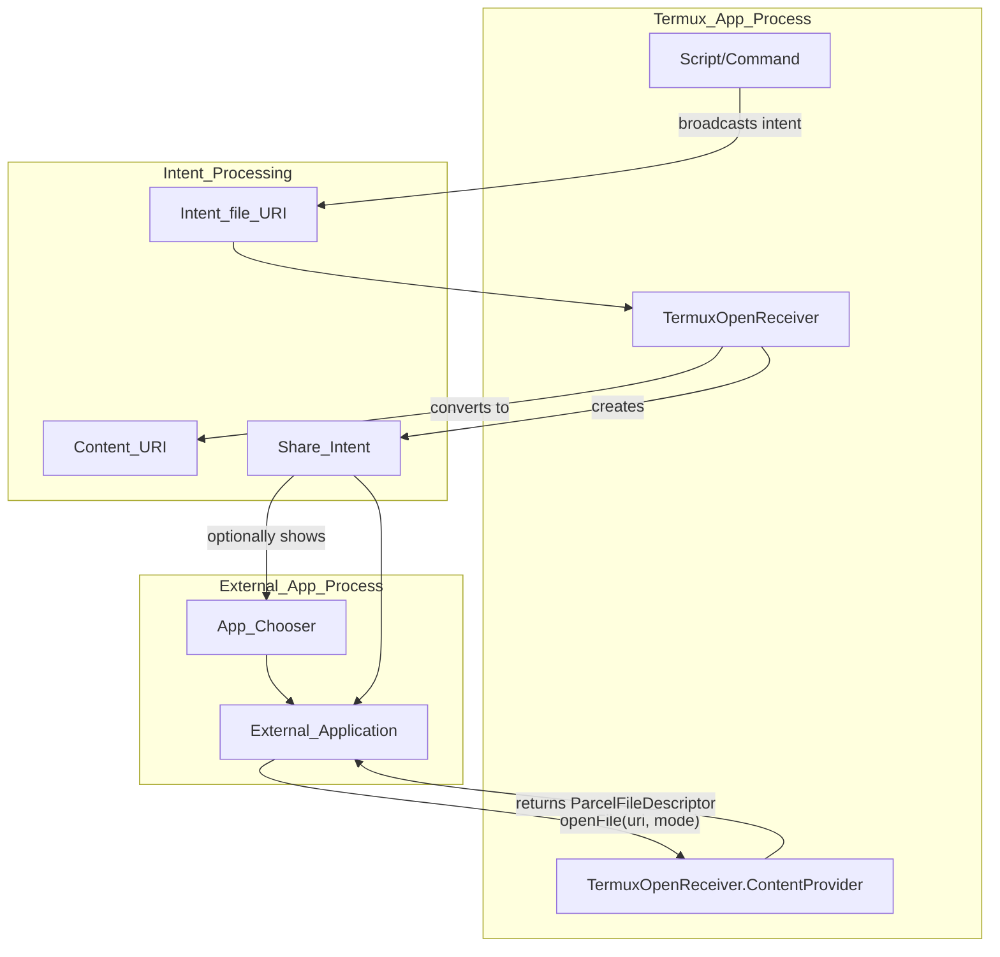
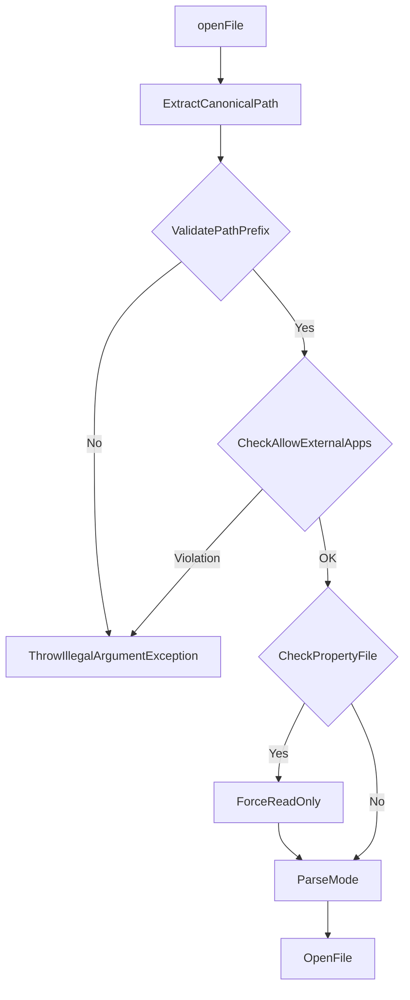
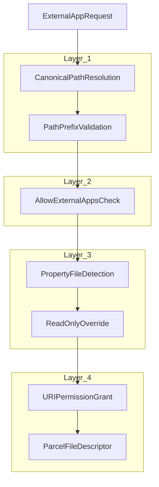

<!-- source: DeepWiki mcp.deepwiki.com · repo termux/termux-app · page 6.2 TermuxOpenReceiver and ContentProvider · fetched 2026-10-26 -->

# TermuxOpenProvider and ContentProvider

<details>
<summary>Relevant source files</summary>

The following files were used as context for generating this wiki page:

- [app/src/main/java/com/termux/app/RunCommandService.java](app/src/main/java/com/termux/app/RunCommandService.java)
- [app/src/main/java/com/termux/app/TermuxActivity.java](app/src/main/java/com/termux/app/TermuxActivity.java)
- [app/src/main/java/com/termux/app/TermuxOpenReceiver.java](app/src/main/java/com/termux/app/TermuxOpenReceiver.java)
- [app/src/main/java/com/termux/app/TermuxService.java](app/src/main/java/com/termux/app/TermuxService.java)
- [app/src/main/res/values/strings.xml](app/src/main/res/values/strings.xml)
- [termux-shared/src/main/java/com/termux/shared/net/uri/UriUtils.java](termux-shared/src/main/java/com/termux/shared/net/uri/UriUtils.java)

</details>


## Purpose and Scope

This page documents the file sharing system implemented by `TermuxOpenReceiver` and its nested `ContentProvider` class. These components enable Termux to share files with external Android applications by converting file system paths to `content://` URIs and providing secure file access through Android's content provider mechanism.

For Storage Access Framework (SAF) integration and document browsing, see [TermuxDocumentsProvider](#6.1). For the broader security model governing external app access, see [Property-Based Access Control](#8.3).

Sources: `[app/src/main/java/com/termux/app/TermuxOpenReceiver.java:30-125]()`, `[app/src/main/java/com/termux/app/TermuxOpenReceiver.java:127-237]()`

## Architecture Overview

The file sharing system consists of two collaborating components: a `BroadcastReceiver` that converts file paths to shareable URIs, and a `ContentProvider` that serves file content to external applications.

Diagram: File Sharing Flow


Sources: `[app/src/main/java/com/termux/app/TermuxOpenReceiver.java:30-125]()`, `[app/src/main/java/com/termux/app/TermuxOpenReceiver.java:127-237]()`

The `TermuxOpenReceiver` acts as the entry point, converting file system paths into content URIs under the authority `com.termux.files`. The nested `ContentProvider` then handles actual file access requests from external applications.

Sources: `[app/src/main/java/com/termux/app/TermuxOpenReceiver.java:30-125]`, `[app/src/main/java/com/termux/app/TermuxOpenReceiver.java:127-237]()`

## TermuxOpenReceiver - The BroadcastReceiver

The `TermuxOpenReceiver` class extends `BroadcastReceiver` (`[app/src/main/java/com/termux/app/TermuxOpenReceiver.java:30]`) and processes file sharing intents sent by shell scripts or other Termux components.

### Intent Reception and Validation

The receiver's `onReceive` method `[app/src/main/java/com/termux/app/TermuxOpenReceiver.java:35]` validates incoming intents and extracts the file URI:

| Validation Check | Purpose | Error Handling |
|-----------------|---------|----------------|
| Intent data null check | Ensures URI is provided | Logs error and returns |
| File scheme validation | Verifies `file://` scheme or non-file scheme | Passes through non-file URIs directly |
| File existence check | Confirms file is readable | Logs error and returns |

Sources: `[app/src/main/java/com/termux/app/TermuxOpenReceiver.java:34-87]()`

### Supported Intent Actions

The receiver handles two intent actions:

1. **`Intent.ACTION_SEND`**: Shares the file via Android's share sheet
2. **`Intent.ACTION_VIEW`**: Opens the file in an appropriate viewer application

Non-file URIs (e.g., `http://`, `https://`) are passed directly to external applications without content provider conversion.

Sources: `[app/src/main/java/com/termux/app/TermuxOpenReceiver.java:48-74]()`

### URI Conversion Process

Diagram: File URI to Content URI Conversion


Sources: `[app/src/main/java/com/termux/app/TermuxOpenReceiver.java:77-107]`, `[termux-shared/src/main/java/com/termux/shared/net/uri/UriUtils.java:29-35]()`

The conversion uses `UriUtils.getContentUri()` with the authority defined in `TermuxConstants.TERMUX_FILE_SHARE_URI_AUTHORITY`. The file path, including any fragment component (text after `#`), is preserved in the content URI's path.

Sources: `[app/src/main/java/com/termux/app/TermuxOpenReceiver.java:77-107]()`

### MIME Type Detection

The receiver determines the content type using a two-tier approach:

1. **Explicit content-type extra**: If the intent includes a `"content-type"` extra, use it directly
2. **File extension mapping**: Otherwise, extract the file extension and use `MimeTypeMap.getSingleton()` to map it to a MIME type
3. **Default fallback**: If no mapping exists, use `"application/octet-stream"`

The file extension is normalized to lowercase to handle case variations.

Sources: `[app/src/main/java/com/termux/app/TermuxOpenReceiver.java:93-104]()`

### Share Intent Construction

The final share intent is constructed with specific flags and extras:

| Component | Value | Purpose |
|-----------|-------|---------|
| Action | `ACTION_VIEW` or `ACTION_SEND` | Determines how external app handles file |
| Flags | `FLAG_ACTIVITY_NEW_TASK` | Launches external app in separate task |
| Flags | `FLAG_GRANT_READ_URI_PERMISSION` | Grants temporary read access to content URI |
| Extra (`ACTION_SEND`) | `EXTRA_STREAM` → content URI | Provides file for sharing |
| Data/Type (`ACTION_VIEW`) | content URI + MIME type | Provides file for viewing |
| Chooser | Optional via `"chooser"` extra | Shows app selection dialog |

Sources: `[app/src/main/java/com/termux/app/TermuxOpenReceiver.java:89-124]()`

## ContentProvider - File Access Provider

The nested `TermuxOpenReceiver.ContentProvider` class extends `android.content.ContentProvider` (`[app/src/main/java/com/termux/app/TermuxOpenReceiver.java:127]`) and serves as the actual file access mechanism for external applications.

### Provider Registration

The content provider must be declared in the Android manifest with the authority `com.termux.files`. This matches the authority used in URI conversion:

```
Content URI: content://com.termux.files/<file-path>
```

Sources: `[app/src/main/java/com/termux/app/TermuxOpenReceiver.java:127-134]()`

### Query Operation

The `query` method (`[app/src/main/java/com/termux/app/TermuxOpenReceiver.java:137]`) provides file metadata to external applications. It returns a `MatrixCursor` with three standard media columns:

| Column | Value | Notes |
|--------|-------|-------|
| `DISPLAY_NAME` | File name | `file.getName()` |
| `SIZE` | File size in bytes | `(int) file.length()` - truncated to int |
| `_ID` | Fixed value of 1 | Placeholder identifier |

The file path is extracted directly from the URI's path component: `new File(uri.getPath())`.

Sources: `[app/src/main/java/com/termux/app/TermuxOpenReceiver.java:137-171]()`

### MIME Type Resolution

The `getType` method (`[app/src/main/java/com/termux/app/TermuxOpenReceiver.java:174]`) provides MIME type information using extension-based mapping via `MimeTypeMap`.

Sources: `[app/src/main/java/com/termux/app/TermuxOpenReceiver.java:174-184]()`

### File Opening with Security Validation

The `openFile` method is the security-critical component that actually provides file access. It implements a multi-layer validation process:

Diagram: File Opening Security Validation


Sources: `[app/src/main/java/com/termux/app/TermuxOpenReceiver.java:201-237]()`

### Path Validation

The provider validates that requested file paths are within allowed directories (`[app/src/main/java/com/termux/app/TermuxOpenReceiver.java:201-211]()`):
1. **Canonical path resolution**: Resolves symlinks and relative paths via `file.getCanonicalPath()`
2. **Path prefix check**: Path must start with either `TermuxConstants.TERMUX_FILES_DIR_PATH` or the external storage directory.

Sources: `[app/src/main/java/com/termux/app/TermuxOpenReceiver.java:201-211]()`

### External Apps Policy Check

The provider enforces the `allow-external-apps` property using `TermuxPluginUtils.checkIfAllowExternalAppsPolicyIsViolated()` (`[app/src/main/java/com/termux/app/TermuxOpenReceiver.java:213-217]()`). If violated, an `IllegalArgumentException` is thrown.

Sources: `[app/src/main/java/com/termux/app/TermuxOpenReceiver.java:213-217]()`

### Read-Only Enforcement for Property Files

To prevent modification of security-critical configuration, the provider forces read-only mode for specific file paths (`[app/src/main/java/com/termux/app/TermuxOpenReceiver.java:219-225]()`).

Sources: `[app/src/main/java/com/termux/app/TermuxOpenReceiver.java:219-225]()`

## Security Model

Diagram: Multi-Layer Security Validation


Sources: `[app/src/main/java/com/termux/app/TermuxOpenReceiver.java:201-237]()`

## Unimplemented Operations

The content provider methods `insert`, `delete`, and `update` return `null` or `0` to enforce a read-only design for external applications.

Sources: `[app/src/main/java/com/termux/app/TermuxOpenReceiver.java:186-198]()`

## Usage Pattern

Typical usage from a shell script via `am broadcast`:
```bash
am broadcast \
  -a android.intent.action.VIEW \
  -d file:///data/data/com.termux/files/home/document.pdf \
  -n com.termux/.app.TermuxOpenReceiver \
  --es content-type application/pdf
```

Sources: `[app/src/main/java/com/termux/app/TermuxOpenReceiver.java:45-124]()`

---

