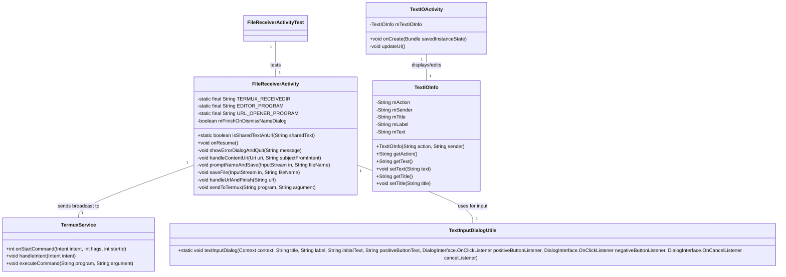

<!-- source: DeepWiki mcp.deepwiki.com · repo termux/termux-app · page 6.3 FileReceiverActivity · fetched 2026-10-26 -->

# FileReceiverActivity

<details>
<summary>Relevant source files</summary>

The following files were used as context for generating this wiki page:

- [app/src/main/java/com/termux/app/api/file/FileReceiverActivity.java](app/src/main/java/com/termux/app/api/file/FileReceiverActivity.java)
- [app/src/test/java/com/termux/app/api/file/FileReceiverActivityTest.java](app/src/test/java/com/termux/app/api/file/FileReceiverActivityTest.java)
- [termux-shared/src/main/java/com/termux/shared/activities/TextIOActivity.java](termux-shared/src/main/java/com/termux/shared/activities/TextIOActivity.java)
- [termux-shared/src/main/java/com/termux/shared/models/TextIOInfo.java](termux-shared/src/main/java/com/termux/shared/models/TextIOInfo.java)
- [termux-shared/src/main/res/layout/activity_text_io.xml](termux-shared/src/main/res/layout/activity_text_io.xml)
- [termux-shared/src/main/res/menu/menu_text_io.xml](termux-shared/src/main/res/menu/menu_text_io.xml)

</details>


The `FileReceiverActivity` is a crucial component in Termux that handles incoming files and text shared from other Android applications. Its primary purpose is to receive data via `ACTION_SEND` or `ACTION_VIEW` intents, save the received files into the `~/downloads` directory within the Termux environment, and then forward the relevant information (file paths or URLs) to an active Termux session for further processing. This allows users to easily transfer files and URLs from other apps into their Termux environment.

## Intent Handling and Data Flow

The `FileReceiverActivity` is activated when an external application sends an `Intent` with `ACTION_SEND` or `ACTION_VIEW`. The activity's `onResume()` method [app/src/main/java/com/termux/app/api/file/FileReceiverActivity.java:65-125]() is the entry point for processing these intents.

### Intent Processing Logic

The activity first logs the received intent for debugging purposes [app/src/main/java/com/termux/app/api/file/FileReceiverActivity.java:73](). It then checks the `action` and `type` of the intent to determine how to handle the incoming data.

#### ACTION_SEND Intent Handling

If the intent action is `ACTION_SEND` [app/src/main/java/com/termux/app/api/file/FileReceiverActivity.java:77]():
*   **Shared URI (File)**: If `Intent.EXTRA_STREAM` contains a `Uri` [app/src/main/java/com/termux/app/api/file/FileReceiverActivity.java:81](), it indicates a file is being shared. The `handleContentUri()` method is called to process this URI [app/src/main/java/com/termux/app/api/file/FileReceiverActivity.java:82]().
*   **Shared Text**: If `Intent.EXTRA_TEXT` contains text [app/src/main/java/com/termux/app/api/file/FileReceiverActivity.java:83]():
    *   **URL**: The `isSharedTextAnUrl()` static method [app/src/main/java/com/termux/app/api/file/FileReceiverActivity.java:60]() checks if the shared text is a URL. This method uses `Patterns.WEB_URL` and a regex for magnet links [app/src/main/java/com/termux/app/api/file/FileReceiverActivity.java:60-61](). If it's a URL, `handleUrlAndFinish()` is called [app/src/main/java/com/termux/app/api/file/FileReceiverActivity.java:85]().
    *   **Plain Text**: If it's not a URL, the text is treated as plain text. It's converted into a `ByteArrayInputStream` and `promptNameAndSave()` is called to save it as a `.txt` file [app/src/main/java/com/termux/app/api/file/FileReceiverActivity.java:87-90]().
*   **No Content**: If neither a URI nor text is found, an error dialog is shown [app/src/main/java/com/termux/app/api/file/FileReceiverActivity.java:93]().

#### ACTION_VIEW Intent Handling

If the intent is not `ACTION_SEND`, the activity assumes it's an `ACTION_VIEW` intent and attempts to retrieve data from `intent.getData()` [app/src/main/java/com/termux/app/api/file/FileReceiverActivity.java:96]().
*   **Content URI**: If the scheme is `content://` [app/src/main/java/com/termux/app/api/file/FileReceiverActivity.java:103](), `handleContentUri()` is called [app/src/main/java/com/termux/app/api/file/FileReceiverActivity.java:104]().
*   **File URI**: If the scheme is `file://` [app/src/main/java/com/termux/app/api/file/FileReceiverActivity.java:105](), the file path is extracted, and `promptNameAndSave()` is called with a `FileInputStream` [app/src/main/java/com/termux/app/api/file/FileReceiverActivity.java:109-118]().
*   **Other Schemes**: For any other scheme, an error dialog is displayed [app/src/main/java/com/termux/app/api/file/FileReceiverActivity.java:123]().

### Data Flow Diagram

```mermaid
graph TD
    A[External App] -->|ACTION_SEND or ACTION_VIEW Intent| B(FileReceiverActivity.onResume())
    B --> C{Intent Action?}
    C -- "ACTION_SEND" --> D{Shared URI or Text?}
    D -- "URI (EXTRA_STREAM)" --> E(handleContentUri(uri, title))
    D -- "Text (EXTRA_TEXT)" --> F{Is Text URL?}
    F -- "Yes" --> G(handleUrlAndFinish(text))
    F -- "No" --> H(promptNameAndSave(ByteArrayInputStream, subject))
    D -- "None" --> I(showErrorDialogAndQuit("No content"))
    C -- "ACTION_VIEW" --> J{Data URI Scheme?}
    J -- "content://" --> E
    J -- "file://" --> K(Extract file path)
    K --> L(promptNameAndSave(FileInputStream, filename))
    J -- "Other" --> M(showErrorDialogAndQuit("Unable to receive"))

    E --> N(Get filename from ContentResolver or intent)
    N --> O(Open InputStream from URI)
    O --> H

    H --> P(Show "Save As" dialog)
    P -- "User enters filename" --> Q(saveFile(InputStream, filename))
    Q --> R(Send broadcast to TermuxService)
    R --> S(TermuxService.onStartCommand())
    S --> T(Execute `termux-file-editor` or `termux-url-opener` in session)
    G --> R
    T --> U[Termux Session]
    I --> V[Error Dialog]
    M --> V
    V --> W(Finish Activity)
    Q --> W
    G --> W
```
Sources:
* [app/src/main/java/com/termux/app/api/file/FileReceiverActivity.java:65-125]()
* [app/src/main/java/com/termux/app/api/file/FileReceiverActivity.java:60-61]()
* [app/src/main/java/com/termux/app/api/file/FileReceiverActivity.java:137-157]()

## Key Functions and Classes

### `FileReceiverActivity`

This is the main activity responsible for receiving and processing shared data.

*   `TERMUX_RECEIVEDIR`: A static final string defining the target directory for received files: `~/downloads` [app/src/main/java/com/termux/app/api/file/FileReceiverActivity.java:41]().
*   `EDITOR_PROGRAM`: Path to the `termux-file-editor` script [app/src/main/java/com/termux/app/api/file/FileReceiverActivity.java:42]().
*   `URL_OPENER_PROGRAM`: Path to the `termux-url-opener` script [app/src/main/java/com/termux/app/api/file/FileReceiverActivity.java:43]().
*   `isSharedTextAnUrl(String sharedText)`: Determines if a given string is a URL using `Patterns.WEB_URL` and a magnet link regex [app/src/main/java/com/termux/app/api/file/FileReceiverActivity.java:60-62]().
*   `onResume()`: The lifecycle method where intent processing begins [app/src/main/java/com/termux/app/api/file/FileReceiverActivity.java:65-125]().
*   `showErrorDialogAndQuit(String message)`: Displays an error message to the user and finishes the activity [app/src/main/java/com/termux/app/api/file/FileReceiverActivity.java:128-135]().
*   `handleContentUri(@NonNull final Uri uri, String subjectFromIntent)`: Handles `content://` URIs. It queries the `ContentResolver` to get the display name of the file and opens an `InputStream` [app/src/main/java/com/termux/app/api/file/FileReceiverActivity.java:137-157]().
*   `promptNameAndSave(final InputStream in, String fileName)`: Prompts the user for a filename using `TextInputDialogUtils.textInputDialog()` [app/src/main/java/com/termux/app/api/file/FileReceiverActivity.java:160-200](). Once a name is provided, it calls `saveFile()` [app/src/main/java/com/termux/app/api/file/FileReceiverActivity.java:195]().
*   `saveFile(final InputStream in, final String fileName)`: Saves the `InputStream` content to a file in `TERMUX_RECEIVEDIR`. It ensures the directory exists and handles potential naming conflicts by appending a number to the filename [app/src/main/java/com/termux/app/api/file/FileReceiverActivity.java:202-249](). After saving, it sends a broadcast to `TermuxService` to execute `termux-file-editor` [app/src/main/java/com/termux/app/api/file/FileReceiverActivity.java:244-247]().
*   `handleUrlAndFinish(String url)`: Sends a broadcast to `TermuxService` to execute `termux-url-opener` with the provided URL [app/src/main/java/com/termux/app/api/file/FileReceiverActivity.java:251-260]().
*   `sendToTermux(String program, String argument)`: A helper method to create and send an `Intent` to `TermuxService` with `TERMUX_SERVICE.ACTION_EXECUTE` to run a specified program with an argument [app/src/main/java/com/termux/app/api/file/FileReceiverActivity.java:262-287]().

### `TermuxService`

The `TermuxService` receives the broadcast intents from `FileReceiverActivity` and executes the appropriate Termux scripts.
*   It listens for `TERMUX_SERVICE.ACTION_EXECUTE` intents [app/src/main/java/com/termux/app/TermuxService.java]().
*   When such an intent is received, it extracts the `TERMUX_SERVICE.EXTRA_EXECUTE_PROGRAM` and `TERMUX_SERVICE.EXTRA_EXECUTE_ARGUMENT` extras [app/src/main/java/com/termux/app/TermuxService.java]().
*   It then executes the specified program (e.g., `termux-file-editor` or `termux-url-opener`) in a new or existing Termux session [app/src/main/java/com/termux/app/TermuxService.java]().

### `TextInputDialogUtils`

Used by `promptNameAndSave()` to display a dialog asking the user for a filename. This utility is part of the `termux-shared` module.

### `TextIOActivity` and `TextIOInfo`

While `FileReceiverActivity` directly uses `TextInputDialogUtils` for filename input, the `TextIOActivity` [termux-shared/src/main/java/com/termux/shared/activities/TextIOActivity.java]() and its associated `TextIOInfo` model [termux-shared/src/main/java/com/termux/shared/models/TextIOInfo.java]() provide a more general mechanism for displaying and editing text. `TextIOInfo` [termux-shared/src/main/java/com/termux/shared/models/TextIOInfo.java:41-45]() defines properties like title, label, text content, and styling for the `TextIOActivity` [termux-shared/src/main/java/com/termux/shared/activities/TextIOActivity.java:113-171](). The `activity_text_io.xml` layout [termux-shared/src/main/res/layout/activity_text_io.xml]() defines the UI for this activity, including an `EditText` for user input [termux-shared/src/main/res/layout/activity_text_io.xml:67-73]().

### `FileReceiverActivityTest`

This test class [app/src/test/java/com/termux/app/api/file/FileReceiverActivityTest.java]() contains unit tests for the `FileReceiverActivity`. Specifically, `testIsSharedTextAnUrl()` [app/src/test/java/com/termux/app/api/file/FileReceiverActivityTest.java:17-34]() verifies the correctness of the `isSharedTextAnUrl()` method with various valid and invalid URL strings.

### Class Diagram


Sources:
* [app/src/main/java/com/termux/app/api/file/FileReceiverActivity.java:41-43]()
* [app/src/main/java/com/termux/app/api/file/FileReceiverActivity.java:60-62]()
* [app/src/main/java/com/termux/app/api/file/FileReceiverActivity.java:65-125]()
* [app/src/main/java/com/termux/app/api/file/FileReceiverActivity.java:128-135]()
* [app/src/main/java/com/termux/app/api/file/FileReceiverActivity.java:137-157]()
* [app/src/main/java/com/termux/app/api/file/FileReceiverActivity.java:160-200]()
* [app/src/main/java/com/termux/app/api/file/FileReceiverActivity.java:202-249]()
* [app/src/main/java/com/termux/app/api/file/FileReceiverActivity.java:251-260]()
* [app/src/main/java/com/termux/app/api/file/FileReceiverActivity.java:262-287]()
* [app/src/main/java/com/termux/app/TermuxService.java]()
* [termux-shared/src/main/java/com/termux/shared/activities/TextIOActivity.java]()
* [termux-shared/src/main/java/com/termux/shared/models/TextIOInfo.java]()
* [termux-shared/src/main/java/com/termux/shared/models/TextIOInfo.java:41-45]()
* [termux-shared/src/main/java/com/termux/shared/activities/TextIOActivity.java:113-171]()
* [termux-shared/src/main/res/layout/activity_text_io.xml]()
* [termux-shared/src/main/res/layout/activity_text_io.xml:67-73]()
* [app/src/test/java/com/termux/app/api/file/FileReceiverActivityTest.java]()
* [app/src/test/java/com/termux/app/api/file/FileReceiverActivityTest.java:17-34]()

## File Saving and Execution

When a file or text is received and a filename is determined (either from the intent or user input), the `saveFile()` method is invoked [app/src/main/java/com/termux/app/api/file/FileReceiverActivity.java:202]().

1.  **Directory Creation**: It first ensures that the `TERMUX_RECEIVEDIR` (`~/downloads`) directory exists [app/src/main/java/com/termux/app/api/file/FileReceiverActivity.java:209]().
2.  **Filename Conflict Resolution**: If a file with the chosen name already exists, it appends a numerical suffix (e.g., `filename-1.txt`) to avoid overwriting [app/src/main/java/com/termux/app/api/file/FileReceiverActivity.java:214-226]().
3.  **File Writing**: The `InputStream` is then read and written to the target file in `~/downloads` [app/src/main/java/com/termux/app/api/file/FileReceiverActivity.java:228-238]().
4.  **Termux Service Broadcast**: After successful saving, an `Intent` with `TERMUX_SERVICE.ACTION_EXECUTE` is created and sent as a broadcast to `TermuxService` [app/src/main/java/com/termux/app/api/file/FileReceiverActivity.java:244-247]().
    *   The `TERMUX_SERVICE.EXTRA_EXECUTE_PROGRAM` extra is set to `EDITOR_PROGRAM` (`~/bin/termux-file-editor`).
    *   The `TERMUX_SERVICE.EXTRA_EXECUTE_ARGUMENT` extra is set to the path of the newly saved file.

Similarly, for URLs, `handleUrlAndFinish()` [app/src/main/java/com/termux/app/api/file/FileReceiverActivity.java:251]() directly sends a broadcast to `TermuxService` with `URL_OPENER_PROGRAM` (`~/bin/termux-url-opener`) and the URL as an argument [app/src/main/java/com/termux/app/api/file/FileReceiverActivity.java:256-259]().

This mechanism ensures that once data is received and stored, the appropriate Termux script is automatically invoked to handle it within a Termux session, providing a seamless integration experience.

Sources:
* [app/src/main/java/com/termux/app/api/file/FileReceiverActivity.java:202]()
* [app/src/main/java/com/termux/app/api/file/FileReceiverActivity.java:209]()
* [app/src/main/java/com/termux/app/api/file/FileReceiverActivity.java:214-226]()
* [app/src/main/java/com/termux/app/api/file/FileReceiverActivity.java:228-238]()
* [app/src/main/java/com/termux/app/api/file/FileReceiverActivity.java:244-247]()
* [app/src/main/java/com/termux/app/api/file/FileReceiverActivity.java:251]()
* [app/src/main/java/com/termux/app/api/file/FileReceiverActivity.java:256-259]()

---

