<!-- source: DeepWiki mcp.deepwiki.com · repo termux/termux-app · page 7 Constants and Shared Infrastructure · fetched 2026-10-26 -->

# Constants and Shared Infrastructure

<details>
<summary>Relevant source files</summary>

The following files were used as context for generating this wiki page:

- [termux-shared/src/main/java/com/termux/shared/termux/TermuxConstants.java](termux-shared/src/main/java/com/termux/shared/termux/TermuxConstants.java)
- [termux-shared/src/main/java/com/termux/shared/termux/TermuxUtils.java](termux-shared/src/main/java/com/termux/shared/termux/TermuxUtils.java)
- [termux-shared/src/main/res/values/strings.xml](termux-shared/src/main/res/values/strings.xml)

</details>


## Purpose and Scope

This document covers the shared infrastructure that forms the foundation for all Termux app components and plugin applications. This includes compile-time constants, utility classes, and cross-module helper libraries that enable consistent configuration and behavior across the entire application ecosystem.

For information about:
- Build system configuration and constant generation: See [Gradle Build Configuration](#2.2)
- Runtime properties and configuration files: See [File System Structure](#5.2)  
- Security-related permission checking: See [Security and Permissions](#8)
- Plugin app communication patterns: See [Plugin Ecosystem](#1.2)

All shared infrastructure code resides in the `termux-shared` module, which is a dependency of the `app` module, `terminal-view` module, and all plugin applications.

## Architecture Overview

The shared infrastructure operates at three distinct levels, forming a layered architecture that progresses from compile-time definitions to runtime operations:

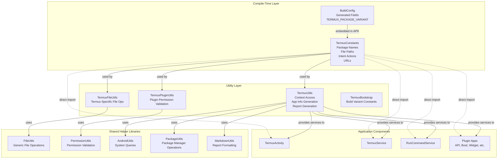

**Sources:** [termux-shared/src/main/java/com/termux/shared/termux/TermuxConstants.java:1-131](), [termux-shared/src/main/java/com/termux/shared/termux/TermuxUtils.java:1-147]()

## TermuxConstants Class

The `TermuxConstants` class serves as the single source of truth for all package names, file paths, intent actions, and URLs used throughout the Termux ecosystem. It is defined in the `termux-shared` module at `termux-shared/src/main/java/com/termux/shared/termux/TermuxConstants.java`.

### Design Principles

The class follows strict architectural principles:

| Principle | Implementation |
|-----------|----------------|
| **Immutability** | All fields are `public static final` compile-time constants |
| **Derivation** | Most constants derive from base constants to ensure consistency |
| **Documentation** | Extensive javadocs with changelog tracking every modification |
| **Centralization** | Single location prevents duplication across modules |
| **Versioning** | Currently v0.53.0 with comprehensive changelog since v0.1.0 |

**Sources:** [termux-shared/src/main/java/com/termux/shared/termux/TermuxConstants.java:15-131]()

### Constant Hierarchy and Derivation

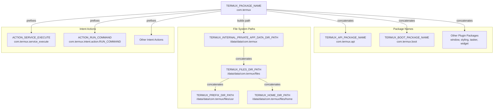

This hierarchical derivation means changing `TERMUX_PACKAGE_NAME` automatically updates all derived constants, though native binaries would require recompilation.

**Sources:** [termux-shared/src/main/java/com/termux/shared/termux/TermuxConstants.java:349-469](), [termux-shared/src/main/java/com/termux/shared/termux/TermuxConstants.java:576-695]()

### Package Names and Application Identity

| Constant | Value | Purpose |
|----------|-------|---------|
| `TERMUX_PACKAGE_NAME` | `"com.termux"` | Base package name for main app |
| `TERMUX_APP_NAME` | `"Termux"` | Human-readable app name |
| `TERMUX_API_PACKAGE_NAME` | `"com.termux.api"` | Termux:API plugin package |
| `TERMUX_BOOT_PACKAGE_NAME` | `"com.termux.boot"` | Termux:Boot plugin package |
| `TERMUX_FLOAT_PACKAGE_NAME` | `"com.termux.window"` | Termux:Float plugin package |
| `TERMUX_STYLING_PACKAGE_NAME` | `"com.termux.styling"` | Termux:Styling plugin package |
| `TERMUX_TASKER_PACKAGE_NAME` | `"com.termux.tasker"` | Termux:Tasker plugin package |
| `TERMUX_WIDGET_PACKAGE_NAME` | `"com.termux.widget"` | Termux:Widget plugin package |

Each package has corresponding GitHub URLs, F-Droid URLs, and issue tracker URLs derived from base constants:

```java
TERMUX_GITHUB_ORGANIZATION_URL = "https://github.com/termux"
TERMUX_GITHUB_REPO_URL = TERMUX_GITHUB_ORGANIZATION_URL + "/termux-app"
TERMUX_FDROID_PACKAGE_URL = FDROID_PACKAGES_BASE_URL + "/" + TERMUX_PACKAGE_NAME
```

Two lists aggregate plugin information for iteration:
- `TERMUX_PLUGIN_APP_NAMES_LIST`: Contains human-readable plugin names
- `TERMUX_PLUGIN_APP_PACKAGE_NAMES_LIST`: Contains package names for all six plugins

**Sources:** [termux-shared/src/main/java/com/termux/shared/termux/TermuxConstants.java:349-469]()

### Directory Path Constants

The class defines the complete Termux file system hierarchy following Unix FHS conventions:

**Primary Directory Structure:**

```mermaid
graph TD
    INTERNAL["TERMUX_INTERNAL_PRIVATE_APP_DATA_DIR_PATH<br/>/data/data/com.termux"]
    FILES["TERMUX_FILES_DIR_PATH<br/>/data/data/com.termux/files"]
    PREFIX["TERMUX_PREFIX_DIR_PATH<br/>/data/data/com.termux/files/usr"]
    HOME["TERMUX_HOME_DIR_PATH<br/>/data/data/com.termux/files/home"]
    STAGING["TERMUX_STAGING_PREFIX_DIR_PATH<br/>/data/data/com.termux/files/usr-staging"]
    APPS["TERMUX_APPS_DIR_PATH<br/>/data/data/com.termux/files/apps"]
    
    subgraph "$PREFIX Subdirectories"
        BIN["TERMUX_BIN_PREFIX_DIR_PATH<br/>usr/bin"]
        ETC["TERMUX_ETC_PREFIX_DIR_PATH<br/>usr/etc"]
        INCLUDE["TERMUX_INCLUDE_PREFIX_DIR_PATH<br/>usr/include"]
        LIB["TERMUX_LIB_PREFIX_DIR_PATH<br/>usr/lib"]
        LIBEXEC["TERMUX_LIBEXEC_PREFIX_DIR_PATH<br/>usr/libexec"]
        SHARE["TERMUX_SHARE_PREFIX_DIR_PATH<br/>usr/share"]
        TMP["TERMUX_TMP_PREFIX_DIR_PATH<br/>usr/tmp"]
        VAR["TERMUX_VAR_PREFIX_DIR_PATH<br/>usr/var"]
    end
    
    subgraph "$HOME Subdirectories"
        CONFIG_HOME["TERMUX_CONFIG_HOME_DIR_PATH<br/>home/.config/termux"]
        DATA_HOME["TERMUX_DATA_HOME_DIR_PATH<br/>home/.termux"]
        STORAGE_HOME["TERMUX_STORAGE_HOME_DIR_PATH<br/>home/storage"]
    end
    
    INTERNAL --> FILES
    FILES --> PREFIX
    FILES --> HOME
    FILES --> STAGING
    FILES --> APPS
    
    PREFIX --> BIN
    PREFIX --> ETC
    PREFIX --> INCLUDE
    PREFIX --> LIB
    PREFIX --> LIBEXEC
    PREFIX --> SHARE
    PREFIX --> TMP
    PREFIX --> VAR
    
    HOME --> CONFIG_HOME
    HOME --> DATA_HOME
    HOME --> STORAGE_HOME
```

Each path constant exists in two forms:
- String path: `TERMUX_PREFIX_DIR_PATH` 
- File object: `TERMUX_PREFIX_DIR`

This dual representation simplifies code that needs either format.

**Sources:** [termux-shared/src/main/java/com/termux/shared/termux/TermuxConstants.java:576-695]()

### Plugin Script Directory Paths

Plugin apps store scripts in designated directories:

| Constant | Default Path | Used By Plugin |
|----------|--------------|----------------|
| `TERMUX_BOOT_SCRIPTS_DIR_PATH` | `~/.termux/boot` | Termux:Boot |
| `TERMUX_SHORTCUT_SCRIPTS_DIR_PATH` | `~/.shortcuts` | Termux:Widget (foreground) |
| `TERMUX_SHORTCUT_TASKS_SCRIPTS_DIR_PATH` | `~/.shortcuts/tasks` | Termux:Widget (background) |
| `TERMUX_SHORTCUT_SCRIPT_ICONS_DIR_PATH` | `~/.shortcuts/icons` | Termux:Widget (script icons) |
| `TERMUX_TASKER_SCRIPTS_DIR_PATH` | `~/.termux/tasker` | Termux:Tasker |

**Sources:** [termux-shared/src/main/java/com/termux/shared/termux/TermuxConstants.java:796-835]()

### Configuration File Paths

**Properties Files:**

Following XDG Base Directory specification, properties files have primary and secondary locations:

```
TERMUX_PROPERTIES_PRIMARY_FILE_PATH: ~/.termux/termux.properties
TERMUX_PROPERTIES_SECONDARY_FILE_PATH: ~/.config/termux/termux.properties

TERMUX_FLOAT_PROPERTIES_PRIMARY_FILE_PATH: ~/.termux/termux.float.properties
TERMUX_FLOAT_PROPERTIES_SECONDARY_FILE_PATH: ~/.config/termux/termux.float.properties
```

Critical security consideration: The constants include lists `TERMUX_PROPERTIES_FILE_PATHS_LIST` and `TERMUX_FLOAT_PROPERTIES_FILE_PATHS_LIST` with explicit javadoc warnings:

> **DO NOT** allow these files to be modified by `ContentProvider` exposed to external apps, since they may silently modify the values for security properties like `PROP_ALLOW_EXTERNAL_APPS` set by users without their explicit consent.

**Sources:** [termux-shared/src/main/java/com/termux/shared/termux/TermuxConstants.java:725-762]()

**Other Configuration Files:**

| Constant | Path | Purpose |
|----------|------|---------|
| `TERMUX_COLOR_PROPERTIES_FILE_PATH` | `~/.termux/colors.properties` | Terminal color scheme |
| `TERMUX_FONT_FILE_PATH` | `~/.termux/font.ttf` | Terminal font |
| `TERMUX_CRASH_LOG_FILE_PATH` | `~/crash_log.md` | Primary crash log |
| `TERMUX_CRASH_LOG_BACKUP_FILE_PATH` | `~/crash_log_backup.md` | Backup crash log |
| `TERMUX_ENV_FILE_PATH` | `/usr/etc/termux/termux.env` | Environment variables |
| `TERMUX_ENV_TEMP_FILE_PATH` | `/usr/etc/termux/termux.env.tmp` | Temp env file |

**Sources:** [termux-shared/src/main/java/com/termux/shared/termux/TermuxConstants.java:765-788]()

### TERMUX_APP Nested Class Structure

The `TERMUX_APP` inner class organizes app-specific constants into logical groupings:

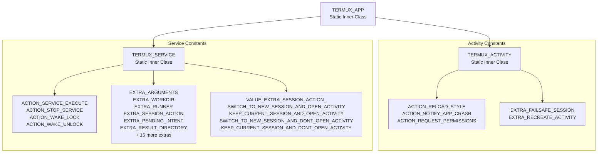

**Key Service Execution Extras:**

The `ACTION_SERVICE_EXECUTE` intent accepts comprehensive configuration:

| Extra | Type | Purpose |
|-------|------|---------|
| `EXTRA_ARGUMENTS` | `String[]` | Command arguments array |
| `EXTRA_STDIN` | `String` | Standard input for command |
| `EXTRA_WORKDIR` | `String` | Working directory path |
| `EXTRA_RUNNER` | `String` | Runner type (TERMINAL_SESSION or APP_SHELL) |
| `EXTRA_SESSION_ACTION` | `int` | Session switching behavior |
| `EXTRA_BACKGROUND_CUSTOM_LOG_LEVEL` | `String` | Custom log level |
| `EXTRA_SHELL_NAME` | `String` | Shell name for session |
| `EXTRA_SHELL_CREATE_MODE` | `String` | Shell creation mode |
| `EXTRA_PENDING_INTENT` | `Parcelable` | Callback for execution result |
| `EXTRA_RESULT_DIRECTORY` | `String` | Directory for result files |
| `EXTRA_RESULT_SINGLE_FILE` | `boolean` | Single vs multiple result files |
| `EXTRA_RESULT_FILE_BASENAME` | `String` | Result filename |
| `EXTRA_RESULT_FILE_OUTPUT_FORMAT` | `String` | Output formatter format |
| `EXTRA_RESULT_FILE_ERROR_FORMAT` | `String` | Error formatter format |

**Sources:** [termux-shared/src/main/java/com/termux/shared/termux/TermuxConstants.java:918-1090]()

### RUN_COMMAND_SERVICE Constants

Parallel structure for external command execution API:

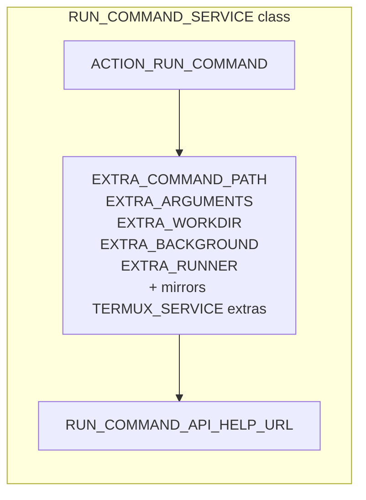

The `RUN_COMMAND_SERVICE` class mirrors most `TERMUX_SERVICE` extras but includes additional parameters:
- `EXTRA_REPLACE_COMMA_ALTERNATIVE_CHARS_IN_ARGUMENTS`: Replace alternative comma chars
- `EXTRA_COMMA_ALTERNATIVE_CHARS_IN_ARGUMENTS`: Custom comma alternative character

This enables rich command execution from plugin apps while maintaining security through permission checking.

**Sources:** [termux-shared/src/main/java/com/termux/shared/termux/TermuxConstants.java:1096-1264]()

### APK Signing Certificate Digests

For security validation and installation source identification:

| Constant | SHA-256 Digest | Release Channel |
|----------|---------------|-----------------|
| `APK_RELEASE_FDROID_SIGNING_CERTIFICATE_SHA256_DIGEST` | `228FB2CFE90831C1499EC3CCAF61E96E8E1CE70766B9474672CE427334D41C42` | F-Droid releases |
| `APK_RELEASE_GITHUB_SIGNING_CERTIFICATE_SHA256_DIGEST` | `B6DA01480EEFD5FBF2CD3771B8D1021EC791304BDD6C4BF41D3FAABAD48EE5E1` | GitHub debug/releases |
| `APK_RELEASE_GOOGLE_PLAYSTORE_SIGNING_CERTIFICATE_SHA256_DIGEST` | `738F0A30A04D3C8A1BE304AF18D0779BCF3EA88FB60808F657A3521861C2EBF9` | Google Play Store |
| `APK_RELEASE_TERMUX_DEVS_SIGNING_CERTIFICATE_SHA256_DIGEST` | `F7A038EB551F1BE8FDF388686B784ABAB4552A5D82DF423E3D8F1B5CBE1C69AE` | Termux developers |

Used by `TermuxUtils.getAPKRelease(String)` to map certificate to human-readable channel name.

**Sources:** [termux-shared/src/main/java/com/termux/shared/termux/TermuxConstants.java:476-501]()

### Security and Permission Constants

**Permission Identifier:**

```java
PERMISSION_RUN_COMMAND = "com.termux.permission.RUN_COMMAND"
```

Custom dangerous-level permission declared by Termux app that external apps must request to execute commands.

**Property-Based Access Control:**

```java
PROP_ALLOW_EXTERNAL_APPS = "allow-external-apps"
PROP_DEFAULT_VALUE_ALLOW_EXTERNAL_APPS = "false"
```

Secondary security check beyond Android permissions - property in `termux.properties` must be explicitly set to `"true"` to allow external app command execution.

**Broadcast Action:**

```java
BROADCAST_TERMUX_OPENED = "com.termux.app.OPENED"
```

Sent when Termux app opens, allowing plugin apps to react (e.g., Termux:Boot runs startup scripts).

**Sources:** [termux-shared/src/main/java/com/termux/shared/termux/TermuxConstants.java:884-895]()

### Notification Configuration

Each major service has dedicated notification channel configuration to comply with Android notification channel requirements:

| Constant | Channel ID | Notification ID | Used By |
|----------|-----------|-----------------|---------|
| `TERMUX_APP_NOTIFICATION_CHANNEL_ID` | `"termux_notification_channel"` | `1337` | TermuxService foreground service |
| `TERMUX_RUN_COMMAND_NOTIFICATION_CHANNEL_ID` | `"termux_run_command_notification_channel"` | `1338` | RunCommandService execution |
| `TERMUX_PLUGIN_COMMAND_ERRORS_NOTIFICATION_CHANNEL_ID` | `"termux_plugin_command_errors_notification_channel"` | N/A | Plugin command errors |
| `TERMUX_CRASH_REPORTS_NOTIFICATION_CHANNEL_ID` | `"termux_crash_reports_notification_channel"` | N/A | App crash notifications |
| `TERMUX_FLOAT_APP_NOTIFICATION_CHANNEL_ID` | `"termux_float_notification_channel"` | `1339` | Termux:Float service |

Each has corresponding `*_NOTIFICATION_CHANNEL_NAME` constants for user-visible channel names.

**Sources:** [termux-shared/src/main/java/com/termux/shared/termux/TermuxConstants.java:840-874]()

### Package Name Forking Considerations

The class javadocs explain the complete process for forking Termux with a different package name. Changes required in:

1. `TERMUX_PACKAGE_NAME` in `TermuxConstants.java`
2. `applicationId` in `app/build.gradle`
3. `manifestPlaceholders` in `app/build.gradle`
4. XML entity values in `strings.xml` files
5. XML configuration files that don't support dynamic variables
6. Bootstrap binaries must be recompiled with new `$PREFIX` path

This extensive list highlights the deep integration between package name, filesystem paths, and compiled native code.

**Sources:** [termux-shared/src/main/java/com/termux/shared/termux/TermuxConstants.java:287-325]()

## TermuxUtils Class

`TermuxUtils` provides utility methods building on `TermuxConstants`, offering higher-level operations for context access, app information retrieval, validation, and debugging report generation.

### Context Acquisition Methods

Plugin apps sharing `sharedUserId` with Termux need to access Termux's package context for file access and resource retrieval:

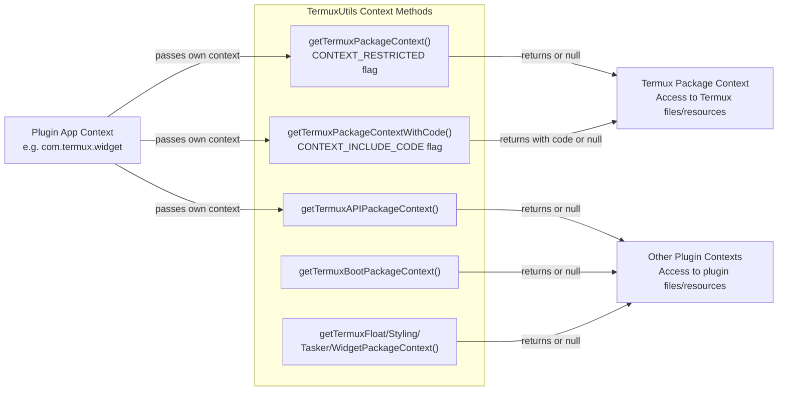

**Primary Methods:**

| Method | Context Flags | Use Case |
|--------|--------------|----------|
| `getTermuxPackageContext(Context)` | `CONTEXT_RESTRICTED` | Safe file/resource access |
| `getTermuxPackageContextWithCode(Context)` | `CONTEXT_INCLUDE_CODE` | Access to Termux class loaders |
| `getTermuxAPIPackageContext(Context)` | Default | Access Termux:API resources |
| `getTermuxBootPackageContext(Context)` | Default | Access Termux:Boot resources |
| (+ 4 more for other plugins) | Default | Access other plugin resources |

All methods internally delegate to `PackageUtils.getContextForPackage()` and return `null` if the package is not installed or context cannot be obtained.

**Sources:** [termux-shared/src/main/java/com/termux/shared/termux/TermuxUtils.java:56-135]()

### Installation and Accessibility Validation

**Basic Installation Check:**

```java
public static String isTermuxAppInstalled(@NonNull final Context context)
```

Returns error message string if Termux app is not installed or disabled, otherwise returns `null`. Essential for external apps before attempting inter-app communication.

**Critical for Android 11+ (SDK 30):** External apps must declare Termux in `<queries>` manifest element:

```xml
<queries>
    <package android:name="com.termux" />
</queries>
```

Or request `QUERY_ALL_PACKAGES` permission, otherwise `PackageManager` will throw exceptions.

**Sources:** [termux-shared/src/main/java/com/termux/shared/termux/TermuxUtils.java:144-147]()

**Comprehensive Accessibility Check:**

```java
public static String isTermuxAppAccessible(@NonNull final Context currentPackageContext)
```

Multi-step validation for plugin apps sharing `sharedUserId`:

1. Checks if app is installed and enabled
2. Attempts to acquire Termux package context
3. Validates `TERMUX_PREFIX_DIR_PATH` exists with required permissions

Returns detailed error message or `null` if all checks pass. Used during plugin app initialization.

**Sources:** [termux-shared/src/main/java/com/termux/shared/termux/TermuxUtils.java:184-220]()

### BuildConfig Field Reflection

Plugin apps can dynamically query build configuration from installed Termux APK:

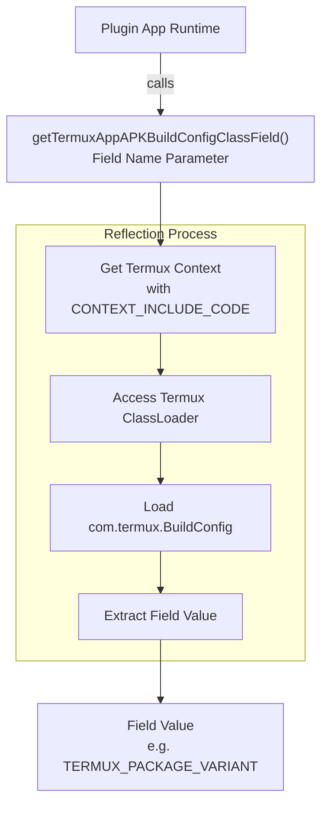

**Primary Methods:**

```java
public static Object getTermuxAppAPKBuildConfigClassField(Context currentPackageContext, String fieldName)
```

Wrapper specifically for `BuildConfig` class fields.

```java
public static Object getTermuxAppAPKClassField(Context currentPackageContext, String clazzName, String fieldName)
```

Generic method to access any class field from Termux APK.

**Important Notes:**
- Returns default values from APK, not runtime values from Termux app process
- Returns `null` if context acquisition fails or field doesn't exist
- Accessing `null` fields throws `NoSuchFieldException`

**Common Use Case:** Query `TERMUX_PACKAGE_VARIANT` to determine if Termux uses apt-android-7 or apt-android-5 bootstrap.

**Sources:** [termux-shared/src/main/java/com/termux/shared/termux/TermuxUtils.java:224-273]()

### App Information Reporting System

`TermuxUtils` provides comprehensive markdown report generation for debugging and issue reporting.

**AppInfoMode Enumeration:**

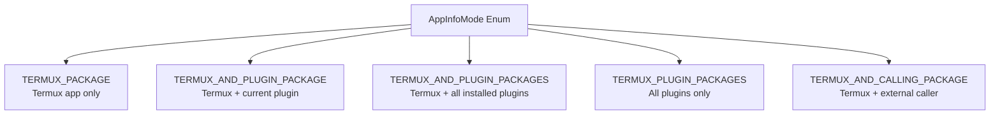

**Sources:** [termux-shared/src/main/java/com/termux/shared/termux/TermuxUtils.java:39-51]()

**Report Generation Methods:**

```java
public static String getAppInfoMarkdownString(Context currentPackageContext, AppInfoMode appInfoMode)
public static String getAppInfoMarkdownString(Context currentPackageContext, AppInfoMode appInfoMode, String callingPackageName)
```

**Generated Report Includes:**

| Information | Source |
|-------------|--------|
| Package name, version name, version code | `PackageManager` |
| Target SDK, minimum SDK | `ApplicationInfo` |
| APK install source | `InstallSourceInfo` |
| Signing certificate SHA-256 | `PackageManager.getSigningInfo()` |
| APK release channel | Mapped from certificate digest |
| **Termux-specific:** |  |
| `TERMUX_APP_PACKAGE_MANAGER` | Build configuration |
| `TERMUX_APP_PACKAGE_VARIANT` | Build configuration |
| Files directory accessibility | `TermuxFileUtils` validation |

**Sources:** [termux-shared/src/main/java/com/termux/shared/termux/TermuxUtils.java:322-466]()

**Plugin Apps Report:**

```java
public static String getTermuxPluginAppsInfoMarkdownString(final Context currentPackageContext)
```

Iterates through `TERMUX_PLUGIN_APP_PACKAGE_NAMES_LIST` and generates info sections for all installed plugins.

**Sources:** [termux-shared/src/main/java/com/termux/shared/termux/TermuxUtils.java:394-418]()

### Additional Debugging Utilities

**Issue Reporting Template:**

```java
public static String getReportIssueMarkdownString(@NonNull final Context context)
```

Generates markdown with:
- Instructions on where to report issues
- Links to GitHub issues for all Termux apps and packages repositories
- Links to email support and Reddit community
- Warnings about proper issue reporting etiquette

**Sources:** [termux-shared/src/main/java/com/termux/shared/termux/TermuxUtils.java:506-536]()

**Important Links Compilation:**

```java
public static String getImportantLinksMarkdownString(@NonNull final Context context)
```

Organizes links by category:
- GitHub repositories (apps and packages)
- Support channels (email, Reddit)
- Documentation (wiki pages)

**Sources:** [termux-shared/src/main/java/com/termux/shared/termux/TermuxUtils.java:544-575]()

**APT Package Information:**

```java
public static String geAPTInfoMarkdownString(@NonNull final Context context)
```

Execution flow:
1. Loads embedded shell script from resources (`R.raw.apt_info_script`)
2. Replaces `@TERMUX_PREFIX@` placeholder with actual path
3. Executes script via `AppShell.execute()` with log level OFF
4. Returns formatted output with repository and package info

**Note:** Takes several seconds to complete due to `apt update` execution.

**Sources:** [termux-shared/src/main/java/com/termux/shared/termux/TermuxUtils.java:587-628]()

**Termux Debug Information:**

```java
public static String getTermuxDebugMarkdownString(@NonNull final Context context)
```

Combines:
- `TermuxFileUtils.getTermuxFilesStatMarkdownString()`: File system stat output
- `getLogcatDumpMarkdownString()`: Logcat dump (limited to 3000 lines to prevent OOM)

**Sources:** [termux-shared/src/main/java/com/termux/shared/termux/TermuxUtils.java:636-697]()

### Miscellaneous Helper Methods

**APK Release Identification:**

```java
public static String getAPKRelease(String signingCertificateSHA256Digest)
```

Maps certificate digest to release channel name:

| Certificate Digest | Returns |
|-------------------|---------|
| F-Droid digest | `"F-Droid"` |
| GitHub digest | `"Github"` |
| Play Store digest | `"Google Play Store"` |
| Termux Devs digest | `"Termux Devs"` |
| Any other | `"Unknown"` |

**Sources:** [termux-shared/src/main/java/com/termux/shared/termux/TermuxUtils.java:701-716]()

**Process ID Retrieval:**

```java
public static String getTermuxAppPID(final Context context)
```

Returns main app process PID for Termux package using `PackageUtils.getPackagePID()`.

**Sources:** [termux-shared/src/main/java/com/termux/shared/termux/TermuxUtils.java:726-728]()

**Broadcast Sending:**

```java
public static void sendTermuxOpenedBroadcast(@NonNull Context context)
```

Sends `BROADCAST_TERMUX_OPENED` to all registered receivers using explicit component names to bypass Android Oreo+ broadcast limitations.

**Sources:** [termux-shared/src/main/java/com/termux/shared/termux/TermuxUtils.java:294-307]()

**URI Validation:**

```java
public static boolean isUriDataForTermuxOrPluginPackage(@NonNull Uri data)
public static boolean isUriDataForTermuxPluginPackage(@NonNull Uri data)
```

Check if URI has `package:` scheme for Termux or plugin packages.

**Sources:** [termux-shared/src/main/java/com/termux/shared/termux/TermuxUtils.java:277-286]()

## Shared Utility Libraries

Beyond `TermuxUtils`, the `termux-shared` module provides specialized utility classes for common cross-cutting concerns.

### File System Utilities

**TermuxFileUtils - Termux-Specific Operations:**

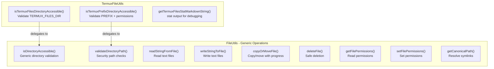

**TermuxFileUtils Validations:**

Key validation checks:
- Directory existence
- Read/write/execute permissions (requires 0700 or 0770)
- Symlink resolution and following
- Parent directory accessibility
- Security policy compliance

**Sources:** [termux-shared/src/main/java/com/termux/shared/termux/TermuxUtils.java:485-489]()

**FileUtils Capabilities:**

Generic file operations:
- Path validation and canonicalization
- Permission checking (read, write, execute)
- Permission setting with proper mode values
- Recursive directory creation
- Safe file deletion (with multiple retry attempts)
- File copying/moving with progress callbacks
- MIME type detection for `ContentProvider` operations
- Character encoding detection and conversion

Used extensively by:
- Bootstrap installer for extracting archives
- `ContentProvider` implementations for file access validation
- Command execution for working directory validation
- Configuration file reading/writing

### Permission Management Utilities

**PermissionUtils - Android Permission Handling:**

Centralizes runtime permission operations:

| Method | Purpose |
|--------|---------|
| `validatePermissions()` | Verify permissions declared in manifest |
| `checkPermissions()` | Check if runtime permissions granted |
| `requestPermissions()` | Request permissions with callback |
| `getPermissionRequestCode()` | Generate unique request codes |
| `checkStoragePermissions()` | Specialized storage permission check |
| `requestStoragePermissions()` | Request storage permissions |

**Error Handling:**

- Throws descriptive exceptions for undeclared permissions
- Generates detailed error messages for permission denials
- Validates permission arrays before operations

**Sources:** [termux-shared/src/main/res/values/strings.xml:33-45]()

**TermuxPluginUtils - Plugin Permission Validation:**

Core security method:

```java
public static Error checkIfAllowExternalAppsPolicyIsViolated(Context context, String callingPackageName)
```

**Dual-Layer Security Check:**

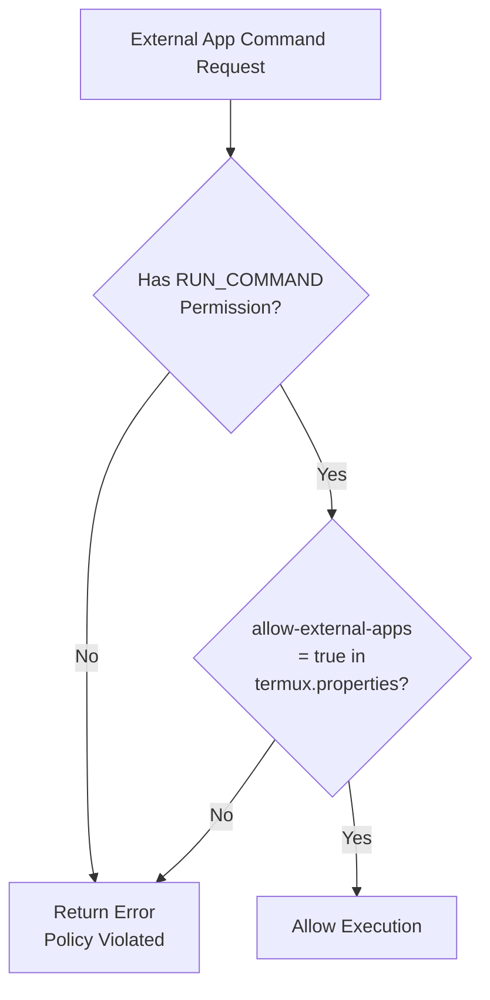

Used by `RunCommandService` to enforce access control policy before forwarding commands to `TermuxService`.

**Sources:** [termux-shared/src/main/res/values/strings.xml:50-51]()

### Android System Utilities

**AndroidUtils - System Information Queries:**

Provides Android system introspection:

- Device information (manufacturer, model, Android version)
- Battery status and charging state
- Display metrics (density, resolution)
- Network connectivity status
- System property reading
- Markdown property formatting

**Key Method:**

```java
public static String getAppInfoMarkdownString(Context context)
```

Generates base app information section used by `TermuxUtils.getAppInfoMarkdownString()`.

**Sources:** [termux-shared/src/main/java/com/termux/shared/termux/TermuxUtils.java:477]()

**PackageUtils - Package Manager Operations:**

Core package management utilities:

| Operation | Methods |
|-----------|---------|
| Context acquisition | `getContextForPackage()` with various flag options |
| Package queries | `getPackageInfo()`, `getApplicationInfo()` |
| Installation checks | `isAppInstalled()`, `isAppEnabled()` |
| Signature verification | `getSigningCertificateSHA256DigestForPackage()` |
| Component management | `getComponentState()`, `setComponentState()` |
| Process queries | `getPackagePID()` |

**Critical for Plugin Apps:**

All `TermuxUtils` context acquisition methods delegate to `PackageUtils.getContextForPackage()`, which handles:
- `PackageManager.createPackageContext()` calls
- Exception catching and null returns
- Context flag management (`CONTEXT_RESTRICTED`, `CONTEXT_INCLUDE_CODE`)

**Sources:** [termux-shared/src/main/java/com/termux/shared/termux/TermuxUtils.java:63]()

### String Resources and Localization

The `strings.xml` file in `termux-shared/src/main/res/values/` provides shared user-facing strings and error messages.

**XML Entity System:**

```xml
<!DOCTYPE resources [
    <!ENTITY TERMUX_PACKAGE_NAME "com.termux">
    <!ENTITY TERMUX_APP_NAME "Termux">
    <!ENTITY TERMUX_PREFIX_DIR_PATH "/data/data/com.termux/files/usr">
]>
```

Entities ensure consistency between Java constants and XML resources:

```xml
<string name="msg_termux_app_required_by_app">
    The &TERMUX_APP_NAME; is required by the %1$s app to run termux commands.
</string>
```

**Sources:** [termux-shared/src/main/res/values/strings.xml:3-13]()

**String Categories:**

| Category | Example Keys | Purpose |
|----------|-------------|---------|
| Package Errors | `error_termux_app_package_context_not_accessible` | Context acquisition failures |
| Permission Errors | `error_allow_external_apps_ungranted` | Security policy violations |
| Permission Messages | `message_sudo_please_grant_permissions` | Permission request dialogs |
| File Errors | `error_termux_prefix_dir_path_not_accessible` | File system access issues |
| Action Labels | `action_copy`, `action_share`, `action_save_to_file` | UI button text |
| Setting Descriptions | `setting_launcher_icon_enabled_on` | Preference descriptions |

**Sources:** [termux-shared/src/main/res/values/strings.xml:16-112]()

## Cross-Module Usage Patterns

Understanding how different components use the shared infrastructure reveals the architectural patterns.

### Pattern 1: Direct Constant Access

Most common pattern - components directly import and reference constants:

```java
// In TermuxActivity, TermuxService, or plugin apps
import com.termux.shared.termux.TermuxConstants;

String prefixPath = TermuxConstants.TERMUX_PREFIX_DIR_PATH;
File homeDir = TermuxConstants.TERMUX_HOME_DIR;
String packageName = TermuxConstants.TERMUX_PACKAGE_NAME;

// Building intent actions
Intent intent = new Intent(TermuxConstants.TERMUX_APP.TERMUX_SERVICE.ACTION_SERVICE_EXECUTE);
intent.putExtra(TermuxConstants.TERMUX_APP.TERMUX_SERVICE.EXTRA_ARGUMENTS, args);
```

**Usage Locations:**
- All activities and services
- Content providers for path validation
- Plugin apps for inter-app communication
- Bootstrap installer for directory creation

### Pattern 2: Context Acquisition for Shared Resources

Plugin apps need Termux context to access shared files and resources:

```java
// In plugin app (e.g., Termux:Widget)
import com.termux.shared.termux.TermuxUtils;

Context termuxContext = TermuxUtils.getTermuxPackageContext(currentContext);
if (termuxContext != null) {
    // Access Termux-owned resources
    Resources res = termuxContext.getResources();
    
    // Access Termux files
    File shortcutsDir = new File(TermuxConstants.TERMUX_SHORTCUT_SCRIPTS_DIR_PATH);
    if (shortcutsDir.exists()) {
        // List and execute scripts
    }
}
```

**Key Requirement:** Apps must share `sharedUserId="com.termux"` in manifest for context acquisition to succeed.

### Pattern 3: Validation Before Operations

Security-conscious components validate accessibility before proceeding:

```java
// In plugin app startup
String errmsg = TermuxUtils.isTermuxAppAccessible(context);
if (errmsg != null) {
    // Show error dialog, disable functionality
    showErrorDialog(errmsg);
    return;
}

// In RunCommandService before execution
Error error = TermuxPluginUtils.checkIfAllowExternalAppsPolicyIsViolated(
    context, callingPackageName);
if (error != null) {
    // Send error notification, deny execution
    sendErrorNotification(error);
    return;
}

// Proceed with operation
```

### Pattern 4: Report Generation for Debugging

Crash handlers and issue reporting use markdown generation:

```java
// In CrashHandler or ReportActivity
StringBuilder report = new StringBuilder();

// Add app information
report.append(TermuxUtils.getAppInfoMarkdownString(context, 
    AppInfoMode.TERMUX_AND_PLUGIN_PACKAGES));
report.append("\n\n");

// Add reporting instructions
report.append(TermuxUtils.getReportIssueMarkdownString(context));
report.append("\n\n");

// Add debug information
report.append(TermuxUtils.getTermuxDebugMarkdownString(context));

// Write to crash log or display in UI
writeToFile(TermuxConstants.TERMUX_CRASH_LOG_FILE_PATH, report.toString());
```

### Pattern 5: BuildConfig Reflection for Runtime Queries

Plugin apps query Termux build configuration at runtime:

```java
// In Termux:API or other plugin
Object variant = TermuxUtils.getTermuxAppAPKBuildConfigClassField(
    context, "TERMUX_PACKAGE_VARIANT");

if ("apt-android-7".equals(variant)) {
    // Handle apt-android-7 specific behavior
} else if ("apt-android-5".equals(variant)) {
    // Handle apt-android-5 specific behavior
}
```

### Inter-Module Dependency Flow

```mermaid
graph TD
    subgraph "app module"
        TermuxActivity["TermuxActivity"]
        TermuxService["TermuxService"]
        RunCommandService["RunCommandService"]
        TermuxInstaller["TermuxInstaller"]
    end
    
    subgraph "terminal-view module"
        TerminalView["TerminalView"]
        TermuxTerminalViewClient["TermuxTerminalViewClient"]
    end
    
    subgraph "terminal-emulator module"
        TerminalEmulator["TerminalEmulator<br/>No direct dependency"]
    end
    
    subgraph "termux-shared module"
        TermuxConstants["TermuxConstants"]
        TermuxUtils["TermuxUtils"]
        TermuxFileUtils["TermuxFileUtils"]
        TermuxPluginUtils["TermuxPluginUtils"]
        FileUtils["FileUtils"]
        PermissionUtils["PermissionUtils"]
    end
    
    subgraph "External Plugin Apps"
        TermuxAPI["Termux:API"]
        TermuxBoot["Termux:Boot"]
        TermuxWidget["Termux:Widget"]
        TermuxTasker["Termux:Tasker"]
    end
    
    TermuxActivity -->|"imports constants"| TermuxConstants
    TermuxActivity -->|"calls methods"| TermuxUtils
    TermuxService -->|"imports constants"| TermuxConstants
    TermuxService -->|"validates with"| TermuxFileUtils
    RunCommandService -->|"imports constants"| TermuxConstants
    RunCommandService -->|"validates with"| TermuxPluginUtils
    TermuxInstaller -->|"uses paths"| TermuxConstants
    TermuxInstaller -->|"uses methods"| TermuxFileUtils
    
    TerminalView -->|"uses constants"| TermuxConstants
    TermuxTerminalViewClient -->|"uses constants"| TermuxConstants
    
    TermuxAPI -->|"imports constants"| TermuxConstants
    TermuxAPI -->|"gets context via"| TermuxUtils
    TermuxBoot -->|"imports constants"| TermuxConstants
    TermuxBoot -->|"gets context via"| TermuxUtils
    TermuxWidget -->|"imports constants"| TermuxConstants
    TermuxWidget -->|"validates via"| TermuxUtils
    TermuxTasker -->|"imports constants"| TermuxConstants
    
    TermuxUtils -->|"uses"| TermuxConstants
    TermuxUtils -->|"uses"| FileUtils
    TermuxFileUtils -->|"uses"| TermuxConstants
    TermuxFileUtils -->|"uses"| FileUtils
    TermuxPluginUtils -->|"uses"| TermuxConstants
    TermuxPluginUtils -->|"uses"| PermissionUtils
```

**Sources:** Based on architectural patterns from the high-level diagrams

## Version Management and Compatibility

### Changelog System

`TermuxConstants` maintains a comprehensive changelog in the file header documentation. Structure:

```
Version: v0.53.0

Changelog:
- 0.1.0 (2021-03-08): Initial Release
- 0.2.0 (2021-03-11): Added *_DIR and *_FILE substrings to paths
...
- 0.53.0 (2025-01-12): Renamed app classes with _APP suffix, added activity constants
```

Each version entry documents:
- Release date
- Added constants
- Modified constants
- Removed constants
- Breaking changes
- Migration instructions

**Sources:** [termux-shared/src/main/java/com/termux/shared/termux/TermuxConstants.java:15-131]()

### Deprecation Handling

Deprecated constants maintain backward compatibility while guiding migration:

```java
/** @deprecated Use {@link #EXTRA_RUNNER} instead */
@Deprecated
public static final String EXTRA_BACKGROUND = TERMUX_PACKAGE_NAME + ".execute.background";
```

The `@Deprecated` annotation triggers compiler warnings, and javadoc explains the replacement API.

**Sources:** [termux-shared/src/main/java/com/termux/shared/termux/TermuxConstants.java:1009-1011]()

### Plugin Compatibility Considerations

**Version Alignment:**

- `termux-shared` library versioned independently from app versions
- Plugin apps depend on specific `termux-shared` versions
- Breaking changes require coordinated updates across all plugins

**Compatibility Issues:**

| Change Type | Impact |
|-------------|--------|
| Intent action rename | Intents fail to reach destination |
| Extra key rename | Data not extracted from intents |
| Path constant change | File not found errors |
| Permission constant change | Permission checks fail |

**Best Practice:** Plugin apps should specify version ranges in dependencies to prevent incompatible combinations.

## Best Practices

### For Termux Core Development

1. **Never Hardcode Values**
   ```java
   // BAD
   String path = "/data/data/com.termux/files/usr/bin";
   
   // GOOD
   String path = TermuxConstants.TERMUX_BIN_PREFIX_DIR_PATH;
   ```

2. **Derive New Constants**
   ```java
   // GOOD - builds on existing hierarchy
   public static final String MY_NEW_DIR_PATH = TERMUX_HOME_DIR_PATH + "/.mydir";
   ```

3. **Document All Changes**
   - Update changelog with version bump
   - Explain rationale for changes
   - Mark breaking changes prominently
   - Provide migration guidance
   **Sources:** [termux-shared/src/main/java/com/termux/shared/termux/TermuxConstants.java:15-131]()

4. **Consider Plugin Impact**
   - Changes to public APIs affect all six plugin apps
   - Coordinate releases when making breaking changes
   - Maintain deprecated constants for transition period

5. **Use Utility Methods**
   ```java
   // PREFER
   String report = TermuxUtils.getAppInfoMarkdownString(context, mode);
   
   // OVER
   String report = "## App Info\n" + packageName + "\n" + versionName + "...";
   ```

### For Plugin Development

1. **Validate Accessibility on Startup**
   ```java
   String errmsg = TermuxUtils.isTermuxAppAccessible(context);
   if (errmsg != null) {
       showSetupInstructions(errmsg);
       return;
   }
   ```

2. **Acquire Context Properly**
   ```java
   Context termuxContext = TermuxUtils.getTermuxPackageContext(context);
   if (termuxContext == null) {
       // Handle error - Termux not accessible
       return;
   }
   // Use termuxContext for file access
   ```

3. **Check Permissions Before Operations**
   ```java
   Error error = TermuxPluginUtils.checkIfAllowExternalAppsPolicyIsViolated(
       context, callingPackageName);
   if (error != null) {
       // Show permission error, guide user to enable allow-external-apps
       return;
   }
   ```

4. **Generate Crash Reports**
   ```java
   // In uncaught exception handler
   String report = TermuxUtils.getAppInfoMarkdownString(context, 
       AppInfoMode.TERMUX_AND_PLUGIN_PACKAGE);
   // Write to crash log
   ```

5. **Handle Null Contexts**
   ```java
   Context termuxContext = TermuxUtils.getTermuxPackageContext(context);
   if (termuxContext != null) {
       // Safe to use
   } else {
       // Termux not installed or different signature
       showInstallInstructions();
   }
   ```

6. **Declare Manifest Queries (Android 11+)**
   ```xml
   <queries>
       <package android:name="com.termux" />
   </queries>
   ```

### For External App Integration

1. **Check Installation First**
   ```java
   String errmsg = TermuxUtils.isTermuxAppInstalled(context);
   if (errmsg != null) {
       // Termux not installed - show installation prompt
       showTermuxInstallDialog();
       return;
   }
   ```

2. **Import Constants Library**
   ```java
   import com.termux.shared.termux.TermuxConstants;
   
   Intent intent = new Intent(TermuxConstants.RUN_COMMAND_SERVICE.ACTION_RUN_COMMAND);
   ```

3. **Request Permission in Manifest**
   ```xml
   <uses-permission android:name="com.termux.permission.RUN_COMMAND" />
   ```

4. **Respect User Policy**
   - Inform users they must enable `allow-external-apps` property
   - Provide clear instructions for editing `termux.properties`
   - Handle permission denial gracefully

5. **Use Documented Intent Schema**
   ```java
   intent.putExtra(TermuxConstants.RUN_COMMAND_SERVICE.EXTRA_COMMAND_PATH, "/bin/sh");
   intent.putExtra(TermuxConstants.RUN_COMMAND_SERVICE.EXTRA_ARGUMENTS, new String[]{"-c", "ls"});
   intent.putExtra(TermuxConstants.RUN_COMMAND_SERVICE.EXTRA_WORKDIR, workdir);
   ```

## Summary

The constants and shared infrastructure in the `termux-shared` module provide the foundational layer for the entire Termux application ecosystem:

**Key Components:**

| Component | Purpose | Usage |
|-----------|---------|-------|
| `TermuxConstants` | Single source of truth for all constants | Direct import in all modules |
| `TermuxUtils` | Context access and app info utilities | Plugin apps and debugging |
| `TermuxFileUtils` | Termux-specific file validation | Installer and file operations |
| `TermuxPluginUtils` | Plugin security validation | RunCommandService |
| Generic utilities | Cross-cutting helper functions | Universal support layer |

**Critical Functions:**

1. **Eliminates Duplication**: Single definition prevents inconsistencies
2. **Enables Plugin Ecosystem**: Shared constants allow inter-app communication
3. **Provides Context Isolation**: `TermuxUtils` abstracts `sharedUserId` context access
4. **Supports Debugging**: Comprehensive markdown report generation
5. **Enforces Security**: Validation utilities implement access control
6. **Tracks Evolution**: Versioned changelog documents API changes

**Architectural Impact:**

This infrastructure is foundational - every component in Termux depends on it. Breaking changes here cascade through the entire ecosystem, affecting the main app and all six plugin apps. Stability and backward compatibility are paramount.

**Related Documentation:**
- Build-time constant generation: [Gradle Build Configuration](#2.2)
- Runtime configuration: [File System Structure](#5.2)
- Security enforcement: [Property-Based Access Control](#8.3)
- Plugin communication: [Plugin Ecosystem](#1.2)

---

