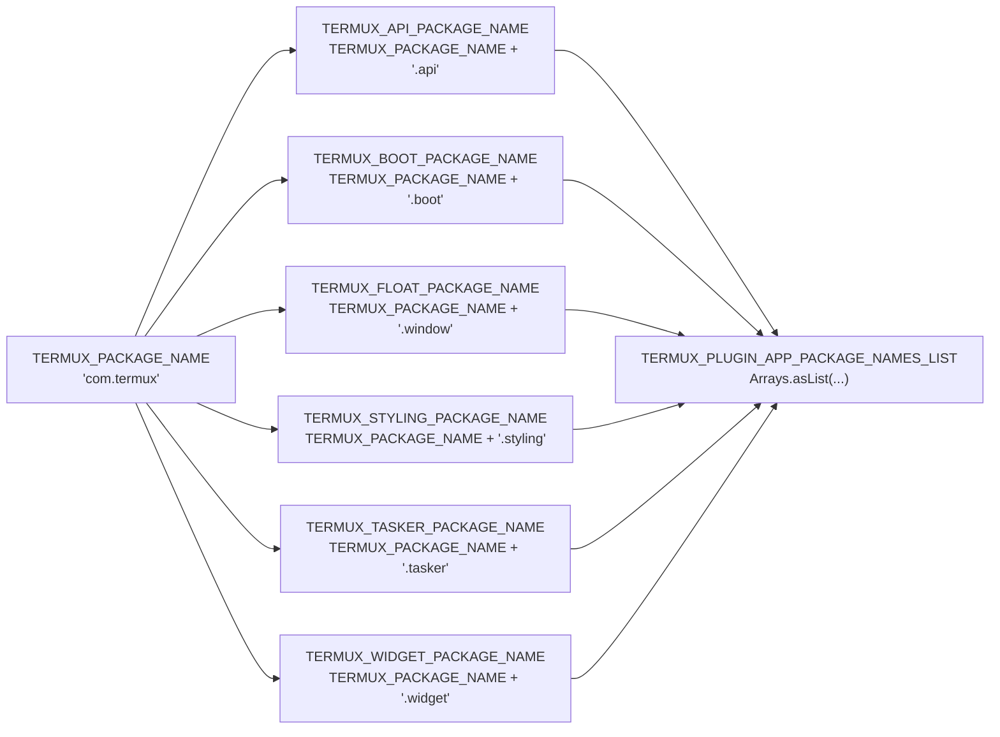
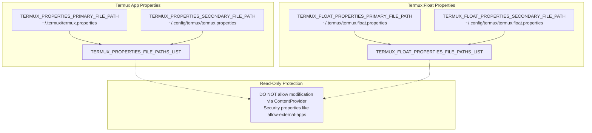
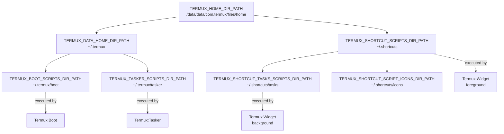
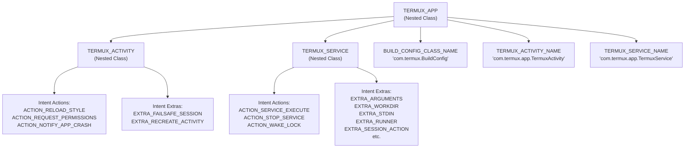
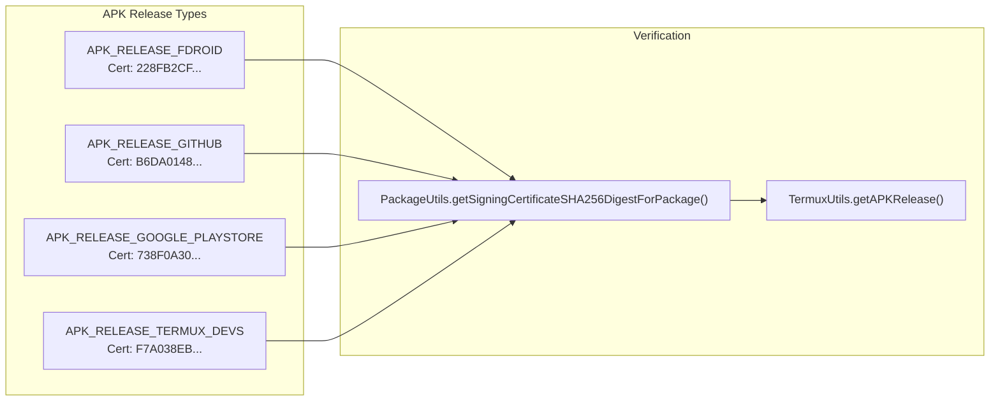
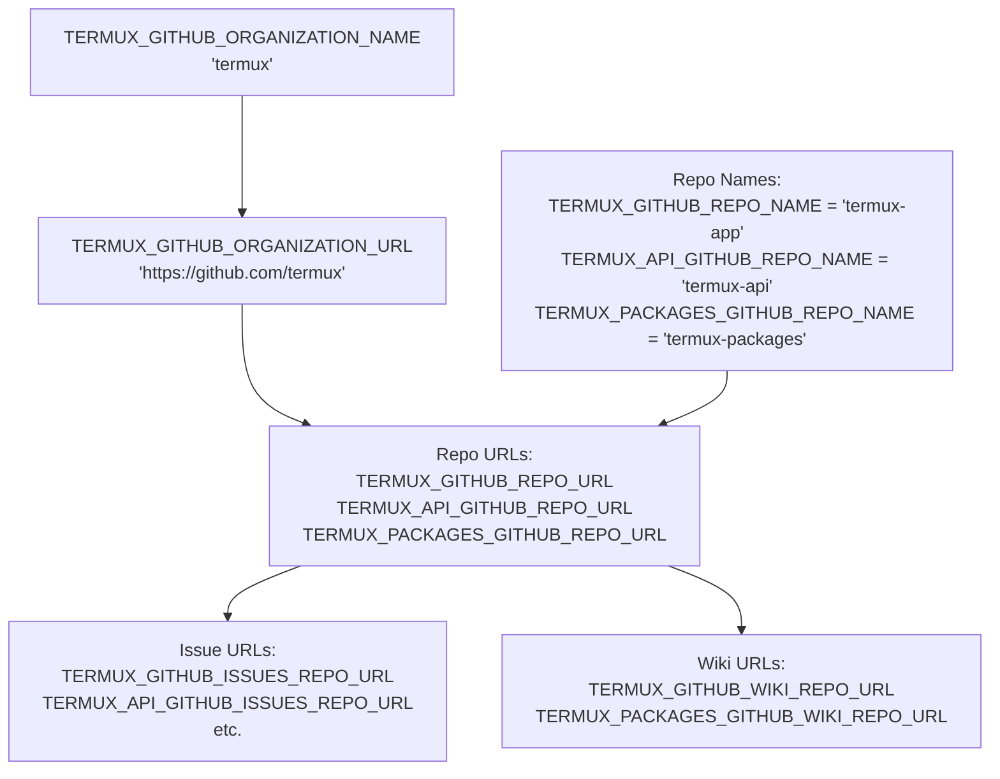

<!-- source: DeepWiki mcp.deepwiki.com · repo termux/termux-app · page 7.1 TermuxConstants · fetched 2026-10-26 -->

# TermuxConstants

<details>
<summary>Relevant source files</summary>

The following files were used as context for generating this wiki page:

- [termux-shared/src/main/java/com/termux/shared/termux/TermuxConstants.java](termux-shared/src/main/java/com/termux/shared/termux/TermuxConstants.java)
- [termux-shared/src/main/java/com/termux/shared/termux/TermuxUtils.java](termux-shared/src/main/java/com/termux/shared/termux/TermuxUtils.java)
- [termux-shared/src/main/res/values/strings.xml](termux-shared/src/main/res/values/strings.xml)

</details>


## Purpose and Scope

The `TermuxConstants` class serves as the central **single source of truth** for all compile-time constants shared across the Termux app and its plugin ecosystem. This class, located in the `termux-shared` module, defines package names, file system paths, intent actions, notification IDs, and repository URLs used throughout the codebase.

The primary purpose is to ensure **consistency and maintainability** when multiple apps (Termux and its six official plugins) need to reference the same values. Instead of hardcoding `"com.termux"` or `"/data/data/com.termux/files/usr"` in multiple locations, all code references `TermuxConstants.TERMUX_PACKAGE_NAME` and `TermuxConstants.TERMUX_PREFIX_DIR_PATH`.

For utilities that access and use these constants, see [TermuxUtils](#7.2). For file system operations that rely on these path constants, see [File System Structure](#5.2).

Sources: [termux-shared/src/main/java/com/termux/shared/termux/TermuxConstants.java:1-1338]()

---

## Class Structure and Organization

The `TermuxConstants` class is organized into logical sections with extensive inline documentation. The file header includes a comprehensive changelog tracking all additions and modifications since version 0.1.0.

### High-Level Constants Categories

```mermaid
graph TB
    TermuxConstants["TermuxConstants<br/>(Main Class)"]
    
    subgraph "Top-Level Constants"
        OrgVars["Organization Variables<br/>TERMUX_GITHUB_ORGANIZATION_NAME<br/>FDROID_PACKAGES_BASE_URL"]
        AppNames["App Names & Packages<br/>TERMUX_PACKAGE_NAME<br/>TERMUX_API_PACKAGE_NAME<br/>etc."]
        Releases["APK Release Info<br/>APK_RELEASE_FDROID<br/>Signing Certificates"]
        Paths["Core Directory Paths<br/>TERMUX_PREFIX_DIR_PATH<br/>TERMUX_HOME_DIR_PATH"]
        ConfigPaths["Configuration Paths<br/>TERMUX_PROPERTIES_PRIMARY_FILE_PATH<br/>TERMUX_ENV_FILE_PATH"]
        Notifications["Notification IDs<br/>TERMUX_APP_NOTIFICATION_CHANNEL_ID"]
        Misc["Miscellaneous<br/>PERMISSION_RUN_COMMAND<br/>PROP_ALLOW_EXTERNAL_APPS"]
    end
    
    subgraph "Nested Classes"
        TermuxApp["TERMUX_APP<br/>Intent Actions & Extras<br/>Activity/Service Names"]
        TermuxApiApp["TERMUX_API_APP<br/>API-specific Constants"]
        TermuxBootApp["TERMUX_BOOT_APP<br/>Boot-specific Constants"]
        TermuxFloatApp["TERMUX_FLOAT_APP<br/>Float-specific Constants"]
        TermuxStylingApp["TERMUX_STYLING_APP<br/>Styling-specific Constants"]
        TermuxTaskerApp["TERMUX_TASKER_APP<br/>Tasker-specific Constants"]
        TermuxWidgetApp["TERMUX_WIDGET_APP<br/>Widget-specific Constants"]
    end
    
    TermuxConstants --> OrgVars
    TermuxConstants --> AppNames
    TermuxConstants --> Releases
    TermuxConstants --> Paths
    TermuxConstants --> ConfigPaths
    TermuxConstants --> Notifications
    TermuxConstants --> Misc
    
    TermuxConstants --> TermuxApp
    TermuxConstants --> TermuxApiApp
    TermuxConstants --> TermuxBootApp
    TermuxConstants --> TermuxFloatApp
    TermuxConstants --> TermuxStylingApp
    TermuxConstants --> TermuxTaskerApp
    TermuxConstants --> TermuxWidgetApp
```



Sources: [termux-shared/src/main/java/com/termux/shared/termux/TermuxConstants.java:326-1338]()

---

## Package Names and Application Identifiers

The most fundamental constants define the package names for Termux and its six official plugins. All package names are derived from the base `TERMUX_PACKAGE_NAME`.

### Package Name Hierarchy

| Constant | Value | Description |
|----------|-------|-------------|
| `TERMUX_PACKAGE_NAME` | `"com.termux"` | Base package name for Termux app |
| `TERMUX_API_PACKAGE_NAME` | `"com.termux.api"` | Termux:API plugin |
| `TERMUX_BOOT_PACKAGE_NAME` | `"com.termux.boot"` | Termux:Boot plugin |
| `TERMUX_FLOAT_PACKAGE_NAME` | `"com.termux.window"` | Termux:Float plugin |
| `TERMUX_STYLING_PACKAGE_NAME` | `"com.termux.styling"` | Termux:Styling plugin |
| `TERMUX_TASKER_PACKAGE_NAME` | `"com.termux.tasker"` | Termux:Tasker plugin |
| `TERMUX_WIDGET_PACKAGE_NAME` | `"com.termux.widget"` | Termux:Widget plugin |

### Application Names and Lists



The `TERMUX_PLUGIN_APP_PACKAGE_NAMES_LIST` aggregates all plugin package names into a single list for iteration when checking installed plugins or generating app info reports.

Sources: [termux-shared/src/main/java/com/termux/shared/termux/TermuxConstants.java:349-469]()

---

## File System Path Constants

The Termux file system hierarchy is entirely defined through constants, ensuring consistency across all components that access files. All paths are **absolute paths** starting from `/data/data/com.termux`.

### Core Directory Structure

```mermaid
graph TB
    Root["TERMUX_INTERNAL_PRIVATE_APP_DATA_DIR_PATH<br/>/data/data/com.termux"]
    
    Files["TERMUX_FILES_DIR_PATH<br/>/data/data/com.termux/files"]
    
    Prefix["TERMUX_PREFIX_DIR_PATH<br/>/data/data/com.termux/files/usr"]
    Home["TERMUX_HOME_DIR_PATH<br/>/data/data/com.termux/files/home"]
    Staging["TERMUX_STAGING_PREFIX_DIR_PATH<br/>/data/data/com.termux/files/usr-staging"]
    Apps["TERMUX_APPS_DIR_PATH<br/>/data/data/com.termux/files/apps"]
    
    PrefixBin["TERMUX_BIN_PREFIX_DIR_PATH<br/>.../usr/bin"]
    PrefixEtc["TERMUX_ETC_PREFIX_DIR_PATH<br/>.../usr/etc"]
    PrefixLib["TERMUX_LIB_PREFIX_DIR_PATH<br/>.../usr/lib"]
    PrefixShare["TERMUX_SHARE_PREFIX_DIR_PATH<br/>.../usr/share"]
    PrefixTmp["TERMUX_TMP_PREFIX_DIR_PATH<br/>.../usr/tmp"]
    PrefixVar["TERMUX_VAR_PREFIX_DIR_PATH<br/>.../usr/var"]
    
    ConfigHome["TERMUX_CONFIG_HOME_DIR_PATH<br/>.../home/.config/termux"]
    DataHome["TERMUX_DATA_HOME_DIR_PATH<br/>.../home/.termux"]
    StorageHome["TERMUX_STORAGE_HOME_DIR_PATH<br/>.../home/storage"]
    
    Root --> Files
    Files --> Prefix
    Files --> Home
    Files --> Staging
    Files --> Apps
    
    Prefix --> PrefixBin
    Prefix --> PrefixEtc
    Prefix --> PrefixLib
    Prefix --> PrefixShare
    Prefix --> PrefixTmp
    Prefix --> PrefixVar
    
    Home --> ConfigHome
    Home --> DataHome
    Home --> StorageHome
```



### Path Constants with File Objects

Each path constant has two forms:
1. **String constant** (suffix `_PATH`): Used for string concatenation and display
2. **File object constant** (no suffix): Pre-constructed `File` object for filesystem operations

Example from [termux-shared/src/main/java/com/termux/shared/termux/TermuxConstants.java:594-597]():
```java
/** Termux app $PREFIX directory path */
public static final String TERMUX_PREFIX_DIR_PATH = TERMUX_FILES_DIR_PATH + "/usr";
/** Termux app $PREFIX directory */
public static final File TERMUX_PREFIX_DIR = new File(TERMUX_PREFIX_DIR_PATH);
```

### Critical Path Constants Table

| Constant | Default Value | Purpose |
|----------|---------------|---------|
| `TERMUX_PREFIX_DIR_PATH` | `/data/data/com.termux/files/usr` | Unix-like `$PREFIX` environment, hardcoded in compiled binaries |
| `TERMUX_HOME_DIR_PATH` | `/data/data/com.termux/files/home` | User home directory (`$HOME`) |
| `TERMUX_CONFIG_HOME_DIR_PATH` | `.../home/.config/termux` | XDG Base Directory compliant config location |
| `TERMUX_DATA_HOME_DIR_PATH` | `.../home/.termux` | Legacy data directory for properties files |
| `TERMUX_TMP_PREFIX_DIR_PATH` | `.../usr/tmp` | Temporary directory (`$TMPDIR`) |
| `TERMUX_APPS_DIR_PATH` | `.../files/apps` | Plugin app-specific data storage |

Sources: [termux-shared/src/main/java/com/termux/shared/termux/TermuxConstants.java:575-695]()

---

## Configuration and Properties Files

Configuration file paths are defined as constants to maintain consistency between where files are written and where they are read.

### Properties File Locations

Termux supports **dual property file locations** for backward compatibility and XDG Base Directory compliance:



### Security-Critical Files

The javadoc at [termux-shared/src/main/java/com/termux/shared/termux/TermuxConstants.java:735-738]() explicitly warns:

> **DO NOT** allow these files to be modified by `ContentProvider` exposed to external apps, since they may silently modify the values for security properties like `PROP_ALLOW_EXTERNAL_APPS` set by users without their explicit consent.

This is enforced in `TermuxOpenReceiver` which forces read-only access to property files.

### Other Configuration Files

| Constant | Path | Purpose |
|----------|------|---------|
| `TERMUX_COLOR_PROPERTIES_FILE_PATH` | `~/.termux/colors.properties` | Terminal color scheme |
| `TERMUX_FONT_FILE_PATH` | `~/.termux/font.ttf` | Terminal font |
| `TERMUX_ENV_FILE_PATH` | `$PREFIX/etc/termux/termux.env` | Environment variables for sessions |
| `TERMUX_CRASH_LOG_FILE_PATH` | `~/crash_log.md` | App crash reports |

Sources: [termux-shared/src/main/java/com/termux/shared/termux/TermuxConstants.java:725-788]()

---

## Plugin Script Directories

The constants define specific directories where plugins look for executable scripts:



Sources: [termux-shared/src/main/java/com/termux/shared/termux/TermuxConstants.java:796-835]()

---

## Intent Actions and Extras (Nested Classes)

The `TERMUX_APP` nested class and similar classes for plugins define **all intent actions and extras** used for inter-process communication. This prevents typos and ensures backward compatibility.

### TERMUX_APP Constants Structure



### Key Intent Action Constants

From [termux-shared/src/main/java/com/termux/shared/termux/TermuxConstants.java:943-1133]():

| Constant | Value | Purpose |
|----------|-------|---------|
| `TERMUX_ACTIVITY.ACTION_RELOAD_STYLE` | `"com.termux.app.reload_style"` | Trigger UI theme reload |
| `TERMUX_ACTIVITY.ACTION_REQUEST_PERMISSIONS` | `"com.termux.app.request_storage_permissions"` | Request storage access |
| `TERMUX_SERVICE.ACTION_SERVICE_EXECUTE` | `"com.termux.service_execute"` | Execute command in service |
| `TERMUX_SERVICE.ACTION_STOP_SERVICE` | `"com.termux.service_stop"` | Stop TermuxService |
| `TERMUX_SERVICE.ACTION_WAKE_LOCK` | `"com.termux.service_wake_lock"` | Acquire wake lock |

### Command Execution Extras

When sending commands via `ACTION_SERVICE_EXECUTE`, these extras define the execution parameters:

- `EXTRA_ARGUMENTS` (String[]): Command arguments
- `EXTRA_STDIN` (String): Standard input data
- `EXTRA_WORKDIR` (String): Working directory
- `EXTRA_RUNNER` (String): Runner type (TERMINAL_SESSION or APP_SHELL)
- `EXTRA_SESSION_ACTION` (int): How to handle the session UI
- `EXTRA_SHELL_NAME` (String): Shell session name
- `EXTRA_BACKGROUND_CUSTOM_LOG_LEVEL` (String): Logging verbosity

Sources: [termux-shared/src/main/java/com/termux/shared/termux/TermuxConstants.java:918-1133]()

---

## APK Release and Signing Constants

The constants define **APK signing certificate SHA-256 digests** for each distribution channel. This enables runtime verification of app authenticity and prevents plugins from different sources from accessing each other.

### Distribution Channels



### Signing Certificate Digest Constants

From [termux-shared/src/main/java/com/termux/shared/termux/TermuxConstants.java:478-501]():

| Release Type | Constant | SHA-256 Digest |
|--------------|----------|----------------|
| F-Droid | `APK_RELEASE_FDROID_SIGNING_CERTIFICATE_SHA256_DIGEST` | `228FB2CFE90831C1499EC3CCAF61E96E8E1CE70766B9474672CE427334D41C42` |
| GitHub | `APK_RELEASE_GITHUB_SIGNING_CERTIFICATE_SHA256_DIGEST` | `B6DA01480EEFD5FBF2CD3771B8D1021EC791304BDD6C4BF41D3FAABAD48EE5E1` |
| Google Play | `APK_RELEASE_GOOGLE_PLAYSTORE_SIGNING_CERTIFICATE_SHA256_DIGEST` | `738F0A30A04D3C8A1BE304AF18D0779BCF3EA88FB60808F657A3521861C2EBF9` |
| Termux Devs | `APK_RELEASE_TERMUX_DEVS_SIGNING_CERTIFICATE_SHA256_DIGEST` | `F7A038EB551F1BE8FDF388686B784ABAB4552A5D82DF423E3D8F1B5CBE1C69AE` |

These digests are used by `TermuxUtils.getAPKRelease()` to identify which release channel an installed APK came from.

Sources: [termux-shared/src/main/java/com/termux/shared/termux/TermuxConstants.java:476-501](), [termux-shared/src/main/java/com/termux/shared/termux/TermuxUtils.java:701-716]()

---

## Notification Channel Constants

Android notification channels are identified by unique IDs. These constants ensure consistency across all notification usage points.

### Notification Channel Definitions

| Constant | Channel ID | Channel Name | Used By |
|----------|------------|--------------|---------|
| `TERMUX_APP_NOTIFICATION_CHANNEL_ID` | `"termux_notification_channel"` | "Termux App" | TermuxService foreground notification |
| `TERMUX_RUN_COMMAND_NOTIFICATION_CHANNEL_ID` | `"termux_run_command_notification_channel"` | "Termux RunCommandService" | RunCommandService notifications |
| `TERMUX_PLUGIN_COMMAND_ERRORS_NOTIFICATION_CHANNEL_ID` | `"termux_plugin_command_errors_notification_channel"` | "Termux Plugin Commands Errors" | Plugin error notifications |
| `TERMUX_CRASH_REPORTS_NOTIFICATION_CHANNEL_ID` | `"termux_crash_reports_notification_channel"` | "Termux Crash Reports" | App crash notifications |
| `TERMUX_FLOAT_APP_NOTIFICATION_CHANNEL_ID` | `"termux_float_notification_channel"` | "Termux:Float App" | Termux:Float service |

### Notification IDs

Static notification IDs prevent duplicate notifications:

- `TERMUX_APP_NOTIFICATION_ID = 1337`
- `TERMUX_RUN_COMMAND_NOTIFICATION_ID = 1338`
- `TERMUX_FLOAT_APP_NOTIFICATION_ID = 1339`

Sources: [termux-shared/src/main/java/com/termux/shared/termux/TermuxConstants.java:843-875]()

---

## GitHub and Web URL Constants

The constants provide a centralized definition of all external URLs for documentation, repositories, and support channels.

### Repository URL Construction



### URL Categories

From [termux-shared/src/main/java/com/termux/shared/termux/TermuxConstants.java:333-570]():

1. **GitHub Organization**: Base URL for all Termux repositories
2. **Repository URLs**: Individual repo URLs for each app and package repo
3. **Issues URLs**: Direct links to issue trackers (`/issues` suffix)
4. **Wiki URLs**: Documentation wiki URLs
5. **F-Droid URLs**: Package pages on F-Droid store
6. **Support URLs**: Email (`support@termux.dev`), Reddit (`r/termux`), main site (`termux.dev`)

Sources: [termux-shared/src/main/java/com/termux/shared/termux/TermuxConstants.java:333-570]()

---

## Permission and Property Constants

Security-related constants define Android permissions and Termux-specific properties that control access.

### Permission Constants

```java
/** Android OS permission declared by Termux app in AndroidManifest.xml */
public static final String PERMISSION_RUN_COMMAND = TERMUX_PACKAGE_NAME + ".permission.RUN_COMMAND";
```

This custom permission must be:
1. Declared in the Termux app manifest
2. Requested by external apps in their manifests
3. Granted by the user

### Property-Based Security

```java
/** Termux property defined in termux.properties file as secondary check */
public static final String PROP_ALLOW_EXTERNAL_APPS = "allow-external-apps";
/** Default value */
public static final String PROP_DEFAULT_VALUE_ALLOW_EXTERNAL_APPS = "false";
```

The `allow-external-apps` property provides **defense in depth**: even if an external app has the `RUN_COMMAND` permission, commands are rejected unless this property is explicitly set to `"true"` in `termux.properties`.

Sources: [termux-shared/src/main/java/com/termux/shared/termux/TermuxConstants.java:884-893]()

---

## Broadcast Actions

```java
/** The broadcast action sent when Termux App opens */
public static final String BROADCAST_TERMUX_OPENED = TERMUX_PACKAGE_NAME + ".app.OPENED";
```

This broadcast is sent when `TermuxActivity` starts, allowing plugin apps (particularly Termux:Boot) to respond to the Termux app being opened. The implementation in `TermuxUtils.sendTermuxOpenedBroadcast()` explicitly resolves all registered receivers to work around Android Oreo broadcast limitations.

Sources: [termux-shared/src/main/java/com/termux/shared/termux/TermuxConstants.java:895](), [termux-shared/src/main/java/com/termux/shared/termux/TermuxUtils.java:294-307]()

---

## Miscellaneous Constants

### Content Provider Authority

```java
/** The Uri authority for Termux app file shares */
public static final String TERMUX_FILE_SHARE_URI_AUTHORITY = TERMUX_PACKAGE_NAME + ".files";
```

Used by `TermuxDocumentsProvider` to expose files via the Storage Access Framework.

### Comma Character Constants

```java
/** The normal comma character */
public static final String COMMA_NORMAL = ",";
/** The alternate comma character that may be used instead */
public static final String COMMA_ALTERNATIVE = "‚";
```

The alternative comma (U+201A, single low-9 quotation mark) can be used in command arguments to avoid conflicts when commas are used as argument separators.

### Environment Variable Prefix

```java
/** Environment variable prefix root for the Termux app */
public static final String TERMUX_ENV_PREFIX_ROOT = "TERMUX";
```

Sources: [termux-shared/src/main/java/com/termux/shared/termux/TermuxConstants.java:898-909]()

---

## Usage Patterns in the Codebase

### Accessing Package Contexts

`TermuxUtils` provides helper methods that internally use `TermuxConstants` to get contexts for plugin packages:


From [termux-shared/src/main/java/com/termux/shared/termux/TermuxUtils.java:83-85]():
```java
public static Context getTermuxAPIPackageContext(@NonNull Context context) {
    return PackageUtils.getContextForPackage(context, TermuxConstants.TERMUX_API_PACKAGE_NAME);
}
```

### Building File Paths

File operations throughout the codebase reference these constants:

```java
// Example: Checking if PREFIX directory is accessible
Error error = TermuxFileUtils.isTermuxPrefixDirectoryAccessible(false, false);
// Internally uses TermuxConstants.TERMUX_PREFIX_DIR_PATH
```

### Generating Intent Actions

Services and activities construct intents using action constants:

```java
Intent intent = new Intent(TermuxConstants.TERMUX_APP.TERMUX_SERVICE.ACTION_SERVICE_EXECUTE);
intent.putExtra(TermuxConstants.TERMUX_APP.TERMUX_SERVICE.EXTRA_ARGUMENTS, args);
```

Sources: [termux-shared/src/main/java/com/termux/shared/termux/TermuxUtils.java:62-135]()

---

## Forking Instructions

The class javadoc at [termux-shared/src/main/java/com/termux/shared/termux/TermuxConstants.java:304-324]() provides detailed instructions for forking Termux. Key points:

1. Change `TERMUX_PACKAGE_NAME` in `TermuxConstants.java`
2. Update `applicationId` in `app/build.gradle`
3. Update `manifestPlaceholders` in `app/build.gradle`
4. Update `ENTITY` values in `strings.xml` files
5. Optionally modify path variables containing "termux"
6. Recompile bootstrap packages with new paths

The `TERMUX_PREFIX_DIR_PATH` is **hardcoded into compiled binaries** in the bootstrap archive, so changing the package name requires rebuilding all packages.

Sources: [termux-shared/src/main/java/com/termux/shared/termux/TermuxConstants.java:287-325]()

---

## Version Management

The class header includes a version string (`v0.53.0`) and comprehensive changelog tracking all modifications since initial release. When modifying `TermuxConstants`, developers must:

1. Increment the version number
2. Add a changelog entry with date and description
3. Ensure backward compatibility or document breaking changes

This versioning is critical because `TermuxConstants` is shared across multiple apps that may update independently.

Sources: [termux-shared/src/main/java/com/termux/shared/termux/TermuxConstants.java:15-285]()

---

