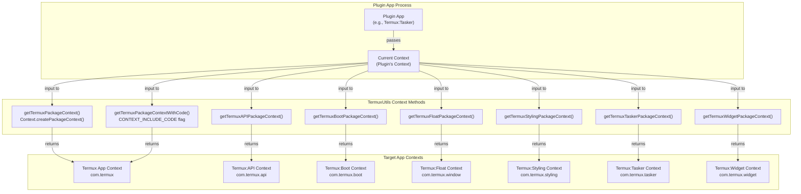
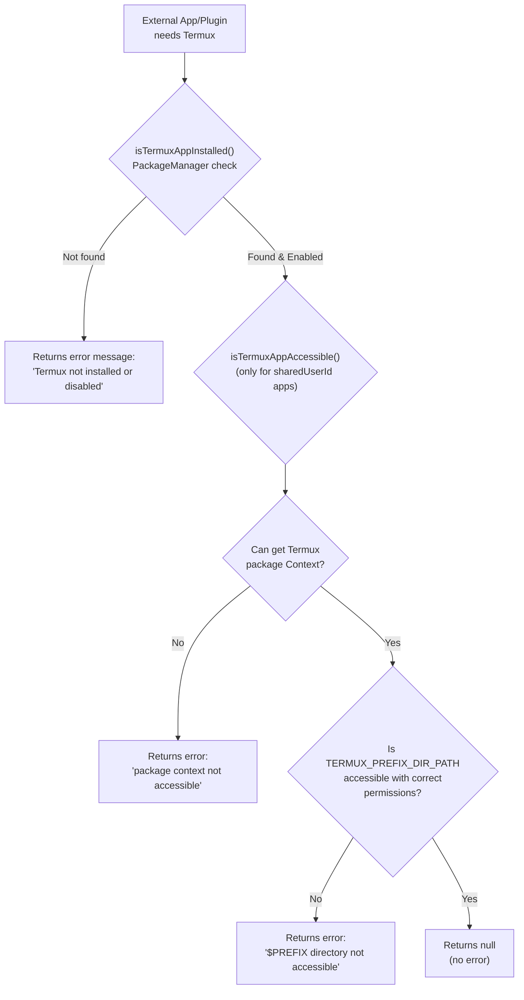
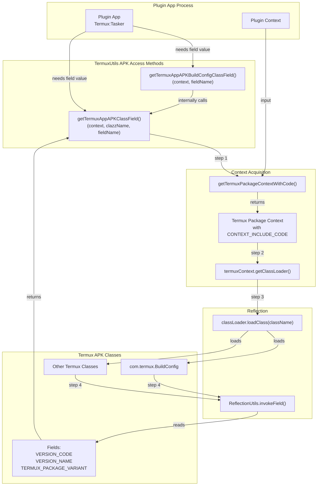
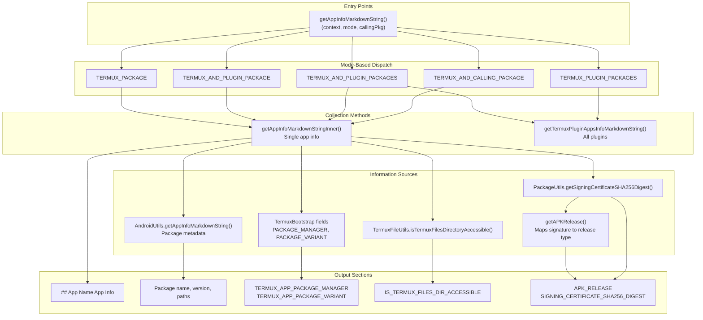
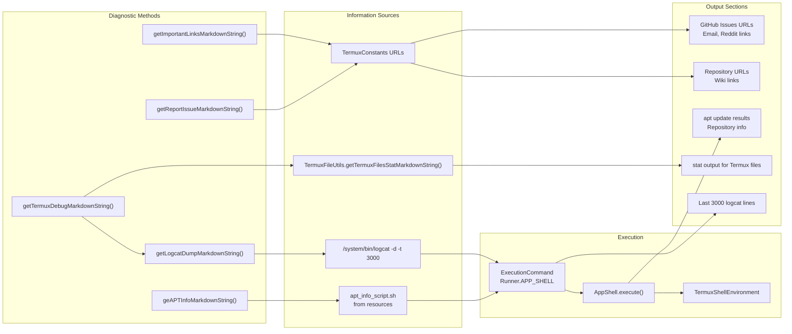
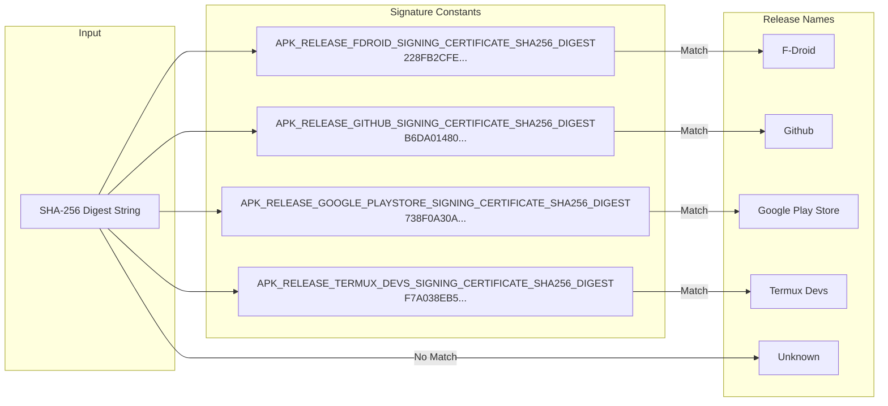
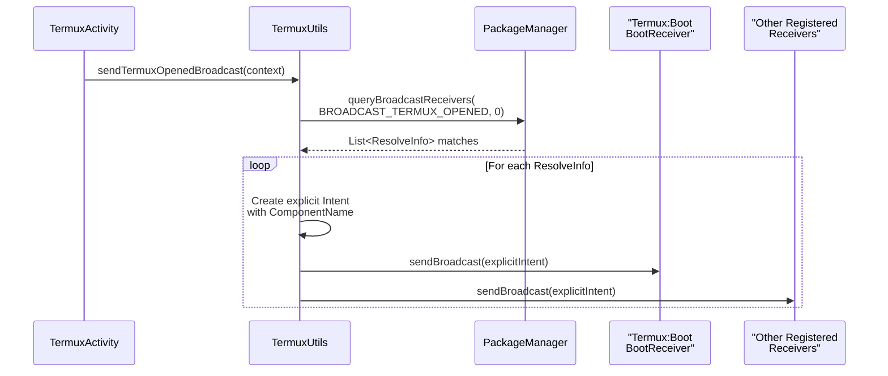
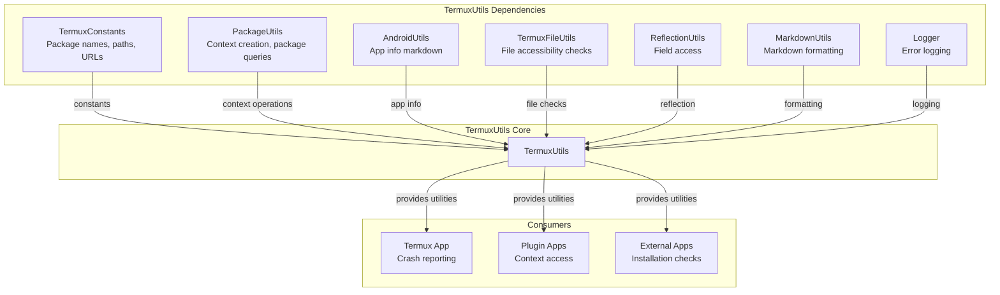

<!-- source: DeepWiki mcp.deepwiki.com · repo termux/termux-app · page 7.2 TermuxUtils · fetched 2026-10-26 -->

# TermuxUtils

<details>
<summary>Relevant source files</summary>

The following files were used as context for generating this wiki page:

- [termux-shared/src/main/java/com/termux/shared/termux/TermuxConstants.java](termux-shared/src/main/java/com/termux/shared/termux/TermuxConstants.java)
- [termux-shared/src/main/java/com/termux/shared/termux/TermuxUtils.java](termux-shared/src/main/java/com/termux/shared/termux/TermuxUtils.java)
- [termux-shared/src/main/res/raw/apt_info_script.sh](termux-shared/src/main/res/raw/apt_info_script.sh)
- [termux-shared/src/main/res/values/strings.xml](termux-shared/src/main/res/values/strings.xml)

</details>


## Purpose and Scope

The `TermuxUtils` class is a comprehensive utility library that provides essential services for inter-app communication, package verification, and diagnostic information generation across the Termux app ecosystem. This class serves as the primary interface for plugin apps and external components to interact with the Termux app, obtain package contexts, verify installation status, and generate debugging reports.

For the constants that `TermuxUtils` relies on (package names, paths, URLs), see [TermuxConstants](#7.1). For other shared utility classes like `FileUtils`, `PermissionUtils`, and `AndroidUtils`, see [Shared Utility Libraries](#7.3).

**Sources:** [termux-shared/src/main/java/com/termux/shared/termux/TermuxUtils.java:1-730]()

---

## Class Overview and Responsibilities

`TermuxUtils` is located in the `termux-shared` module and provides eight primary categories of functionality:

| Category | Methods | Purpose |
|----------|---------|---------|
| **Context Access** | `getTermuxPackageContext()`, `getTermux*PackageContext()` | Obtain `Context` objects for Termux and plugin packages |
| **Installation Verification** | `isTermuxAppInstalled()`, `isTermuxAppAccessible()` | Check if apps are installed, enabled, and accessible |
| **APK Metadata Access** | `getTermuxAppAPKBuildConfigClassField()`, `getTermuxAppAPKClassField()` | Read fields from APK's compiled classes |
| **URI Validation** | `isUriDataForTermuxOrPluginPackage()` | Validate package URIs |
| **Broadcast Utilities** | `sendTermuxOpenedBroadcast()` | Send app lifecycle broadcasts |
| **App Info Generation** | `getAppInfoMarkdownString()`, `getTermuxPluginAppsInfoMarkdownString()` | Generate markdown reports with app metadata |
| **Debugging** | `geAPTInfoMarkdownString()`, `getLogcatDumpMarkdownString()`, `getTermuxDebugMarkdownString()` | Generate diagnostic information |
| **Miscellaneous** | `getAPKRelease()`, `getTermuxAppPID()` | APK signature verification, process identification |

**Sources:** [termux-shared/src/main/java/com/termux/shared/termux/TermuxUtils.java:37-730]()

---

## Context Access and Package Interaction

### Context Acquisition Methods

The core functionality of `TermuxUtils` is providing `Context` objects for all Termux apps, enabling cross-app resource access and inter-process communication. This is critical because Termux apps share the `com.termux` `sharedUserId`, allowing them to access each other's private data directories.



**Context Acquisition with Different Flags:**

- **`getTermuxPackageContext(Context)`** - Returns context with `CONTEXT_RESTRICTED` flag (default), preventing certain operations
- **`getTermuxPackageContextWithCode(Context)`** - Returns context with `CONTEXT_INCLUDE_CODE` flag, allowing class loading from the target app's ClassLoader

The implementation delegates to `PackageUtils.getContextForPackage()`:

```
getTermuxPackageContext():
  → PackageUtils.getContextForPackage(context, "com.termux")
    → context.createPackageContext("com.termux", Context.CONTEXT_RESTRICTED)

getTermuxPackageContextWithCode():
  → PackageUtils.getContextForPackage(context, "com.termux", CONTEXT_INCLUDE_CODE)
    → context.createPackageContext("com.termux", Context.CONTEXT_INCLUDE_CODE)
```

**Sources:** [termux-shared/src/main/java/com/termux/shared/termux/TermuxUtils.java:56-141]()

---

## Installation and Accessibility Verification

### Installation Checks for External Apps

`TermuxUtils` provides two levels of verification: basic installation checks for external apps, and deeper accessibility checks for apps sharing `sharedUserId`.



**Installation Check (`isTermuxAppInstalled()`):**

This method can be used by any external app, even those not sharing `sharedUserId` with Termux. It performs a basic `PackageManager` query to check if the Termux app is installed and enabled.

**Important for Android 11+ (SDK 30+):** External apps targeting SDK 30+ must declare Termux in their `AndroidManifest.xml` `<queries>` section or request `QUERY_ALL_PACKAGES` permission:

```xml
<manifest>
    <queries>
        <package android:name="com.termux" />
    </queries>
</manifest>
```

Without this declaration, `PackageManager` will return "not found" even if Termux is installed.

**Accessibility Check (`isTermuxAppAccessible()`):**

This method performs three verification steps:
1. Calls `isTermuxAppInstalled()` to verify basic installation
2. Attempts to get Termux package `Context` via `getTermuxPackageContext()`
3. Calls `TermuxFileUtils.isTermuxPrefixDirectoryAccessible()` to verify `$PREFIX` directory exists with correct permissions

This method only works for apps sharing `com.termux` `sharedUserId`.

**Sources:** [termux-shared/src/main/java/com/termux/shared/termux/TermuxUtils.java:143-220](), [termux-shared/src/main/res/values/strings.xml:95-101]()

---

## APK Metadata and BuildConfig Access

### Reflection-Based Field Access

`TermuxUtils` provides methods to read field values from classes in the Termux APK. This is particularly useful for reading `BuildConfig` fields like version codes, package variants, and feature flags.



**Method Flow:**

1. **`getTermuxAppAPKBuildConfigClassField(context, fieldName)`** - Convenience wrapper for reading `BuildConfig` fields
   - Internally calls `getTermuxAppAPKClassField(context, "com.termux.BuildConfig", fieldName)`

2. **`getTermuxAppAPKClassField(context, clazzName, fieldName)`** - General-purpose field reader
   - Gets Termux package context with `CONTEXT_INCLUDE_CODE` flag
   - Obtains Termux app's `ClassLoader` via `termuxContext.getClassLoader()`
   - Loads the specified class using `classLoader.loadClass(clazzName)`
   - Uses `ReflectionUtils.invokeField(clazz, fieldName, null)` to read the static field value

**Important Limitations:**

- Only reads **default values** from the APK file, not runtime values from the Termux process
- Requires `sharedUserId` to work (context acquisition will fail otherwise)
- Attempting to access `null` fields throws `NoSuchFieldException`
- Returns `null` if any exception occurs (logged to logcat)

**Example Use Case:**

A plugin app checking which Termux package variant is installed:

```java
Context pluginContext = getApplicationContext();
Object variantObj = TermuxUtils.getTermuxAppAPKBuildConfigClassField(
    pluginContext, "TERMUX_PACKAGE_VARIANT");
String variant = (String) variantObj;  // "apt-android-7" or "apt-android-5"
```

**Sources:** [termux-shared/src/main/java/com/termux/shared/termux/TermuxUtils.java:224-273]()

---

## App Information Generation System

### AppInfoMode Enumeration

The `getAppInfoMarkdownString()` method accepts an `AppInfoMode` enum that determines which apps' information should be included in the generated markdown report:

| AppInfoMode | Apps Included | Use Case |
|-------------|---------------|----------|
| `TERMUX_PACKAGE` | Termux app only | Basic Termux info |
| `TERMUX_AND_PLUGIN_PACKAGE` | Termux + current plugin (if applicable) | Plugin app reports |
| `TERMUX_AND_PLUGIN_PACKAGES` | Termux + all installed plugins | Comprehensive system report |
| `TERMUX_PLUGIN_PACKAGES` | All installed plugins only | Plugin ecosystem status |
| `TERMUX_AND_CALLING_PACKAGE` | Termux + external caller package | API call reports |

### Information Generation Architecture



### Markdown Report Structure

Each app's info section follows this structure:

```markdown
## App Name App Info

PACKAGE_NAME: com.termux
...
TERMUX_APP_PACKAGE_MANAGER: apt
TERMUX_APP_PACKAGE_VARIANT: apt-android-7
TERMUX_FILES_DIR: /data/data/com.termux/files
IS_TERMUX_FILES_DIR_ACCESSIBLE: true
APK_RELEASE: F-Droid
SIGNING_CERTIFICATE_SHA256_DIGEST: 228FB2CFE90831C1499EC3CCAF61E96E8E1CE70766B9474672CE427334D41C42

##
```

**Plugin Apps Enumeration:**

The `getTermuxPluginAppsInfoMarkdownString()` method iterates through `TermuxConstants.TERMUX_PLUGIN_APP_PACKAGE_NAMES_LIST` and attempts to get context for each plugin. Only installed plugins are included in the output:

```
for packageName in TERMUX_PLUGIN_APP_PACKAGE_NAMES_LIST:
  pluginContext = PackageUtils.getContextForPackage(currentContext, packageName)
  if pluginContext != null:
    append getAppInfoMarkdownStringInner(pluginContext)
```

**Sources:** [termux-shared/src/main/java/com/termux/shared/termux/TermuxUtils.java:39-51](), [termux-shared/src/main/java/com/termux/shared/termux/TermuxUtils.java:311-498]()

---

## Debugging and Diagnostic Tools

### Diagnostic Information Methods

`TermuxUtils` provides comprehensive debugging capabilities through several markdown generation methods:



### APT Information Execution Flow

The `geAPTInfoMarkdownString()` method demonstrates how `TermuxUtils` executes shell commands:

1. **Load Script Template:**
   - Reads `apt_info_script.sh` from `com.termux.shared.R.raw.apt_info_script` [termux-shared/src/main/java/com/termux/shared/termux/TermuxUtils.java:580-580]
   - Script contains APT repository diagnostics [termux-shared/src/main/res/raw/apt_info_script.sh:1-59]()

2. **Replace Placeholders:**
   - Substitutes `@TERMUX_PREFIX@` with `TermuxConstants.TERMUX_PREFIX_DIR_PATH` [termux-shared/src/main/java/com/termux/shared/termux/TermuxUtils.java:582-582]

3. **Create Execution Command:**
   ```java
   ExecutionCommand(
     id: -1,
     executable: "/data/data/com.termux/files/usr/bin/bash",
     stdin: aptInfoScript,
     runner: Runner.APP_SHELL,
     backgroundCustomLogLevel: LOG_LEVEL_OFF
   )
   ```
   [termux-shared/src/main/java/com/termux/shared/termux/TermuxUtils.java:584-590]()

4. **Execute via AppShell:**
   ```java
   AppShell.execute(
     context,
     executionCommand,
     environment: TermuxShellEnvironment,
     synchronous: true
   )
   ```
   [termux-shared/src/main/java/com/termux/shared/termux/TermuxUtils.java:592-596]()

5. **Process Results:**
   - Check `executionCommand.isSuccessful()` and `exitCode == 0` [termux-shared/src/main/java/com/termux/shared/termux/TermuxUtils.java:598-600]()
   - Extract `stdout` for markdown output [termux-shared/src/main/java/com/termux/shared/termux/TermuxUtils.java:601-601]()
   - Log `stderr` if present [termux-shared/src/main/java/com/termux/shared/termux/TermuxUtils.java:603-605]()

**Logcat Dump Implementation:**

The `getLogcatDumpMarkdownString()` method limits output to prevent `OutOfMemoryError`:

```
/system/bin/logcat -d -t 3000
```

- `-d`: Dump logcat and exit
- `-t 3000`: Last 3000 lines only
- Assumes average 160 chars/line = ~500KB memory usage

The `backgroundCustomLogLevel` is set to `Logger.LOG_LEVEL_OFF` to prevent recursive logging of the logcat command itself. [termux-shared/src/main/java/com/termux/shared/termux/TermuxUtils.java:680-680]()

**Sources:** [termux-shared/src/main/java/com/termux/shared/termux/TermuxUtils.java:500-697](), [termux-shared/src/main/res/raw/apt_info_script.sh:1-59]()

---

## APK Signature Verification and Release Detection

### Release Type Mapping

The `getAPKRelease()` method maps APK signing certificate SHA-256 digests to human-readable release types:



This mapping is critical for:
- **Installation Compatibility Warnings:** Apps with different signatures cannot share `sharedUserId`
- **User Support:** Identifying which APK source user installed from
- **Debug Reports:** Including APK provenance in crash reports

**Usage in App Info Reports:**

The signing certificate digest is obtained via `PackageUtils.getSigningCertificateSHA256DigestForPackage()` and then passed to `getAPKRelease()` to generate the human-readable release name in markdown reports.

**Sources:** [termux-shared/src/main/java/com/termux/shared/termux/TermuxUtils.java:700-716]()

---

## Broadcast Communication

### TERMUX_OPENED Broadcast Mechanism

The `sendTermuxOpenedBroadcast()` method notifies all registered receivers that the Termux app has been opened:



**Why Explicit Intents:**

Starting with Android Oreo (SDK 26), implicit broadcasts are restricted. The method converts the implicit broadcast to explicit broadcasts by:

1. Querying `PackageManager` for all receivers registered for `BROADCAST_TERMUX_OPENED` [termux-shared/src/main/java/com/termux/shared/termux/TermuxUtils.java:294-294]()
2. For each match, creating an explicit `Intent` with `ComponentName` [termux-shared/src/main/java/com/termux/shared/termux/TermuxUtils.java:297-297]()
3. Setting the component: `new ComponentName(packageName, receiverClassName)` [termux-shared/src/main/java/com/termux/shared/termux/TermuxUtils.java:298-298]()
4. Sending the explicit broadcast [termux-shared/src/main/java/com/termux/shared/termux/TermuxUtils.java:300-300]()

This technique bypasses Oreo's broadcast restrictions while maintaining compatibility.

**Common Receiver:**

Termux:Boot listens for this broadcast to determine when Termux app is opened, potentially executing boot scripts if configured.

**Sources:** [termux-shared/src/main/java/com/termux/shared/termux/TermuxUtils.java:288-307]()

---

## Common Usage Patterns

### Pattern 1: Plugin App Initialization

Plugin apps typically use `TermuxUtils` during initialization to verify Termux accessibility:

```java
Plugin App onCreate():
  1. Check if Termux is accessible:
     errmsg = TermuxUtils.isTermuxAppAccessible(getApplicationContext())
     
  2. If errmsg != null:
     - Show error dialog to user
     - Provide installation instructions
     - Exit or disable functionality
     
  3. Get Termux context for resource access:
     termuxContext = TermuxUtils.getTermuxPackageContext(getApplicationContext())
     
  4. Read configuration from Termux files:
     termuxProperties = new TermuxPropertyConstants(termuxContext)
```

### Pattern 2: Error Reporting

When generating crash or error reports:

```java
Crash Handler:
  1. Generate comprehensive app info:
     appInfo = TermuxUtils.getAppInfoMarkdownString(
       context, 
       AppInfoMode.TERMUX_AND_PLUGIN_PACKAGES
     )
     
  2. Add debugging info:
     debugInfo = TermuxUtils.getTermuxDebugMarkdownString(context)
     
  3. Add issue reporting instructions:
     reportInfo = TermuxUtils.getReportIssueMarkdownString(context)
     
  4. Add important links:
     links = TermuxUtils.getImportantLinksMarkdownString(context)
     
  5. Combine into full report:
     fullReport = appInfo + "\n\n" + debugInfo + "\n\n" + reportInfo + "\n\n" + links
```

### Pattern 3: Build Configuration Access

Reading Termux build configuration from plugin:

```java
Plugin checking compatibility:
  1. Get Termux package variant:
     variant = TermuxUtils.getTermuxAppAPKBuildConfigClassField(
       context, 
       "TERMUX_PACKAGE_VARIANT"
     )
     
  2. Get Termux version:
     versionCode = TermuxUtils.getTermuxAppAPKBuildConfigClassField(
       context,
       "VERSION_CODE"
     )
     
  3. Verify compatibility:
     if (versionCode < MINIMUM_REQUIRED_VERSION) {
       showIncompatibilityError()
     }
```

**Sources:** General patterns inferred from [termux-shared/src/main/java/com/termux/shared/termux/TermuxUtils.java:1-730]()

---

## Integration with Other Components



**Key Integration Points:**

- **TermuxConstants:** Source of all package names, paths, and URLs used in reports [termux-shared/src/main/java/com/termux/shared/termux/TermuxConstants.java:1-131]()
- **PackageUtils:** Underlying implementation for context acquisition and package queries [termux-shared/src/main/java/com/termux/shared/termux/TermuxUtils.java:25-25]()
- **AndroidUtils:** Provides base app information that `TermuxUtils` extends with Termux-specific fields [termux-shared/src/main/java/com/termux/shared/termux/TermuxUtils.java:15-15]()
- **TermuxFileUtils:** Validates Termux file system accessibility [termux-shared/src/main/java/com/termux/shared/termux/TermuxUtils.java:20-20]()
- **ReflectionUtils:** Enables reading fields from APK classes [termux-shared/src/main/java/com/termux/shared/termux/TermuxUtils.java:18-18]()
- **AppShell/ExecutionCommand:** Executes shell commands for APT info and logcat dumps [termux-shared/src/main/java/com/termux/shared/termux/TermuxUtils.java:19-19](), [termux-shared/src/main/java/com/termux/shared/termux/TermuxUtils.java:23-23]()

**Sources:** [termux-shared/src/main/java/com/termux/shared/termux/TermuxUtils.java:1-36]()

---

