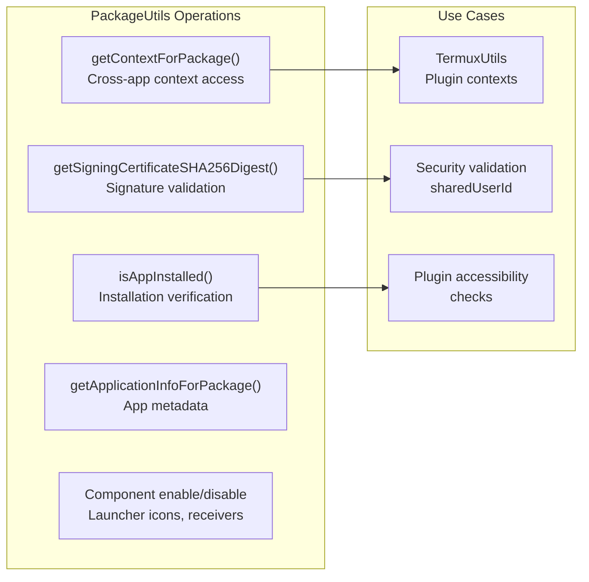
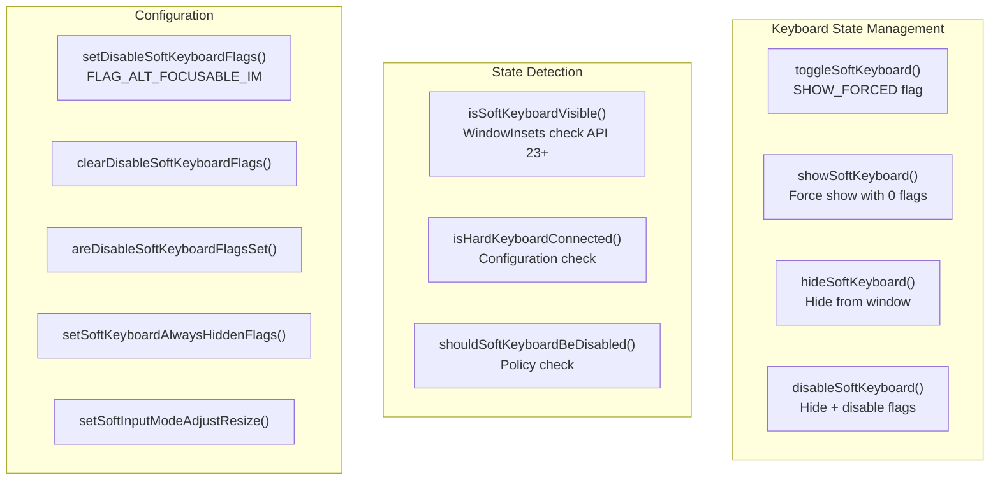
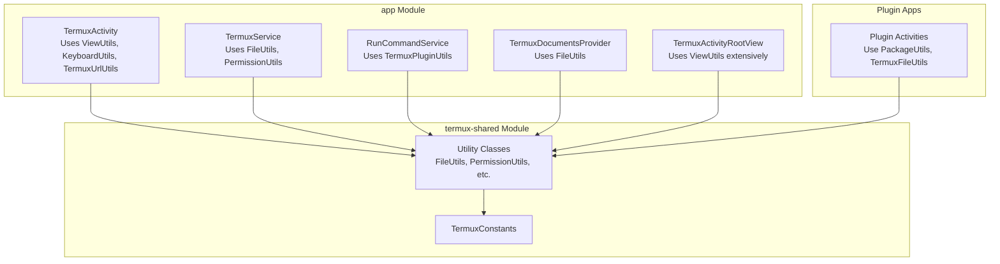

<!-- source: DeepWiki mcp.deepwiki.com · repo termux/termux-app · page 7.3 Shared Utility Libraries · fetched 2026-10-26 -->

# Shared Utility Libraries

Relevant source files

The following files were used as context for generating this wiki page:

- [app/src/main/java/com/termux/app/terminal/TermuxActivityRootView.java](app/src/main/java/com/termux/app/terminal/TermuxActivityRootView.java)
- [app/src/main/res/layout/activity_termux.xml](app/src/main/res/layout/activity_termux.xml)
- [app/src/test/java/com/termux/app/TermuxActivityTest.java](app/src/test/java/com/termux/app/TermuxActivityTest.java)
- [termux-shared/src/main/java/com/termux/shared/android/AndroidUtils.java](termux-shared/src/main/java/com/termux/shared/android/AndroidUtils.java)
- [termux-shared/src/main/java/com/termux/shared/android/FeatureFlagUtils.java](termux-shared/src/main/java/com/termux/shared/android/FeatureFlagUtils.java)
- [termux-shared/src/main/java/com/termux/shared/android/PhantomProcessUtils.java](termux-shared/src/main/java/com/termux/shared/android/PhantomProcessUtils.java)
- [termux-shared/src/main/java/com/termux/shared/android/ProcessUtils.java](termux-shared/src/main/java/com/termux/shared/android/ProcessUtils.java)
- [termux-shared/src/main/java/com/termux/shared/android/UserUtils.java](termux-shared/src/main/java/com/termux/shared/android/UserUtils.java)
- [termux-shared/src/main/java/com/termux/shared/android/resource/ResourceUtils.java](termux-shared/src/main/java/com/termux/shared/android/resource/ResourceUtils.java)
- [termux-shared/src/main/java/com/termux/shared/data/DataUtils.java](termux-shared/src/main/java/com/termux/shared/data/DataUtils.java)
- [termux-shared/src/main/java/com/termux/shared/data/IntentUtils.java](termux-shared/src/main/java/com/termux/shared/data/IntentUtils.java)
- [termux-shared/src/main/java/com/termux/shared/termux/data/TermuxUrlUtils.java](termux-shared/src/main/java/com/termux/shared/termux/data/TermuxUrlUtils.java)
- [termux-shared/src/main/java/com/termux/shared/view/KeyboardUtils.java](termux-shared/src/main/java/com/termux/shared/view/KeyboardUtils.java)
- [termux-shared/src/main/java/com/termux/shared/view/ViewUtils.java](termux-shared/src/main/java/com/termux/shared/view/ViewUtils.java)

This page documents the shared utility classes in the `termux-shared` module that provide reusable functionality across the Termux app and its plugins. These utilities handle file operations, permissions, view management, keyboard handling, package operations, and Android system integration.

For the central constants system, see [TermuxConstants](#7.1). For context access and app info utilities, see [TermuxUtils](#7.2).

## Overview

The shared utility libraries are located in the `termux-shared` module and provide cross-cutting functionality that is used by both the main Termux app and its plugin applications. These utilities abstract common Android operations, enforce consistent behavior, and centralize logic for system interactions.

### Utility Library Structure

```mermaid
graph TB
    subgraph "termux-shared Module"
        subgraph "File System"
            FileUtils["FileUtils<br/>Generic file operations"]
            TermuxFileUtils["TermuxFileUtils<br/>Termux-specific paths"]
        end
        
        subgraph "Permissions & Access"
            PermissionUtils["PermissionUtils<br/>Android permissions"]
            TermuxPluginUtils["TermuxPluginUtils<br/>Plugin access control"]
        end
        
        subgraph "Package Management"
            PackageUtils["PackageUtils<br/>Context & signatures"]
        end
        
        subgraph "View & Input"
            ViewUtils["ViewUtils<br/>View measurements"]
            KeyboardUtils["KeyboardUtils<br/>Keyboard management"]
        end
        
        subgraph "Android Integration"
            AndroidUtils["AndroidUtils<br/>App info & system"]
            FeatureFlagUtils["FeatureFlagUtils<br/>Android feature flags"]
            PhantomProcessUtils["PhantomProcessUtils<br/>Android 12+ phantom processes"]
            ProcessUtils["ProcessUtils<br/>Android process info"]
            ResourceUtils["ResourceUtils<br/>Android resource lookup"]
            UserUtils["UserUtils<br/>Android user management"]
        end
        
        subgraph "Data & Presentation"
            DataUtils["DataUtils<br/>Data validation"]
            MarkdownUtils["MarkdownUtils<br/>Markdown generation"]
            ShareUtils["ShareUtils<br/>File sharing"]
            IntentUtils["IntentUtils<br/>Intent manipulation"]
            TermuxUrlUtils["TermuxUrlUtils<br/>URL extraction"]
        end
        
        subgraph "Reflection"
            ReflectionUtils["ReflectionUtils<br/>Hidden API access"]
        end
    end
    
    subgraph "Consumers"
        TermuxApp["Termux App"]
        PluginApps["Plugin Apps"]
    end
    
    FileUtils --> TermuxFileUtils
    PermissionUtils --> TermuxPluginUtils
    PackageUtils --> TermuxUtils["TermuxUtils"]
    FeatureFlagUtils --> PhantomProcessUtils
    ReflectionUtils --> FeatureFlagUtils
    
    TermuxApp --> FileUtils
    TermuxApp --> PermissionUtils
    TermuxApp --> ViewUtils
    TermuxApp --> KeyboardUtils
    TermuxApp --> AndroidUtils
    TermuxApp --> DataUtils
    TermuxApp --> IntentUtils
    TermuxApp --> TermuxUrlUtils
    TermuxApp --> ResourceUtils
    TermuxApp --> ProcessUtils
    TermuxApp --> UserUtils
    TermuxApp --> PhantomProcessUtils
    TermuxApp --> ReflectionUtils
    
    PluginApps --> FileUtils
    PluginApps --> PermissionUtils
    PluginApps --> PackageUtils
    PluginApps --> DataUtils
    PluginApps --> IntentUtils
    PluginApps --> ResourceUtils
    PluginApps --> ProcessUtils
    PluginApps --> UserUtils
    PluginApps --> PhantomProcessUtils
    PluginApps --> ReflectionUtils
```

**Sources:** [termux-shared/src/main/res/values/strings.xml:1-138]()

## File System Utilities

### FileUtils

`FileUtils` provides generic file and directory operations that are not specific to Termux paths. It handles file permissions, accessibility checks, directory creation, and path validation.

**Key Constants:**
- `APP_WORKING_DIRECTORY_PERMISSIONS` - Required permissions (rwx) for working directories
- `APP_WORKING_FILE_PERMISSIONS` - Required permissions (rw) for working files

**Key Methods:**
- Directory accessibility validation
- Permission checking and setting
- File/directory creation with proper permissions
- Path canonicalization and validation

**Sources:** Referenced in [termux-shared/src/main/res/values/strings.xml:17]()

### TermuxFileUtils

`TermuxFileUtils` extends file utilities with Termux-specific path validation and directory checks. It validates that key Termux directories exist and have correct permissions.

**Key Methods:**
- `isTermuxFilesDirectoryAccessible()` - Validates `TERMUX_FILES_DIR_PATH`
- `isTermuxPrefixDirectoryAccessible()` - Validates `TERMUX_PREFIX_DIR_PATH` with required permissions
- Path validation within Termux directory hierarchy

The `isTermuxPrefixDirectoryAccessible()` method is critical for plugin apps to verify that they can access the Termux environment before attempting operations.

**Sources:** [termux-shared/src/main/java/com/termux/shared/termux/TermuxUtils.java:208-209]()

## Permission Management

### PermissionUtils

`PermissionUtils` handles Android runtime permission requests and validation. It provides methods for checking permissions, requesting them from users, and validating that required permissions have been declared in the manifest.

**Key Functionality:**

| Function | Description |
|----------|-------------|
| Permission Validation | Check if permissions are granted at runtime |
| Manifest Verification | Ensure requested permissions are declared in manifest |
| Request Handling | Manage permission request flows with request codes |
| Storage Permissions | Special handling for `MANAGE_EXTERNAL_STORAGE` and legacy storage |

**Error Messages:**
- `error_failed_to_request_permissions` - Permission request failure with request code
- `error_attempted_to_check_for_permissions_not_requested` - Checking undeclared permissions
- `error_attempted_to_ask_for_permissions_not_requested` - Requesting undeclared permissions
- `error_has_not_requested_legacy_external_storage` - Missing `requestLegacyExternalStorage` on API 29+

**Sources:** [termux-shared/src/main/res/values/strings.xml:33-45](), [app/src/main/AndroidManifest.xml:24-26]()

### TermuxPluginUtils

`TermuxPluginUtils` enforces the `allow-external-apps` policy that controls whether external applications can execute commands via `RunCommandService`. This is a critical security layer.

**Key Method:**
- `checkIfAllowExternalAppsPolicyIsViolated()` - Validates if external app access is allowed by checking the `allow-external-apps` property in `termux.properties`

**Policy Enforcement:**
Even if an external app has the `RUN_COMMAND` permission, access is denied unless `allow-external-apps=true` is explicitly set in the user's configuration.

**Sources:** [termux-shared/src/main/res/values/strings.xml:50-51]()

## Package Management

### PackageUtils

`PackageUtils` provides package-related operations including context retrieval, signature verification, app installation checks, and component state management.

**Core Operations:**

**Key Methods:**
- `getContextForPackage(Context, String)` - Get context for another package with same `sharedUserId`
- `getContextForPackage(Context, String, int)` - Get context with flags (e.g., `CONTEXT_INCLUDE_CODE`)
- `isAppInstalled(Context, String, String)` - Check if app is installed and enabled
- `getSigningCertificateSHA256DigestForPackage(Context)` - Get APK signature digest
- `setComponentState()` - Enable/disable components (activities, receivers)

**Context Access Requirements:**
Apps must share the same `sharedUserId` (`com.termux`) and have matching APK signatures to access each other's contexts. This is validated automatically when getting package contexts.

**Sources:** [termux-shared/src/main/java/com/termux/shared/termux/TermuxUtils.java:62-135](), [termux-shared/src/main/res/values/strings.xml:22-29]()

## View Utilities

### ViewUtils

`ViewUtils` provides view measurement, visibility detection, and display utilities. It handles complex scenarios like multi-window mode, split-screen, and keyboard overlap detection.

**Key Features:**

| Method | Purpose |
|--------|---------|
| `isViewFullyVisible()` | Check if view is completely visible and not obscured |
| `getWindowAndViewRects()` | Get window and view rectangles with status bar compensation |
| `isRectAbove()` | Rectangle position comparison |
| `getDisplayOrientation()` | Get device orientation (portrait/landscape) |
| `getDisplaySize()` | Get display dimensions (activity or physical) |
| `dpToPx()` / `pxToDp()` | Unit conversion |
| `setLayoutMarginsInDp()` | Set view margins in dp units |

**Multi-Window Support:**

The `getWindowAndViewRects()` method handles complex layout scenarios:
- Status bar height compensation
- Action bar height detection
- Multi-window mode detection (API 24+)
- Split-screen positioning (top/bottom in portrait, left/right in landscape)
- Navbar height considerations

**Logging Control:**
- `VIEW_UTILS_LOGGING_ENABLED` - Global flag to enable verbose logging
- `setIsViewUtilsLoggingEnabled(boolean)` - Toggle logging at runtime

**Sources:** [termux-shared/src/main/java/com/termux/shared/view/ViewUtils.java:1-246](), [app/src/main/java/com/termux/app/terminal/TermuxActivityRootView.java:64-284]()

### KeyboardUtils

`KeyboardUtils` manages soft keyboard visibility, hardware keyboard detection, and keyboard state configuration. It handles Android's complex keyboard behavior across different devices and configurations.

**Keyboard Visibility Control:**

**Hardware Keyboard Detection:**

`isHardKeyboardConnected()` checks the device configuration to determine if:
- Device has hardware keys for text input (`config.keyboard != KEYBOARD_NOKEYS`)
- External hardware keyboard is connected (`config.hardKeyboardHidden == HARDKEYBOARDHIDDEN_NO`)

**Keyboard Policy:**

The `shouldSoftKeyboardBeDisabled()` method evaluates user preferences:
- If `isSoftKeyboardEnabled=false` → always disabled
- If `isSoftKeyboardEnabledOnlyIfNoHardware=true` → disabled when hardware keyboard connected
- Otherwise → enabled

**Force Show Implementation:**

The `showSoftKeyboard()` and `toggleSoftKeyboard()` methods use special flags to force keyboard display even when:
- Hardware keyboard is connected
- User has disabled "Show on-screen keyboard while hardware keyboard is connected" in system settings
- Current keyboard app overrides `InputMethodService.onEvaluateInputViewShown()` to return `true`

This is critical for devices where users want both hardware and soft keyboards available simultaneously.

**Sources:** [termux-shared/src/main/java/com/termux/shared/view/KeyboardUtils.java:1-198]()

## Android Integration

### AndroidUtils

`AndroidUtils` provides general Android system utilities including app information generation, markdown report formatting, and system property access.

**Key Functionality:**
- `getAppInfoMarkdownString(Context)` - Generate markdown-formatted app information for the current app. [termux-shared/src/main/java/com/termux/shared/android/AndroidUtils.java:39-63]()
- `getAppInfoMarkdownString(Context, String)` - Get app info for a specific package. [termux-shared/src/main/java/com/termux/shared/android/AndroidUtils.java:66-101]()
- `getDeviceInfoMarkdownString(Context)` - Generate markdown-formatted device information. [termux-shared/src/main/java/com/termux/shared/android/AndroidUtils.java:103-105]()
- `appendPropertyToMarkdown()` - Append key-value pairs to markdown output. [termux-shared/src/main/java/com/termux/shared/android/AndroidUtils.java:123-136]()
- System property and configuration access.
- Activity context extraction.

The markdown generation methods are heavily used by `TermuxUtils` to create detailed app reports for debugging and issue reporting.

**Sources:** [termux-shared/src/main/java/com/termux/shared/android/AndroidUtils.java:1-270](), [termux-shared/src/main/java/com/termux/shared/termux/TermuxUtils.java:474-498]()

### FeatureFlagUtils

`FeatureFlagUtils` provides methods to interact with Android's hidden feature flag system, primarily used in userdebug builds. It allows checking the status of system feature flags, which can influence system behavior.

**Key Functionality:**
- `getAllFeatureFlags()`: Retrieves all feature flags and their values. [termux-shared/src/main/java/com/termux/shared/android/FeatureFlagUtils.java:89-101]()
- `featureFlagExists(String)`: Checks if a specific feature flag exists. [termux-shared/src/main/java/com/termux/shared/android/FeatureFlagUtils.java:109-114]()
- `getFeatureFlagValueString(Context, String)`: Returns the `FeatureFlagValue` (UNKNOWN, UNSUPPORTED, TRUE, FALSE) for a given flag. [termux-shared/src/main/java/com/termux/shared/android/FeatureFlagUtils.java:123-140]()
- `isFeatureEnabled(Context, String)`: Checks if a feature flag is enabled. [termux-shared/src/main/java/com/termux/shared/android/FeatureFlagUtils.java:143-150]()

This utility uses reflection to bypass hidden API restrictions, as the `android.util.FeatureFlagUtils` class is `@hide`.

**Sources:** [termux-shared/src/main/java/com/termux/shared/android/FeatureFlagUtils.java:1-169]()

### PhantomProcessUtils

`PhantomProcessUtils` provides utilities related to Android 12+ phantom processes, which are background processes that the system may kill to conserve resources. It interacts with feature flags and system settings to monitor and manage these processes.

**Key Constants:**
- `FEATURE_FLAG_SETTINGS_ENABLE_MONITOR_PHANTOM_PROCS`: A feature flag that, if set to `false`, disables trimming of phantom processes. [termux-shared/src/main/java/com/termux/shared/android/PhantomProcessUtils.java:33-36]()
- `KEY_MAX_PHANTOM_PROCESSES`: The key for the maximum number of allowed phantom processes. [termux-shared/src/main/java/com/termux/shared/android/PhantomProcessUtils.java:44-46]()
- `SETTINGS_GLOBAL_DEVICE_CONFIG_SYNC_DISABLED`: A global setting indicating if DeviceConfig syncs are disabled. [termux-shared/src/main/java/com/termux/shared/android/PhantomProcessUtils.java:53-56]()

**Key Methods:**
- `getFeatureFlagMonitorPhantomProcsValueString(Context)`: Gets the status of the `settings_enable_monitor_phantom_procs` feature flag. [termux-shared/src/main/java/com/termux/shared/android/PhantomProcessUtils.java:63-65]()
- `getActivityManagerMaxPhantomProcesses(Context)`: Retrieves the currently enforced `MAX_PHANTOM_PROCESSES` value from `dumpsys activity settings`. Requires `DUMP` and `PACKAGE_USAGE_STATS` permissions. [termux-shared/src/main/java/com/termux/shared/android/PhantomProcessUtils.java:72-101]()
- `getSettingsGlobalDeviceConfigSyncDisabled(Context)`: Gets the value of the `device_config_sync_disabled` global setting. [termux-shared/src/main/java/com/termux/shared/android/PhantomProcessUtils.java:109-113]()

**Sources:** [termux-shared/src/main/java/com/termux/shared/android/PhantomProcessUtils.java:1-115]()

### ProcessUtils

`ProcessUtils` provides methods to retrieve information about running Android processes.

**Key Methods:**
- `getAppProcessNameForPid(Context, int)`: Returns the application process name for a given process ID (PID) by querying `ActivityManager.getRunningAppProcesses()`. This method does not track child processes. [termux-shared/src/main/java/com/termux/shared/android/ProcessUtils.java:35-56]()

**Sources:** [termux-shared/src/main/java/com/termux/shared/android/ProcessUtils.java:1-58]()

### ResourceUtils

`ResourceUtils` provides helper methods for retrieving Android resource identifiers dynamically. This is useful when resource names are constructed at runtime or need to be looked up from different packages.

**Key Constants:**
- `RES_TYPE_COLOR`, `RES_TYPE_DRAWABLE`, `RES_TYPE_ID`, `RES_TYPE_LAYOUT`, `RES_TYPE_STRING`, `RES_TYPE_STYLE`: Common resource types. [termux-shared/src/main/java/com/termux/shared/android/resource/ResourceUtils.java:12-19]()

**Key Methods:**
- `getResourceId(Context, String, String, boolean)`: Generic method to get a resource ID given its name, type, and whether to log errors. [termux-shared/src/main/java/com/termux/shared/android/resource/ResourceUtils.java:26-30]()
- `getResourceId(Context, String, String, String, boolean)`: Overloaded method allowing specification of a default package. [termux-shared/src/main/java/com/termux/shared/android/resource/ResourceUtils.java:48-66]()
- Type-specific wrappers: `getColorResourceId()`, `getDrawableResourceId()`, `getIdResourceId()`, `getLayoutResourceId()`, `getStringResourceId()`, `getStyleResourceId()`. These simplify lookup for common resource types. [termux-shared/src/main/java/com/termux/shared/android/resource/ResourceUtils.java:75-134]()

**Sources:** [termux-shared/src/main/java/com/termux/shared/android/resource/ResourceUtils.java:1-136]()

### UserUtils

`UserUtils` provides methods for interacting with Android user management, particularly for multi-user environments.

**Key Methods:**
- `getUserId()`: Returns the user ID for the current process.
- `isCurrentUserOwner()`: Checks if the current user is the device owner.

**Sources:** [termux-shared/src/main/java/com/termux/shared/android/UserUtils.java]()

## Data and Presentation Utilities

### DataUtils

`DataUtils` provides data validation and manipulation utilities.

**Key Operations:**
- `TRANSACTION_SIZE_LIMIT_IN_BYTES`: A constant defining the maximum safe data size for Android transactions (100KB) to prevent `TransactionTooLargeException`. [termux-shared/src/main/java/com/termux/shared/data/DataUtils.java:19-20]()
- `getTruncatedCommandOutput(String, int, boolean, boolean, boolean)`: Truncates a string, optionally from the end, on a newline, and with a prefix. [termux-shared/src/main/java/com/termux/shared/data/DataUtils.java:23-51]()
- `replaceSubStringsInStringArrayItems(String[], String, String)`: Replaces substrings in each item of a string array. [termux-shared/src/main/java/com/termux/shared/data/DataUtils.java:60-65]()
- Type conversion: `getFloatFromString()`, `getIntFromString()`, `getStringFromInteger()`. [termux-shared/src/main/java/com/termux/shared/data/DataUtils.java:76-115]()
- `bytesToHex(byte[])`: Converts a byte array to a hexadecimal string. [termux-shared/src/main/java/com/termux/shared/data/DataUtils.java:123-131]()
- `getIntStoredAsStringFromBundle(Bundle, String, int)`: Retrieves an integer from a `Bundle` where it might be stored as a string. [termux-shared/src/main/java/com/termux/shared/data/DataUtils.java:143-146]()
- `clamp(int, int, int)`: Clamps an integer value within a specified range. [termux-shared/src/main/java/com/termux/shared/data/DataUtils.java:153-155]()
- `rangedOrDefault(float, float, float, float)`: Returns a value if it's within a range, otherwise a default. [termux-shared/src/main/java/com/termux/shared/data/DataUtils.java:161-165]()
- String indentation: `getSpaceIndentedString()`, `getTabIndentedString()`, `getIndentedString()`. [termux-shared/src/main/java/com/termux/shared/data/DataUtils.java:176-200]()
- Null/empty string checks.
- Collection validation.
- Data sanitization.

**Sources:** [termux-shared/src/main/java/com/termux/shared/data/DataUtils.java:1-200](), [termux-shared/src/main/java/com/termux/shared/termux/TermuxUtils.java:359]()

### IntentUtils

`IntentUtils` provides helper methods for manipulating and extracting data from Android `Intent` objects.

**Key Methods:**
- `get and set` various data types (e.g., `String`, `boolean`, `int`, `Bundle`) from `Intent` extras.
- `get and set` `Serializable` objects.
- `get and set` `Parcelable` objects.
- `get and set` `String[]` arrays.

**Sources:** [termux-shared/src/main/java/com/termux/shared/data/IntentUtils.java]()

### MarkdownUtils

`MarkdownUtils` generates markdown-formatted strings for links, headers, and structured text output.

**Key Methods:**
- `getLinkMarkdownString(String, String)` - Create markdown links
- Markdown escaping and formatting
- Structured text generation

Used extensively in report generation and help text formatting.

**Sources:** [termux-shared/src/main/java/com/termux/shared/termux/TermuxUtils.java:516-532]()

### ShareUtils

`ShareUtils` handles file sharing operations via Android's sharing system and Storage Access Framework.

**Functionality:**
- Share text/files via intent chooser
- Open URLs in external browsers
- File URI generation and sharing
- Storage permission validation

**Resource Strings:**
- `title_share_with` - Share intent chooser title
- `title_open_url_with` - URL open intent title
- `msg_storage_permission_not_granted` - Permission error message
- `msg_file_saved_successfully` - Save confirmation with path

**Sources:** [termux-shared/src/main/res/values/strings.xml:63-67]()

### TermuxUrlUtils

`TermuxUrlUtils` provides functionality for extracting URLs from text using a comprehensive regular expression.

**Key Constants:**
- `URL_MATCH_REGEX`: A `Pattern` object that defines the regular expression used to match various URL schemes (e.g., `http`, `https`, `ftp`, `git`, `file`, `ssh`, etc.) and their components (user, host, port, path, fragment). [termux-shared/src/main/java/com/termux/shared/termux/data/TermuxUrlUtils.java:9-87]()

**Key Methods:**
- `getUrlMatchRegex()`: Lazily initializes and returns the `URL_MATCH_REGEX` pattern. [termux-shared/src/main/java/com/termux/shared/termux/data/TermuxUrlUtils.java:11-88]()
- `extractUrls(String)`: Takes a string and returns a `LinkedHashSet` of unique URLs found within it. [termux-shared/src/main/java/com/termux/shared/termux/data/TermuxUrlUtils.java:90-102]()

This utility is used, for example, in `TermuxActivityTest` to verify URL extraction logic. [app/src/test/java/com/termux/app/TermuxActivityTest.java:16-30]()

**Sources:** [termux-shared/src/main/java/com/termux/shared/termux/data/TermuxUrlUtils.java:1-104](), [app/src/test/java/com/termux/app/TermuxActivityTest.java:3-32]()

## Reflection

### ReflectionUtils

`ReflectionUtils` provides helper methods for using Java reflection, particularly for bypassing Android's hidden API restrictions.

**Key Methods:**
- `bypassHiddenAPIReflectionRestrictions()`: Attempts to bypass hidden API restrictions, which is necessary for accessing internal Android classes and methods.
- `getDeclaredMethod()`: Safely retrieves a declared method using reflection.
- `invokeMethod()`: Invokes a method using reflection.

This utility is crucial for features like `FeatureFlagUtils` that need to access internal Android system components.

**Sources:** [termux-shared/src/main/java/com/termux/shared/reflection/ReflectionUtils.java]()

## Usage Patterns and Integration

### Cross-Module Utility Access

**Sources:** [app/src/main/java/com/termux/app/terminal/TermuxActivityRootView.java:1-285](), [app/src/main/java/com/termux/filepicker/TermuxDocumentsProvider.java:1-268]()

### Common Usage Scenarios

**Scenario 1: View Visibility Management**

The `TermuxActivityRootView` uses `ViewUtils.getWindowAndViewRects()` extensively to detect keyboard overlap and adjust layout margins dynamically. This handles complex cases like:
- Keyboard opening with clipboard suggestions
- Multi-window split-screen mode
- Toolbar/extra keys visibility changes
- Hardware vs. soft keyboard switching

**Sources:** [app/src/main/java/com/termux/app/terminal/TermuxActivityRootView.java:120-273]()

**Scenario 2: Plugin Access Validation**

When external apps send commands via `RunCommandService`, the flow is:
1. `PermissionUtils` validates `RUN_COMMAND` permission
2. `TermuxPluginUtils.checkIfAllowExternalAppsPolicyIsViolated()` checks `allow-external-apps` property
3. `PackageUtils` may verify caller signature
4. `TermuxFileUtils` validates target paths

**Sources:** Referenced in security diagram from [termux-shared/src/main/res/values/strings.xml:50-51]()

**Scenario 3: Cross-App Context Access**

Plugin apps accessing Termux environment:
1. `PackageUtils.getContextForPackage()` retrieves Termux package context (requires matching `sharedUserId`)
2. `TermuxFileUtils.isTermuxPrefixDirectoryAccessible()` validates `$PREFIX` directory
3. Operations proceed with validated context and paths

**Sources:** [termux-shared/src/main/java/com/termux/shared/termux/TermuxUtils.java:198-220]()

### Error Handling and User Feedback

Utility classes consistently return error information through:
- **Return Values:** `null` for success, error string for failure
- **Error Objects:** `Error` class instances with structured error data
- **Resource Strings:** Localized error messages from `strings.xml`
- **Logging:** Verbose logging via `Logger` class when debugging enabled

Error messages are designed to be user-facing and include actionable information, such as required permission names, missing configuration values, or paths that need attention.

**Sources:** [termux-shared/src/main/res/values/strings.xml:1-138]()

---

