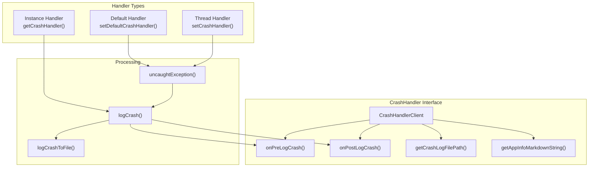
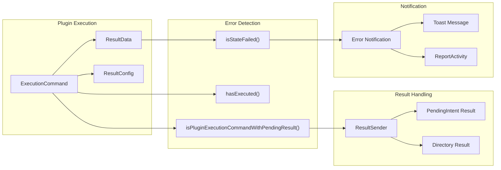
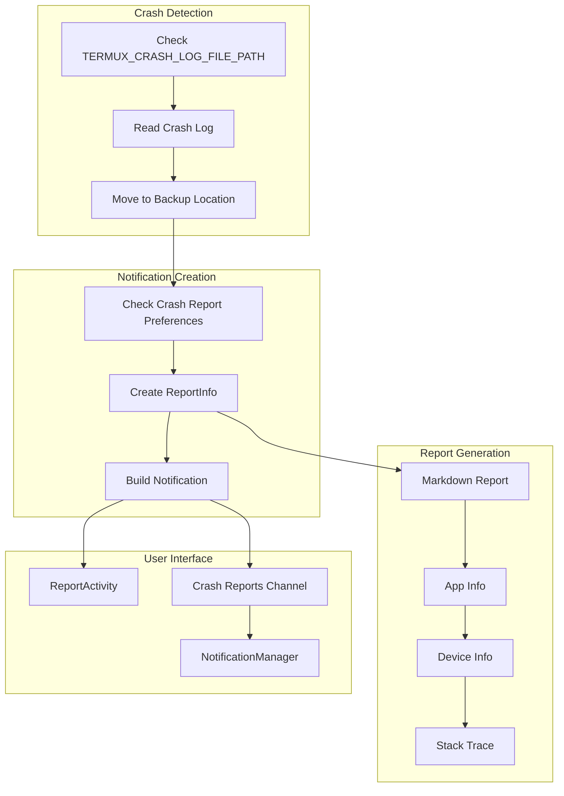
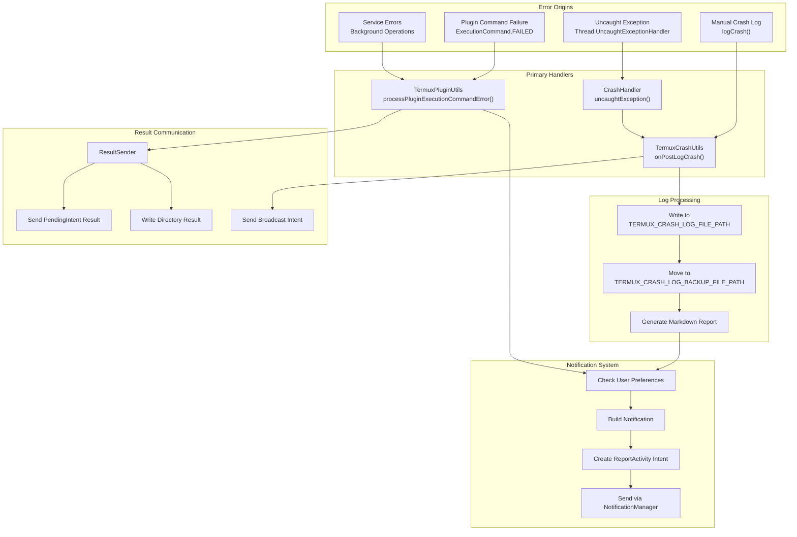

<!-- source: DeepWiki mcp.deepwiki.com · repo termux/termux-app · page 7.4 Error Handling and Crash Reporting · fetched 2026-10-26 -->

# Error Handling and Crash Reporting

<details>
<summary>Relevant source files</summary>

The following files were used as context for generating this wiki page:

- [termux-shared/src/main/java/com/termux/shared/activities/ReportActivity.java](termux-shared/src/main/java/com/termux/shared/activities/ReportActivity.java)
- [termux-shared/src/main/java/com/termux/shared/crash/CrashHandler.java](termux-shared/src/main/java/com/termux/shared/crash/CrashHandler.java)
- [termux-shared/src/main/java/com/termux/shared/errors/Error.java](termux-shared/src/main/java/com/termux/shared/errors/Error.java)
- [termux-shared/src/main/java/com/termux/shared/interact/MessageDialogUtils.java](termux-shared/src/main/java/com/termux/shared/interact/MessageDialogUtils.java)
- [termux-shared/src/main/java/com/termux/shared/logger/Logger.java](termux-shared/src/main/java/com/termux/shared/logger/Logger.java)
- [termux-shared/src/main/java/com/termux/shared/markdown/MarkdownUtils.java](termux-shared/src/main/java/com/termux/shared/markdown/MarkdownUtils.java)
- [termux-shared/src/main/java/com/termux/shared/models/ReportInfo.java](termux-shared/src/main/java/com/termux/shared/models/ReportInfo.java)
- [termux-shared/src/main/java/com/termux/shared/notification/NotificationUtils.java](termux-shared/src/main/java/com/termux/shared/notification/NotificationUtils.java)
- [termux-shared/src/main/java/com/termux/shared/shell/ShellUtils.java](termux-shared/src/main/java/com/termux/shared/shell/ShellUtils.java)
- [termux-shared/src/main/java/com/termux/shared/shell/StreamGobbler.java](termux-shared/src/main/java/com/termux/shared/shell/StreamGobbler.java)
- [termux-shared/src/main/java/com/termux/shared/shell/command/ShellCommandConstants.java](termux-shared/src/main/java/com/termux/shared/shell/command/ShellCommandConstants.java)
- [termux-shared/src/main/java/com/termux/shared/termux/crash/TermuxCrashUtils.java](termux-shared/src/main/java/com/termux/shared/termux/crash/TermuxCrashUtils.java)
- [termux-shared/src/main/java/com/termux/shared/termux/notification/TermuxNotificationUtils.java](termux-shared/src/main/java/com/termux/shared/termux/notification/TermuxNotificationUtils.java)
- [termux-shared/src/main/java/com/termux/shared/termux/plugins/TermuxPluginUtils.java](termux-shared/src/main/java/com/termux/shared/termux/plugins/TermuxPluginUtils.java)
- [termux-shared/src/main/res/menu/menu_report.xml](termux-shared/src/main/res/menu/menu_report.xml)

</details>


## Purpose and Scope

This document covers the error handling and crash reporting systems within the Termux application. It encompasses uncaught exception handling, crash logging, plugin error management, and user notification mechanisms for error states. For information about general logging capabilities, see [Package Signature Verification](#8.1).

The error handling system provides comprehensive crash detection, reporting, and user notification across the main Termux application and its plugin ecosystem.

## Core Error Handling Architecture

The Termux error handling system is built around several key components that work together to detect, log, and report errors across the application and plugin ecosystem.

```mermaid
graph TB
    subgraph "Error Sources"
        UE["Uncaught Exceptions"]
        CE["Caught Exceptions"] 
        PE["Plugin Execution Errors"]
        SE["Service Errors"]
    end
    
    subgraph "Core Handlers"
        CH["CrashHandler"]
        TCU["TermuxCrashUtils"]
        TPU["TermuxPluginUtils"]
    end
    
    subgraph "Processing Layer"
        CL["Crash Log File"]
        NB["Notification Builder"]
        RA["ReportActivity"]
    end
    
    subgraph "User Interface"
        NM["NotificationManager"]
        TOAST["Toast Messages"]
        REPORT["Error Reports"]
    end
    
    subgraph "Storage"
        LOGFILE["TERMUX_CRASH_LOG_FILE_PATH"]
        BACKUP["TERMUX_CRASH_LOG_BACKUP_FILE_PATH"]
    end
    
    UE --> CH
    CE --> TCU
    PE --> TPU
    SE --> TPU
    
    CH --> TCU
    TCU --> CL
    TPU --> NB
    
    CL --> LOGFILE
    LOGFILE --> BACKUP
    
    NB --> NM
    TCU --> TOAST
    NB --> RA
    
    RA --> REPORT
    NM --> "Android System"
```

**Error Handling Flow Architecture**

The system distinguishes between different error sources and routes them through appropriate handlers. The `CrashHandler` manages uncaught exceptions, while `TermuxCrashUtils` processes both caught and uncaught exceptions with Termux-specific logic.

Sources: [termux-shared/src/main/java/com/termux/shared/crash/CrashHandler.java:15-158](), [termux-shared/src/main/java/com/termux/shared/termux/crash/TermuxCrashUtils.java:34-48]()

## Crash Handler System

### CrashHandler Implementation

The `CrashHandler` class implements `Thread.UncaughtExceptionHandler` and provides the foundation for exception capture across the application.



**CrashHandler Component Relationships**

The `CrashHandlerClient` interface allows customization of crash handling behavior, while different handler types support various threading scenarios.

Sources: [termux-shared/src/main/java/com/termux/shared/crash/CrashHandler.java:117-156](), [termux-shared/src/main/java/com/termux/shared/crash/CrashHandler.java:45-65]()

### TermuxCrashUtils Integration

`TermuxCrashUtils` implements the `CrashHandlerClient` interface and provides Termux-specific crash handling logic.

| Method | Purpose | Key Behavior |
|--------|---------|--------------|
| `setDefaultCrashHandler()` | Set app-wide handler | Called at application startup |
| `setCrashHandler()` | Set thread-specific handler | For background threads |
| `logCrash()` | Manual crash logging | For caught exceptions |
| `onPostLogCrash()` | Post-crash processing | Sends broadcast notifications |
| `getCrashLogFilePath()` | Define log location | Returns `TERMUX_CRASH_LOG_FILE_PATH` |

The system supports two crash types defined in the `TYPE` enum: `UNCAUGHT_EXCEPTION` and `CAUGHT_EXCEPTION`, which determine the notification behavior.
Sources: [termux-shared/src/main/java/com/termux/shared/termux/crash/TermuxCrashUtils.java:36-39](), [termux-shared/src/main/java/com/termux/shared/termux/crash/TermuxCrashUtils.java:52-83]()

## Plugin Error Handling

### ExecutionCommand Error Processing

The plugin system handles errors through the `TermuxPluginUtils` class, which processes `ExecutionCommand` failures and communicates results back to calling applications.



**Plugin Error Processing Flow**

The system processes plugin execution results through `processPluginExecutionCommandResult()` and handles errors via `processPluginExecutionCommandError()`.
Sources: [termux-shared/src/main/java/com/termux/shared/termux/plugins/TermuxPluginUtils.java:57-105](), [termux-shared/src/main/java/com/termux/shared/termux/plugins/TermuxPluginUtils.java:154-205]()

### Plugin Error Notification System

Plugin errors are communicated through a dedicated notification channel with specific formatting and user preferences.

| Notification Component | Configuration |
|----------------------|---------------|
| Channel ID | `TERMUX_PLUGIN_COMMAND_ERRORS_NOTIFICATION_CHANNEL_ID` |
| Channel Name | `TERMUX_PLUGIN_COMMAND_ERRORS_NOTIFICATION_CHANNEL_NAME` |
| Priority | `Notification.PRIORITY_HIGH` |
| Preference Key | `KEY_PLUGIN_ERROR_NOTIFICATIONS_ENABLED` |

The `sendPluginCommandErrorNotification()` method supports various configuration options including forced notifications, toast messages, and device info inclusion.
Sources: [termux-shared/src/main/java/com/termux/shared/termux/plugins/TermuxPluginUtils.java:320-406](), [termux-shared/src/main/java/com/termux/shared/termux/plugins/TermuxPluginUtils.java:443-447]()

## Crash Notification System

### Crash Report Notifications

The crash notification system provides user-visible feedback when crashes occur, with configurable notification preferences and detailed error reporting.



**Crash Notification Processing Pipeline**

The `notifyAppCrashFromCrashLogFile()` method implements a comprehensive crash notification system that reads crash logs, creates formatted reports, and presents them to users through the Android notification system.
Sources: [termux-shared/src/main/java/com/termux/shared/termux/crash/TermuxCrashUtils.java:144-199](), [termux-shared/src/main/java/com/termux/shared/termux/crash/TermuxCrashUtils.java:284-368]()

### Notification Channel Management

Both crash reports and plugin errors use dedicated notification channels with specific characteristics:

| Channel Type | Channel ID | Importance | Use Case |
|-------------|------------|------------|----------|
| Crash Reports | `TERMUX_CRASH_REPORTS_NOTIFICATION_CHANNEL_ID` | `IMPORTANCE_HIGH` | Application crashes |
| Plugin Errors | `TERMUX_PLUGIN_COMMAND_ERRORS_NOTIFICATION_CHANNEL_ID` | `IMPORTANCE_HIGH` | Plugin command failures |

The notification system integrates with `TermuxNotificationUtils` to ensure unique notification IDs and proper icon handling across different Android versions.
Sources: [termux-shared/src/main/java/com/termux/shared/termux/crash/TermuxCrashUtils.java:405-409](), [termux-shared/src/main/java/com/termux/shared/termux/plugins/TermuxPluginUtils.java:443-447](), [termux-shared/src/main/java/com/termux/shared/termux/notification/TermuxNotificationUtils.java:28-46]()

## Error Types and Processing Flow

### Complete Error Handling Pipeline

The Termux error handling system processes different error types through specialized pathways while maintaining consistent logging and notification patterns.



**Complete Error Processing Architecture**

This comprehensive flow shows how different error types are routed through appropriate handlers, processed into logs and reports, and communicated to users through notifications or result callbacks.

The system maintains separation of concerns between crash detection, logging, notification, and result communication while providing consistent error reporting across all application components.
Sources: [termux-shared/src/main/java/com/termux/shared/crash/CrashHandler.java:35-42](), [termux-shared/src/main/java/com/termux/shared/termux/crash/TermuxCrashUtils.java:91-116](), [termux-shared/src/main/java/com/termux/shared/termux/plugins/TermuxPluginUtils.java:77-101]()

## Errno/Error Model

The codebase uses an `Error` class to encapsulate error information, often including an `Errno` code. This provides a structured way to report and handle various types of failures.

The `Error` class [termux-shared/src/main/java/com/termux/shared/errors/Error.java]() typically contains:
*   An error code (e.g., from `Errno` [termux-shared/src/main/java/com/termux/shared/errors/Errno.java]()).
*   A descriptive error message.
*   Optionally, a `Throwable` for exceptions.

This model is used consistently across the codebase, for example, when writing to files [termux-shared/src/main/java/com/termux/shared/crash/CrashHandler.java:110-112]() or processing plugin command results [termux-shared/src/main/java/com/termux/shared/termux/plugins/TermuxPluginUtils.java:88-99]().

Sources: [termux-shared/src/main/java/com/termux/shared/errors/Error.java](), [termux-shared/src/main/java/com/termux/shared/errors/Errno.java](), [termux-shared/src/main/java/com/termux/shared/crash/CrashHandler.java:110-112](), [termux-shared/src/main/java/com/termux/shared/termux/plugins/TermuxPluginUtils.java:88-99]()

## ReportActivity and Markdown Reports

The `ReportActivity` [termux-shared/src/main/java/com/termux/shared/activities/ReportActivity.java]() is a central component for displaying detailed error reports to the user. It renders reports in Markdown format, providing a structured and readable presentation of crash information.

### ReportInfo Object

Reports are encapsulated in a `ReportInfo` object [termux-shared/src/main/java/com/termux/shared/models/ReportInfo.java](), which is a `Serializable` class containing:
*   `userAction`: The action being performed when the error occurred.
*   `sender`: The component that generated the report.
*   `reportTitle`: The title for the report.
*   `reportTimestamp`: When the report was generated.
*   `reportStringPrefix`, `reportString`, `reportStringSuffix`: Markdown content for the report.
*   `addReportInfoHeaderToMarkdown`: Flag to include header info in the markdown.
*   `reportSaveFileLabel`, `reportSaveFilePath`: Information for saving the report to a file.

The `ReportActivity` can receive `ReportInfo` either directly as a `Serializable` extra or by providing a file path to a serialized `ReportInfo` object [termux-shared/src/main/java/com/termux/shared/activities/ReportActivity.java:120-141]().

### Markdown Rendering

`ReportActivity` uses the `Markwon` library to render Markdown content. It configures `Markwon` with `LinkifyPlugin` and a custom plugin for `FencedCodeBlock` rendering [termux-shared/src/main/java/com/termux/shared/markdown/MarkdownUtils.java:140-167](). This ensures code blocks and other Markdown elements are displayed correctly.

The `MarkdownUtils` class [termux-shared/src/main/java/com/termux/shared/markdown/MarkdownUtils.java]() provides helper methods for generating Markdown strings, such as `getMarkdownCodeForString()` [termux-shared/src/main/java/com/termux/shared/markdown/MarkdownUtils.java:53-80]() for escaping backticks and `getSingleLineMarkdownStringEntry()` [termux-shared/src/main/java/com/termux/shared/markdown/MarkdownUtils.java:113-117]() for creating key-value pairs.

### Report Lifecycle

1.  **Creation**: A `ReportInfo` object is created, populated with error details, app info, device info, and stack traces [termux-shared/src/main/java/com/termux/shared/termux/crash/TermuxCrashUtils.java:284-368]().
2.  **Serialization (Optional)**: For large reports, the `ReportInfo` object can be serialized to a temporary file to avoid `TransactionTooLargeException` when passing it via `Intent` extras [termux-shared/src/main/java/com/termux/shared/activities/ReportActivity.java:120-141]().
3.  **Launch**: An `Intent` is created to launch `ReportActivity`, passing the `ReportInfo` object or its file path [termux-shared/src/main/java/com/termux/shared/termux/crash/TermuxCrashUtils.java:370-379]().
4.  **Display**: `ReportActivity` retrieves the `ReportInfo`, generates the full Markdown string, and displays it in a `RecyclerView` [termux-shared/src/main/java/com/termux/shared/activities/ReportActivity.java:157-168]().
5.  **Actions**: Users can share, copy, or save the report using options in the activity's menu [termux-shared/src/main/res/menu/menu_report.xml]().
6.  **Cleanup**: Old serialized `ReportInfo` files are periodically deleted to prevent accumulation [termux-shared/src/main/java/com/termux/shared/activities/ReportActivity.java:470-475]().

Sources: [termux-shared/src/main/java/com/termux/shared/activities/ReportActivity.java](), [termux-shared/src/main/java/com/termux/shared/models/ReportInfo.java](), [termux-shared/src/main/java/com/termux/shared/markdown/MarkdownUtils.java](), [termux-shared/src/main/java/com/termux/shared/termux/crash/TermuxCrashUtils.java:284-368](), [termux-shared/src/main/java/com/termux/shared/termux/crash/TermuxCrashUtils.java:370-379](), [termux-shared/src/main/res/menu/menu_report.xml]()

## Error Dialogs

For critical errors that prevent the application from functioning, simple message dialogs are used to inform the user and, if necessary, exit the application.

The `MessageDialogUtils` class [termux-shared/src/main/java/com/termux/shared/interact/MessageDialogUtils.java]() provides static methods to display these dialogs:
*   `showMessage()`: Displays a dialog with a title, message, and optional positive/negative buttons [termux-shared/src/main/java/com/termux/shared/interact/MessageDialogUtils.java:31-93]().
*   `exitAppWithErrorMessage()`: Displays an error message and then exits the application when the dialog is dismissed [termux-shared/src/main/java/com/termux/shared/interact/MessageDialogUtils.java:95-97]().

These dialogs are typically used for unrecoverable errors, such as issues during bootstrap installation or critical startup failures.

Sources: [termux-shared/src/main/java/com/termux/shared/interact/MessageDialogUtils.java]()

## Logger Infrastructure

The `Logger` class [termux-shared/src/main/java/com/termux/shared/logger/Logger.java]() in the `termux-shared` module provides a centralized logging infrastructure for the entire Termux ecosystem. It supports different log levels and handles message formatting and truncation.

### Log Levels

The `Logger` defines several log levels:
*   `LOG_LEVEL_OFF` (0): No logging.
*   `LOG_LEVEL_NORMAL` (1): Logs error, warn, and info messages.
*   `LOG_LEVEL_DEBUG` (2): Adds debug messages.
*   `LOG_LEVEL_VERBOSE` (3): Adds verbose messages.

The `CURRENT_LOG_LEVEL` can be configured to control the verbosity of logs [termux-shared/src/main/java/com/termux/shared/logger/Logger.java:32]().

### Logging Methods

The `Logger` provides methods for different log priorities:
*   `logError()`: For error messages [termux-shared/src/main/java/com/termux/shared/logger/Logger.java:105-111]().
*   `logWarn()`: For warning messages [termux-shared/src/main/java/com/termux/shared/logger/Logger.java:145-151]().
*   `logInfo()`: For informational messages [termux-shared/src/main/java/com/termux/shared/logger/Logger.java:165-171]().
*   `logDebug()`: For debug messages [termux-shared/src/main/java/com/termux/shared/logger/Logger.java:181-187]().
*   `logVerbose()`: For verbose messages [termux-shared/src/main/java/com/termux/shared/logger/Logger.java:201-207]().

Each of these methods has an `Extended` variant (e.g., `logErrorExtended()`) that handles messages longer than the Android log buffer limit (`LOGGER_ENTRY_MAX_PAYLOAD`) by splitting them into multiple entries [termux-shared/src/main/java/com/termux/shared/logger/Logger.java:69-101]().

### Stack Trace Logging

The `Logger` also includes utilities for logging stack traces:
*   `getStackTraceString()`: Converts a `Throwable` to a string representation of its stack trace [termux-shared/src/main/java/com/termux/shared/logger/Logger.java:450-459]().
*   `logStackTrace()`: Logs a stack trace directly [termux-shared/src/main/java/com/termux/shared/logger/Logger.java:461-467]().
*   `getStackTracesMarkdownString()`: Formats stack traces into a Markdown string for reports [termux-shared/src/main/java/com/termux/shared/logger/Logger.java:488-499]().

### Toast Messages

For transient user feedback, the `Logger` provides methods to show Android `Toast` messages, often in conjunction with logging an error:
*   `showToast()`: Displays a toast message [termux-shared/src/main/java/com/termux/shared/logger/Logger.java:390-400]().
*   `logErrorAndShowToast()`: Logs an error and then displays a toast [termux-shared/src/main/java/com/termux/shared/logger/Logger.java:402-408]().

Sources: [termux-shared/src/main/java/com/termux/shared/logger/Logger.java]()

---

