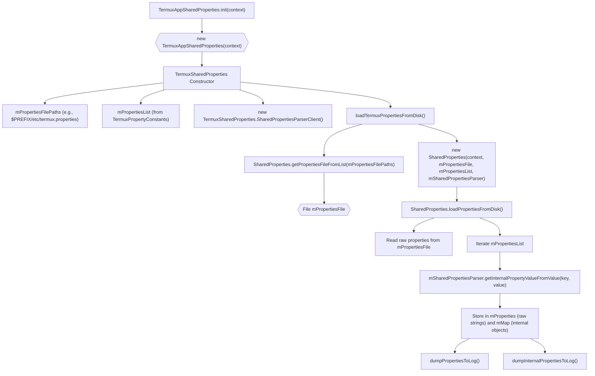
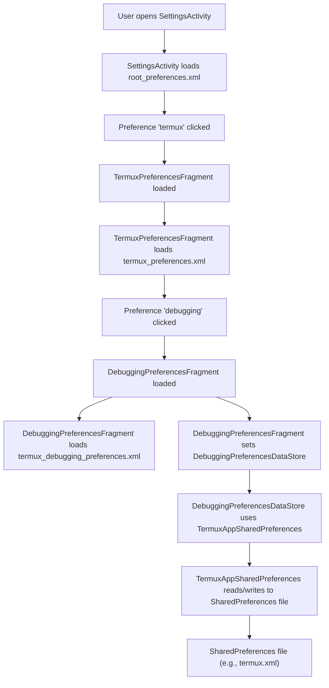

<!-- source: DeepWiki mcp.deepwiki.com · repo termux/termux-app · page 7.5 Settings, Properties and Preferences · fetched 2026-10-26 -->

# Settings, Properties and Preferences

Relevant source files

The following files were used as context for generating this wiki page:

- [app/src/main/java/com/termux/app/fragments/settings/TermuxAPIPreferencesFragment.java](app/src/main/java/com/termux/app/fragments/settings/TermuxAPIPreferencesFragment.java)
- [app/src/main/java/com/termux/app/fragments/settings/TermuxFloatPreferencesFragment.java](app/src/main/java/com/termux/app/fragments/settings/TermuxFloatPreferencesFragment.java)
- [app/src/main/java/com/termux/app/fragments/settings/TermuxPreferencesFragment.java](app/src/main/java/com/termux/app/fragments/settings/TermuxPreferencesFragment.java)
- [app/src/main/java/com/termux/app/fragments/settings/TermuxTaskerPreferencesFragment.java](app/src/main/java/com/termux/app/fragments/settings/TermuxTaskerPreferencesFragment.java)
- [app/src/main/java/com/termux/app/fragments/settings/TermuxWidgetPreferencesFragment.java](app/src/main/java/com/termux/app/fragments/settings/TermuxWidgetPreferencesFragment.java)
- [app/src/main/java/com/termux/app/fragments/settings/termux/DebuggingPreferencesFragment.java](app/src/main/java/com/termux/app/fragments/settings/termux/DebuggingPreferencesFragment.java)
- [app/src/main/java/com/termux/app/fragments/settings/termux/TerminalIOPreferencesFragment.java](app/src/main/java/com/termux/app/fragments/settings/termux/TerminalIOPreferencesFragment.java)
- [app/src/main/java/com/termux/app/fragments/settings/termux/TerminalViewPreferencesFragment.java](app/src/main/java/com/termux/app/fragments/settings/termux/TerminalViewPreferencesFragment.java)
- [app/src/main/java/com/termux/app/fragments/settings/termux_api/DebuggingPreferencesFragment.java](app/src/main/java/com/termux/app/fragments/settings/termux_api/DebuggingPreferencesFragment.java)
- [app/src/main/java/com/termux/app/fragments/settings/termux_float/DebuggingPreferencesFragment.java](app/src/main/java/com/termux/app/fragments/settings/termux_float/DebuggingPreferencesFragment.java)
- [app/src/main/java/com/termux/app/fragments/settings/termux_tasker/DebuggingPreferencesFragment.java](app/src/main/java/com/termux/app/fragments/settings/termux_tasker/DebuggingPreferencesFragment.java)
- [app/src/main/java/com/termux/app/fragments/settings/termux_widget/DebuggingPreferencesFragment.java](app/src/main/java/com/termux/app/fragments/settings/termux_widget/DebuggingPreferencesFragment.java)
- [app/src/main/res/xml/root_preferences.xml](app/src/main/res/xml/root_preferences.xml)
- [app/src/main/res/xml/termux_api_debugging_preferences.xml](app/src/main/res/xml/termux_api_debugging_preferences.xml)
- [app/src/main/res/xml/termux_api_preferences.xml](app/src/main/res/xml/termux_api_preferences.xml)
- [app/src/main/res/xml/termux_float_debugging_preferences.xml](app/src/main/res/xml/termux_float_debugging_preferences.xml)
- [app/src/main/res/xml/termux_float_preferences.xml](app/src/main/res/xml/termux_float_preferences.xml)
- [app/src/main/res/xml/termux_preferences.xml](app/src/main/res/xml/termux_preferences.xml)
- [app/src/main/res/xml/termux_tasker_debugging_preferences.xml](app/src/main/res/xml/termux_tasker_debugging_preferences.xml)
- [app/src/main/res/xml/termux_tasker_preferences.xml](app/src/main/res/xml/termux_tasker_preferences.xml)
- [app/src/main/res/xml/termux_terminal_view_preferences.xml](app/src/main/res/xml/termux_terminal_view_preferences.xml)
- [app/src/main/res/xml/termux_widget_debugging_preferences.xml](app/src/main/res/xml/termux_widget_debugging_preferences.xml)
- [app/src/main/res/xml/termux_widget_preferences.xml](app/src/main/res/xml/termux_widget_preferences.xml)
- [termux-shared/src/main/java/com/termux/shared/settings/preferences/AppSharedPreferences.java](termux-shared/src/main/java/com/termux/shared/settings/preferences/AppSharedPreferences.java)
- [termux-shared/src/main/java/com/termux/shared/settings/preferences/SharedPreferenceUtils.java](termux-shared/src/main/java/com/termux/shared/settings/preferences/SharedPreferenceUtils.java)
- [termux-shared/src/main/java/com/termux/shared/settings/properties/SharedProperties.java](termux-shared/src/main/java/com/termux/shared/settings/properties/SharedProperties.java)
- [termux-shared/src/main/java/com/termux/shared/settings/properties/SharedPropertiesParser.java](termux-shared/src/main/java/com/termux/shared/settings/properties/SharedPropertiesParser.java)
- [termux-shared/src/main/java/com/termux/shared/shell/command/environment/AndroidShellEnvironment.java](termux-shared/src/main/java/com/termux/shared/shell/command/environment/AndroidShellEnvironment.java)
- [termux-shared/src/main/java/com/termux/shared/shell/command/environment/ShellCommandShellEnvironment.java](termux-shared/src/main/java/com/termux/shared/shell/command/environment/ShellCommandShellEnvironment.java)
- [termux-shared/src/main/java/com/termux/shared/termux/settings/preferences/TermuxAPIAppSharedPreferences.java](termux-shared/src/main/java/com/termux/shared/termux/settings/preferences/TermuxAPIAppSharedPreferences.java)
- [termux-shared/src/main/java/com/termux/shared/termux/settings/preferences/TermuxAppSharedPreferences.java](termux-shared/src/main/java/com/termux/shared/termux/settings/preferences/TermuxAppSharedPreferences.java)
- [termux-shared/src/main/java/com/termux/shared/termux/settings/preferences/TermuxBootAppSharedPreferences.java](termux-shared/src/main/java/com/termux/shared/termux/settings/preferences/TermuxBootAppSharedPreferences.java)
- [termux-shared/src/main/java/com/termux/shared/termux/settings/preferences/TermuxFloatAppSharedPreferences.java](termux-shared/src/main/java/com/termux/shared/termux/settings/preferences/TermuxFloatAppSharedPreferences.java)
- [termux-shared/src/main/java/com/termux/shared/termux/settings/preferences/TermuxPreferenceConstants.java](termux-shared/src/main/java/com/termux/shared/termux/settings/preferences/TermuxPreferenceConstants.java)
- [termux-shared/src/main/java/com/termux/shared/termux/settings/preferences/TermuxStylingAppSharedPreferences.java](termux-shared/src/main/java/com/termux/shared/termux/settings/preferences/TermuxStylingAppSharedPreferences.java)
- [termux-shared/src/main/java/com/termux/shared/termux/settings/preferences/TermuxTaskerAppSharedPreferences.java](termux-shared/src/main/java/com/termux/shared/termux/settings/preferences/TermuxTaskerAppSharedPreferences.java)
- [termux-shared/src/main/java/com/termux/shared/termux/settings/preferences/TermuxWidgetAppSharedPreferences.java](termux-shared/src/main/java/com/termux/shared/termux/settings/preferences/TermuxWidgetAppSharedPreferences.java)
- [termux-shared/src/main/java/com/termux/shared/termux/settings/properties/TermuxAppSharedProperties.java](termux-shared/src/main/java/com/termux/shared/termux/settings/properties/TermuxAppSharedProperties.java)
- [termux-shared/src/main/java/com/termux/shared/termux/settings/properties/TermuxPropertyConstants.java](termux-shared/src/main/java/com/termux/shared/termux/settings/properties/TermuxPropertyConstants.java)
- [termux-shared/src/main/java/com/termux/shared/termux/settings/properties/TermuxSharedProperties.java](termux-shared/src/main/java/com/termux/shared/termux/settings/properties/TermuxSharedProperties.java)
- [termux-shared/src/main/java/com/termux/shared/termux/shell/TermuxShellManager.java](termux-shared/src/main/java/com/termux/shared/termux/shell/TermuxShellManager.java)
- [termux-shared/src/main/java/com/termux/shared/termux/shell/TermuxShellUtils.java](termux-shared/src/main/java/com/termux/shared/termux/shell/TermuxShellUtils.java)
- [termux-shared/src/main/java/com/termux/shared/termux/shell/command/environment/TermuxShellCommandShellEnvironment.java](termux-shared/src/main/java/com/termux/shared/termux/shell/command/environment/TermuxShellCommandShellEnvironment.java)

This page details how Termux manages its configuration through properties files and Android's `SharedPreferences`. It covers the parsing of `termux.properties` files, the wrapper classes for `SharedPreferences`, and the implementation of the `SettingsActivity` with its preference fragments and XML definitions.

## Termux Properties (`termux.properties`)

Termux uses a custom properties system, primarily for `termux.properties` files, which allows for flexible configuration. This system is implemented through `TermuxSharedProperties` and `TermuxPropertyConstants`.

### `TermuxSharedProperties`

The `TermuxSharedProperties` class [termux-shared/src/main/java/com/termux/shared/termux/settings/properties/TermuxSharedProperties.java:20-721]() is an abstract class that provides a framework for loading and managing properties from `.properties` files. It extends the generic `SharedProperties` class [termux-shared/src/main/java/com/termux/shared/settings/properties/SharedProperties.java:45-645]().

Key aspects of `TermuxSharedProperties`:
*   **File Paths**: It takes a list of potential properties file paths (`mPropertiesFilePaths`) [termux-shared/src/main/java/com/termux/shared/termux/settings/properties/TermuxSharedProperties.java:36](). The system will load properties from the first existing file in this list [termux-shared/src/main/java/com/termux/shared/termux/settings/properties/TermuxSharedProperties.java:49](). For the main Termux app, these paths are defined in `TermuxConstants.TERMUX_PROPERTIES_FILE_PATHS_LIST` [termux-shared/src/main/java/com/termux/shared/termux/settings/properties/TermuxAppSharedProperties.java:16]().
*   **Property List**: It maintains a `Set<String>` (`mPropertiesList`) [termux-shared/src/main/java/com/termux/shared/termux/settings/properties/TermuxSharedProperties.java:37]() of known property keys. This allows for filtering and validation of properties.
*   **Parsing**: It uses a `SharedPropertiesParser` [termux-shared/src/main/java/com/termux/shared/termux/settings/properties/TermuxSharedProperties.java:38]() to convert raw string values from the properties file into internal `Object` representations.
*   **Caching**: Properties are loaded into an in-memory cache (`mSharedProperties`) [termux-shared/src/main/java/com/termux/shared/termux/settings/properties/TermuxSharedProperties.java:51]() upon initialization or explicit reload via `loadTermuxPropertiesFromDisk()` [termux-shared/src/main/java/com/termux/shared/termux/settings/properties/TermuxSharedProperties.java:45-56]().
*   **Retrieval**: Methods like `getPropertyValue()` [termux-shared/src/main/java/com/termux/shared/termux/settings/properties/TermuxSharedProperties.java:85-87](), `isPropertyValueTrue()` [termux-shared/src/main/java/com/termux/shared/termux/settings/properties/TermuxSharedProperties.java:103](), and `isPropertyValueFalse()` [termux-shared/src/main/java/com/termux/shared/termux/settings/properties/TermuxSharedProperties.java:121]() provide convenient ways to access property values, with support for default values and type conversion.

The concrete implementation for the main Termux app is `TermuxAppSharedProperties` [termux-shared/src/main/java/com/termux/shared/termux/settings/properties/TermuxAppSharedProperties.java:9-40](). This class initializes `TermuxSharedProperties` with the specific file paths and property list relevant to the main application.

#### `SharedProperties`

The `SharedProperties` class [termux-shared/src/main/java/com/termux/shared/settings/properties/SharedProperties.java:45-645]() is a generic utility for reading `.properties` files. It maintains two in-memory caches:
1.  `mProperties`: Stores raw `String` key-value pairs as read from the file [termux-shared/src/main/java/com/termux/shared/settings/properties/SharedProperties.java:52-55]().
2.  `mMap`: Stores internal `Object` representations of the values, processed by a `SharedPropertiesParser` [termux-shared/src/main/java/com/termux/shared/settings/properties/SharedProperties.java:57-61]().

It provides static methods to read properties directly from files without maintaining an instance cache, and instance methods for cached access.

#### `SharedPropertiesParser`

The `SharedPropertiesParser` interface [termux-shared/src/main/java/com/termux/shared/settings/properties/SharedPropertiesParser.java:19-24]() defines how property values are converted from their `String` representation in the `.properties` file to an internal `Object` type. This allows for custom parsing logic for different property types (e.g., booleans, integers, enums).

### `TermuxPropertyConstants`

The `TermuxPropertyConstants` class [termux-shared/src/main/java/com/termux/shared/termux/settings/properties/TermuxPropertyConstants.java:96-481]() defines all the keys and their default values for properties used across the Termux app and its plugins. This centralizes property definitions and ensures consistency. It includes constants for various settings such as:
*   `KEY_DISABLE_FILE_SHARE_RECEIVER` [termux-shared/src/main/java/com/termux/shared/termux/settings/properties/TermuxPropertyConstants.java:103]()
*   `KEY_HIDE_SOFT_KEYBOARD_ON_STARTUP` [termux-shared/src/main/java/com/termux/shared/termux/settings/properties/TermuxPropertyConstants.java:131]()
*   `KEY_TERMINAL_CURSOR_BLINK_RATE` [termux-shared/src/main/java/com/termux/shared/termux/settings/properties/TermuxPropertyConstants.java:200]()
*   `KEY_NIGHT_MODE` [termux-shared/src/main/java/com/termux/shared/termux/settings/properties/TermuxPropertyConstants.java:290]()

It also defines `ImmutableBiMap` instances for mapping string values to internal boolean representations, like `MAP_GENERIC_BOOLEAN` [termux-shared/src/main/java/com/termux/shared/settings/properties/SharedProperties.java:71-75]().

#### Properties Loading Flow

**Figure 1: Termux Properties Loading Flow**
Sources:
*   `termux-shared/src/main/java/com/termux/shared/termux/settings/properties/TermuxSharedProperties.java:33-55`
*   `termux-shared/src/main/java/com/termux/shared/termux/settings/properties/TermuxAppSharedProperties.java:14-17`
*   `termux-shared/src/main/java/com/termux/shared/settings/properties/SharedProperties.java:96-148`

## SharedPreferences Wrappers

Termux uses Android's `SharedPreferences` for storing user preferences that are typically managed through the UI. To provide a structured and type-safe way to access these preferences, wrapper classes are used.

### `AppSharedPreferences`

The `AppSharedPreferences` class [termux-shared/src/main/java/com/termux/shared/settings/preferences/AppSharedPreferences.java:20-49]() is an abstract base class for managing `SharedPreferences`. It holds references to two `SharedPreferences` instances:
1.  `mSharedPreferences`: For private access, typically used by the app itself [termux-shared/src/main/java/com/termux/shared/settings/preferences/AppSharedPreferences.java:22]().
2.  `mMultiProcessSharedPreferences`: For multi-process access, useful for inter-app communication or widgets [termux-shared/src/main/java/com/termux/shared/settings/preferences/AppSharedPreferences.java:23]().

It provides methods to get and set various data types (boolean, int, float, string) using `SharedPreferenceUtils` [termux-shared/src/main/java/com/termux/shared/settings/preferences/SharedPreferenceUtils.java:11-432]().

### Termux-Specific `SharedPreferences` Wrappers

Several concrete implementations of `AppSharedPreferences` exist for the main Termux app and its plugins:

*   **`TermuxAppSharedPreferences`**: Manages preferences for the main Termux app [termux-shared/src/main/java/com/termux/shared/termux/settings/preferences/TermuxAppSharedPreferences.java:18-261](). It uses `TermuxConstants.TERMUX_DEFAULT_PREFERENCES_FILE_BASENAME_WITHOUT_EXTENSION` for its preference file [termux-shared/src/main/java/com/termux/shared/termux/settings/preferences/TermuxAppSharedPreferences.java:28-31](). Examples of preferences managed here include `KEY_SHOW_TERMINAL_TOOLBAR` [termux-shared/src/main/java/com/termux/shared/termux/settings/preferences/TermuxAppSharedPreferences.java:72](), `KEY_FONTSIZE` [termux-shared/src/main/java/com/termux/shared/termux/settings/preferences/TermuxAppSharedPreferences.java:155](), and `KEY_LOG_LEVEL` [termux-shared/src/main/java/com/termux/shared/termux/settings/preferences/TermuxAppSharedPreferences.java:200]().
*   **`TermuxAPIAppSharedPreferences`**: Manages preferences for the Termux:API plugin [termux-shared/src/main/java/com/termux/shared/termux/settings/preferences/TermuxAPIAppSharedPreferences.java:16-84]().
*   **`TermuxFloatAppSharedPreferences`**: Manages preferences for the Termux:Float plugin.
*   **`TermuxWidgetAppSharedPreferences`**: Manages preferences for the Termux:Widget plugin.
*   **`TermuxStylingAppSharedPreferences`**: Manages preferences for the Termux:Styling plugin.
*   **`TermuxTaskerAppSharedPreferences`**: Manages preferences for the Termux:Tasker plugin.
*   **`TermuxBootAppSharedPreferences`**: Manages preferences for the Termux:Boot plugin.

These wrapper classes provide `build()` methods to obtain an instance, often requiring a `Context` and handling cases where the target package context might not be available [termux-shared/src/main/java/com/termux/shared/termux/settings/preferences/TermuxAppSharedPreferences.java:44-67]().

### `TermuxPreferenceConstants`

The `TermuxPreferenceConstants` class [termux-shared/src/main/java/com/termux/shared/termux/settings/preferences/TermuxPreferenceConstants.java:83-319]() defines all the keys and default values for `SharedPreferences` used by Termux and its plugins. It organizes constants into nested classes like `TERMUX_APP` [termux-shared/src/main/java/com/termux/shared/termux/settings/preferences/TermuxPreferenceConstants.java:87-167](), `TERMUX_API_APP`, etc., to maintain a clear separation of concerns.

### `SharedPreferenceUtils`

The `SharedPreferenceUtils` class [termux-shared/src/main/java/com/termux/shared/settings/preferences/SharedPreferenceUtils.java:11-432]() provides static helper methods for interacting with `SharedPreferences`. This includes:
*   Retrieving `SharedPreferences` instances with `MODE_PRIVATE` or `MODE_MULTI_PROCESS` [termux-shared/src/main/java/com/termux/shared/settings/preferences/SharedPreferenceUtils.java:25-40]().
*   Type-safe getters and setters for boolean, float, int, long, and string values, handling `ClassCastException` and logging errors [termux-shared/src/main/java/com/termux/shared/settings/preferences/SharedPreferenceUtils.java:54-89]().
*   Methods to get/set integers stored as strings [termux-shared/src/main/java/com/termux/shared/settings/preferences/SharedPreferenceUtils.java:170-199]().

## Settings Activity and Preference Fragments

The Termux application provides a `SettingsActivity` (not explicitly shown in provided files, but implied by `root_preferences.xml`) that hosts various preference fragments. These fragments are defined using Android's Preference Library.

### `root_preferences.xml`

The `app/src/main/res/xml/root_preferences.xml` file [app/src/main/res/xml/root_preferences.xml:1-49]() defines the top-level structure of the settings screen. It uses `<Preference>` tags to link to different preference fragments:
*   `TermuxPreferencesFragment`: For general Termux app settings [app/src/main/res/xml/root_preferences.xml:7]().
*   `TermuxAPIPreferencesFragment`: For Termux:API settings [app/src/main/res/xml/root_preferences.xml:14]().
*   `TermuxFloatPreferencesFragment`: For Termux:Float settings [app/src/main/res/xml/root_preferences.xml:21]().
*   `TermuxTaskerPreferencesFragment`: For Termux:Tasker settings [app/src/main/res/xml/root_preferences.xml:28]().
*   `TermuxWidgetPreferencesFragment`: For Termux:Widget settings [app/src/main/res/xml/root_preferences.xml:35]().

These preferences can be conditionally visible using `app:isPreferenceVisible="false"` [app/src/main/res/xml/root_preferences.xml:13]().

### Preference Fragments

Each preference fragment (e.g., `TermuxPreferencesFragment`, `DebuggingPreferencesFragment`) extends `androidx.preference.PreferenceFragmentCompat`. These fragments define their UI using XML files (e.g., `R.xml.termux_preferences`, `R.xml.termux_debugging_preferences`).

#### `DebuggingPreferencesFragment` Example

The `DebuggingPreferencesFragment` [app/src/main/java/com/termux/app/fragments/settings/termux/DebuggingPreferencesFragment.java:20-64]() demonstrates how preferences are managed:
*   It sets a custom `PreferenceDataStore` [app/src/main/java/com/termux/app/fragments/settings/termux/DebuggingPreferencesFragment.java:28]() (`DebuggingPreferencesDataStore`) to handle reading and writing preference values.
*   It loads preferences from `R.xml.termux_debugging_preferences` [app/src/main/java/com/termux/app/fragments/settings/termux/DebuggingPreferencesFragment.java:30]().
*   It configures specific preferences, such as the log level, by populating `ListPreference` entries [app/src/main/java/com/termux/app/fragments/settings/termux/DebuggingPreferencesFragment.java:35-46]().

#### `DebuggingPreferencesDataStore`

The `DebuggingPreferencesDataStore` class [app/src/main/java/com/termux/app/fragments/settings/termux/DebuggingPreferencesFragment.java:67-155]() extends `PreferenceDataStore` and acts as a bridge between the preference UI and the `TermuxAppSharedPreferences`.
*   It uses `TermuxAppSharedPreferences.build()` [app/src/main/java/com/termux/app/fragments/settings/termux/DebuggingPreferencesFragment.java:76]() to get an instance of the shared preferences wrapper.
*   The `getString()`, `putBoolean()`, and `getBoolean()` methods [app/src/main/java/com/termux/app/fragments/settings/termux/DebuggingPreferencesFragment.java:90-153]() override the default behavior to read from and write to the `TermuxAppSharedPreferences` instance, ensuring that changes are persisted correctly.

### Settings Flow

**Figure 2: Settings UI and Data Flow**
Sources:
*   `app/src/main/res/xml/root_preferences.xml:1-50`
*   `app/src/main/java/com/termux/app/fragments/settings/termux/DebuggingPreferencesFragment.java:20-64`
*   `app/src/main/java/com/termux/app/fragments/settings/termux/DebuggingPreferencesFragment.java:67-155`
*   `termux-shared/src/main/java/com/termux/shared/termux/settings/preferences/TermuxAppSharedPreferences.java:18-262`

---

