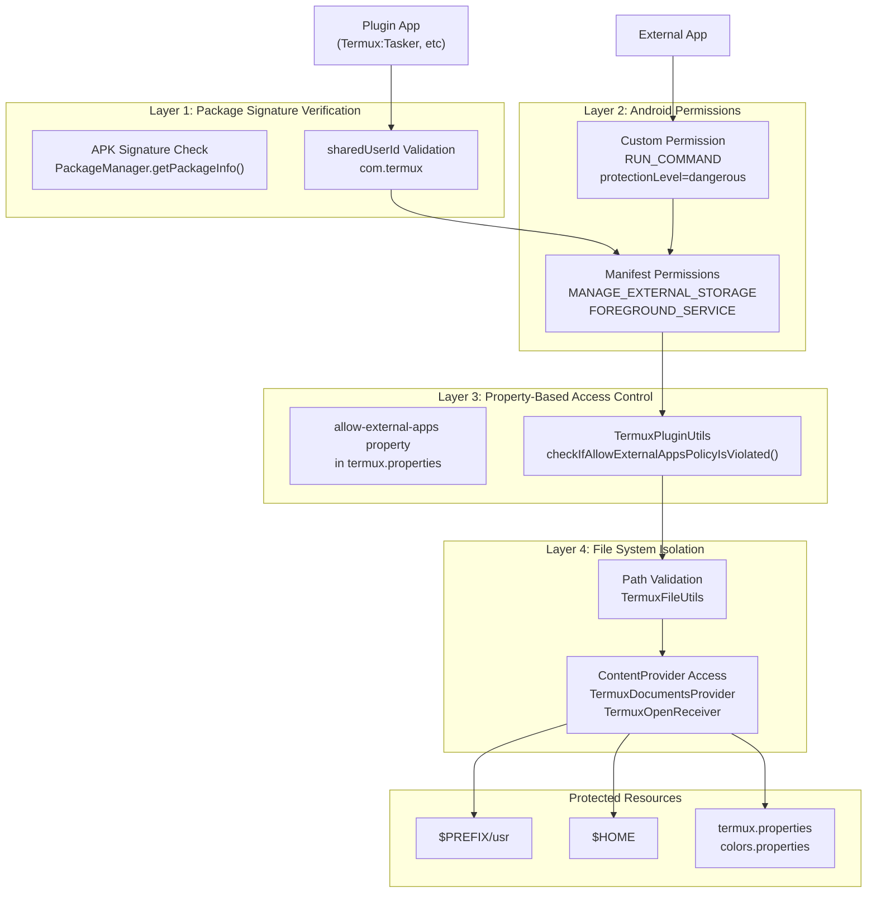
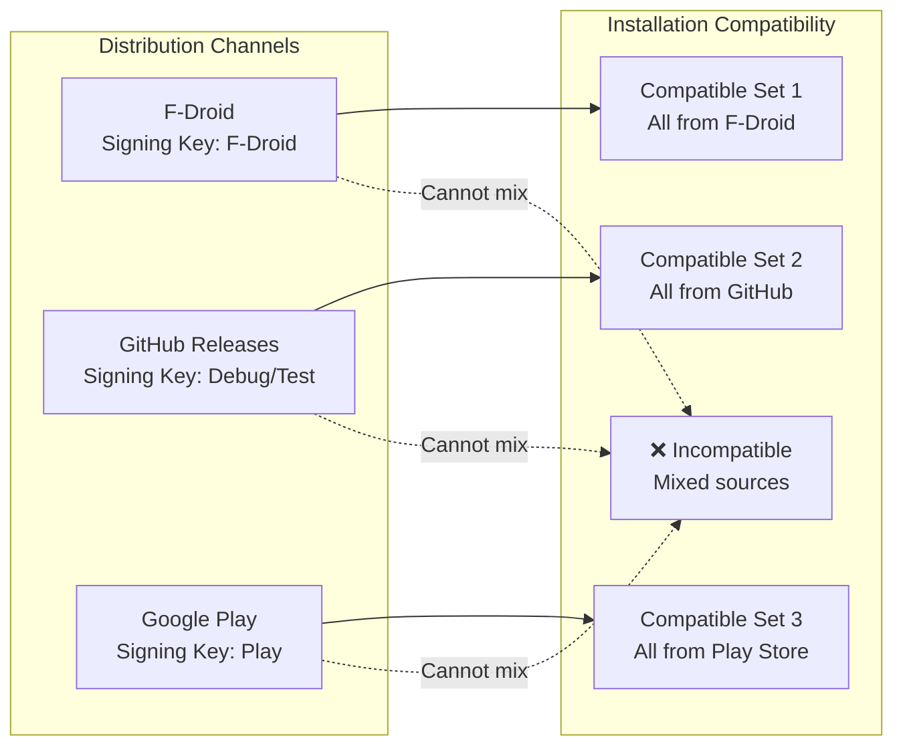
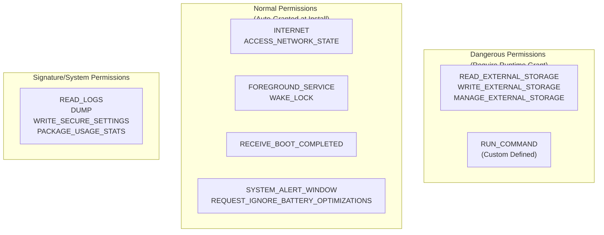
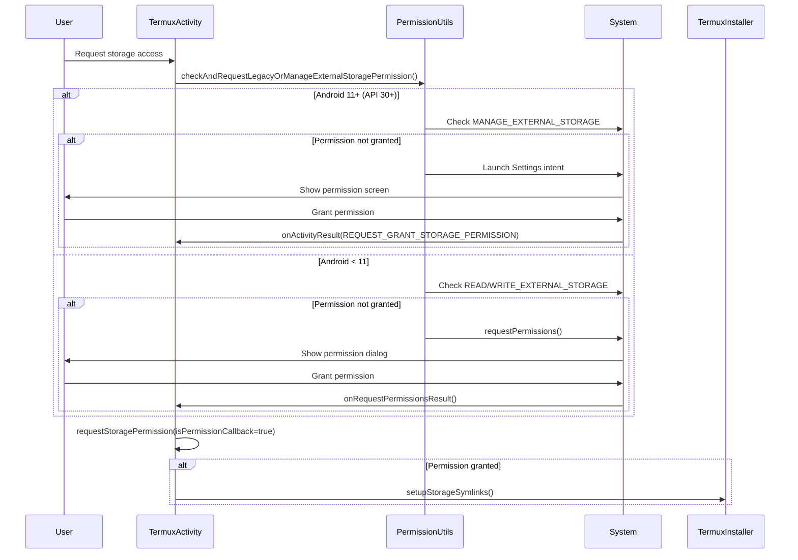
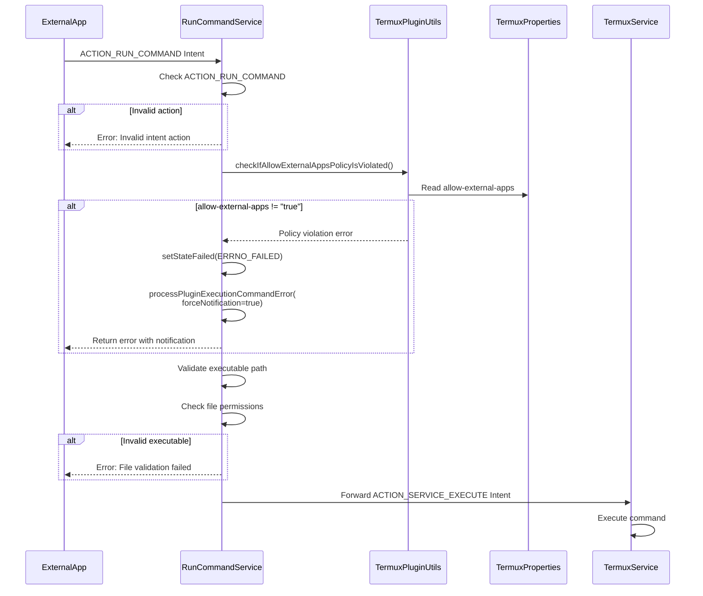
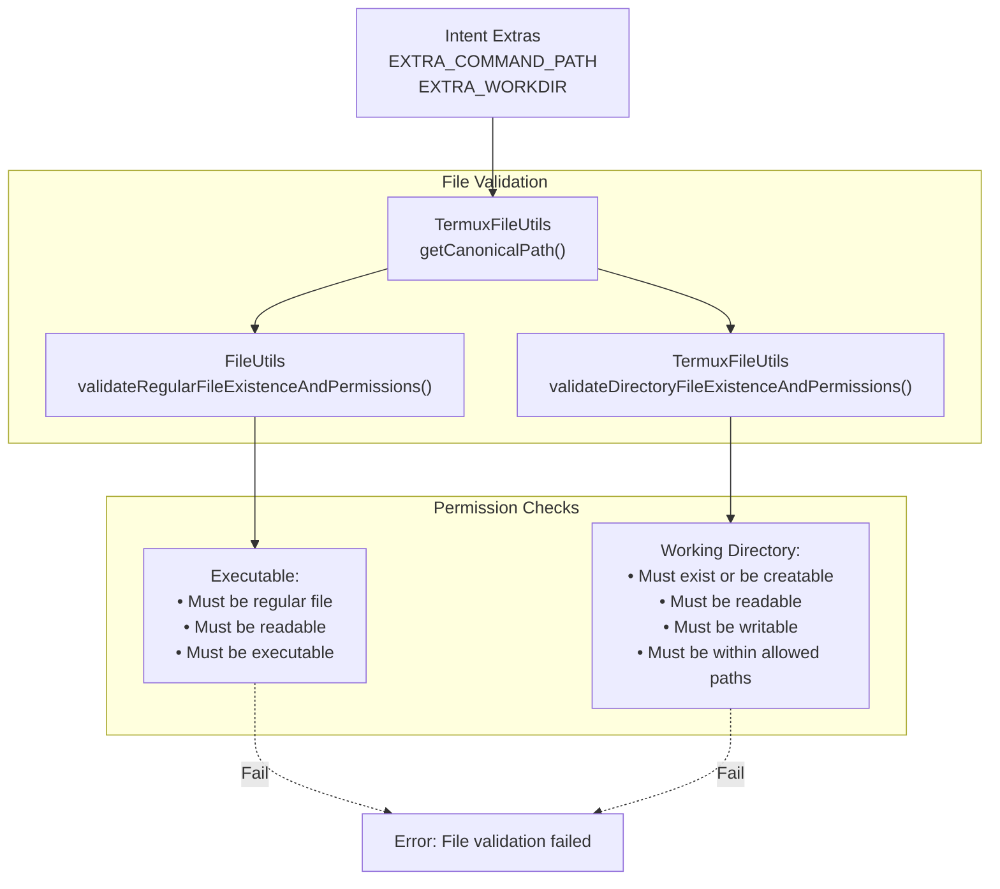
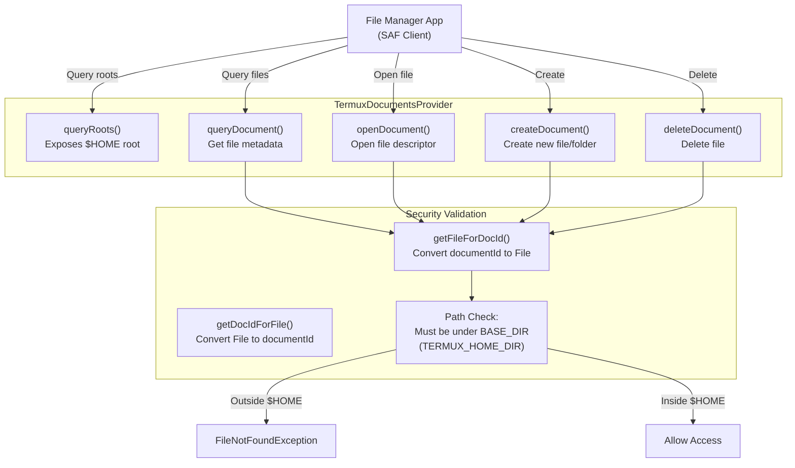
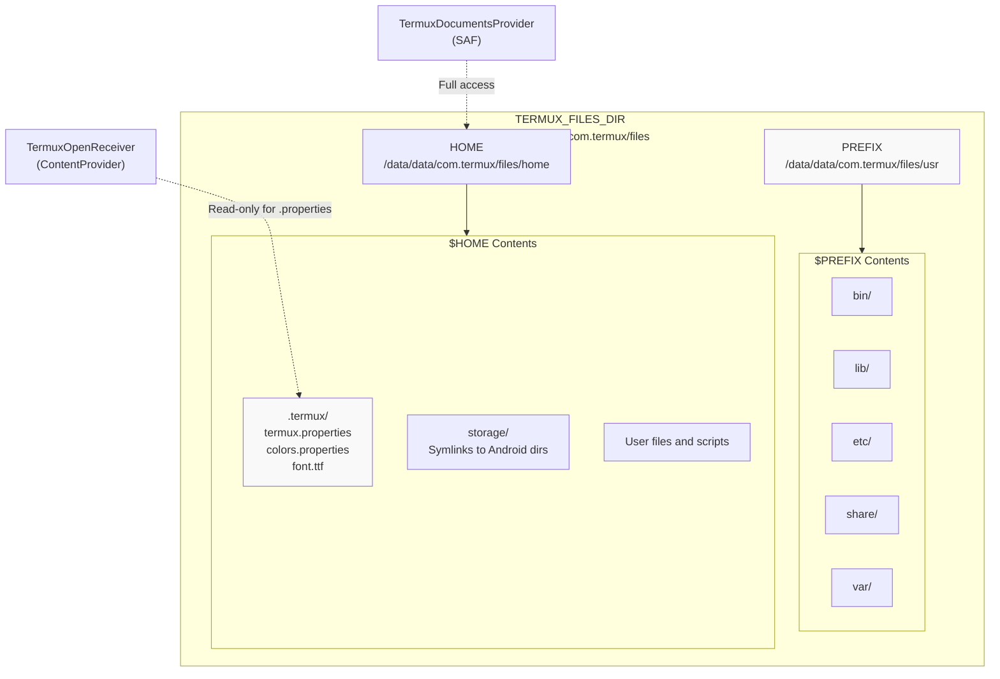

<!-- source: DeepWiki mcp.deepwiki.com · repo termux/termux-app · page 8 Security and Permissions · fetched 2026-10-26 -->

# Security and Permissions

<details>
<summary>Relevant source files</summary>

The following files were used as context for generating this wiki page:

- [SECURITY.md](SECURITY.md)
- [termux-shared/src/main/java/com/termux/shared/activity/ActivityErrno.java](termux-shared/src/main/java/com/termux/shared/activity/ActivityErrno.java)
- [termux-shared/src/main/java/com/termux/shared/activity/ActivityUtils.java](termux-shared/src/main/java/com/termux/shared/activity/ActivityUtils.java)
- [termux-shared/src/main/java/com/termux/shared/android/PackageUtils.java](termux-shared/src/main/java/com/termux/shared/android/PackageUtils.java)
- [termux-shared/src/main/java/com/termux/shared/android/PermissionUtils.java](termux-shared/src/main/java/com/termux/shared/android/PermissionUtils.java)

</details>


## Overview

The Termux app implements a multi-layered security model to protect the Unix environment and user data from unauthorized access. This document covers the security mechanisms including package signature verification, Android permissions, property-based access control, and file system isolation.

For information about the plugin ecosystem and inter-app communication, see [Plugin Ecosystem](#1.2). For file sharing mechanisms, see [File Sharing and Content Providers](#6).

---

## Security Architecture Overview

The Termux security model consists of four primary layers that work together to provide defense-in-depth:



**Sources:** [app/src/main/AndroidManifest.xml:1-235](), [app/src/main/java/com/termux/app/RunCommandService.java:1-288]()

---

## Package Signature and sharedUserId

This section provides a high-level overview of how Termux leverages Android's `sharedUserId` mechanism and APK signature verification for inter-app communication and security. For detailed information, see [Package Signature Verification](#8.1).

### sharedUserId Mechanism

Termux apps use Android's `sharedUserId` feature to share process space and file access. All official Termux apps (main app and plugins) declare the same `sharedUserId` in their manifests:

[app/src/main/AndroidManifest.xml:5-6]()

This enables:
- **Cross-app context access** via `PackageUtils.getContextForPackage()` [termux-shared/src/main/java/com/termux/shared/android/PackageUtils.java:41-60]()
- **Shared file system access** to `$PREFIX` and `$HOME` directories
- **Direct IPC** without additional permission checks between apps with matching UID

### APK Signature Requirements

Android enforces that only apps with **matching APK signatures** can share the same `sharedUserId`. This prevents malicious apps from gaining access to Termux's file system.



The signature verification happens automatically when Android attempts to install an app with an existing `sharedUserId`. Mismatched signatures result in installation failure with error messages like:
```
Package ... has mismatched uid: ... versus ...
```

**Sources:** [app/src/main/AndroidManifest.xml:5-6](), [termux-shared/src/main/java/com/termux/shared/termux/TermuxConstants.java:145-156]()

### Package Context Access

Plugin apps access the Termux app's context using `TermuxUtils.getTermuxPackageContext()`:

[termux-shared/src/main/java/com/termux/shared/termux/TermuxUtils.java:56-64]()

This method wraps `PackageManager.createPackageContext()` with the `CONTEXT_RESTRICTED` flag, which fails if:
- The target package is not installed
- The calling app and target package have different APK signatures (and thus cannot share `sharedUserId`)

**Sources:** [termux-shared/src/main/java/com/termux/shared/termux/TermuxUtils.java:56-135](), [termux-shared/src/main/java/com/termux/shared/android/PackageUtils.java:41-60]()

---

## Android Permission System

This section outlines the Android permission model used by Termux, including declared permissions, runtime requests, and the custom `RUN_COMMAND` permission. For a detailed breakdown, see [Permission System](#8.2).

### Declared Manifest Permissions

The Termux app declares standard Android permissions in its manifest:



Key permissions:

| Permission | Protection Level | Purpose |
|------------|------------------|---------|
| `MANAGE_EXTERNAL_STORAGE` | dangerous | Access to `/sdcard` for storage symlinks |
| `FOREGROUND_SERVICE` | normal | Keep `TermuxService` running |
| `RUN_COMMAND` (custom) | dangerous | Allow external apps to execute commands |
| `WAKE_LOCK` | normal | Prevent CPU sleep during long-running tasks |
| `READ_LOGS` | signature\|privileged | Debug crash reports |
| `SYSTEM_ALERT_WINDOW` | special | Start activities from background on Android 10+ |

**Sources:** [app/src/main/AndroidManifest.xml:15-38]()

### Custom RUN_COMMAND Permission

Termux defines a custom dangerous-level permission for external command execution:

[app/src/main/AndroidManifest.xml:15-20]()

This permission must be:
1. **Declared** in the manifest of any external app that wants to execute commands
2. **Granted** by the user at runtime (dangerous protection level)
3. **Required** by `RunCommandService` to accept intents

[app/src/main/AndroidManifest.xml:200-207]()

**Sources:** [app/src/main/AndroidManifest.xml:15-20](), [app/src/main/res/values/strings.xml:21-24]()

### Runtime Permission Requests

The Termux app requests storage permissions at runtime when needed. The `PermissionUtils` class provides helper methods for checking and requesting permissions [termux-shared/src/main/java/com/termux/shared/android/PermissionUtils.java:52-82](), [termux-shared/src/main/java/com/termux/shared/android/PermissionUtils.java:96-149]().



The implementation uses a two-phase approach to handle both the permission request and the callback:

[app/src/main/java/com/termux/app/TermuxActivity.java:768-790]()

The callback handler processes results from both `onActivityResult()` (for `MANAGE_EXTERNAL_STORAGE` on Android 11+) and `onRequestPermissionsResult()` (for legacy storage permissions):

[app/src/main/java/com/termux/app/TermuxActivity.java:792-808]()

**Sources:** [app/src/main/java/com/termux/app/TermuxActivity.java:768-808](), [termux-shared/src/main/java/com/termux/shared/android/PermissionUtils.java]()

---

## External App Access Control

This section describes how Termux controls access for external applications, primarily through the `allow-external-apps` property and rigorous validation checks. For a detailed explanation, see [Property-Based Access Control](#8.3).

### The allow-external-apps Property

The `allow-external-apps` property in `~/.termux/termux.properties` acts as a master switch for external command execution, providing user-controllable security:

```properties
# Default: false
# Allow external apps to execute arbitrary commands within Termux environment
allow-external-apps=true
```

This property is checked **before** any external command is executed, even if the calling app has the `RUN_COMMAND` permission.

### RunCommandService Security Flow



The key security check occurs at [app/src/main/java/com/termux/app/RunCommandService.java:135-145]():

The policy validation is performed by `TermuxPluginUtils`:

[termux-shared/src/main/java/com/termux/shared/termux/plugins/TermuxPluginUtils.java]() (referenced in error message at [termux-shared/src/main/res/values/strings.xml:50-51]())

**Important:** When the policy is violated, `forceNotification=true` ensures a notification is displayed even if the user has disabled plugin error notifications. This alerts users to potential malicious activity.

**Sources:** [app/src/main/java/com/termux/app/RunCommandService.java:135-145](), [termux-shared/src/main/res/values/strings.xml:50-51]()

### Executable and Working Directory Validation

`RunCommandService` validates all file paths to prevent unauthorized access:



Executable validation at [app/src/main/java/com/termux/app/RunCommandService.java:150-169]():

Working directory validation at [app/src/main/java/com/termux/app/RunCommandService.java:173-191]():

The validation ensures that:
- Only files that are **readable and executable** can be run
- Working directories are **writable** and within allowed Termux paths
- Symbolic links are handled correctly (applets for coreutils/busybox)

**Sources:** [app/src/main/java/com/termux/app/RunCommandService.java:150-191]()

---

## File System Security

### TermuxDocumentsProvider (SAF Access)

The `TermuxDocumentsProvider` exposes the `$HOME` directory via Android's Storage Access Framework (SAF), with built-in path validation:



The base directory is restricted to `TERMUX_HOME_DIR`:

[app/src/main/java/com/termux/filepicker/TermuxDocumentsProvider.java:34-38]()

Document IDs are absolute paths, validated on each operation:

[app/src/main/java/com/termux/filepicker/TermuxDocumentsProvider.java:203-214]()

**Search Functionality:** The search implementation includes additional protection against symlink traversal:

[app/src/main/java/com/termux/filepicker/TermuxDocumentsProvider.java:156-190]()

This prevents search from following symlinks outside `$HOME`, such as symlinks to `/sdcard`.

**Sources:** [app/src/main/java/com/termux/filepicker/TermuxDocumentsProvider.java:1-268]()

### TermuxOpenReceiver ContentProvider

The `TermuxOpenReceiver.ContentProvider` provides read-only access to specific files for sharing:

[app/src/main/AndroidManifest.xml:171-176]()

Key security features:
- **Requires `RUN_COMMAND` permission** for access
- **Forces read-only mode** for sensitive property files (`.properties`, `.ttf`)
- **Path validation** ensures files are within `TERMUX_FILES_DIR_PATH`

The read-only enforcement for property files prevents silent modification of security settings:

[app/src/main/java/com/termux/app/TermuxOpenReceiver.java]() (ContentProvider inner class)

**Sources:** [app/src/main/AndroidManifest.xml:171-176]()

### Protected Directory Structure



Access restrictions:
- **$PREFIX** (`/data/data/com.termux/files/usr`): Not exposed via ContentProviders, only accessible by apps with matching `sharedUserId`
- **$HOME** (`/data/data/com.termux/files/home`): Exposed via SAF with full read/write for authorized apps
- **Property files**: Always opened read-only when accessed via `TermuxOpenReceiver.ContentProvider`

**Sources:** [termux-shared/src/main/java/com/termux/shared/termux/TermuxConstants.java:570-605]()

---

## Permission Management in TermuxActivity

### Storage Permission Request Flow

The storage permission request flow handles both legacy and modern Android storage models:

| Android Version | Permission Required | Request Method |
|-----------------|---------------------|----------------|
| Android 10 and below | `READ_EXTERNAL_STORAGE`<br/>`WRITE_EXTERNAL_STORAGE` | `requestPermissions()` dialog |
| Android 11+ | `MANAGE_EXTERNAL_STORAGE` | Settings screen intent |

The request is triggered by user action or bootstrap installation:

[app/src/main/java/com/termux/app/TermuxActivity.java:768-790]()

### Callback Processing

Both callback methods delegate to the same handler to ensure consistent behavior:

[app/src/main/java/com/termux/app/TermuxActivity.java:792-808]()

### Storage Symlink Setup

After permission is granted, storage symlinks are created to provide convenient access to Android directories:

[app/src/main/java/com/termux/app/TermuxActivity.java:782]()

This creates symlinks like:
- `~/storage/shared` → `/sdcard`
- `~/storage/downloads` → `/sdcard/Download`
- `~/storage/dcim` → `/sdcard/DCIM`
- etc.

**Sources:** [app/src/main/java/com/termux/app/TermuxActivity.java:768-808]()

---

## Permission Error Messages

The app provides detailed error messages to help users understand permission issues:

| Error Key | Context | Message |
|-----------|---------|---------|
| `error_allow_external_apps_ungranted` | External app access denied | Requires `allow-external-apps=true` in termux.properties |
| `error_display_over_other_apps_permission_not_granted` | Background service start | Requires "Display over other apps" permission on Android 10+ |
| `error_termux_app_package_context_not_accessible` | Plugin cannot access Termux | APK signature mismatch or Termux not installed |
| `error_termux_prefix_dir_path_not_accessible` | $PREFIX not accessible | Bootstrap not installed or permission issue |

**Sources:** [termux-shared/src/main/res/values/strings.xml:33-51](), [termux-shared/src/main/res/values/strings.xml:81-101]()

---

## Security Best Practices

### For Users

1. **Download all Termux apps from the same source** (F-Droid, GitHub, or Play Store) to avoid signature mismatch errors
2. **Keep `allow-external-apps=false`** unless you specifically need external app integration
3. **Review permission requests** before granting, especially `MANAGE_EXTERNAL_STORAGE`
4. **Monitor notifications** for unauthorized command execution attempts

### For Plugin Developers

1. **Declare `sharedUserId="com.termux"`** in your manifest
2. **Request `RUN_COMMAND` permission** before sending intents
3. **Validate user input** before constructing execution commands
4. **Use appropriate error handling** for permission denials
5. **Check Termux availability** with `TermuxUtils.isTermuxAppAccessible()` before attempting operations

### For External App Developers

1. **Request `RUN_COMMAND` permission** in your manifest
2. **Inform users** they must set `allow-external-apps=true`
3. **Provide API help** URLs in your intent extras (`EXTRA_PLUGIN_API_HELP`)
4. **Handle permission errors gracefully** and guide users to settings
5. **Respect security boundaries** and validate all file paths

**Sources:** [termux-shared/src/main/java/com/termux/shared/termux/TermuxUtils.java:167-220]()

---

