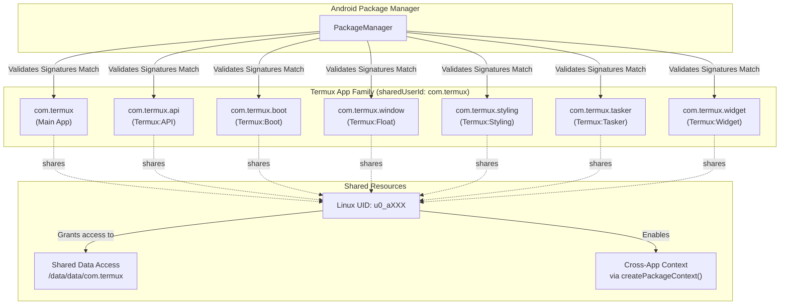
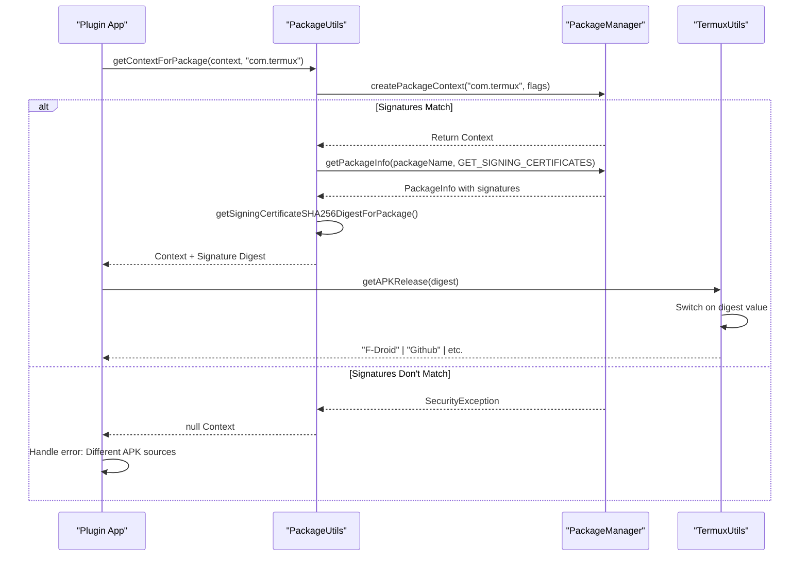
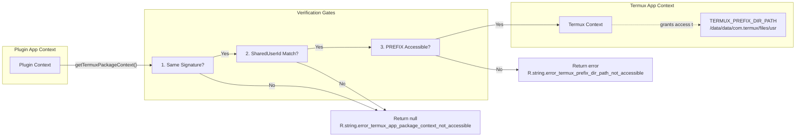
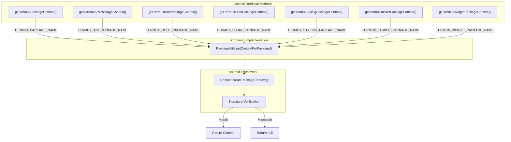

<!-- source: DeepWiki mcp.deepwiki.com · repo termux/termux-app · page 8.1 Package Signature Verification · fetched 2026-10-26 -->

# Package Signature Verification

<details>
<summary>Relevant source files</summary>

The following files were used as context for generating this wiki page:

- [termux-shared/src/main/java/com/termux/shared/activity/ActivityErrno.java](termux-shared/src/main/java/com/termux/shared/activity/ActivityErrno.java)
- [termux-shared/src/main/java/com/termux/shared/activity/ActivityUtils.java](termux-shared/src/main/java/com/termux/shared/activity/ActivityUtils.java)
- [termux-shared/src/main/java/com/termux/shared/android/PackageUtils.java](termux-shared/src/main/java/com/termux/shared/android/PackageUtils.java)
- [termux-shared/src/main/java/com/termux/shared/android/PermissionUtils.java](termux-shared/src/main/java/com/termux/shared/android/PermissionUtils.java)
- [termux-shared/src/main/java/com/termux/shared/termux/TermuxConstants.java](termux-shared/src/main/java/com/termux/shared/termux/TermuxConstants.java)
- [termux-shared/src/main/java/com/termux/shared/termux/TermuxUtils.java](termux-shared/src/main/java/com/termux/shared/termux/TermuxUtils.java)
- [termux-shared/src/main/res/values/strings.xml](termux-shared/src/main/res/values/strings.xml)

</details>


## Purpose and Scope

This document explains how Termux verifies APK package signatures to ensure secure cross-app communication and data sharing between the main Termux app and its plugin ecosystem. Package signature verification is the foundational security mechanism that enables the `sharedUserId` architecture used throughout the Termux application family.

For information about other security mechanisms built on top of signature verification, see [Permission System](#8.2) and [Property-Based Access Control](#8.3).

## Overview

Package signature verification ensures that all Termux apps and plugins installed on a device are signed with the same cryptographic key. This is critical because Android's `sharedUserId` mechanism only allows apps with matching signatures to share the same Linux user ID, enabling them to access each other's private data directories and obtain shared package contexts.

The verification system serves three primary purposes:

1. **Installation Validation**: Prevents installation of apps from different sources with incompatible signatures
2. **Context Access Control**: Ensures only properly signed apps can obtain package contexts for inter-app communication
3. **Release Identification**: Identifies which distribution channel (F-Droid, GitHub, Google Play, or Termux Devs) an installed APK originates from

Sources: [termux-shared/src/main/java/com/termux/shared/termux/TermuxConstants.java:478-500]()

## Supported APK Signing Certificates

Termux recognizes four official APK signing certificates, each corresponding to a different distribution channel. Each signing certificate is identified by its SHA-256 digest stored as compile-time constants.

| Release Channel | Constant Name | SHA-256 Digest |
|----------------|---------------|----------------|
| F-Droid | `APK_RELEASE_FDROID` | `228FB2CFE90831C1499EC3CCAF61E96E8E1CE70766B9474672CE427334D41C42` |
| GitHub | `APK_RELEASE_GITHUB` | `B6DA01480EEFD5FBF2CD3771B8D1021EC791304BDD6C4BF41D3FAABAD48EE5E1` |
| Google Play Store | `APK_RELEASE_GOOGLE_PLAYSTORE` | `738F0A30A04D3C8A1BE304AF18D0779BCF3EA88FB60808F657A3521861C2EBF9` |
| Termux Devs | `APK_RELEASE_TERMUX_DEVS` | `F7A038EB551F1BE8FDF388686B784ABAB4552A5D82DF423E3D8F1B5CBE1C69AE` |

These digest values are defined in `TermuxConstants` and used throughout the codebase for signature validation and release identification.

Sources: [termux-shared/src/main/java/com/termux/shared/termux/TermuxConstants.java:478-500]()

## The SharedUserId Mechanism


**Diagram: Shared User ID Mechanism**

All Termux apps declare `android:sharedUserId="com.termux"` in their Android manifests. Android's PackageManager enforces that all apps sharing a `sharedUserId` must be signed with the same certificate. This creates a trust boundary where apps can only join the shared user group if they possess the correct signing key.

The `sharedUserId` mechanism provides:

- **Shared Linux UID**: All apps run under the same Linux user, enabling direct file system access
- **Data Directory Sharing**: Apps can read/write to `TERMUX_INTERNAL_PRIVATE_APP_DATA_DIR_PATH` (`/data/data/com.termux`)
- **Cross-Context Access**: Apps can obtain each other's `Context` objects via `Context.createPackageContext()`

Sources: [termux-shared/src/main/java/com/termux/shared/termux/TermuxConstants.java:580-583]()

## Signature Verification Process


**Diagram: Signature Verification Flow**

The signature verification flow occurs whenever a plugin app attempts to access the Termux main app's context:

1.  **Context Request**: Plugin calls `TermuxUtils.getTermuxPackageContext(context)` [termux-shared/src/main/java/com/termux/shared/termux/TermuxUtils.java:62-64]() which wraps `PackageUtils.getContextForPackage()` [termux-shared/src/main/java/com/termux/shared/android/PackageUtils.java:41-42]().
2.  **Signature Validation**: `PackageManager.createPackageContext()` internally verifies that the calling package and target package (`com.termux`) have matching signatures.
3.  **Success Path**: If signatures match, a `Context` object is returned.
4.  **Failure Path**: If signatures don't match, a `SecurityException` is thrown and `null` is returned.
5.  **Release Identification**: The signing certificate SHA-256 digest is extracted and mapped to a release name via `TermuxUtils.getAPKRelease()` [termux-shared/src/main/java/com/termux/shared/termux/TermuxUtils.java:701-716]().

The signature digest extraction uses Android's `PackageInfo.signingInfo` API to retrieve the certificate chain and compute the SHA-256 hash.

Sources: [termux-shared/src/main/java/com/termux/shared/termux/TermuxUtils.java:62-75](), [termux-shared/src/main/java/com/termux/shared/termux/TermuxUtils.java:701-716](), [termux-shared/src/main/java/com/termux/shared/android/PackageUtils.java:41-42]()

## Context Access Requirements


**Diagram: Context Access Verification Gates**

For a plugin app to successfully access the Termux main app, three conditions must be satisfied:

### 1. Signature Verification
The plugin's APK signature must match the Termux app's signature exactly. This is enforced by Android's `PackageManager` when calling `createPackageContext()`.

### 2. SharedUserId Declaration
Both packages must declare the same `sharedUserId` in their manifests. This is validated during APK installation.

### 3. PREFIX Directory Accessibility
The `TERMUX_PREFIX_DIR_PATH` (`/data/data/com.termux/files/usr`) must exist and have proper permissions. This is checked by `TermuxFileUtils.isTermuxPrefixDirectoryAccessible()`.

The `TermuxUtils.isTermuxAppAccessible()` method performs all three checks:

```java
// Check if installed and enabled
String errmsg = isTermuxAppInstalled(currentPackageContext);

// Try to get package context (signature verification happens here)
Context termuxPackageContext = getTermuxPackageContext(currentPackageContext);
if (termuxPackageContext == null)
    errmsg = getString(R.string.error_termux_app_package_context_not_accessible);

// Verify PREFIX directory accessibility
Error error = TermuxFileUtils.isTermuxPrefixDirectoryAccessible(false, false);
if (error != null)
    errmsg = getString(R.string.error_termux_prefix_dir_path_not_accessible);
```

Sources: [termux-shared/src/main/java/com/termux/shared/termux/TermuxUtils.java:198-220](), [termux-shared/src/main/res/values/strings.xml:96-101]()

## Installation Compatibility Constraints

Package signature verification creates strict installation compatibility rules that users must follow:

| Scenario | Result | Reason |
|----------|--------|--------|
| All apps from F-Droid | ✅ Compatible | All signed with F-Droid key |
| All apps from GitHub | ✅ Compatible | All signed with GitHub debug key |
| All apps from Google Play | ✅ Compatible | All signed with Google Play key |
| Mix: F-Droid + GitHub | ❌ Incompatible | Different signing keys |
| Mix: F-Droid + Google Play | ❌ Incompatible | Different signing keys |
| Mix: GitHub + Google Play | ❌ Incompatible | Different signing keys |

**Key Rule**: All Termux apps and plugins on a device must come from the same distribution source.

### Why Mixing Sources Fails

When attempting to install a plugin from a different source than the main app:

1.  Android's `PackageManager` detects the signature mismatch during installation.
2.  Installation succeeds (the apps can coexist), but the `sharedUserId` is not shared.
3.  Each app runs under a different Linux UID.
4.  Calls to `createPackageContext()` fail with `SecurityException`.
5.  Plugin functionality is completely broken.

The error messages users encounter are defined in the string resources and explain the incompatibility:

```xml
<string name="error_get_package_context_failed_message">
    Failed to get package context for the "%1$s" package.
    This may be because the app package is not installed or it has 
    different APK signature from the current app.
</string>

<string name="error_termux_prefix_dir_path_not_accessible">
    The Termux app $PREFIX directory is not accessible by the %1$s app.
    This may be because you have not installed or setup Termux app or
    Termux app and %1$s app both have different APK signatures because 
    you have managed to install both apps from different sources.
</string>
```

Sources: [termux-shared/src/main/res/values/strings.xml:24-26](), [termux-shared/src/main/res/values/strings.xml:97-101]()

## Release Detection and Reporting

The `getAPKRelease()` method maps signing certificate digests to human-readable release names for diagnostic reporting:

```java
public static String getAPKRelease(String signingCertificateSHA256Digest) {
    if (signingCertificateSHA256Digest == null) return "null";
    
    switch (signingCertificateSHA256Digest.toUpperCase()) {
        case TermuxConstants.APK_RELEASE_FDROID_SIGNING_CERTIFICATE_SHA256_DIGEST:
            return TermuxConstants.APK_RELEASE_FDROID;
        case TermuxConstants.APK_RELEASE_GITHUB_SIGNING_CERTIFICATE_SHA256_DIGEST:
            return TermuxConstants.APK_RELEASE_GITHUB;
        case TermuxConstants.APK_RELEASE_GOOGLE_PLAYSTORE_SIGNING_CERTIFICATE_SHA256_DIGEST:
            return TermuxConstants.APK_RELEASE_GOOGLE_PLAYSTORE;
        case TermuxConstants.APK_RELEASE_TERMUX_DEVS_SIGNING_CERTIFICATE_SHA256_DIGEST:
            return TermuxConstants.APK_RELEASE_TERMUX_DEVS;
        default:
            return "Unknown";
    }
}
```
This is used when generating app info reports via `getAppInfoMarkdownStringInner()`:

```java
String signingCertificateSHA256Digest = 
    PackageUtils.getSigningCertificateSHA256DigestForPackage(context);
if (signingCertificateSHA256Digest != null) {
    AndroidUtils.appendPropertyToMarkdown(markdownString,
        "APK_RELEASE", getAPKRelease(signingCertificateSHA256Digest));
    AndroidUtils.appendPropertyToMarkdown(markdownString,
        "SIGNING_CERTIFICATE_SHA256_DIGEST", signingCertificateSHA256Digest);
}
```

This information is included in crash reports and diagnostic logs to help identify signature mismatch issues.

Sources: [termux-shared/src/main/java/com/termux/shared/termux/TermuxUtils.java:701-716](), [termux-shared/src/main/java/com/termux/shared/termux/TermuxUtils.java:491-495]()

## Package Context Retrieval Methods

`TermuxUtils` provides dedicated methods for obtaining contexts of each plugin app, all of which rely on signature verification:


**Diagram: Package Context Retrieval**

Each method follows the same pattern:

1.  Calls `PackageUtils.getContextForPackage()` [termux-shared/src/main/java/com/termux/shared/android/PackageUtils.java:41-42]() with the appropriate package name constant.
2.  Returns the `Context` if signatures match.
3.  Returns `null` if signatures don't match or package is not installed.

Example implementation:

```java
public static Context getTermuxAPIPackageContext(@NonNull Context context) {
    return PackageUtils.getContextForPackage(context, 
        TermuxConstants.TERMUX_API_PACKAGE_NAME);
}
```
[termux-shared/src/main/java/com/termux/shared/termux/TermuxUtils.java:83-85]()

These methods are used throughout the plugin ecosystem to access shared constants, read configuration files, and query package information.

Sources: [termux-shared/src/main/java/com/termux/shared/termux/TermuxUtils.java:62-135](), [termux-shared/src/main/java/com/termux/shared/termux/TermuxConstants.java:350-444](), [termux-shared/src/main/java/com/termux/shared/android/PackageUtils.java:41-42]()

---

