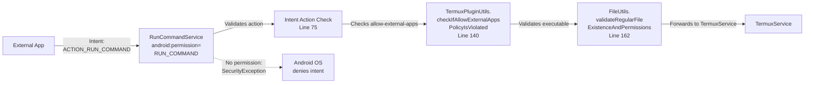
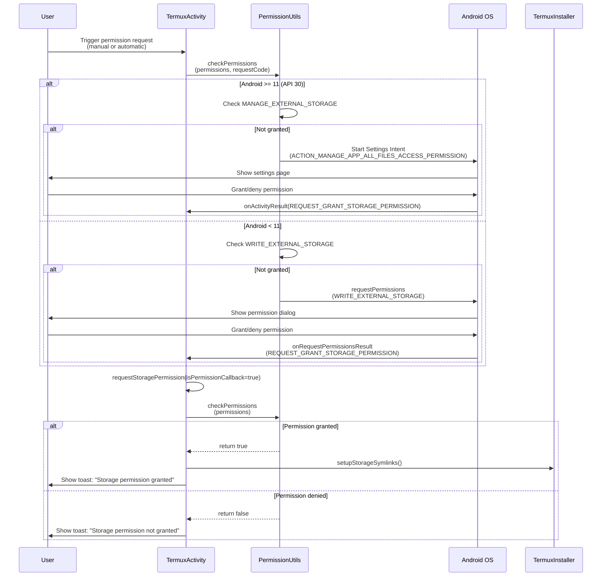

<!-- source: DeepWiki mcp.deepwiki.com · repo termux/termux-app · page 8.2 Permission System · fetched 2026-10-26 -->

# Permission System

<details>
<summary>Relevant source files</summary>

The following files were used as context for generating this wiki page:

- [app/src/main/AndroidManifest.xml](app/src/main/AndroidManifest.xml)
- [app/src/main/java/com/termux/filepicker/TermuxDocumentsProvider.java](app/src/main/java/com/termux/filepicker/TermuxDocumentsProvider.java)
- [app/src/main/res/drawable/ic_new_session.xml](app/src/main/res/drawable/ic_new_session.xml)
- [app/src/main/res/drawable/ic_settings.xml](app/src/main/res/drawable/ic_settings.xml)
- [app/src/main/res/xml/shortcuts.xml](app/src/main/res/xml/shortcuts.xml)
- [termux-shared/src/main/java/com/termux/shared/activity/ActivityErrno.java](termux-shared/src/main/java/com/termux/shared/activity/ActivityErrno.java)
- [termux-shared/src/main/java/com/termux/shared/activity/ActivityUtils.java](termux-shared/src/main/java/com/termux/shared/activity/ActivityUtils.java)
- [termux-shared/src/main/java/com/termux/shared/android/PackageUtils.java](termux-shared/src/main/java/com/termux/shared/android/PackageUtils.java)
- [termux-shared/src/main/java/com/termux/shared/android/PermissionUtils.java](termux-shared/src/main/java/com/termux/shared/android/PermissionUtils.java)
- [termux-shared/src/main/java/com/termux/shared/android/SELinuxUtils.java](termux-shared/src/main/java/com/termux/shared/android/SELinuxUtils.java)

</details>


This page documents the Android permission system implementation in Termux, including declared permissions, custom permission definitions, runtime permission requests, and permission enforcement mechanisms. For package signature verification and sharedUserId-based access control, see [Package Signature Verification](#8.1). For property-based access control using `allow-external-apps`, see [Property-Based Access Control](#8.3).

## Overview

Termux declares and uses Android permissions at multiple levels:
- **Manifest-declared permissions**: Standard Android permissions requested at install time or runtime
- **Custom permissions**: The `RUN_COMMAND` dangerous-level permission for external command execution
- **Runtime permissions**: Storage permissions requested dynamically from the user
- **Special permissions**: Battery optimization and display-over-other-apps permissions with custom request flows

The permission system ensures that:
1. Termux can access necessary system resources (storage, network, wake locks)
2. External apps cannot execute commands without explicit user consent via the `RUN_COMMAND` permission
3. Users are prompted for dangerous permissions at appropriate times
4. Background execution is not interrupted by battery optimization

Sources: [app/src/main/AndroidManifest.xml:1-235](), [termux-shared/src/main/java/com/termux/shared/android/PermissionUtils.java:86-149]()

## Permission Categories

```mermaid
graph TB
    subgraph "Permission Categories"
        Manifest["Manifest Permissions"]
        Custom["Custom Permission"]
        Runtime["Runtime Permissions"]
        Special["Special Permissions"]
    end
    
    subgraph "Manifest Permissions Detail"
        Storage["Storage Access<br/>READ/WRITE_EXTERNAL_STORAGE<br/>MANAGE_EXTERNAL_STORAGE"]
        Network["Network<br/>INTERNET<br/>ACCESS_NETWORK_STATE"]
        System["System Services<br/>WAKE_LOCK<br/>VIBRATE<br/>FOREGROUND_SERVICE"]
        Boot["Boot & Automation<br/>RECEIVE_BOOT_COMPLETED<br/>SYSTEM_ALERT_WINDOW"]
        Advanced["Advanced<br/>READ_LOGS<br/>DUMP<br/>WRITE_SECURE_SETTINGS<br/>REQUEST_INSTALL_PACKAGES"]
    end
    
    subgraph "Custom Permission Detail"
        RunCommand["RUN_COMMAND<br/>protectionLevel=dangerous"]
        RunCommandUsage["Required by:<br/>RunCommandService<br/>TermuxOpenReceiver ContentProvider"]
    end
    
    subgraph "Runtime Permission Detail"
        StorageRequest["PermissionUtils.checkPermissions"]
        ActivityResult["Activity.onActivityResult"]
        PermissionResult["Activity.onRequestPermissionsResult"]
    end
    
    subgraph "Special Permission Detail"
        BatteryOpt["REQUEST_IGNORE_BATTERY_OPTIMIZATIONS<br/>PermissionUtils.requestDisableBatteryOptimizations"]
        DisplayOverApps["SYSTEM_ALERT_WINDOW<br/>Required for Android >= 10"]
    end
    
    Manifest --> Storage
    Manifest --> Network
    Manifest --> System
    Manifest --> Boot
    Manifest --> Advanced
    
    Custom --> RunCommand
    RunCommand --> RunCommandUsage
    
    Runtime --> StorageRequest
    StorageRequest --> ActivityResult
    StorageRequest --> PermissionResult
    
    Special --> BatteryOpt
    Special --> DisplayOverApps
```



Sources: [app/src/main/AndroidManifest.xml:15-38](), [termux-shared/src/main/java/com/termux/shared/android/PermissionUtils.java:86-149]()

## Declared Permissions in Manifest

All permissions are declared in `AndroidManifest.xml` using `<uses-permission>` tags. The following table categorizes all declared permissions:

| Permission | Protection Level | Purpose | Required API Level |
|------------|------------------|---------|-------------------|
| `ACCESS_NETWORK_STATE` | Normal | Check network connectivity status | All |
| `INTERNET` | Normal | Network access for package downloads | All |
| `READ_EXTERNAL_STORAGE` | Dangerous | Read files from external storage | All |
| `WRITE_EXTERNAL_STORAGE` | Dangerous | Write files to external storage | All |
| `MANAGE_EXTERNAL_STORAGE` | Special | Full external storage access | API 30+ |
| `WAKE_LOCK` | Normal | Keep CPU running for background tasks | All |
| `VIBRATE` | Normal | Vibration feedback | All |
| `FOREGROUND_SERVICE` | Normal | Run TermuxService as foreground service | API 28+ |
| `REQUEST_IGNORE_BATTERY_OPTIMIZATIONS` | Normal | Request battery optimization exemption | API 23+ |
| `SYSTEM_ALERT_WINDOW` | Special | Display over other apps | All |
| `READ_LOGS` | Signature/privileged | Read system logs (unused in practice) | All |
| `DUMP` | Signature/privileged | Dump system state (unused in practice) | All |
| `WRITE_SECURE_SETTINGS` | Signature/privileged | Modify secure settings (unused in practice) | All |
| `REQUEST_INSTALL_PACKAGES` | Signature | Request package installation | API 26+ |
| `RECEIVE_BOOT_COMPLETED` | Normal | Receive boot completed broadcasts | All |
| `PACKAGE_USAGE_STATS` | Signature/privileged | Access package usage statistics | All |
| `SET_ALARM` | Normal | Set alarms | All |

**Note**: Permissions with protection level `signature` or `privileged` (READ_LOGS, DUMP, WRITE_SECURE_SETTINGS, PACKAGE_USAGE_STATS) are declared but will not be granted to regular apps. They are included for completeness but have no practical effect unless Termux is installed as a system app.

Sources: [app/src/main/AndroidManifest.xml:22-38]()

## Custom RUN_COMMAND Permission

Termux defines a custom dangerous-level permission to control external command execution:

```xml
<permission
    android:name="${TERMUX_PACKAGE_NAME}.permission.RUN_COMMAND"
    android:description="@string/permission_run_command_description"
    android:icon="@mipmap/ic_launcher"
    android:label="@string/permission_run_command_label"
    android:protectionLevel="dangerous" />
```

### Permission Definition

The `RUN_COMMAND` permission has the following characteristics:
- **Name**: `com.termux.permission.RUN_COMMAND` (using package name substitution)
- **Protection Level**: `dangerous` - requires explicit user consent
- **Label**: "Run commands in Termux environment"
- **Description**: "execute arbitrary commands within Termux environment and access files"

Sources: [app/src/main/AndroidManifest.xml:15-20]()

### Permission Enforcement

The `RUN_COMMAND` permission is enforced in two components:

#### 1. RunCommandService



The service declaration in the manifest requires the permission:

```xml
<service
    android:name=".app.RunCommandService"
    android:exported="true"
    android:permission="${TERMUX_PACKAGE_NAME}.permission.RUN_COMMAND">
```

Android automatically denies intents sent to this service from apps that don't hold the `RUN_COMMAND` permission, preventing the service's `onStartCommand()` method from ever being called.

Sources: [app/src/main/AndroidManifest.xml:200-207]()

#### 2. TermuxOpenReceiver ContentProvider

The content provider used by `TermuxOpenReceiver` for file sharing also requires the `RUN_COMMAND` permission:

```xml
<provider
    android:name=".app.TermuxOpenReceiver$ContentProvider"
    android:authorities="${TERMUX_PACKAGE_NAME}.files"
    android:exported="true"
    android:grantUriPermissions="true"
    android:permission="${TERMUX_PACKAGE_NAME}.permission.RUN_COMMAND" />
```

This prevents unauthorized apps from accessing Termux files via the content provider URI scheme.

Sources: [app/src/main/AndroidManifest.xml:171-176]()

## Runtime Permission Requests

### Storage Permission Flow

Termux requests storage permissions at runtime to access external storage for the `~/storage` symlinks. The permission request flow differs based on Android version:



Sources: [termux-shared/src/main/java/com/termux/shared/android/PermissionUtils.java:52-82](), [termux-shared/src/main/java/com/termux/shared/android/PermissionUtils.java:86-149]()

### Permission Request Implementation

The `PermissionUtils` class in `termux-shared` provides helper methods for checking and requesting permissions.

**Method signature and key logic:**
- `PermissionUtils.checkPermission(@NonNull Context context, @NonNull String permission)`: Checks if a single permission is granted [termux-shared/src/main/java/com/termux/shared/android/PermissionUtils.java:52-54]()
- `PermissionUtils.checkPermissions(@NonNull Context context, @NonNull String[] permissions)`: Checks if multiple permissions are granted [termux-shared/src/main/java/com/termux/shared/android/PermissionUtils.java:56-82]()
- `PermissionUtils.requestPermission(@NonNull Context context, @NonNull String permission, int requestCode)`: Requests a single permission [termux-shared/src/main/java/com/termux/shared/android/PermissionUtils.java:96-100]()
- `PermissionUtils.requestPermissions(@NonNull Context context, @NonNull String[] permissions, int requestCode)`: Requests multiple permissions [termux-shared/src/main/java/com/termux/shared/android/PermissionUtils.java:120-149]()
- Request codes: `PermissionUtils.REQUEST_GRANT_STORAGE_PERMISSION` (1000), `PermissionUtils.REQUEST_DISABLE_BATTERY_OPTIMIZATIONS` (2000), `PermissionUtils.REQUEST_GRANT_DISPLAY_OVER_OTHER_APPS_PERMISSION` (2001) [termux-shared/src/main/java/com/termux/shared/android/PermissionUtils.java:37-41]()

**Callback handlers:**

1. **onActivityResult**: Handles result from settings activity (Android 11+)
   - `ActivityUtils.startActivityForResult()` is used to launch settings intents [termux-shared/src/main/java/com/termux/shared/activity/ActivityUtils.java:100-135]()

2. **onRequestPermissionsResult**: Handles runtime permission dialog result (Android < 11)
   - The `requestPermissions` methods in `PermissionUtils` internally call `Activity.requestPermissions()` or `AppCompatActivity.requestPermissions()` [termux-shared/src/main/java/com/termux/shared/android/PermissionUtils.java:138-140]()

Sources: [termux-shared/src/main/java/com/termux/shared/android/PermissionUtils.java:37-149](), [termux-shared/src/main/java/com/termux/shared/activity/ActivityUtils.java:100-135]()

## Permission Usage in Services

### TermuxService Wake Lock Permissions

`TermuxService` uses `WAKE_LOCK` permission to keep the CPU active for long-running background tasks:

**Wake lock acquisition:**
- Method: `actionAcquireWakeLock()`
- Acquires `PowerManager.PARTIAL_WAKE_LOCK` to prevent CPU sleep
- Acquires `WifiManager.WIFI_MODE_FULL_HIGH_PERF` lock for network stability
- Requests battery optimization exemption via `PermissionUtils.requestDisableBatteryOptimizations()`

**Wake lock release:**
- Method: `actionReleaseWakeLock()`
- Releases both power and WiFi locks
- Updates notification to reflect wake lock status

**Battery optimization:**
- Check method: `PermissionUtils.checkIfBatteryOptimizationsDisabled()`
- Request method: `PermissionUtils.requestDisableBatteryOptimizations()`
- Uses `REQUEST_IGNORE_BATTERY_OPTIMIZATIONS` permission to launch settings

Sources: [app/src/main/AndroidManifest.xml:27](), [termux-shared/src/main/java/com/termux/shared/android/PermissionUtils.java:290-300]()

### FOREGROUND_SERVICE Permission

The `FOREGROUND_SERVICE` permission (required on Android 9+) allows `TermuxService` to run as a foreground service with a persistent notification:

**Service startup:**
- Method: `runStartForeground()`
- Calls `startForeground()` with notification ID and notification object
- Creates notification channel for API 26+

**Notification channel setup:**
- Method: `setupNotificationChannel()` (referenced in `buildNotification()`)
- Channel ID: `TERMUX_APP_NOTIFICATION_CHANNEL_ID`
- Importance: Low (minimal interruption)

The foreground service ensures that Android does not kill the Termux process when the app is in the background, allowing terminal sessions to continue running.

Sources: [app/src/main/AndroidManifest.xml:29]()

## Display Over Other Apps Permission

For Android 10 (API 29) and higher, Termux requires the `SYSTEM_ALERT_WINDOW` permission to start terminal sessions from background:

**Requirement:**
- Permission: `android.permission.SYSTEM_ALERT_WINDOW`
- Declared at: [app/src/main/AndroidManifest.xml:31]()
- Error message: Defined at [app/src/main/res/values/strings.xml:107-109]()
- Message text: "Termux requires 'Display over other apps' permission to start terminal sessions from background on Android >= 10"

**Usage context:**
The permission is checked when external apps attempt to start terminal sessions via `RunCommandService` while Termux is not in the foreground. Without this permission, Android will block the service start, preventing command execution.

**User action required:**
Users must manually enable this permission via Settings → Apps → Termux → Advanced → Display over other apps.

Sources: [app/src/main/AndroidManifest.xml:31]()

## Permission Error Handling

### RunCommandService Permission Errors

`RunCommandService` handles permission-related errors with detailed error messages:

**Error types and messages:**

1. **Invalid intent action**
   - String resource: `error_run_command_service_invalid_intent_action`
   - Triggered at: [app/src/main/java/com/termux/app/RunCommandService.java:75-80]()

2. **Mandatory extra missing**
   - String resource: `error_run_command_service_mandatory_extra_missing`
   - Triggered when `EXTRA_COMMAND_PATH` is null or empty at [app/src/main/java/com/termux/app/RunCommandService.java:150-155]()

3. **Invalid runner**
   - String resource: `error_run_command_service_invalid_execution_command_runner`
   - Triggered when runner is not recognized at [app/src/main/java/com/termux/app/RunCommandService.java:110-115]()

All errors are processed through `TermuxPluginUtils.processPluginExecutionCommandError()`, which handles result delivery to the calling app via pending intents and displays notifications if configured.

Sources: [app/src/main/java/com/termux/app/RunCommandService.java:58-240]()

## Permission Integration with File System

### TermuxDocumentsProvider Permission

The Storage Access Framework (SAF) document provider requires system-level permission:

```xml
<provider
    android:name=".filepicker.TermuxDocumentsProvider"
    android:authorities="${TERMUX_PACKAGE_NAME}.documents"
    android:exported="true"
    android:grantUriPermissions="true"
    android:permission="android.permission.MANAGE_DOCUMENTS">
```

**Permission characteristics:**
- Permission: `android.permission.MANAGE_DOCUMENTS`
- Protection level: Signature (system apps only)
- Purpose: Allows Termux to appear in Android's document picker
- Access scope: Exposes `TERMUX_HOME_DIR` (~/home directory) to other apps

**Implementation:**
- Provider class: `TermuxDocumentsProvider` [app/src/main/java/com/termux/filepicker/TermuxDocumentsProvider.java:34-268]()
- Base directory: `TermuxConstants.TERMUX_HOME_DIR` [app/src/main/java/com/termux/filepicker/TermuxDocumentsProvider.java:38]()
- Supported operations: Query, read, write, create, delete documents within home directory

The `MANAGE_DOCUMENTS` permission ensures only the system document picker can invoke this provider, preventing arbitrary apps from directly accessing Termux files without going through the SAF security layer.

Sources: [app/src/main/AndroidManifest.xml:160-169](), [app/src/main/java/com/termux/filepicker/TermuxDocumentsProvider.java:34-268]()

## SELinux Helpers

The `SELinuxUtils` class provides methods to interact with Android's SELinux system, primarily for debugging and understanding security contexts. These methods use reflection to access hidden APIs in `android.os.SELinux`.

```mermaid
graph TD
    A[SELinuxUtils] --> B{getContext()}
    A --> C{getPidContext(pid)}
    A --> D{getFileContext(path)}

    B --> E[Current process security context]
    C --> F[Process ID security context]
    D --> G[File object security context]

    subgraph Reflection
        B -- uses --> H[ReflectionUtils.bypassHiddenAPIReflectionRestrictions()]
        C -- uses --> H
        D -- uses --> H
        H --> I[Class.forName("android.os.SELinux")]
        I --> J[ReflectionUtils.getDeclaredMethod()]
        J --> K[ReflectionUtils.invokeMethod()]
    end
```

- `SELinuxUtils.getContext()`: Retrieves the security context of the current process [termux-shared/src/main/java/com/termux/shared/android/SELinuxUtils.java:26-41]().
- `SELinuxUtils.getPidContext(int pid)`: Retrieves the security context for a given process ID [termux-shared/src/main/java/com/termux/shared/android/SELinuxUtils.java:45-68]().
- `SELinuxUtils.getFileContext(@NonNull String path)`: Retrieves the security context of a file object at a specified path [termux-shared/src/main/java/com/termux/shared/android/SELinuxUtils.java:71-94]().

These methods are primarily for internal diagnostics and do not directly enforce permissions but provide information about the SELinux state, which is crucial for Android's security model.

Sources: [termux-shared/src/main/java/com/termux/shared/android/SELinuxUtils.java:1-96]()

## Permission Summary Table

| Component | Permission | Enforcement Point | Protection Level | Purpose |
|-----------|-----------|-------------------|------------------|---------|
| RunCommandService | `RUN_COMMAND` | Manifest declaration | Dangerous | External command execution |
| TermuxOpenReceiver ContentProvider | `RUN_COMMAND` | Manifest declaration | Dangerous | File URI access |
| TermuxDocumentsProvider | `MANAGE_DOCUMENTS` | Manifest declaration | Signature | SAF integration |
| TermuxService | `WAKE_LOCK` | Runtime API call | Normal | Background CPU/WiFi lock |
| TermuxService | `FOREGROUND_SERVICE` | `startForeground()` | Normal | Persistent service |
| TermuxService | `REQUEST_IGNORE_BATTERY_OPTIMIZATIONS` | Settings intent | Normal | Battery exemption |
| TermuxActivity | `WRITE_EXTERNAL_STORAGE` | Runtime request | Dangerous | Storage access (API < 30) |
| TermuxActivity | `MANAGE_EXTERNAL_STORAGE` | Settings intent | Special | Storage access (API >= 30) |
| All components | `INTERNET` | Implicit | Normal | Network access |
| SystemEventReceiver | `RECEIVE_BOOT_COMPLETED` | Manifest declaration | Normal | Boot broadcasts |

Sources: [app/src/main/AndroidManifest.xml:1-235](), [termux-shared/src/main/java/com/termux/shared/android/PermissionUtils.java:37-149]()

---

