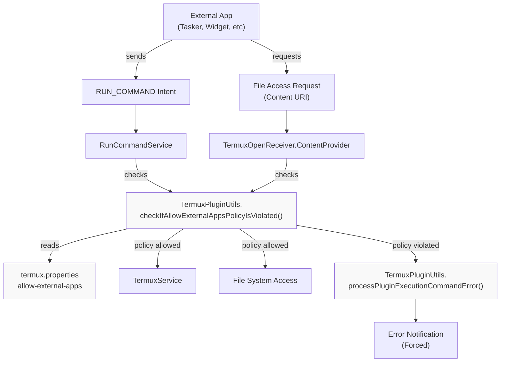
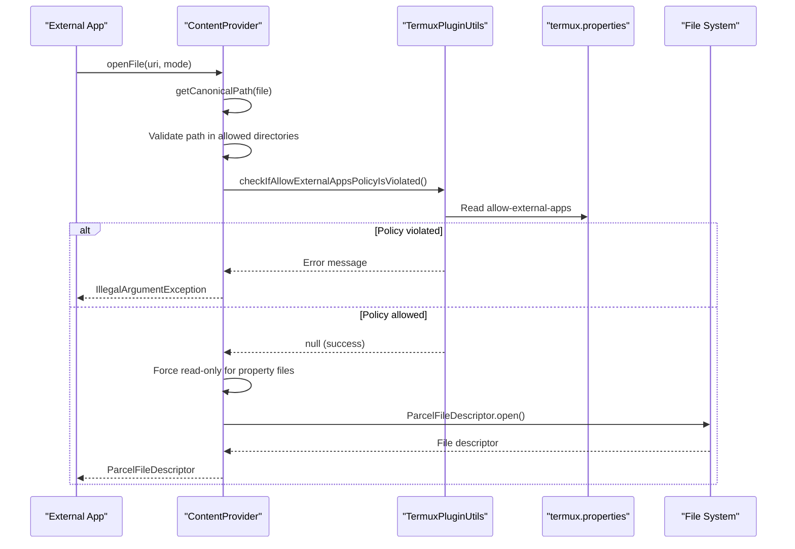
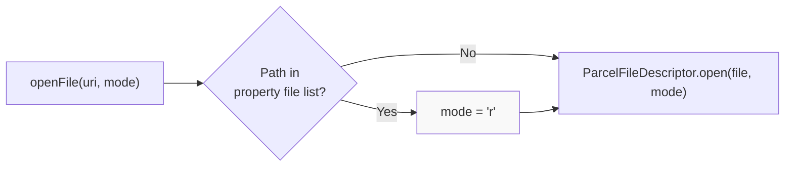
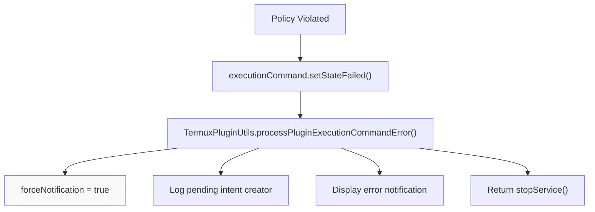
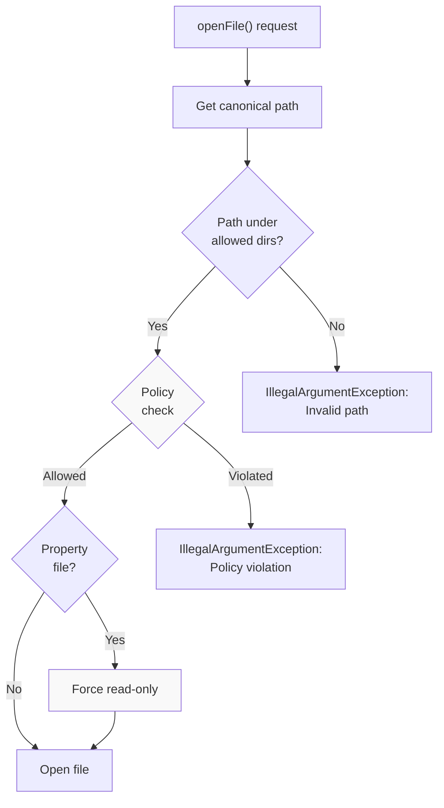
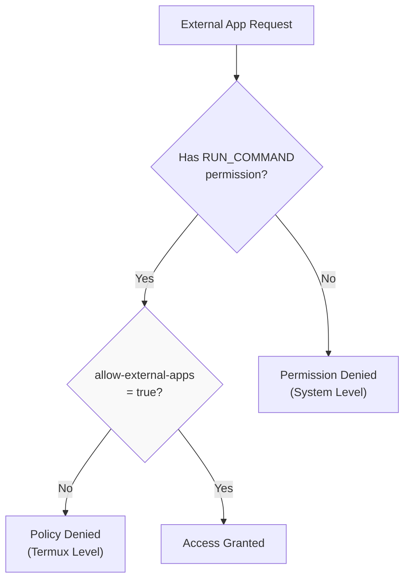

<!-- source: DeepWiki mcp.deepwiki.com · repo termux/termux-app · page 8.3 Property-Based Access Control · fetched 2026-10-26 -->

# Property-Based Access Control

<details>
<summary>Relevant source files</summary>

The following files were used as context for generating this wiki page:

- [termux-shared/src/main/java/com/termux/shared/crash/CrashHandler.java](termux-shared/src/main/java/com/termux/shared/crash/CrashHandler.java)
- [termux-shared/src/main/java/com/termux/shared/markdown/MarkdownUtils.java](termux-shared/src/main/java/com/termux/shared/markdown/MarkdownUtils.java)
- [termux-shared/src/main/java/com/termux/shared/notification/NotificationUtils.java](termux-shared/src/main/java/com/termux/shared/notification/NotificationUtils.java)
- [termux-shared/src/main/java/com/termux/shared/settings/properties/SharedProperties.java](termux-shared/src/main/java/com/termux/shared/settings/properties/SharedProperties.java)
- [termux-shared/src/main/java/com/termux/shared/settings/properties/SharedPropertiesParser.java](termux-shared/src/main/java/com/termux/shared/settings/properties/SharedPropertiesParser.java)
- [termux-shared/src/main/java/com/termux/shared/termux/crash/TermuxCrashUtils.java](termux-shared/src/main/java/com/termux/shared/termux/crash/TermuxCrashUtils.java)
- [termux-shared/src/main/java/com/termux/shared/termux/notification/TermuxNotificationUtils.java](termux-shared/src/main/java/com/termux/shared/termux/notification/TermuxNotificationUtils.java)
- [termux-shared/src/main/java/com/termux/shared/termux/plugins/TermuxPluginUtils.java](termux-shared/src/main/java/com/termux/shared/termux/plugins/TermuxPluginUtils.java)
- [termux-shared/src/main/java/com/termux/shared/termux/settings/properties/TermuxAppSharedProperties.java](termux-shared/src/main/java/com/termux/shared/termux/settings/properties/TermuxAppSharedProperties.java)
- [termux-shared/src/main/java/com/termux/shared/termux/settings/properties/TermuxPropertyConstants.java](termux-shared/src/main/java/com/termux/shared/termux/settings/properties/TermuxPropertyConstants.java)
- [termux-shared/src/main/java/com/termux/shared/termux/settings/properties/TermuxSharedProperties.java](termux-shared/src/main/java/com/termux/shared/termux/settings/properties/TermuxSharedProperties.java)
- [termux-shared/src/main/java/com/termux/shared/termux/shell/TermuxShellUtils.java](termux-shared/src/main/java/com/termux/shared/termux/shell/TermuxShellUtils.java)

</details>


## Purpose and Scope

This document describes the property-based access control mechanism in Termux, which uses the `allow-external-apps` property in `termux.properties` to gate external application access to Termux's execution environment and file system. This security layer operates independently of Android's permission system, providing user-controllable access control even after permissions are granted. For information about Android permissions and signature verification, see [Permission System]() and [Package Signature Verification]().

## The `allow-external-apps` Property

The `allow-external-apps` property is a boolean configuration value stored in the `termux.properties` file that determines whether external applications (plugins and third-party apps) can:
- Execute commands via `RunCommandService`
- Access files via `TermuxOpenReceiver.ContentProvider`

**Default Value**: Not set (equivalent to "false")  
**Valid Values**: "true" or not set  
**File Location**: `$HOME/.termux/termux.properties` or `/data/data/com.termux/files/home/.termux/termux.properties`

When this property is not set to "true", all external command execution and file access attempts are rejected with detailed error messages, regardless of whether the calling application has the `RUN_COMMAND` permission.

**Sources**: [app/src/main/java/com/termux/app/RunCommandService.java:135-145](), [app/src/main/java/com/termux/app/TermuxOpenReceiver.java:213-217]()

## Policy Enforcement Architecture



**Diagram: Property-Based Access Control Enforcement Points**

The property check occurs at two primary enforcement points before any privileged operations are performed.

**Sources**: [app/src/main/java/com/termux/app/RunCommandService.java:58-145](), [app/src/main/java/com/termux/app/TermuxOpenReceiver.java:201-232]()

## RunCommandService Enforcement

The `RunCommandService` is the primary entry point for external command execution via the `RUN_COMMAND` intent action. The policy check occurs early in the request processing pipeline, after basic intent validation but before any command execution setup.

### Enforcement Sequence

| Step | Action | File Reference |
|------|--------|----------------|
| 1 | Parse intent extras and construct `ExecutionCommand` | [app/src/main/java/com/termux/app/RunCommandService.java:68-134]() |
| 2 | Validate intent action and runner type | [app/src/main/java/com/termux/app/RunCommandService.java:75-115]() |
| 3 | **Check `allow-external-apps` policy** | [app/src/main/java/com/termux/app/RunCommandService.java:140]() |
| 4 | Validate executable file permissions | [app/src/main/java/com/termux/app/RunCommandService.java:150-169]() |
| 5 | Forward to `TermuxService` for execution | [app/src/main/java/com/termux/app/RunCommandService.java:232-237]()

The key implementation at [app/src/main/java/com/termux/app/RunCommandService.java:140]():

```java
errmsg = TermuxPluginUtils.checkIfAllowExternalAppsPolicyIsViolated(this, LOG_TAG);
```

If the check returns a non-null error message, the service:
1. Sets the execution command state to failed
2. Calls `processPluginExecutionCommandError()` with `forceNotification=true`
3. Returns `stopService()` to terminate request processing

**Forced Notifications**: When the policy is violated, notifications are force-enabled (`forceNotification=true` parameter) to alert users that an external application attempted to execute commands. This is critical for security since malicious apps or imported plugin projects may try to execute commands without user knowledge.

**Sources**: [app/src/main/java/com/termux/app/RunCommandService.java:135-145]()

## ContentProvider Enforcement

The `TermuxOpenReceiver.ContentProvider` exposes Termux files to external applications via Android's `ContentProvider` API. The policy check occurs in the `openFile()` method before granting file access.

### Enforcement Sequence



**Diagram: ContentProvider File Access Control Flow**

### Path Validation

The `ContentProvider` performs multi-layered validation:

1. **Canonical Path Resolution**: [app/src/main/java/com/termux/app/TermuxOpenReceiver.java:204]()
2. **Allowed Path Check**: Files must be under `TERMUX_FILES_DIR_PATH` or external storage [app/src/main/java/com/termux/app/TermuxOpenReceiver.java:209-211]()
3. **Policy Check**: [app/src/main/java/com/termux/app/TermuxOpenReceiver.java:214-217]()
4. **Property File Protection**: [app/src/main/java/com/termux/app/TermuxOpenReceiver.java:222-225]()

**Sources**: [app/src/main/java/com/termux/app/TermuxOpenReceiver.java:201-232]()

## Policy Violation Detection

The `TermuxPluginUtils.checkIfAllowExternalAppsPolicyIsViolated()` method is the centralized policy enforcement function. This method is responsible for checking the `allow-external-apps` property.

### Implementation Details

The `checkIfAllowExternalAppsPolicyIsViolated()` method (not directly shown in the provided snippets but inferred from usage) would likely interact with `TermuxAppSharedProperties` to retrieve the value of `TermuxPropertyConstants.KEY_ALLOW_EXTERNAL_APPS`.

```mermaid
graph TD
    A[TermuxPluginUtils.checkIfAllowExternalAppsPolicyIsViolated()] --> B{Get TermuxAppSharedProperties instance}
    B --> C[Call TermuxAppSharedProperties.isAllowExternalApps()]
    C --> D{Is property true?}
    D -- Yes --> E[Return null (no violation)]
    D -- No --> F[Return error message (violation)]

    style A fill:#f9f9f9
    style C fill:#f9f9f9
    style D fill:#f9f9f9
    style E fill:#f9f9f9
    style F fill:#f9f9f9
```
**Diagram: `checkIfAllowExternalAppsPolicyIsViolated()` Logic**

The `TermuxAppSharedProperties` class, which extends `TermuxSharedProperties`, is responsible for loading and managing properties from `termux.properties`. The `isAllowExternalApps()` method (inferred) would use `TermuxSharedProperties.isPropertyValueTrue()` to check the boolean value of the `allow-external-apps` key.

**Sources**:
* `TermuxAppSharedProperties` definition: [termux-shared/src/main/java/com/termux/shared/termux/settings/properties/TermuxAppSharedProperties.java:9-17]()
* `TermuxSharedProperties.isPropertyValueTrue()`: [termux-shared/src/main/java/com/termux/shared/termux/settings/properties/TermuxSharedProperties.java:103-105]()
* `TermuxPropertyConstants.KEY_ALLOW_EXTERNAL_APPS` (inferred, similar to other boolean keys): [termux-shared/src/main/java/com/termux/shared/termux/settings/properties/TermuxPropertyConstants.java:103-106]()

### Expected Behavior

| Property Value | Method Return | Access Result |
|----------------|---------------|---------------|
| "true" | `null` | Access granted |
| Not set | Error message string | Access denied |
| "false" | Error message string | Access denied |
| Any other value | Error message string | Access denied |

The method likely:
1. Loads `TermuxAppSharedProperties` to read the property value
2. Checks if the value is exactly "true"
3. Returns `null` for success or a descriptive error message for failure

### Logging and Caller Identification

Both enforcement points pass a `LOG_TAG` parameter for audit logging. The `RunCommandService` additionally logs the pending intent creator if provided, helping identify which application attempted unauthorized access:

```
// From RunCommandService comment at line 138-139:
// If a pending intent is also sent, then its creator is also logged and shown.
```

**Sources**: [app/src/main/java/com/termux/app/RunCommandService.java:140](), [app/src/main/java/com/termux/app/TermuxOpenReceiver.java:214]()

## Property File Protection

A critical security feature prevents external applications from modifying property files that contain the `allow-external-apps` setting itself. Without this protection, a malicious app could enable external access by modifying the property file.

### Read-Only Enforcement



**Diagram: Property File Read-Only Protection**

Implementation at [app/src/main/java/com/termux/app/TermuxOpenReceiver.java:219-225]():

```java
// **DO NOT** allow these files to be modified by ContentProvider exposed to external
// apps, since they may silently modify the values for security properties like
// TermuxConstants.PROP_ALLOW_EXTERNAL_APPS set by users without their explicit consent.
if (TermuxConstants.TERMUX_PROPERTIES_FILE_PATHS_LIST.contains(path) ||
    TermuxConstants.TERMUX_FLOAT_PROPERTIES_FILE_PATHS_LIST.contains(path)) {
    mode = "r";
}
```

### Protected Files

The protection applies to two property file lists defined in `TermuxConstants`:
- `TERMUX_PROPERTIES_FILE_PATHS_LIST`: Main Termux property files including `termux.properties`
- `TERMUX_FLOAT_PROPERTIES_FILE_PATHS_LIST`: Termux:Float property files

Even if the calling application requests write mode (`"w"`, `"rw"`, etc.), the mode is forcibly downgraded to read-only (`"r"`) for these specific files.

**Sources**: [app/src/main/java/com/termux/app/TermuxOpenReceiver.java:219-225]()

## Error Handling and Notifications

Policy violations trigger different error handling depending on the enforcement point.

### RunCommandService Error Handling



**Diagram: RunCommandService Error Handling Flow**

At [app/src/main/java/com/termux/app/RunCommandService.java:142-144]():

```java
executionCommand.setStateFailed(Errno.ERRNO_FAILED.getCode(), errmsg);
TermuxPluginUtils.processPluginExecutionCommandError(this, LOG_TAG, executionCommand, true);
return stopService();
```

The `forceNotification=true` parameter ensures users are alerted even if plugin error notifications are disabled in settings. This prevents silent unauthorized access attempts. The `TermuxPluginUtils.processPluginExecutionCommandError()` method handles the logging and notification display. It uses `TermuxNotificationUtils.sendPluginCommandErrorNotification()` to show a notification.

**Sources**:
* `RunCommandService` error handling: [app/src/main/java/com/termux/app/RunCommandService.java:135-145]()
* `TermuxPluginUtils.processPluginExecutionCommandError()`: [termux-shared/src/main/java/com/termux/shared/termux/plugins/TermuxPluginUtils.java:121-131]()
* `TermuxNotificationUtils.sendPluginCommandErrorNotification()` (inferred from `TermuxPluginUtils` usage): [termux-shared/src/main/java/com/termux/shared/termux/plugins/TermuxPluginUtils.java:93-98]()

### ContentProvider Error Handling

The `ContentProvider` throws an `IllegalArgumentException` which propagates to the calling application:

```java
String errmsg = TermuxPluginUtils.checkIfAllowExternalAppsPolicyIsViolated(getContext(), LOG_TAG);
if (errmsg != null) {
    throw new IllegalArgumentException(errmsg);
}
```

This causes the file access request to fail immediately, and the calling application receives a `FileNotFoundException` wrapping the security error.

**Sources**: [app/src/main/java/com/termux/app/TermuxOpenReceiver.java:214-217]()

## File System Access Validation

Beyond the property check, the `ContentProvider` enforces additional file system access restrictions to prevent path traversal and unauthorized directory access.

### Access Control Matrix

| Path Location | Policy Check | Path Validation | Result |
|---------------|--------------|-----------------|--------|
| Under `TERMUX_FILES_DIR_PATH` | Required | Canonical path must match | Allowed if policy passes |
| Under external storage | Required | Canonical path must match | Allowed if policy passes |
| Property files | Required | Always forced read-only | Read-only access if policy passes |
| Other paths | N/A | Rejected before policy check | `IllegalArgumentException` |

### Validation Implementation



**Diagram: ContentProvider File Access Validation Pipeline**

The allowed directory check at [app/src/main/java/com/termux/app/TermuxOpenReceiver.java:209-211]():

```java
if (!(path.startsWith(TermuxConstants.TERMUX_FILES_DIR_PATH) || path.startsWith(storagePath))) {
    throw new IllegalArgumentException("Invalid path: " + path);
}
```

This ensures that even with the `allow-external-apps` property set to "true", external applications cannot access arbitrary system files—only files within Termux's data directory or external storage.

**Sources**: [app/src/main/java/com/termux/app/TermuxOpenReceiver.java:201-232]()

## Integration with Permission System

The property-based access control operates as a secondary security layer after Android's permission system:



**Diagram: Two-Layer Security Model**

**Layer 1 - Android Permission**: The `RUN_COMMAND` permission (declared in the manifest) controls which apps can send intents to `RunCommandService`. Without this permission, the Android system rejects the intent before it reaches Termux.

**Layer 2 - Property Policy**: Even with the permission granted, the `allow-external-apps` property provides user-controlled gating. This allows users to:
- Grant permission during installation (required for plugin apps)
- Disable access later by not setting the property (or removing it)
- Re-enable access by setting the property to "true"

This design provides defense-in-depth: Android permissions control *which* apps can attempt access, while the property controls *when* access is actually permitted.

**Sources**: [app/src/main/java/com/termux/app/RunCommandService.java:135-145](), [app/src/main/res/values/strings.xml:21-24]()

---

