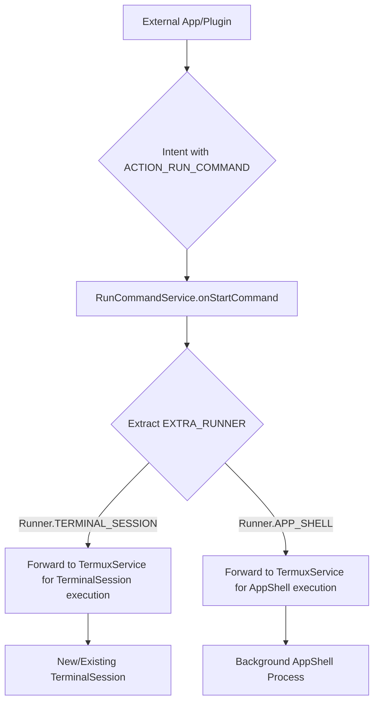

<!-- source: DeepWiki mcp.deepwiki.com · repo termux/termux-app · page 9 Glossary · fetched 2026-10-26 -->

# Glossary

<details>
<summary>Relevant source files</summary>

The following files were used as context for generating this wiki page:

- [app/src/main/java/com/termux/app/RunCommandService.java](app/src/main/java/com/termux/app/RunCommandService.java)
- [app/src/main/java/com/termux/app/TermuxActivity.java](app/src/main/java/com/termux/app/TermuxActivity.java)
- [app/src/main/java/com/termux/app/TermuxInstaller.java](app/src/main/java/com/termux/app/TermuxInstaller.java)
- [app/src/main/java/com/termux/app/TermuxOpenReceiver.java](app/src/main/java/com/termux/app/TermuxOpenReceiver.java)
- [app/src/main/java/com/termux/app/TermuxService.java](app/src/main/java/com/termux/app/TermuxService.java)
- [app/src/main/java/com/termux/app/models/UserAction.java](app/src/main/java/com/termux/app/models/UserAction.java)
- [app/src/main/res/values/strings.xml](app/src/main/res/values/strings.xml)
- [terminal-emulator/src/main/java/com/termux/terminal/TerminalEmulator.java](terminal-emulator/src/main/java/com/termux/terminal/TerminalEmulator.java)
- [terminal-emulator/src/test/java/com/termux/terminal/ControlSequenceIntroducerTest.java](terminal-emulator/src/test/java/com/termux/terminal/ControlSequenceIntroducerTest.java)
- [terminal-emulator/src/test/java/com/termux/terminal/HistoryTest.java](terminal-emulator/src/test/java/com/termux/terminal/HistoryTest.java)
- [terminal-emulator/src/test/java/com/termux/terminal/ResizeTest.java](terminal-emulator/src/test/java/com/termux/terminal/ResizeTest.java)
- [terminal-emulator/src/test/java/com/termux/terminal/TerminalTest.java](terminal-emulator/src/test/java/com/termux/terminal/TerminalTest.java)
- [termux-shared/src/main/java/com/termux/shared/errors/Errno.java](termux-shared/src/main/java/com/termux/shared/errors/Errno.java)
- [termux-shared/src/main/java/com/termux/shared/file/FileUtils.java](termux-shared/src/main/java/com/termux/shared/file/FileUtils.java)
- [termux-shared/src/main/java/com/termux/shared/file/FileUtilsErrno.java](termux-shared/src/main/java/com/termux/shared/file/FileUtilsErrno.java)
- [termux-shared/src/main/java/com/termux/shared/file/tests/FileUtilsTests.java](termux-shared/src/main/java/com/termux/shared/file/tests/FileUtilsTests.java)
- [termux-shared/src/main/java/com/termux/shared/termux/TermuxConstants.java](termux-shared/src/main/java/com/termux/shared/termux/TermuxConstants.java)
- [termux-shared/src/main/java/com/termux/shared/termux/TermuxUtils.java](termux-shared/src/main/java/com/termux/shared/termux/TermuxUtils.java)
- [termux-shared/src/main/java/com/termux/shared/termux/models/UserAction.java](termux-shared/src/main/java/com/termux/shared/termux/models/UserAction.java)
- [termux-shared/src/main/res/values/strings.xml](termux-shared/src/main/res/values/strings.xml)

</details>


This page defines key terms, jargon, abbreviations, and domain concepts used within the Termux codebase. It aims to provide a clear understanding of these elements, often with references to their implementation and usage.

## PREFIX

The `PREFIX` directory refers to the root directory where Termux installs its Linux environment. This is a crucial concept as it defines the base path for all installed packages and utilities within Termux. The default path for `PREFIX` is `/data/data/com.termux/files/usr` [termux-shared/src/main/res/values/strings.xml:12](). The `TermuxInstaller` class is responsible for setting up this directory during the initial bootstrap process [app/src/main/java/com/termux/app/TermuxInstaller.java:105-112]().

## bootstrap

The "bootstrap" refers to the initial set of core packages and files that are installed when Termux is first launched. This process establishes the basic Linux environment necessary for Termux to function. The `TermuxInstaller` class handles the entire bootstrap installation, including extracting files from a zip archive, setting permissions, and creating symlinks [app/src/main/java/com/termux/app/TermuxInstaller.java:60-61]().

### Bootstrap Installation Process

```mermaid
graph TD
    A[TermuxApp Startup] --> B{Is $PREFIX directory empty or non-existent?};
    B -- Yes --> C[Show "Installing bootstrap packages..." Progress Dialog];
    C --> D[Delete $STAGING_PREFIX and $PREFIX if they exist];
    D --> E[Create $STAGING_PREFIX directory];
    E --> F[Load bootstrap zip from shared library];
    F --> G{Process Zip Entries};
    G -- SYMLINKS.txt --> H[Store symlink definitions];
    G -- Other Entry --> I[Extract to $STAGING_PREFIX and set permissions];
    G -- All Entries Processed --> J[Create symlinks from stored definitions];
    J --> K[Move $STAGING_PREFIX to $PREFIX];
    K --> L[Run whenDone callback];
    B -- No --> L;
    C -- Error --> M[Show Bootstrap Error Dialog];
```
**Diagram 1: Bootstrap Installation Flow**

Sources:
- [app/src/main/java/com/termux/app/TermuxInstaller.java:60-61]()
- [app/src/main/java/com/termux/app/TermuxInstaller.java:105-140]()
- [termux-shared/src/main/res/values/strings.xml:12]()

## ExecutionCommand

An `ExecutionCommand` is a data structure that encapsulates all the necessary information to execute a command within the Termux environment. This includes the executable path, arguments, standard input, working directory, and the desired runner (e.g., `TERMINAL_SESSION` or `APP_SHELL`). It also contains fields for command metadata like labels, descriptions, and help text, and a `ResultConfig` for handling command output and results [termux-shared/src/main/java/com/termux/shared/shell/command/ExecutionCommand.java]().

Sources:
- [termux-shared/src/main/java/com/termux/shared/shell/command/ExecutionCommand.java]()

## Runner

A `Runner` defines how an `ExecutionCommand` will be executed. Termux supports different types of runners, primarily `TERMINAL_SESSION` and `APP_SHELL`.

*   **`Runner.TERMINAL_SESSION`**: This runner executes the command within a new or existing interactive terminal session. This is typically used for user-facing commands that require interaction or display output in the terminal view.
*   **`Runner.APP_SHELL`**: This runner executes the command in a background shell process, often without a direct interactive terminal. This is suitable for scripts or commands that run in the background and may return their output via a `PendingIntent`.

The `RunCommandService` determines which runner to use based on the `EXTRA_RUNNER` intent extra or defaults to `TERMINAL_SESSION` if `EXTRA_BACKGROUND` is not set [app/src/main/java/com/termux/app/RunCommandService.java:107-110]().


**Diagram 2: ExecutionCommand Runner Flow**

Sources:
- [app/src/main/java/com/termux/app/RunCommandService.java:107-110]()
- [termux-shared/src/main/java/com/termux/shared/shell/command/ExecutionCommand.java]()
- [termux-shared/src/main/java/com/termux/shared/shell/command/ExecutionCommand.java:7]()

## CSI/OSC/DCS

These are types of escape sequences used in terminal emulation to control various aspects of the terminal's behavior and display. They are processed by the `TerminalEmulator` class [terminal-emulator/src/main/java/com/termux/terminal/TerminalEmulator.java:31]().

*   **CSI (Control Sequence Introducer)**: Introduced by `ESC [` (or `\x1b[`). These sequences are used for common terminal operations like cursor positioning, text formatting (colors, bold), screen clearing, and reporting terminal status. The `TerminalEmulator` uses `ESC_CSI` as an escape state for processing these [terminal-emulator/src/main/java/com/termux/terminal/TerminalEmulator.java:65]().
*   **OSC (Operating System Command)**: Introduced by `ESC ]` (or `\x1b]`). These sequences are used for interacting with the operating system or terminal emulator itself, often for setting window titles, changing color palettes, or reporting URLs. The `TerminalEmulator` uses `ESC_OSC` as an escape state for processing these [terminal-emulator/src/main/java/com/termux/terminal/TerminalEmulator.java:106]().
*   **DCS (Device Control String)**: Introduced by `ESC P` (or `\x1bP`). These sequences are used for device-specific control functions, often involving graphics or printer control. The `TerminalEmulator` uses `ESC_DCS` as an escape state for processing these [terminal-emulator/src/main/java/com/termux/terminal/TerminalEmulator.java:132]().

Sources:
- [terminal-emulator/src/main/java/com/termux/terminal/TerminalEmulator.java:31]()
- [terminal-emulator/src/main/java/com/termux/terminal/TerminalEmulator.java:65]()
- [terminal-emulator/src/main/java/com/termux/terminal/TerminalEmulator.java:106]()
- [terminal-emulator/src/main/java/com/termux/terminal/TerminalEmulator.java:132]()

## DECSET

`DECSET` (Digital Equipment Corporation Set Mode) is a type of control sequence used to set or reset various terminal modes. These modes can affect how the terminal interprets input, displays characters, or handles scrolling. For example, `\033[?1000h` (DECSET 1000) enables mouse tracking, and `\033[?1000l` (DECRST 1000) disables it [terminal-emulator/src/test/java/com/termux/terminal/TerminalTest.java:46-48](). The `TerminalEmulator` class handles these sequences to modify its internal state.

Sources:
- [terminal-emulator/src/test/java/com/termux/terminal/TerminalTest.java:46-48]()

## extra keys

"Extra keys" refers to the customizable row of buttons displayed above the software keyboard in Termux. These buttons provide quick access to common terminal commands, special characters (like `ESC`, `TAB`, `CTRL`), and function keys that are not readily available on standard mobile keyboards. The `ExtraKeysView` class [app/src/main/java/com/termux/app/TermuxActivity.java:129]() manages the display and functionality of these keys, and `TermuxTerminalExtraKeys` [app/src/main/java/com/termux/app/TermuxActivity.java:134]() acts as its client. Users can configure these keys through settings.

Sources:
- [app/src/main/java/com/termux/app/TermuxActivity.java:129]()
- [app/src/main/java/com/termux/app/TermuxActivity.java:134]()

## failsafe session

A "failsafe session" is a special type of terminal session that starts with a minimal environment, bypassing user-defined startup scripts (like `.bashrc` or `.zshrc`). This is useful for debugging issues that might arise from misconfigured shell startup files or problematic commands. Users can initiate a failsafe session from the Termux activity's sidebar menu [app/src/main/res/values/strings.xml:46]().

Sources:
- [app/src/main/res/values/strings.xml:46]()

## plugin apps

"Plugin apps" are separate Android applications that extend the functionality of Termux. These apps typically interact with the main Termux application through intents and shared data. Examples include Termux:API, Termux:Boot, Termux:Float, Termux:Styling, Termux:Tasker, and Termux:Widget [termux-shared/src/main/res/values/strings.xml:6-11](). The `TermuxPluginUtils` class [termux-shared/src/main/java/com/termux/shared/termux/plugins/TermuxPluginUtils.java]() provides utilities for interacting with these plugins, and `TermuxUtils` [termux-shared/src/main/java/com/termux/shared/termux/TermuxUtils.java:45-135]() offers methods to get their respective contexts. Communication often involves the `RUN_COMMAND` intent [termux-shared/src/main/java/com/termux/shared/termux/TermuxConstants.java:44](), which allows plugins to execute commands within Termux.

Sources:
- [termux-shared/src/main/res/values/strings.xml:6-11]()
- [termux-shared/src/main/java/com/termux/shared/termux/plugins/TermuxPluginUtils.java]()
- [termux-shared/src/main/java/com/termux/shared/termux/TermuxUtils.java:45-135]()
- [termux-shared/src/main/java/com/termux/shared/termux/TermuxConstants.java:44]()