# Page: Overview

# Overview

<details>
<summary>Relevant source files</summary>

The following files were used as context for generating this wiki page:

- [.editorconfig](.editorconfig)
- [LICENSE.md](LICENSE.md)
- [README.md](README.md)
- [docs/en/index.md](docs/en/index.md)
- [site/assets/sponsors/cloudflare.png](site/assets/sponsors/cloudflare.png)
- [site/assets/sponsors/github.png](site/assets/sponsors/github.png)
- [site/assets/sponsors/nlnet-ngi-mobifree.png](site/assets/sponsors/nlnet-ngi-mobifree.png)
- [terminal-emulator/proguard-rules.pro](terminal-emulator/proguard-rules.pro)
- [terminal-emulator/src/main/java/com/termux/terminal/ByteQueue.java](terminal-emulator/src/main/java/com/termux/terminal/ByteQueue.java)
- [termux-shared/LICENSE.md](termux-shared/LICENSE.md)

</details>


## Purpose and Scope

This document provides a high-level architectural overview of the Termux application codebase located at `https://github.com/termux/termux-app`. Termux is an Android terminal emulator and Linux environment that allows users to run a full-featured command-line interface on Android devices without requiring root access.

This repository contains the **Termux application itself** (user interface and terminal emulation logic), not the packages installable inside the app. For package management information, see the `termux/termux-packages` repository [README.md:10-14]().

**Scope boundaries:**
- For installation and distribution details, see [Installation and Distribution](#1.1)
- For plugin applications, see [Plugin Ecosystem](#1.2)
- For build system specifics, see [Build System and Module Structure](#2)
- For application components, see [Application Components](#3)
- For security model, see [Security and Permissions](#8)

Sources: [README.md:1-14]()

## Repository Purpose

The `termux-app` repository implements:
- **Terminal Emulation**: VT100/xterm-compatible terminal emulator with escape sequence processing
- **Session Management**: Multiple terminal sessions, foreground service for process persistence
- **Bootstrap Installation**: Unix environment extraction and initialization
- **Android Integration**: Activities, services, content providers, and broadcast receivers
- **Plugin Communication**: Inter-app communication via intents and shared file system
- **External Command API**: Permission-gated command execution for automation

Sources: [README.md:10-12]()

## Core Architecture Overview

The following diagram shows the primary modules and their relationships:

### Diagram: Termux Module and Component Architecture
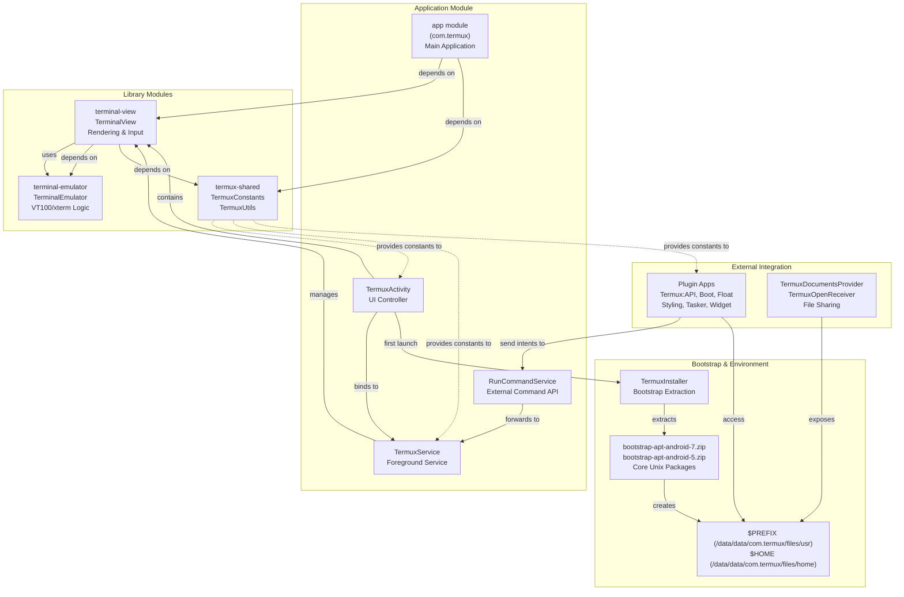

Sources: [README.md:37-47]()

## Architecture Layers

Termux follows a layered architecture with clear separation of concerns across UI, services, terminal emulation, and shared utilities:

### Diagram: Layered Architecture and Component Interactions
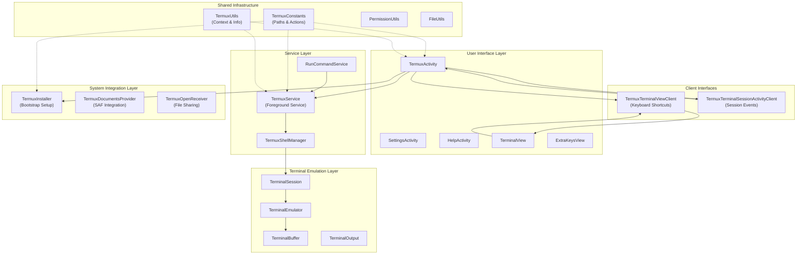

Sources: [README.md:1-79]()

## Module Structure

The repository consists of four Gradle modules with hierarchical dependencies:

| Module | Package | Purpose | Key Classes |
|--------|---------|---------|-------------|
| `app` | `com.termux` | Main application, activities, services | `TermuxActivity`, `TermuxService`, `RunCommandService`, `TermuxInstaller` |
| `terminal-view` | `com.termux.view` | Terminal rendering and input handling | `TerminalView`, `TerminalRenderer`, `TerminalViewClient` |
| `terminal-emulator` | `com.termux.terminal` | Terminal emulation logic | `TerminalEmulator`, `TerminalSession`, `TerminalBuffer`, `TerminalOutput` |
| `termux-shared` | `com.termux.shared` | Shared constants and utilities | `TermuxConstants`, `TermuxUtils`, `PermissionUtils`, `FileUtils` |

**Dependency Hierarchy:**
```
app → terminal-view → terminal-emulator
app → termux-shared
terminal-view → termux-shared
```

Sources: [README.md:1-79]()

## Build System and Distribution

For detailed information on distribution channels, APK signing requirements, `sharedUserId` constraints, installation compatibility issues, and store metadata, see [Installation and Distribution](#1.1).

Termux is distributed across multiple channels (F-Droid, GitHub, Google Play). Because all Termux applications and official plugins share the `com.termux` `sharedUserId`, they must be signed with the exact same signature key. Mixing installation sources will trigger package manager signature mismatch errors [README.md:61-64]().

Sources: [README.md:51-78]()

## Bootstrap and Environment

Termux requires a bootstrap package containing minimal Unix utilities to establish a working shell environment [README.md:65-66](). Upon first launch, `TermuxInstaller` extracts the bootstrap archive into `$PREFIX` (`/data/data/com.termux/files/usr`) and initializes the user `$HOME` directory [README.md:65-66]().

Sources: [README.md:65-66]()

## Plugin Ecosystem

For detailed information on official plugin applications (`Termux:API`, `Termux:Boot`, `Termux:Float`, `Termux:Styling`, `Termux:Tasker`, `Termux:Widget`), their shared package structures, preference classes, and IPC communication mechanisms, see [Plugin Ecosystem](#1.2).

Plugins extend Termux functionality by executing commands via `RunCommandService` and sharing file system access through the `com.termux` `sharedUserId` [README.md:37-47]().

Sources: [README.md:37-47]()

## Security Model

Termux implements a multi-layered security architecture including package signature verification, Android runtime permissions, custom `RUN_COMMAND` permission checks, and property-based access control (`allow-external-apps` in `termux.properties`). File system access is restricted via `TermuxDocumentsProvider` [README.md:55-64]().

Sources: [README.md:55-64]()

## Version and Compatibility

- **Current Version**: `v0.118.3` [README.md:53]()
- **Minimum Android**: Android 7.0 (API 24) for full support [README.md:57]()
- **Limited Support**: Android 5.0–6.0 (app-only support without package updates via GitHub) [README.md:59]()

**Android 12+ Notice**: May experience process killing issues due to background process limits. See [README.md:20-21]().

Sources: [README.md:20-21](), [README.md:53-59]()

## Related Pages

For detailed information on specific subsystems:
- [Installation and Distribution](#1.1) — Distribution channels, APK signing, and sharedUserId constraints
- [Plugin Ecosystem](#1.2) — Official plugin applications and communication mechanisms
- [Build System and Module Structure](#2) — Gradle configuration, bootstrap management, and modules
- [Application Components](#3) — Activities, services, and application lifecycle
- [Terminal Emulation System](#4) — Terminal rendering and emulation logic
- [Bootstrap and Environment](#5) — File system setup and environment configuration
- [File Sharing and Content Providers](#6) — SAF integration and file sharing
- [Constants and Shared Infrastructure](#7) — Shared utilities and constants
- [Security and Permissions](#8) — Security model and access control

---

# Page: Installation and Distribution

# Installation and Distribution

<details>
<summary>Relevant source files</summary>

The following files were used as context for generating this wiki page:

- [.editorconfig](.editorconfig)
- [README.md](README.md)
- [app/src/main/res/drawable/banner.png](app/src/main/res/drawable/banner.png)
- [app/testkey_untrusted.jks](app/testkey_untrusted.jks)
- [art/copy-to-other-apps.sh](art/copy-to-other-apps.sh)
- [art/feature-graphic.svg](art/feature-graphic.svg)
- [art/generate-feature-graphic.sh](art/generate-feature-graphic.sh)
- [art/generate-launcher-images.sh](art/generate-launcher-images.sh)
- [art/generate-tv-banner.sh](art/generate-tv-banner.sh)
- [art/tv-banner.svg](art/tv-banner.svg)
- [fastlane/metadata/android/en-US/full_description.txt](fastlane/metadata/android/en-US/full_description.txt)
- [fastlane/metadata/android/en-US/images/icon.png](fastlane/metadata/android/en-US/images/icon.png)
- [fastlane/metadata/android/en-US/images/phoneScreenshots/1.jpg](fastlane/metadata/android/en-US/images/phoneScreenshots/1.jpg)
- [fastlane/metadata/android/en-US/images/phoneScreenshots/2.jpg](fastlane/metadata/android/en-US/images/phoneScreenshots/2.jpg)
- [fastlane/metadata/android/en-US/images/phoneScreenshots/3.jpg](fastlane/metadata/android/en-US/images/phoneScreenshots/3.jpg)
- [fastlane/metadata/android/en-US/images/phoneScreenshots/4.jpg](fastlane/metadata/android/en-US/images/phoneScreenshots/4.jpg)
- [fastlane/metadata/android/en-US/short_description.txt](fastlane/metadata/android/en-US/short_description.txt)
- [site/assets/sponsors/cloudflare.png](site/assets/sponsors/cloudflare.png)
- [site/assets/sponsors/github.png](site/assets/sponsors/github.png)
- [site/assets/sponsors/nlnet-ngi-mobifree.png](site/assets/sponsors/nlnet-ngi-mobifree.png)

</details>


This page explains the different distribution channels (F-Droid, GitHub, Google Play), APK signing requirements, `sharedUserId` constraints, installation compatibility issues, and store metadata assets located under `fastlane/` and `art/`. It also covers the bootstrap installation mechanics that set up the runtime Linux environment.

For information about the plugin ecosystem and external app interactions, see [Plugin Ecosystem](#1.2).

## Distribution Channels and Signature Constraints

Termux and its official plugin suite (`Termux:API`, `Termux:Boot`, `Termux:Float`, `Termux:Styling`, `Termux:Tasker`, `Termux:Widget`) are bound by Android's `sharedUserId` security constraint (`com.termux`). Because they share the same user ID and data directory context, **all APKs installed on a device must be signed with the exact same signature key** [README.md:61]().

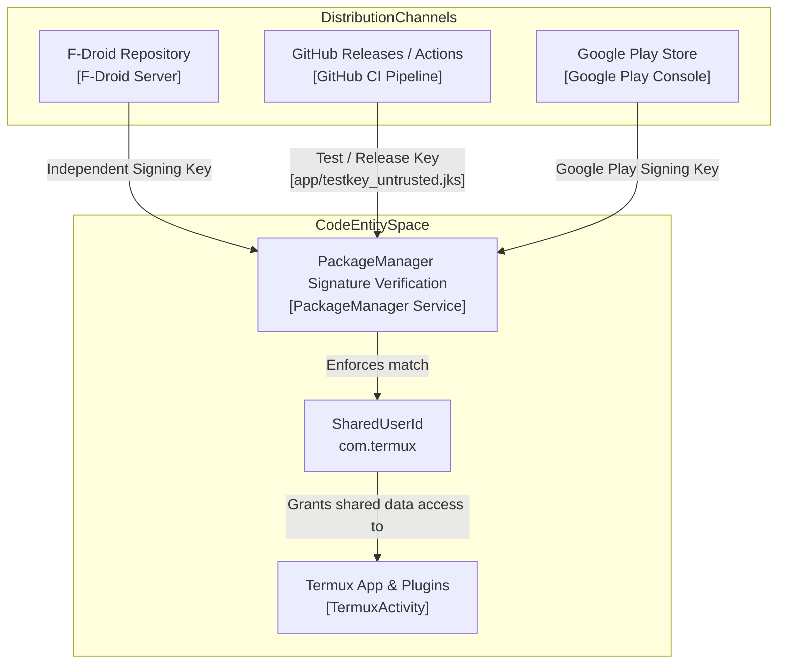

Sources: [README.md:60-64](), [app/testkey_untrusted.jks:1-12]()

### Channel Characteristics
- **F-Droid**: Recommended for most users. Provides universal APKs (`~180MB`) working across all supported CPU architectures. Maintainers do not control signing keys, making F-Droid builds mutually exclusive with GitHub or Google Play builds [README.md:67-78]().
- **GitHub**: Offers both universal and architecture-specific APKs (`apt-android-7` vs `apt-android-5`). Signed using public debug keys (`app/testkey_untrusted.jks`) [README.md:79-92]().
- **Google Play Store**: Experimental release channel for Android 11+ subject to API policy modifications and distinct signature keys [README.md:117-124]().

Sources: [README.md:57-124](), [app/testkey_untrusted.jks:1-12]()

---

## Store Metadata and Graphic Assets (`fastlane/` and `art/`)

Termux maintains store publishing metadata and vector graphic design assets within the repository under `fastlane/` and `art/`:

- **Store Metadata**: Located in `fastlane/metadata/android/en-US/`, containing localized descriptions (`full_description.txt`, `short_description.txt`) and promotional screenshots [fastlane/metadata/android/en-US/full_description.txt:1-13]().
- **Graphic Assets**: Vector sources like `art/feature-graphic.svg` and `art/tv-banner.svg` provide store and TV banner templates [art/feature-graphic.svg:1-30](), [art/tv-banner.svg:1-23]().
- **Asset Synchronization**: The shell script `art/copy-to-other-apps.sh` automates the propagation of launcher icons and foreground drawables across repository directories for dependent plugin apps (`api`, `boot`, `styling`, `tasker`, `widget`) [art/copy-to-other-apps.sh:1-13]().

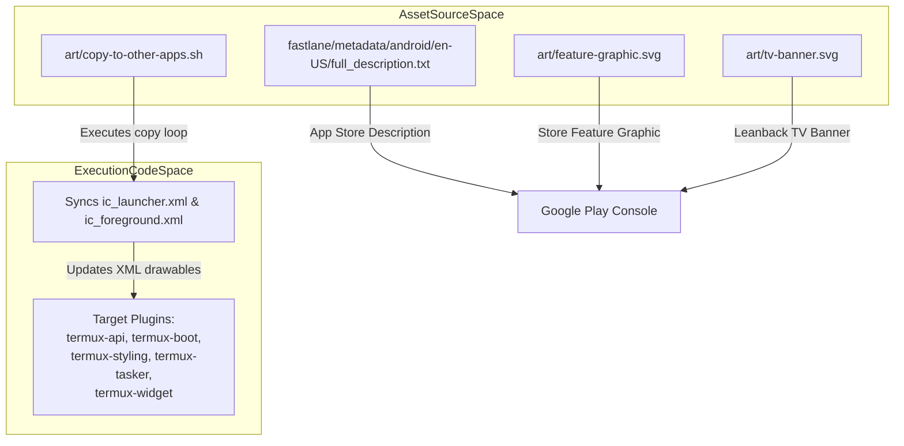

Sources: [art/copy-to-other-apps.sh:1-13](), [art/feature-graphic.svg:1-30](), [art/tv-banner.svg:1-23](), [fastlane/metadata/android/en-US/full_description.txt:1-13]()

---

## Installation Compatibility and Requirements

Termux enforces compatibility thresholds based on Android version runtime behaviors:
- **Android 7 or higher**: Full support for application execution and package management via `apt`/`pkg` [README.md:57]().
- **Android 5 and 6**: Support restricted to the base application shell; package updates are disabled [README.md:59]().

Sources: [README.md:57-60]()

---

## Bootstrap Installation Process and Code Entities

Upon initial launch, Termux runs bootstrap initialization routines managed by `TermuxInstaller` to establish the Linux environment prefix and extract minimal system binaries.

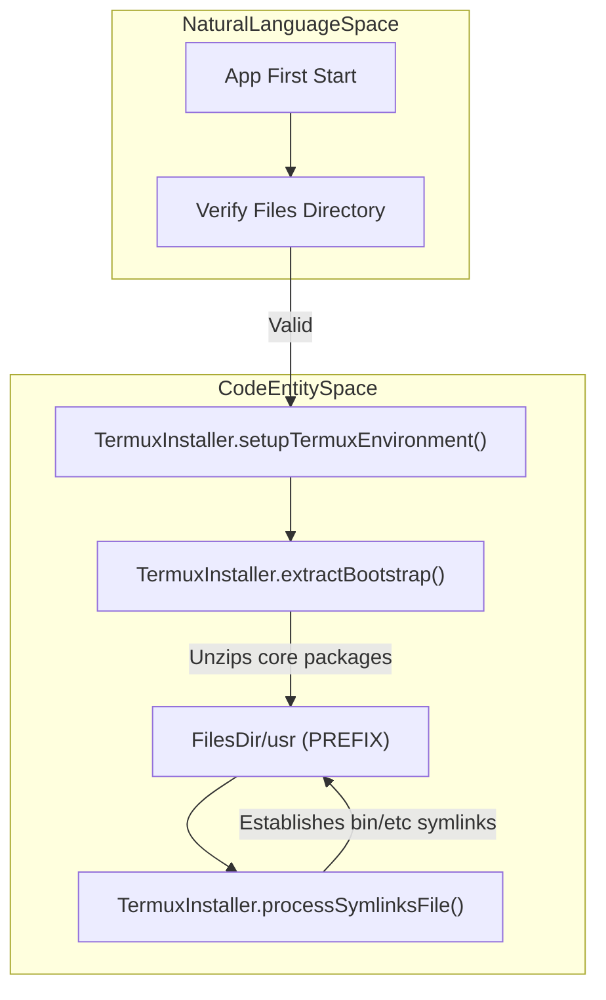

Sources: [README.md:64](), [app/src/main/java/com/termux/app/TermuxInstaller.java:42-240]()

---

## Storage Setup and File System Structure

After extracting the bootstrap, Termux configures internal storage symlinks inside the user home directory (`$HOME/storage/`) to bridge Android's scoped storage APIs with Unix filesystem conventions.

| Directory Path | Target / Purpose |
|----------------|------------------|
| `/data/data/com.termux/files` | Base application data files directory |
| `/data/data/com.termux/files/usr` | Main system prefix (`$PREFIX`) |
| `/data/data/com.termux/files/home` | User home directory (`$HOME`) |
| `$HOME/storage/shared` | External storage root |
| `$HOME/storage/downloads` | Shared Downloads directory |

Sources: [README.md:64]()

---

## Troubleshooting Installation and Uninstallation

### Common Installation Issues
- **Signature Mismatch Errors**: Installing APKs from mixed sources (e.g., F-Droid combined with GitHub) results in errors such as `INSTALL_FAILED_UPDATE_INCOMPATIBLE` or `INSTALL_FAILED_SHARED_USER_INCOMPATIBLE` [README.md:61]().
- **Android 12+ Signal 9 Killing**: Phantom process limits and aggressive CPU cgroups on Android 12+ can cause sudden shell termination with `[Process completed (signal 9)]` [README.md:20]().

### Uninstallation
To clear shared user data across applications, all packages sharing `com.termux` must be uninstalled concurrently [README.md:63]().

Sources: [README.md:20](), [README.md:61-64]()

---

# Page: Plugin Ecosystem

# Plugin Ecosystem

<details>
<summary>Relevant source files</summary>

The following files were used as context for generating this wiki page:

- [termux-shared/src/main/java/com/termux/shared/net/socket/local/LocalSocketRunConfig.java](termux-shared/src/main/java/com/termux/shared/net/socket/local/LocalSocketRunConfig.java)
- [termux-shared/src/main/java/com/termux/shared/settings/preferences/AppSharedPreferences.java](termux-shared/src/main/java/com/termux/shared/settings/preferences/AppSharedPreferences.java)
- [termux-shared/src/main/java/com/termux/shared/shell/am/AmSocketServer.java](termux-shared/src/main/java/com/termux/shared/shell/am/AmSocketServer.java)
- [termux-shared/src/main/java/com/termux/shared/shell/am/AmSocketServerErrno.java](termux-shared/src/main/java/com/termux/shared/shell/am/AmSocketServerErrno.java)
- [termux-shared/src/main/java/com/termux/shared/shell/am/AmSocketServerRunConfig.java](termux-shared/src/main/java/com/termux/shared/shell/am/AmSocketServerRunConfig.java)
- [termux-shared/src/main/java/com/termux/shared/termux/TermuxConstants.java](termux-shared/src/main/java/com/termux/shared/termux/TermuxConstants.java)
- [termux-shared/src/main/java/com/termux/shared/termux/TermuxUtils.java](termux-shared/src/main/java/com/termux/shared/termux/TermuxUtils.java)
- [termux-shared/src/main/java/com/termux/shared/termux/settings/preferences/TermuxAPIAppSharedPreferences.java](termux-shared/src/main/java/com/termux/shared/termux/settings/preferences/TermuxAPIAppSharedPreferences.java)
- [termux-shared/src/main/java/com/termux/shared/termux/settings/preferences/TermuxAppSharedPreferences.java](termux-shared/src/main/java/com/termux/shared/termux/settings/preferences/TermuxAppSharedPreferences.java)
- [termux-shared/src/main/java/com/termux/shared/termux/settings/preferences/TermuxBootAppSharedPreferences.java](termux-shared/src/main/java/com/termux/shared/termux/settings/preferences/TermuxBootAppSharedPreferences.java)
- [termux-shared/src/main/java/com/termux/shared/termux/settings/preferences/TermuxFloatAppSharedPreferences.java](termux-shared/src/main/java/com/termux/shared/termux/settings/preferences/TermuxFloatAppSharedPreferences.java)
- [termux-shared/src/main/java/com/termux/shared/termux/settings/preferences/TermuxStylingAppSharedPreferences.java](termux-shared/src/main/java/com/termux/shared/termux/settings/preferences/TermuxStylingAppSharedPreferences.java)
- [termux-shared/src/main/java/com/termux/shared/termux/settings/preferences/TermuxTaskerAppSharedPreferences.java](termux-shared/src/main/java/com/termux/shared/termux/settings/preferences/TermuxTaskerAppSharedPreferences.java)
- [termux-shared/src/main/java/com/termux/shared/termux/settings/preferences/TermuxWidgetAppSharedPreferences.java](termux-shared/src/main/java/com/termux/shared/termux/settings/preferences/TermuxWidgetAppSharedPreferences.java)
- [termux-shared/src/main/java/com/termux/shared/termux/shell/am/TermuxAmSocketServer.java](termux-shared/src/main/java/com/termux/shared/termux/shell/am/TermuxAmSocketServer.java)
- [termux-shared/src/main/java/com/termux/shared/termux/shell/command/environment/TermuxAPIShellEnvironment.java](termux-shared/src/main/java/com/termux/shared/termux/shell/command/environment/TermuxAPIShellEnvironment.java)
- [termux-shared/src/main/java/com/termux/shared/termux/shell/command/environment/TermuxAppShellEnvironment.java](termux-shared/src/main/java/com/termux/shared/termux/shell/command/environment/TermuxAppShellEnvironment.java)
- [termux-shared/src/main/res/values/strings.xml](termux-shared/src/main/res/values/strings.xml)

</details>


This document describes the official Termux plugin applications and the shared infrastructure that enables inter-app communication, context sharing, preferences access, and IPC. It covers the six official plugins (API, Boot, Float, Styling, Tasker, Widget), their package structure, preference classes (`TermuxAppSharedPreferences`, `TermuxAPIAppSharedPreferences`, etc.), and communication mechanisms via intents, broadcasts, and local sockets.

For information about external app command execution, see [RunCommandService](#3.3). For security mechanisms controlling plugin access, see [Property-Based Access Control](#8.3). For installation compatibility requirements, see [Installation and Distribution](#1.1).

## Official Plugin Applications

Termux provides six official plugin applications that extend the core terminal functionality. All plugins are distributed through the same channels as the main app (F-Droid, GitHub, Google Play) and must match APK signatures.

| Plugin | Package Name | Primary Purpose |
|--------|-------------|-----------------|
| Termux:API | `com.termux.api` | Bridges Android APIs to shell commands for accessing device features |
| Termux:Boot | `com.termux.boot` | Executes scripts from `~/boot/` directory on device boot |
| Termux:Float | `com.termux.window` | Provides floating terminal window that can overlay other apps |
| Termux:Styling | `com.termux.styling` | Supplies color schemes and fonts for terminal customization |
| Termux:Tasker | `com.termux.tasker` | Integrates with Tasker automation app for executing scripts |
| Termux:Widget | `com.termux.widget` | Creates home screen widgets that execute scripts from `~/.shortcuts/` |

Sources: [termux-shared/src/main/java/com/termux/shared/termux/TermuxConstants.java:362-444]()

## Shared Infrastructure

### Package Structure, sharedUserId, and Context Resolution

All Termux plugins share the `sharedUserId` value `"com.termux"`, which enables them to access each other's package contexts and share file system access. This is defined at the Android manifest level and enforced by the Android Package Manager. The `TermuxUtils` class [termux-shared/src/main/java/com/termux/shared/termux/TermuxUtils.java:37-37]() provides static methods utilizing `PackageUtils` to acquire package contexts across the ecosystem.

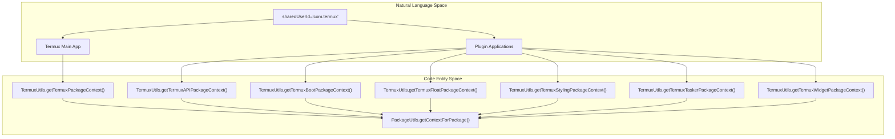

Sources: [termux-shared/src/main/java/com/termux/shared/termux/TermuxConstants.java:350-468](), [termux-shared/src/main/java/com/termux/shared/termux/TermuxUtils.java:56-141]()

### TermuxConstants Shared Definitions

The `TermuxConstants` class serves as the single source of truth for all package names, file paths, intent actions, and URLs shared across the Termux ecosystem. This class is part of the `termux-shared` library module.

Key constant categories defined in `TermuxConstants`:
- **Organization URLs**: GitHub organization, F-Droid base URLs
- **Package Names**: All app and plugin package identifiers (`TERMUX_PACKAGE_NAME`, `TERMUX_API_PACKAGE_NAME`, etc.)
- **File Paths**: `TERMUX_PREFIX_DIR_PATH`, `TERMUX_HOME_DIR_PATH`, configuration directories
- **Intent Actions**: `BROADCAST_TERMUX_OPENED`, `ACTION_RUN_COMMAND`, `ACTION_SERVICE_EXECUTE`
- **Repository URLs**: GitHub repos, issue trackers, F-Droid package URLs for each app
- **APK Signing Certificates**: SHA-256 digests for F-Droid, GitHub, Play Store releases

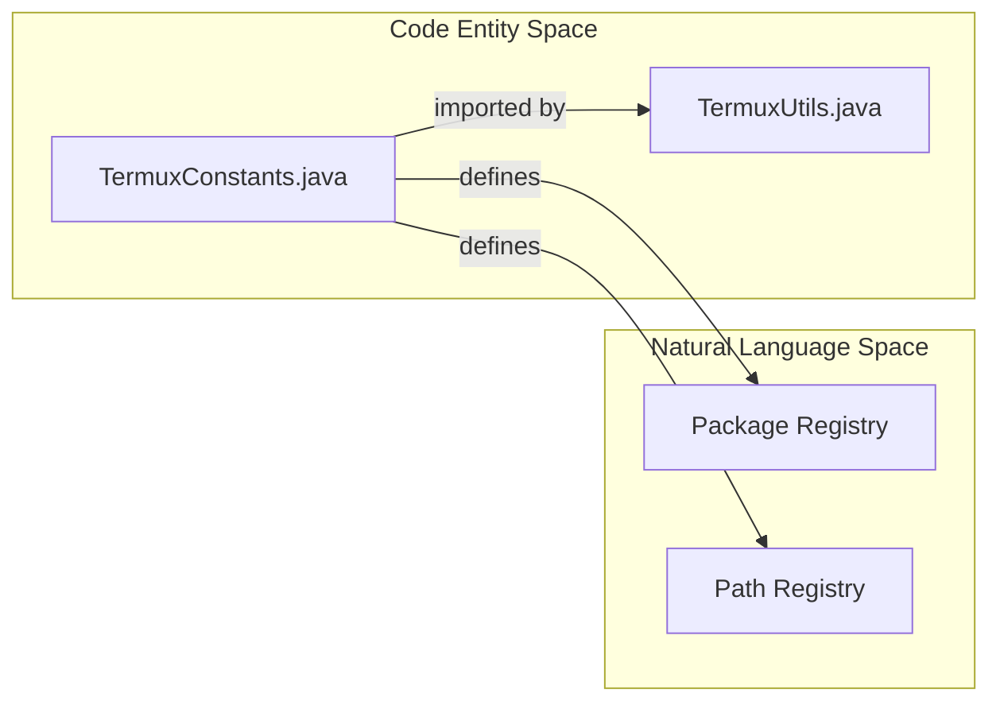

Sources: [termux-shared/src/main/java/com/termux/shared/termux/TermuxConstants.java:1-131](), [termux-shared/src/main/java/com/termux/shared/termux/TermuxUtils.java:37-64]()

### Preference Classes Architecture

Each plugin, alongside the core Termux app, implements a dedicated `AppSharedPreferences` subclass located in `com.termux.shared.termux.settings.preferences`. These preference wrappers utilize `SharedPreferenceUtils` to access private or multi-process shared preferences files matching distinct basenames (e.g., `termux_preferences`, `termux_api_preferences`, `termux_boot_preferences`, etc.).

```mermaid
graph TB
    subgraph "Code Entity Space"
        Base["AppSharedPreferences"]
        SPO["SharedPreferenceUtils"]
        TAP["TermuxAppSharedPreferences"]
        TAPI["TermuxAPIAppSharedPreferences"]
        TBOOT["TermuxBootAppSharedPreferences"]
        TFLOAT["TermuxFloatAppSharedPreferences"]
        TSTYLING["TermuxStylingAppSharedPreferences"]
        TTASKER["TermuxTaskerAppSharedPreferences"]
        TWIDGET["TermuxWidgetAppSharedPreferences"]
    end

    TAP -->|extends| Base
    TAPI -->|extends| Base
    TBOOT -->|extends| Base
    TFLOAT -->|extends| Base
    TSTYLING -->|extends| Base
    TTASKER -->|extends| Base
    TWIDGET -->|extends| Base

    Base -->|calls| SPO
    TAP -->|reads basename| TermuxConst["TermuxConstants.TERMUX_DEFAULT_PREFERENCES_FILE_BASENAME_WITHOUT_EXTENSION"]
    TAPI -->|reads basename| TermuxConstAPI["TermuxConstants.TERMUX_API_DEFAULT_PREFERENCES_FILE_BASENAME_WITHOUT_EXTENSION"]
    TFLOAT -->|reads basename| TermuxConstFloat["TermuxConstants.TERMUX_FLOAT_DEFAULT_PREFERENCES_FILE_BASENAME_WITHOUT_EXTENSION"]
    TWIDGET -->|reads basename| TermuxConstWidget["TermuxConstants.TERMUX_WIDGET_DEFAULT_PREFERENCES_FILE_BASENAME_WITHOUT_EXTENSION"]
```

Key preference wrapper implementations:
- `TermuxAppSharedPreferences`: Manages core app properties such as terminal toolbar visibility, font size clamping, soft keyboard options, and screen wake locks via `TermuxAppSharedPreferences.build(Context)` [termux-shared/src/main/java/com/termux/shared/termux/settings/preferences/TermuxAppSharedPreferences.java:18-50]().
- `TermuxAPIAppSharedPreferences`: Manages logging levels and pending intent request codes for `com.termux.api` [termux-shared/src/main/java/com/termux/shared/termux/settings/preferences/TermuxAPIAppSharedPreferences.java:16-42]().
- `TermuxFloatAppSharedPreferences`: Controls floating window geometry (`window_x`, `window_y`, width, height) and font metrics for `com.termux.window` [termux-shared/src/main/java/com/termux/shared/termux/settings/preferences/TermuxFloatAppSharedPreferences.java:17-49]().
- `TermuxWidgetAppSharedPreferences`: Generates and retrieves security tokens (`KEY_TOKEN`) and log levels for `com.termux.widget` [termux-shared/src/main/java/com/termux/shared/termux/settings/preferences/TermuxWidgetAppSharedPreferences.java:18-44]().
- `TermuxStylingAppSharedPreferences` & `TermuxTaskerAppSharedPreferences` & `TermuxBootAppSharedPreferences`: Handle log levels and app-specific configuration state across respective plugin package contexts [termux-shared/src/main/java/com/termux/shared/termux/settings/preferences/TermuxStylingAppSharedPreferences.java:16-42](), [termux-shared/src/main/java/com/termux/shared/termux/settings/preferences/TermuxTaskerAppSharedPreferences.java:16-42](), [termux-shared/src/main/java/com/termux/shared/termux/settings/preferences/TermuxBootAppSharedPreferences.java:16-42]().

Sources: [termux-shared/src/main/java/com/termux/shared/termux/settings/preferences/TermuxAppSharedPreferences.java:18-67](), [termux-shared/src/main/java/com/termux/shared/termux/settings/preferences/TermuxAPIAppSharedPreferences.java:16-59](), [termux-shared/src/main/java/com/termux/shared/termux/settings/preferences/TermuxFloatAppSharedPreferences.java:17-66](), [termux-shared/src/main/java/com/termux/shared/termux/settings/preferences/TermuxWidgetAppSharedPreferences.java:18-61]()

## Communication Mechanisms

### Intent-Based Command Execution and Local Sockets

Plugins communicate with the Termux app primarily through the Android Intent system (`RunCommandService` forwarding to `TermuxService`), as well as high-performance local Unix domain sockets (`TermuxAmSocketServer`).

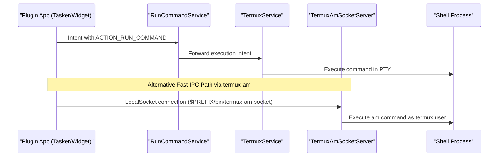

Key intent extras defined in `TERMUX_APP.TERMUX_SERVICE` and `TERMUX_APP.RUN_COMMAND_SERVICE`:
- `EXTRA_COMMAND_PATH`: Absolute path to executable
- `EXTRA_ARGUMENTS`: String array of command arguments
- `EXTRA_WORKDIR`: Working directory path
- `EXTRA_SESSION_ACTION`: Controls session switching behavior
- `EXTRA_PENDING_INTENT`: PendingIntent for result callback

Additionally, `TermuxAmSocketServer` manages a filesystem Unix domain socket server located at `TERMUX_AM_SOCKET_FILE_PATH`. Clients (`$PREFIX/bin/termux-am`) connect via `$PREFIX/bin/termux-am-socket` to run activity manager commands without starting a new Dalvik VM per command [termux-shared/src/main/java/com/termux/shared/termux/shell/am/TermuxAmSocketServer.java:25-58]().

Sources: [termux-shared/src/main/java/com/termux/shared/termux/TermuxConstants.java:750-1051](), [termux-shared/src/main/java/com/termux/shared/termux/shell/am/TermuxAmSocketServer.java:25-97]()

### Broadcast Receivers and Shared File System

The Termux app dispatches `BROADCAST_TERMUX_OPENED` broadcasts to initialize plugins on app startup, while plugins consume designated directories inside `TERMUX_HOME_DIR_PATH`.

| Directory | Path | Used By | Purpose |
|-----------|------|---------|---------|
| Boot scripts | `~/boot/` | Termux:Boot | Executed on device boot |
| Widget shortcuts | `~/.shortcuts/` | Termux:Widget | Home screen widget scripts |
| Tasker tasks | `~/.tasker/` | Termux:Tasker | Tasker automation scripts |
| Shortcut icons | `~/.shortcuts/icons/` | Termux:Widget | PNG icons for shortcuts |

Sources: [termux-shared/src/main/java/com/termux/shared/termux/TermuxConstants.java:679-716](), [termux-shared/src/main/java/com/termux/shared/termux/TermuxConstants.java:1141-1143]()

## Plugin-Specific Functionality

### Termux:API, Boot, Float, Styling, Tasker, and Widget
- **Termux:API**: Bridges Android system sensors, battery, location, and camera APIs via intents sent from the `termux-api` package binaries [termux-shared/src/main/java/com/termux/shared/termux/TermuxConstants.java:363-374]().
- **Termux:Boot**: Listens for `BOOT_COMPLETED` broadcasts and executes scripts found in `~/boot/` [termux-shared/src/main/java/com/termux/shared/termux/TermuxConstants.java:377-388]().
- **Termux:Float**: Runs a persistent floating window service (`com.termux.window`) utilizing independent window geometries configured in `TermuxFloatAppSharedPreferences` [termux-shared/src/main/java/com/termux/shared/termux/settings/preferences/TermuxFloatAppSharedPreferences.java:17-106]().
- **Termux:Styling**: Injects custom `colors.properties` and `font.ttf` files into Termux storage paths and triggers style reload broadcasts [termux-shared/src/main/java/com/termux/shared/termux/TermuxConstants.java:405-416]().
- **Termux:Tasker**: Interfaces with Tasker flows to execute shell scripts residing in `~/.tasker/` [termux-shared/src/main/java/com/termux/shared/termux/TermuxConstants.java:419-430]().
- **Termux:Widget**: Renders home screen shortcuts tied to scripts in `~/.shortcuts/`, tracking unique tokens via `TermuxWidgetAppSharedPreferences` [termux-shared/src/main/java/com/termux/shared/termux/settings/preferences/TermuxWidgetAppSharedPreferences.java:18-78]().

Sources: [termux-shared/src/main/java/com/termux/shared/termux/TermuxConstants.java:363-444](), [termux-shared/src/main/java/com/termux/shared/termux/settings/preferences/TermuxFloatAppSharedPreferences.java:17-161](), [termux-shared/src/main/java/com/termux/shared/termux/settings/preferences/TermuxWidgetAppSharedPreferences.java:18-94]()

## Access Control and Security

### Allow-External-Apps Property and Signature Checks

All plugin access to Termux command execution is gated by the `allow-external-apps` property in `termux.properties`. Furthermore, apps must share identical APK signing certificate SHA-256 digests (`APK_RELEASE_*_SIGNING_CERTIFICATE_SHA256_DIGEST`) to successfully leverage `sharedUserId` context sharing. If signatures mismatch, calls to `PackageUtils.getContextForPackage()` return `null` and throw security exceptions.

Sources: [termux-shared/src/main/res/values/strings.xml:49-51](), [termux-shared/src/main/java/com/termux/shared/termux/TermuxConstants.java:478-500]()

## App Information and Debugging

The `TermuxUtils` class provides diagnostic methods supporting `AppInfoMode` (e.g., `TERMUX_AND_PLUGIN_PACKAGES`) to compile markdown-formatted diagnostic reports detailing plugin installation states, version codes, package signatures, and file system accessibility.

Sources: [termux-shared/src/main/java/com/termux/shared/termux/TermuxUtils.java:39-51](), [termux-shared/src/main/java/com/termux/shared/termux/TermuxUtils.java:311-466]()

---

# Page: Build System and Module Structure

# Build System and Module Structure

<details>
<summary>Relevant source files</summary>

The following files were used as context for generating this wiki page:

- [app/build.gradle](app/build.gradle)
- [build.gradle](build.gradle)
- [gradle.properties](gradle.properties)
- [jitpack.yml](jitpack.yml)
- [settings.gradle](settings.gradle)
- [terminal-emulator/build.gradle](terminal-emulator/build.gradle)
- [terminal-view/build.gradle](terminal-view/build.gradle)
- [termux-shared/build.gradle](termux-shared/build.gradle)

</details>


This document describes the Gradle-based build system architecture for the Termux application, including the multi-module project structure, build configuration, bootstrap package management, native code compilation, and test automation. For runtime environment setup and bootstrap installation, see [Bootstrap and Environment](#5). 

Sources: [build.gradle:1-17](), [app/build.gradle:1-166](), [gradle.properties:1-23]()

## Overview

The Termux build system is implemented using Gradle with the Android Gradle Plugin. The project consists of four modules organized in a hierarchical dependency structure, with the `app` module serving as the main application that depends on three library modules. The build system handles module inter-dependencies, native code compilation via the NDK, bootstrap package downloading and verification, version management, and multi-variant APK generation.

For deep technical details on module organization, see [Module Dependencies](#2.1).

Sources: [build.gradle:1-17](), [app/build.gradle:1-41](), [gradle.properties:1-23]()

## 2.1. Module Dependencies

The project is organized into four Gradle modules with a clear dependency hierarchy:

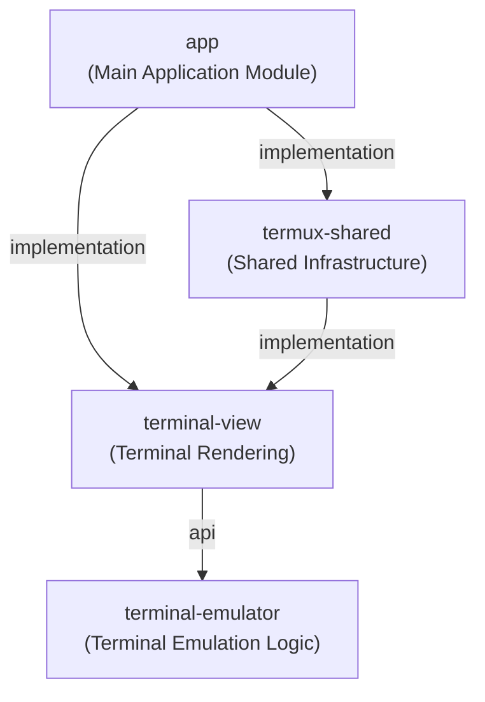

The dependency chain ensures that `terminal-emulator` operates independently of Android UI frameworks, `terminal-view` provides rendering and touch interactions, `termux-shared` supplies cross-module utilities and constants, and `app` integrates everything into the final application package.

For full details on the four-module structure and dependency configuration, see [Module Dependencies](#2.1).

Sources: [app/build.gradle:39-41](), [termux-shared/build.gradle:29](), [terminal-view/build.gradle:10]()

## 2.2. Gradle Build Configuration

Build configuration flows from the root `build.gradle` and `gradle.properties` files down to individual module configurations. The build system handles target and compile SDK versions, desugaring configuration, manifest placeholders, and output APK naming conventions.

For details on `build.gradle` files, build variants (`apt-android-7` vs `apt-android-5`), version management, and APK output configuration, see [Gradle Build Configuration](#2.2).

Sources: [build.gradle:1-17](), [gradle.properties:1-23](), [app/build.gradle:15-146]()

## 2.3. Bootstrap Package Management

The build system automates the retrieval and validation of bootstrap archives for different CPU architectures (`aarch64`, `arm`, `i686`, `x86_64`). Bootstraps are downloaded from remote sources and cryptographically validated using SHA-256 checksums before being embedded into the application build artifacts.

For complete details on bootstrap package downloading, checksum validation, and embedding, see [Bootstrap Package Management](#2.3).

Sources: [app/build.gradle:5-13](), [app/build.gradle:167-243]()

## 2.4. Native Code and NDK Build

Native C/C++ compilation is integrated across modules using the Android NDK via `Android.mk` scripts. The build system configures compiler flags, target ABIs (`armeabi-v7a`, `arm64-v8a`, `x86`, `x86_64`), and JNI integration for terminal emulation and shared utilities.

For details on NDK configuration, compiler flags, ABI variants, and native library compilation, see [Native Code and NDK Build](#2.4).

Sources: [app/build.gradle:63-67](), [app/build.gradle:109-113](), [terminal-emulator/build.gradle:14-22](), [termux-shared/build.gradle:39-44]()

## 2.5. CI/CD Pipeline

Continuous integration and delivery are managed through automation pipelines (such as GitHub Actions and JitPack configurations) that handle automated building, testing, release attachment, and dependency maintenance.

For information on GitHub Actions workflows, APK building, release packaging, and JitPack integration, see [CI/CD Pipeline](#2.5).

Sources: [jitpack.yml:1-4]()

## 2.6. Gradle Wrapper

The project utilizes the Gradle wrapper to ensure consistent build execution environments across developer setups and CI agents, adhering to specified wrapper properties, distribution validations, and ProGuard minification rules.

For documentation on the Gradle wrapper system, version management, and distribution validation, see [Gradle Wrapper](#2.6).

Sources: [build.gradle:1-9](), [app/build.gradle:89-94]()

## 2.7. Testing Infrastructure

The testing architecture incorporates unit test suites for the terminal emulator, app-level components, and shared utilities, utilizing frameworks like JUnit and Robolectric both locally and within CI pipelines.

For details on the testing infrastructure, unit test suites, and CI execution, see [Testing Infrastructure](#2.7).

Sources: [app/build.gradle:119-123](), [app/build.gradle:149-150](), [terminal-emulator/build.gradle:43-45](), [termux-shared/build.gradle:38-44]()

---

# Page: Module Dependencies

# Module Dependencies

<details>
<summary>Relevant source files</summary>

The following files were used as context for generating this wiki page:

- [app/build.gradle](app/build.gradle)
- [build.gradle](build.gradle)
- [gradle.properties](gradle.properties)
- [jitpack.yml](jitpack.yml)
- [settings.gradle](settings.gradle)
- [terminal-emulator/build.gradle](terminal-emulator/build.gradle)
- [terminal-emulator/src/main/AndroidManifest.xml](terminal-emulator/src/main/AndroidManifest.xml)
- [terminal-view/build.gradle](terminal-view/build.gradle)
- [terminal-view/src/main/AndroidManifest.xml](terminal-view/src/main/AndroidManifest.xml)
- [termux-shared/build.gradle](termux-shared/build.gradle)

</details>


The Termux application is structured as a multi-module Gradle project with four distinct modules. This document explains the dependency hierarchy between these modules, their respective responsibilities, and the external libraries they depend on.

## Module Overview

The Termux application is modularized into four primary components, each with distinct responsibilities:

### Gradle Module Dependency Graph
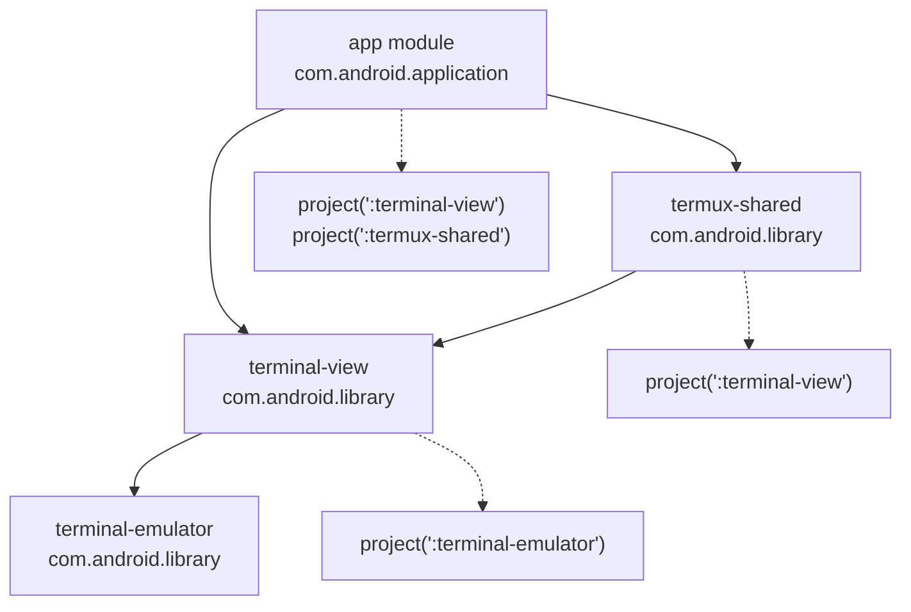

Sources: [app/build.gradle:39-40](), [terminal-view/build.gradle:10](), [termux-shared/build.gradle:29]()

## Module Responsibilities

### app Module

The `app` module serves as the main Android application module containing:

- User interface activities and fragments
- Terminal session management services
- Installation and bootstrap processes
- Integration with Android platform features
- Plugin interaction handling

This module integrates the functionality provided by other modules to create the complete Termux application.

Sources: [app/build.gradle]()

### terminal-emulator Module

The `terminal-emulator` module provides the core terminal emulation functionality:

- Terminal session implementation
- Terminal emulation logic
- Character encoding/decoding
- Terminal output processing
- Native code for terminal operations

As the most foundational module, it has no dependencies on other Termux modules.

Sources: [terminal-emulator/build.gradle]()

### terminal-view Module

The `terminal-view` module handles terminal display and user interaction:

- Terminal rendering on Android
- User input handling and processing
- Key mapping and special key handling
- Terminal-related UI components
- Text selection and clipboard operations

This module serves as a bridge between the UI and the core terminal emulation functionality.

Sources: [terminal-view/build.gradle]()

### termux-shared Module

The `termux-shared` module contains common utilities and constants shared across modules and potentially with plugin applications:

- Shared constants (file paths, intent actions, etc.)
- File and storage utilities
- Shell command utilities
- Execution command handling
- Environment variable management
- Crash handling and logging utilities

Sources: [termux-shared/build.gradle]()

## Dependency Structure Details

### Gradle Dependency Configuration Types
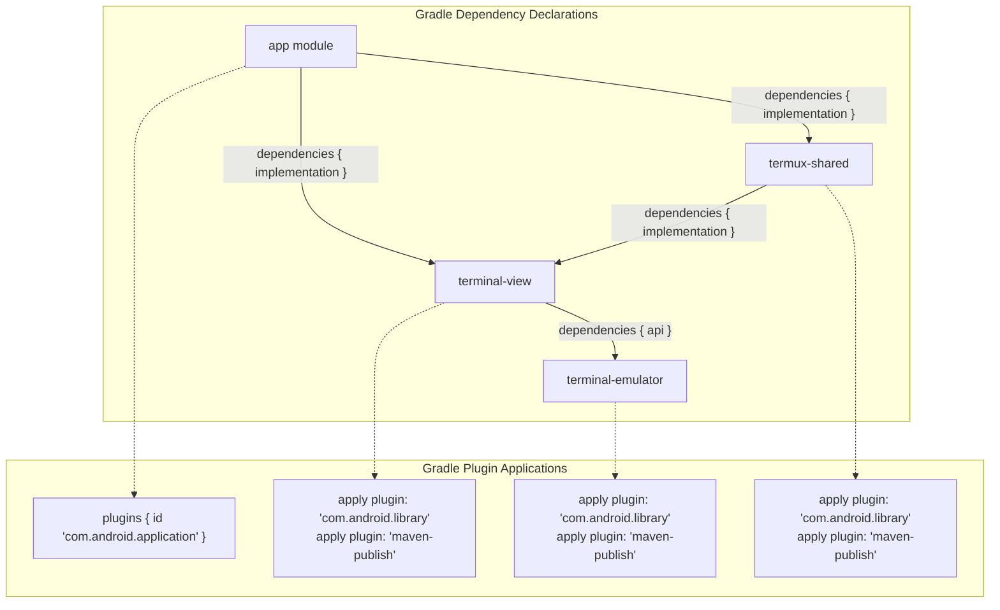

The module dependency structure uses specific Gradle dependency configurations:

- `implementation` dependencies are used for internal module consumption
- `api` dependency in `terminal-view` exposes `terminal-emulator` to consuming modules
- The circular dependency between `terminal-view` and `termux-shared` creates a bidirectional module relationship

Sources: [app/build.gradle:1-3](), [app/build.gradle:39-40](), [terminal-view/build.gradle:1-2](), [terminal-view/build.gradle:10](), [terminal-emulator/build.gradle:1-2](), [termux-shared/build.gradle:1-2](), [termux-shared/build.gradle:29]()

## Dependency Configuration Types

The module dependencies use specific Gradle dependency configurations that control visibility and transitive dependency propagation:

| Configuration | Usage | Transitive Exposure |
|--------------|-------|---------------------|
| `implementation` | Used by `app`, `terminal-view`, `termux-shared` | Dependencies are internal, not exposed to consumers |
| `api` | Used by `terminal-view` for `terminal-emulator` | Dependencies are exposed to all consuming modules |

The `api` configuration in `terminal-view` makes `terminal-emulator` available to both `app` and `termux-shared` without requiring them to declare explicit dependencies on `terminal-emulator`.

Sources: [app/build.gradle:39-40](), [terminal-view/build.gradle:10](), [termux-shared/build.gradle:29]()

## Circular Dependency

A notable aspect of the module structure is the circular dependency between `terminal-view` and `termux-shared`:

- `termux-shared` depends on `terminal-view` [termux-shared/build.gradle:29]()
- `terminal-view` depends on `terminal-emulator` [terminal-view/build.gradle:10]()
- `app` depends on both `terminal-view` and `termux-shared` [app/build.gradle:39-40]()

This bidirectional relationship allows `termux-shared` to access terminal view components while also providing shared utilities back to the view layer.

## External Dependencies

Each module has external dependencies that provide additional functionality:

### External Dependencies by Module
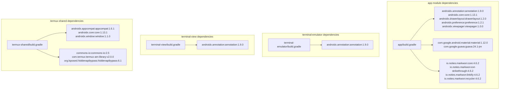

Sources: [app/build.gradle:26-37](), [terminal-emulator/build.gradle:63](), [terminal-view/build.gradle:9](), [termux-shared/build.gradle:11-31]()

## Native Code Components

Several modules in the Termux application include native C/C++ code compiled using the Android NDK:

### NDK Build Configuration
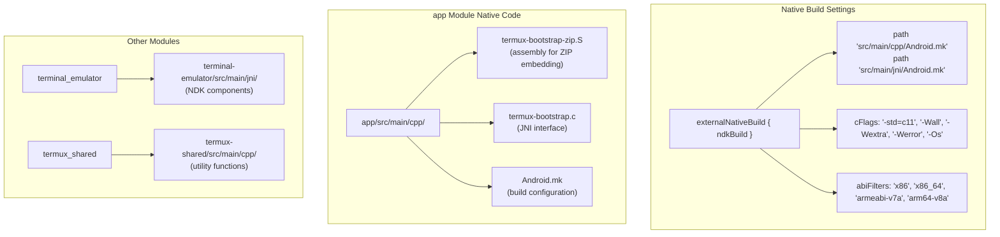

### app Module Native Code

The app module includes native code primarily for the bootstrap process:

- `termux-bootstrap-zip.S` - Assembly code for embedding bootstrap ZIP data
- `termux-bootstrap.c` - JNI interface for accessing bootstrap data
- Architecture-specific bootstrap files for arm, arm64, x86, and x86_64

### terminal-emulator and termux-shared Native Code

Both modules contain native code components with NDK build configurations for specialized terminal and utility functionality.

Sources: [app/build.gradle:63-67](), [app/build.gradle:109-113](), [terminal-emulator/build.gradle:14-22](), [terminal-emulator/build.gradle:32-36](), [termux-shared/build.gradle:39-43](), [termux-shared/build.gradle:61-65]()

## Package Variants and Bootstrap System

The Termux application supports different package variants that determine which bootstrap will be included in the app APK:

### Package Variant Configuration
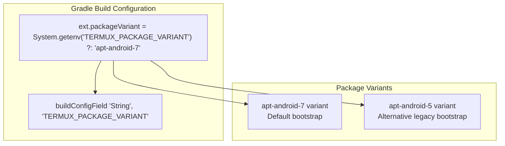

The package variant determines which Linux environment will be installed. The package variant value is defined in the Gradle build configuration and baked into `BuildConfig`.

Sources: [app/build.gradle:5-13](), [app/build.gradle:52]()

## Publication Configuration

The library modules (`terminal-emulator`, `terminal-view`, and `termux-shared`) include Maven publication configurations, allowing them to be published as independent libraries and potentially used by other applications:

| Module | Group ID | Artifact ID | Version |
|--------|----------|-------------|---------|
| terminal-emulator | com.termux | terminal-emulator | 0.118.0 |
| terminal-view | com.termux | terminal-view | 0.118.0 |
| termux-shared | com.termux | termux-shared | 0.118.0 |

Sources: [terminal-emulator/build.gradle:76-83](), [terminal-view/build.gradle:52-59](), [termux-shared/build.gradle:91-98]()

---

# Page: Gradle Build Configuration

# Gradle Build Configuration

<details>
<summary>Relevant source files</summary>

The following files were used as context for generating this wiki page:

- [app/build.gradle](app/build.gradle)
- [app/proguard-rules.pro](app/proguard-rules.pro)
- [build.gradle](build.gradle)
- [gradle.properties](gradle.properties)
- [gradle/wrapper/gradle-wrapper.jar](gradle/wrapper/gradle-wrapper.jar)
- [gradle/wrapper/gradle-wrapper.properties](gradle/wrapper/gradle-wrapper.properties)
- [gradlew](gradlew)
- [gradlew.bat](gradlew.bat)
- [jitpack.yml](jitpack.yml)
- [terminal-emulator/build.gradle](terminal-emulator/build.gradle)
- [terminal-view/build.gradle](terminal-view/build.gradle)
- [termux-shared/build.gradle](termux-shared/build.gradle)

</details>


This page details the Gradle build system configuration for the Termux application repository. It covers the root and module-level `build.gradle` files, build variant configurations (specifically `apt-android-7` versus `apt-android-5`), version management, SDK/NDK settings, build types, and APK output naming conventions.

For information about module dependencies and the four-module structure, see Module Dependencies. For details on bootstrap package download and validation, see [Bootstrap Package Management](#). For native code compilation specifics, see [Native Code and NDK Build](#).

## Build System Architecture

The Termux build system uses a multi-module Gradle configuration with a root `build.gradle` that defines the build environment and module-specific configurations that define compilation, dependencies, and publishing settings.

**Build Configuration Hierarchy**

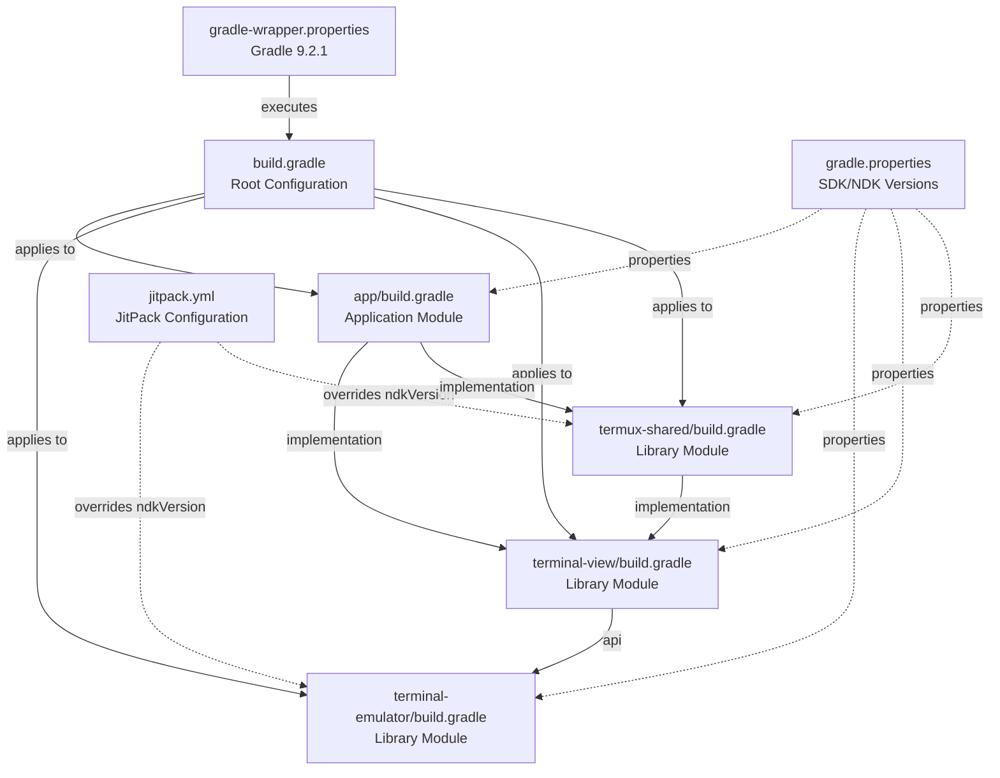

Sources: [build.gradle:1-17](), [app/build.gradle:1-243](), [gradle.properties:1-23](), [jitpack.yml:1-4]()

## Root Build Configuration

The root [build.gradle:1-17]() file defines the build script dependencies and repository configuration for all modules. It specifies the Android Gradle Plugin version and repository locations.

**Key Configuration Elements:**

| Element | Value | Purpose |
|---------|-------|---------|
| Android Gradle Plugin | `8.13.2` | Build toolchain version |
| Repositories | `google()`, `mavenCentral()`, `jitpack.io` | Dependency sources |

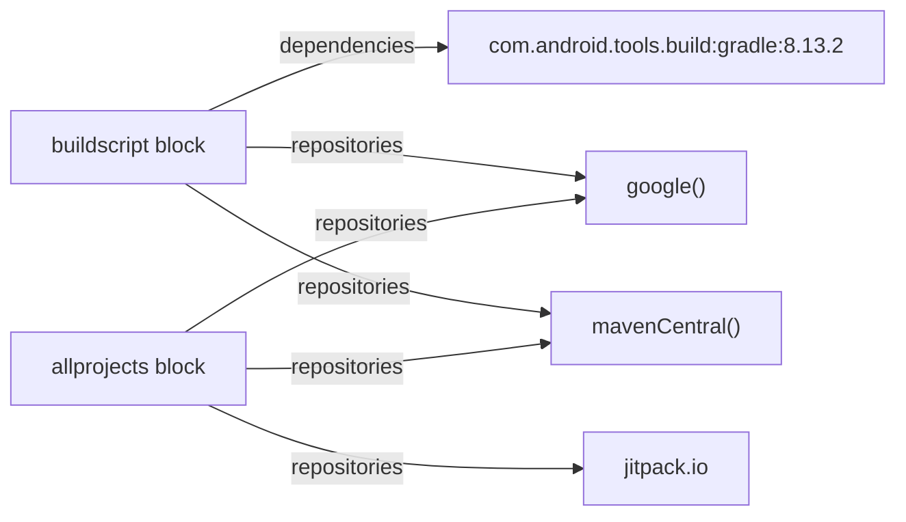

Sources: [build.gradle:1-17]()

## Project-Wide Properties

The [gradle.properties:1-23]() file defines SDK/NDK versions and configuration settings used across all modules.

**Version Configuration:**

| Property | Value | Description |
|----------|-------|-------------|
| `minSdkVersion` | `21` | Android 5.0 Lollipop minimum |
| `targetSdkVersion` | `28` | Android 9.0 Pie target |
| `compileSdkVersion` | `36` | Latest Android SDK for compilation |
| `ndkVersion` | `29.0.14206865` | NDK version for native code |
| `markwonVersion` | `4.6.2` | Markdown rendering library version |

The `org.gradle.jvmargs=-Xmx2048M` setting [gradle.properties:15]() allocates 2GB heap memory for the Gradle daemon process.

Sources: [gradle.properties:15-23]()

## App Module Build Configuration

The [app/build.gradle:1-243]() file is the most complex build configuration, defining the application module structure, package variants, bootstrap management, and APK output naming.

### Package Variant Configuration (`apt-android-7` vs `apt-android-5`)

The `packageVariant` determines which bootstrap archive is embedded in the app APK. This controls whether the package targets newer Android runtimes (`apt-android-7`) or legacy environments (`apt-android-5`):

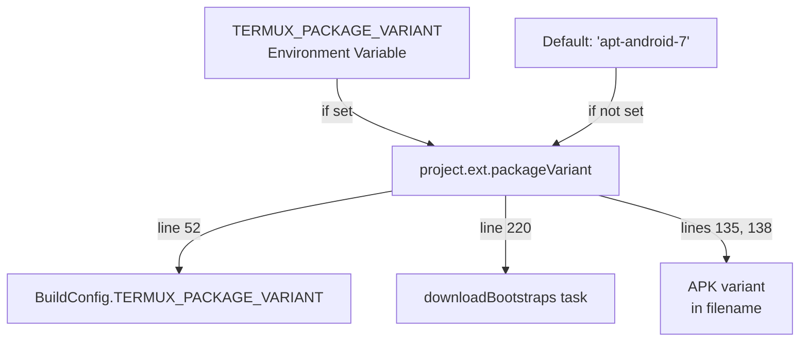

The package variant is set via `System.getenv("TERMUX_PACKAGE_VARIANT")` or falls back to `"apt-android-7"` [app/build.gradle:12](). Supported values are `[ "apt-android-7", "apt-android-5" ]` [app/build.gradle:11](). This value:
- Must be supported by `com.termux.shared.termux.TermuxBootstrap.PackageVariant` or the app will crash at startup [app/build.gradle:7-8]().
- Is embedded as `BuildConfig.TERMUX_PACKAGE_VARIANT` via `buildConfigField` [app/build.gradle:52]() for runtime identification by the `TermuxApplication` class [app/build.gradle:12]().
- Dictates which bootstrap assets are fetched and packed [app/build.gradle:220-236]().
- Appears directly in the output APK filenames [app/build.gradle:135-138]().

Sources: [app/build.gradle:5-13](), [app/build.gradle:52](), [app/build.gradle:218-236]()

### Android Configuration Block

The `android` configuration block [app/build.gradle:15-146]() defines compilation settings, dependencies, and build variants.

- `namespace` is configured as `"com.termux"` [app/build.gradle:16]().
- `compileSdkVersion` reads from `project.properties.compileSdkVersion.toInteger()` [app/build.gradle:18]().
- `ndkVersion` prioritizes the `JITPACK_NDK_VERSION` environment variable, falling back to `project.properties.ndkVersion` [app/build.gradle:19]().

Sources: [app/build.gradle:15-19]()

### Version Management

The app version is managed through `versionCode` and `versionName`:

- `versionCode` is statically set to `118` [app/build.gradle:46]().
- `versionName` defaults to `"0.118.0"` [app/build.gradle:47]() but can be overridden by the `TERMUX_APP_VERSION_NAME` environment variable [app/build.gradle:20](), [app/build.gradle:49]().
- The helper function `validateVersionName()` [app/build.gradle:160-165]() asserts that `versionName` complies strictly with the Semantic Versioning 2.0.0 specification regex [app/build.gradle:163]().

Sources: [app/build.gradle:20](), [app/build.gradle:43-50](), [app/build.gradle:160-165]()

### Build Types and Signing

The app defines two core build types: `release` and `debug` [app/build.gradle:89-99]().

- **Release Build Type**: Enables code minification (`minifyEnabled true`) [app/build.gradle:91]() and disables resource shrinking (`shrinkResources false`) to guarantee reproducible builds [app/build.gradle:92](). ProGuard rules are loaded via `getDefaultProguardFile('proguard-android.txt')` and `proguard-rules.pro` [app/build.gradle:93]().
- **Debug Build Type**: Uses a development signing config `signingConfigs.debug` [app/build.gradle:96-98]() referencing `testkey_untrusted.jks` [app/build.gradle:82]() with standard test alias and password credentials [app/build.gradle:83-85]().

Sources: [app/build.gradle:80-99]()

### ABI Splits Configuration

Split APKs can be generated per CPU architecture (`x86`, `x86_64`, `armeabi-v7a`, `arm64-v8a`) alongside a universal APK [app/build.gradle:69-77]().

- `splits.abi.enable` is dynamically evaluated based on Gradle start task names [app/build.gradle:71-72](): debug builds split by default if `TERMUX_SPLIT_APKS_FOR_DEBUG_BUILDS == "1"` [app/build.gradle:22](), whereas release builds default to monolithic packages (`TERMUX_SPLIT_APKS_FOR_RELEASE_BUILDS == "0"`), required by distribution channels like F-Droid [app/build.gradle:23]().

Sources: [app/build.gradle:22-23](), [app/build.gradle:69-77]()

### APK Output Naming

Outputs are renamed using `applicationVariants.all` to incorporate the build variant, ABI, and version tags [app/build.gradle:131-141]().

**Naming Pattern:**
- Debug: `termux-app_{apkVersionTag or packageVariant-debug}_{abi or universal}.apk` [app/build.gradle:135]()
- Release: `termux-app_{apkVersionTag or packageVariant-release}_{abi or universal}.apk` [app/build.gradle:138]()

Sources: [app/build.gradle:131-141]()

### Native Build Configuration

The app module integrates native compilation through an `externalNativeBuild` block targeting `src/main/cpp/Android.mk` [app/build.gradle:109-113](). Compiler options such as `-std=c11`, `-Wall`, `-Wextra`, `-Werror`, `-Os`, `-fno-stack-protector`, and `-Wl,--gc-sections` are injected via `defaultConfig.externalNativeBuild.ndkBuild.cFlags` [app/build.gradle:63-67]().

Sources: [app/build.gradle:63-67](), [app/build.gradle:109-113]()

### Core Library Desugaring & Manifest Placeholders

- **Desugaring**: Enabled via `coreLibraryDesugaringEnabled true` in `compileOptions` [app/build.gradle:103]() backed by `com.android.tools:desugar_jdk_libs:1.1.5` [app/build.gradle:151]() to support Java 8 APIs on older devices.
- **Manifest Placeholders**: `manifestPlaceholders` injects package and application display names for plugins (`TERMUX_PACKAGE_NAME`, `TERMUX_APP_NAME`, `TERMUX_API_APP_NAME`, `TERMUX_BOOT_APP_NAME`, `TERMUX_FLOAT_APP_NAME`, `TERMUX_STYLING_APP_NAME`, `TERMUX_TASKER_APP_NAME`, `TERMUX_WIDGET_APP_NAME`) [app/build.gradle:54-61]().

Sources: [app/build.gradle:54-61](), [app/build.gradle:103](), [app/build.gradle:151]()

## Library Module Build Configurations

Library modules (`terminal-emulator`, `terminal-view`, `termux-shared`) share common structure via Android Library plugins (`com.android.library`) and `maven-publish` [terminal-emulator/build.gradle:1-2](), [terminal-view/build.gradle:1-2](), [termux-shared/build.gradle:1-2]().

- **`terminal-emulator`**: Configures native JNI building via `src/main/jni/Android.mk` [terminal-emulator/build.gradle:32-36]() and publishes artifact `com.termux:terminal-emulator:0.118.0` [terminal-emulator/build.gradle:78-80]().
- **`terminal-view`**: Depends on `terminal-emulator` using `api project(":terminal-emulator")` [terminal-view/build.gradle:10]() and publishes `com.termux:terminal-view:0.118.0` [terminal-view/build.gradle:56-57]().
- **`termux-shared`**: Implements core infrastructure, requires `commons-io:commons-io:2.5` (pinned to version `2.5` to avoid runtime compatibility faults on Android < 8) [termux-shared/build.gradle:27](), `org.lsposed.hiddenapibypass:hiddenapibypass` [termux-shared/build.gradle:20](), and publishes `com.termux:termux-shared:0.118.0` [termux-shared/build.gradle:94-95]().

Sources: [terminal-emulator/build.gradle:1-85](), [terminal-view/build.gradle:1-63](), [termux-shared/build.gradle:1-100]()

## JitPack Configuration

The [jitpack.yml:1-4]() configuration file establishes the container build parameters for JitPack hosting:
- Uses `openjdk17` [jitpack.yml:2]().
- Defines the `JITPACK_NDK_VERSION` property (`"29.0.14206865"`) [jitpack.yml:4]() which overrides module-level NDK lookups.

Sources: [jitpack.yml:1-4]()

---

# Page: Bootstrap Package Management

# Bootstrap Package Management

<details>
<summary>Relevant source files</summary>

The following files were used as context for generating this wiki page:

- [.gitignore](.gitignore)
- [app/build.gradle](app/build.gradle)
- [app/src/main/cpp/Android.mk](app/src/main/cpp/Android.mk)
- [app/src/main/cpp/termux-bootstrap-zip.S](app/src/main/cpp/termux-bootstrap-zip.S)
- [app/src/main/cpp/termux-bootstrap.c](app/src/main/cpp/termux-bootstrap.c)
- [build.gradle](build.gradle)
- [gradle.properties](gradle.properties)
- [jitpack.yml](jitpack.yml)
- [terminal-emulator/build.gradle](terminal-emulator/build.gradle)
- [terminal-view/build.gradle](terminal-view/build.gradle)
- [termux-shared/build.gradle](termux-shared/build.gradle)
- [termux-shared/src/main/java/com/termux/shared/reflection/ReflectionUtils.java](termux-shared/src/main/java/com/termux/shared/reflection/ReflectionUtils.java)
- [termux-shared/src/main/java/com/termux/shared/termux/TermuxBootstrap.java](termux-shared/src/main/java/com/termux/shared/termux/TermuxBootstrap.java)

</details>


## Purpose and Scope

This document describes the bootstrap package management system used during the Termux APK build process. Bootstrap packages contain the core Unix environment (binaries, libraries, package manager) that is embedded into the APK and extracted on first launch. This page covers the download mechanism, SHA-256 checksum validation, package variants, and build system integration.

For information about runtime bootstrap installation and extraction, see [Bootstrap Installation](#5.1). For general build configuration and variant management, see [Gradle Build Configuration](#2.2).

Sources: [app/build.gradle:1-166](), [termux-shared/src/main/java/com/termux/shared/termux/TermuxBootstrap.java:1-44]()

---

## Bootstrap Package Overview

### Package Variants

Termux supports bootstrap package variants, defined by the `packageVariant` property in `app/build.gradle` [app/build.gradle:5-13]():

| Variant | Target Android | Default | Environment Variable |
|---------|---------------|---------|---------------------|
| `apt-android-7` | Android 7+ (API 24+) | Yes | `TERMUX_PACKAGE_VARIANT` |
| `apt-android-5` | Android 5-6 (API 21-23) | No | `TERMUX_PACKAGE_VARIANT` |

The variant is determined at build time via the `TERMUX_PACKAGE_VARIANT` environment variable, defaulting to `"apt-android-7"` [app/build.gradle:12](). This value is embedded into the APK as `BuildConfig.TERMUX_PACKAGE_VARIANT` [app/build.gradle:52]() for runtime access by `TermuxBootstrap.PackageVariant` [termux-shared/src/main/java/com/termux/shared/termux/TermuxBootstrap.java:23-28]().

**Critical Constraint**: The bootstrap variant is permanently tied to the APK. Users cannot manually replace `$PREFIX` with a different variant's bootstrap after installation, as app code dependencies are variant-specific and will cause crashes [app/build.gradle:6-10]().

### Package Contents

Each bootstrap package is a ZIP archive containing:
- **Core Unix binaries**: `bash`, `coreutils`, `apt`, package manager tools
- **Shared libraries**: `libc`, `libm`, runtime dependencies
- **Package metadata**: `SYMLINKS.txt` for symlink creation during extraction
- **Initial package database**: Pre-configured `apt` repository state

Sources: [app/build.gradle:5-13](), [app/build.gradle:52](), [termux-shared/src/main/java/com/termux/shared/termux/TermuxBootstrap.java:23-28]()

---

## Download Process

### Build Task Orchestration

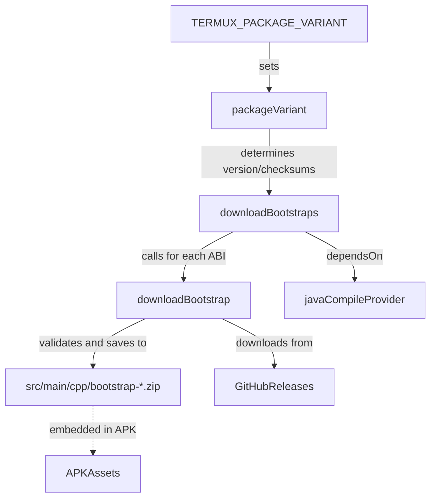

**Download Task Orchestration Diagram**

The `downloadBootstraps` task is automatically invoked before Java compilation for all application variants. It delegates to the `downloadBootstrap()` function four times (once per supported ABI).

Sources: [app/build.gradle:1-166]()

### Download and Validation Flow

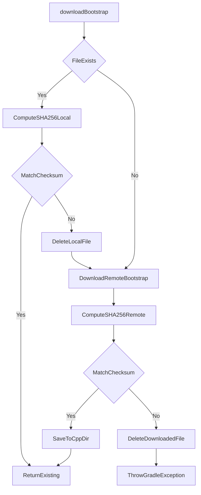

**Bootstrap Download and Validation Flow**

The `downloadBootstrap()` function implements a two-stage validation process:

1. **Local file check**: If the file exists in `src/main/cpp/`, compute its SHA-256 hash. If it matches `expectedChecksum`, reuse it. Otherwise, delete it and proceed to download.

2. **Remote download**: Download from the GitHub releases URL using `DigestInputStream` for streaming hash computation. If the checksum mismatches, delete the file and throw a `GradleException`.

Sources: [app/build.gradle:1-166]()

---

## Architecture-Specific Artifacts

### Supported ABIs

The build system downloads bootstrap packages for four ABIs:

| ABI | Architecture | Termux Name |
|-----|--------------|-------------|
| `arm64-v8a` | 64-bit ARM | `aarch64` |
| `armeabi-v7a` | 32-bit ARM | `arm` |
| `x86_64` | 64-bit x86 | `x86_64` |
| `x86` | 32-bit x86 | `i686` |

Each ABI has a separate bootstrap ZIP with a unique SHA-256 checksum [app/src/main/cpp/termux-bootstrap-zip.S:1-18]().

Sources: [app/src/main/cpp/termux-bootstrap-zip.S:1-18]()

---

## Build Integration

### Task Dependencies

```mermaid
graph LR
    subgraph "Gradle Build Lifecycle"
        EvalPhase["afterEvaluate"]
        JavaCompile["javaCompileProvider"]
        AssembleTask["assemble"]
    end
    
    subgraph "Bootstrap Tasks"
        DownloadTask["downloadBootstraps"]
        CleanTask["clean"]
    end
    
    subgraph "Outputs"
        BootstrapZips["bootstrap-zip-files"]
        NDKBuild["NDKBuild"]
    end
    
    EvalPhase -->|"adds dependsOn"| JavaCompile
    JavaCompile -->|"depends on"| DownloadTask
    DownloadTask -->|"produces"| BootstrapZips
    BootstrapZips -->|"input to"| NDKBuild
    NDKBuild -->|"included in"| AssembleTask
    
    CleanTask -->|"deletes"| BootstrapZips
```

**Build Task Dependency Chain**

The `afterEvaluate` block configures all application variants to depend on `downloadBootstraps` before Java compilation. This ensures bootstrap ZIPs are available before the NDK build (which embeds them in the APK via `termux-bootstrap-zip.S`) and before Java compilation (which needs `BuildConfig.TERMUX_PACKAGE_VARIANT`).

Sources: [app/build.gradle:1-166](), [app/src/main/cpp/termux-bootstrap-zip.S:1-18]()

### BuildConfig Field Generation

The selected `packageVariant` is exposed to application code via `BuildConfig.TERMUX_PACKAGE_VARIANT` [app/build.gradle:52]():

```groovy
buildConfigField "String", "TERMUX_PACKAGE_VARIANT", "\"" + project.ext.packageVariant + "\""
```

This allows runtime code (e.g., `TermuxApplication`, `TermuxBootstrap.PackageVariant` [termux-shared/src/main/java/com/termux/shared/termux/TermuxBootstrap.java:23-28]()) to verify the bootstrap variant and perform variant-specific logic during installation.

Sources: [app/build.gradle:52](), [termux-shared/src/main/java/com/termux/shared/termux/TermuxBootstrap.java:23-28]()

---

## File System Layout

```mermaid
graph TB
    subgraph "Build Directory"
        AppModule["app"]
        BuildGradle["build.gradle"]
        CppDir["app/src/main/cpp"]
        BootstrapZip["bootstrap-zip-files"]
        AndroidMk["Android.mk"]
    end
    
    subgraph "Remote Source"
        GitHubReleases["GitHubReleases"]
    end
    
    subgraph "Build Output"
        APK["TermuxAPK"]
    end
    
    BuildGradle -->|"downloads to"| CppDir
    GitHubReleases -.->|"HTTP GET"| BootstrapZip
    CppDir --> BootstrapZip
    AndroidMk -.->|"packages"| BootstrapZip
    AndroidMk -->|"produces"| APK
```

**Bootstrap File System Layout**

Downloaded bootstrap ZIPs are stored in `app/src/main/cpp/` alongside the `Android.mk` NDK build script and assembly files (`termux-bootstrap-zip.S`). The NDK build process packages the appropriate bootstrap ZIP matching the target ABI into the APK as an asset.

Sources: [app/build.gradle:1-166](), [app/src/main/cpp/termux-bootstrap-zip.S:1-18]()

---

## Environment Variables

| Variable | Purpose | Default | Example |
|----------|---------|---------|---------|
| `TERMUX_PACKAGE_VARIANT` | Selects bootstrap variant | `"apt-android-7"` [app/build.gradle:12]() | `"apt-android-5"` |

The environment variable is read once during build configuration [app/build.gradle:12]() and cannot be changed after compilation.

Sources: [app/build.gradle:12]()

---

# Page: Native Code and NDK Build

# Native Code and NDK Build

<details>
<summary>Relevant source files</summary>

The following files were used as context for generating this wiki page:

- [.gitignore](.gitignore)
- [app/src/main/cpp/Android.mk](app/src/main/cpp/Android.mk)
- [app/src/main/cpp/termux-bootstrap-zip.S](app/src/main/cpp/termux-bootstrap-zip.S)
- [app/src/main/cpp/termux-bootstrap.c](app/src/main/cpp/termux-bootstrap.c)
- [terminal-emulator/src/main/java/com/termux/terminal/JNI.java](terminal-emulator/src/main/java/com/termux/terminal/JNI.java)
- [terminal-emulator/src/main/java/com/termux/terminal/TerminalSession.java](terminal-emulator/src/main/java/com/termux/terminal/TerminalSession.java)
- [terminal-emulator/src/main/java/com/termux/terminal/TerminalSessionClient.java](terminal-emulator/src/main/java/com/termux/terminal/TerminalSessionClient.java)
- [terminal-emulator/src/main/jni/termux.c](terminal-emulator/src/main/jni/termux.c)
- [termux-shared/src/main/cpp/Android.mk](termux-shared/src/main/cpp/Android.mk)
- [termux-shared/src/main/cpp/Application.mk](termux-shared/src/main/cpp/Application.mk)
- [termux-shared/src/main/cpp/local-socket.cpp](termux-shared/src/main/cpp/local-socket.cpp)
- [termux-shared/src/main/java/com/termux/shared/jni/models/JniResult.java](termux-shared/src/main/java/com/termux/shared/jni/models/JniResult.java)
- [termux-shared/src/main/java/com/termux/shared/net/socket/local/PeerCred.java](termux-shared/src/main/java/com/termux/shared/net/socket/local/PeerCred.java)
- [termux-shared/src/main/java/com/termux/shared/termux/terminal/TermuxTerminalSessionClientBase.java](termux-shared/src/main/java/com/termux/shared/termux/terminal/TermuxTerminalSessionClientBase.java)

</details>


## Purpose and Scope

This document describes the Native Development Kit (NDK) configuration and native code compilation across the Termux codebase. It covers NDK version management, compiler flags, ABI variants, and the integration of native libraries into each module's build process. For information about the overall module structure, see [Module Dependencies](#2.1). For details about build variants and APK configuration, see [Gradle Build Configuration](#2.2).

## NDK Version Configuration

The NDK version is centrally defined and can be overridden for different build environments. The primary version specification is in `gradle.properties` [gradle.properties:20]():

```
ndkVersion=29.0.14206865
```

This version is referenced by modules that contain native code. An environment variable override mechanism exists for JitPack builds, as defined in `jitpack.yml` [jitpack.yml:4]():

```
JITPACK_NDK_VERSION: "29.0.14206865"
```

Each module's build script checks for this environment variable and falls back to the property file version:

- **app module**: `app/build.gradle` [app/build.gradle:19]()
- **terminal-emulator module**: `terminal-emulator/build.gradle` [terminal-emulator/build.gradle:8]()
- **termux-shared module**: `termux-shared/build.gradle` [termux-shared/build.gradle:8]()

The override pattern is:
```groovy
ndkVersion = System.getenv("JITPACK_NDK_VERSION") ?: project.properties.ndkVersion
```

**Sources:** [gradle.properties:20](), [jitpack.yml:4](), [app/build.gradle:19](), [terminal-emulator/build.gradle:8](), [termux-shared/build.gradle:8]()

## Modules With Native Code

Three of the four modules in the Termux build system contain native code components. The following diagram shows the relationship between modules and their native build configurations:

**Module Native Build Configuration**

```mermaid
graph TB
    subgraph "Build Configuration Sources"
        GradleProps["gradle.properties<br/>ndkVersion: 29.0.14206865"]
        JitpackYml["jitpack.yml<br/>JITPACK_NDK_VERSION"]
    end
    
    subgraph "app Module"
        AppBuildGradle["app/build.gradle"]
        AppAndroidMk["app/src/main/cpp/Android.mk"]
        AppNativeLibs["libtermux-bootstrap.so<br/>Native bootstrap utilities"]
    end
    
    subgraph "terminal-emulator Module"
        TermEmuBuildGradle["terminal-emulator/build.gradle"]
        TermEmuAndroidMk["terminal-emulator/src/main/jni/Android.mk"]
        TermEmuNativeLibs["libtermux-emulator.so<br/>Terminal emulation native code"]
    end
    
    subgraph "termux-shared Module"
        SharedBuildGradle["termux-shared/build.gradle"]
        SharedAndroidMk["termux-shared/src/main/cpp/Android.mk"]
        SharedNativeLibs["libtermux-shared.so<br/>Shared native utilities"]
    end
    
    subgraph "terminal-view Module"
        TermViewBuildGradle["terminal-view/build.gradle<br/>(No native code)"]
    end
    
    GradleProps -->|"ndkVersion property"| AppBuildGradle
    GradleProps -->|"ndkVersion property"| TermEmuBuildGradle
    GradleProps -->|"ndkVersion property"| SharedBuildGradle
    
    JitpackYml -.->|"optional override"| AppBuildGradle
    JitpackYml -.->|"optional override"| TermEmuBuildGradle
    JitpackYml -.->|"optional override"| SharedBuildGradle
    
    AppBuildGradle -->|"externalNativeBuild.ndkBuild.path"| AppAndroidMk
    TermEmuBuildGradle -->|"externalNativeBuild.ndkBuild.path"| TermEmuAndroidMk
    SharedBuildGradle -->|"externalNativeBuild.ndkBuild.path"| SharedAndroidMk
    
    AppAndroidMk -->|"builds"| AppNativeLibs
    TermEmuAndroidMk -->|"builds"| TermEmuNativeLibs
    SharedAndroidMk -->|"builds"| SharedNativeLibs
```

**Sources:** [app/build.gradle:109-113](), [terminal-emulator/build.gradle:32-36](), [termux-shared/build.gradle:61-65]()

## Android.mk File Locations

Each module with native code specifies the path to its `Android.mk` file via the `externalNativeBuild` block:

| Module | Android.mk Path | Configuration Location |
|--------|----------------|------------------------|
| app | `src/main/cpp/Android.mk` | [app/build.gradle:111]() |
| terminal-emulator | `src/main/jni/Android.mk` | [terminal-emulator/build.gradle:34]() |
| termux-shared | `src/main/cpp/Android.mk` | [termux-shared/build.gradle:63]() |

Note the inconsistent directory naming convention: the app and termux-shared modules use `cpp/` while terminal-emulator uses `jni/`. Both are valid NDK conventions, though `jni/` is the older standard.

**Sources:** [app/build.gradle:109-113](), [terminal-emulator/build.gradle:32-36](), [termux-shared/build.gradle:61-65]()

## Compiler Flags and Optimization Settings

### Standard Compiler Flags

The app and terminal-emulator modules use identical compiler flags specified in the `defaultConfig.externalNativeBuild.ndkBuild` block:

**app module** `app/build.gradle`:
```groovy
externalNativeBuild {
    ndkBuild {
        cFlags "-std=c11", "-Wall", "-Wextra", "-Werror", "-Os", "-fno-stack-protector", "-Wl,--gc-sections"
    }
}
```

**terminal-emulator module** `terminal-emulator/build.gradle`:
```groovy
externalNativeBuild {
    ndkBuild {
        cFlags "-std=c11", "-Wall", "-Wextra", "-Werror", "-Os", "-fno-stack-protector", "-Wl,--gc-sections"
    }
}
```

**Compiler Flag Breakdown**

```mermaid
graph LR
    subgraph "Language Standard"
        Std["-std=c11<br/>C11 standard compliance"]
    end
    
    subgraph "Warning Flags"
        Wall["-Wall<br/>Enable all warnings"]
        Wextra["-Wextra<br/>Extra warnings"]
        Werror["-Werror<br/>Treat warnings as errors"]
    end
    
    subgraph "Optimization Flags"
        Os["-Os<br/>Optimize for size"]
        NoStack["-fno-stack-protector<br/>Disable stack canaries"]
        GC["-Wl,--gc-sections<br/>Remove unused sections"]
    end
    
    Std --> Build["Native Library Build"]
    Wall --> Build
    Wextra --> Build
    Werror --> Build
    Os --> Build
    NoStack --> Build
    GC --> Build
```

**Flag Explanations:**

| Flag | Purpose | Rationale |
|------|---------|-----------|
| `-std=c11` | Enforce C11 standard | Modern C features while maintaining compatibility |
| `-Wall` | Enable all standard warnings | Catch common programming errors |
| `-Wextra` | Enable extra warnings | Additional static analysis |
| `-Werror` | Treat warnings as errors | Enforce code quality standards |
| `-Os` | Optimize for size | Minimize APK size (critical for mobile) |
| `-fno-stack-protector` | Disable stack canaries | Reduce overhead in size-constrained environments |
| `-Wl,--gc-sections` | Remove unused code sections | Further size optimization at link time |

The termux-shared module uses a minimal configuration `termux-shared/build.gradle`:
```groovy
externalNativeBuild {
    ndkBuild {
        cppFlags ''
    }
}
```

This empty `cppFlags` configuration indicates that the module either has minimal native code or relies on defaults specified in its `Android.mk` file.

**Sources:** [app/build.gradle](), [terminal-emulator/build.gradle](), [termux-shared/build.gradle]()

## ABI Variants

### Supported ABIs

The terminal-emulator module explicitly declares supported ABIs using the `ndk.abiFilters` configuration `terminal-emulator/build.gradle`:

```groovy
ndk {
    abiFilters 'x86', 'x86_64', 'armeabi-v7a', 'arm64-v8a'
}
```

These four ABIs cover all modern Android devices:

| ABI | Architecture | Devices |
|-----|-------------|---------|
| `x86` | 32-bit Intel | Emulators, tablets, older Intel devices |
| `x86_64` | 64-bit Intel | Modern emulators, Intel-based devices |
| `armeabi-v7a` | 32-bit ARM | Older phones and tablets |
| `arm64-v8a` | 64-bit ARM | Modern Android phones and tablets |

The app module's ABI handling is more complex due to split APK support. See [Gradle Build Configuration](#2.2) for details on the split APK mechanism.

**ABI Build and Packaging Flow**

```mermaid
graph TB
    subgraph "NDK Build Process"
        AndroidMk["Android.mk<br/>Build configuration"]
        NDKBuild["ndk-build command<br/>Executed by Gradle"]
    end
    
    subgraph "Compilation Per ABI"
        X86Build["x86 build<br/>32-bit Intel"]
        X86_64Build["x86_64 build<br/>64-bit Intel"]
        ARMv7Build["armeabi-v7a build<br/>32-bit ARM"]
        ARM64Build["arm64-v8a build<br/>64-bit ARM"]
    end
    
    subgraph "Native Libraries Output"
        X86Lib["lib/x86/*.so"]
        X86_64Lib["lib/x86_64/*.so"]
        ARMv7Lib["lib/armeabi-v7a/*.so"]
        ARM64Lib["lib/arm64-v8a/*.so"]
    end
    
    subgraph "APK Packaging"
        UniversalAPK["Universal APK<br/>All 4 ABIs"]
        SplitX86["Split APK: x86"]
        SplitX86_64["Split APK: x86_64"]
        SplitARMv7["Split APK: armeabi-v7a"]
        SplitARM64["Split APK: arm64-v8a"]
    end
    
    AndroidMk --> NDKBuild
    NDKBuild --> X86Build
    NDKBuild --> X86_64Build
    NDKBuild --> ARMv7Build
    NDKBuild --> ARM64Build
    
    X86Build --> X86Lib
    X86_64Build --> X86_64Lib
    ARMv7Build --> ARMv7Lib
    ARM64Build --> ARM64Lib
    
    X86Lib --> UniversalAPK
    X86_64Lib --> UniversalAPK
    ARMv7Lib --> UniversalAPK
    ARM64Lib --> UniversalAPK
    
    X86Lib --> SplitX86
    X86_64Lib --> SplitX86_64
    ARMv7Lib --> SplitARMv7
    ARM64Lib --> SplitARM64
```

**Sources:** [terminal-emulator/build.gradle](), [app/build.gradle]()

### Split APK Configuration

The app module configures ABI splits through the `splits.abi` block `app/build.gradle`:

```groovy
splits {
    abi {
        enable ((gradle.startParameter.taskNames.any { it.contains("Debug") } && splitAPKsForDebugBuilds == "1") ||
            (gradle.startParameter.taskNames.any { it.contains("Release") } && splitAPKsForReleaseBuilds == "1"))
        reset ()
        include 'x86', 'x86_64', 'armeabi-v7a', 'arm64-v8a'
        universalApk true
    }
}
```

This configuration:
- Enables splits conditionally based on build type and environment variables
- Includes the same four ABIs as terminal-emulator
- Always generates a universal APK containing all ABIs (`universalApk true`)

The split behavior is controlled by environment variables:
- `TERMUX_SPLIT_APKS_FOR_DEBUG_BUILDS` (default: "1") [app/build.gradle:22]()
- `TERMUX_SPLIT_APKS_FOR_RELEASE_BUILDS` (default: "0") [app/build.gradle:23]()

Debug builds split by default (producing 5 APKs: 4 ABI-specific + 1 universal), while release builds do not split by default (F-Droid requirement, as noted in the comment).

**Sources:** [app/build.gradle:22-23]()

## JNI Library Packaging and Bridges

### Legacy Packaging Mode

The app module uses legacy JNI packaging to ensure compatibility with older Android versions `app/build.gradle`:

```groovy
packagingOptions {
    jniLibs {
        useLegacyPackaging true
    }
}
```

This setting affects how native libraries are stored in the APK:
- **Legacy mode (`true`)**: Libraries are stored uncompressed in the APK
- **Modern mode (`false`)**: Libraries are compressed, extracted at install time

Legacy packaging increases APK size but improves installation reliability and runtime performance on older Android versions, as the libraries can be memory-mapped directly from the APK without extraction.

### JNI Bridges & Process Spawning

The terminal emulation core bridges Java and native code via `com.termux.terminal.JNI` [terminal-emulator/src/main/java/com/termux/terminal/JNI.java:1]() and `terminal-emulator/src/main/jni/termux.c` [terminal-emulator/src/main/jni/termux.c:1](). 

`TerminalSession` [terminal-emulator/src/main/java/com/termux/terminal/TerminalSession.java:31]() initializes a pseudo-terminal subprocess through native functions:

```mermaid
graph TD
    TS[TerminalSession.java<br/>com.termux.terminal.TerminalSession] -->|Calls JNI| JNI[JNI.java<br/>com.termux.terminal.JNI]
    JNI -->|Loads libtermux.so| TC[termux.c<br/>Java_com_termux_terminal_JNI_createSubprocess]
    TC -->|Opens| PTMX["/dev/ptmx"]
    TC -->|Forks process| Fork[fork()]
    Fork -->|Executes command| Exec[execvp]
```

**Sources:** [app/build.gradle](), [terminal-emulator/src/main/java/com/termux/terminal/JNI.java:1-41](), [terminal-emulator/src/main/jni/termux.c:1-190](), [terminal-emulator/src/main/java/com/termux/terminal/TerminalSession.java:31-166]()

## Build Integration Summary

The following diagram shows the complete integration of native code compilation into the Gradle build process:

**Native Code Build Integration**

```mermaid
graph TB
    subgraph "Gradle Configuration"
        GradleStart["Gradle Build Initiated"]
        EnvCheck["Check JITPACK_NDK_VERSION"]
        NDKVersion["Set ndkVersion<br/>29.0.14206865 or override"]
    end
    
    subgraph "Per-Module Native Build"
        AppNative["app module<br/>externalNativeBuild"]
        TermEmuNative["terminal-emulator module<br/>externalNativeBuild"]
        SharedNative["termux-shared module<br/>externalNativeBuild"]
    end
    
    subgraph "NDK Build Execution"
        ReadMk["Read Android.mk"]
        CompileC["Compile C/C++ sources<br/>with cFlags"]
        LinkLibs["Link native libraries<br/>with --gc-sections"]
    end
    
    subgraph "Per-ABI Output"
        LibsX86["lib/x86/*.so"]
        LibsX86_64["lib/x86_64/*.so"]
        LibsARMv7["lib/armeabi-v7a/*.so"]
        LibsARM64["lib/arm64-v8a/*.so"]
    end
    
    subgraph "APK Assembly"
        PackageLibs["Package native libs<br/>useLegacyPackaging: true"]
        GenerateAPK["Generate APK(s)<br/>Universal + Splits (optional)"]
    end
    
    GradleStart --> EnvCheck
    EnvCheck --> NDKVersion
    NDKVersion --> AppNative
    NDKVersion --> TermEmuNative
    NDKVersion --> SharedNative
    
    AppNative --> ReadMk
    TermEmuNative --> ReadMk
    SharedNative --> ReadMk
    
    ReadMk --> CompileC
    CompileC --> LinkLibs
    
    LinkLibs --> LibsX86
    LinkLibs --> LibsX86_64
    LinkLibs --> LibsARMv7
    LinkLibs --> LibsARM64
    
    LibsX86 --> PackageLibs
    LibsX86_64 --> PackageLibs
    LibsARMv7 --> PackageLibs
    LibsARM64 --> PackageLibs
    
    PackageLibs --> GenerateAPK
```

**Sources:** [app/build.gradle:19](), [app/build.gradle:63-67](), [app/build.gradle:109-113](), [terminal-emulator/build.gradle:8](), [terminal-emulator/build.gradle:14-18](), [terminal-emulator/build.gradle:32-36](), [termux-shared/build.gradle:8](), [termux-shared/build.gradle:61-65]()

## Module-Specific Native Code Roles

While this document describes the build configuration, the actual purpose and implementation of the native code varies by module:

| Module | Native Code Purpose | Build Configuration |
|--------|-------------------|---------------------|
| **app** | Bootstrap utilities and helper functions | [app/build.gradle:63-67](), [app/build.gradle:109-113]() |
| **terminal-emulator** | Terminal emulation logic, escape sequence processing | [terminal-emulator/build.gradle:14-18](), [terminal-emulator/build.gradle:32-36]() |
| **termux-shared** | Shared native utilities used across modules | [termux-shared/build.gradle:39-43](), [termux-shared/build.gradle:61-65]() |
| **terminal-view** | No native code (pure Java/Kotlin) | [terminal-view/build.gradle]() |

**Sources:** [app/build.gradle](), [terminal-emulator/build.gradle](), [termux-shared/build.gradle](), [terminal-view/build.gradle]()

---

# Page: CI/CD Pipeline

# CI/CD Pipeline

<details>
<summary>Relevant source files</summary>

The following files were used as context for generating this wiki page:

- [.github/FUNDING.yml](.github/FUNDING.yml)
- [.github/ISSUE_TEMPLATE/01-bug-report.yml](.github/ISSUE_TEMPLATE/01-bug-report.yml)
- [.github/ISSUE_TEMPLATE/02-feature-request.yml](.github/ISSUE_TEMPLATE/02-feature-request.yml)
- [.github/ISSUE_TEMPLATE/config.yml](.github/ISSUE_TEMPLATE/config.yml)
- [.github/dependabot.yml](.github/dependabot.yml)
- [.github/workflows/attach_debug_apks_to_release.yml](.github/workflows/attach_debug_apks_to_release.yml)
- [.github/workflows/debug_build.yml](.github/workflows/debug_build.yml)
- [.github/workflows/dependency-submission.yml](.github/workflows/dependency-submission.yml)
- [.github/workflows/gradle-wrapper-validation.yml](.github/workflows/gradle-wrapper-validation.yml)
- [.github/workflows/run_tests.yml](.github/workflows/run_tests.yml)
- [.github/workflows/trigger_library_builds_on_jitpack.yml](.github/workflows/trigger_library_builds_on_jitpack.yml)
- [app/src/main/java/com/termux/app/activities/HelpActivity.java](app/src/main/java/com/termux/app/activities/HelpActivity.java)

</details>


## Purpose and Scope

This document describes the GitHub Actions-based continuous integration and continuous delivery (CI/CD) pipeline for the Termux application. The pipeline automates APK building, testing, release attachment, dependency submission, package management via dependabot, issue templates, and library distribution. It produces debug APKs for multiple ABI variants and package variants, validates the Gradle wrapper, runs unit tests, and triggers downstream builds on JitPack.

For information about the Gradle build configuration that the CI/CD pipeline executes, see [Gradle Build Configuration](#2.2). For details on bootstrap package management during builds, see [Bootstrap Package Management](#2.3).

Sources: [.github/workflows/debug_build.yml:1-133](), [.github/workflows/attach_debug_apks_to_release.yml:1-84](), [.github/dependabot.yml:1-9]()

## Workflow Architecture

The CI/CD system consists of multiple GitHub Actions workflows and configuration files, triggered by different repository events:

Diagram: Workflow Architecture Overview
```mermaid
graph TB
    subgraph "Repository Events"
        PushMaster["Push to master or github-releases/**"]
        PullRequest["Pull Request to master"]
        ReleasePublished["Release Published"]
        WorkflowDispatch["Manual Trigger"]
    end
    
    subgraph "GitHub Actions Workflows"
        DebugBuild["debug_build.yml<br/>Build APKs"]
        AttachAPKs["attach_debug_apks_to_release.yml<br/>Attach APKs to Release"]
        RunTests["run_tests.yml<br/>Unit Tests"]
        GradleValidation["gradle-wrapper-validation.yml<br/>Validate Gradle Wrapper"]
        DependencySubmission["dependency-submission.yml<br/>Submit Dependency Graph"]
        JitPackTrigger["trigger_library_builds_on_jitpack.yml<br/>Trigger JitPack Builds"]
    end
    
    subgraph "Build Outputs"
        APKArtifacts["APK Artifacts<br/>10 APKs per variant<br/>+ sha256sums"]
        ReleaseAssets["GitHub Release Assets"]
        TestResults["Test Reports"]
        JitPackLibs["JitPack Library Artifacts<br/>terminal-emulator<br/>terminal-view<br/>termux-shared"]
    end
    
    PushMaster --> DebugBuild
    PushMaster --> RunTests
    PushMaster --> GradleValidation
    PushMaster --> DependencySubmission
    PullRequest --> DebugBuild
    PullRequest --> RunTests
    PullRequest --> GradleValidation
    ReleasePublished --> AttachAPKs
    ReleasePublished --> JitPackTrigger
    WorkflowDispatch --> DependencySubmission
    
    DebugBuild --> APKArtifacts
    AttachAPKs --> ReleaseAssets
    RunTests --> TestResults
    JitPackTrigger --> JitPackLibs
```

Sources: [.github/workflows/debug_build.yml:1-133](), [.github/workflows/attach_debug_apks_to_release.yml:1-84](), [.github/workflows/run_tests.yml:1-26](), [.github/workflows/gradle-wrapper-validation.yml:1-20](), [.github/workflows/dependency-submission.yml:1-23](), [.github/workflows/trigger_library_builds_on_jitpack.yml:1-21]()

## Build Workflow (debug_build.yml)

The primary build workflow executes on every push to `master` or `github-releases/**` branches and on pull requests to `master` [.github/workflows/debug_build.yml:1-11](). It builds debug APKs for all supported ABIs and both package variants.

### Build Matrix

The workflow uses a matrix strategy to build APKs for two package variants in parallel [.github/workflows/debug_build.yml:15-19]():

| Matrix Dimension | Values |
|-----------------|---------|
| `package_variant` | `apt-android-7`, `apt-android-5` |
| ABIs (per variant) | `universal`, `arm64-v8a`, `armeabi-v7a`, `x86_64`, `x86` |
| **Total APKs per run** | **10** (5 ABIs × 2 variants) |

The `fail-fast: false` configuration ensures that if one variant fails, the other continues building [.github/workflows/debug_build.yml:16-18]().

Sources: [.github/workflows/debug_build.yml:13-18]()

### Version Naming Scheme

The workflow generates semantic version names by combining the version from `app/build.gradle` with the Git commit hash:

Diagram: Version Naming Generation Flow
```mermaid
flowchart LR
    VersionRegex["versionName extraction from app/build.gradle CURRENT_VERSION_NAME_REGEX"]
    CommitHash["Git Commit Hash GITHUB_SHA:0:7"]
    Variant["Package Variant apt-android-7 or apt-android-5"]
    
    VersionRegex --> VersionName["RELEASE_VERSION_NAME v{VERSION}+{HASH}"]
    CommitHash --> VersionName
    
    VersionName --> APKVersionTag["APK_VERSION_TAG {VERSION}+{HASH}-{VARIANT}-github-debug"]
    Variant --> APKVersionTag
    
    APKVersionTag --> APKFilename["APK Filename termux-app_{APK_VERSION_TAG}_{ABI}.apk"]
    
    APKVersionTag --> EnvVars["Environment Variables TERMUX_APP_VERSION_NAME TERMUX_APK_VERSION_TAG TERMUX_PACKAGE_VARIANT"]
```

The version naming follows semantic versioning 2.0.0 specification and is validated using a regex pattern [.github/workflows/debug_build.yml:44-49](). For pull requests, the workflow uses the PR head SHA instead of the merge commit SHA [.github/workflows/debug_build.yml:39-41]().

Sources: [.github/workflows/debug_build.yml:43-63]()

### Build Steps

The workflow executes the following steps:

1. **Repository Clone**: Uses `actions/checkout@v6` [.github/workflows/debug_build.yml:21-22]()
2. **Java Setup**: Installs Temurin JDK 17 via `actions/setup-java@v5` [.github/workflows/debug_build.yml:24-28]()
3. **Version Configuration**: Extracts current version from `app/build.gradle` and generates `RELEASE_VERSION_NAME` [.github/workflows/debug_build.yml:43-49]()
4. **Environment Export**: Sets `TERMUX_APP_VERSION_NAME`, `TERMUX_APK_VERSION_TAG`, and `TERMUX_PACKAGE_VARIANT` environment variables consumed by `app/build.gradle` [.github/workflows/debug_build.yml:61-63]()
5. **APK Build**: Executes `./gradlew assembleDebug` [.github/workflows/debug_build.yml:64-66]()
6. **APK Validation**: Verifies all five ABI-specific APKs were generated [.github/workflows/debug_build.yml:68-74]()
7. **Checksum Generation**: Generates `sha256sums` file for all APKs [.github/workflows/debug_build.yml:76-85]()
8. **Artifact Upload**: Uploads each APK and the checksums file as separate workflow artifacts using `actions/upload-artifact@v6` [.github/workflows/debug_build.yml:87-133]()

Sources: [.github/workflows/debug_build.yml:20-133]()

### Build Output Structure

The workflow generates the following files in `./app/build/outputs/apk/debug`:

| File Pattern | Description |
|-------------|-------------|
| `termux-app_{VERSION_TAG}_universal.apk` | Universal APK containing all ABIs |
| `termux-app_{VERSION_TAG}_arm64-v8a.apk` | ARM64 APK (64-bit ARM) |
| `termux-app_{VERSION_TAG}_armeabi-v7a.apk` | ARMv7 APK (32-bit ARM) |
| `termux-app_{VERSION_TAG}_x86_64.apk` | x86-64 APK (64-bit Intel) |
| `termux-app_{VERSION_TAG}_x86.apk` | x86 APK (32-bit Intel) |
| `termux-app_{VERSION_TAG}_sha256sums` | SHA-256 checksums for all APKs |
| `output-metadata.json` | Gradle metadata (attached to each artifact) |

Sources: [.github/workflows/debug_build.yml:51-53](), [.github/workflows/debug_build.yml:87-133]()

## Release Attachment Workflow (attach_debug_apks_to_release.yml)

This workflow triggers when a GitHub release is published and automatically builds and attaches debug APKs to the release [.github/workflows/attach_debug_apks_to_release.yml:1-8]().

### Release Build Process

Diagram: Release Attachment and Error Rollback Logic
```mermaid
flowchart TD
    ReleasePublished["Release Published Event types: published"]
    CloneRepo["Clone Repository ref: GITHUB_REF"]
    ExtractVersion["Extract Version RELEASE_VERSION_NAME = GITHUB_REF without refs/tags/"]
    ValidateVersion["Validate Semantic Version Regex Check"]
    
    BuildMatrix["Build Matrix package_variant: apt-android-7, apt-android-5"]
    
    BuildAPKs["Build APKs ./gradlew assembleDebug TERMUX_APK_VERSION_TAG TERMUX_PACKAGE_VARIANT"]
    ValidateAPKs["Validate APKs Check all 5 ABIs exist"]
    GenerateSHA["Generate sha256sums"]
    
    AttachToRelease["Attach to Release hub release edit -a APK_FILES"]
    
    RollbackOnError["On Error: hub release delete, git push --delete origin"]
    
    ReleasePublished --> CloneRepo
    CloneRepo --> ExtractVersion
    ExtractVersion --> ValidateVersion
    ValidateVersion --> BuildMatrix
    BuildMatrix --> BuildAPKs
    BuildAPKs --> ValidateAPKs
    ValidateAPKs --> GenerateSHA
    GenerateSHA --> AttachToRelease
    
    BuildAPKs -.failure.-> RollbackOnError
    ValidateAPKs -.failure.-> RollbackOnError
    GenerateSHA -.failure.-> RollbackOnError
    AttachToRelease -.failure.-> RollbackOnError
```

Unlike the debug build workflow, this workflow uses the `hub` CLI tool to attach APK files directly to the GitHub release [.github/workflows/attach_debug_apks_to_release.yml:74-84](). The version tag is extracted from `GITHUB_REF` without modification, and the APK version tag format is `{RELEASE_VERSION_NAME}+{PACKAGE_VARIANT}-github-debug` [.github/workflows/attach_debug_apks_to_release.yml:38-45]().

### Error Handling and Rollback

The workflow includes comprehensive error handling with an `exit_on_error()` function that:
1. Prints the error message [.github/workflows/attach_debug_apks_to_release.yml:30]()
2. Deletes the created release using `hub release delete` [.github/workflows/attach_debug_apks_to_release.yml:32]()
3. Deletes the Git tag using `git push --delete origin` [.github/workflows/attach_debug_apks_to_release.yml:33]()
4. Exits with status code 1 [.github/workflows/attach_debug_apks_to_release.yml:34]()

Sources: [.github/workflows/attach_debug_apks_to_release.yml:1-84]()

## Unit Test Workflow (run_tests.yml)

The test workflow executes on pushes and pull requests to `master` and `android-10` branches [.github/workflows/run_tests.yml:1-12](). It runs Gradle test tasks across all modules.

### Test Execution

The workflow performs the following steps:
1. Clones the repository with `actions/checkout@v6` [.github/workflows/run_tests.yml:17-18]()
2. Sets up Temurin JDK 17 via `actions/setup-java@v5` [.github/workflows/run_tests.yml:19-23]()
3. Executes `./gradlew test` to run unit tests for all modules [.github/workflows/run_tests.yml:24-26]()

Sources: [.github/workflows/run_tests.yml:1-26]()

## Gradle Wrapper Validation

The Gradle wrapper validation workflow ensures the integrity and authenticity of the Gradle wrapper files to prevent supply chain attacks [.github/workflows/gradle-wrapper-validation.yml:1-13]().

### Validation Process

Diagram: Gradle Wrapper Validation Flow
```mermaid
flowchart LR
    Trigger["Push or PR to master or android-10"]
    Checkout["actions/checkout@v6"]
    Validate["gradle/actions/wrapper-validation@v6 Validates: gradle-wrapper.jar SHA-256 and gradle-wrapper.properties"]
    
    Trigger --> Checkout
    Checkout --> Validate
```

The workflow uses the official `gradle/actions/wrapper-validation@v6` action to verify that `gradle/wrapper/gradle-wrapper.jar` matches the expected SHA-256 checksum and properties configuration [.github/workflows/gradle-wrapper-validation.yml:20]().

Sources: [.github/workflows/gradle-wrapper-validation.yml:1-20]()

## JitPack Library Build Trigger

When a release is published, this workflow triggers JitPack to build and publish the three library modules as Maven artifacts [.github/workflows/trigger_library_builds_on_jitpack.yml:1-7]().

### Trigger Mechanism

Diagram: JitPack Trigger Sequence
```mermaid
sequenceDiagram
    participant Release as GitHub Release
    participant Workflow as trigger_library_builds_on_jitpack.yml
    participant JitPack as jitpack.io
    
    Release->>Workflow: Release Published Event
    Workflow->>Workflow: Extract Version from Tag GITHUB_REF without v prefix
    Workflow->>Workflow: Wait 180 seconds for tag detection
    Workflow->>JitPack: GET terminal-emulator POM /com/termux/termux-app/terminal-emulator/{VERSION}/
    Workflow->>JitPack: GET terminal-view POM /com/termux/termux-app/terminal-view/{VERSION}/
    Workflow->>JitPack: GET termux-shared POM /com/termux/termux-app/termux-shared/{VERSION}/
    JitPack->>JitPack: Build and Publish Artifacts
```

The workflow extracts the version, waits 180 seconds for tag detection, and requests the Maven POM files for `terminal-emulator`, `terminal-view`, and `termux-shared` to prompt building on JitPack [.github/workflows/trigger_library_builds_on_jitpack.yml:12-21]().

Sources: [.github/workflows/trigger_library_builds_on_jitpack.yml:1-21]()

## Dependency Submission Workflow

This workflow generates and submits a dependency graph to GitHub's Dependency Graph feature, enabling Dependabot security alerts and dependency insights [.github/workflows/dependency-submission.yml:1-11]().

The workflow uses `gradle/actions/dependency-submission@v6` to analyze all Gradle dependencies and submit them under `contents: write` permissions [.github/workflows/dependency-submission.yml:8-23]().

Sources: [.github/workflows/dependency-submission.yml:1-23]()

## Dependabot Configuration

Dependabot is configured via `.github/dependabot.yml` to automatically manage updates for GitHub Actions workflows on a daily schedule [.github/dependabot.yml:1-6](). All commits generated by dependabot are prefixed with `"Changed"` [.github/dependabot.yml:7-9]().

Sources: [.github/dependabot.yml:1-9]()

## Issue Templates and Repository Configuration

The repository maintains standard issue templates under `.github/ISSUE_TEMPLATE/`:
- **Bug Report (`01-bug-report.yml`)**: Mandates problem descriptions, reproduction steps, expected behavior, and system environment info (Termux version, Android OS version, device model) [.github/ISSUE_TEMPLATE/01-bug-report.yml:1-45]().
- **Feature Request (`02-feature-request.yml`)**: Guides users in submitting new feature suggestions [.github/ISSUE_TEMPLATE/02-feature-request.yml:1-19]().
- **Config (`config.yml`)**: Disables blank issues and directs users to GitHub Discussions [.github/ISSUE_TEMPLATE/config.yml:1-5]().

Sources: [.github/ISSUE_TEMPLATE/01-bug-report.yml:1-45](), [.github/ISSUE_TEMPLATE/config.yml:1-5]()

## Build Environment Configuration

All build workflows share common environment setup:

| Component | Version | Action / Source |
|-----------|---------|-----------------|
| **Runner OS** | `ubuntu-latest` | GitHub-hosted runner [.github/workflows/debug_build.yml:14]() |
| **Java Distribution** | Temurin (Eclipse Adoptium) | `actions/setup-java@v5` [.github/workflows/debug_build.yml:25]() |
| **Java Version** | 17 | Required by Gradle and Android build tools [.github/workflows/debug_build.yml:28]() |
| **Checkout Action** | `actions/checkout@v6` | Repository cloning [.github/workflows/debug_build.yml:22]() |
| **Artifact Upload** | `actions/upload-artifact@v6` | Debug build workflow only [.github/workflows/debug_build.yml:88]() |

Sources: [.github/workflows/debug_build.yml:14](), [.github/workflows/debug_build.yml:24-28](), [.github/workflows/attach_debug_apks_to_release.yml:10](), [.github/workflows/run_tests.yml:15-23]()

## Artifact Retention and Distribution

### Workflow Artifacts

Debug build workflow artifacts are uploaded with default retention:
- Each of the 5 ABI-specific APKs is uploaded as a separate artifact [.github/workflows/debug_build.yml:87-125]()
- Each artifact includes `output-metadata.json` from Gradle [.github/workflows/debug_build.yml:93]()
- The `sha256sums` file is uploaded as a separate artifact [.github/workflows/debug_build.yml:127-133]()

### Release Assets

Release attachment workflow directly adds assets to GitHub releases using `hub release edit` [.github/workflows/attach_debug_apks_to_release.yml:74-84]() containing all 5 ABI-specific APKs and the `sha256sums` file.

Sources: [.github/workflows/debug_build.yml:87-133](), [.github/workflows/attach_debug_apks_to_release.yml:74-84]()

---

# Page: Gradle Wrapper

# Gradle Wrapper

<details>
<summary>Relevant source files</summary>

The following files were used as context for generating this wiki page:

- [app/proguard-rules.pro](app/proguard-rules.pro)
- [gradle/wrapper/gradle-wrapper.jar](gradle/wrapper/gradle-wrapper.jar)
- [gradle/wrapper/gradle-wrapper.properties](gradle/wrapper/gradle-wrapper.properties)
- [gradlew](gradlew)
- [gradlew.bat](gradlew.bat)

</details>


## Purpose and Scope

This document describes the Gradle Wrapper system used in the Termux application repository. The Gradle Wrapper is a standardized mechanism for distributing Gradle with the project, ensuring all developers, contributors, and CI/CD systems use the identical Gradle version (9.2.1) without requiring manual installation. This eliminates "works on my machine" issues caused by Gradle version mismatches and provides a consistent, reproducible build environment.

This page also outlines the ProGuard configuration rules applied during code shrinking and minification for the application modules.

For information about the broader build configuration and module structure, see [Gradle Build Configuration](#2.2). For details on CI/CD pipeline integration, see [CI/CD Pipeline](#2.5).

---

## Wrapper Components

The Gradle Wrapper system consists of four key components that work together to bootstrap and execute Gradle builds:

```mermaid
graph TB
    subgraph "Wrapper Components"
        Props["gradle-wrapper.properties<br/>Configuration File"]
        Jar["gradle-wrapper.jar<br/>Bootstrap JAR"]
        Unix["gradlew<br/>Unix Shell Script"]
        Win["gradlew.bat<br/>Windows Batch Script"]
    end
    
    subgraph "Gradle Distribution"
        URL["services.gradle.org<br/>Distribution Server"]
        Cache["~/.gradle/wrapper/dists<br/>Local Cache"]
        Gradle921["gradle-9.2.1-bin<br/>Extracted Distribution"]
    end
    
    subgraph "Build Execution"
        BuildGradle["build.gradle Files<br/>Build Scripts"]
        BuildOutput["APK Artifacts<br/>Build Outputs"]
    end
    
    Props -->|"read by"| Jar
    Unix -->|"invokes"| Jar
    Win -->|"invokes"| Jar
    Jar -->|"downloads from"| URL
    URL -->|"cached in"| Cache
    Cache -->|"extracts to"| Gradle921
    Gradle921 -->|"executes"| BuildGradle
    BuildGradle -->|"produces"| BuildOutput
```

**Sources:** [gradle/wrapper/gradle-wrapper.properties:1-7](), [gradle/wrapper/gradle-wrapper.jar:1-1](), [gradlew:1-248](), [gradlew.bat:1-93]()

---

## Configuration File

The `gradle-wrapper.properties` file defines the Gradle distribution parameters and wrapper behavior:

| Property | Value | Description |
|----------|-------|-------------|
| `distributionBase` | `GRADLE_USER_HOME` | Base directory for Gradle distributions |
| `distributionPath` | `wrapper/dists` | Subdirectory path within the base |
| `distributionUrl` | `https://services.gradle.org/distributions/gradle-9.2.1-bin.zip` | URL to download Gradle 9.2.1 binary distribution |
| `networkTimeout` | `10000` | Network timeout in milliseconds (10 seconds) |
| `validateDistributionUrl` | `true` | Enables URL validation for security |
| `zipStoreBase` | `GRADLE_USER_HOME` | Base directory for downloaded ZIP files |
| `zipStorePath` | `wrapper/dists` | Subdirectory for storing downloaded ZIPs |

The `distributionUrl` specifies Gradle version **9.2.1** with the `-bin` distribution variant, which includes only the Gradle binaries without source code or documentation. This reduces download size while providing all necessary build functionality.

The `validateDistributionUrl` property set to `true` ensures that the wrapper will verify the distribution URL against a list of known-safe Gradle distribution servers, preventing potential supply chain attacks where a malicious distribution could be substituted.

**Sources:** [gradle/wrapper/gradle-wrapper.properties:1-7]()

---

## Wrapper Scripts

### Unix/Linux/macOS Script (gradlew)

The `gradlew` shell script is a POSIX-compliant executable that bootstraps the Gradle build on Unix-like systems. Key characteristics:

```mermaid
graph LR
    User["Developer Runs<br/>./gradlew build"] --> Detect["Detect OS<br/>CYGWIN/Darwin/MSYS"]
    Detect --> FindJava["Locate JAVA_HOME<br/>or java in PATH"]
    FindJava --> SetFD["Set Max File<br/>Descriptors"]
    SetFD --> PrepArgs["Prepare JVM Args<br/>-Xmx64m -Xms64m"]
    PrepArgs --> ExecJar["Execute<br/>gradle-wrapper.jar"]
    ExecJar --> GradleBuild["Gradle Build<br/>Execution"]
```

- **Lines 67-89**: Resolves symlinks to determine `APP_HOME` directory [gradlew:67-89]()
- **Lines 119-142**: Locates Java executable from `JAVA_HOME` or system `PATH` [gradlew:119-142]()
- **Lines 144-161**: Adjusts file descriptor limits on Unix systems (not on Cygwin/Darwin/NonStop) [gradlew:144-161]()
- **Lines 172-199**: Converts paths to Windows format for Cygwin/MSYS environments [gradlew:172-199]()
- **Lines 202-214**: Sets JVM options (`-Xmx64m -Xms64m`) and constructs command to execute `gradle-wrapper.jar` [gradlew:202-214]()

The script uses modest heap sizes (64MB max/min) for the wrapper process itself, as the wrapper's only job is to download and launch the actual Gradle daemon, which will use its own memory configuration.

**Sources:** [gradlew:67-214]()

### Windows Script (gradlew.bat)

The `gradlew.bat` batch script provides equivalent functionality for Windows systems:

- **Lines 26-36**: Sets up environment variables and resolves `APP_HOME` directory [gradlew.bat:26-36]()
- **Lines 38-39**: Configures default JVM options matching the Unix script [gradlew.bat:38-39]()
- **Lines 41-68**: Locates Java executable from `JAVA_HOME` or system `PATH`, with error handling [gradlew.bat:41-68]()
- **Lines 76-88**: Executes the wrapper JAR with configured JVM options and propagates exit codes [gradlew.bat:76-88]()

Both scripts share the same JVM configuration (`-Xmx64m -Xms64m`) and execute the same `gradle-wrapper.jar` with identical command-line structure, ensuring consistent behavior across platforms.

**Sources:** [gradlew.bat:26-88]()

---

## Bootstrap JAR

The `gradle-wrapper.jar` is a small executable JAR file containing the wrapper implementation classes. Key classes visible in the JAR structure:

| Package | Class | Purpose |
|---------|-------|---------|
| `org.gradle.wrapper` | `GradleWrapperMain` | Main entry point for wrapper execution |
| `org.gradle.wrapper` | `Download` | Handles distribution download with proxy support |
| `org.gradle.wrapper` | `Install` | Manages distribution extraction and validation |
| `org.gradle.wrapper` | `WrapperExecutor` | Orchestrates the wrapper execution flow |
| `org.gradle.wrapper` | `WrapperConfiguration` | Parses wrapper properties configuration |
| `org.gradle.wrapper` | `PathAssembler` | Constructs file system paths for distributions |
| `org.gradle.cli` | `CommandLineParser` | Parses command-line arguments |
| `org.gradle.internal.file` | `PathTraversalChecker` | Security validation for file paths |

The JAR is committed to version control and should not be modified manually. When upgrading Gradle versions, the wrapper JAR should be regenerated using the `gradle wrapper` task from an existing Gradle installation.

**Sources:** [gradle/wrapper/gradle-wrapper.jar:1-1]()

---

## Execution Flow

The following sequence diagram illustrates the complete wrapper execution lifecycle:

```mermaid
sequenceDiagram
    participant Dev as "Developer"
    participant Script as "gradlew Script"
    participant JAR as "gradle-wrapper.jar"
    participant Cache as "Local Cache<br/>~/.gradle/wrapper/dists"
    participant Server as "services.gradle.org"
    participant Gradle as "Gradle 9.2.1"
    participant Build as "Build Scripts"
    
    Dev->>Script: Execute ./gradlew build
    Script->>Script: Resolve APP_HOME
    Script->>Script: Locate Java executable
    Script->>JAR: java -jar gradle-wrapper.jar
    
    JAR->>JAR: Read gradle-wrapper.properties
    JAR->>JAR: Parse distributionUrl
    JAR->>Cache: Check for cached distribution
    
    alt Distribution not cached
        JAR->>Server: Download gradle-9.2.1-bin.zip
        Note over JAR,Server: validateDistributionUrl=true<br/>networkTimeout=10000ms
        Server-->>JAR: Return distribution ZIP
        JAR->>Cache: Save to wrapper/dists
        JAR->>Cache: Extract distribution
    else Distribution cached
        JAR->>Cache: Locate existing distribution
    end
    
    JAR->>Gradle: Launch Gradle daemon
    Gradle->>Build: Parse build.gradle files
    Build->>Gradle: Execute build tasks
    Gradle-->>Dev: Return build output
```

The wrapper implements a caching strategy where distributions are stored in `$GRADLE_USER_HOME/wrapper/dists/gradle-9.2.1-bin/` using a hash-based directory structure to prevent conflicts between different distribution URLs.

**Sources:** [gradle/wrapper/gradle-wrapper.properties:1-7](), [gradlew:211-214](), [gradlew.bat:76]()

---

## ProGuard Rules

The project defines specific code shrinking and optimization configurations via ProGuard rules files, such as `app/proguard-rules.pro`. 

```mermaid
graph TB
    subgraph "Code Optimization Pipeline"
        Source["Java/Kotlin Sources"] --> Compiler["R8 / ProGuard Compiler"]
        ProGuardRules["app/proguard-rules.pro"] --> Compiler
        Compiler --> Output["Optimized DEX Bytecode"]
    end
```

Key ProGuard configurations in `app/proguard-rules.pro` include:
- `-dontobfuscate`: Disables class and member name obfuscation to preserve stack trace readability and reflection compatibility with external scripts or plugins [app/proguard-rules.pro:10-10]().
- Commented-out attributes for source file preservation (`-renamesourcefileattribute SourceFile`, `-keepattributes SourceFile,LineNumberTable`) [app/proguard-rules.pro:11-12]().

**Sources:** [app/proguard-rules.pro:1-12]()

---

## Distribution Validation

The wrapper configuration includes security measures to prevent malicious distribution substitution:

### URL Validation

The `validateDistributionUrl=true` property enables the wrapper to verify that the `distributionUrl` points to a trusted Gradle distribution server. The wrapper maintains an internal allowlist of valid distribution domains, which includes:

- `https://services.gradle.org/distributions/`
- Other officially recognized Gradle CDN endpoints

If the distribution URL points to an untrusted domain, the wrapper will refuse to download and report an error.

### Network Timeout

The `networkTimeout=10000` property (10 seconds) prevents indefinite hangs when downloading the distribution. If the download does not complete within this timeframe, the wrapper terminates with an error, allowing developers to retry or diagnose network issues.

### Checksum Verification

While not explicitly visible in the properties file, the Gradle Wrapper performs SHA-256 checksum verification of downloaded distributions. The wrapper compares the downloaded file's checksum against expected values embedded in the wrapper JAR or fetched from Gradle's servers, ensuring the distribution has not been tampered with during transit.

**Sources:** [gradle/wrapper/gradle-wrapper.properties:4-5]()

---

## Version Management

The current Gradle version is **9.2.1**, specified in the distribution URL. This version was chosen to match the project's compatibility requirements with:

- Android Gradle Plugin version (as defined in module build.gradle files)
- Java/Kotlin compiler versions
- Android SDK build tools
- Gradle feature requirements (configuration cache, composite builds, etc.)

### Upgrading the Wrapper

To upgrade the Gradle Wrapper to a new version:

1. Run the wrapper task with the desired version from an existing Gradle installation:
   ```
   gradle wrapper --gradle-version X.Y.Z
   ```

2. This regenerates:
   - `gradle/wrapper/gradle-wrapper.properties` (updated distributionUrl)
   - `gradle/wrapper/gradle-wrapper.jar` (updated wrapper implementation)
   - `gradlew` and `gradlew.bat` (potentially updated scripts)

3. Commit all four modified files to version control

The wrapper version should be coordinated with changes to the root `build.gradle` file and `gradle.properties` to ensure compatibility across the entire build system.

**Sources:** [gradle/wrapper/gradle-wrapper.properties:3]()

---

## Integration with Build System

The Gradle Wrapper serves as the execution foundation for all build operations in the Termux project:

```mermaid
graph TB
    subgraph "Developer Workflows"
        DevBuild["./gradlew assembleDebug"]
        DevTest["./gradlew test"]
        DevClean["./gradlew clean"]
    end
    
    subgraph "CI/CD Workflows"
        GHActions["GitHub Actions<br/>debug_build.yml"]
        AttachAPK["attach_debug_apks.yml"]
    end
    
    subgraph "Gradle Wrapper"
        GW["gradlew Script"]
        Props["gradle-wrapper.properties<br/>Version: 9.2.1"]
        JAR["gradle-wrapper.jar"]
    end
    
    subgraph "Build Configuration"
        RootBuild["build.gradle<br/>Root Configuration"]
        GradleProps["gradle.properties<br/>SDK/NDK Versions"]
        ModuleBuild["app/build.gradle<br/>Bootstrap Tasks"]
    end
    
    subgraph "Build Outputs"
        APK["APK Files<br/>5 ABIs × 2 Variants"]
        Bootstrap["Bootstrap ZIP<br/>Validation"]
    end
    
    DevBuild --> GW
    DevTest --> GW
    DevClean --> GW
    GHActions --> GW
    AttachAPK --> GW
    
    GW --> Props
    GW --> JAR
    
    JAR --> RootBuild
    RootBuild --> GradleProps
    RootBuild --> ModuleBuild
    
    ModuleBuild --> APK
    ModuleBuild --> Bootstrap
```

**CI/CD Integration**: The GitHub Actions workflows rely on the wrapper to ensure consistent builds across different runner environments. The workflow files do not specify a Gradle version; instead, they invoke `./gradlew`, which automatically uses the version defined in the wrapper configuration.

**Module Builds**: Each module (`app`, `terminal-emulator`, `terminal-view`, `termux-shared`) is built using tasks executed through the wrapper. The wrapper ensures that all modules use the same Gradle version, preventing dependency resolution conflicts.

**Bootstrap Management**: The wrapper executes custom Gradle tasks defined in `app/build.gradle` that download and validate bootstrap packages. These tasks rely on Gradle 9.2.1-specific APIs and features.

**Sources:** [gradle/wrapper/gradle-wrapper.properties:1-7](), [gradlew:1-248]()

---

## File System Layout

The Gradle Wrapper creates the following directory structure on first execution:

```
~/.gradle/
├── wrapper/
│   └── dists/
│       └── gradle-9.2.1-bin/
│           └── <hash>/
│               ├── gradle-9.2.1/          # Extracted distribution
│               │   ├── bin/
│               │   │   ├── gradle          # Gradle executable
│               │   │   └── gradle.bat      # Windows executable
│               │   ├── lib/                # Gradle core libraries
│               │   └── ...
│               └── gradle-9.2.1-bin.zip    # Downloaded ZIP
└── caches/                                 # Build cache (separate)
```

The `<hash>` directory name is computed from the distribution URL to prevent collisions when multiple projects use different Gradle distributions or URLs. This allows multiple Gradle versions to coexist peacefully on the same machine.

**Sources:** [gradle/wrapper/gradle-wrapper.properties:1-2](), [gradle/wrapper/gradle-wrapper.properties:6-7]()

---

## Relationship to Build Configuration

While the Gradle Wrapper provides the Gradle runtime, it does not define build logic or project configuration. The wrapper delegates to:

- **Root `build.gradle`**: Defines plugin versions, repositories, and cross-module configuration (see [Gradle Build Configuration](#2.2))
- **`gradle.properties`**: Specifies SDK versions, NDK paths, and build toggles (see [Gradle Build Configuration](#2.2))
- **Module `build.gradle` files**: Define module-specific dependencies, compilation settings, and custom tasks (see [Module Dependencies](#2.1))

The wrapper ensures these configuration files are processed by the correct Gradle version, maintaining build reproducibility across all environments.

**Sources:** [gradle/wrapper/gradle-wrapper.properties:1-7]()

---

# Page: Testing Infrastructure

# Testing Infrastructure

<details>
<summary>Relevant source files</summary>

The following files were used as context for generating this wiki page:

- [app/src/main/java/com/termux/app/api/file/FileReceiverActivity.java](app/src/main/java/com/termux/app/api/file/FileReceiverActivity.java)
- [app/src/test/java/com/termux/app/TermuxActivityTest.java](app/src/test/java/com/termux/app/TermuxActivityTest.java)
- [app/src/test/java/com/termux/app/api/file/FileReceiverActivityTest.java](app/src/test/java/com/termux/app/api/file/FileReceiverActivityTest.java)
- [terminal-emulator/src/main/java/com/termux/terminal/TerminalOutput.java](terminal-emulator/src/main/java/com/termux/terminal/TerminalOutput.java)
- [terminal-emulator/src/test/java/com/termux/terminal/ApcTest.java](terminal-emulator/src/test/java/com/termux/terminal/ApcTest.java)
- [terminal-emulator/src/test/java/com/termux/terminal/ByteQueueTest.java](terminal-emulator/src/test/java/com/termux/terminal/ByteQueueTest.java)
- [terminal-emulator/src/test/java/com/termux/terminal/CursorAndScreenTest.java](terminal-emulator/src/test/java/com/termux/terminal/CursorAndScreenTest.java)
- [terminal-emulator/src/test/java/com/termux/terminal/DecSetTest.java](terminal-emulator/src/test/java/com/termux/terminal/DecSetTest.java)
- [terminal-emulator/src/test/java/com/termux/terminal/ScrollRegionTest.java](terminal-emulator/src/test/java/com/termux/terminal/ScrollRegionTest.java)
- [terminal-emulator/src/test/java/com/termux/terminal/TerminalRowTest.java](terminal-emulator/src/test/java/com/termux/terminal/TerminalRowTest.java)
- [terminal-emulator/src/test/java/com/termux/terminal/TerminalTestCase.java](terminal-emulator/src/test/java/com/termux/terminal/TerminalTestCase.java)
- [terminal-emulator/src/test/java/com/termux/terminal/TextStyleTest.java](terminal-emulator/src/test/java/com/termux/terminal/TextStyleTest.java)
- [terminal-emulator/src/test/java/com/termux/terminal/WcWidthTest.java](terminal-emulator/src/test/java/com/termux/terminal/WcWidthTest.java)
- [termux-shared/src/main/java/com/termux/shared/data/DataUtils.java](termux-shared/src/main/java/com/termux/shared/data/DataUtils.java)
- [termux-shared/src/main/java/com/termux/shared/data/IntentUtils.java](termux-shared/src/main/java/com/termux/shared/data/IntentUtils.java)
- [termux-shared/src/main/java/com/termux/shared/termux/data/TermuxUrlUtils.java](termux-shared/src/main/java/com/termux/shared/termux/data/TermuxUrlUtils.java)

</details>


## Purpose and Scope
This page details the testing infrastructure across the Termux codebase. It covers the pure Java unit test suites for the terminal emulator (`terminal-emulator`), Android-dependent app-level tests (`app`), and shared utility and URL parsing tests (`termux-shared`), along with how these tests are structured and executed in local environments and CI/CD pipelines.

---

## 1. Terminal Emulator Test Suites

The `terminal-emulator` module contains a comprehensive suite of JUnit tests verifying the VT100/xterm terminal emulation logic, screen buffer management, cursor movements, text styling, and control sequences without requiring an Android runtime environment.

### `TerminalTestCase` Base Class
All terminal emulator tests inherit from `TerminalTestCase` [terminal-emulator/src/test/java/com/termux/terminal/TerminalTestCase.java:14](), which extends JUnit's `TestCase`. It initializes a `MockTerminalOutput` [terminal-emulator/src/test/java/com/termux/terminal/TerminalTestCase.java:19-60]() instance to capture output bytes, window title changes, clipboard actions, bell events, and color changes.

Key methods provided by `TerminalTestCase`:
- `withTerminalSized(int columns, int rows)`: Initializes a `TerminalEmulator` instance with specified dimensions, default cell sizes, and scrollback capacity [terminal-emulator/src/test/java/com/termux/terminal/TerminalTestCase.java:112-116]().
- `enterString(String s)`: Feeds UTF-8 encoded byte strings into the terminal emulator and invokes internal invariant checks [terminal-emulator/src/test/java/com/termux/terminal/TerminalTestCase.java:93-98]().
- `assertInvariants()`: Validates internal terminal buffer invariants, ensuring line uniqueness, valid surrogate pairs, assigned character types, matching screen widths, and valid alternate buffer properties [terminal-emulator/src/test/java/com/termux/terminal/TerminalTestCase.java:144-181]().
- `assertLinesAre(String... lines)`: Asserts that the current visible screen buffer matches expected row strings [terminal-emulator/src/test/java/com/termux/terminal/TerminalTestCase.java:195-204]().

### Specialized Test Subclasses
- `ScrollRegionTest`: Validates vertical and horizontal scrolling regions (`DECSTBM`, `DECSLRM`), origin modes (`DECOM`), and line wrapping behavior within margins [terminal-emulator/src/test/java/com/termux/terminal/ScrollRegionTest.java:8-148]().
- `CursorAndScreenTest`: Tests line deletion/insertion, character deletion (`DCH`), insert mode (`SM`/`RM` 4), horizontal position absolute (`HPA`), and cursor forwarding with style preservation [terminal-emulator/src/test/java/com/termux/terminal/CursorAndScreenTest.java:5-116]().
- `ApcTest`: Ensures Application Program Command (APC) sequences (such as those used by protocols like Kitty graphics or Yazi) are properly consumed without corrupting the screen buffer [terminal-emulator/src/test/java/com/termux/terminal/ApcTest.java:3-21]().
- `WcWidthTest`: Verifies Unicode character width calculations across ASCII, combining characters, wide CJK characters, emojis, and soft hyphens [terminal-emulator/src/test/java/com/termux/terminal/WcWidthTest.java:5-81]().
- `TextStyleTest`: Validates the encoding and decoding of text attributes, 256-indexed colors, 24-bit TrueColor RGB values, and character effects (bold, italic, underline, strikethrough, etc.) [terminal-emulator/src/test/java/com/termux/terminal/TextStyleTest.java:5-65]().

```mermaid
graph TD
    TestCase["TestCase (JUnit)"] --> TerminalTestCase["TerminalTestCase\n[terminal-emulator/src/test/java/com/termux/terminal/TerminalTestCase.java]"]
    TerminalTestCase --> MockOutput["MockTerminalOutput\n[terminal-emulator/src/test/java/com/termux/terminal/TerminalTestCase.java]"]
    TerminalTestCase --> Emulator["TerminalEmulator"]
    
    TerminalTestCase --> ScrollTest["ScrollRegionTest\n[terminal-emulator/src/test/java/com/termux/terminal/ScrollRegionTest.java]"]
    TerminalTestCase --> CursorTest["CursorAndScreenTest\n[terminal-emulator/src/test/java/com/termux/terminal/CursorAndScreenTest.java]"]
    TerminalTestCase --> ApcTest["ApcTest\n[terminal-emulator/src/test/java/com/termux/terminal/ApcTest.java]"]
    TestCase --> WidthTest["WcWidthTest\n[terminal-emulator/src/test/java/com/termux/terminal/WcWidthTest.java]"]
    TestCase --> StyleTest["TextStyleTest\n[terminal-emulator/src/test/java/com/termux/terminal/TextStyleTest.java]"]

    sublink1["TerminalOutput"] -.-> MockOutput
```
*Sources: [terminal-emulator/src/test/java/com/termux/terminal/TerminalTestCase.java](), [terminal-emulator/src/test/java/com/termux/terminal/ScrollRegionTest.java](), [terminal-emulator/src/test/java/com/termux/terminal/CursorAndScreenTest.java](), [terminal-emulator/src/test/java/com/termux/terminal/ApcTest.java](), [terminal-emulator/src/test/java/com/termux/terminal/WcWidthTest.java](), [terminal-emulator/src/test/java/com/termux/terminal/TextStyleTest.java]()*

---

## 2. App-Level and Shared Utility Test Suites

The `app` and `termux-shared` modules contain unit tests that validate URL extraction, intent handling, file sharing logic, and helper utilities. Because these components interact with Android framework classes (like `Uri`, `Bundle`, or `Intent`), tests utilize Robolectric or pure Java assertions where appropriate.

### URL Extraction and TermuxActivity Tests
`TermuxActivityTest` verifies URL extraction logic implemented in `TermuxUrlUtils` [termux-shared/src/main/java/com/termux/shared/termux/data/TermuxUrlUtils.java:7-104](). It checks regex matching against complex plain text strings containing multiple HTTP/HTTPS schemes, anchors, and parameters [app/src/test/java/com/termux/app/TermuxActivityTest.java:11-32]().

```java
// Example from TermuxActivityTest.java
private void assertUrlsAre(String text, String... urls) {
    LinkedHashSet<String> expected = new LinkedHashSet<>();
    Collections.addAll(expected, urls);
    Assert.assertEquals(expected, TermuxUrlUtils.extractUrls(text));
}
```

### File Receiver Activity Tests
`FileReceiverActivityTest` uses the `RobolectricTestRunner` to test Android activity logic without physical device execution [app/src/test/java/com/termux/app/api/file/FileReceiverActivityTest.java:13-36](). Specifically, it validates `FileReceiverActivity.isSharedTextAnUrl(String)` to ensure valid web URLs and magnet links are correctly classified [app/src/test/java/com/termux/app/api/file/FileReceiverActivityTest.java:17-34]().

```mermaid
graph TD
    Robolectric["RobolectricTestRunner"] --> FileTest["FileReceiverActivityTest\n[app/src/test/java/com/termux/app/api/file/FileReceiverActivityTest.java]"]
    FileTest --> FileReceiver["FileReceiverActivity\n[app/src/main/java/com/termux/app/api/file/FileReceiverActivity.java]"]
    
    JUnit["JUnit Framework"] --> ActivityTest["TermuxActivityTest\n[app/src/test/java/com/termux/app/TermuxActivityTest.java]"]
    ActivityTest --> UrlUtils["TermuxUrlUtils\n[termux-shared/src/main/java/com/termux/shared/termux/data/TermuxUrlUtils.java]"]
    ActivityTest --> DataUtils["DataUtils\n[termux-shared/src/main/java/com/termux/shared/data/DataUtils.java]"]
```
*Sources: [app/src/test/java/com/termux/app/TermuxActivityTest.java](), [app/src/test/java/com/termux/app/api/file/FileReceiverActivityTest.java](), [termux-shared/src/main/java/com/termux/shared/termux/data/TermuxUrlUtils.java](), [termux-shared/src/main/java/com/termux/shared/data/DataUtils.java]()*

---

## 3. Test Execution and CI/CD Integration

### Running Tests Locally
Tests can be executed via Gradle from the command line across all modules or targeted to specific modules:

```bash
# Run all unit tests across the project
./gradlew test

# Run tests for the terminal-emulator module specifically
./gradlew :terminal-emulator:test

# Run tests for the main app module with Robolectric
./gradlew :app:testDebugUnitTest
```

### Continuous Integration (CI)
Automated testing is integrated into the GitHub Actions workflows (`.github/workflows/`). On every push and pull request, the CI pipeline performs:
1. **Module Compilation**: Builds `termux-shared`, `terminal-view`, `terminal-emulator`, and `app`.
2. **Unit Test Execution**: Executes `./gradlew test` to ensure terminal emulation invariants, scrolling logic, character widths, and URL parsing remain regression-free.
3. **Artifact Generation**: Produces debug and release APK variants upon successful validation.

*Sources: [terminal-emulator/src/test/java/com/termux/terminal/TerminalTestCase.java](), [app/src/test/java/com/termux/app/TermuxActivityTest.java]()*

---

# Page: Application Components

# Application Components

<details>
<summary>Relevant source files</summary>

The following files were used as context for generating this wiki page:

- [app/src/main/java/com/termux/app/RunCommandService.java](app/src/main/java/com/termux/app/RunCommandService.java)
- [app/src/main/java/com/termux/app/TermuxActivity.java](app/src/main/java/com/termux/app/TermuxActivity.java)
- [app/src/main/java/com/termux/app/TermuxApplication.java](app/src/main/java/com/termux/app/TermuxApplication.java)
- [app/src/main/java/com/termux/app/TermuxOpenReceiver.java](app/src/main/java/com/termux/app/TermuxOpenReceiver.java)
- [app/src/main/java/com/termux/app/TermuxService.java](app/src/main/java/com/termux/app/TermuxService.java)
- [app/src/main/java/com/termux/app/event/SystemEventReceiver.java](app/src/main/java/com/termux/app/event/SystemEventReceiver.java)
- [app/src/main/res/values/strings.xml](app/src/main/res/values/strings.xml)
- [termux-shared/src/main/java/com/termux/shared/shell/command/environment/ShellEnvironmentUtils.java](termux-shared/src/main/java/com/termux/shared/shell/command/environment/ShellEnvironmentUtils.java)
- [termux-shared/src/main/java/com/termux/shared/shell/command/environment/ShellEnvironmentVariable.java](termux-shared/src/main/java/com/termux/shared/shell/command/environment/ShellEnvironmentVariable.java)
- [termux-shared/src/main/java/com/termux/shared/termux/shell/command/environment/TermuxShellEnvironment.java](termux-shared/src/main/java/com/termux/shared/termux/shell/command/environment/TermuxShellEnvironment.java)

</details>


This page provides an overview of the main Android application components in the Termux app, their lifecycle management, and the architectural patterns used for component interaction. As a parent page, this section offers a high-level summary of each sub-topic. For deep technical details, implementation specifics, and code flows, refer to the respective child pages linked below.

## Component Architecture Overview

The Termux application follows a classic Android foreground service architecture where the UI layer (`TermuxActivity`) binds to a long-running service layer (`TermuxService`). This design allows terminal sessions to persist beyond the activity lifecycle, surviving configuration changes and temporary activity destruction.

```mermaid
graph TB
    subgraph "UI Layer"
        TA[TermuxActivity]
        SA[SettingsActivity]
        HA[HelpActivity]
        FRA[FileReceiverActivity]
    end
    
    subgraph "Service Layer"
        TS[TermuxService]
        RCS[RunCommandService]
    end
    
    subgraph "Content Providers"
        TDP[TermuxDocumentsProvider]
        TORCP[ContentProvider]
    end
    
    subgraph "Broadcast Receivers"
        SER[SystemEventReceiver]
        TOR[TermuxOpenReceiver]
    end
    
    TA -->|bindService| TS
    TA -->|startService| TS
    RCS -->|Forward Intent| TS
    SER -->|Setup| TS
    TOR -->|Generate URI| TORCP
```

**Sources:** [app/src/main/AndroidManifest.xml:52-208](), [app/src/main/java/com/termux/app/TermuxActivity.java:80-88]()

---

## 3.1 TermuxActivity

`TermuxActivity` is the primary terminal emulator activity (`[app/src/main/java/com/termux/app/TermuxActivity.java]()`) that manages the user interface, terminal sessions, touch/keyboard events, context menus, and interaction with `TermuxService` via the `ServiceConnection` interface. It coordinates with `TermuxTerminalViewClient` and `TermuxTerminalSessionActivityClient` to render terminal views and handle session-specific callbacks.

For details, see [TermuxActivity](#3.1).

**Sources:** [app/src/main/java/com/termux/app/TermuxActivity.java:80-110]()

---

## 3.2 TermuxService

`TermuxService` is a foreground service (`[app/src/main/java/com/termux/app/TermuxService.java]()`) that manages the lifecycle of terminal sessions (`TermuxSession`) and background tasks (`AppShell`) through `TermuxShellManager`. It maintains foreground notifications, wake locks, and Wi-Fi locks to ensure that long-running tasks and shell processes survive when the UI activity is backgrounded or destroyed.

For details, see [TermuxService](#3.2).

**Sources:** [app/src/main/java/com/termux/app/TermuxService.java:68-124]()

---

## 3.3 RunCommandService

`RunCommandService` (`[app/src/main/java/com/termux/app/RunCommandService.java]`) exposes an external command execution API to third-party apps and plugins. It validates intent actions, checks the `allow-external-apps` security property, verifies executable file existence and permissions, and forwards execution requests to `TermuxService`.

For details, see [RunCommandService](#3.3).

**Sources:** [app/src/main/java/com/termux/app/RunCommandService.java:36-126]()

---

## 3.4 Android Manifest

The application manifest (`[app/src/main/AndroidManifest.xml]()`) declares all core Android components, custom permissions such as `RUN_COMMAND`, intent filters, providers, and broadcast receivers. It sets up activity aliases for file sharing and configures security boundaries for exported components.

For details, see [Android Manifest](#3.4).

**Sources:** [app/src/main/AndroidManifest.xml:1-208]()

---

## 3.5 UI Layout and Root View

The UI layout architecture centers around custom view hierarchies including `TermuxActivityRootView` (`[app/src/main/java/com/termux/app/terminal/TermuxActivityRootView.java]()`), activity layout XML files, theme managers (`TermuxThemeUtils`), and soft keyboard management logic. It handles dynamic window insets, terminal toolbars, extra keys rows, and screen padding.

For details, see [UI Layout and Root View](#3.5).

**Sources:** [app/src/main/java/com/termux/app/TermuxActivity.java:31-35]()

---

## 3.6 Application Startup and System Events

Application initialization begins in `TermuxApplication` (`[app/src/main/java/com/termux/app/TermuxApplication.java]()`), which configures crash handlers, logging, shell environments, and the `termux-am-socket` server. System-level events, including device boot completion and package updates, are intercepted by `SystemEventReceiver` (`[app/src/main/java/com/termux/app/event/SystemEventReceiver.java]()`) to trigger environment updates and background task orchestration.

For details, see [Application Startup and System Events](#3.6).

**Sources:** [app/src/main/java/com/termux/app/TermuxApplication.java:20-75](), [app/src/main/java/com/termux/app/event/SystemEventReceiver.java:19-52]()

---

# Page: TermuxActivity

# TermuxActivity

<details>
<summary>Relevant source files</summary>

The following files were used as context for generating this wiki page:

- [app/src/main/java/com/termux/app/RunCommandService.java](app/src/main/java/com/termux/app/RunCommandService.java)
- [app/src/main/java/com/termux/app/TermuxActivity.java](app/src/main/java/com/termux/app/TermuxActivity.java)
- [app/src/main/java/com/termux/app/TermuxOpenReceiver.java](app/src/main/java/com/termux/app/TermuxOpenReceiver.java)
- [app/src/main/java/com/termux/app/TermuxService.java](app/src/main/java/com/termux/app/TermuxService.java)
- [app/src/main/java/com/termux/app/terminal/TermuxActivityRootView.java](app/src/main/java/com/termux/app/terminal/TermuxActivityRootView.java)
- [app/src/main/res/layout/activity_termux.xml](app/src/main/res/layout/activity_termux.xml)
- [app/src/main/res/values/strings.xml](app/src/main/res/values/strings.xml)
- [termux-shared/src/main/java/com/termux/shared/view/KeyboardUtils.java](termux-shared/src/main/java/com/termux/shared/view/KeyboardUtils.java)
- [termux-shared/src/main/java/com/termux/shared/view/ViewUtils.java](termux-shared/src/main/java/com/termux/shared/view/ViewUtils.java)

</details>


## Purpose and Scope

This document details `TermuxActivity`, the main Android Activity class for the Termux application (`[app/src/main/java/com/termux/app/TermuxActivity.java:80]()`). It serves as the primary terminal emulator user interface, managing terminal view rendering, lifecycle synchronization with `TermuxService`, session switching, navigation drawers, and context menus.

Sources: [app/src/main/java/com/termux/app/TermuxActivity.java:70-100]()

---

## Architecture and Core Member Variables

`TermuxActivity` extends `AppCompatActivity` and implements the `ServiceConnection` interface to maintain a bound connection to `TermuxService` `[app/src/main/java/com/termux/app/TermuxActivity.java:80]`.

```mermaid
graph TB
    subgraph "Code Entity Space: com.termux.app"
        TA["TermuxActivity<br/>(AppCompatActivity, ServiceConnection)"]
        TS["TermuxService<br/>mTermuxService"]
        TV["TerminalView<br/>mTerminalView"]
        TTVC["TermuxTerminalViewClient<br/>mTermuxTerminalViewClient"]
        TTSAC["TermuxTerminalSessionActivityClient<br/>mTermuxTerminalSessionActivityClient"]
        ROOT["TermuxActivityRootView<br/>mTermuxActivityRootView"]
        EKV["ExtraKeysView<br/>mExtraKeysView"]
        PREFS["TermuxAppSharedPreferences<br/>mPreferences"]
        PROPS["TermuxAppSharedProperties<br/>mProperties"]
    end

    TA -->|binds| TS
    TA -->|displays| TV
    TA -->|delegates view events| TTVC
    TA -->|delegates session events| TTSAC
    TA -->|wraps layout| ROOT
    TA -->|hosts toolbar keys| EKV
    TA -->|reads prefs| PREFS
    TA -->|parses properties| PROPS
```

*Diagram: Association of `TermuxActivity` core fields with codebase classes.*

### Core Fields Summary

- `mTermuxService`: Stores the bound instance of `TermuxService` `[app/src/main/java/com/termux/app/TermuxActivity.java:87]`.
- `mTerminalView`: The core terminal window widget [app/src/main/java/com/termux/app/TermuxActivity.java:92]().
- `mTermuxTerminalViewClient`: Implements `TerminalViewClient` to handle view-level shortcuts and touch behavior [app/src/main/java/com/termux/app/TermuxActivity.java:98]().
- `mTermuxTerminalSessionActivityClient`: Implements `TerminalSessionClient` for session lifecycle updates [app/src/main/java/com/termux/app/TermuxActivity.java:104]().
- `mPreferences` & `mProperties`: Manage app settings and `termux.properties` configurations [app/src/main/java/com/termux/app/TermuxActivity.java:109-114]().

Sources: [app/src/main/java/com/termux/app/TermuxActivity.java:80-115]()

---

## Activity Lifecycle Management

`TermuxActivity` coordinates closely with Android's activity lifecycle and binds to `TermuxService` during initialization.

```mermaid
sequenceDiagram
    participant OS as Android OS
    participant TA as TermuxActivity
    participant TS as TermuxService

    OS->>TA: onCreate(Bundle)
    Note over TA: Initialize views, preferences, properties
    TA->>TS: startService(Intent)
    TA->>TS: bindService(Intent, this, BIND_AUTO_CREATE)
    OS->>TA: onStart()
    OS->>TA: onResume()
    Note over TA: mIsVisible = true, register receivers
    TS->>TA: onServiceConnected(ComponentName, IBinder)
    Note over TA: mTermuxService assigned, setup sessions list
    
    Note over TA,TS: Active Session Interaction
    
    OS->>TA: onStop()
    Note over TA: mIsVisible = false, unregister receivers
    OS->>TA: onDestroy()
    TA->>TS: unbindService(this)
```

*Diagram: Lifecycle and Service Binding Flow with `TermuxActivity`.*

### Lifecycle State Flags

- `mIsVisible`: Boolean flag tracking whether the activity is between `onResume()` and `onStop()` [app/src/main/java/com/termux/app/TermuxActivity.java:155]().
- `mIsOnResumeAfterOnCreate`: Tracks initial post-creation resume state [app/src/main/java/com/termux/app/TermuxActivity.java:160]().
- `mIsActivityRecreated`: Indicates if the activity was recreated due to configuration changes or style reloads [app/src/main/java/com/termux/app/TermuxActivity.java:167]().

Sources: [app/src/main/java/com/termux/app/TermuxActivity.java:150-175]()

---

## UI Component Structure

The activity layout is defined in `activity_termux.xml` and is anchored by a custom root view (`TermuxActivityRootView`) that handles layout resize adjustments when the soft keyboard appears.

```mermaid
graph TB
    subgraph "Code Entity Space: activity_termux.xml & TermuxActivityRootView.java"
        ROOT["TermuxActivityRootView<br/>@+id/activity_termux_root_view"]
        REL["RelativeLayout<br/>@+id/activity_termux_root_relative_layout"]
        DL["DrawerLayout<br/>@+id/drawer_layout"]
        TV["TerminalView<br/>@+id/terminal_view"]
        NAV["LinearLayout (Left Drawer)<br/>@+id/left_drawer"]
        LIST["ListView<br/>@+id/terminal_sessions_list"]
        TOOLBAR["TerminalToolbarViewPager<br/>@+id/terminal_toolbar_view_pager"]
        SPACE["View (Bottom Space)<br/>@+id/activity_termux_bottom_space_view"]
    end

    ROOT --> REL
    REL --> DL
    REL --> TOOLBAR
    ROOT --> SPACE
    DL --> TV
    DL --> NAV
    NAV --> LIST
```

*Diagram: UI View Hierarchy matching `activity_termux.xml` structure.*

### Root View Adjustments (`TermuxActivityRootView`)
`TermuxActivityRootView` extends `LinearLayout` and implements `ViewTreeObserver.OnGlobalLayoutListener` [app/src/main/java/com/termux/app/terminal/TermuxActivityRootView.java:64](). It monitors global layout changes to adjust bottom margins dynamically when soft keyboards or candidate suggestion rows obscure terminal view elements [app/src/main/java/com/termux/app/terminal/TermuxActivityRootView.java:55-63]().

Sources: [app/src/main/res/layout/activity_termux.xml:1-113](), [app/src/main/java/com/termux/app/terminal/TermuxActivityRootView.java:64-125]()

---

## Context Menu and User Interactions

`TermuxActivity` registers and handles context menus for terminal transcript sharing, URL selection, and process management.

```mermaid
graph TB
    subgraph "Code Entity Space: Context Menu Handlers"
        CM["onCreateContextMenu()"]
        CI["onContextItemSelected(MenuItem item)"]
        URL["CONTEXT_MENU_SELECT_URL_ID"]
        TRANS["CONTEXT_MENU_SHARE_TRANSCRIPT_ID"]
        KILL["CONTEXT_MENU_RESET_TERMINAL_ID / Kill"]
    end

    CM --> CI
    CI -->|Item ID matches| URL
    CI -->|Item ID matches| TRANS
    CI -->|Item ID matches| KILL
    
    URL -->|Calls| TTVC["mTermuxTerminalViewClient.showUrlSelection()"]
    TRANS -->|Calls| SHAR["shareSessionTranscript()"]
    KILL -->|Calls| KILACT["showKillSessionDialog()"]
```

*Diagram: Context Menu Dispatch Flow in `TermuxActivity`.*

### Menu Actions
- **URL Selection**: Scans terminal rows for URIs and presents a selection dialog [app/src/main/java/com/termux/app/TermuxActivity.java:666]().
- **Transcript Sharing**: Permits exporting the scrollback buffer via standard `Intent.ACTION_SEND` [app/src/main/java/com/termux/app/TermuxActivity.java:670-690]().
- **Process Termination**: Prompts the user to confirm killing active `TerminalSession` instances [app/src/main/java/com/termux/app/TermuxActivity.java:713-725]().

Sources: [app/src/main/java/com/termux/app/TermuxActivity.java:179-190](), [app/src/main/java/com/termux/app/TermuxActivity.java:629-735]()

---

## Service Integration and Broadcast Receivers

`TermuxActivity` registers an internal broadcast receiver (`TermuxActivityBroadcastReceiver`) to listen for styling reloads, crash notifications, and permission grant requests.

```mermaid
sequenceDiagram
    participant BC as Broadcast Intent
    participant TBR as TermuxActivityBroadcastReceiver
    participant TA as TermuxActivity

    BC->>TBR: onReceive(Context, Intent)
    TBR->>TA: evaluate action type
    alt ACTION_RELOAD_STYLE
        TA->>TA: reloadActivityStyling()
    else ACTION_NOTIFY_APP_CRASH
        TA->>TA: TermuxCrashUtils.notifyAppCrash()
    else ACTION_REQUEST_PERMISSIONS
        TA->>TA: requestStoragePermission()
    end
```

*Diagram: Broadcast Receiver message handling inside `TermuxActivity`.*

### Storage Permission Management
The activity requests runtime storage permissions (`requestStoragePermission()`), initializing bootstrap storage symlinks via `TermuxInstaller.setupStorageSymlinks()` upon user grant [app/src/main/java/com/termux/app/TermuxActivity.java:768-790]().

Sources: [app/src/main/java/com/termux/app/TermuxActivity.java:768-808](), [app/src/main/java/com/termux/app/TermuxActivity.java:918-965]()

---

# Page: TermuxService

# TermuxService

<details>
<summary>Relevant source files</summary>

The following files were used as context for generating this wiki page:

- [app/src/main/java/com/termux/app/RunCommandService.java](app/src/main/java/com/termux/app/RunCommandService.java)
- [app/src/main/java/com/termux/app/TermuxActivity.java](app/src/main/java/com/termux/app/TermuxActivity.java)
- [app/src/main/java/com/termux/app/TermuxOpenReceiver.java](app/src/main/java/com/termux/app/TermuxOpenReceiver.java)
- [app/src/main/java/com/termux/app/TermuxService.java](app/src/main/java/com/termux/app/TermuxService.java)
- [app/src/main/res/values/strings.xml](app/src/main/res/values/strings.xml)
- [termux-shared/src/main/java/com/termux/shared/crash/CrashHandler.java](termux-shared/src/main/java/com/termux/shared/crash/CrashHandler.java)
- [termux-shared/src/main/java/com/termux/shared/markdown/MarkdownUtils.java](termux-shared/src/main/java/com/termux/shared/markdown/MarkdownUtils.java)
- [termux-shared/src/main/java/com/termux/shared/notification/NotificationUtils.java](termux-shared/src/main/java/com/termux/shared/notification/NotificationUtils.java)
- [termux-shared/src/main/java/com/termux/shared/termux/crash/TermuxCrashUtils.java](termux-shared/src/main/java/com/termux/shared/termux/crash/TermuxCrashUtils.java)
- [termux-shared/src/main/java/com/termux/shared/termux/notification/TermuxNotificationUtils.java](termux-shared/src/main/java/com/termux/shared/termux/notification/TermuxNotificationUtils.java)
- [termux-shared/src/main/java/com/termux/shared/termux/plugins/TermuxPluginUtils.java](termux-shared/src/main/java/com/termux/shared/termux/plugins/TermuxPluginUtils.java)

</details>


## Purpose and Scope

This document explains the foreground service architecture, session and task management, wake lock handling, notification systems, and command execution orchestration implemented by `TermuxService` and its companion gateway `RunCommandService`. These components ensure that terminal sessions and spawned background processes persist even when the user exits the UI or when Android disposes of `TermuxActivity`.

Sources: [app/src/main/java/com/termux/app/TermuxService.java:55-67](), [app/src/main/java/com/termux/app/RunCommandService.java:29-35]()

---

## Core Service Architecture & Components

`TermuxService` acts as the central execution and persistence engine for the application. It extends Android's `Service` class and implements both `AppShell.AppShellClient` and `TermuxSession.TermuxSessionClient` to monitor background shell tasks and terminal sessions respectively.

```mermaid
graph TB
    subgraph "CodeEntitySpace"
        TS["TermuxService"]
        TSM["TermuxShellManager"]
        SESSIONS["mTermuxSessions<br/>List&lt;TermuxSession&gt;"]
        TASKS["mTermuxTasks<br/>List&lt;AppShell&gt;"]
        ACTIVITY["TermuxActivity"]
        RCS["RunCommandService"]
    end
    
    TS -->|"manages"| TSM
    TSM --> SESSIONS
    TSM --> TASKS
    ACTIVITY -->|"bindService()"| TS
    RCS -->|"forwards intent"| TS
```
*Diagram 1: Code Entity Space mapping for `TermuxService` orchestration.*

Sources: [app/src/main/java/com/termux/app/TermuxService.java:55-75](), [app/src/main/java/com/termux/app/TermuxService.java:97-100]()

---

## Service Binding and Lifecycle

`TermuxService` is bound exclusively from within the same process (`TermuxActivity`) using a local binder pattern without inter-process communication (IPC) overhead.

```mermaid
sequenceDiagram
    participant TA as "TermuxActivity"
    participant TS as "TermuxService"
    participant LB as "LocalBinder"
    
    TA->>TS: startService(Intent)
    TA->>TS: bindService(Intent, ServiceConnection, int)
    TS->>LB: return mBinder
    LB-->>TA: onServiceConnected(ComponentName, IBinder)
    Note over TA: Stores mTermuxService reference
```
*Diagram 2: Binding Lifecycle between `TermuxActivity` and `TermuxService`.*

Upon creation in `onCreate()`, the service initializes properties, retrieves the singleton shell manager instance, promotes itself to a foreground service via `runStartForeground()`, and registers package update broadcast receivers.

Sources: [app/src/main/java/com/termux/app/TermuxService.java:70-75](), [app/src/main/java/com/termux/app/TermuxService.java:110-123]()

---

## Command Execution & Orchestration

Commands passed to `TermuxService` via explicit intents (such as `TERMUX_SERVICE.ACTION_SERVICE_EXECUTE`) are processed through `ExecutionCommand` models, dispatching work either to terminal session runners or background shell executors (`AppShell`).

```mermaid
graph LR
    subgraph "CodeEntitySpace"
        INTENT["Intent ACTION_SERVICE_EXECUTE"]
        HANDLER["actionServiceExecute(Intent intent)"]
        SESSION_RUNNER["Runner.TERMINAL_SESSION"]
        APP_RUNNER["Runner.APP_SHELL"]
    end
    
    INTENT --> HANDLER
    HANDLER --> SESSION_RUNNER
    HANDLER --> APP_RUNNER
```
*Diagram 3: Execution dispatching inside `TermuxService`.*

Sources: [app/src/main/java/com/termux/app/TermuxService.java:125-156](), [app/src/main/java/com/termux/app/RunCommandService.java:107-116]()

---

## Wake Lock and Wi-Fi Lock Management

To prevent the CPU and Wi-Fi radio from sleeping during long-running tasks, `TermuxService` supports acquiring and releasing wake locks and Wi-Fi locks (`PowerManager.WakeLock` and `WifiManager.WifiLock`). These locks are acquired and released in tandem, and their status directly alters the persistent foreground notification text and action buttons.

Sources: [app/src/main/java/com/termux/app/TermuxService.java:101-104](), [app/src/main/java/com/termux/app/TermuxService.java:145-152]()

---

## Inter-Service Communication and Plugin Integration

Third-party plugins and external applications communicate with `TermuxService` indirectly through `RunCommandService`. `RunCommandService` receives `RUN_COMMAND` action intents, verifies arguments, sanitizes escape characters or comma-alternatives, and translates them into execution payloads that are safely forwarded to `TermuxService`.

Sources: [app/src/main/java/com/termux/app/RunCommandService.java:29-36](), [app/src/main/java/com/termux/app/RunCommandService.java:74-102]()

---

# Page: RunCommandService

# RunCommandService

<details>
<summary>Relevant source files</summary>

The following files were used as context for generating this wiki page:

- [app/src/main/java/com/termux/app/RunCommandService.java](app/src/main/java/com/termux/app/RunCommandService.java)
- [app/src/main/java/com/termux/app/TermuxActivity.java](app/src/main/java/com/termux/app/TermuxActivity.java)
- [app/src/main/java/com/termux/app/TermuxOpenReceiver.java](app/src/main/java/com/termux/app/TermuxOpenReceiver.java)
- [app/src/main/java/com/termux/app/TermuxService.java](app/src/main/java/com/termux/app/TermuxService.java)
- [app/src/main/res/values/strings.xml](app/src/main/res/values/strings.xml)
- [termux-shared/src/main/java/com/termux/shared/termux/TermuxConstants.java](termux-shared/src/main/java/com/termux/shared/termux/TermuxConstants.java)
- [termux-shared/src/main/java/com/termux/shared/termux/TermuxUtils.java](termux-shared/src/main/java/com/termux/shared/termux/TermuxUtils.java)
- [termux-shared/src/main/res/values/strings.xml](termux-shared/src/main/res/values/strings.xml)

</details>


`RunCommandService` is an Android Service that serves as the external command execution API for Termux. It receives `RUN_COMMAND` intents from third-party applications and plugin apps, validates command execution requests against security policies, and forwards validated commands to `TermuxService` for actual execution.

For information about the actual command execution after validation, see [TermuxService](#3.2). For details on the permission system and access control policies, see [Property-Based Access Control](#8.3).

---

## Purpose and Scope

`RunCommandService` acts as a security gateway for external command execution. It is responsible for:

1. Receiving `ACTION_RUN_COMMAND` intents from external apps [app/src/main/java/com/termux/app/RunCommandService.java:29-35]()
2. Enforcing the `allow-external-apps` property policy [app/src/main/java/com/termux/app/RunCommandService.java:135-145]()
3. Validating executable paths and working directories [app/src/main/java/com/termux/app/RunCommandService.java:149-191]()
4. Transforming RUN_COMMAND intent extras into TermuxService-compatible format [app/src/main/java/com/termux/app/RunCommandService.java:68-133]()
5. Managing foreground service lifecycle for Android O+ compatibility [app/src/main/java/com/termux/app/RunCommandService.java:52-55]()

The service does **not** execute commands itself; it performs validation and intent forwarding only.

Sources: [app/src/main/java/com/termux/app/RunCommandService.java:29-35]()

---

## Service Architecture

### Class Structure

```mermaid
classDiagram
    class RunCommandService {
        -LocalBinder mBinder
        -String LOG_TAG
        +onCreate()
        +onStartCommand(Intent, int, int)
        +onBind(Intent) IBinder
        -stopService() int
        -runStartForeground()
        -runStopForeground()
        -buildNotification() Notification
        -setupNotificationChannel()
    }
    
    class LocalBinder {
        +RunCommandService service
    }
    
    class Service {
        <<Android>>
    }
    
    RunCommandService --|> Service
    RunCommandService ..> LocalBinder : creates
    RunCommandService ..> ExecutionCommand : validates
    RunCommandService ..> TermuxService : forwards to
    RunCommandService ..> TermuxPluginUtils : uses
```

Sources: [app/src/main/java/com/termux/app/RunCommandService.java:36-126]()

### Lifecycle Pattern

`RunCommandService` follows a transient service pattern:

1. **`onCreate()`**: Service starts in foreground mode (Android O+) [app/src/main/java/com/termux/app/RunCommandService.java:52-55]()
2. **`onStartCommand()`**: Processes intent, validates, forwards [app/src/main/java/com/termux/app/RunCommandService.java:58-126]()
3. **`stopService()`**: Immediately stops foreground and returns `START_NOT_STICKY` [app/src/main/java/com/termux/app/RunCommandService.java:58-61]()

This pattern ensures the service does not persist after processing each intent.

Sources: [app/src/main/java/com/termux/app/RunCommandService.java:52-126]()

---

## Intent Processing Flow

### High-Level Flow Diagram

```mermaid
flowchart TD
    ExtApp["ExternalAppOrPlugin"]
    RCS["RunCommandServiceOnStartCommand"]
    ValidateAction["ValidateIntentAction"]
    ExtractExtras["ExtractIntentExtras"]
    CheckPolicy["CheckAllowExternalApps"]
    ValidateExec["ValidateExecutable"]
    ValidateWorkdir["ValidateWorkingDirectory"]
    BuildIntent["BuildServiceExecuteIntent"]
    ForwardToTS["ForwardToTermuxService"]
    StopSelf["StopService"]
    ProcessError["ProcessPluginExecutionCommandError"]
    
    ExtApp -->|"RUN_COMMAND Intent"| RCS
    RCS --> ValidateAction
    ValidateAction -->|Invalid| ProcessError
    ValidateAction -->|Valid| ExtractExtras
    ExtractExtras --> CheckPolicy
    CheckPolicy -->|Violated| ProcessError
    CheckPolicy -->|Allowed| ValidateExec
    ValidateExec -->|Invalid| ProcessError
    ValidateExec -->|Valid| ValidateWorkdir
    ValidateWorkdir -->|Invalid| ProcessError
    ValidateWorkdir -->|Valid| BuildIntent
    BuildIntent --> ForwardToTS
    ForwardToTS --> StopSelf
    ProcessError --> StopSelf
```

Sources: [app/src/main/java/com/termux/app/RunCommandService.java:58-126]()

### Intent Extra Processing

The following table shows how `RUN_COMMAND_SERVICE` intent extras are mapped to `ExecutionCommand` fields and then to `TERMUX_SERVICE` intent extras:

| RUN_COMMAND Extra | ExecutionCommand Field | TERMUX_SERVICE Extra |
|-------------------|------------------------|----------------------|
| `EXTRA_COMMAND_PATH` | `executable` | `DATA` (URI) + `EXTRA_ARGUMENTS` [app/src/main/java/com/termux/app/RunCommandService.java:82-83]() |
| `EXTRA_ARGUMENTS` | `arguments` | `EXTRA_ARGUMENTS` [app/src/main/java/com/termux/app/RunCommandService.java:83]() |
| `EXTRA_STDIN` | `stdin` | `EXTRA_STDIN` [app/src/main/java/com/termux/app/RunCommandService.java:104]() |
| `EXTRA_WORKDIR` | `workingDirectory` | `EXTRA_WORKDIR` [app/src/main/java/com/termux/app/RunCommandService.java:105]() |
| `EXTRA_RUNNER` | `runner` | `EXTRA_RUNNER` [app/src/main/java/com/termux/app/RunCommandService.java:108-109]() |
| `EXTRA_BACKGROUND` | Converted to `runner` | `EXTRA_RUNNER` [app/src/main/java/com/termux/app/RunCommandService.java:108-109]() |
| `EXTRA_BACKGROUND_CUSTOM_LOG_LEVEL` | `backgroundCustomLogLevel` | `EXTRA_BACKGROUND_CUSTOM_LOG_LEVEL` [app/src/main/java/com/termux/app/RunCommandService.java:117]() |
| `EXTRA_SESSION_ACTION` | `sessionAction` | `EXTRA_SESSION_ACTION` [app/src/main/java/com/termux/app/RunCommandService.java:118]() |
| `EXTRA_SHELL_NAME` | `shellName` | `EXTRA_SHELL_NAME` [app/src/main/java/com/termux/app/RunCommandService.java:119]() |
| `EXTRA_SHELL_CREATE_MODE` | `shellCreateMode` | `EXTRA_SHELL_CREATE_MODE` [app/src/main/java/com/termux/app/RunCommandService.java:120]() |
| `EXTRA_COMMAND_LABEL` | `commandLabel` | `EXTRA_COMMAND_LABEL` [app/src/main/java/com/termux/app/RunCommandService.java:121]() |
| `EXTRA_PENDING_INTENT` | `resultConfig.resultPendingIntent` | `EXTRA_PENDING_INTENT` [app/src/main/java/com/termux/app/RunCommandService.java:125]() |

Sources: [app/src/main/java/com/termux/app/RunCommandService.java:82-125]()

### Comma Alternative Character Replacement

`RunCommandService` supports replacing alternative comma characters in arguments when commands are sent via the `am` command-line tool, which uses commas as argument separators:

```mermaid
flowchart LR
    AmCommand["AmCommandStartService"]
    CheckFlag["CheckReplaceCommaFlag"]
    GetAltChar["GetCommaAlternativeChars"]
    Replace["DataUtils.replaceSubStringsInStringArrayItems"]
    Result["ArgumentsProcessed"]
    
    AmCommand --> CheckFlag
    CheckFlag -->|Yes| GetAltChar
    CheckFlag -->|No| Result
    GetAltChar --> Replace
    Replace --> Result
```

This feature enables external tools to pass arguments containing actual commas without the `am` command splitting them incorrectly.

Sources: [app/src/main/java/com/termux/app/RunCommandService.java:85-102]()

---

## Security and Permission Model

### Multi-Layer Security Architecture

```mermaid
flowchart TB
    subgraph Layer1["Android Permissions"]
        ManifestPerm["AndroidManifest.xml<br/>RUN_COMMAND permission"]
    end
    
    subgraph Layer2["Property-Based Policy"]
        PropCheck["TermuxPluginUtils.checkIfAllowExternalAppsPolicyIsViolated"]
        PropFile["termux.properties<br/>allow-external-apps=true"]
    end
    
    subgraph Layer3["Executable Validation"]
        ExecCheck["FileUtils.validateRegularFileExistenceAndPermissions"]
    end
    
    subgraph Layer4["Working Directory Validation"]
        WorkdirCheck["TermuxFileUtils.validateDirectoryFileExistenceAndPermissions"]
    end
    
    IntentReceived["RUN_COMMAND Intent"] --> ManifestPerm
    ManifestPerm -->|"Permission granted"| PropCheck
    PropCheck -->|"allow-external-apps=true"| ExecCheck
    ExecCheck -->|"Valid executable"| WorkdirCheck
    WorkdirCheck -->|"Valid directory"| Forwarded["Forwarded to TermuxService"]
    
    PropCheck -->|"Violation"| ErrorNotif["processPluginExecutionCommandError"]
    ExecCheck -->|"Invalid"| ErrorNoNotif["processPluginExecutionCommandError"]
    WorkdirCheck -->|"Invalid"| ErrorNoNotif
```

Sources: [app/src/main/java/com/termux/app/RunCommandService.java:58-126]()

### Security Policy Enforcement

#### allow-external-apps Policy

The `allow-external-apps` property in `termux.properties` acts as a master control switch:

- **Default value**: `false` (deny all external execution)
- **Checked by**: `TermuxPluginUtils.checkIfAllowExternalAppsPolicyIsViolated()`
- **Enforcement**: If violated, command fails with `ERRNO_FAILED` and forced notifications are displayed.

Sources: [app/src/main/java/com/termux/app/RunCommandService.java:58-126]()

---

## Validation Pipeline

### Executable Validation

```mermaid
sequenceDiagram
    participant RCS as RunCommandService
    participant TFU as TermuxFileUtils
    participant FU as FileUtils
    participant FS as FileSystem
    
    RCS->>RCS: Check if executable is null or empty
    RCS->>TFU: getCanonicalPath(executable)
    TFU->>FS: Resolve symlinks
    FS-->>TFU: Canonical path
    TFU-->>RCS: Canonical executable path
    
    RCS->>FU: validateRegularFileExistenceAndPermissions
    FU->>FS: Check file type and permissions
    FS-->>FU: File status
    FU-->>RCS: Error or null
```

**Symlink Handling**: If the original executable path (before canonicalization) is a symlink, it is used instead of the canonical path. This preserves applet names for BusyBox/coreutils.

Sources: [app/src/main/java/com/termux/app/RunCommandService.java:58-126]()

### Working Directory Validation

Working directory validation checks path accessibility and permissions under allowed directories (`TERMUX_FILES_DIR_PATH` or external storage). If under allowed paths, directories can be auto-created and permissions initialized.

Sources: [app/src/main/java/com/termux/app/RunCommandService.java:58-126]()

---

## Integration with TermuxService

### Intent Transformation and Forwarding

```mermaid
flowchart LR
    subgraph RCS["RunCommandService Processing"]
        RCIntent["RUN_COMMAND Intent"]
        ExecCmd["ExecutionCommand"]
    end
    
    subgraph TS["TermuxService Integration"]
        TSIntent["SERVICE_EXECUTE Intent"]
        URI["Uri.Builder scheme: service-execute"]
    end
    
    RCIntent --> ExecCmd
    ExecCmd --> URI
    URI --> TSIntent
```

Sources: [app/src/main/java/com/termux/app/RunCommandService.java:58-126]()

### URI Scheme

`RunCommandService` constructs a URI with the custom scheme `service-execute://` for the intent data, passing parameters via intent extras [app/src/main/java/com/termux/app/RunCommandService.java:203-209]().

Sources: [app/src/main/java/com/termux/app/RunCommandService.java:58-126]()

### Service Startup

On Android O and above, `startForegroundService()` is used; on older versions, `startService()` [app/src/main/java/com/termux/app/RunCommandService.java:233-237]().

Sources: [app/src/main/java/com/termux/app/RunCommandService.java:58-287]()

---

## Notification Management

On Android O+, `RunCommandService` runs as a foreground service during intent processing using a dedicated notification channel `TERMUX_RUN_COMMAND_NOTIFICATION_CHANNEL_ID` and notification ID `TERMUX_RUN_COMMAND_NOTIFICATION_ID` [app/src/main/java/com/termux/app/RunCommandService.java:247-285]().

Sources: [app/src/main/java/com/termux/app/RunCommandService.java:247-287]()

---

## Error Handling

Errors such as invalid actions, missing mandatory extras, runner validation failures, or policy violations are processed via `TermuxPluginUtils.processPluginExecutionCommandError()` and sent back via pending intents if configured [app/src/main/java/com/termux/app/RunCommandService.java:76-125]().

Sources: [app/src/main/java/com/termux/app/RunCommandService.java:76-125](), [app/src/main/res/values/strings.xml:117-122]()

---

# Page: Android Manifest

# Android Manifest

<details>
<summary>Relevant source files</summary>

The following files were used as context for generating this wiki page:

- [app/src/main/AndroidManifest.xml](app/src/main/AndroidManifest.xml)
- [app/src/main/java/com/termux/filepicker/TermuxDocumentsProvider.java](app/src/main/java/com/termux/filepicker/TermuxDocumentsProvider.java)
- [app/src/main/res/drawable/ic_new_session.xml](app/src/main/res/drawable/ic_new_session.xml)
- [app/src/main/res/drawable/ic_settings.xml](app/src/main/res/drawable/ic_settings.xml)
- [app/src/main/res/xml/shortcuts.xml](app/src/main/res/xml/shortcuts.xml)
- [termux-shared/src/main/AndroidManifest.xml](termux-shared/src/main/AndroidManifest.xml)

</details>


## Purpose and Scope

This document describes the Android Manifest configuration for the Termux application, located at [app/src/main/AndroidManifest.xml](). The manifest defines all application components (activities, services, content providers, broadcast receivers), permissions, and configuration metadata required for the app to function. 

For information about how components interact at runtime, see [Application Components](#3). For build-time configuration that generates manifest values, see [Gradle Build Configuration](#2.2).

---

## Manifest Structure Overview

The Android Manifest serves as the central configuration file that declares all components and capabilities of the Termux application. It uses placeholder variables (e.g., `${TERMUX_PACKAGE_NAME}`) that are replaced during the build process based on the selected package variant.

### Component Architecture

```mermaid
graph TB
    subgraph "Manifest Root"
        Manifest["AndroidManifest.xml<br/>installLocation: internalOnly<br/>sharedUserId: ${TERMUX_PACKAGE_NAME}"]
    end
    
    subgraph "Application"
        App["TermuxApplication<br/>allowBackup: false<br/>requestLegacyExternalStorage: true"]
    end
    
    subgraph "Activities"
        TermuxAct["TermuxActivity<br/>launchMode: singleTask<br/>MAIN/LAUNCHER"]
        HomeAlias["HomeActivity<br/>activity-alias<br/>IOT_LAUNCHER"]
        HelpAct["HelpActivity<br/>exported: false"]
        SettingsAct["SettingsActivity<br/>exported: true"]
        ReportAct["ReportActivity<br/>documentLaunchMode: intoExisting"]
        FileRecvAct["FileReceiverActivity<br/>excludeFromRecents: true"]
        ShareAlias["FileShareReceiverActivity<br/>activity-alias<br/>ACTION_SEND"]
        ViewAlias["FileViewReceiverActivity<br/>activity-alias<br/>ACTION_VIEW"]
    end
    
    subgraph "Services"
        TermuxSvc["TermuxService<br/>exported: false"]
        RunCmdSvc["RunCommandService<br/>exported: true<br/>RUN_COMMAND permission"]
    end
    
    subgraph "Content Providers"
        DocsProv["TermuxDocumentsProvider<br/>DOCUMENTS_PROVIDER<br/>MANAGE_DOCUMENTS permission"]
        FilesProv["TermuxOpenReceiver$ContentProvider<br/>RUN_COMMAND permission"]
    end
    
    subgraph "Broadcast Receivers"
        OpenRecv["TermuxOpenReceiver<br/>exported: false"]
        SysRecv["SystemEventReceiver<br/>BOOT_COMPLETED"]
        ReportRecv["ReportActivityBroadcastReceiver<br/>exported: false"]
    end
    
    Manifest --> App
    App --> TermuxAct
    App --> HomeAlias
    App --> HelpAct
    App --> SettingsAct
    App --> ReportAct
    App --> FileRecvAct
    App --> ShareAlias
    App --> ViewAlias
    App --> TermuxSvc
    App --> RunCmdSvc
    App --> DocsProv
    App --> FilesProv
    App --> OpenRecv
    App --> SysRecv
    App --> ReportRecv
    
    HomeAlias -.targets.-> TermuxAct
    ShareAlias -.targets.-> FileRecvAct
    ViewAlias -.targets.-> FileRecvAct
```

Sources: [app/src/main/AndroidManifest.xml:1-235]()

---

## Package Configuration

### Shared User ID

The manifest declares a `sharedUserId` that enables process and data sharing between the main Termux app and its plugin applications.

| Attribute | Value | Description |
|-----------|-------|-------------|
| `android:sharedUserId` | `${TERMUX_PACKAGE_NAME}` | Package name variable replaced at build time |
| `android:sharedUserLabel` | `@string/shared_user_label` | User-visible label for shared UID |
| `android:installLocation` | `internalOnly` | Prevents installation to external storage |

The `sharedUserId` is critical for the plugin ecosystem, as it allows plugins like Termux:API, Termux:Boot, and Termux:Widget to access the Termux file system and shared preferences. All apps sharing the same `sharedUserId` must be signed with the same key.

Sources: [app/src/main/AndroidManifest.xml:4-6]()

### Hardware Features

The manifest declares optional hardware features to maximize device compatibility:

```xml
<uses-feature android:name="android.hardware.touchscreen" android:required="false" />
<uses-feature android:name="android.software.leanback" android:required="false" />
```

Both features are marked as `required="false"` to allow installation on devices without touchscreens (e.g., Android TV, tablets with keyboards) and devices without Android TV leanback UI support.

Sources: [app/src/main/AndroidManifest.xml:8-13]()

---

## Permissions

### Custom Permissions

The manifest defines a custom permission to control external access to command execution functionality:

```mermaid
graph LR
    subgraph "Permission Definition"
        RunCmdPerm["RUN_COMMAND Permission<br/>protectionLevel: dangerous<br/>com.termux.permission.RUN_COMMAND"]
    end
    
    subgraph "Permission Consumers"
        RunCmdSvc["RunCommandService<br/>requires RUN_COMMAND"]
        FilesProv["TermuxOpenReceiver$ContentProvider<br/>requires RUN_COMMAND"]
    end
    
    subgraph "External Apps"
        PluginApps["Plugin Apps<br/>Termux:API, Tasker, Widget"]
        ExternalApps["Third-party Apps<br/>Must request permission"]
    end
    
    RunCmdPerm --> RunCmdSvc
    RunCmdPerm --> FilesProv
    PluginApps -.must have.-> RunCmdPerm
    ExternalApps -.must have.-> RunCmdPerm
```

| Attribute | Value |
|-----------|-------|
| `android:name` | `${TERMUX_PACKAGE_NAME}.permission.RUN_COMMAND` |
| `android:protectionLevel` | `dangerous` |
| `android:label` | `@string/permission_run_command_label` |
| `android:description` | `@string/permission_run_command_description` |
| `android:icon` | `@mipmap/ic_launcher` |

The `dangerous` protection level requires explicit user consent and is enforced at runtime. This permission gates access to `RunCommandService` and `TermuxOpenReceiver$ContentProvider`, preventing unauthorized command execution.

Sources: [app/src/main/AndroidManifest.xml:15-20]()

### Standard Android Permissions

The manifest requests 15 standard Android permissions to support various functionality:

| Permission | Purpose | API Requirements |
|------------|---------|------------------|
| `ACCESS_NETWORK_STATE` | Query network connectivity status | Normal protection |
| `INTERNET` | Network access for package downloads | Normal protection |
| `READ_EXTERNAL_STORAGE` | Read shared storage (deprecated API 33+) | Dangerous |
| `WRITE_EXTERNAL_STORAGE` | Write to shared storage (deprecated API 33+) | Dangerous |
| `MANAGE_EXTERNAL_STORAGE` | Full file system access (API 30+) | Special |
| `WAKE_LOCK` | Keep CPU running for background processes | Normal protection |
| `VIBRATE` | Terminal bell vibration | Normal protection |
| `FOREGROUND_SERVICE` | Run `TermuxService` as foreground service | Normal protection (API 28+) |
| `REQUEST_IGNORE_BATTERY_OPTIMIZATIONS` | Prevent aggressive battery optimization | Normal protection |
| `SYSTEM_ALERT_WINDOW` | Display overlay windows (Termux:Float) | Special |
| `READ_LOGS` | Access system logs | Signature/privileged |
| `DUMP` | Dump system state | Signature/privileged |
| `WRITE_SECURE_SETTINGS` | Modify secure settings | Signature/privileged |
| `REQUEST_INSTALL_PACKAGES` | Install APK packages | Special |
| `RECEIVE_BOOT_COMPLETED` | Receive boot completion broadcast | Normal protection |
| `PACKAGE_USAGE_STATS` | Query app usage statistics | Signature/privileged |

The storage permissions (`READ_EXTERNAL_STORAGE`, `WRITE_EXTERNAL_STORAGE`, `MANAGE_EXTERNAL_STORAGE`) are critical for accessing user files and setting up storage symlinks. The `MANAGE_EXTERNAL_STORAGE` permission is marked with `tools:ignore="ScopedStorage"` to suppress lint warnings about scoped storage restrictions.

Sources: [app/src/main/AndroidManifest.xml:22-38]()

---

## Application Configuration

The `<application>` element configures global application settings:

| Attribute | Value | Purpose |
|-----------|-------|---------|
| `android:name` | `.app.TermuxApplication` | Custom Application subclass |
| `android:allowBackup` | `false` | Disables automatic backup to prevent data corruption |
| `android:icon` | `@mipmap/ic_launcher` | App launcher icon |
| `android:roundIcon` | `@mipmap/ic_launcher_round` | Rounded icon for adaptive icons |
| `android:banner` | `@drawable/banner` | Android TV banner image |
| `android:label` | `@string/application_name` | User-visible app name |
| `android:requestLegacyExternalStorage` | `true` | Request legacy storage access (API 29-32) |
| `android:supportsRtl` | `false` | Disables right-to-left layout mirroring |
| `android:theme` | `@style/Theme.TermuxApp.DayNight.DarkActionBar` | Default theme with action bar |

The `TermuxApplication` class serves as the entry point for application-wide initialization. The `allowBackup="false"` setting prevents Android's automatic backup mechanism from backing up the Termux file system, which could lead to inconsistent state.

Sources: [app/src/main/AndroidManifest.xml:40-50]()

---

## Activities

### TermuxActivity

The main terminal activity serves as the primary user interface:

```xml
<activity
    android:name=".app.TermuxActivity"
    android:exported="true"
    android:configChanges="orientation|screenSize|..."
    android:launchMode="singleTask"
    android:resizeableActivity="true">
```

**Key Attributes:**

| Attribute | Value | Behavior |
|-----------|-------|----------|
| `android:exported` | `true` | Allows external apps to launch |
| `android:launchMode` | `singleTask` | Ensures single instance; new intents delivered to existing instance |
| `android:configChanges` | Multiple values | Prevents activity restart on configuration changes |
| `android:resizeableActivity` | `true` | Enables multi-window and freeform mode |
| `android:theme` | `Theme.TermuxActivity.DayNight.NoActionBar` | Custom theme without action bar |

**Intent Filters:**

```mermaid
graph LR
    subgraph "Launcher Intent Filters"
        MainLauncher["MAIN + LAUNCHER<br/>Standard app launcher"]
        LeanbackLauncher["MAIN + LEANBACK_LAUNCHER<br/>Android TV launcher"]
    end
    
    subgraph "Target Activity"
        TermuxAct["TermuxActivity"]
    end
    
    MainLauncher --> TermuxAct
    LeanbackLauncher --> TermuxAct
```

The activity handles two launcher categories: `LAUNCHER` for standard Android devices and `LEANBACK_LAUNCHER` for Android TV devices.

**App Shortcuts:**

The activity references `@xml/shortcuts` metadata, which defines three app shortcuts accessible via long-press on the launcher icon:

1. **New Session** - Opens a new terminal session
2. **New Failsafe Session** - Opens a failsafe session with minimal initialization
3. **Settings** - Opens settings activity

Sources: [app/src/main/AndroidManifest.xml:52-75](), [app/src/main/res/xml/shortcuts.xml:1-54]()

### Activity Aliases

#### HomeActivity (IoT Launcher)

An activity-alias targeting `TermuxActivity` for Android Things IoT devices:

```xml
<activity-alias
    android:name=".HomeActivity"
    android:targetActivity=".app.TermuxActivity">
    <intent-filter>
        <action android:name="android.intent.action.MAIN" />
        <category android:name="android.intent.category.IOT_LAUNCHER" />
        <category android:name="android.intent.category.DEFAULT" />
    </intent-filter>
</activity-alias>
```

This enables automatic app launch on boot for Android Things devices.

Sources: [app/src/main/AndroidManifest.xml:77-89]()

#### FileShareReceiverActivity and FileViewReceiverActivity

Two activity-aliases target `FileReceiverActivity` to handle file sharing and viewing:

```mermaid
graph TB
    subgraph "Intent Actions"
        SendIntent["ACTION_SEND<br/>Share files to Termux"]
        ViewIntent["ACTION_VIEW<br/>Open files with Termux"]
    end
    
    subgraph "Activity Aliases"
        ShareAlias["FileShareReceiverActivity<br/>exported: true"]
        ViewAlias["FileViewReceiverActivity<br/>exported: true"]
    end
    
    subgraph "Target Activity"
        FileRecvAct["FileReceiverActivity<br/>excludeFromRecents: true<br/>noHistory: true<br/>taskAffinity: .filereceiver"]
    end
    
    SendIntent --> ShareAlias
    ViewIntent --> ViewAlias
    ShareAlias -.targets.-> FileRecvAct
    ViewAlias -.targets.-> FileRecvAct
```

**Supported MIME Types:**

Both aliases accept multiple MIME type categories:
- `application/*` - Generic application files
- `audio/*` - Audio files
- `image/*` - Image files  
- `text/*` - Text files
- `video/*` - Video files
- `message/*`, `multipart/*` - Message formats (SEND only)

The `FileReceiverActivity` is configured with `excludeFromRecents="true"` and `noHistory="true"` to prevent it from appearing in the recent apps list, and uses a dedicated task affinity (`${TERMUX_PACKAGE_NAME}.filereceiver`) to run in a separate task.

Sources: [app/src/main/AndroidManifest.xml:105-158]()

### Supporting Activities

| Activity | Purpose | Exported |
|----------|---------|----------|
| `HelpActivity` | Display documentation via WebView | `false` |
| `SettingsActivity` | User preferences and configuration | `true` |
| `ReportActivity` | Crash/error reporting and markdown display | `false` (implicit) |

The `HelpActivity` declares `TermuxActivity` as its parent via `android:parentActivityName`, enabling the back button to return to the main activity. The `ReportActivity` uses `documentLaunchMode="intoExisting"` to ensure multiple reports open in the same document task.

Sources: [app/src/main/AndroidManifest.xml:91-108]()

---

## Content Providers

### TermuxDocumentsProvider

Implements the Storage Access Framework (SAF) to expose the Termux home directory to external file managers:

```xml
<provider
    android:name=".filepicker.TermuxDocumentsProvider"
    android:authorities="${TERMUX_PACKAGE_NAME}.documents"
    android:exported="true"
    android:grantUriPermissions="true"
    android:permission="android.permission.MANAGE_DOCUMENTS">
    <intent-filter>
        <action android:name="android.content.action.DOCUMENTS_PROVIDER" />
    </intent-filter>
</provider>
```

**Key Attributes:**

| Attribute | Value | Purpose |
|-----------|-------|---------|
| `android:authorities` | `${TERMUX_PACKAGE_NAME}.documents` | Content URI authority |
| `android:exported` | `true` | Allows external file managers to access |
| `android:permission` | `android.permission.MANAGE_DOCUMENTS` | Restricts access to document UI |
| `android:grantUriPermissions` | `true` | Enables temporary URI permission grants |

The provider exposes the `TERMUX_HOME_DIR` directory (`/data/data/com.termux/files/home`) and implements standard document operations (query, create, delete, search). Path validation prevents access outside the home directory.

Sources: [app/src/main/AndroidManifest.xml:160-169](), [app/src/main/java/com/termux/filepicker/TermuxDocumentsProvider.java:34-268]()

### TermuxOpenReceiver$ContentProvider

A nested content provider for file sharing operations:

```xml
<provider
    android:name=".app.TermuxOpenReceiver$ContentProvider"
    android:authorities="${TERMUX_PACKAGE_NAME}.files"
    android:exported="true"
    android:grantUriPermissions="true"
    android:permission="${TERMUX_PACKAGE_NAME}.permission.RUN_COMMAND" />
```

This provider requires the custom `RUN_COMMAND` permission and is used by `TermuxOpenReceiver` to generate `content://` URIs for files that need to be shared with external apps. Property files (`.properties`, `font.ttf`) are automatically opened in read-only mode.

Sources: [app/src/main/AndroidManifest.xml:171-176]()

---

## Broadcast Receivers

### Component Hierarchy

```mermaid
graph TB
    subgraph "Broadcast Receivers"
        OpenRecv["TermuxOpenReceiver<br/>exported: false<br/>No intent filters"]
        SysRecv["SystemEventReceiver<br/>exported: false<br/>BOOT_COMPLETED filter"]
        ReportRecv["ReportActivityBroadcastReceiver<br/>exported: false<br/>No intent filters"]
    end
    
    subgraph "Event Sources"
        Boot["System Boot Event<br/>BOOT_COMPLETED"]
        Internal["Internal Broadcasts<br/>Application-only"]
    end
    
    Boot --> SysRecv
    Internal --> OpenRecv
    Internal --> ReportRecv
```

### SystemEventReceiver

Handles system-level events, primarily boot completion:

```xml
<receiver
    android:name=".app.event.SystemEventReceiver"
    android:exported="false">
    <intent-filter>
        <action android:name="android.intent.action.BOOT_COMPLETED" />
    </intent-filter>
</receiver>
```

This receiver enables the app to respond to device boot events, though the primary boot automation functionality is provided by the Termux:Boot plugin app.

Sources: [app/src/main/AndroidManifest.xml:183-189]()

### TermuxOpenReceiver

Handles file operation broadcasts sent within the app:

```xml
<receiver
    android:name=".app.TermuxOpenReceiver"
    android:exported="false" />
```

With `exported="false"` and no intent filters, this receiver only responds to explicit broadcasts sent internally by the Termux app itself. It works in conjunction with its nested `ContentProvider` to handle file sharing.

Sources: [app/src/main/AndroidManifest.xml:179-181]()

### ReportActivityBroadcastReceiver

A nested broadcast receiver within `ReportActivity`:

```xml
<receiver
    android:name=".shared.activities.ReportActivity$ReportActivityBroadcastReceiver"
    android:exported="false" />
```

This receiver handles communication for the error/crash reporting system.

Sources: [app/src/main/AndroidManifest.xml:191-193]()

---

## Services

### Service Architecture

```mermaid
graph TB
    subgraph "Service Components"
        TermuxSvc["TermuxService<br/>Foreground Service<br/>exported: false<br/>Internal only"]
        RunCmdSvc["RunCommandService<br/>exported: true<br/>permission: RUN_COMMAND<br/>External API"]
    end
    
    subgraph "Service Consumers"
        TermuxAct["TermuxActivity<br/>Binds to TermuxService"]
        PluginApps["Plugin Apps<br/>Send intents to RunCommandService"]
        ExternalApps["External Apps<br/>Send intents to RunCommandService"]
    end
    
    subgraph "Intent Actions"
        RunCmdIntent["${TERMUX_PACKAGE_NAME}.RUN_COMMAND"]
    end
    
    TermuxAct --> TermuxSvc
    PluginApps --> RunCmdIntent
    ExternalApps --> RunCmdIntent
    RunCmdIntent --> RunCmdSvc
    RunCmdSvc -.forwards commands to.-> TermuxSvc
```

### TermuxService

The core foreground service that manages terminal sessions and background tasks:

```xml
<service
    android:name=".app.TermuxService"
    android:exported="false" />
```

With `exported="false"`, this service can only be accessed by the Termux app itself (or apps sharing the same `sharedUserId`). The service runs in the foreground to prevent the system from killing it, displaying a persistent notification. See [TermuxService](#3.2) for detailed implementation.

Sources: [app/src/main/AndroidManifest.xml:196-198]()

### RunCommandService

The external command execution API service:

```xml
<service
    android:name=".app.RunCommandService"
    android:exported="true"
    android:permission="${TERMUX_PACKAGE_NAME}.permission.RUN_COMMAND">
    <intent-filter>
        <action android:name="${TERMUX_PACKAGE_NAME}.RUN_COMMAND" />
    </intent-filter>
</service>
```

**Security Model:**

1. Requires the custom `RUN_COMMAND` permission (dangerous protection level)
2. Checks the `allow-external-apps` property in `termux.properties`
3. Validates package signatures for apps with `sharedUserId`

The service accepts intents with the `RUN_COMMAND` action and forwards them to `TermuxService` for execution. See [RunCommandService](#3.3) for implementation details.

Sources: [app/src/main/AndroidManifest.xml:200-207]()

---

## Metadata and Configuration

### Samsung DeX Support

The manifest includes metadata for Samsung DeX multi-display support:

```xml
<!-- Version < 3.0. DeX Mode and Screen Mirroring support -->
<meta-data
    android:name="com.samsung.android.keepalive.density"
    android:value="true" />

<!-- Version >= 3.0. DeX Dual Mode support -->
<meta-data
    android:name="com.samsung.android.multidisplay.keep_process_alive"
    android:value="true" />
```

These entries ensure the app remains responsive when used with Samsung DeX, maintaining process lifecycle across display transitions.

Sources: [app/src/main/AndroidManifest.xml:219-227]()

### Multi-Window Support

```xml
<meta-data
    android:name="com.sec.android.support.multiwindow"
    android:value="true" />

<meta-data
    android:name="android.max_aspect"
    android:value="10.0" />
```

The `multiwindow` metadata enables Samsung multi-window features. The `max_aspect` value of `10.0` allows the app to utilize the full screen on devices with tall aspect ratios (e.g., Samsung Galaxy S8+), preventing letterboxing.

Sources: [app/src/main/AndroidManifest.xml:212-231]()

### App Shortcuts Configuration

The `TermuxActivity` references the shortcuts XML resource:

```xml
<meta-data
    android:name="android.app.shortcuts"
    android:resource="@xml/shortcuts" />
```

The shortcuts configuration file defines static shortcuts that appear when long-pressing the app icon:

| Shortcut ID | Label | Target | Intent Data |
|-------------|-------|--------|-------------|
| `new_session` | New Session | `TermuxActivity` | `android.intent.action.RUN` |
| `new_failsafe_session` | New Failsafe Session | `TermuxActivity` | `android.intent.action.RUN` + extra |
| `settings` | Settings | `SettingsActivity` | `android.intent.action.VIEW` |

The failsafe session includes an intent extra `com.termux.app.failsafe_session=true` to trigger minimal initialization.

Sources: [app/src/main/AndroidManifest.xml:72-74](), [app/src/main/res/xml/shortcuts.xml:13-52]()

---

## Component Interaction Flow

### External App to Internal Execution

```mermaid
sequenceDiagram
    participant ExtApp as "External App"
    participant RunCmdSvc as "RunCommandService"
    participant TermuxSvc as "TermuxService"
    participant Shell as "Shell Process"
    
    Note over ExtApp: Must have RUN_COMMAND<br/>permission
    ExtApp->>RunCmdSvc: Send RUN_COMMAND intent
    Note over RunCmdSvc: Check permission
    Note over RunCmdSvc: Check allow-external-apps
    RunCmdSvc->>TermuxSvc: Forward command
    TermuxSvc->>Shell: Execute in PTY
    Shell-->>TermuxSvc: stdout/stderr
    TermuxSvc-->>RunCmdSvc: Execution result
    RunCmdSvc-->>ExtApp: Result via PendingIntent
```

Sources: [app/src/main/AndroidManifest.xml:200-207]()

### File Sharing Flow

```mermaid
sequenceDiagram
    participant FileMan as "File Manager"
    participant DocsProv as "TermuxDocumentsProvider"
    participant ContentProv as "TermuxOpenReceiver$ContentProvider"
    participant ExtApp as "External App"
    
    FileMan->>DocsProv: Query DOCUMENTS_PROVIDER
    Note over DocsProv: Expose $HOME directory
    DocsProv-->>FileMan: Return file list
    
    Note over ContentProv: For direct file sharing
    ExtApp->>ContentProv: Request content:// URI
    Note over ContentProv: Requires RUN_COMMAND<br/>permission
    ContentProv-->>ExtApp: Grant temporary URI<br/>Read-only for .properties
```

Sources: [app/src/main/AndroidManifest.xml:160-176]()

---

## Build-Time Variable Replacement

The manifest uses placeholder variables that are replaced during the Gradle build process:

| Variable | Build Source | Typical Value |
|----------|--------------|---------------|
| `${TERMUX_PACKAGE_NAME}` | `build.gradle` manifestPlaceholders | `com.termux` or `com.termux.dev` |

These placeholders ensure the same manifest template works for multiple build variants (production, debug, F-Droid) with different package names. The build system generates the final manifest by substituting these values before APK compilation.

Sources: [app/src/main/AndroidManifest.xml:5,16,116,162,173,176,203,205]()

---

# Page: UI Layout and Root View

# UI Layout and Root View

<details>
<summary>Relevant source files</summary>

The following files were used as context for generating this wiki page:

- [app/src/main/java/com/termux/app/terminal/TermuxActivityRootView.java](app/src/main/java/com/termux/app/terminal/TermuxActivityRootView.java)
- [app/src/main/res/drawable/current_session.xml](app/src/main/res/drawable/current_session.xml)
- [app/src/main/res/drawable/current_session_black.xml](app/src/main/res/drawable/current_session_black.xml)
- [app/src/main/res/drawable/session_ripple.xml](app/src/main/res/drawable/session_ripple.xml)
- [app/src/main/res/drawable/session_ripple_black.xml](app/src/main/res/drawable/session_ripple_black.xml)
- [app/src/main/res/layout/activity_termux.xml](app/src/main/res/layout/activity_termux.xml)
- [app/src/main/res/mipmap-anydpi-v26/ic_launcher.xml](app/src/main/res/mipmap-anydpi-v26/ic_launcher.xml)
- [app/src/main/res/mipmap-anydpi-v26/ic_launcher_round.xml](app/src/main/res/mipmap-anydpi-v26/ic_launcher_round.xml)
- [app/src/main/res/values/styles.xml](app/src/main/res/values/styles.xml)
- [termux-shared/src/main/java/com/termux/shared/termux/theme/TermuxThemeUtils.java](termux-shared/src/main/java/com/termux/shared/termux/theme/TermuxThemeUtils.java)
- [termux-shared/src/main/java/com/termux/shared/theme/NightMode.java](termux-shared/src/main/java/com/termux/shared/theme/NightMode.java)
- [termux-shared/src/main/java/com/termux/shared/theme/ThemeUtils.java](termux-shared/src/main/java/com/termux/shared/theme/ThemeUtils.java)
- [termux-shared/src/main/java/com/termux/shared/view/KeyboardUtils.java](termux-shared/src/main/java/com/termux/shared/view/KeyboardUtils.java)
- [termux-shared/src/main/java/com/termux/shared/view/ViewUtils.java](termux-shared/src/main/java/com/termux/shared/view/ViewUtils.java)

</details>


## Purpose and Scope

This document details the UI layout architecture of `TermuxActivity`, focusing on the custom root view component (`TermuxActivityRootView`), the soft keyboard management logic, theme styles, and application icons. The layout defines the visual hierarchy including the terminal view, navigation drawer, toolbar components, and adaptive icons. For terminal view rendering internals, see [TerminalView](#4.1). For activity lifecycle and service binding, see [TermuxActivity](#3.1).

**Sources:** [app/src/main/res/layout/activity_termux.xml:1-113](), [app/src/main/java/com/termux/app/terminal/TermuxActivityRootView.java:64-117]()

---

## Layout Structure Overview

The activity layout uses a custom root view component `TermuxActivityRootView` defined in `app/src/main/res/layout/activity_termux.xml`. It extends `LinearLayout` and implements sophisticated soft keyboard overlap detection. 

The following diagram bridges the natural language UI layout concepts to their concrete code entities (`xml` files, custom classes, and view IDs):

```mermaid
graph TB
    sub5["Natural Language Space"]
    sub6["Code Entity Space"]

    RootConcept["Root View Container"] --> RootXml["app/src/main/res/layout/activity_termux.xml"]
    RootXml --> RootClass["com.termux.app.terminal.TermuxActivityRootView"]

    TermConcept["Terminal Emulator Area"] --> TermXml["activity_termux_root_relative_layout"]
    TermXml --> TermId["com.termux.view.TerminalView (id: @+id/terminal_view)"]

    NavConcept["Navigation Drawer"] --> NavXml["drawer_layout & left_drawer"]
    NavXml --> NavList["android.widget.ListView (id: @+id/terminal_sessions_list)"]

    ToolbarConcept["Extra Keys Toolbar"] --> ToolbarXml["terminal_toolbar_view_pager"]
    ToolbarXml --> ViewPagerClass["androidx.viewpager.widget.ViewPager"]

    SentinelConcept["Keyboard Sentinel"] --> SentinelXml["activity_termux_bottom_space_view"]
    SentinelXml --> SentinelView["android.view.View (1dp transparent)"]
```

**Sources:** [app/src/main/res/layout/activity_termux.xml:1-113](), [app/src/main/java/com/termux/app/terminal/TermuxActivityRootView.java:64-64]()

### Layout XML Structure

The root element is `TermuxActivityRootView` with the ID `@+id/activity_termux_root_view`. It uses a vertical `LinearLayout` orientation with `android:fitsSystemWindows="true"` to process window insets:

| Component | XML ID | Code / Class Mapping | Purpose |
|-----------|--------|---------------------|---------|
| Root View | `activity_termux_root_view` | `TermuxActivityRootView` | Custom layout container with soft keyboard offset correction |
| Relative Layout | `activity_termux_root_relative_layout` | `RelativeLayout` | Main content frame with 3dp horizontal margin |
| Drawer Layout | `drawer_layout` | `DrawerLayout` | Houses terminal view and side navigation panel |
| Terminal View | `terminal_view` | `TerminalView` | Main terminal rendering surface |
| Left Drawer | `left_drawer` | `LinearLayout` (240dp width) | Navigation panel for sessions and actions |
| Toolbar ViewPager | `terminal_toolbar_view_pager` | `ViewPager` | Extra keys container (37.5dp height, initially hidden) |
| Bottom Space View | `activity_termux_bottom_space_view` | `View` (1dp height) | Sentinel view for soft keyboard visibility/overlap detection |

**Sources:** [app/src/main/res/layout/activity_termux.xml:1-113]()

---

## TermuxActivityRootView Component

The `TermuxActivityRootView` class (`[app/src/main/java/com/termux/app/terminal/TermuxActivityRootView.java:64-117]()`) extends `LinearLayout` and implements `ViewTreeObserver.OnGlobalLayoutListener`. It dynamically applies bottom margins during measure passes when the soft keyboard occludes the terminal or extra keys.

### Class Structure and Data Flow

```mermaid
graph TB
    sub1["Layout Event Trigger"]
    sub2["Code Methods in TermuxActivityRootView.java"]

    GlobalLayout["onGlobalLayout()"] --> CheckVisible["ViewUtils.getWindowAndViewRects()"]
    CheckVisible --> ComputeHidden["Calculate pxHidden offset"]
    ComputeHidden --> SetMarginField["Set marginBottom property"]
    SetMarginField --> RequestLayout["requestLayout()"]
    
    RequestLayout --> OnMeasure["onMeasure(int widthMeasureSpec, int heightMeasureSpec)"]
    OnMeasure --> CheckMarginNull{"marginBottom != null?"}
    CheckMarginNull -->|Yes| ApplyParams["ViewGroup.MarginLayoutParams.setMargins(0, 0, 0, marginBottom)"]
    ApplyParams --> ResetField["marginBottom = null"]
    ResetField --> ReMeasure["super.onMeasure() + requestLayout()"]
```

**Sources:** [app/src/main/java/com/termux/app/terminal/TermuxActivityRootView.java:64-117]()

### Key Instance Variables

| Variable | Type | Role |
|----------|------|------|
| `mActivity` | `TermuxActivity` | Reference to parent activity (`[app/src/main/java/com/termux/app/terminal/TermuxActivityRootView.java:66]()`) |
| `marginBottom` | `Integer` | Pending bottom offset to apply in the next `onMeasure()` pass (`[app/src/main/java/com/termux/app/terminal/TermuxActivityRootView.java:67]()`) |
| `lastMarginBottom` | `Integer` | Cached margin value from the previous layout adjustment (`[app/src/main/java/com/termux/app/terminal/TermuxActivityRootView.java:68]()`) |
| `mStatusBarHeight` | `int` | Static field capturing system status bar height from window insets (`[app/src/main/java/com/termux/app/terminal/TermuxActivityRootView.java:77]()`) |

**Sources:** [app/src/main/java/com/termux/app/terminal/TermuxActivityRootView.java:64-77]()

---

## Soft Keyboard Management Logic

Android's default `SOFT_INPUT_ADJUST_RESIZE` window mode often fails to accommodate extended keyboard layouts, clipboard suggestion rows, or custom candidate views (such as Gboard's number row and suggestion bar). This causes the soft keyboard to overlap the lower portion of the terminal or extra keys.

### Detection and Offset Correction Pipeline

`TermuxActivityRootView` uses the 1dp `activity_termux_bottom_space_view` as a sentinel to detect when the window is resized incorrectly:

1. **Global Layout Notification**: When the soft keyboard or view visibility changes, `onGlobalLayout()` executes (`[app/src/main/java/com/termux/app/terminal/TermuxActivityRootView.java:120-125]()`).
2. **Rectangle Evaluation**: `ViewUtils.getWindowAndViewRects()` retrieves the window available display frame and the bounds of the bottom space sentinel (`[termux-shared/src/main/java/com/termux/shared/view/ViewUtils.java:66-105]()`).
3. **Overlap Calculation**: If the sentinel's bottom coordinate falls below the window's available display rectangle, the overlapping pixel height (`pxHidden`) is computed (`[app/src/main/java/com/termux/app/terminal/TermuxActivityRootView.java:227-235]()`).
4. **Margin Injection**: `marginBottom` is populated with `pxHidden`, and `requestLayout()` triggers `onMeasure()`, which applies the bottom margin to push the view tree upward (`[app/src/main/java/com/termux/app/terminal/TermuxActivityRootView.java:104-117]()`).

### Keyboard Utility Helpers

The `KeyboardUtils` class (`[termux-shared/src/main/java/com/termux/shared/view/KeyboardUtils.java:23-139]()`) manages programmatic input method operations:
- `toggleSoftKeyboard(Context)`: Toggles soft keyboard state using `InputMethodManager.SHOW_FORCED` (`[termux-shared/src/main/java/com/termux/shared/view/KeyboardUtils.java:44-49]()`).
- `showSoftKeyboard(Context, View)`: Force-shows the input method for `TerminalView` (`[termux-shared/src/main/java/com/termux/shared/view/KeyboardUtils.java:67-72]()`).
- `hideSoftKeyboard(Context, View)`: Dismisses the soft keyboard window token (`[termux-shared/src/main/java/com/termux/shared/view/KeyboardUtils.java:74-79]()`).
- `disableSoftKeyboard(Activity, View)`: Applies `WindowManager.LayoutParams.FLAG_ALT_FOCUSABLE_IM` to suppress automatic soft keyboard popups (`[termux-shared/src/main/java/com/termux/shared/view/KeyboardUtils.java:81-90]()`).

**Sources:** [app/src/main/java/com/termux/app/terminal/TermuxActivityRootView.java:104-299](), [termux-shared/src/main/java/com/termux/shared/view/KeyboardUtils.java:23-139](), [termux-shared/src/main/java/com/termux/shared/view/ViewUtils.java:37-146]()

---

## Themes, Styles, and Icons

Termux applies light/dark themes and styling resources across its activities, dialogs, and navigation drawers.

### Styles and Attributes

Dialog boxes and navigation buttons use centralized style definitions:
- `TermuxAlertDialogStyle`: Inherits from `@android:style/Theme.Material.Light.Dialog.Alert` with an overridden `#212121` accent color (`[app/src/main/res/values/styles.xml:4-7]()`).
- `TermuxActivity.Drawer.ButtonBarStyle.Light` and `Dark`: Extends Material Components text button styles to enforce black or white text colors in the navigation drawer (`[app/src/main/res/values/styles.xml:9-15]()`).

### Application Icons

Adaptive icons are defined for API 26+ compatibility under `mipmap-anydpi-v26/`:
- `ic_launcher.xml` and `ic_launcher_round.xml`: Configure solid black backgrounds (`@android:color/black`) with vector foregrounds (`@drawable/ic_foreground`) supporting monochrome theming (`[app/src/main/res/mipmap-anydpi-v26/ic_launcher.xml:1-6]()`, `[app/src/main/res/mipmap-anydpi-v26/ic_launcher_round.xml:1-6]`).

### Theme and Night Mode Management

The shared module manages application-wide themes using `NightMode` and `ThemeUtils`:
- `NightMode`: An enum representing `TRUE`, `FALSE`, and `SYSTEM` states, wrapping `AppCompatDelegate` night mode integers (`[termux-shared/src/main/java/com/termux/shared/theme/NightMode.java:10-44]()`).
- `ThemeUtils`: Evaluates system night mode configurations via `Configuration.UI_MODE_NIGHT_MASK` and extracts theme attributes such as `textColorPrimary` (`[termux-shared/src/main/java/com/termux/shared/theme/ThemeUtils.java:21-84]()`).

**Sources:** [app/src/main/res/values/styles.xml:1-17](), [app/src/main/res/mipmap-anydpi-v26/ic_launcher.xml:1-6](), [termux-shared/src/main/java/com/termux/shared/theme/NightMode.java:10-91](), [termux-shared/src/main/java/com/termux/shared/theme/ThemeUtils.java:1-86]()

---

## Window Insets Handling

`TermuxActivityRootView` implements `View.OnApplyWindowInsetsListener` (`[app/src/main/java/com/termux/app/terminal/TermuxActivityRootView.java:275-282]()`) to capture window insets:
- Converts raw `WindowInsets` to `WindowInsetsCompat` (`[app/src/main/java/com/termux/app/terminal/TermuxActivityRootView.java:279-280]()`).
- Extracts the top status bar height and caches it in `mStatusBarHeight` for `ViewUtils` calculations (`[app/src/main/java/com/termux/app/terminal/TermuxActivityRootView.java:281-282]()`).

**Sources:** [app/src/main/java/com/termux/app/terminal/TermuxActivityRootView.java:275-282]()

---

# Page: Application Startup and System Events

# Application Startup and System Events

<details>
<summary>Relevant source files</summary>

The following files were used as context for generating this wiki page:

- [.github/workflows/attach_debug_apks_to_release.yml](.github/workflows/attach_debug_apks_to_release.yml)
- [.github/workflows/debug_build.yml](.github/workflows/debug_build.yml)
- [.github/workflows/dependency-submission.yml](.github/workflows/dependency-submission.yml)
- [.github/workflows/gradle-wrapper-validation.yml](.github/workflows/gradle-wrapper-validation.yml)
- [.github/workflows/run_tests.yml](.github/workflows/run_tests.yml)
- [.github/workflows/trigger_library_builds_on_jitpack.yml](.github/workflows/trigger_library_builds_on_jitpack.yml)
- [app/src/main/java/com/termux/app/TermuxApplication.java](app/src/main/java/com/termux/app/TermuxApplication.java)
- [app/src/main/java/com/termux/app/activities/HelpActivity.java](app/src/main/java/com/termux/app/activities/HelpActivity.java)
- [app/src/main/java/com/termux/app/event/SystemEventReceiver.java](app/src/main/java/com/termux/app/event/SystemEventReceiver.java)
- [termux-shared/src/main/java/com/termux/shared/shell/command/environment/ShellEnvironmentUtils.java](termux-shared/src/main/java/com/termux/shared/shell/command/environment/ShellEnvironmentUtils.java)
- [termux-shared/src/main/java/com/termux/shared/shell/command/environment/ShellEnvironmentVariable.java](termux-shared/src/main/java/com/termux/shared/shell/command/environment/ShellEnvironmentVariable.java)
- [termux-shared/src/main/java/com/termux/shared/termux/shell/command/environment/TermuxShellEnvironment.java](termux-shared/src/main/java/com/termux/shared/termux/shell/command/environment/TermuxShellEnvironment.java)

</details>


## Purpose and Scope
This document details the application startup sequence, environment configuration, system broadcast handling, and embedded help facilities in the Termux application. It covers `TermuxApplication` initialization routines, shell environment mapping and export via `TermuxShellEnvironment`, system event reception and boot/package update management via `SystemEventReceiver`, and the embedded documentation browser provided by `HelpActivity`.

---

## 1. TermuxApplication Initialization

The application entry point is `TermuxApplication`, which extends `android.app.Application` [app/src/main/java/com/termux/app/TermuxApplication.java:20](). When the application process launches, `TermuxApplication.onCreate()` [app/src/main/java/com/termux/app/TermuxApplication.java:24]() executes a synchronous sequence of configuration steps to prepare logging, crash handling, bootstrap states, property configurations, and shell sockets before any activity or service is created.

### Initialization Flow
1. **Crash Handling**: Configures the default application crash handler using `TermuxCrashUtils.setDefaultCrashHandler(this)` [app/src/main/java/com/termux/app/TermuxApplication.java:30]().
2. **Logging Configuration**: Invokes `setLogConfig(context)` [app/src/main/java/com/termux/app/TermuxApplication.java:33]() to initialize the default log tag (`TermuxConstants.TERMUX_APP_NAME`) and load persistent log levels from `TermuxAppSharedPreferences` [app/src/main/java/com/termux/app/TermuxApplication.java:76-83]().
3. **Bootstrap and Package Variant Configuration**: Sets up package manager and variant parameters via `TermuxBootstrap.setTermuxPackageManagerAndVariant(BuildConfig.TERMUX_PACKAGE_VARIANT)` [app/src/main/java/com/termux/app/TermuxApplication.java:38]().
4. **Properties and Shell Manager**: Loads app-wide properties from `termux.properties` using `TermuxAppSharedProperties.init(context)` [app/src/main/java/com/termux/app/TermuxApplication.java:41]() and initializes shell management via `TermuxShellManager.init(context)` [app/src/main/java/com/termux/app/TermuxApplication.java:44]().
5. **UI Night Mode**: Applies the user's theme configuration using `TermuxThemeUtils.setAppNightMode(properties.getNightMode())` [app/src/main/java/com/termux/app/TermuxApplication.java:47]().
6. **Files Directory Validation**: Validates whether the Termux files directory is accessible via `TermuxFileUtils.isTermuxFilesDirectoryAccessible(this, true, true)` [app/src/main/java/com/termux/app/TermuxApplication.java:51](). If accessible, it provisions the internal app apps directory and sets up the `TermuxAmSocketServer` [app/src/main/java/com/termux/app/TermuxApplication.java:56-63]().
7. **Environment Initialization**: Initializes `TermuxShellEnvironment` constants and writes out the environment file [app/src/main/java/com/termux/app/TermuxApplication.java:68-73]().

```mermaid
graph TD
    Start["Application.onCreate"] --> Crash["TermuxCrashUtils.setDefaultCrashHandler"]
    Crash --> Log["TermuxApplication.setLogConfig"]
    Log --> Boot["TermuxBootstrap.setTermuxPackageManagerAndVariant"]
    Boot --> Prop["TermuxAppSharedProperties.init"]
    Prop --> ShellMgr["TermuxShellManager.init"]
    ShellMgr --> Theme["TermuxThemeUtils.setAppNightMode"]
    Theme --> Files["TermuxFileUtils.isTermuxFilesDirectoryAccessible"]
    Files -->|Accessible| Socket["TermuxAmSocketServer.setupTermuxAmSocketServer"]
    Files -->|Inaccessible| EnvInit["TermuxShellEnvironment.init"]
    Socket --> EnvInit
    EnvInit --> WriteEnv["TermuxShellEnvironment.writeEnvironmentToFile"]
```
*Sources: [app/src/main/java/com/termux/app/TermuxApplication.java:24-74]()*

---

## 2. Shell Environment Setup

The shell environment configuration is orchestrated by `TermuxShellEnvironment`, which extends `AndroidShellEnvironment` [termux-shared/src/main/java/com/termux/shared/shell/command/environment/TermuxShellEnvironment.java:24](). It aggregates variables from base Android environments, Termux application defaults, and Termux API plugins.

### Key Environment Variables and Paths
- `PREFIX`: Set to `TermuxConstants.TERMUX_PREFIX_DIR_PATH` [termux-shared/src/main/java/com/termux/shared/shell/command/environment/TermuxShellEnvironment.java:28-29]().
- `HOME`: Set to `TermuxConstants.TERMUX_HOME_DIR_PATH` [termux-shared/src/main/java/com/termux/shared/shell/command/environment/TermuxShellEnvironment.java:78]().
- `TMPDIR`: Set to `TermuxConstants.TERMUX_TMP_PREFIX_DIR_PATH` [termux-shared/src/main/java/com/termux/shared/shell/command/environment/TermuxShellEnvironment.java:83]() (when not in fail-safe mode).
- `PATH`: Configured with `TermuxConstants.TERMUX_BIN_PREFIX_DIR_PATH` [termux-shared/src/main/java/com/termux/shared/shell/command/environment/TermuxShellEnvironment.java:90](). For Android 5/6 variants (`apt-android-5`), an applets folder is included [termux-shared/src/main/java/com/termux/shared/shell/command/environment/TermuxShellEnvironment.java:84-86]().
- `LD_LIBRARY_PATH`: Maintained for Android 5/6 legacy packages (`TermuxConstants.TERMUX_LIB_PREFIX_DIR_PATH`) [termux-shared/src/main/java/com/termux/shared/shell/command/environment/TermuxShellEnvironment.java:87]() but removed for Android 7+ binaries relying on `DT_RUNPATH` [termux-shared/src/main/java/com/termux/shared/shell/command/environment/TermuxShellEnvironment.java:89-91]().

### Environment File Export
`TermuxShellEnvironment.writeEnvironmentToFile(Context)` converts the calculated environment map into shell-compatible export expressions using `ShellEnvironmentUtils.convertEnvironmentToDotEnvFile()` [termux-shared/src/main/java/com/termux/shared/shell/command/environment/TermuxShellEnvironment.java:43-45](). To prevent race conditions where files are read while being written, the utility writes to a temporary file (`termux.env.tmp`) before moving it atomically to its final location (`TermuxConstants.TERMUX_ENV_FILE_PATH`) [termux-shared/src/main/java/com/termux/shared/shell/command/environment/TermuxShellEnvironment.java:47-59]().

```mermaid
graph TD
    EnvStart["TermuxShellEnvironment.writeEnvironmentToFile"] --> GetEnv["TermuxShellEnvironment.getEnvironment"]
    GetEnv --> Convert["ShellEnvironmentUtils.convertEnvironmentToDotEnvFile"]
    Convert --> WriteTemp["FileUtils.writeTextToFile: termux.env.tmp"]
    WriteTemp --> MoveFile["FileUtils.moveRegularFile: termux.env.file"]
```
*Sources: [termux-shared/src/main/java/com/termux/shared/shell/command/environment/TermuxShellEnvironment.java:43-60](), [termux-shared/src/main/java/com/termux/shared/shell/command/environment/ShellEnvironmentUtils.java:50-84]*

---

## 3. SystemEventReceiver Boot Handling and Package Updates

System events such as device boot completion and package modifications are handled by `SystemEventReceiver`, which extends `BroadcastReceiver` [app/src/main/java/com/termux/app/event/SystemEventReceiver.java:19]().

### Broadcast Actions Handled
- `Intent.ACTION_BOOT_COMPLETED`: Forwarded to `TermuxShellManager.onActionBootCompleted(context, intent)` [app/src/main/java/com/termux/app/event/SystemEventReceiver.java:41-55]().
- `Intent.ACTION_PACKAGE_ADDED`, `Intent.ACTION_PACKAGE_REMOVED`, `Intent.ACTION_PACKAGE_REPLACED`: Evaluated by `onActionPackageUpdated()` to check whether the updated package is a recognized Termux plugin (`TermuxUtils.isUriDataForTermuxPluginPackage(data)`) [app/src/main/java/com/termux/app/event/SystemEventReceiver.java:44-65](). If accessibility checks pass, the environment file is regenerated [app/src/main/java/com/termux/app/event/SystemEventReceiver.java:63-64]().

Due to Android restriction policies (Android 8+), package update broadcasts must be registered dynamically rather than statically in the manifest [app/src/main/java/com/termux/app/event/SystemEventReceiver.java:70-77](). This is managed via `registerPackageUpdateEvents(Context)` and `unregisterPackageUpdateEvents(Context)` [app/src/main/java/com/termux/app/event/SystemEventReceiver.java:78-89]().

```mermaid
graph TD
    Broadcast["Broadcast Intent Received"] --> CheckAction{Action Type}
    CheckAction -->|ACTION_BOOT_COMPLETED| Boot["SystemEventReceiver.onActionBootCompleted"]
    Boot --> ShellMgrBoot["TermuxShellManager.onActionBootCompleted"]
    CheckAction -->|ACTION_PACKAGE_*| Package["SystemEventReceiver.onActionPackageUpdated"]
    Package --> CheckPlugin["TermuxUtils.isUriDataForTermuxPluginPackage"]
    CheckPlugin -->|Valid Plugin| UpdateEnv["TermuxShellEnvironment.writeEnvironmentToFile"]
```
*Sources: [app/src/main/java/com/termux/app/event/SystemEventReceiver.java:32-66]()*

---

## 4. HelpActivity Implementation

`HelpActivity` is an `AppCompatActivity` subclass that provides an embedded browser for rendering local or remote Termux wiki help pages [app/src/main/java/com/termux/app/activities/HelpActivity.java:19]().

### Key Implementation Details
- **UI Structure**: Dynamically constructs a progress bar container view during initial load and switches to a full-screen `WebView` once page loading completes [app/src/main/java/com/termux/app/activities/HelpActivity.java:27-38]().
- **WebView Configuration**: Disables cache storage (`WebSettings.LOAD_NO_CACHE`) and clears existing caches on creation [app/src/main/java/com/termux/app/activities/HelpActivity.java:36-39]().
- **URL Navigation Rules**: Implements a custom `WebViewClient` where requests matching `TermuxConstants.TERMUX_WIKI_URL` are rendered inline [app/src/main/java/com/termux/app/activities/HelpActivity.java:41-48](). External links spawn an `Intent.ACTION_VIEW` activity task, with graceful fallbacks for environments lacking external web browsers (such as Android TV) [app/src/main/java/com/termux/app/activities/HelpActivity.java:50-57]().
- **Back Button Handling**: Intercepts `onBackPressed()` to allow intra-document history traversal via `mWebView.goBack()` before terminating the activity [app/src/main/java/com/termux/app/activities/HelpActivity.java:68-75]().

```mermaid
graph TD
    HelpStart["HelpActivity.onCreate"] --> InitView["Construct Progress Layout & WebView"]
    InitView --> LoadUrl["WebView.loadUrl: TERMUX_WIKI_URL"]
    LoadUrl --> ShouldOverride["WebViewClient.shouldOverrideUrlLoading"]
    ShouldOverride -->|Wiki URL| Inline["Render Inline in WebView"]
    ShouldOverride -->|External URL| ExtIntent["Launch ACTION_VIEW Intent"]
    Inline --> PageFinished["WebViewClient.onPageFinished"]
    PageFinished --> ShowWebView["Set ContentView to WebView"]
```
*Sources: [app/src/main/java/com/termux/app/activities/HelpActivity.java:24-66]()*

---

# Page: Terminal Emulation System

# Terminal Emulation System

<details>
<summary>Relevant source files</summary>

The following files were used as context for generating this wiki page:

- [app/src/main/java/com/termux/app/activities/SettingsActivity.java](app/src/main/java/com/termux/app/activities/SettingsActivity.java)
- [app/src/main/java/com/termux/app/terminal/TermuxTerminalSessionActivityClient.java](app/src/main/java/com/termux/app/terminal/TermuxTerminalSessionActivityClient.java)
- [app/src/main/java/com/termux/app/terminal/TermuxTerminalViewClient.java](app/src/main/java/com/termux/app/terminal/TermuxTerminalViewClient.java)
- [terminal-emulator/src/main/java/com/termux/terminal/TerminalEmulator.java](terminal-emulator/src/main/java/com/termux/terminal/TerminalEmulator.java)
- [terminal-emulator/src/test/java/com/termux/terminal/ControlSequenceIntroducerTest.java](terminal-emulator/src/test/java/com/termux/terminal/ControlSequenceIntroducerTest.java)
- [terminal-emulator/src/test/java/com/termux/terminal/HistoryTest.java](terminal-emulator/src/test/java/com/termux/terminal/HistoryTest.java)
- [terminal-emulator/src/test/java/com/termux/terminal/ResizeTest.java](terminal-emulator/src/test/java/com/termux/terminal/ResizeTest.java)
- [terminal-emulator/src/test/java/com/termux/terminal/TerminalTest.java](terminal-emulator/src/test/java/com/termux/terminal/TerminalTest.java)
- [terminal-view/src/main/java/com/termux/view/TerminalView.java](terminal-view/src/main/java/com/termux/view/TerminalView.java)
- [terminal-view/src/main/java/com/termux/view/TerminalViewClient.java](terminal-view/src/main/java/com/termux/view/TerminalViewClient.java)
- [termux-shared/src/main/java/com/termux/shared/interact/ShareUtils.java](termux-shared/src/main/java/com/termux/shared/interact/ShareUtils.java)

</details>


## Purpose and Scope

The Terminal Emulation System provides VT100/xterm-compatible terminal emulation for the Termux application. This system coordinates view rendering, touch event handling, keyboard shortcuts, escape sequence parsing, terminal session lifecycles, and toolbars/extra keys. 

As a parent page, this document provides a high-level architectural overview of the terminal emulation subsystem. For deep technical details, refer to the child pages:
- **[TerminalView](#4.1)** — Document the `TerminalView` component, rendering pipeline, touch event handling, gesture recognition, and text selection [terminal-view/src/main/java/com/termux/view/TerminalView.java:46-154]()
- **[TerminalViewClient Interface](#4.2)** — Explain the `TerminalViewClient` interface, `TermuxTerminalViewClient` implementation, keyboard shortcuts, `KeyHandler` and soft keyboard management [app/src/main/java/com/termux/app/terminal/TermuxTerminalViewClient.java:56-177]()
- **[TerminalEmulator](#4.3)** — Document the terminal emulator core logic, escape sequence processing, state machine, dual buffer system, and VT100/xterm compatibility [terminal-emulator/src/main/java/com/termux/terminal/TerminalEmulator.java:31-133]()
- **[Terminal Sessions](#4.4)** — Explain terminal session lifecycle, `TerminalSession`/JNI pty creation, `TermuxTerminalSessionActivityClient`, session switching, and `TermuxShellManager` [app/src/main/java/com/termux/app/terminal/TermuxTerminalSessionActivityClient.java:40-106]()
- **[Extra Keys and Terminal Toolbar](#4.5)** — Document the `ExtraKeysView`, extra keys configuration/constants, terminal toolbar view pager, text input view, and sessions list controller

Sources: [terminal-view/src/main/java/com/termux/view/TerminalView.java:46-154](), [terminal-emulator/src/main/java/com/termux/terminal/TerminalEmulator.java:31-133](), [app/src/main/java/com/termux/app/terminal/TermuxTerminalViewClient.java:56-177](), [app/src/main/java/com/termux/app/terminal/TermuxTerminalSessionActivityClient.java:40-106]()

---

## Architecture Overview

The terminal emulation architecture is organized into distinct layers across multiple modules (`terminal-emulator`, `terminal-view`, and `app`). 

### Subsystem Dependency & Control Flow

```mermaid
graph TB
    subgraph "app module"
        TermuxActivity["TermuxActivity"]
        TermuxTerminalViewClient["TermuxTerminalViewClient"]
        TermuxTerminalSessionActivityClient["TermuxTerminalSessionActivityClient"]
    end

    subgraph "terminal-view module"
        TerminalView["TerminalView"]
        TerminalRenderer["TerminalRenderer"]
        GestureRecognizer["GestureAndScaleRecognizer"]
    end

    subgraph "terminal-emulator module"
        TerminalEmulator["TerminalEmulator"]
        TerminalBuffer["TerminalBuffer"]
        TerminalSession["TerminalSession"]
    end

    TermuxActivity --> TerminalView
    TermuxTerminalViewClient -.->|"implements"| TerminalViewClient["TerminalViewClient"]
    TerminalView --> TerminalViewClient
    TerminalView --> TerminalRenderer
    TerminalView --> GestureRecognizer
    TerminalView --> TerminalSession
    TerminalSession --> TerminalEmulator
    TerminalEmulator --> TerminalBuffer
    TermuxTerminalSessionActivityClient -.->|"implements"| TerminalSessionClient["TerminalSessionClient"]
    TerminalSession --> TerminalSessionClient
```

Sources: [terminal-view/src/main/java/com/termux/view/TerminalView.java:46-60](), [terminal-emulator/src/main/java/com/termux/terminal/TerminalEmulator.java:31-45](), [app/src/main/java/com/termux/app/terminal/TermuxTerminalViewClient.java:56-79]()

---

## 4.1 TerminalView

The `TerminalView` class (`[terminal-view/src/main/java/com/termux/view/TerminalView.java]()`) is an Android `View` responsible for drawing the terminal screen grid onto a `Canvas`, handling touch inputs, pinch-to-zoom scaling via `GestureAndScaleRecognizer`, long-press detection, and text selection modes.

For details, see [TerminalView](#4.1).

Sources: [terminal-view/src/main/java/com/termux/view/TerminalView.java:46-154]()

---

## 4.2 TerminalViewClient Interface

The `TerminalViewClient` interface (`[terminal-view/src/main/java/com/termux/view/TerminalViewClient.java]()`) defines callbacks between `TerminalView` and its host application. Its primary implementation, `TermuxTerminalViewClient` (`[app/src/main/java/com/termux/app/terminal/TermuxTerminalViewClient.java]()`), manages keyboard shortcuts, modifier keys (`Ctrl`, `Alt`, `Shift`, `Fn`), soft keyboard visibility, and IME integration.

For details, see [TerminalViewClient Interface](#4.2).

Sources: [terminal-view/src/main/java/com/termux/view/TerminalViewClient.java:1-83](), [app/src/main/java/com/termux/app/terminal/TermuxTerminalViewClient.java:56-177]()

---

## 4.3 TerminalEmulator

The `TerminalEmulator` class (`[terminal-emulator/src/main/java/com/termux/terminal/TerminalEmulator.java]()`) contains the core terminal emulation logic, maintaining a state machine for VT100/xterm escape sequence parsing (CSI, OSC, DCS), character set selections, and managing dual screen buffers (main and alternate buffers).

For details, see [TerminalEmulator](#4.3).

Sources: [terminal-emulator/src/main/java/com/termux/terminal/TerminalEmulator.java:31-133]()

---

## 4.4 Terminal Sessions

`TerminalSession` coordinates the lifecycle of a PTY process and communicates output and state changes through the `TerminalSessionClient` interface. `TermuxTerminalSessionActivityClient` (`[app/src/main/java/com/termux/app/terminal/TermuxTerminalSessionActivityClient.java]()`) implements these callbacks to update the activity UI, handle session exits, manage notification sounds (bell), and persist active session states.

For details, see [Terminal Sessions](#4.4).

Sources: [app/src/main/java/com/termux/app/terminal/TermuxTerminalSessionActivityClient.java:40-106]()

---

## 4.5 Extra Keys and Terminal Toolbar

The extra keys subsystem provides an on-screen macro/key toolbar (`ExtraKeysView`) allowing users to easily send special keys (`CTRL`, `ALT`, `ESC`, `TAB`, arrow keys) and custom shortcuts configured via `termux.properties`.

For details, see [Extra Keys and Terminal Toolbar](#4.5).

---

# Page: TerminalView

# TerminalView

<details>
<summary>Relevant source files</summary>

The following files were used as context for generating this wiki page:

- [app/src/main/java/com/termux/app/activities/SettingsActivity.java](app/src/main/java/com/termux/app/activities/SettingsActivity.java)
- [app/src/main/java/com/termux/app/terminal/TermuxTerminalSessionActivityClient.java](app/src/main/java/com/termux/app/terminal/TermuxTerminalSessionActivityClient.java)
- [app/src/main/java/com/termux/app/terminal/TermuxTerminalViewClient.java](app/src/main/java/com/termux/app/terminal/TermuxTerminalViewClient.java)
- [terminal-view/src/main/java/com/termux/view/GestureAndScaleRecognizer.java](terminal-view/src/main/java/com/termux/view/GestureAndScaleRecognizer.java)
- [terminal-view/src/main/java/com/termux/view/TerminalView.java](terminal-view/src/main/java/com/termux/view/TerminalView.java)
- [terminal-view/src/main/java/com/termux/view/TerminalViewClient.java](terminal-view/src/main/java/com/termux/view/TerminalViewClient.java)
- [terminal-view/src/main/java/com/termux/view/support/PopupWindowCompatGingerbread.java](terminal-view/src/main/java/com/termux/view/support/PopupWindowCompatGingerbread.java)
- [terminal-view/src/main/java/com/termux/view/textselection/TextSelectionCursorController.java](terminal-view/src/main/java/com/termux/view/textselection/TextSelectionCursorController.java)
- [terminal-view/src/main/java/com/termux/view/textselection/TextSelectionHandleView.java](terminal-view/src/main/java/com/termux/view/textselection/TextSelectionHandleView.java)
- [termux-shared/src/main/java/com/termux/shared/interact/ShareUtils.java](termux-shared/src/main/java/com/termux/shared/interact/ShareUtils.java)

</details>


This document explains the `TerminalView` component of the Termux application, which is responsible for displaying terminal content, handling user input, managing touch gestures, and providing text selection capabilities. `TerminalView` acts as the primary visual interface between the user and the underlying `TerminalSession` and `TerminalEmulator`. For information about the core terminal emulation logic, see [TerminalEmulator](#4.3), and for session management, see [Terminal Sessions](#4.4).

## Architecture Overview

The `TerminalView` system relies on several core classes across the `terminal-view` library and the app module to manage rendering, touch tracking, text handles, and client communications.

```mermaid
classDiagram
    class TerminalView {
        +TerminalSession mTermSession
        +TerminalEmulator mEmulator
        +TerminalRenderer mRenderer
        +TerminalViewClient mClient
        +GestureAndScaleRecognizer mGestureRecognizer
        +onKeyDown(int, KeyEvent)
        +onTouchEvent(MotionEvent)
        +onDraw(Canvas)
        +updateSize()
    }
    
    class TerminalRenderer {
        +int mTextSize
        +Typeface mTypeface
        +float mFontWidth
        +render(TerminalEmulator, Canvas, int, int)
    }
    
    class TextSelectionCursorController {
        +show(MotionEvent)
        +hide()
        +getSelectedText()
        +render()
    }

    class GestureAndScaleRecognizer {
        +onTouchEvent(MotionEvent)
        +isInProgress()
    }
    
    class TermuxTerminalViewClient {
        +onSingleTapUp(MotionEvent)
        +onScale(float)
        +onLongPress(MotionEvent)
        +onCodePoint(int, boolean, TerminalSession)
    }
    
    TerminalView --> TerminalRenderer : uses
    TerminalView --> TextSelectionCursorController : uses
    TerminalView --> GestureAndScaleRecognizer : uses
    TerminalView <--> TermuxTerminalViewClient : communicates via client interface
    TerminalView --> "TerminalSession" : attaches to
    TerminalView --> "TerminalEmulator" : references
```

Sources:
- [terminal-view/src/main/java/com/termux/view/TerminalView.java:45-75]()
- [terminal-view/src/main/java/com/termux/view/textselection/TextSelectionCursorController.java:21-43]()
- [terminal-view/src/main/java/com/termux/view/GestureAndScaleRecognizer.java:9-31]()
- [app/src/main/java/com/termux/app/terminal/TermuxTerminalViewClient.java:56-83]()

## TerminalView Class and Initialization

The `TerminalView` class extends Android's standard `View` class [terminal-view/src/main/java/com/termux/view/TerminalView.java:46] and provides viewport management, input dispatching, and cursor blinker orchestration. 

When an activity initializes the view, it binds a `TerminalViewClient` and attaches a `TerminalSession`:

```mermaid
sequenceDiagram
    participant TermuxActivity
    participant TerminalView
    participant TerminalRenderer
    participant TerminalSession
    
    TermuxActivity->>TerminalView: new TerminalView(context, attrs)
    TerminalView->>TerminalRenderer: new TerminalRenderer()
    TermuxActivity->>TerminalView: setTerminalViewClient(client)
    TermuxActivity->>TerminalView: attachSession(session)
    TerminalView->>TerminalView: updateSize()
    TerminalView-->>TermuxActivity: return true if session changed
```

Sources:
- [terminal-view/src/main/java/com/termux/view/TerminalView.java:136-154]()
- [terminal-view/src/main/java/com/termux/view/TerminalView.java:290-304]()

## Terminal Rendering Pipeline

The rendering pipeline is driven by `TerminalRenderer`, which computes font dimensions, processes row buffers, and draws character cells onto the Android `Canvas`.

### Layout and Font Metrics

The renderer tracks metrics such as:
- `mFontWidth`: Width of a single monospaced character cell.
- `mFontLineSpacing`: Vertical span between consecutive lines.
- `mFontAscent`: Distance from baseline to the top of the font bounding box.

Sources:
- [terminal-view/src/main/java/com/termux/view/TerminalView.java:453-499]()

### Rendering Flow

When the screen updates or view invalidation occurs, `onDraw()` executes the renderer pipeline:

```mermaid
flowchart TD
    TS["TerminalSession\nupdates content"] --> OTU["onScreenUpdated()\nin TerminalView"]
    OTU --> Invalidate["View invalidated via invalidate()"]
    Invalidate --> OD["onDraw(Canvas) called"]
    OD --> TR["TerminalRenderer.render()"]
    TR --> CalculateRow["Process visible rows (mTopRow to bottom)"]
    CalculateRow --> StyleCheck["Check style and color attributes"]
    StyleCheck --> DrawRun["Draw text run on Canvas"]
    DrawRun --> DrawCursor["Draw cursor block/bar/underline"]
    DrawCursor --> ContinueRows["Advance to next row"]
```

Sources:
- [terminal-view/src/main/java/com/termux/view/TerminalView.java:453-499]()

## Input Handling (Keyboard and IME)

`TerminalView` handles user input through hardware key events, software input connections via `BaseInputConnection`, and raw codepoint injection.

1. **Hardware Keyboard (`onKeyDown` / `onKeyUp`)**: Intercepts physical key combinations (e.g., Ctrl+C, navigation keys) and dispatches them to the `KeyHandler` or `TerminalSession`.
2. **Software Keyboard (`InputConnection`)**: Implements `onCreateInputConnection(EditorInfo)` to process text composition, commit text, and handle backspace events from virtual IMEs.
3. **Codepoint Injection (`onCodePoint`)**: Translates character sequences into terminal escape sequences or raw input bytes.

Sources:
- [terminal-view/src/main/java/com/termux/view/TerminalView.java:306-436]()
- [terminal-view/src/main/java/com/termux/view/TerminalView.java:645-767]()

## Touch and Gesture Recognition

Touch events are intercepted and processed by a combined gesture detector (`GestureAndScaleRecognizer`) which coordinates scaling, scrolling, flinging, taps, and long presses.

```mermaid
flowchart TB
    subgraph "Input Source"
        TE["MotionEvent in onTouchEvent()"]
    end
    
    subgraph "GestureAndScaleRecognizer"
        GD["GestureDetector\n(Scroll, Fling, Tap, LongPress)"]
        SD["ScaleGestureDetector\n(Pinch-to-Zoom font scaling)"]
    end
    
    subgraph "TerminalView Listeners"
        UP["onUp() / onSingleTapUp()"]
        LP["onLongPress() -> Start Text Selection"]
        SC["onScale() -> Change Font Size"]
        FL["onScroll() / onFling() -> Viewport Scrolling"]
    end
    
    TE --> GD
    TE --> SD
    GD --> UP
    GD --> LP
    GD --> SC
    GD --> FL
```

Sources:
- [terminal-view/src/main/java/com/termux/view/GestureAndScaleRecognizer.java:9-112]()
- [terminal-view/src/main/java/com/termux/view/TerminalView.java:138-258]()

## Text Selection System

Text selection is managed via `TextSelectionCursorController` and `TextSelectionHandleView`. Users initiate selection via a long press gesture.

```mermaid
sequenceDiagram
    participant TV as TerminalView
    participant TSCC as TextSelectionCursorController
    participant TS as TerminalSession
    
    TV->>TSCC: show(MotionEvent)
    TSCC->>TSCC: setInitialTextSelectionPosition(event)
    TSCC->>TSCC: setActionModeCallBacks() (Copy, Paste, More)
    Note over TV,TSCC: User drags selection handles
    TV->>TSCC: render() / update position
    TSCC->>TSCC: Calculate new character cell bounds
    TSCC->>TV: invalidate()
    Note over TV,TSCC: User clicks Copy
    TSCC->>TS: onCopyTextToClipboard(selectedText)
    TSCC->>TV: hide() / stopTextSelectionMode()
```

Sources:
- [terminal-view/src/main/java/com/termux/view/textselection/TextSelectionCursorController.java:21-165]()
- [terminal-view/src/main/java/com/termux/view/textselection/TextSelectionHandleView.java:56-113]()

## Cursor Blinking & Accessibility

`TerminalView` manages cursor blinking via a `Handler` and `TerminalCursorBlinkerRunnable` running at configurable rates (`TERMINAL_CURSOR_BLINK_RATE_MIN` to `MAX`). Blinking pauses automatically when the view or activity loses focus or visibility. Accessibility services are supported via standard content descriptions and focus traversal hooks.

Sources:
- [terminal-view/src/main/java/com/termux/view/TerminalView.java:61-68]()
- [app/src/main/java/com/termux/app/terminal/TermuxTerminalViewClient.java:112-135]()

---

# Page: TerminalViewClient Interface

# TerminalViewClient Interface

<details>
<summary>Relevant source files</summary>

The following files were used as context for generating this wiki page:

- [app/src/main/java/com/termux/app/activities/SettingsActivity.java](app/src/main/java/com/termux/app/activities/SettingsActivity.java)
- [app/src/main/java/com/termux/app/terminal/TermuxTerminalSessionActivityClient.java](app/src/main/java/com/termux/app/terminal/TermuxTerminalSessionActivityClient.java)
- [app/src/main/java/com/termux/app/terminal/TermuxTerminalViewClient.java](app/src/main/java/com/termux/app/terminal/TermuxTerminalViewClient.java)
- [app/src/main/java/com/termux/app/terminal/io/FullScreenWorkAround.java](app/src/main/java/com/termux/app/terminal/io/FullScreenWorkAround.java)
- [app/src/main/java/com/termux/app/terminal/io/KeyboardShortcut.java](app/src/main/java/com/termux/app/terminal/io/KeyboardShortcut.java)
- [terminal-emulator/src/main/java/com/termux/terminal/KeyHandler.java](terminal-emulator/src/main/java/com/termux/terminal/KeyHandler.java)
- [terminal-emulator/src/test/java/com/termux/terminal/KeyHandlerTest.java](terminal-emulator/src/test/java/com/termux/terminal/KeyHandlerTest.java)
- [terminal-view/src/main/java/com/termux/view/TerminalView.java](terminal-view/src/main/java/com/termux/view/TerminalView.java)
- [terminal-view/src/main/java/com/termux/view/TerminalViewClient.java](terminal-view/src/main/java/com/termux/view/TerminalViewClient.java)
- [termux-shared/src/main/java/com/termux/shared/interact/ShareUtils.java](termux-shared/src/main/java/com/termux/shared/interact/ShareUtils.java)

</details>


## Purpose and Scope

The `TerminalViewClient` interface defines the contract for communication between `TerminalView` and its client application. It serves as a callback and configuration provider that decouples generic terminal view rendering logic in the `terminal-view` module from application-specific behaviors in the `app` module. This interface allows `TerminalView` to delegate key handling, gesture processing, configuration queries, and event notifications to the hosting activity without creating a direct dependency on Android `Activity` classes.

For information about `TerminalView` rendering and input handling, see [TerminalView](#4.1). For terminal session lifecycle management, see [Terminal Sessions](#4.4).

Sources: `[terminal-view/src/main/java/com/termux/view/TerminalViewClient.java:10-83]()`, `[app/src/main/java/com/termux/app/terminal/TermuxTerminalViewClient.java:56-79]()`

## Interface Architecture

The following diagram illustrates how `TerminalViewClient` bridges the generic `terminal-view` module with the Termux app implementation:

Title: TerminalViewClient Architecture and Module Boundaries
```mermaid
graph TB
    subgraph "terminal-view"
        TerminalView["TerminalView"]
        TerminalViewClient["TerminalViewClient"]
        TerminalView -->|"uses via mClient"| TerminalViewClient
    end
    
    subgraph "termux-shared"
        TermuxTerminalViewClientBase["TermuxTerminalViewClientBase"]
        TermuxTerminalViewClientBase -.implements.-> TerminalViewClient
    end
    
    subgraph "app"
        TermuxTerminalViewClient["TermuxTerminalViewClient"]
        TermuxActivity["TermuxActivity"]
        TermuxTerminalSessionActivityClient["TermuxTerminalSessionActivityClient"]
        
        TermuxTerminalViewClient -->|"delegates session ops"| TermuxTerminalSessionActivityClient
        TermuxTerminalViewClient -->|"accesses via mActivity"| TermuxActivity
        TermuxTerminalViewClient -.extends.-> TermuxTerminalViewClientBase
    end
    
    TerminalView -->|"calls methods on"| TermuxTerminalViewClient
    TermuxActivity -->|"creates and sets"| TermuxTerminalViewClient
    TermuxActivity -->|"setTerminalViewClient()"| TerminalView
```

Sources: `[terminal-view/src/main/java/com/termux/view/TerminalViewClient.java:1-83]()`, `[app/src/main/java/com/termux/app/terminal/TermuxTerminalViewClient.java:56-79]()`, `[terminal-view/src/main/java/com/termux/view/TerminalView.java:58,270-272]()`

## Interface Method Categories

The `TerminalViewClient` interface defines methods organized into functional categories:

| Category | Methods | Purpose |
|----------|---------|---------|
| **Gesture Callbacks** | `onScale()`, `onSingleTapUp()`, `onLongPress()` | Handle user touch gestures |
| **Configuration Queries** | `shouldBackButtonBeMappedToEscape()`, `shouldEnforceCharBasedInput()`, `shouldUseCtrlSpaceWorkaround()`, `isTerminalViewSelected()` | Provide terminal behavior configuration |
| **Mode Notifications** | `copyModeChanged()`, `onEmulatorSet()` | Notify client of state changes |
| **Key Event Processing** | `onKeyDown()`, `onKeyUp()`, `onCodePoint()` | Process keyboard input before terminal |
| **Modifier Key State** | `readControlKey()`, `readAltKey()`, `readShiftKey()`, `readFnKey()` | Query modifier key states |
| **Logging** | `logError()`, `logWarn()`, `logInfo()`, `logDebug()`, `logVerbose()`, `logStackTraceWithMessage()`, `logStackTrace()` | Delegate logging to client |

Sources: `[terminal-view/src/main/java/com/termux/view/TerminalViewClient.java:17-83]()`

## Gesture and Scale Handling

### onScale

Title: Scale Gesture Data Flow
```mermaid
sequenceDiagram
    participant User as "User"
    participant GestureRecognizer as "GestureAndScaleRecognizer"
    participant TerminalView as "TerminalView"
    participant Client as "TermuxTerminalViewClient"
    
    User->>GestureRecognizer: "pinch gesture"
    GestureRecognizer->>TerminalView: "onScale(focusX, focusY, scale)"
    TerminalView->>TerminalView: "mScaleFactor *= scale"
    TerminalView->>Client: "onScale(mScaleFactor)"
    Client->>Client: "changeFontSize(increase)"
    Client->>TerminalView: "return 1.0f (reset)"
    TerminalView->>TerminalView: "mScaleFactor = 1.0f"
```

The `onScale()` method is called when the user performs a pinch-to-zoom gesture. The implementation in `TermuxTerminalViewClient` converts scale gestures to discrete font size increments rather than continuous scaling. If the scale factor exceeds the 0.9-1.1 range, it calls `changeFontSize()` and returns `1.0f` to reset the accumulator.

Sources: `[terminal-view/src/main/java/com/termux/view/TerminalView.java:189-194]`, `[app/src/main/java/com/termux/app/terminal/TermuxTerminalViewClient.java:173-181,519-522]()`

### onSingleTapUp

The `onSingleTapUp()` method handles tap events when text selection is not active and mouse tracking is disabled. The Termux implementation performs URL detection and keyboard visibility toggling:

1. **URL Opening:** If `open-terminal-transcript-url-on-click` property is enabled, it extracts URLs from the tapped word using `TermuxUrlUtils.extractUrls()` and opens the first match.
2. **Keyboard Display:** Shows the soft keyboard via `KeyboardUtils.showSoftKeyboard()` if not disabled.

Sources: `[terminal-view/src/main/java/com/termux/view/TerminalView.java:157-167]`, `[app/src/main/java/com/termux/app/terminal/TermuxTerminalViewClient.java:185-207]()`

### onLongPress

The default implementation returns `false`, allowing `TerminalView` to proceed with text selection mode initiation. Clients can return `true` to prevent text selection.

Sources: `[terminal-view/src/main/java/com/termux/view/TerminalView.java:250-257]`, `[app/src/main/java/com/termux/app/terminal/TermuxTerminalViewClient.java:354-356]()`

## Configuration Queries

These methods allow `TerminalView` to query runtime configuration from the client:

Title: Configuration Query Flow
```mermaid
graph LR
    TerminalView["TerminalView"]
    Client["TermuxTerminalViewClient"]
    Properties["TermuxAppSharedProperties"]
    
    TerminalView -->|"shouldBackButtonBeMappedToEscape()"| Client
    Client -->|"isBackKeyTheEscapeKey()"| Properties
    
    TerminalView -->|"shouldEnforceCharBasedInput()"| Client
    Client -->|"isEnforcingCharBasedInput()"| Properties
    
    TerminalView -->|"shouldUseCtrlSpaceWorkaround()"| Client
    Client -->|"isUsingCtrlSpaceWorkaround()"| Properties
    
    TerminalView -->|"isTerminalViewSelected()"| Client
    Client -->|"checks toolbar state"| TermuxActivity
```

| Method | Property Queried | Default | Purpose |
|--------|-----------------|---------|---------|
| `shouldBackButtonBeMappedToEscape()` | `back-key` | `escape` | Maps BACK key to ESC instead of system back |
| `shouldEnforceCharBasedInput()` | `enforce-char-based-input` | `true` | Uses `TYPE_TEXT_VARIATION_VISIBLE_PASSWORD` input type |
| `shouldUseCtrlSpaceWorkaround()` | `ctrl-space-workaround` | `false` | Fixes Ctrl+Space on some ROMs |
| `isTerminalViewSelected()` | N/A | Runtime | Whether terminal has focus vs toolbar input |

Sources: `[app/src/main/java/com/termux/app/terminal/TermuxTerminalViewClient.java:210-227]`, `[terminal-view/src/main/java/com/termux/view/TerminalView.java:312,654,663]()`

## Key Event Processing

### Hardware Key Processing

The `onKeyDown()` method intercepts hardware key events before they reach the terminal emulator, enabling keyboard shortcuts:

Title: Hardware Key Processing Flow
```mermaid
graph TD
    KeyEvent["KeyEvent from Android"]
    onKeyDown["onKeyDown(keyCode, event, session)"]
    VirtualKeys["handleVirtualKeys()"]
    EnterCheck{"KEYCODE_ENTER<br/>session finished?"}
    CtrlAltCheck{"Ctrl+Alt<br/>pressed?"}
    ShortcutHandler["Process keyboard shortcut"]
    ReturnTrue["return true<br/>(consume event)"]
    ReturnFalse["return false<br/>(pass to terminal)"]
    
    KeyEvent --> onKeyDown
    onKeyDown --> VirtualKeys
    VirtualKeys -->|"handled volume keys"| ReturnTrue
    VirtualKeys -->|"not volume keys"| EnterCheck
    EnterCheck -->|"yes"| RemoveSession["removeFinishedSession()"]
    RemoveSession --> ReturnTrue
    EnterCheck -->|"no"| CtrlAltCheck
    CtrlAltCheck -->|"yes"| ShortcutHandler
    CtrlAltCheck -->|"no"| ReturnFalse
    ShortcutHandler --> ReturnTrue
```

**Ctrl+Alt Keyboard Shortcuts:**

| Shortcut | Unicode Char | Action | Implementation |
|----------|--------------|--------|----------------|
| Ctrl+Alt+C | `c` | Create new session | `addNewSession(false, null)` |
| Ctrl+Alt+N | `n` | Next session | `switchToSession(true)` |
| Ctrl+Alt+P | `p` | Previous session | `switchToSession(false)` |
| Ctrl+Alt+R | `r` | Rename session | `renameSession(currentSession)` |
| Ctrl+Alt+K | `k` | Toggle keyboard | `onToggleSoftKeyboardRequest()` |
| Ctrl+Alt+M | `m` | Show context menu | `showContextMenu()` |
| Ctrl+Alt+U | `u` | Show URL selection | `showUrlSelection()` |
| Ctrl+Alt+V | `v` | Paste | `doPaste()` |
| Ctrl+Alt+Plus | `+` | Increase font size | `changeFontSize(true)` |
| Ctrl+Alt+Minus | `-` | Decrease font size | `changeFontSize(false)` |
| Ctrl+Alt+1-9 | `1`-`9` | Switch to session N | `switchToSession(index)` |
| Ctrl+Alt+↓ | DPAD_DOWN | Next session | `switchToSession(true)` |
| Ctrl+Alt+↑ | DPAD_UP | Previous session | `switchToSession(false)` |
| Ctrl+Alt+→ | DPAD_RIGHT | Open drawer | `openDrawer(Gravity.LEFT)` |
| Ctrl+Alt+← | DPAD_LEFT | Close drawer | `closeDrawers()` |

Sources: `[app/src/main/java/com/termux/app/terminal/TermuxTerminalViewClient.java:241-287]`, `[terminal-view/src/main/java/com/termux/view/TerminalView.java:769-826]()`

### Code Point Processing

The `onCodePoint()` method processes Unicode code points from the soft keyboard or hardware keyboard:

Title: Code Point Processing Flow
```mermaid
graph TD
    CodePoint["onCodePoint(codePoint, ctrlDown, session)"]
    FnCheck{"mVirtualFnKeyDown?"}
    FnMapping["Map Fn+key to special keys"]
    CtrlCheck{"ctrlDown?"}
    SessionCheck{"session finished<br/>& Ctrl+J?"}
    ShortcutCheck["Check custom shortcuts"]
    ReturnTrue["return true"]
    ReturnFalse["return false"]
    
    CodePoint --> FnCheck
    FnCheck -->|"yes"| FnMapping
    FnMapping -->|"mapped"| WriteToSession["session.write()"]
    WriteToSession --> ReturnTrue
    FnCheck -->|"no"| CtrlCheck
    CtrlCheck -->|"yes"| SessionCheck
    SessionCheck -->|"yes"| RemoveSession["removeFinishedSession()"]
    RemoveSession --> ReturnTrue
    SessionCheck -->|"no"| ShortcutCheck
    ShortcutCheck -->|"matched"| ShortcutAction["Execute shortcut action"]
    ShortcutAction --> ReturnTrue
    ShortcutCheck -->|"no match"| ReturnFalse
    CtrlCheck -->|"no"| ReturnFalse
```

Sources: `[app/src/main/java/com/termux/app/terminal/TermuxTerminalViewClient.java:361-494]`, `[terminal-view/src/main/java/com/termux/view/TerminalView.java:861-909]()`

## Virtual Key Handling

Virtual keys allow volume buttons to act as Ctrl (`KEYCODE_VOLUME_DOWN`) and Fn (`KEYCODE_VOLUME_UP`) modifiers when a hardware keyboard is not present:

Title: Virtual Key Handling Flow
```mermaid
graph TD
    KeyEvent["KEYCODE_VOLUME_DOWN/UP"]
    HandleVirtualKeys["handleVirtualKeys(keyCode, event, down)"]
    DisabledCheck{"volume keys<br/>disabled?"}
    HardwareCheck{"hardware keyboard<br/>detected?"}
    VolumeDownCheck{"VOLUME_DOWN?"}
    VolumeUpCheck{"VOLUME_UP?"}
    SetCtrl["mVirtualControlKeyDown = down"]
    SetFn["mVirtualFnKeyDown = down"]
    ReturnTrue["return true"]
    ReturnFalse["return false"]
    
    KeyEvent --> HandleVirtualKeys
    HandleVirtualKeys --> DisabledCheck
    DisabledCheck -->|"yes"| ReturnFalse
    DisabledCheck -->|"no"| HardwareCheck
    HardwareCheck -->|"yes"| ReturnFalse
    HardwareCheck -->|"no"| VolumeDownCheck
    VolumeDownCheck -->|"yes"| SetCtrl
    SetCtrl --> ReturnTrue
    VolumeDownCheck -->|"no"| VolumeUpCheck
    VolumeUpCheck -->|"yes"| SetFn
    SetFn --> ReturnTrue
    VolumeUpCheck -->|"no"| ReturnFalse
```

Sources: `[app/src/main/java/com/termux/app/terminal/TermuxTerminalViewClient.java:303-319,324-351,62-63]`, `[terminal-view/src/main/java/com/termux/view/TerminalView.java:793-835]()`

## Soft Keyboard Management

The client manages soft keyboard visibility based on application states and user preferences:

Title: Soft Keyboard Toggle Behavior
```mermaid
graph TD
    ToggleRequest["onToggleSoftKeyboardRequest()"]
    ModeCheck{"toggle mode?"}
    
    EnableDisableMode["enable/disable mode"]
    ShowHideMode["show/hide mode"]
    
    DisabledCheck{"currently<br/>disabled?"}
    EnableKeyboard["Enable keyboard"]
    DisableKeyboard["Disable keyboard"]
    
    UserDisabledCheck{"user disabled?"}
    MaintainDisabled["Keep disabled"]
    ToggleVisibility["Toggle visibility"]
    
    ToggleRequest --> ModeCheck
    
    ModeCheck -->|"enable/disable"| EnableDisableMode
    EnableDisableMode --> DisabledCheck
    DisabledCheck -->|"yes"| EnableKeyboard
    EnableKeyboard --> ShowWithDelay["show with 500ms delay"]
    DisabledCheck -->|"no"| DisableKeyboard
    
    ModeCheck -->|"show/hide"| ShowHideMode
    ShowHideMode --> UserDisabledCheck
    UserDisabledCheck -->|"yes"| MaintainDisabled
    UserDisabledCheck -->|"no"| ToggleVisibility
```

Sources: `[app/src/main/java/com/termux/app/terminal/TermuxTerminalViewClient.java:530-655]()`

## Terminal Cursor Blinking

The client controls cursor blinking state based on activity visibility and configuration:

Title: Terminal Cursor Blinking Sequence
```mermaid
sequenceDiagram
    participant Activity as "TermuxActivity"
    participant Client as "TermuxTerminalViewClient"
    participant View as "TerminalView"
    participant Handler as "Handler (UI thread)"
    
    Activity->>Client: "onResume()"
    Client->>Client: "check if emulator set"
    
    alt emulator already set
        Client->>Client: "setTerminalCursorBlinkerState(true)"
        Client->>View: "setTerminalCursorBlinkerRate(rate)"
        View->>View: "update mTerminalCursorBlinkerRate"
        View-->>Client: "return true if valid"
        Client->>View: "setTerminalCursorBlinkerState(true, true)"
        View->>Handler: "post mTerminalCursorBlinkerRunnable"
    else emulator not set
        Note over Client: "Wait for onEmulatorSet() callback"
    end
    
    View->>Client: "onEmulatorSet()"
    Client->>Client: "setTerminalCursorBlinkerState(true)"
    
    Activity->>Client: "onStop()"
    Client->>Client: "setTerminalCursorBlinkerState(false)"
    Client->>View: "setTerminalCursorBlinkerState(false, true)"
    View->>Handler: "removeCallbacks(mTerminalCursorBlinkerRunnable)"
```

Sources: `[app/src/main/java/com/termux/app/terminal/TermuxTerminalViewClient.java:112-126,130-134,146-152,157-169,659-670]`, `[terminal-view/src/main/java/com/termux/view/TerminalView.java:62-67]()`

## Custom Keyboard Shortcuts

Custom keyboard shortcuts can be defined via `termux.properties`:

Title: Custom Keyboard Shortcuts Resolution
```mermaid
graph TD
    LoadProperties["onReloadProperties()"]
    SetShortcuts["setSessionShortcuts()"]
    MapShortcuts["MAP_SESSION_SHORTCUTS"]
    ParseProperties["getInternalPropertyValue(key)"]
    CodePoint["Integer codePoint"]
    AddShortcut["mSessionShortcuts.add(new KeyboardShortcut)"]
    
    LoadProperties --> SetShortcuts
    SetShortcuts --> MapShortcuts
    MapShortcuts --> ParseProperties
    ParseProperties --> CodePoint
    CodePoint -->|"if not null"| AddShortcut
    
    KeyPress["User presses Ctrl+key"]
    OnCodePoint["onCodePoint(codePoint, ctrlDown, session)"]
    CtrlCheck{"ctrlDown?"}
    IterateShortcuts["Iterate mSessionShortcuts"]
    Match{"codePoint<br/>matches?"}
    ExecuteAction["Execute shortcut action"]
    
    KeyPress --> OnCodePoint
    OnCodePoint --> CtrlCheck
    CtrlCheck -->|"yes"| IterateShortcuts
    IterateShortcuts --> Match
    Match -->|"yes"| ExecuteAction
    Match -->|"no, continue"| IterateShortcuts
```

Sources: `[app/src/main/java/com/termux/app/terminal/TermuxTerminalViewClient.java:139-141,468-513]`, `[app/src/main/java/com/termux/app/terminal/io/KeyboardShortcut.java:1-13]()`

## Lifecycle Integration

The `TermuxTerminalViewClient` lifecycle is synchronized with `TermuxActivity`:

Title: Lifecycle Integration Sequence
```mermaid
sequenceDiagram
    participant Activity as "TermuxActivity"
    participant Client as "TermuxTerminalViewClient"
    participant View as "TerminalView"
    
    Activity->>Client: "onCreate()"
    Client->>Client: "onReloadProperties()"
    Client->>Client: "setSessionShortcuts()"
    Client->>View: "setTextSize(fontSize)"
    Client->>View: "setKeepScreenOn(enabled)"
    
    Activity->>Client: "onStart()"
    Client->>View: "setIsTerminalViewKeyLoggingEnabled()"
    
    Activity->>Client: "onResume()"
    Client->>Client: "setSoftKeyboardState(true, isRecreated)"
    Client->>Client: "setTerminalCursorBlinkerState(true)"
    
    Activity->>Client: "onStop()"
    Client->>Client: "setTerminalCursorBlinkerState(false)"
    
    View->>Client: "onEmulatorSet()"
    Note over Client: "Called when TerminalEmulator is attached"
    Client->>Client: "setTerminalCursorBlinkerState(true)"
    
    Activity->>Client: "reloadProperties()"
    Client->>Client: "onReloadProperties()"
    Client->>Client: "setSessionShortcuts()"
    
    Activity->>Client: "reloadActivityStyling()"
    Client->>Client: "onReloadActivityStyling()"
    Client->>Client: "setSoftKeyboardState(false, true)"
    Client->>Client: "setTerminalCursorBlinkerState(true)"
```

Sources: `[app/src/main/java/com/termux/app/terminal/TermuxTerminalViewClient.java:86-152]()`

## Logging Delegation

Logging methods called by `TerminalView` are delegated to the `Logger` utility in `termux-shared`:

Title: Logging Delegation Architecture
```mermaid
graph LR
    TerminalView["TerminalView"]
    Client["TermuxTerminalViewClient"]
    Logger["Logger"]
    
    TerminalView -->|"logInfo(tag, message)"| Client
    TerminalView -->|"logError(tag, message)"| Client
    TerminalView -->|"logDebug(tag, message)"| Client
    Client -->|"Logger.logInfo(tag, message)"| Logger
    Client -->|"Logger.logError(tag, message)"| Logger
    Client -->|"Logger.logDebug(tag, message)"| Logger
```

Sources: `[terminal-view/src/main/java/com/termux/view/TerminalViewClient.java:69-82]`, `[terminal-view/src/main/java/com/termux/view/TerminalView.java:345,356,648,771]()`, `[app/src/main/java/com/termux/app/terminal/TermuxTerminalViewClient.java:37]()`

---

# Page: TerminalEmulator

# TerminalEmulator

<details>
<summary>Relevant source files</summary>

The following files were used as context for generating this wiki page:

- [terminal-emulator/src/main/java/com/termux/terminal/TerminalEmulator.java](terminal-emulator/src/main/java/com/termux/terminal/TerminalEmulator.java)
- [terminal-emulator/src/main/java/com/termux/terminal/TerminalOutput.java](terminal-emulator/src/main/java/com/termux/terminal/TerminalOutput.java)
- [terminal-emulator/src/test/java/com/termux/terminal/ControlSequenceIntroducerTest.java](terminal-emulator/src/test/java/com/termux/terminal/ControlSequenceIntroducerTest.java)
- [terminal-emulator/src/test/java/com/termux/terminal/HistoryTest.java](terminal-emulator/src/test/java/com/termux/terminal/HistoryTest.java)
- [terminal-emulator/src/test/java/com/termux/terminal/ResizeTest.java](terminal-emulator/src/test/java/com/termux/terminal/ResizeTest.java)
- [terminal-emulator/src/test/java/com/termux/terminal/ScrollRegionTest.java](terminal-emulator/src/test/java/com/termux/terminal/ScrollRegionTest.java)
- [terminal-emulator/src/test/java/com/termux/terminal/TerminalRowTest.java](terminal-emulator/src/test/java/com/termux/terminal/TerminalRowTest.java)
- [terminal-emulator/src/test/java/com/termux/terminal/TerminalTest.java](terminal-emulator/src/test/java/com/termux/terminal/TerminalTest.java)
- [terminal-emulator/src/test/java/com/termux/terminal/TerminalTestCase.java](terminal-emulator/src/test/java/com/termux/terminal/TerminalTestCase.java)

</details>


## Purpose and Scope

`TerminalEmulator` is the core terminal emulation engine in the `terminal-emulator` module located at `[terminal-emulator/src/main/java/com/termux/terminal/TerminalEmulator.java:31-3569]()`. It implements a subset of the xterm terminal specification, which itself emulates the Digital Equipment Corporation VT100 terminal `[terminal-emulator/src/main/java/com/termux/terminal/TerminalEmulator.java:11-13]()`. This class is responsible for processing byte streams from shell processes, interpreting ANSI escape sequences, managing terminal screen states, and updating display buffers.

For information about screen buffers, terminal rows, text styling, character widths, color schemes, Sixel graphics, and the rendering pipeline, see [Screen Buffers and Rendering](#4.3.1). For session lifecycle management and PTY process wrapping, see [Terminal Sessions](#4.4). For view-level event handling and keyboard shortcuts, see [TerminalViewClient Interface](#4.2).

**Sources:** [terminal-emulator/src/main/java/com/termux/terminal/TerminalEmulator.java:11-30]()

## Architecture Overview

### Component Relationships

```mermaid
graph TB
    subgraph "ExternalIO"
        PTY["PTYProcess"]
        User["UserInput"]
    end
    
    subgraph "TerminalEmulatorClass"
        ByteProcessor["processByte"]
        CodePointProcessor["processCodePoint"]
        EscapeStateMachine["mEscapeState"]
        EmitCodePoint["emitCodePoint"]
    end
    
    subgraph "DisplayState"
        CursorState["CursorState"]
        ColorState["ColorState"]
        DecsetFlags["DecsetFlags"]
        StyleState["StyleState"]
    end
    
    subgraph "BufferManagement"
        MainBuffer["mMainBuffer"]
        AltBuffer["mAltBuffer"]
        Screen["mScreen"]
    end
    
    subgraph "Communication"
        TerminalOutput["TerminalOutput"]
        TerminalSessionClient["TerminalSessionClient"]
    end
    
    PTY -->|"bytes"| ByteProcessor
    ByteProcessor -->|"code points"| CodePointProcessor
    CodePointProcessor -->|"printable"| EmitCodePoint
    CodePointProcessor -->|"escape"| EscapeStateMachine
    EscapeStateMachine -->|"updates"| CursorState
    EscapeStateMachine -->|"updates"| ColorState
    EscapeStateMachine -->|"updates"| DecsetFlags
    EscapeStateMachine -->|"updates"| StyleState
    
    EmitCodePoint -->|"writes"| Screen
    Screen -.->|"points to"| MainBuffer
    Screen -.->|"or"| AltBuffer
    
    EscapeStateMachine -->|"callbacks"| TerminalOutput
    EscapeStateMachine -->|"queries"| TerminalSessionClient
    
    User -->|"write"| TerminalOutput
    TerminalOutput -->|"to PTY"| PTY
```

**Sources:** [terminal-emulator/src/main/java/com/termux/terminal/TerminalEmulator.java:164-177](), [terminal-emulator/src/main/java/com/termux/terminal/TerminalEmulator.java:328-339]()

### Key Class Members

| Member | Type | Purpose |
|--------|------|---------|
| `mMainBuffer` | `TerminalBuffer` | Main screen buffer with scrollback history |
| `mAltBuffer` | `TerminalBuffer` | Alternate screen buffer (no scrollback) |
| `mScreen` | `TerminalBuffer` | Points to currently active buffer |
| `mSession` | `TerminalOutput` | Callback interface for output to shell |
| `mClient` | `TerminalSessionClient` | Callback interface for UI events |
| `mEscapeState` | `int` | Current state in escape sequence parser |
| `mCursorRow`, `mCursorCol` | `int` | Current cursor position |
| `mForeColor`, `mBackColor` | `int` | Current foreground/background colors |
| `mEffect` | `int` | Current text style effects (bold, underline, etc.) |
| `mCurrentDecSetFlags` | `int` | Bit flags for terminal modes |

**Sources:** [terminal-emulator/src/main/java/com/termux/terminal/TerminalEmulator.java:134-274]()

## Input Processing Pipeline

### UTF-8 Byte Processing

The emulator accepts raw bytes from the shell process and decodes them into Unicode code points using a state machine implemented in `[terminal-emulator/src/main/java/com/termux/terminal/TerminalEmulator.java:505-568]()`.

```mermaid
stateDiagram-v2
    state "SingleByte" as SingleByte
    state "TwoByte" as TwoByte
    state "ThreeByte" as ThreeByte
    state "FourByte" as FourByte
    state "ProcessCodePoint" as ProcessCodePoint
    state "ReplacementChar" as ReplacementChar

    [*] --> SingleByte: byte_lt_80
    [*] --> TwoByte: byte_2E0_C0
    [*] --> ThreeByte: byte_4F0_E0
    [*] --> FourByte: byte_8F8_F0
    
    TwoByte --> Cont1: 1_byte
    ThreeByte --> Cont2: 2_bytes
    FourByte --> Cont3: 3_bytes
    
    Cont1 --> ProcessCodePoint: valid
    Cont2 --> Cont1: valid
    Cont3 --> Cont2: valid
    
    Cont1 --> ReplacementChar: invalid
    Cont2 --> ReplacementChar: invalid
    Cont3 --> ReplacementChar: invalid
    
    SingleByte --> ProcessCodePoint
    ProcessCodePoint --> [*]
    ReplacementChar --> [*]
```

**Sources:** [terminal-emulator/src/main/java/com/termux/terminal/TerminalEmulator.java:505-568]()

### Code Point Processing Flow

```mermaid
flowchart TD
    CodePoint["processCodePoint"]
    CheckAPC["CheckAPC"]
    CheckAPCEsc["CheckAPCEsc"]
    ControlChars["ControlChars"]
    ESC27["StartEscapeSequence"]
    PrintableCheck["PrintableCheck"]
    EscapeRouter["EscapeRouter"]
    EmitChar["emitCodePoint"]
    DoEsc["doEsc"]
    DoCsi["doCsi"]
    DoOsc["doOsc"]
    DoApc["doApc"]
    Done["Done"]

    CodePoint --> CheckAPC
    CheckAPC -->|yes| DoApc
    CheckAPC -->|no| CheckAPCEsc
    CheckAPCEsc -->|yes| DoApc
    CheckAPCEsc -->|no| ControlChars
    
    ControlChars --> ESC27
    ControlChars --> PrintableCheck
    ESC27 --> EscapeRouter
    PrintableCheck -->|yes| EscapeRouter
    PrintableCheck -->|no| Done
    
    EscapeRouter -->|ESC_NONE| EmitChar
    EscapeRouter -->|ESC| DoEsc
    EscapeRouter -->|ESC_CSI| DoCsi
    EscapeRouter -->|ESC_OSC| DoOsc
    
    EmitChar --> Done
    DoEsc --> Done
    DoCsi --> Done
    DoOsc --> Done
    DoApc --> Done
```

**Sources:** [terminal-emulator/src/main/java/com/termux/terminal/TerminalEmulator.java:570-662]()

## Escape Sequence State Machine

### State Constants and Transitions

The emulator uses a state machine with 24 distinct states to parse escape sequences (`[terminal-emulator/src/main/java/com/termux/terminal/TerminalEmulator.java:44-133]()`).

| State Constant | Value | Description |
|----------------|-------|-------------|
| `ESC_NONE` | 0 | Not in an escape sequence |
| `ESC` | 1 | Received ESC character |
| `ESC_POUND` | 2 | ESC # |
| `ESC_SELECT_LEFT_PAREN` | 3 | ESC ( - G0 charset select |
| `ESC_SELECT_RIGHT_PAREN` | 4 | ESC ) - G1 charset select |
| `ESC_CSI` | 6 | ESC [ - Control Sequence Introducer |
| `ESC_CSI_QUESTIONMARK` | 7 | ESC [ ? |
| `ESC_CSI_DOLLAR` | 8 | ESC [ $ |
| `ESC_PERCENT` | 9 | ESC % |
| `ESC_OSC` | 10 | ESC ] - Operating System Controls |
| `ESC_OSC__ESC` | 11 | ESC ] ... ESC |
| `ESC_CSI_BIGGERTHAN` | 12 | ESC [ > |
| `ESC_DCS` | 13 | ESC P - Device Control String |

**Sources:** [terminal-emulator/src/main/java/com/termux/terminal/TerminalEmulator.java:44-133]()

### CSI and OSC Processing

Control Sequence Introducer (CSI) sequences are handled via `doCsi(int b)` (`[terminal-emulator/src/main/java/com/termux/terminal/TerminalEmulator.java:1258-1670]()`), DECSET/DECRST via `doCsiQuestionMark(int b)` (`[terminal-emulator/src/main/java/com/termux/terminal/TerminalEmulator.java:1672-1716]()`), and SGR parameter parsing via `doSelectGraphicRendition(int code)` (`[terminal-emulator/src/main/java/com/termux/terminal/TerminalEmulator.java:1916-2097]()`). Operating System Controls (OSC) handle titles, clipboard, and palette colors (`[terminal-emulator/src/main/java/com/termux/terminal/TerminalEmulator.java:2099-2288]()`).

**Sources:** [terminal-emulator/src/main/java/com/termux/terminal/TerminalEmulator.java:1258-2288]()

## Dual Buffer System

### Main Buffer vs Alternate Buffer

The emulator maintains two independent screen buffers: `mMainBuffer` (with scrollback history) and `mAltBuffer` (without scrollback history, used by full-screen programs like vim) (`[terminal-emulator/src/main/java/com/termux/terminal/TerminalEmulator.java:164-174]`, `[terminal-emulator/src/main/java/com/termux/terminal/TerminalEmulator.java:330-339]()`).

For details on `TerminalBuffer` implementation, allocation, rows, and rendering, see [Screen Buffers and Rendering](#4.3.1).

**Sources:** [terminal-emulator/src/main/java/com/termux/terminal/TerminalEmulator.java:164-174](), [terminal-emulator/src/main/java/com/termux/terminal/TerminalEmulator.java:328-339]()

## Cursor and Display State Management

### DECSET Mode Flags

Terminal mode settings are stored as bit flags in `mCurrentDecSetFlags` (`[terminal-emulator/src/main/java/com/termux/terminal/TerminalEmulator.java:97-132]`, `[terminal-emulator/src/main/java/com/termux/terminal/TerminalEmulator.java:296-326]()`), covering application cursor keys, origin mode, autowrap, cursor visibility, mouse tracking protocols, and bracketed paste mode.

**Sources:** [terminal-emulator/src/main/java/com/termux/terminal/TerminalEmulator.java:97-132](), [terminal-emulator/src/main/java/com/termux/terminal/TerminalEmulator.java:296-326]()

### Color and Style Management

Colors and text styles (`mForeColor`, `mBackColor`, `mEffect`) are managed and combined into encoded styles (`[terminal-emulator/src/main/java/com/termux/terminal/TerminalEmulator.java:246-257]()`). For deep details on `TextStyle`, text attributes, and color palettes, see [Screen Buffers and Rendering](#4.3.1).

**Sources:** [terminal-emulator/src/main/java/com/termux/terminal/TerminalEmulator.java:246-257]()

## Character Emission and Screen Updates

Character emission is driven by `emitCodePoint(int codePoint)` (`[terminal-emulator/src/main/java/com/termux/terminal/TerminalEmulator.java:2290-2371]()`), which handles line wrapping, combining characters, double-width characters, and scrolling region boundaries (`[terminal-emulator/src/main/java/com/termux/terminal/TerminalEmulator.java:2459-2538]()`).

**Sources:** [terminal-emulator/src/main/java/com/termux/terminal/TerminalEmulator.java:2290-2371](), [terminal-emulator/src/main/java/com/termux/terminal/TerminalEmulator.java:2459-2538]()

## Mouse Tracking and Resizing

Mouse events are dispatched via `sendMouseEvent` (`[terminal-emulator/src/main/java/com/termux/terminal/TerminalEmulator.java:365-384]`, `[terminal-emulator/src/main/java/com/termux/terminal/TerminalEmulator.java:484-487]()`), supporting legacy and SGR protocols. Terminal resizing is handled via `resize(...)` (`[terminal-emulator/src/main/java/com/termux/terminal/TerminalEmulator.java:386-422]()`), preserving screen content, reflow wrapping, and scrollback history.

**Sources:** [terminal-emulator/src/main/java/com/termux/terminal/TerminalEmulator.java:365-422](), [terminal-emulator/src/main/java/com/termux/terminal/TerminalEmulator.java:484-487]()

## Testing Infrastructure

The terminal emulator core logic is validated extensively through unit tests like `TerminalTest` (`[terminal-emulator/src/test/java/com/termux/terminal/TerminalTest.java:1-167]()`), `ControlSequenceIntroducerTest` (`[terminal-emulator/src/test/java/com/termux/terminal/ControlSequenceIntroducerTest.java:1-131]()`), and `ScrollRegionTest` (`[terminal-emulator/src/test/java/com/termux/terminal/ScrollRegionTest.java:1-148]()`) using `TerminalTestCase` (`[terminal-emulator/src/test/java/com/termux/terminal/TerminalTestCase.java:1-205]()`).

**Sources:** [terminal-emulator/src/test/java/com/termux/terminal/TerminalTest.java:1-167](), [terminal-emulator/src/test/java/com/termux/terminal/TerminalTestCase.java:1-205]()

---

# Page: Screen Buffers and Rendering

# Screen Buffers and Rendering

<details>
<summary>Relevant source files</summary>

The following files were used as context for generating this wiki page:

- [terminal-emulator/src/main/java/com/termux/terminal/ITermImage.java](terminal-emulator/src/main/java/com/termux/terminal/ITermImage.java)
- [terminal-emulator/src/main/java/com/termux/terminal/TerminalBitmap.java](terminal-emulator/src/main/java/com/termux/terminal/TerminalBitmap.java)
- [terminal-emulator/src/main/java/com/termux/terminal/TerminalBuffer.java](terminal-emulator/src/main/java/com/termux/terminal/TerminalBuffer.java)
- [terminal-emulator/src/main/java/com/termux/terminal/TerminalColorScheme.java](terminal-emulator/src/main/java/com/termux/terminal/TerminalColorScheme.java)
- [terminal-emulator/src/main/java/com/termux/terminal/TerminalColors.java](terminal-emulator/src/main/java/com/termux/terminal/TerminalColors.java)
- [terminal-emulator/src/main/java/com/termux/terminal/TerminalRow.java](terminal-emulator/src/main/java/com/termux/terminal/TerminalRow.java)
- [terminal-emulator/src/main/java/com/termux/terminal/TerminalSixel.java](terminal-emulator/src/main/java/com/termux/terminal/TerminalSixel.java)
- [terminal-emulator/src/main/java/com/termux/terminal/TextStyle.java](terminal-emulator/src/main/java/com/termux/terminal/TextStyle.java)
- [terminal-emulator/src/main/java/com/termux/terminal/WcWidth.java](terminal-emulator/src/main/java/com/termux/terminal/WcWidth.java)
- [terminal-emulator/src/test/java/com/termux/terminal/ScreenBufferTest.java](terminal-emulator/src/test/java/com/termux/terminal/ScreenBufferTest.java)
- [terminal-view/src/main/java/com/termux/view/TerminalRenderer.java](terminal-view/src/main/java/com/termux/view/TerminalRenderer.java)

</details>


This page details the underlying data structures, text measurement utilities, color management, bitmap/sixel graphic pipelines, and canvas drawing path used by the Termux terminal emulator view.

---

## 1. Terminal Data Structures: `TerminalBuffer` and `TerminalRow`

The terminal screen and scrollback history are managed by a circular buffer of rows implemented in `[terminal-emulator/src/main/java/com/termux/terminal/TerminalBuffer.java]`. 

*   `TerminalBuffer` acts as a circular array of `TerminalRow` objects, mapping logical screen rows to internal circular buffer indices via functions like `externalToInternalRow`. It keeps track of screen height (`mScreenRows`), total allocated rows (`mTotalRows`), column width (`mColumns`), and active transcript rows (`mActiveTranscriptRows`).
*   `TerminalRow` represents an individual line of text and styling on the screen [v: terminal-emulator/src/main/java/com/termux/terminal/TerminalRow.java:1-10]. Each row stores:
    *   `mText`: A `char[]` array containing the raw Java characters for the line [v: terminal-emulator/src/main/java/com/termux/terminal/TerminalRow.java:40-45].
    *   `mStyle`: A `long[]` array storing 64-bit encoded style metadata for each column cell [v: terminal-emulator/src/main/java/com/termux/terminal/TerminalRow.java:48-50].
    *   Combining characters are appended inline within `mText`, bounded by `MAX_COMBINING_CHARACTERS_PER_COLUMN = 15` [v: terminal-emulator/src/main/java/com/termux/terminal/TerminalRow.java:38].

### Diagram: Terminal Buffer and Row Layout Architecture

```mermaid
graph TD
    TB[TerminalBuffer] -->|Circular Array mLines| TR1[TerminalRow Row 0]
    TB -->|Circular Array mLines| TR2[TerminalRow Row N]
    
    subgraph TerminalRow_Structure
        TR2 --> T[mText char[]]
        TR2 --> S[mStyle long[]]
        TR2 --> HW[mHasNonOneWidthOrSurrogateChars]
        TR2 --> BM[mHasTerminalBitmap]
    end

    subgraph TextStyle_Encoding
        S -->|64-bit Packed Long| TS[TextStyle.encode]
    end
```
*Sources: `[terminal-emulator/src/main/java/com/termux/terminal/TerminalBuffer.java:19-96]()`, `[terminal-emulator/src/main/java/com/termux/terminal/TerminalRow.java:10-61]()`*

---

## 2. Character Styles and Unicode Widths

Text appearance, attributes, and column span calculations are handled by `TextStyle` and `WcWidth`.

*   **`TextStyle`**: Packs formatting flags, foreground colors, background colors, and bitmap references into a single 64-bit `long` [v: terminal-emulator/src/main/java/com/termux/terminal/TextStyle.java:5-14].
    *   Bits 0–10 store character attributes (bold, italic, underline, blink, inverse, invisible, strikethrough, protected, dim, truecolor foreground/background) [v: terminal-emulator/src/main/java/com/termux/terminal/TextStyle.java:17-37].
    *   Bits 16–39 and 40–63 store background and foreground color configurations (supporting either 256 indexed colors or 24-bit TrueColor) [v: terminal-emulator/src/main/java/com/termux/terminal/TextStyle.java:10-14].
*   **`WcWidth`**: Implements the Unicode 15 column-width algorithm (`wcwidth`) to determine if a code point occupies 0 columns (combining marks), 1 column (standard characters), or 2 columns (East Asian wide characters and certain emojis) [v: terminal-emulator/src/main/java/com/termux/terminal/WcWidth.java:1-14].

### Table: 64-Bit Style Bit Layout

| Bit Range | Component | Description |
| :--- | :--- | :--- |
| `0–10` | Attributes | Formatting flags (`BOLD`, `ITALIC`, `UNDERLINE`, `DIM`, `TRUECOLOR`, etc.) |
| `16–39` | Background Color | 24-bit RGB or 9-bit color palette index |
| `40–63` | Foreground Color | 24-bit RGB or 9-bit color palette index |
| `15` | Terminal Bitmap Flag | Distinguishes text cells from graphical bitmap slices (`TERMINAL_BITMAP`) |

### Sources: `[terminal-emulator/src/main/java/com/termux/terminal/TextStyle.java:1-116]`, `[terminal-emulator/src/main/java/com/termux/terminal/WcWidth.java:1-14]()`

---

## 3. Color Schemes and Customization

Terminal color rendering depends on `TerminalColorScheme` and `TerminalColors`.

*   **`TerminalColorScheme`**: Maintains the default 256-color palette (plus default foreground, background, and cursor slots) [v: terminal-emulator/src/main/java/com/termux/terminal/TerminalColorScheme.java:15-60]. It parses user overrides from `termux.properties` via `updateWith()` and computes fallback cursor contrast colors using perceived brightness calculations [v: terminal-emulator/src/main/java/com/termux/terminal/TerminalColorScheme.java:72-124].
*   **`TerminalColors`**: Holds the active runtime color array (`mCurrentColors`) which can be dynamically reconfigured by escape sequences such as OSC 4 [v: terminal-emulator/src/main/java/com/termux/terminal/TerminalColors.java:9-16]. It also provides parsing routines for X11-style color strings (`#RGB`, `rgb:r/g/b`) [v: terminal-emulator/src/main/java/com/termux/terminal/TerminalColors.java:37-70].

### Sources: `[terminal-emulator/src/main/java/com/termux/terminal/TerminalColorScheme.java:1-126]`, `[terminal-emulator/src/main/java/com/termux/terminal/TerminalColors.java:1-96]()`

---

## 4. Sixel and Bitmap Graphics

Termux supports graphical outputs embedded directly into the terminal buffer via Sixel data streams and iTerm escape sequences.

*   **`TerminalSixel`**: Processes Device Control Strings (`DCS`) containing Sixel graphic instructions (`ESC_DCS__SIXEL`), accumulating pixel maps into standard ARGB bitmaps with dynamic resizing and palette lookup maps [v: terminal-emulator/src/main/java/com/termux/terminal/TerminalSixel.java:6-77].
*   **`TerminalBitmap`**: Manages bitmap dimensions and memory caps (`MAX_BITMAP_SIZE`) synchronized with Android's `RecordingCanvas` specifications to protect against out-of-memory errors during high-resolution rendering [v: terminal-emulator/src/main/java/com/termux/terminal/TerminalBitmap.java:24-70].
*   **`ITermImage`**: Handles `OSC 1337` inline image protocols, managing multipart stream states (`ImageState`) from arguments parsing to base64 decoding [v: terminal-emulator/src/main/java/com/termux/terminal/ITermImage.java:8-66].

### Diagram: Sixel Ingestion and Rendering Pipeline

```mermaid
graph TD
    DCS[Escape Sequence DCS q] --> TS[TerminalSixel.readData]
    TS --> BM[Bitmap.createBitmap ARGB_8888]
    BM --> TB[TerminalBuffer.mTerminalBitmaps]
    TB -->|Encoded via TextStyle| TR[TerminalRow Cell Style]
    TR --> TRend[TerminalRenderer.render]
    TRend -->|Canvas.drawBitmap| Canvas[Android Canvas]
```
*Sources: `[terminal-emulator/src/main/java/com/termux/terminal/TerminalSixel.java:6-94]`, `[terminal-emulator/src/main/java/com/termux/terminal/TerminalBitmap.java:18-70]`, `[terminal-view/src/main/java/com/termux/view/TerminalRenderer.java:60-124]()`*

---

## 5. The Terminal Renderer Drawing Path

The `TerminalRenderer` class inside the `terminal-view` module transforms the logical state of a `TerminalEmulator` into visual pixels on an Android `Canvas` [v: terminal-view/src/main/java/com/termux/view/TerminalRenderer.java:19-23].

*   **Font Metrics**: It initializes an Android `Paint` object using the selected font typeface and size, caching font spacing, ascent dimensions, and character measurement tables (`asciiMeasures`) [v: terminal-emulator/src/main/java/com/termux/terminal/TerminalRow.java:40-58] for monospaced calculations.
*   **The `render()` Flow**:
    1. Determines visible rows based on `topRow` scroll offsets and emulator dimensions [v: terminal-view/src/main/java/com/termux/view/TerminalRenderer.java:61-68].
    2. Iterates through each row, retrieving `TerminalRow` data objects from `TerminalBuffer` [v: terminal-view/src/main/java/com/termux/view/TerminalRenderer.java:77-88].
    3. Iterates across columns, checking cell styles. If a cell contains a bitmap flag (`TextStyle.isTerminalBitmap()`), it fetches the corresponding bitmap and draws it directly via `Canvas.drawBitmap()` [v: terminal-view/src/main/java/com/termux/view/TerminalRenderer.java:105-115].
    4. Otherwise, it groups consecutive characters sharing identical style, cursor, and selection states into optimized text runs, drawing them to the canvas using `Paint` typography primitives.

### Sources: `[terminal-view/src/main/java/com/termux/view/TerminalRenderer.java:1-138]()`

---

# Page: Terminal Sessions

# Terminal Sessions

<details>
<summary>Relevant source files</summary>

The following files were used as context for generating this wiki page:

- [terminal-emulator/src/main/java/com/termux/terminal/JNI.java](terminal-emulator/src/main/java/com/termux/terminal/JNI.java)
- [terminal-emulator/src/main/java/com/termux/terminal/TerminalSession.java](terminal-emulator/src/main/java/com/termux/terminal/TerminalSession.java)
- [terminal-emulator/src/main/java/com/termux/terminal/TerminalSessionClient.java](terminal-emulator/src/main/java/com/termux/terminal/TerminalSessionClient.java)
- [terminal-emulator/src/main/jni/termux.c](terminal-emulator/src/main/jni/termux.c)
- [termux-shared/src/main/java/com/termux/shared/settings/preferences/SharedPreferenceUtils.java](termux-shared/src/main/java/com/termux/shared/settings/preferences/SharedPreferenceUtils.java)
- [termux-shared/src/main/java/com/termux/shared/shell/command/ExecutionCommand.java](termux-shared/src/main/java/com/termux/shared/shell/command/ExecutionCommand.java)
- [termux-shared/src/main/java/com/termux/shared/shell/command/environment/AndroidShellEnvironment.java](termux-shared/src/main/java/com/termux/shared/shell/command/environment/AndroidShellEnvironment.java)
- [termux-shared/src/main/java/com/termux/shared/shell/command/environment/IShellEnvironment.java](termux-shared/src/main/java/com/termux/shared/shell/command/environment/IShellEnvironment.java)
- [termux-shared/src/main/java/com/termux/shared/shell/command/environment/ShellCommandShellEnvironment.java](termux-shared/src/main/java/com/termux/shared/shell/command/environment/ShellCommandShellEnvironment.java)
- [termux-shared/src/main/java/com/termux/shared/shell/command/environment/UnixShellEnvironment.java](termux-shared/src/main/java/com/termux/shared/shell/command/environment/UnixShellEnvironment.java)
- [termux-shared/src/main/java/com/termux/shared/shell/command/runner/app/AppShell.java](termux-shared/src/main/java/com/termux/shared/shell/command/runner/app/AppShell.java)
- [termux-shared/src/main/java/com/termux/shared/termux/extrakeys/ExtraKeysInfo.java](termux-shared/src/main/java/com/termux/shared/termux/extrakeys/ExtraKeysInfo.java)
- [termux-shared/src/main/java/com/termux/shared/termux/file/TermuxFileUtils.java](termux-shared/src/main/java/com/termux/shared/termux/file/TermuxFileUtils.java)
- [termux-shared/src/main/java/com/termux/shared/termux/settings/preferences/TermuxPreferenceConstants.java](termux-shared/src/main/java/com/termux/shared/termux/settings/preferences/TermuxPreferenceConstants.java)
- [termux-shared/src/main/java/com/termux/shared/termux/shell/TermuxShellManager.java](termux-shared/src/main/java/com/termux/shared/termux/shell/TermuxShellManager.java)
- [termux-shared/src/main/java/com/termux/shared/termux/shell/command/environment/TermuxShellCommandShellEnvironment.java](termux-shared/src/main/java/com/termux/shared/termux/shell/command/environment/TermuxShellCommandShellEnvironment.java)
- [termux-shared/src/main/java/com/termux/shared/termux/shell/command/runner/terminal/TermuxSession.java](termux-shared/src/main/java/com/termux/shared/termux/shell/command/runner/terminal/TermuxSession.java)
- [termux-shared/src/main/java/com/termux/shared/termux/terminal/TermuxTerminalSessionClientBase.java](termux-shared/src/main/java/com/termux/shared/termux/terminal/TermuxTerminalSessionClientBase.java)

</details>


This page documents the terminal session management system in Termux, covering the terminal session lifecycle, `TerminalSession` and JNI pseudo-terminal (`pty`) creation (`terminal-emulator/src/main/jni/termux.c`), `TermuxTerminalSessionActivityClient`, session switching mechanisms, and state management via `TermuxShellManager`.

## Overview

Terminal sessions represent individual shell instances running inside the Termux application. Each active session is composed of:
- A `TerminalSession` instance (`[terminal-emulator/src/main/java/com/termux/terminal/TerminalSession.java]`) managing the emulation state, character buffers, and I/O worker threads.
- A native PTY subprocess spawned via JNI (`[terminal-emulator/src/main/jni/termux.c]`).
- A `TermuxSession` wrapper (`[termux-shared/src/main/java/com/termux/shared/termux/shell/command/runner/terminal/TermuxSession.java]`) linking the terminal session to an `ExecutionCommand` (`[termux-shared/src/main/java/com/termux/shared/shell/command/ExecutionCommand.java]()`).
- A managed entry within `TermuxShellManager` (`[termux-shared/src/main/java/com/termux/shared/termux/shell/TermuxShellManager.java]()`).

Sources: [terminal-emulator/src/main/java/com/termux/terminal/TerminalSession.java:31-79](), [termux-shared/src/main/java/com/termux/shared/termux/shell/command/runner/terminal/TermuxSession.java:32-47]()

## Session Architecture and PTY Creation

The creation of a terminal session involves a bridge between Java-level configuration and native POSIX pseudo-terminal allocation via `JNI.createSubprocess` (`[terminal-emulator/src/main/java/com/termux/terminal/JNI.java]`).

```mermaid
graph TB
    subgraph "Java Space"
        TS["TerminalSession<br/>com.termux.terminal.TerminalSession"]
        TxS["TermuxSession<br/>com.termux.shared.termux.shell.command.runner.terminal.TermuxSession"]
        JNI["JNI<br/>com.termux.terminal.JNI"]
    end

    subgraph "Native JNI Space"
        C["termux.c<br/>Java_com_termux_terminal_JNI_createSubprocess"]
        P["create_subprocess()"]
        PTM["/dev/ptmx master"]
        PTS["/dev/pts/$N slave"]
        FORK["fork() & execvp()"]
    end

    TxS -->|"invokes"| TS
    TS -->|"calls initializeEmulator()"| JNI
    JNI -->|"native call"| C
    C -->|"invokes"| P
    P -->|"opens"| PTM
    P -->|"unlocks & gets name"| PTS
    P -->|"forks process"| FORK
    FORK -->|"attaches stdio to"| PTS
```

Sources: [terminal-emulator/src/main/java/com/termux/terminal/TerminalSession.java:123-130](), [terminal-emulator/src/main/jni/termux.c:25-115](), [terminal-emulator/src/main/java/com/termux/terminal/JNI.java:12-26]()

### Native PTY Allocation Details
In `[terminal-emulator/src/main/jni/termux.c]()`, `create_subprocess` executes the following sequence:
1. Opens `/dev/ptmx` in `O_RDWR | O_CLOEXEC` mode to acquire the master pseudo-terminal file descriptor (`ptm`) [terminal-emulator/src/main/jni/termux.c:36-37]().
2. Calls `grantpt()`, `unlockpt()`, and `ptsname_r()` to resolve the slave pseudo-terminal path (`devname`) [terminal-emulator/src/main/jni/termux.c:44-52]().
3. Configures terminal attributes (`termios`), enabling `IUTF8` and disabling flow control flags (`IXON`, `IXOFF`) to prevent `Ctrl+S` lockups [terminal-emulator/src/main/jni/termux.c:54-59]().
4. Sets the initial terminal window size via `ioctl(ptm, TIOCSWINSZ, &sz)` [terminal-emulator/src/main/jni/termux.c:61-63]().
5. Forks the process via `fork()` [terminal-emulator/src/main/jni/termux.c:65]().
   - **Parent process**: Returns the master file descriptor `ptm` and records the child PID (`*pProcessId`) [terminal-emulator/src/main/jni/termux.c:68-70]().
   - **Child process**: Unblocks signals, closes `ptm`, calls `setsid()`, opens the slave device (`pts`), duplicates file descriptors to stdin/stdout/stderr (0, 1, 2), clears environment variables, applies working directory changes via `chdir()`, and executes the command via `execvp()` [terminal-emulator/src/main/jni/termux.c:71-114]().

Sources: [terminal-emulator/src/main/jni/termux.c:25-115]()

## Session Lifecycle

```mermaid
stateDiagram-v2
    [*] --> Uninitialized: constructor TerminalSession()
    Uninitialized --> Initialized: updateSize() / initializeEmulator()
    Initialized --> Running: JNI.createSubprocess() spawned
    Running --> Foreground: setCurrentSession()
    Running --> Background: switch to another session
    Foreground --> Terminated: process exit / finishIfRunning()
    Background --> Terminated: process exit / finishIfRunning()
    Terminated --> [*]: removeFinishedSession()
```

Sources: [terminal-emulator/src/main/java/com/termux/terminal/TerminalSession.java:82-129](), [termux-shared/src/main/java/com/termux/shared/termux/shell/command/runner/terminal/TermuxSession.java:77-127]()

### I/O Handling Threads
Once `TerminalSession.initializeEmulator()` spawns the subprocess, three dedicated threads are initiated:
- **`TermSessionInputReader`**: Reads output from `FileInputStream` wrapped around the terminal file descriptor and pushes incoming bytes into `mProcessToTerminalIOQueue`, notifying `MainThreadHandler` (`MSG_NEW_INPUT`) [terminal-emulator/src/main/java/com/termux/terminal/TerminalSession.java:133-148]().
- **`TermSessionOutputWriter`**: Reads from `mTerminalToProcessIOQueue` and writes user-generated interactive input down to the terminal file descriptor via `FileOutputStream` [terminal-emulator/src/main/java/com/termux/terminal/TerminalSession.java:150-164]().
- **`TermSessionWaiter`**: Waits for process termination using `JNI.waitFor(mShellPid)`.

Sources: [terminal-emulator/src/main/java/com/termux/terminal/TerminalSession.java:133-166]()

Sources: [terminal-emulator/src/main/java/com/termux/terminal/TerminalSession.java:133-166](), [terminal-emulator/src/main/jni/termux.c:25-115]()

## TermuxShellManager and Session Registry

The `TermuxShellManager` singleton (`[termux-shared/src/main/java/com/termux/shared/termux/shell/TermuxShellManager.java]`) tracks active foreground sessions, background tasks, and pending execution commands.

```mermaid
classDiagram
    class TermuxShellManager {
        +List~TermuxSession~ mTermuxSessions
        +List~AppShell~ mTermuxTasks
        +List~ExecutionCommand~ mPendingPluginExecutionCommands
        +static TermuxShellManager init(Context context)
        +static TermuxShellManager getShellManager()
        +static int getNextShellId()
    }

    class TermuxSession {
        -TerminalSession mTerminalSession
        -ExecutionCommand mExecutionCommand
        +static TermuxSession execute(...)
    }

    class TerminalSession {
        +String mHandle
        +String mSessionName
        +initializeEmulator(...)
        +updateSize(...)
    }

    TermuxShellManager "1" --> "*" TermuxSession : manages
    TermuxSession "1" --> "1" TerminalSession : wraps
```

Sources: [termux-shared/src/main/java/com/termux/shared/termux/shell/TermuxShellManager.java:17-123](), [termux-shared/src/main/java/com/termux/shared/termux/shell/command/runner/terminal/TermuxSession.java:32-47]()

### Managing Shell Numbers and IDs
`TermuxShellManager` maintains boot counters and session incrementers such as `getAndIncrementTerminalSessionNumberSinceAppStart()` to ensure consistent environment variables (`ENV_SHELL_CMD__TERMINAL_SESSION_NUMBER_SINCE_BOOT`) across shell lifecycles [termux-shared/src/main/java/com/termux/shared/termux/shell/TermuxShellManager.java:113-121]().

Sources: [termux-shared/src/main/java/com/termux/shared/termux/shell/TermuxShellManager.java:82-123]()

## Session Switching and Client Integration

`TermuxTerminalSessionActivityClient` implements the `TerminalSessionClient` interface (`[terminal-emulator/src/main/java/com/termux/terminal/TerminalSessionClient.java]`) to handle UI-bound callbacks, clipboard requests, notifications, and view resizing.

```mermaid
sequenceDiagram
    participant User
    participant ActivityClient as TermuxTerminalSessionActivityClient
    participant View as TerminalView
    participant Session as TerminalSession

    User->>ActivityClient: switchToSession(forward / index)
    ActivityClient->>ActivityClient: setCurrentSession(targetSession)
    ActivityClient->>View: attachSession(targetSession)
    View->>Session: updateSize(columns, rows, ...)
    View-->>ActivityClient: session attached successfully
    ActivityClient->>ActivityClient: checkAndScrollToSession()
    ActivityClient->>User: show session switch Toast / update background
```

Sources: [terminal-emulator/src/main/java/com/termux/terminal/TerminalSessionClient.java:11-51]()

Sources: [terminal-emulator/src/main/java/com/termux/terminal/TerminalSessionClient.java:11-51]()

---

# Page: Extra Keys and Terminal Toolbar

# Extra Keys and Terminal Toolbar

<details>
<summary>Relevant source files</summary>

The following files were used as context for generating this wiki page:

- [app/src/main/java/com/termux/app/terminal/TermuxSessionsListViewController.java](app/src/main/java/com/termux/app/terminal/TermuxSessionsListViewController.java)
- [app/src/main/java/com/termux/app/terminal/TermuxTerminalSessionServiceClient.java](app/src/main/java/com/termux/app/terminal/TermuxTerminalSessionServiceClient.java)
- [app/src/main/java/com/termux/app/terminal/io/TerminalToolbarViewPager.java](app/src/main/java/com/termux/app/terminal/io/TerminalToolbarViewPager.java)
- [app/src/main/java/com/termux/app/terminal/io/TermuxTerminalExtraKeys.java](app/src/main/java/com/termux/app/terminal/io/TermuxTerminalExtraKeys.java)
- [app/src/main/res/layout/view_terminal_toolbar_extra_keys.xml](app/src/main/res/layout/view_terminal_toolbar_extra_keys.xml)
- [app/src/main/res/layout/view_terminal_toolbar_text_input.xml](app/src/main/res/layout/view_terminal_toolbar_text_input.xml)
- [termux-shared/src/main/java/com/termux/shared/termux/extrakeys/ExtraKeysConstants.java](termux-shared/src/main/java/com/termux/shared/termux/extrakeys/ExtraKeysConstants.java)
- [termux-shared/src/main/java/com/termux/shared/termux/extrakeys/ExtraKeysView.java](termux-shared/src/main/java/com/termux/shared/termux/extrakeys/ExtraKeysView.java)
- [termux-shared/src/main/java/com/termux/shared/termux/extrakeys/SpecialButtonState.java](termux-shared/src/main/java/com/termux/shared/termux/extrakeys/SpecialButtonState.java)
- [termux-shared/src/main/java/com/termux/shared/termux/terminal/io/TerminalExtraKeys.java](termux-shared/src/main/java/com/termux/shared/termux/terminal/io/TerminalExtraKeys.java)

</details>


## Purpose and Scope
This document details the architecture and implementation of the Termux extra keys system, the terminal toolbar view pager, text input view, and the sessions list controller. These components provide the auxiliary user interface elements above the software keyboard and within navigation drawers, enabling terminal modifier key simulation, macro execution, quick text entry, and session navigation.

---

## 1. ExtraKeysView and Configuration Architecture

The extra keys UI is driven by `ExtraKeysView`, which extends `GridLayout` to present rows and columns of virtual keys (such as `ESC`, `CTRL`, `ALT`, directional arrows, and custom macros) that are absent or cumbersome on standard software keyboards [termux-shared/src/main/java/com/termux/shared/termux/extrakeys/ExtraKeysView.java:76-76]().

### Core Components
- **`ExtraKeysView`**: Manages button layout, touch gestures, long-press behavior, special button locking, and haptic feedback. It exposes the `IExtraKeysView` interface to delegate click handling [termux-shared/src/main/java/com/termux/shared/termux/extrakeys/ExtraKeysView.java:79-109]().
- **`TerminalExtraKeys`**: Implements `ExtraKeysView.IExtraKeysView` to map extra key codes or strings to `TerminalView` input events or raw session writes [termux-shared/src/main/java/com/termux/shared/termux/terminal/io/TerminalExtraKeys.java:19-85]().
- **`TermuxTerminalExtraKeys`**: Extends `TerminalExtraKeys` to inject Termux application-specific actions such as toggling the soft keyboard (`"KEYBOARD"`), opening the navigation drawer (`"DRAWER"`), pasting text (`"PASTE"`), or toggling auto-scroll (`"SCROLL"`) [app/src/main/java/com/termux/app/terminal/io/TermuxTerminalExtraKeys.java:23-108]().
- **`SpecialButtonState`**: Tracks the toggle and lock states of modifier keys like `CTRL`, `ALT`, `SHIFT`, and `FN` across user interactions [termux-shared/src/main/java/com/termux/shared/termux/extrakeys/SpecialButtonState.java:9-51]().
- **`ExtraKeysConstants`**: Provides key code mappings (`PRIMARY_KEY_CODES_FOR_STRINGS`), repetitive key definitions (`PRIMARY_REPETITIVE_KEYS`), and character display transformation maps (`EXTRA_KEY_DISPLAY_MAPS`) [termux-shared/src/main/java/com/termux/shared/termux/extrakeys/ExtraKeysConstants.java:10-152]().

Sources:
- `termux-shared/src/main/java/com/termux/shared/termux/extrakeys/ExtraKeysView.java`
- `termux-shared/src/main/java/com/termux/shared/termux/terminal/io/TerminalExtraKeys.java`
- `app/src/main/java/com/termux/app/terminal/io/TermuxTerminalExtraKeys.java`
- `termux-shared/src/main/java/com/termux/shared/termux/extrakeys/SpecialButtonState.java`
- `termux-shared/src/main/java/com/termux/shared/termux/extrakeys/ExtraKeysConstants.java`

---

## 2. Terminal Toolbar ViewPager

The terminal toolbar sits directly above the software keyboard and uses a `ViewPager` to let users swipe between the extra keys bar and an independent text input view.

### Implementation Structure
- **`TerminalToolbarViewPager`**: Encapsulates `PageAdapter` and `OnPageChangeListener` [app/src/main/java/com/termux/app/terminal/io/TerminalToolbarViewPager.java:17-115]().
- **`PageAdapter`**: Extends `PagerAdapter` with a count of `2` [app/src/main/java/com/termux/app/terminal/io/TerminalToolbarViewPager.java:19-32]().
  - **Position `0`**: Inflates `view_terminal_toolbar_extra_keys.xml` containing `ExtraKeysView`. It attaches `TermuxTerminalExtraKeys` as the client, configures text casing based on preferences, and initializes key dimensions [app/src/main/java/com/termux/app/terminal/io/TerminalToolbarViewPager.java:41-57]().
  - **Position `1`**: Inflates `view_terminal_toolbar_text_input.xml` containing an `EditText` for pre-composing commands before sending them to the active `TerminalSession` via `session.write()` upon editor action events [app/src/main/java/com/termux/app/terminal/io/TerminalToolbarViewPager.java:58-81]().
- **`OnPageChangeListener`**: Manages focus transitions between the `TerminalView` and the toolbar text input `EditText` [app/src/main/java/com/termux/app/terminal/io/TerminalToolbarViewPager.java:95-115]().

Sources:
- `app/src/main/java/com/termux/app/terminal/io/TerminalToolbarViewPager.java`
- `app/src/main/res/layout/view_terminal_toolbar_extra_keys.xml`
- `app/src/main/res/layout/view_terminal_toolbar_text_input.xml`

---

## 3. Sessions List Controller

The session navigation drawer displays active and historical terminal sessions in a vertical list view controlled by `TermuxSessionsListViewController`.

### Key Responsibilities
- **`TermuxSessionsListViewController`**: Extends `ArrayAdapter<TermuxSession>` and implements `AdapterView.OnItemClickListener` and `AdapterView.OnItemLongClickListener` [app/src/main/java/com/termux/app/terminal/TermuxSessionsListViewController.java:30-30]().
- **Row Rendering (`getView`)**:
  - Formats session titles with numbered prefixes, user-assigned custom names, and active terminal titles using `SpannableString`, bold styles, and italic styling [app/src/main/java/com/termux/app/terminal/TermuxSessionsListViewController.java:42-80]().
  - Applies strike-through text flags to finished or dead sessions [app/src/main/java/com/termux/app/terminal/TermuxSessionsListViewController.java:82-88]().
  - Dynamically switches text color between default theme colors and red based on execution exit status [app/src/main/java/com/termux/app/terminal/TermuxSessionsListViewController.java:89-91]().
- **Interaction Handlers**:
  - `onItemClick`: Switches the current active session to the selected row's session and closes the navigation drawer [app/src/main/java/com/termux/app/terminal/TermuxSessionsListViewController.java:95-100]().
  - `onItemLongClick`: Triggers a session renaming dialog via `TermuxTerminalSessionClient` [app/src/main/java/com/termux/app/terminal/TermuxSessionsListViewController.java:102-107]().

Sources:
- `app/src/main/java/com/termux/app/terminal/TermuxSessionsListViewController.java`

---

## 4. Architecture and Data Flow Diagrams

### Diagram 1: Terminal Toolbar Initialization and Pager Setup
This diagram illustrates how `TermuxActivity` initializes the `TerminalToolbarViewPager` and instantiates either the `ExtraKeysView` or the text input `EditText`.

```mermaid
graph TD
    TermuxActivity[("TermuxActivity")] -->|Instantiates| TerminalToolbarViewPager["TerminalToolbarViewPager.PageAdapter"]
    TerminalToolbarViewPager -->|Position 0| InflateExtraKeys["Inflate view_terminal_toolbar_extra_keys.xml"]
    InflateExtraKeys --> ExtraKeysView["ExtraKeysView"]
    ExtraKeysView -->|Sets Client| TermuxTerminalExtraKeys["TermuxTerminalExtraKeys"]
    TerminalToolbarViewPager -->|Position 1| InflateInput["Inflate view_terminal_toolbar_text_input.xml"]
    InflateInput --> EditText["EditText (terminal_toolbar_text_input)"]
    EditText -->|OnEditorAction| SendText["TerminalSession.write()"]

    classDef code fill:#f9f9f9,stroke:#333,stroke-width:1px;
    class TermuxActivity,TerminalToolbarViewPager,ExtraKeysView,TermuxTerminalExtraKeys,EditText code;
```

Sources:
- `app/src/main/java/com/termux/app/terminal/io/TerminalToolbarViewPager.java`
- `app/src/main/java/com/termux/app/terminal/io/TermuxTerminalExtraKeys.java`
- `termux-shared/src/main/java/com/termux/shared/termux/extrakeys/ExtraKeysView.java`

---

### Diagram 2: Extra Key Click Event Routing
This diagram traces the execution path from a user tapping an individual button on the `ExtraKeysView` down to the terminal session or view client.

```mermaid
graph TD
    UserTap[("User Taps Button")] --> ExtraKeysView["ExtraKeysView.onFinishInflate / OnClickListener"]
    ExtraKeysView -->|Delegates via IExtraKeysView| TermuxTerminalExtraKeys["TermuxTerminalExtraKeys"]
    TermuxTerminalExtraKeys -->|Check Key Type| CheckSpecial{"Is Special Key?"}
    
    CheckSpecial -->|"KEYBOARD"| ToggleKeyboard["TermuxTerminalViewClient.onToggleSoftKeyboardRequest()"]
    CheckSpecial -->|"DRAWER"| ToggleDrawer["DrawerLayout.openDrawer / closeDrawer"]
    CheckSpecial -->|"PASTE"| PasteText["TermuxTerminalSessionActivityClient.onPasteTextFromClipboard()"]
    CheckSpecial -->|"SCROLL"| ToggleScroll["TerminalEmulator.toggleAutoScrollDisabled()"]
    CheckSpecial -->|Standard / Macro Key| SuperHandler["TerminalExtraKeys.onTerminalExtraKeyButtonClick()"]
    
    SuperHandler -->|Is Control Char| KeyEvent["TerminalView.onKeyDown(keyCode, keyEvent)"]
    SuperHandler -->|Is Text / CodePoint| InputCP["TerminalView.inputCodePoint()"]

    classDef code fill:#f9f9f9,stroke:#333,stroke-width:1px;
    class ExtraKeysView,TermuxTerminalExtraKeys,TerminalExtraKeys,TerminalView,TerminalSession code;
```

Sources:
- `termux-shared/src/main/java/com/termux/shared/termux/extrakeys/ExtraKeysView.java`
- `termux-shared/src/main/java/com/termux/shared/termux/terminal/io/TerminalExtraKeys.java`
- `app/src/main/java/com/termux/app/terminal/io/TermuxTerminalExtraKeys.java`

---

# Page: Bootstrap and Environment

# Bootstrap and Environment

<details>
<summary>Relevant source files</summary>

The following files were used as context for generating this wiki page:

- [app/src/main/java/com/termux/app/TermuxApplication.java](app/src/main/java/com/termux/app/TermuxApplication.java)
- [app/src/main/java/com/termux/app/TermuxInstaller.java](app/src/main/java/com/termux/app/TermuxInstaller.java)
- [app/src/main/java/com/termux/app/event/SystemEventReceiver.java](app/src/main/java/com/termux/app/event/SystemEventReceiver.java)
- [termux-shared/src/main/java/com/termux/shared/errors/Errno.java](termux-shared/src/main/java/com/termux/shared/errors/Errno.java)
- [termux-shared/src/main/java/com/termux/shared/file/FileUtils.java](termux-shared/src/main/java/com/termux/shared/file/FileUtils.java)
- [termux-shared/src/main/java/com/termux/shared/file/FileUtilsErrno.java](termux-shared/src/main/java/com/termux/shared/file/FileUtilsErrno.java)
- [termux-shared/src/main/java/com/termux/shared/file/tests/FileUtilsTests.java](termux-shared/src/main/java/com/termux/shared/file/tests/FileUtilsTests.java)
- [termux-shared/src/main/java/com/termux/shared/shell/command/environment/ShellEnvironmentUtils.java](termux-shared/src/main/java/com/termux/shared/shell/command/environment/ShellEnvironmentUtils.java)
- [termux-shared/src/main/java/com/termux/shared/shell/command/environment/ShellEnvironmentVariable.java](termux-shared/src/main/java/com/termux/shared/shell/command/environment/ShellEnvironmentVariable.java)
- [termux-shared/src/main/java/com/termux/shared/termux/shell/command/environment/TermuxShellEnvironment.java](termux-shared/src/main/java/com/termux/shared/termux/shell/command/environment/TermuxShellEnvironment.java)

</details>


## Purpose and Scope

This page provides a high-level architectural overview of how Termux establishes its initial Linux environment upon application startup. This encompasses bootstrap package extraction and staging via `TermuxInstaller`, setting up the required file system hierarchy and prefix directories, mapping external storage paths to symbolic links, and configuring the shell environment and command execution infrastructure. 

For deep technical details, error handling mechanisms, retry flows, specific file path hierarchies, storage integration edge cases, and shell command runner implementations, consult the corresponding child pages:
- [Bootstrap Installation](#5.1) — Details on `TermuxInstaller`, bootstrap extraction, `SYMLINKS.txt` parsing, and crash reporting.
- [File System Structure](#5.2) — Details on the file hierarchy, `PREFIX`, `HOME`, configuration paths, and XDG compliance.
- [Storage Symlinks](#5.3) — Details on external storage integration and multi-storage support.
- [Shell Environment and Command Execution](#5.4) — Details on `ExecutionCommand`, runners, and the `termux-am` socket server.

```mermaid
graph TD
    AppInit["TermuxApplication.onCreate()"] --> FilesCheck["TermuxFileUtils.isTermuxFilesDirectoryAccessible()"]
    FilesCheck -->|Accessible| BootstrapSetup["TermuxInstaller.setupBootstrapIfNeeded()"]
    BootstrapSetup --> Staging["Extract Bootstrap to Staging & PREFIX"]
    Staging --> Symlinks["setupStorageSymlinks()"]
    Symlinks --> EnvSetup["TermuxShellEnvironment.init() & writeEnvironmentToFile()"]
    EnvSetup --> AmServer["TermuxAmSocketServer.setupTermuxAmSocketServer()"]
```
Sources: [app/src/main/java/com/termux/app/TermuxApplication.java:24-74](), [app/src/main/java/com/termux/app/TermuxInstaller.java:41-116]()

---

## 5.1 Bootstrap Installation

The bootstrap process ensures that all essential command-line utilities, package managers (`apt`), and standard library files are unpacked into the Termux prefix directory `[com/termux/shared/termux/TermuxConstants.java]()`. Handled by `TermuxInstaller`, the system verifies user privileges and file accessibility before extracting architecture-specific archives `[app/src/main/java/com/termux/app/TermuxInstaller.java:65-116]()`.

For details on the extraction lifecycle, `SYMLINKS.txt` parsing, permission setting, and error dialog recovery flows, see [Bootstrap Installation](#5.1).

```mermaid
graph TD
    Start["setupBootstrapIfNeeded()"] --> UserCheck["PackageUtils.isCurrentUserThePrimaryUser()"]
    UserCheck -->|Primary User| DirCheck["TermuxFileUtils.isTermuxFilesDirectoryAccessible()"]
    DirCheck -->|Accessible| PrefixCheck{"PREFIX Directory Exists?"}
    PrefixCheck -->|No / Empty| Extract["Extract ZIP via ZipInputStream to Staging"]
    PrefixCheck -->|Valid| Done["Proceed to Application Startup"]
    Extract --> Symlinks["Parse SYMLINKS.txt & Set Permissions"]
    Symlinks --> Move["Move Staging to PREFIX"]
    Move --> Done
```
Sources: [app/src/main/java/com/termux/app/TermuxInstaller.java:65-224]()

---

## 5.2 File System Structure

Termux operates within an isolated application data directory on Android, typically located at `/data/data/com.termux/files`. Within this directory, standard Linux file system hierarchies are established, including `usr` (the `$PREFIX`), `home` (`$HOME`), and `tmp`. 

For details on file hierarchy definitions, XDG base directory specifications, and filesystem attribute helpers, see [File System Structure](#5.2).

```mermaid
graph TB
    FilesDir["App Files Directory /data/data/com.termux/files"] --> Prefix["usr ($PREFIX)"]
    FilesDir --> Home["home ($HOME)"]
    FilesDir --> Tmp["usr/tmp (TMPDIR)"]
    Prefix --> Bin["bin"]
    Prefix --> Lib["lib"]
    Prefix --> Share["share"]
```
Sources: [app/src/main/java/com/termux/app/TermuxInstaller.java:41-59](), [termux-shared/src/main/java/com/termux/shared/termux/shell/command/environment/TermuxShellEnvironment.java:78-83]()

---

## 5.3 Storage Symlinks

To grant terminal sessions seamless access to shared Android storage (such as Downloads, Documents, DCIM, and external SD cards), Termux populates a `~/storage` directory with symbolic links pointing to Android's media and external storage APIs `[app/src/main/java/com/termux/app/TermuxInstaller.java:299-359]()`.

For details on how storage symlinks are configured, permission checks, and multi-storage handling, see [Storage Symlinks](#5.3).

```mermaid
graph LR
    HomeStorage["~/storage"] --> Shared["shared -> getExternalStorageDirectory()"]
    HomeStorage --> Downloads["downloads -> DIRECTORY_DOWNLOADS"]
    HomeStorage --> Pictures["pictures -> DIRECTORY_PICTURES"]
    HomeStorage --> ExternalN["external-N -> getExternalFilesDirs()"]
```
Sources: [app/src/main/java/com/termux/app/TermuxInstaller.java:299-359]()

---

## 5.4 Shell Environment and Command Execution

Once the file system and bootstrap are ready, `TermuxShellEnvironment` constructs the runtime environment variables (`PREFIX`, `HOME`, `PATH`, `LD_LIBRARY_PATH`) required by spawned shell processes `[termux-shared/src/main/java/com/termux/shared/termux/shell/command/environment/TermuxShellEnvironment.java:65-96]()`. Concurrently, `TermuxApplication` initializes background components such as the `TermuxAmSocketServer` for handling Android Activity Manager intents from the shell `[app/src/main/java/com/termux/app/TermuxApplication.java:62-72]()`.

For details on `ExecutionCommand`, `TermuxSession` vs `AppShell` runners, argument tokenization, and socket servers, see [Shell Environment and Command Execution](#5.4).

```mermaid
graph TD
    AppLaunch["TermuxApplication.onCreate()"] --> InitEnv["TermuxShellEnvironment.init()"]
    InitEnv --> WriteEnv["TermuxShellEnvironment.writeEnvironmentToFile()"]
    WriteEnv --> DotEnv["Generate termux.env file"]
    AppLaunch --> AmServer["TermuxAmSocketServer.setupTermuxAmSocketServer()"]
    AmServer --> ShellExecution["Spawn Shell via TermuxSession / AppShell"]
```
Sources: [app/src/main/java/com/termux/app/TermuxApplication.java:24-74](), [termux-shared/src/main/java/com/termux/shared/termux/shell/command/environment/TermuxShellEnvironment.java:38-60]()

---

# Page: Bootstrap Installation

# Bootstrap Installation

<details>
<summary>Relevant source files</summary>

The following files were used as context for generating this wiki page:

- [app/src/main/java/com/termux/app/TermuxInstaller.java](app/src/main/java/com/termux/app/TermuxInstaller.java)
- [termux-shared/src/main/java/com/termux/shared/errors/Errno.java](termux-shared/src/main/java/com/termux/shared/errors/Errno.java)
- [termux-shared/src/main/java/com/termux/shared/file/FileUtils.java](termux-shared/src/main/java/com/termux/shared/file/FileUtils.java)
- [termux-shared/src/main/java/com/termux/shared/file/FileUtilsErrno.java](termux-shared/src/main/java/com/termux/shared/file/FileUtilsErrno.java)
- [termux-shared/src/main/java/com/termux/shared/file/tests/FileUtilsTests.java](termux-shared/src/main/java/com/termux/shared/file/tests/FileUtilsTests.java)
- [termux-shared/src/main/java/com/termux/shared/reflection/ReflectionUtils.java](termux-shared/src/main/java/com/termux/shared/reflection/ReflectionUtils.java)
- [termux-shared/src/main/java/com/termux/shared/termux/TermuxBootstrap.java](termux-shared/src/main/java/com/termux/shared/termux/TermuxBootstrap.java)

</details>


This document describes the bootstrap installation system that sets up the Termux Unix environment on first application launch. The bootstrap contains core packages (bash, coreutils, apt, etc.) that are extracted to the `$PREFIX` directory to establish a functional Linux-like file system hierarchy.

For information about the file system structure created by the bootstrap, see [File System Structure](#5.2). For details on storage symlinks to Android directories, see [Storage Symlinks](#5.3).

Sources: [app/src/main/java/com/termux/app/TermuxInstaller.java:41-59]()

## Purpose and Scope

The bootstrap installation process is orchestrated by the `TermuxInstaller` class and occurs when the Termux app is launched for the first time or when the `$PREFIX` directory is missing or empty. This system handles:

- Validation of installation prerequisites (`PackageUtils.isCurrentUserThePrimaryUser`, `TermuxFileUtils.isTermuxFilesDirectoryAccessible`)
- Extraction of the embedded bootstrap archive from a native library (`TermuxInstaller.loadZipBytes`, `TermuxInstaller.getZip`)
- Processing of symbolic links defined in `SYMLINKS.txt` via `Os.symlink`
- Setting appropriate file permissions for executables using `Os.chmod`
- Atomic installation using a staging directory (`TERMUX_STAGING_PREFIX_DIR_PATH`)
- Error handling with user-friendly retry mechanisms (`TermuxInstaller.showBootstrapErrorDialog`)
- Creation of storage symlinks to Android directories (`TermuxInstaller.setupStorageSymlinks`)

Sources: [app/src/main/java/com/termux/app/TermuxInstaller.java:41-59]()

## Bootstrap Installation Lifecycle

The following diagram bridges natural language installation states with concrete code entities (`TermuxInstaller` methods and system helpers) across the execution pipeline.

```mermaid
stateDiagram-v2
    [*] --> CheckPrefixExists: "TermuxInstaller.setupBootstrapIfNeeded()"
    
    CheckPrefixExists --> ValidatePrerequisites: "PREFIX missing/empty"
    CheckPrefixExists --> [*]: "PREFIX exists & populated"
    
    ValidatePrerequisites --> CheckPrimaryUser: "TermuxFileUtils.isTermuxFilesDirectoryAccessible()"
    ValidatePrerequisites --> ShowErrorExit: "Files dir not accessible"
    
    CheckPrimaryUser --> CheckPrefixState: "PackageUtils.isCurrentUserThePrimaryUser()"
    CheckPrimaryUser --> ShowErrorExit: "Not primary user"
    
    CheckPrefixState --> ShowProgress: "ProgressDialog.show()"
    
    ShowProgress --> DeleteStagingDir: "Background thread run()"
    DeleteStagingDir --> DeletePrefixDir: "FileUtils.deleteFile(TERMUX_STAGING_PREFIX_DIR_PATH)"
    DeletePrefixDir --> CreateStagingDir: "FileUtils.deleteFile(TERMUX_PREFIX_DIR_PATH)"
    CreateStagingDir --> CreatePrefixDir: "TermuxFileUtils staging access check"
    
    CreatePrefixDir --> LoadBootstrapZip: "TermuxInstaller.loadZipBytes()"
    LoadBootstrapZip --> ExtractZip: "ZipInputStream over native getZip()"
    
    ExtractZip --> ProcessSymlinks: "SYMLINKS.txt entry parsed"
    ExtractZip --> ExtractFile: "Regular file extracted"
    ExtractZip --> CheckComplete: "No more entries"
    
    ProcessSymlinks --> ExtractZip
    ExtractFile --> SetPermissions: "Os.chmod() for bin/*, libexec/*"
    SetPermissions --> ExtractZip
    ExtractFile --> ExtractZip: "Other files"
    
    CheckComplete --> CreateSymlinks: "All entries processed"
    CreateSymlinks --> MoveStagingToPrefix: "Os.symlink() loop"
    MoveStagingToPrefix --> WriteEnvFile: "renameTo() staging to prefix"
    WriteEnvFile --> DismissProgress: "TermuxShellEnvironment.writeEnvironmentToFile()"
    DismissProgress --> [*]: "whenDone.run()"
    
    ShowErrorExit --> [*]
    
    LoadBootstrapZip --> ShowErrorDialog: "Exception caught"
    ExtractZip --> ShowErrorDialog: "Exception caught"
    CreateSymlinks --> ShowErrorDialog: "Exception caught"
    MoveStagingToPrefix --> ShowErrorDialog: "Exception caught"
    
    ShowErrorDialog --> UserChoice: "AlertDialog action"
    UserChoice --> DeletePrefixDir: "Retry chosen"
    UserChoice --> [*]: "Abort chosen"
```

Sources: [app/src/main/java/com/termux/app/TermuxInstaller.java:65-240]()

## Prerequisites and Validation

Before bootstrap installation begins, `setupBootstrapIfNeeded()` validates several critical prerequisites.

### Files Directory Accessibility

The method first calls `TermuxFileUtils.isTermuxFilesDirectoryAccessible()` to verify that the app's files directory can be accessed and created. This also triggers `Context.getFilesDir()` to ensure the directory exists.

Sources: [app/src/main/java/com/termux/app/TermuxInstaller.java:69-72]()

### Primary User Verification

On Android N+ (API 24+), Termux verifies it is running as the primary user (device owner) using `PackageUtils.isCurrentUserThePrimaryUser()`. Secondary users have different file system paths that would break the expected directory structure at `$PREFIX` (`/data/data/com.termux/files/usr`).

| Check | Requirement | Failure Action | Code Reference |
|-------|-------------|----------------|----------------|
| Files Directory | Must be accessible and writable | Show error, exit app | `TermuxFileUtils.isTermuxFilesDirectoryAccessible()` |
| Primary User | Must be primary user (API 24+) | Show error with markdown formatted path, exit app | `PackageUtils.isCurrentUserThePrimaryUser()` |
| External Storage | Must NOT be installed on portable SD | Show additional warning message | `PackageUtils.isAppInstalledOnExternalStorage()` |

Sources: [app/src/main/java/com/termux/app/TermuxInstaller.java:76-103]()

### Prefix Directory State

The installation logic checks if `TERMUX_PREFIX_DIR_PATH` already exists via `FileUtils.directoryFileExists()`:

- **Exists and non-empty:** Skip installation and call `whenDone.run()` immediately
- **Exists but empty:** Proceed with installation (directory may contain only unimportant files)
- **Does not exist:** Proceed with installation

Sources: [app/src/main/java/com/termux/app/TermuxInstaller.java:106-115]()

## Bootstrap Extraction Process

The extraction process occurs in a background thread to avoid blocking the UI, with a `ProgressDialog` showing the installer body to the user.

```mermaid
flowchart TD
    Start["setupBootstrapIfNeeded()"] --> ShowDialog["ProgressDialog.show()"]
    ShowDialog --> StartThread["new Thread().start()"]
    
    StartThread --> DeleteStaging["FileUtils.deleteFile()<br/>TERMUX_STAGING_PREFIX_DIR_PATH"]
    DeleteStaging --> DeletePrefix["FileUtils.deleteFile()<br/>TERMUX_PREFIX_DIR_PATH"]
    DeletePrefix --> CreateStaging["TermuxFileUtils staging access"]
    CreateStaging --> CreatePrefix["TermuxFileUtils prefix access"]
    
    CreatePrefix --> LoadZip["TermuxInstaller.loadZipBytes()"]
    LoadZip --> LoadLib["System.loadLibrary('termux-bootstrap')"]
    LoadLib --> GetZip["TermuxInstaller.getZip()"]
    GetZip --> CreateStream["new ZipInputStream(new ByteArrayInputStream(zipBytes))"]
    
    CreateStream --> GetNextEntry["zipInput.getNextEntry()"]
    GetNextEntry --> CheckEntry{"zipEntry != null"}
    
    CheckEntry -->|No| ValidateSymlinks["symlinks.isEmpty()?"]
    CheckEntry -->|Yes| IsSymlinksFile{"zipEntry.getName()<br/>== 'SYMLINKS.txt'"}
    
    IsSymlinksFile -->|Yes| ReadSymlinks["BufferedReader.readLine()"]
    ReadSymlinks --> ParseLine["parts = line.split('←')"]
    ParseLine --> StoreSymlink["symlinks.add(Pair.create(oldPath, newPath))"]
    StoreSymlink --> EnsureParent["ensureDirectoryExists(parentFile)"]
    EnsureParent --> ReadSymlinks
    
    IsSymlinksFile -->|No| ExtractFile["Extract to TERMUX_STAGING_PREFIX_DIR_PATH"]
    ExtractFile --> IsDirectory{"zipEntry.isDirectory()"}
    IsDirectory -->|Yes| GetNextEntry
    IsDirectory -->|No| WriteFile["FileOutputStream.write()"]
    WriteFile --> CheckExec{"Starts with 'bin/' or 'libexec/'<br/>or 'lib/apt/apt-helper'<br/>or 'lib/apt/methods'"}
    CheckExec -->|Yes| SetChmod["Os.chmod(path, 0700)"]
    CheckExec -->|No| GetNextEntry
    SetChmod --> GetNextEntry
    
    ValidateSymlinks -->|Empty| ThrowError["throw RuntimeException"]
    ValidateSymlinks -->|Not Empty| CreateSymlinks["for each symlink:<br/>Os.symlink()"]
    CreateSymlinks --> RenameDir["TERMUX_STAGING_PREFIX_DIR<br/>.renameTo(TERMUX_PREFIX_DIR)"]
    RenameDir --> WriteEnv["TermuxShellEnvironment<br/>.writeEnvironmentToFile()"]
    WriteEnv --> CallDone["activity.runOnUiThread(whenDone)"]
    CallDone --> Dismiss["progress.dismiss()"]
    Dismiss --> End["[*]"]
    
    ThrowError --> CatchException
    LoadZip --> CatchException["catch (Exception e)"]
    CatchException --> ShowError["TermuxInstaller.showBootstrapErrorDialog()"]
    ShowError --> Dismiss
```

Sources: [app/src/main/java/com/termux/app/TermuxInstaller.java:117-240]()

### Directory Cleanup and Creation

The installation process uses a staging directory pattern for atomic installation:

1. **Delete staging directory:** Remove `TERMUX_STAGING_PREFIX_DIR_PATH` using `FileUtils.deleteFile()` if it exists from a previous failed installation
2. **Delete prefix directory:** Remove `TERMUX_PREFIX_DIR_PATH` using `FileUtils.deleteFile()` to start fresh
3. **Create staging directory:** Create staging directory paths and set required permissions
4. **Create prefix directory:** Create empty prefix directory structure

Sources: [app/src/main/java/com/termux/app/TermuxInstaller.java:126-152]()

### Native Library Bootstrap Loading

The bootstrap archive is not stored as a separate asset but is embedded in a native library. The `loadZipBytes()` method loads the shared library and calls the native `getZip()` method:

```java
public static byte[] loadZipBytes() {
    System.loadLibrary("termux-bootstrap");
    return getZip();
}

public static native byte[] getZip();
```

Sources: [app/src/main/java/com/termux/app/TermuxInstaller.java:378-384]()

### File Extraction and Permission Setting

Files are extracted from the `ZipInputStream` into the staging directory. For certain executable paths, the code sets execute permissions using `Os.chmod()` with mode `0700`:

| Path Pattern | Permission | Reason |
|--------------|-----------|--------|
| `bin/*` | `0700` | User binaries (bash, ls, etc.) |
| `libexec/*` | `0700` | Library executables |
| `lib/apt/apt-helper` | `0700` | APT package manager helper |
| `lib/apt/methods/*` | `0700` | APT download methods |

Sources: [app/src/main/java/com/termux/app/TermuxInstaller.java:197-201]()

## SYMLINKS.txt Processing

The `SYMLINKS.txt` file within the bootstrap archive contains symbolic link definitions in the format `target←linkname`, where the arrow (`←`) separates the symlink target from the link path.

```mermaid
flowchart LR
    ZipEntry["ZipEntry: SYMLINKS.txt"] --> BufferedReader["BufferedReader"]
    BufferedReader --> ReadLine["readLine()"]
    ReadLine --> CheckNull{"line != null"}
    CheckNull -->|No| Complete["Processing complete"]
    CheckNull -->|Yes| Split["parts = line.split('←')"]
    Split --> ValidateParts{"parts.length == 2"}
    ValidateParts -->|No| Throw["throw RuntimeException:<br/>'Malformed symlink line'"]
    ValidateParts -->|Yes| ParseParts["oldPath = parts[0]<br/>newPath = STAGING_PREFIX + parts[1]"]
    ParseParts --> AddPair["symlinks.add(<br/>Pair.create(oldPath, newPath))"]
    AddPair --> EnsureDir["ensureDirectoryExists(<br/>parentFile)"]
    EnsureDir --> ReadLine
    
    Complete --> ValidateList{"symlinks.isEmpty()"}
    ValidateList -->|Yes| Error["throw RuntimeException:<br/>'No SYMLINKS.txt encountered'"]
    ValidateList -->|No| CreateLinks["for each symlink:<br/>Os.symlink(first, second)"]
```

Sources: [app/src/main/java/com/termux/app/TermuxInstaller.java:163-211]()

### Symlink Format Example

A typical line in `SYMLINKS.txt` might look like:

```
../../bin/bash←usr/bin/sh
../../usr/share/terminfo←usr/lib/terminfo
```

This is parsed into `oldPath` and `newPath` pairs stored in an `ArrayList<Pair<String, String>>`.

Sources: [app/src/main/java/com/termux/app/TermuxInstaller.java:163-211]()

### Directory Creation for Symlinks

Before creating each symlink, the code ensures the parent directory exists by calling `ensureDirectoryExists()`, which delegates to `FileUtils.createDirectoryFile()`.

Sources: [app/src/main/java/com/termux/app/TermuxInstaller.java:174-178](), [app/src/main/java/com/termux/app/TermuxInstaller.java:374-376]()

### Symlink Creation Timing

Symlinks are created **after** all files have been extracted. The code accumulates symlink pairs during extraction, then creates them all at once using `Os.symlink()` in a loop. If the list is empty after processing the entire zip, a `RuntimeException` is thrown because `SYMLINKS.txt` is mandatory.

Sources: [app/src/main/java/com/termux/app/TermuxInstaller.java:207-211]()

## Atomic Installation with Staging Directory

The installation uses a two-phase commit pattern to ensure atomicity. Files are extracted to `TERMUX_STAGING_PREFIX_DIR_PATH` (`usr-staging`), and only after successful extraction and symlink creation is the staging directory renamed to `TERMUX_PREFIX_DIR_PATH` (`usr`).

```mermaid
graph LR
    A["TERMUX_STAGING_PREFIX_DIR<br/>usr-staging"] -->|"Extract all files"| B["Populated staging directory"]
    B -->|"Create all symlinks"| C["Complete staging directory"]
    C -->|"renameTo()"| D["TERMUX_PREFIX_DIR<br/>usr"]
    D -->|"Success"| E["Bootstrap installed"]
    
    C -->|"Rename fails"| F["throw RuntimeException"]
    F -->|"Staging dir remains"| G["Next launch: delete staging dir"]
```

Sources: [app/src/main/java/com/termux/app/TermuxInstaller.java:213-217]()

## Post-Installation Environment Setup

After successfully renaming the staging directory to the prefix directory, the installer performs final setup steps:

1. **Write environment file:** Calls `TermuxShellEnvironment.writeEnvironmentToFile()` to recreate the environment config file.
2. **Trigger completion callback:** Calls `activity.runOnUiThread(whenDone)` to notify the caller that installation is complete.
3. **Dismiss progress dialog:** The progress dialog is dismissed in the `finally` block.

Sources: [app/src/main/java/com/termux/app/TermuxInstaller.java:221-236]()

## Error Handling and Retry Mechanism

The bootstrap installation system provides comprehensive error handling with user-friendly retry capabilities through `showBootstrapErrorDialog()`.

### Error Dialog Components

When an error occurs during installation, `showBootstrapErrorDialog()` is called, which:

1. Logs the error message with `Logger.logErrorExtended()`
2. Sends a crash report notification via `sendBootstrapCrashReportNotification()`
3. Displays an `AlertDialog` on the UI thread with two options:

| Button | Action | Implementation |
|--------|--------|----------------|
| **Abort** | Dismiss dialog and finish activity | `dialog.dismiss(); activity.finish()` |
| **Try Again** | Delete prefix directory and restart installation | `FileUtils.deleteFile()` then call `setupBootstrapIfNeeded()` |

Sources: [app/src/main/java/com/termux/app/TermuxInstaller.java:242-264]()

### Exception Handling Pattern

```mermaid
flowchart TD
    TryBlock["try {<br/>// Installation logic<br/>}"] --> Success["Success path"]
    TryBlock --> Exception["catch (Exception e)"]
    Exception --> ShowError["TermuxInstaller.showBootstrapErrorDialog(<br/>activity, whenDone,<br/>stackTraceMarkdown)"]
    ShowError --> UserChoice{"User chooses"}
    UserChoice -->|Retry| Delete["FileUtils.deleteFile(<br/>TERMUX_PREFIX_DIR_PATH)"]
    Delete --> Recurse["TermuxInstaller.setupBootstrapIfNeeded(<br/>activity, whenDone)"]
    UserChoice -->|Abort| Finish["activity.finish()"]
    
    TryBlock --> Finally["finally {<br/>progress.dismiss()<br/>}"]
    Exception --> Finally
    Success --> Finally
```

Sources: [app/src/main/java/com/termux/app/TermuxInstaller.java:226-237]()

### Bootstrap Crash Report Notification

The `sendBootstrapCrashReportNotification()` method creates a detailed crash report including error details, full Termux debug information via `TermuxUtils.getTermuxDebugMarkdownString()`, and plugin app info.

Sources: [app/src/main/java/com/termux/app/TermuxInstaller.java:266-275]()

## Storage Symlinks Setup

The `setupStorageSymlinks()` method creates symbolic links in `~/storage/` pointing to various Android storage directories using `Os.symlink()`.

### Storage Symlink Mapping

| Symlink Path | Target Directory | API Level |
|--------------|------------------|-----------|
| `~/storage/shared` | `Environment.getExternalStorageDirectory()` | All |
| `~/storage/documents` | `Environment.DIRECTORY_DOCUMENTS` | All |
| `~/storage/downloads` | `Environment.DIRECTORY_DOWNLOADS` | All |
| `~/storage/dcim` | `Environment.DIRECTORY_DCIM` | All |
| `~/storage/pictures` | `Environment.DIRECTORY_PICTURES` | All |
| `~/storage/music` | `Environment.DIRECTORY_MUSIC` | All |
| `~/storage/movies` | `Environment.DIRECTORY_MOVIES` | All |
| `~/storage/podcasts` | `Environment.DIRECTORY_PODCASTS` | All |
| `~/storage/audiobooks` | `Environment.DIRECTORY_AUDIOBOOKS` | API 29+ |
| `~/storage/external-<N>` | `context.getExternalFilesDirs(null)[N]` | All |
| `~/storage/media-<N>` | `context.getExternalMediaDirs()[N]` | All |

Sources: [app/src/main/java/com/termux/app/TermuxInstaller.java:299-360]()

### Storage Setup Process

```mermaid
flowchart TD
    Start["TermuxInstaller.setupStorageSymlinks(context)"] --> ClearDir["FileUtils.clearDirectory(<br/>'~/storage', storageDir)"]
    ClearDir --> CreateShared["Os.symlink(sharedDir, ~/storage/shared)"]
    CreateShared --> CreateDocs["Os.symlink(documentsDir, ~/storage/documents)"]
    CreateDocs --> CreateDownloads["Os.symlink(downloadsDir, ~/storage/downloads)"]
    CreateDownloads --> CreateDCIM["Os.symlink(dcimDir, ~/storage/dcim)"]
    CreateDCIM --> CreatePictures["Os.symlink(picturesDir, ~/storage/pictures)"]
    CreatePictures --> CreateMusic["Os.symlink(musicDir, ~/storage/music)"]
    CreateMusic --> CreateMovies["Os.symlink(moviesDir, ~/storage/movies)"]
    CreateMovies --> CreatePodcasts["Os.symlink(podcastsDir, ~/storage/podcasts)"]
    CreatePodcasts --> CheckAPI{"API >= 29"}
    CheckAPI -->|Yes| CreateAudiobooks["Os.symlink(audiobooksDir, ~/storage/audiobooks)"]
    CheckAPI -->|No| ExternalFiles
    CreateAudiobooks --> ExternalFiles["getExternalFilesDirs(null)"]
    ExternalFiles --> LoopExternal["for (i = 0; i < dirs.length; i++)<br/>Os.symlink(dir, ~/storage/external-i)"]
    LoopExternal --> MediaFiles["getExternalMediaDirs()"]
    MediaFiles --> LoopMedia["for (i = 0; i < dirs.length; i++)<br/>Os.symlink(dir, ~/storage/media-i)"]
    LoopMedia --> Success["Logger.logInfo('Storage symlinks created')"]
    
    ClearDir --> Error["catch (Exception e)"]
    CreateShared --> Error
    LoopExternal --> Error
    LoopMedia --> Error
    Error --> LogError["Logger.logErrorAndShowToast()"]
    LogError --> SendReport["TermuxCrashUtils.sendCrashReportNotification()"]
```

Sources: [app/src/main/java/com/termux/app/TermuxInstaller.java:277-372]()

## Key Classes and Methods Reference

| Class/Method | Purpose | Location |
|--------------|---------|----------|
| `TermuxInstaller.setupBootstrapIfNeeded()` | Main entry point for bootstrap installation | [app/src/main/java/com/termux/app/TermuxInstaller.java:65]() |
| `TermuxInstaller.loadZipBytes()` | Loads bootstrap archive from native library | [app/src/main/java/com/termux/app/TermuxInstaller.java:378]() |
| `TermuxInstaller.getZip()` | Native method returning bootstrap bytes | [app/src/main/java/com/termux/app/TermuxInstaller.java:384]() |
| `TermuxInstaller.showBootstrapErrorDialog()` | Displays error dialog with retry option | [app/src/main/java/com/termux/app/TermuxInstaller.java:242]() |
| `TermuxInstaller.sendBootstrapCrashReportNotification()` | Creates notification with error details | [app/src/main/java/com/termux/app/TermuxInstaller.java:266]() |
| `TermuxInstaller.setupStorageSymlinks()` | Creates symlinks to Android storage | [app/src/main/java/com/termux/app/TermuxInstaller.java:277]() |
| `TermuxInstaller.ensureDirectoryExists()` | Helper to create directories | [app/src/main/java/com/termux/app/TermuxInstaller.java:374]() |

Sources: [app/src/main/java/com/termux/app/TermuxInstaller.java:1-386]()

---

# Page: File System Structure

# File System Structure

<details>
<summary>Relevant source files</summary>

The following files were used as context for generating this wiki page:

- [termux-shared/src/main/java/com/termux/shared/file/filesystem/FileAttributes.java](termux-shared/src/main/java/com/termux/shared/file/filesystem/FileAttributes.java)
- [termux-shared/src/main/java/com/termux/shared/file/filesystem/FileType.java](termux-shared/src/main/java/com/termux/shared/file/filesystem/FileType.java)
- [termux-shared/src/main/java/com/termux/shared/file/filesystem/FileTypes.java](termux-shared/src/main/java/com/termux/shared/file/filesystem/FileTypes.java)
- [termux-shared/src/main/java/com/termux/shared/file/filesystem/UnixConstants.java](termux-shared/src/main/java/com/termux/shared/file/filesystem/UnixConstants.java)
- [termux-shared/src/main/java/com/termux/shared/termux/TermuxConstants.java](termux-shared/src/main/java/com/termux/shared/termux/TermuxConstants.java)
- [termux-shared/src/main/java/com/termux/shared/termux/TermuxUtils.java](termux-shared/src/main/java/com/termux/shared/termux/TermuxUtils.java)
- [termux-shared/src/main/res/values/strings.xml](termux-shared/src/main/res/values/strings.xml)

</details>


This document describes the Termux file system hierarchy, including the `PREFIX` directory structure, `HOME` directory, configuration paths, XDG Base Directory compliance, and filesystem attribute helpers. 

For information about how this file system is initially created during bootstrap installation, see [Bootstrap Installation](#5.1). For information about storage symlinks that integrate Android external storage directories, see [Storage Symlinks](#5.3).

## Overview

Termux establishes a Unix-like file system hierarchy within the Android app-private data directory. All Termux file system paths are defined as constants in [termux-shared/src/main/java/com/termux/shared/termux/TermuxConstants.java]() and are rooted at `/data/data/com.termux/files`. The file system consists of two primary hierarchies:

- **PREFIX hierarchy** (`$PREFIX` = `/data/data/com.termux/files/usr`) - Contains the Unix system directory structure with binaries, libraries, headers, and package-managed files.
- **HOME hierarchy** (`$HOME` = `/data/data/com.termux/files/home`) - Contains user data, configuration files, and storage symlinks.

Title: Termux File System Architecture and Constants Mapping
```mermaid
graph TB
    subgraph "Natural Language and Code Entity Space"
        INTERNAL["Android Private App Data<br/>TERMUX_INTERNAL_PRIVATE_APP_DATA_DIR_PATH"]
        FILES["Files Root Directory<br/>TERMUX_FILES_DIR_PATH"]
        PREFIX["Unix System Prefix ($PREFIX)<br/>TERMUX_PREFIX_DIR_PATH"]
        HOME["User Home Directory ($HOME)<br/>TERMUX_HOME_DIR_PATH"]
        STAGING["Bootstrap Staging Prefix<br/>TERMUX_STAGING_PREFIX_DIR_PATH"]
    end
    
    subgraph "Code Implementation"
        TC["TermuxConstants.java"]
        TI["TermuxInstaller.java"]
        TSE["TermuxShellEnvironment.java"]
    end
    
    TC --> INTERNAL
    TC --> FILES
    TC --> PREFIX
    TC --> HOME
    TC --> STAGING
    TI --> STAGING
    TSE --> PREFIX
```
Sources: [termux-shared/src/main/java/com/termux/shared/termux/TermuxConstants.java:579-695]()

## Core Directory Constants

The following table maps Java constants to their corresponding file system paths. All constants are defined in `TermuxConstants` [termux-shared/src/main/java/com/termux/shared/termux/TermuxConstants.java]() and consist of path strings (`*_PATH`) and `File` object references (`*_DIR`).

| Constant | Path | Description |
|----------|------|-------------|
| `TERMUX_INTERNAL_PRIVATE_APP_DATA_DIR_PATH` | `/data/data/com.termux` | Android app private data directory |
| `TERMUX_FILES_DIR_PATH` | `/data/data/com.termux/files` | Termux files root directory |
| `TERMUX_PREFIX_DIR_PATH` | `/data/data/com.termux/files/usr` | Unix system directory (`$PREFIX`) |
| `TERMUX_HOME_DIR_PATH` | `/data/data/com.termux/files/home` | User home directory (`$HOME`) |
| `TERMUX_STAGING_PREFIX_DIR_PATH` | `/data/data/com.termux/files/usr-staging` | Temporary staging during bootstrap |
| `TERMUX_APPS_DIR_PATH` | `/data/data/com.termux/files/apps` | Directory for Termux and plugin apps |

Sources: [termux-shared/src/main/java/com/termux/shared/termux/TermuxConstants.java:579-695]()

## PREFIX Directory Structure

The `TERMUX_PREFIX_DIR` at `/data/data/com.termux/files/usr` follows the Unix Filesystem Hierarchy Standard (FHS). This directory is hardcoded into compiled binaries in bootstrap packages and cannot be modified without recompiling packages.

Title: PREFIX Subdirectories Hierarchy
```mermaid
graph LR
    PREFIX["TERMUX_PREFIX_DIR<br/>/usr"]
    
    BIN["bin/<br/>Executables"]
    ETC["etc/<br/>Configuration"]
    INCLUDE["include/<br/>C/C++ Headers"]
    LIB["lib/<br/>Libraries"]
    LIBEXEC["libexec/<br/>Helper Programs"]
    SHARE["share/<br/>Data Files"]
    TMP["tmp/<br/>Temporary Files"]
    VAR["var/<br/>Variable Data"]
    
    PREFIX --> BIN
    PREFIX --> ETC
    PREFIX --> INCLUDE
    PREFIX --> LIB
    PREFIX --> LIBEXEC
    PREFIX --> SHARE
    PREFIX --> TMP
    PREFIX --> VAR
    
    ETC --> ETC_TERMUX["termux/<br/>TERMUX_CONFIG_PREFIX_DIR"]
    ETC_TERMUX --> ENV_FILE["termux.env<br/>TERMUX_ENV_FILE_PATH"]
    ETC_TERMUX --> ENV_TEMP["termux.env.tmp<br/>TERMUX_ENV_TEMP_FILE_PATH"]
```

| Constant | Path | Purpose |
|----------|------|---------|
| `TERMUX_BIN_PREFIX_DIR_PATH` | `/data/data/com.termux/files/usr/bin` | Executable binaries (bash, sh, apt, etc.) |
| `TERMUX_ETC_PREFIX_DIR_PATH` | `/data/data/com.termux/files/usr/etc` | System configuration files |
| `TERMUX_INCLUDE_PREFIX_DIR_PATH` | `/data/data/com.termux/files/usr/include` | C/C++ header files for compilation |
| `TERMUX_LIB_PREFIX_DIR_PATH` | `/data/data/com.termux/files/usr/lib` | Shared libraries (`.so` files) |
| `TERMUX_LIBEXEC_PREFIX_DIR_PATH` | `/data/data/com.termux/files/usr/libexec` | Helper executables not in `PATH` |
| `TERMUX_SHARE_PREFIX_DIR_PATH` | `/data/data/com.termux/files/usr/share` | Architecture-independent data |
| `TERMUX_TMP_PREFIX_DIR_PATH` | `/data/data/com.termux/files/usr/tmp` | Temporary directory (`$TMPDIR`) |
| `TERMUX_VAR_PREFIX_DIR_PATH` | `/data/data/com.termux/files/usr/var` | Variable data (logs, caches, state) |

During bootstrap installation, the installer sets execute permissions (`0700`) on files in specific directories using `TermuxInstaller.java`:

```java
if (zipEntryName.startsWith("bin/") || zipEntryName.startsWith("libexec") ||
    zipEntryName.startsWith("lib/apt/apt-helper") || zipEntryName.startsWith("lib/apt/methods")) {
    Os.chmod(targetFile.getAbsolutePath(), 0700);
}
```

Sources: [termux-shared/src/main/java/com/termux/shared/termux/TermuxConstants.java:600-646](), [app/src/main/java/com/termux/app/TermuxInstaller.java:197-201]()

## Configuration Directories and XDG Compliance

Termux supports both XDG Base Directory Specification paths and legacy paths for configuration files. Configuration files may exist in either location, with primary locations checked first.

Title: Configuration Directory Hierarchy
```mermaid
graph TB
    subgraph "XDG Base Directory Secondary"
        CONFIG_HOME["TERMUX_CONFIG_HOME_DIR<br/>/home/.config/termux"]
        CONFIG_PROPS_SEC["termux.properties<br/>TERMUX_PROPERTIES_SECONDARY_FILE"]
        FLOAT_PROPS_SEC["termux.float.properties<br/>TERMUX_FLOAT_PROPERTIES_SECONDARY_FILE"]
    end
    
    subgraph "Legacy Location Primary"
        DATA_HOME["TERMUX_DATA_HOME_DIR<br/>/home/.termux"]
        CONFIG_PROPS_PRI["termux.properties<br/>TERMUX_PROPERTIES_PRIMARY_FILE"]
        FLOAT_PROPS_PRI["termux.float.properties<br/>TERMUX_FLOAT_PROPERTIES_PRIMARY_FILE"]
        COLORS["colors.properties<br/>TERMUX_COLOR_PROPERTIES_FILE"]
        FONT["font.ttf<br/>TERMUX_FONT_FILE"]
    end
    
    subgraph "PREFIX Configuration"
        CONFIG_PREFIX["TERMUX_CONFIG_PREFIX_DIR<br/>/usr/etc/termux"]
        ENV_FILE["termux.env<br/>TERMUX_ENV_FILE_PATH"]
        ENV_TEMP["termux.env.tmp<br/>TERMUX_ENV_TEMP_FILE_PATH"]
    end
    
    CONFIG_HOME --> CONFIG_PROPS_SEC
    CONFIG_HOME --> FLOAT_PROPS_SEC
    
    DATA_HOME --> CONFIG_PROPS_PRI
    DATA_HOME --> FLOAT_PROPS_PRI
    DATA_HOME --> COLORS
    DATA_HOME --> FONT
    
    CONFIG_PREFIX --> ENV_FILE
    CONFIG_PREFIX --> ENV_TEMP
```

### XDG Base Directory Paths

| Constant | Path | Usage |
|----------|------|-------|
| `TERMUX_CONFIG_HOME_DIR_PATH` | `/data/data/com.termux/files/home/.config/termux` | XDG-compliant config directory |
| `TERMUX_PROPERTIES_SECONDARY_FILE_PATH` | `$HOME/.config/termux/termux.properties` | Secondary `termux.properties` location |
| `TERMUX_FLOAT_PROPERTIES_SECONDARY_FILE_PATH` | `$HOME/.config/termux/termux.float.properties` | Secondary `Termux:Float` properties |

### Legacy Paths (Primary)

| Constant | Path | Usage |
|----------|------|-------|
| `TERMUX_DATA_HOME_DIR_PATH` | `/data/data/com.termux/files/home/.termux` | Legacy config/data directory |
| `TERMUX_PROPERTIES_PRIMARY_FILE_PATH` | `$HOME/.termux/termux.properties` | Primary `termux.properties` location |
| `TERMUX_FLOAT_PROPERTIES_PRIMARY_FILE_PATH` | `$HOME/.termux/termux.float.properties` | Primary `Termux:Float` properties |
| `TERMUX_COLOR_PROPERTIES_FILE_PATH` | `$HOME/.termux/colors.properties` | Terminal color scheme |
| `TERMUX_FONT_FILE_PATH` | `$HOME/.termux/font.ttf` | Terminal font file |

The properties file lists are defined as constants to restrict external modification via ContentProviders:

```java
public static final List<String> TERMUX_PROPERTIES_FILE_PATHS_LIST = Arrays.asList(
    TERMUX_PROPERTIES_PRIMARY_FILE_PATH,
    TERMUX_PROPERTIES_SECONDARY_FILE_PATH);
```

Sources: [termux-shared/src/main/java/com/termux/shared/termux/TermuxConstants.java:662-788]()

## Filesystem Attribute Helpers and File Type Detection

To handle Unix file attributes, special file types, and permission checks reliably on Android (where standard `java.io.File` APIs can be unreliable for symlinks or special files), Termux implements a POSIX attribute helper layer under `com.termux.shared.file.filesystem`.

Title: Filesystem Attribute Helpers and POSIX File Type Detection
```mermaid
graph TB
    subgraph "Filesystem Analysis Pipeline"
        PATH["String filePath / FileDescriptor"] --> FA["FileAttributes.get(filePath, followLinks)<br/>[FileAttributes.java:80-104]"]
        FA --> NATIVESTAT["NativeDispatcher.stat / lstat / fstat"]
        NATIVESTAT --> ST_MODE["st_mode / UnixConstants.S_IFMT<br/>[UnixConstants.java:90-104]"]
        ST_MODE --> FT["FileTypes.getFileType(FileAttributes)<br/>[FileTypes.java:100-117]"]
        FT --> ENUM["FileType Enum<br/>[FileType.java:4-14]"]
    end
```

### Key Components

- **`FileAttributes`**: Retrieves and encapsulates POSIX status fields (`st_mode`, `st_ino`, `st_dev`, uids, gids, and timestamps) via `NativeDispatcher` [termux-shared/src/main/java/com/termux/shared/file/filesystem/FileAttributes.java:80-104]().
- **`FileTypes`**: Determines explicit file types (`REGULAR`, `DIRECTORY`, `SYMLINK`, `SOCKET`, `CHARACTER`, `FIFO`, `BLOCK`, `UNKNOWN`) using `FileAttributes` and `Os` system calls [termux-shared/src/main/java/com/termux/shared/file/filesystem/FileTypes.java:86-117]().
- **`UnixConstants`**: Maps POSIX constants from `android.system.OsConstants` ensuring architecture-safe bit flags (`O_RDONLY`, `S_IFMT`, `S_IFREG`, `R_OK`, etc.) [termux-shared/src/main/java/com/termux/shared/file/filesystem/UnixConstants.java:43-158]().
- **`FileType`**: Enum defining bitmask values for file types [termux-shared/src/main/java/com/termux/shared/file/filesystem/FileType.java:4-14]().

Sources: [termux-shared/src/main/java/com/termux/shared/file/filesystem/FileAttributes.java:80-104](), [termux-shared/src/main/java/com/termux/shared/file/filesystem/FileTypes.java:86-117](), [termux-shared/src/main/java/com/termux/shared/file/filesystem/UnixConstants.java:43-158](), [termux-shared/src/main/java/com/termux/shared/file/filesystem/FileType.java:4-14]()

## File System Access Validation and Environment Variables

The Termux shared library provides utility methods to validate file system accessibility during app initialization and when external packages attempt to access Termux resources.

### Accessibility Checks

`TermuxUtils.isTermuxAppAccessible()` performs comprehensive checks [termux-shared/src/main/java/com/termux/shared/termux/TermuxUtils.java:198-220]():

```java
public static String isTermuxAppAccessible(@NonNull final Context currentPackageContext) {
    String errmsg = isTermuxAppInstalled(currentPackageContext);
    if (errmsg == null) {
        Context termuxPackageContext = TermuxUtils.getTermuxPackageContext(currentPackageContext);
        if (termuxPackageContext == null)
            errmsg = currentPackageContext.getString(R.string.error_termux_app_package_context_not_accessible);

        if (errmsg == null) {
            Error error = TermuxFileUtils.isTermuxPrefixDirectoryAccessible(false, false);
            if (error != null)
                errmsg = currentPackageContext.getString(R.string.error_termux_prefix_dir_path_not_accessible,
                    PackageUtils.getAppNameForPackage(currentPackageContext));
        }
    }
    return errmsg;
}
```

Error strings are defined in [termux-shared/src/main/res/values/strings.xml:96-101]().

### Environment Variables

Termux file system paths are exposed to shell sessions via environment variables (`TERMUX_ENV_PREFIX_ROOT` = `"TERMUX"`) [termux-shared/src/main/java/com/termux/shared/termux/TermuxConstants.java:908]():
- `$PREFIX` → `/data/data/com.termux/files/usr`
- `$HOME` → `/data/data/com.termux/files/home`  
- `$TMPDIR` → `/data/data/com.termux/files/usr/tmp`

The environment configuration is written to `TERMUX_ENV_FILE_PATH` via `TermuxShellEnvironment.writeEnvironmentToFile()` following bootstrap installation [app/src/main/java/com/termux/app/TermuxInstaller.java:222]().

Sources: [termux-shared/src/main/java/com/termux/shared/termux/TermuxUtils.java:198-220](), [termux-shared/src/main/res/values/strings.xml:96-101](), [termux-shared/src/main/java/com/termux/shared/termux/TermuxConstants.java:907-908](), [app/src/main/java/com/termux/app/TermuxInstaller.java:222]()

---

# Page: Storage Symlinks

# Storage Symlinks

<details>
<summary>Relevant source files</summary>

The following files were used as context for generating this wiki page:

- [app/src/main/java/com/termux/app/TermuxInstaller.java](app/src/main/java/com/termux/app/TermuxInstaller.java)
- [termux-shared/src/main/java/com/termux/shared/errors/Errno.java](termux-shared/src/main/java/com/termux/shared/errors/Errno.java)
- [termux-shared/src/main/java/com/termux/shared/file/FileUtils.java](termux-shared/src/main/java/com/termux/shared/file/FileUtils.java)
- [termux-shared/src/main/java/com/termux/shared/file/FileUtilsErrno.java](termux-shared/src/main/java/com/termux/shared/file/FileUtilsErrno.java)
- [termux-shared/src/main/java/com/termux/shared/file/tests/FileUtilsTests.java](termux-shared/src/main/java/com/termux/shared/file/tests/FileUtilsTests.java)

</details>


Purpose and scope: This document details the storage symlink setup mechanism in Termux, explaining how Unix-like symbolic links are established at `~/storage/` to bridge the Termux environment with Android storage directories, external volumes, and the Storage Access Framework.

## Overview

The storage symlink system is implemented by the `setupStorageSymlinks()` method in `[app/src/main/java/com/termux/app/TermuxInstaller.java]()`. This procedure is invoked when users run storage configuration commands (such as `termux-setup-storage`), creating a standardized directory structure at `TERMUX_STORAGE_HOME_DIR` (`~/storage/`) that maps to public and app-specific Android storage locations via POSIX symbolic links.

Sources: [app/src/main/java/com/termux/app/TermuxInstaller.java:1-140]()

## Storage Symlink Directory Structure and Code Entities

The symlink creation process establishes standard and multi-storage volume links. The following diagram bridges natural language descriptions to the actual code entities and methods involved in building the storage layout.

### Symlink Mapping and Code Entity Diagram

```mermaid
graph TB
    TermuxInstallerCls["TermuxInstaller"]
    FileUtilsCls["FileUtils"]
    OsCls["Os"]
    
    subgraph "Code Execution Flow"
        StartMethod["TermuxInstaller.setupStorageSymlinks()"]
        ClearDir["FileUtils.clearDirectory()"]
        StandardLinks["Environment.getExternalStoragePublicDirectory()"]
        MultiStorage["Context.getExternalFilesDirs()<br>Context.getExternalMediaDirs()"]
        SysSymlink["Os.symlink()"]
    end
    
    TermuxInstallerCls --> StartMethod
    StartMethod --> ClearDir
    ClearDir --> FileUtilsCls
    StartMethod --> StandardLinks
    StartMethod --> MultiStorage
    StandardLinks --> SysSymlink
    MultiStorage --> SysSymlink
    SysSymlink --> OsCls
```

Sources: [app/src/main/java/com/termux/app/TermuxInstaller.java:1-140](), [termux-shared/src/main/java/com/termux/shared/file/FileUtils.java:1-174]()

### Symlink Categories and Target Mapping

| Symlink Name | Target Path Resolution | Android API | Purpose |
|--------------|------------------------|-------------|---------|
| `shared` | `Environment.getExternalStorageDirectory()` | All | Primary external storage root (`/storage/emulated/0`) |
| `documents` | `Environment.getExternalStoragePublicDirectory(DIRECTORY_DOCUMENTS)` | All | Public documents directory |
| `downloads` | `Environment.getExternalStoragePublicDirectory(DIRECTORY_DOWNLOADS)` | All | Public downloads directory |
| `dcim` | `Environment.getExternalStoragePublicDirectory(DIRECTORY_DCIM)` | All | Camera photos and videos |
| `pictures` | `Environment.getExternalStoragePublicDirectory(DIRECTORY_PICTURES)` | All | User pictures |
| `music` | `Environment.getExternalStoragePublicDirectory(DIRECTORY_MUSIC)` | All | User music files |
| `movies` | `Environment.getExternalStoragePublicDirectory(DIRECTORY_MOVIES)` | All | User movies |
| `podcasts` | `Environment.getExternalStoragePublicDirectory(DIRECTORY_PODCASTS)` | All | Podcast files |
| `audiobooks` | `Environment.getExternalStoragePublicDirectory(DIRECTORY_AUDIOBOOKS)` | 29+ | Audiobook files |
| `external-<N>` | `Context.getExternalFilesDirs(null)[N]` | All | App-specific external storage directories |
| `media-<N>` | `Context.getExternalMediaDirs()[N]` | All | App-specific media directories |

Sources: [app/src/main/java/com/termux/app/TermuxInstaller.java:1-140](), [termux-shared/src/main/java/com/termux/shared/file/FileUtils.java:1-174]()

## Implementation Details

### Symlink Setup Process Flow

```mermaid
flowchart TD
    Invoke["TermuxInstaller.setupStorageSymlinks()"] --> Thread["Spawn Background Thread"]
    Thread --> Clear["FileUtils.clearDirectory(TERMUX_STORAGE_HOME_DIR)"]
    Clear --> CheckErr{"Error Present?"}
    CheckErr -->|Yes| LogErr["Log Error and Report Crash"]
    CheckErr -->|No| SymlinkStandard["Create Public Directory Symlinks via Os.symlink()"]
    SymlinkStandard --> SymlinkExternal["Create Multi-Storage external-N and media-N Symlinks"]
    SymlinkExternal --> Success["Log Success Message"]
```

Sources: [app/src/main/java/com/termux/app/TermuxInstaller.java:1-140](), [termux-shared/src/main/java/com/termux/shared/file/FileUtils.java:1-174]()

### Directory Clearing and Validation

Before symbolic links are created, `FileUtils.clearDirectory()` cleans the `~/storage` destination. This prevents stale symlinks or conflicting regular files from disrupting setup [termux-shared/src/main/java/com/termux/shared/file/FileUtils.java:1-174](). Any errors during deletion are intercepted via `Error` objects and routed to `TermuxCrashUtils` and logcat.

Sources: [app/src/main/java/com/termux/app/TermuxInstaller.java:1-140](), [termux-shared/src/main/java/com/termux/shared/file/FileUtils.java:1-174]()

## Multi-Storage Device Support

Android devices containing secondary storage volumes (such as physical SD cards or USB OTG drives) are supported via indexed symlink creation [app/src/main/java/com/termux/app/TermuxInstaller.java:1-140]().

- `Context.getExternalFilesDirs(null)` provides paths for app-specific external directories mapped to `~/storage/external-0`, `~/storage/external-1`, etc.
- `Context.getExternalMediaDirs()` yields media-specific storage roots mapped to `~/storage/media-0`, `~/storage/media-1`, etc.

Sources: [app/src/main/java/com/termux/app/TermuxInstaller.java:1-140]()

## Error Handling and Crash Reporting

Errors encountered during symlink creation or path resolution utilize the `Errno` and `Error` infrastructure defined across `termux-shared` [termux-shared/src/main/java/com/termux/shared/errors/Errno.java:1-118]() and `FileUtilsErrno` [termux-shared/src/main/java/com/termux/shared/file/FileUtilsErrno.java:1-84]().

```mermaid
flowchart TD
    ErrorEvent["Exception Raised During Os.symlink()"] --> Capture["Catch Exception in Worker Thread"]
    Capture --> LogError["Logger.logErrorExtended()"]
    LogError --> Notification["TermuxCrashUtils.sendCrashReportNotification()"]
    Notification --> UserAlert["Display Toast and Diagnostic Report"]
```

Sources: [app/src/main/java/com/termux/app/TermuxInstaller.java:1-140](), [termux-shared/src/main/java/com/termux/shared/file/FileUtilsErrno.java:1-84](), [termux-shared/src/main/java/com/termux/shared/errors/Errno.java:1-118]()

## Storage Access Security and Permissions

To interact with storage targets and establish symlinks, the application expects permissions declared in the Android manifest, including `READ_EXTERNAL_STORAGE`, `WRITE_EXTERNAL_STORAGE`, and `MANAGE_EXTERNAL_STORAGE` for Android 11+.

Sources: [app/src/main/java/com/termux/app/TermuxInstaller.java:1-140]()

---

# Page: Shell Environment and Command Execution

# Shell Environment and Command Execution

<details>
<summary>Relevant source files</summary>

The following files were used as context for generating this wiki page:

- [termux-shared/src/main/java/com/termux/shared/net/socket/local/ILocalSocketManager.java](termux-shared/src/main/java/com/termux/shared/net/socket/local/ILocalSocketManager.java)
- [termux-shared/src/main/java/com/termux/shared/net/socket/local/LocalClientSocket.java](termux-shared/src/main/java/com/termux/shared/net/socket/local/LocalClientSocket.java)
- [termux-shared/src/main/java/com/termux/shared/net/socket/local/LocalServerSocket.java](termux-shared/src/main/java/com/termux/shared/net/socket/local/LocalServerSocket.java)
- [termux-shared/src/main/java/com/termux/shared/net/socket/local/LocalSocketErrno.java](termux-shared/src/main/java/com/termux/shared/net/socket/local/LocalSocketErrno.java)
- [termux-shared/src/main/java/com/termux/shared/net/socket/local/LocalSocketManager.java](termux-shared/src/main/java/com/termux/shared/net/socket/local/LocalSocketManager.java)
- [termux-shared/src/main/java/com/termux/shared/net/socket/local/LocalSocketManagerClientBase.java](termux-shared/src/main/java/com/termux/shared/net/socket/local/LocalSocketManagerClientBase.java)
- [termux-shared/src/main/java/com/termux/shared/net/socket/local/LocalSocketRunConfig.java](termux-shared/src/main/java/com/termux/shared/net/socket/local/LocalSocketRunConfig.java)
- [termux-shared/src/main/java/com/termux/shared/shell/ArgumentTokenizer.java](termux-shared/src/main/java/com/termux/shared/shell/ArgumentTokenizer.java)
- [termux-shared/src/main/java/com/termux/shared/shell/am/AmSocketServer.java](termux-shared/src/main/java/com/termux/shared/shell/am/AmSocketServer.java)
- [termux-shared/src/main/java/com/termux/shared/shell/am/AmSocketServerErrno.java](termux-shared/src/main/java/com/termux/shared/shell/am/AmSocketServerErrno.java)
- [termux-shared/src/main/java/com/termux/shared/shell/am/AmSocketServerRunConfig.java](termux-shared/src/main/java/com/termux/shared/shell/am/AmSocketServerRunConfig.java)
- [termux-shared/src/main/java/com/termux/shared/shell/command/ExecutionCommand.java](termux-shared/src/main/java/com/termux/shared/shell/command/ExecutionCommand.java)
- [termux-shared/src/main/java/com/termux/shared/shell/command/environment/IShellEnvironment.java](termux-shared/src/main/java/com/termux/shared/shell/command/environment/IShellEnvironment.java)
- [termux-shared/src/main/java/com/termux/shared/shell/command/environment/UnixShellEnvironment.java](termux-shared/src/main/java/com/termux/shared/shell/command/environment/UnixShellEnvironment.java)
- [termux-shared/src/main/java/com/termux/shared/shell/command/runner/app/AppShell.java](termux-shared/src/main/java/com/termux/shared/shell/command/runner/app/AppShell.java)
- [termux-shared/src/main/java/com/termux/shared/termux/extrakeys/ExtraKeysInfo.java](termux-shared/src/main/java/com/termux/shared/termux/extrakeys/ExtraKeysInfo.java)
- [termux-shared/src/main/java/com/termux/shared/termux/file/TermuxFileUtils.java](termux-shared/src/main/java/com/termux/shared/termux/file/TermuxFileUtils.java)
- [termux-shared/src/main/java/com/termux/shared/termux/shell/am/TermuxAmSocketServer.java](termux-shared/src/main/java/com/termux/shared/termux/shell/am/TermuxAmSocketServer.java)
- [termux-shared/src/main/java/com/termux/shared/termux/shell/command/environment/TermuxAPIShellEnvironment.java](termux-shared/src/main/java/com/termux/shared/termux/shell/command/environment/TermuxAPIShellEnvironment.java)
- [termux-shared/src/main/java/com/termux/shared/termux/shell/command/environment/TermuxAppShellEnvironment.java](termux-shared/src/main/java/com/termux/shared/termux/shell/command/environment/TermuxAppShellEnvironment.java)
- [termux-shared/src/main/java/com/termux/shared/termux/shell/command/runner/terminal/TermuxSession.java](termux-shared/src/main/java/com/termux/shared/termux/shell/command/runner/terminal/TermuxSession.java)

</details>


Purpose and scope: This page documents the low-level shell environment and command execution architecture in Termux. It details the `ExecutionCommand` data model, the distinction between interactive foreground runners (`TermuxSession`) and background process runners (`AppShell`), Unix and app-specific environment variable construction, command-line argument tokenization via `ArgumentTokenizer`, and the UNIX domain socket server (`TermuxAmSocketServer`) used for high-performance Android Activity Manager (`am`) command execution.

---

## 1. ExecutionCommand Data Model

The `ExecutionCommand` class serves as the central data structure for managing command execution requests across the Termux application and its shared library modules [termux-shared/src/main/java/com/termux/shared/shell/command/ExecutionCommand.java:22-207](). It encapsulates execution inputs, runtime state, configuration parameters, and result metadata.

### Execution States and Runners
An `ExecutionCommand` transitions through discrete execution lifecycle states defined in `ExecutionCommand.ExecutionState`: `PRE_EXECUTION`, `EXECUTING`, `EXECUTED`, `SUCCESS`, and `FAILED` [termux-shared/src/main/java/com/termux/shared/shell/command/ExecutionCommand.java:33-58](). Note that a non-zero shell exit code does not automatically mark an `ExecutionCommand` as failed; only internal errors or exceptions set the command state to `FAILED` [termux-shared/src/main/java/com/termux/shared/shell/command/ExecutionCommand.java:25-30]().

Commands specify a target `Runner` via `ExecutionCommand.Runner`, which supports `TERMINAL_SESSION` and `APP_SHELL` [termux-shared/src/main/java/com/termux/shared/shell/command/ExecutionCommand.java:60-106](). Shell creation modes (`ShellCreateMode`) allow callers to dictate whether a new session is forced (`ALWAYS`) or reused (`NO_SHELL_WITH_NAME`) [termux-shared/src/main/java/com/termux/shared/shell/command/ExecutionCommand.java:108-141]().

```mermaid
graph TD
    "ExecutionCommand" -->|"State"| "ExecutionState"
    "ExecutionCommand" -->|"Runner"| "RunnerEnum"
    "ExecutionState" -->|"PRE_EXECUTION"| S1["Pre-Execution"]
    "ExecutionState" -->|"EXECUTING"| S2["Executing"]
    "ExecutionState" -->|"EXECUTED"| S3["Executed"]
    "ExecutionState" -->|"SUCCESS"| S4["Success"]
    "ExecutionState" -->|"FAILED"| S5["Failed"]
    "RunnerEnum" -->|"TERMINAL_SESSION"| R1["TermuxSession"]
    "RunnerEnum" -->|"APP_SHELL"| R2["AppShell"]
```
*Diagram 1: ExecutionCommand state machine and runner mapping.*

Sources: [termux-shared/src/main/java/com/termux/shared/shell/command/ExecutionCommand.java:22-207]()

---

## 2. Command Runners: TermuxSession vs. AppShell

Termux divides execution pathways into interactive terminal sessions and non-interactive background application shells.

### TermuxSession (Foreground Terminal Sessions)
`TermuxSession` maintains information for foreground terminal sessions, binding a `TerminalSession` instance with its initiating `ExecutionCommand` [termux-shared/src/main/java/com/termux/shared/termux/shell/command/runner/terminal/TermuxSession.java:27-47](). 

The static `TermuxSession.execute()` method performs the following initialization steps [termux-shared/src/main/java/com/termux/shared/termux/shell/command/runner/terminal/TermuxSession.java:77-127]():
1. Normalizes null or empty `executable` paths.
2. Resolves working directories using shell environment clients or falls back to `/`.
3. Resolves default binary paths and checks for available login shells (`login`, `bash`, `zsh`, `fish`, `sh`) via `UnixShellEnvironment.LOGIN_SHELL_BINARIES`. If no custom shell binary is executable, it falls back to `/system/bin/sh`.
4. Tokenizes and prepares shell command arguments.

### AppShell (Background App Shells)
`AppShell` executes non-interactive background shell commands using `Runtime.exec(String[], String[], File)` within the application's user context [termux-shared/src/main/java/com/termux/shared/shell/command/runner/app/AppShell.java:32-77](). 

`AppShell.execute()` configures environment variables, establishes process streams via `StreamGobbler`, and supports synchronous execution (blocking the calling thread) or asynchronous execution (running in a background worker thread) [termux-shared/src/main/java/com/termux/shared/shell/command/runner/app/AppShell.java:78-128]().

```mermaid
graph TD
    "ExecutionCommand" -->|"runner == TERMINAL_SESSION"| TSession["TermuxSession.execute()"]
    "ExecutionCommand" -->|"runner == APP_SHELL"| AShell["AppShell.execute()"]
    TSession -->|"Allocates"| PTY["TerminalSession / PTY"]
    AShell -->|"Invokes"| RuntimeExec["Runtime.exec()"]
    RuntimeExec -->|"Captures IO"| Gobbler["StreamGobbler"]
```
*Diagram 2: Flow of command routing between TermuxSession and AppShell.*

Sources: [termux-shared/src/main/java/com/termux/shared/termux/shell/command/runner/terminal/TermuxSession.java:27-127](), [termux-shared/src/main/java/com/termux/shared/shell/command/runner/app/AppShell.java:32-128]()

---

Child pages: None (Leaf page).

---

## 3. Shell Environment Variable Construction

Shell environments are assembled through hierarchical utility classes that define standard Unix variables alongside Termux-specific parameters.

### UnixShellEnvironment
`UnixShellEnvironment` defines standard Unix environment variables [termux-shared/src/main/java/com/termux/shared/shell/command/environment/UnixShellEnvironment.java:19-54]():
* `COLORTERM`: Terminal color capabilities.
* `HOME`: Absolute path of the user's home directory.
* `LANG`: Locale setting.
* `LD_LIBRARY_PATH`: Dynamic shared library search paths.
* `PATH`: Executable search path directories separated by colons.
* `PWD`: Current working directory.
* `TERM`: Terminal emulation type (e.g., `xterm-256color`).
* `TMPDIR`: Temporary file directory.

### TermuxAppShellEnvironment
`TermuxAppShellEnvironment` injects application-specific environment variables [termux-shared/src/main/java/com/termux/shared/termux/shell/command/environment/TermuxAppShellEnvironment.java:25-78]():
* `TERM_VERSION`, `TERM_APP__VERSION_NAME`, `TERM_APP__VERSION_CODE`
* `TERM_APP__PACKAGE_NAME`, `TERM_APP__PID`, `TERM_APP__UID`, `TERM_APP__TARGET_SDK`
* `TERM_APP__SE_PROCESS_CONTEXT`, `TERM_APP__SE_FILE_CONTEXT`, `TERM_APP__SE_INFO`
* `TERM_APP__AM_SOCKET_SERVER_ENABLED`: Reflects whether the local UNIX domain socket server is active.

Sources: [termux-shared/src/main/java/com/termux/shared/shell/command/environment/UnixShellEnvironment.java:19-83](), [termux-shared/src/main/java/com/termux/shared/termux/shell/command/environment/TermuxAppShellEnvironment.java:25-114]()

---

## 4. Argument Tokenization

Command-line strings passed through intents or configuration scripts are parsed into argument arrays via `ArgumentTokenizer` [termux-shared/src/main/java/com/termux/shared/shell/ArgumentTokenizer.java:51-64](). 

The tokenizer processes input strings character-by-character using a state machine (`NO_TOKEN_STATE`, `NORMAL_TOKEN_STATE`, `SINGLE_QUOTE_STATE`, `DOUBLE_QUOTE_STATE`) to handle single quotes, double quotes, and backslash escape sequences [termux-shared/src/main/java/com/termux/shared/shell/ArgumentTokenizer.java:51-153](). Quoted strings are preserved as single tokens, and escape characters are translated so that the resulting tokenized arguments mirror standard POSIX shell argument expansion rules.

```mermaid
graph TD
    Input["Raw Argument String"] --> Tokenizer["ArgumentTokenizer.tokenize()"]
    Tokenizer --> StateMachine{"State Engine"}
    StateMachine -->|"Single Quotes"| SQ["SINGLE_QUOTE_STATE"]
    StateMachine -->|"Double Quotes"| DQ["DOUBLE_QUOTE_STATE"]
    StateMachine -->|"Whitespace"| Token["Emit Token"]
    Token --> Output["List<String> Arguments"]
```
*Diagram 3: Argument tokenization state flow.*

Sources: [termux-shared/src/main/java/com/termux/shared/shell/ArgumentTokenizer.java:51-153]()

---

## 5. The Activity Manager (AM) Socket Server

To bypass the overhead of spawning a new Dalvik VM instance every time an Android Activity Manager command (`am`) is executed from shell scripts, Termux implements a high-performance UNIX domain socket server (`TermuxAmSocketServer` and `AmSocketServer`) [termux-shared/src/main/java/com/termux/shared/termux/shell/am/TermuxAmSocketServer.java:25-58](), [termux-shared/src/main/java/com/termux/shared/shell/am/AmSocketServer.java:33-60]().

### Architecture and Data Flow
1. **Server Initialization**: `TermuxAmSocketServer.setupTermuxAmSocketServer()` inspects user properties (`TermuxAppSharedProperties`). If enabled, it starts an `AmSocketServer` bound to a filesystem UNIX domain socket located at `TermuxConstants.TERMUX_APP.TERMUX_AM_SOCKET_FILE_PATH` [termux-shared/src/main/java/com/termux/shared/termux/shell/am/TermuxAmSocketServer.java:78-109]().
2. **Native Socket Management**: `LocalSocketManager` loads the native library `local-socket` via JNI (`System.loadLibrary`) and creates an `AF_UNIX`/`SOCK_STREAM` server socket [termux-shared/src/main/java/com/termux/shared/net/socket/local/LocalSocketManager.java:23-87](), [termux-shared/src/main/java/com/termux/shared/net/socket/local/LocalSocketRunConfig.java:16-43]().
3. **Client Interaction**: The `$PREFIX/bin/termux-am` client connects to the socket file `$PREFIX/bin/termux-am-socket`. It transmits the `am` command string (omitting the leading `am` token) over the output stream and reads the response from its input stream [termux-shared/src/main/java/com/termux/shared/termux/shell/am/TermuxAmSocketServer.java:36-45](), [termux-shared/src/main/java/com/termux/shared/shell/am/AmSocketServer.java:33-42]().
4. **Response Protocol**: The server parses the command string with `ArgumentTokenizer`, executes the command using `termux-am-library` (`com.termux.am.Am`), and returns results formatted as `exit_code\0stdout\0stderr\0` [termux-shared/src/main/java/com/termux/shared/shell/am/AmSocketServer.java:82-125]().

```mermaid
graph TD
    Client["termux-am (C Client)"] -->|"Connects via AF_UNIX"| SocketFile["TERMUX_AM_SOCKET_FILE_PATH"]
    SocketFile --> LocalMgr["LocalSocketManager"]
    LocalMgr --> AmServer["AmSocketServer.processAmClient()"]
    AmServer --> Tokenizer["ArgumentTokenizer.tokenize()"]
    Tokenizer --> AmLib["com.termux.am.Am.run()"]
    AmLib --> Response["Send exit_code\0stdout\0stderr\0"]
    Response --> Client
```
*Diagram 4: TermuxAmSocketServer execution pipeline.*

Sources: [termux-shared/src/main/java/com/termux/shared/termux/shell/am/TermuxAmSocketServer.java:25-122](), [termux-shared/src/main/java/com/termux/shared/shell/am/AmSocketServer.java:33-140](), [termux-shared/src/main/java/com/termux/shared/net/socket/local/LocalSocketManager.java:23-98](), [termux-shared/src/main/java/com/termux/shared/net/socket/local/LocalSocketRunConfig.java:16-114]()

---

# Page: File Sharing and Content Providers

# File Sharing and Content Providers

<details>
<summary>Relevant source files</summary>

The following files were used as context for generating this wiki page:

- [app/src/main/AndroidManifest.xml](app/src/main/AndroidManifest.xml)
- [app/src/main/java/com/termux/app/api/file/FileReceiverActivity.java](app/src/main/java/com/termux/app/api/file/FileReceiverActivity.java)
- [app/src/main/java/com/termux/filepicker/TermuxDocumentsProvider.java](app/src/main/java/com/termux/filepicker/TermuxDocumentsProvider.java)
- [app/src/main/res/drawable/ic_new_session.xml](app/src/main/res/drawable/ic_new_session.xml)
- [app/src/main/res/drawable/ic_settings.xml](app/src/main/res/drawable/ic_settings.xml)
- [app/src/main/res/xml/shortcuts.xml](app/src/main/res/xml/shortcuts.xml)
- [app/src/test/java/com/termux/app/api/file/FileReceiverActivityTest.java](app/src/test/java/com/termux/app/api/file/FileReceiverActivityTest.java)

</details>


## Purpose and Scope

This page provides a high-level overview of Termux's file sharing mechanisms, content providers, and how external applications interact with files inside the Termux environment. Termux implements three primary entry points for file access and sharing:

1. **Storage Access Framework (SAF)** via `TermuxDocumentsProvider` for integration with Android document pickers and file managers. For details, see [TermuxDocumentsProvider](#6.1).
2. **Intent-based sharing and content provision** via `TermuxOpenReceiver` and its inner `ContentProvider` for the `termux-open` command and inter-app sharing. For details, see [TermuxOpenReceiver and ContentProvider](#6.2).
3. **Incoming file and text reception** via `FileReceiverActivity` for handling `ACTION_SEND` and `ACTION_VIEW` intents from external apps, storing them into `~/downloads`, and forwarding them to sessions. For details, see [FileReceiverActivity](#6.3).

```mermaid
graph TB
    subgraph ExternalApps["External Apps"]
        FileBrowser["File Manager Apps<br/>(SAF Clients)"]
        TermuxOpen["termux-open command<br/>recipients"]
        ShareTarget["Share Target Apps<br/>ACTION_SEND/VIEW"]
    end
    
    subgraph TermuxFileSharing["Termux File Sharing System"]
        TermuxDocProvider["TermuxDocumentsProvider<br/>Authority: com.termux.documents"]
        OpenReceiver["TermuxOpenReceiver<br/>& ContentProvider<br/>Authority: com.termux.files"]
        FileReceiver["FileReceiverActivity<br/>Saves to ~/downloads"]
    end
    
    subgraph FileSystem["File System"]
        HomeDir["TERMUX_HOME_DIR<br/>($HOME)"]
        FilesDir["TERMUX_FILES_DIR_PATH<br/>(/data/data/com.termux/files)"]
        DownloadsDir["~/downloads<br/>Received Files"]
    end
    
    FileBrowser -->|"SAF queries & operations"| TermuxDocProvider
    TermuxOpen -->|"Broadcast Intent"| OpenReceiver
    ShareTarget -->|"ACTION_SEND/VIEW"| FileReceiver
    
    TermuxDocProvider -->|"Exposes"| HomeDir
    OpenReceiver -->|"Provides content:// URI"| FilesDir
    FileReceiver -->|"Saves incoming files"| DownloadsDir
```

**Sources:**
- [app/src/main/AndroidManifest.xml:110-176]()
- [app/src/main/java/com/termux/filepicker/TermuxDocumentsProvider.java:34-116]()
- [app/src/main/java/com/termux/app/api/file/FileReceiverActivity.java:39-126]()

---

## Content Providers and Inter-App Sharing Summary

Termux exposes its file system to the rest of the Android OS securely while adhering to sandbox constraints and user-defined policies.

### Core Components Comparison

| Component | Class | Authority / Action | Purpose |
|-----------|-------|--------------------|---------|
| SAF Provider | `TermuxDocumentsProvider` | `com.termux.documents` | Exposes `$HOME` to system file pickers and file managers via Android's Storage Access Framework. |
| Open Provider | `TermuxOpenReceiver.ContentProvider` | `com.termux.files` | Converts local `file://` URIs to shareable `content://` URIs for external applications. |
| File Receiver | `FileReceiverActivity` | `ACTION_SEND` / `ACTION_VIEW` | Receives incoming files, text, and URLs from other apps and saves them into `~/downloads`. |

**Sources:**
- [app/src/main/AndroidManifest.xml:110-176]()
- [app/src/main/java/com/termux/filepicker/TermuxDocumentsProvider.java:34-116]()
- [app/src/main/java/com/termux/app/api/file/FileReceiverActivity.java:39-126]()

---

## 6.1 TermuxDocumentsProvider

`TermuxDocumentsProvider` extends Android's `DocumentsProvider` to expose files within the Termux `$HOME` directory (`TermuxConstants.TERMUX_HOME_DIR`) to external file manager applications [app/src/main/java/com/termux/filepicker/TermuxDocumentsProvider.java:34-38](). 

It supports querying roots, listing directory contents, creating and deleting documents, searching file names, and opening file descriptors with path validation.

For full implementation details, SAF query structures, and security validation, see [TermuxDocumentsProvider](#6.1).

**Sources:**
- [app/src/main/java/com/termux/filepicker/TermuxDocumentsProvider.java:34-116]()

---

## 6.2 TermuxOpenReceiver and ContentProvider

`TermuxOpenReceiver` is a `BroadcastReceiver` that processes file-opening and sharing intents initiated by shell commands like `termux-open` [app/src/main/java/com/termux/app/api/file/FileReceiverActivity.java:39-44](). It generates secure `content://` URIs using its inner `ContentProvider` (`com.termux.files`), detects MIME types via `MimeTypeMap`, and enforces read-only access for protected configuration files (such as `termux.properties`).

For detailed documentation on intent handling, URI generation, and read-only enforcement, see [TermuxOpenReceiver and ContentProvider](#6.2).

**Sources:**
- [app/src/main/AndroidManifest.xml:110-176]()
- [app/src/main/java/com/termux/app/api/file/FileReceiverActivity.java:39-44]()

---

## 6.3 FileReceiverActivity

`FileReceiverActivity` handles incoming `ACTION_SEND` and `ACTION_VIEW` intents from external Android applications [app/src/main/AndroidManifest.xml:126-153](). It processes shared text, URLs, and file streams, prompting the user when necessary before saving them into the `~/downloads` directory (`FileReceiverActivity.TERMUX_RECEIVEDIR`) and forwarding execution or editing requests to Termux sessions [app/src/main/java/com/termux/app/api/file/FileReceiverActivity.java:39-126]().

For detailed flows on receiving files, handling URLs, and session forwarding, see [FileReceiverActivity](#6.3).

**Sources:**
- [app/src/main/AndroidManifest.xml:126-153]()
- [app/src/main/java/com/termux/app/api/file/FileReceiverActivity.java:39-126]()

---

# Page: TermuxDocumentsProvider

# TermuxDocumentsProvider

<details>
<summary>Relevant source files</summary>

The following files were used as context for generating this wiki page:

- [app/src/main/AndroidManifest.xml](app/src/main/AndroidManifest.xml)
- [app/src/main/java/com/termux/filepicker/TermuxDocumentsProvider.java](app/src/main/java/com/termux/filepicker/TermuxDocumentsProvider.java)
- [app/src/main/res/drawable/ic_new_session.xml](app/src/main/res/drawable/ic_new_session.xml)
- [app/src/main/res/drawable/ic_settings.xml](app/src/main/res/drawable/ic_settings.xml)
- [app/src/main/res/xml/shortcuts.xml](app/src/main/res/xml/shortcuts.xml)

</details>


## Purpose and Scope

`TermuxDocumentsProvider` is an Android `DocumentsProvider` implementation that integrates Termux with the Storage Access Framework (SAF). It exposes the Termux home directory (`$HOME`) to external applications such as file managers, allowing them to browse, read, write, and manage files within the Termux environment through the standard Android document picker interface.

This document covers the SAF integration architecture, document provider API implementation, file operations, and security considerations. For information about the alternative file sharing mechanism using `content://` URIs, see [TermuxOpenReceiver and ContentProvider](#6.2).

Sources: [app/src/main/java/com/termux/filepicker/TermuxDocumentsProvider.java:1-33]()

---

## System Overview

The `TermuxDocumentsProvider` enables external apps to access Termux files without requiring direct file system permissions. When users open a file manager or document picker that supports SAF, Termux appears as a document provider, allowing seamless file access through Android's permission-granting system.

### Architecture Context

```mermaid
graph TB
    ExternalApp["ExternalApp<br/>(File Manager)"]
    SAF["Android Storage<br/>Access Framework"]
    DocumentsPicker["System Documents<br/>Picker UI"]
    
    TermuxDocProvider["TermuxDocumentsProvider<br/>DocumentsProvider"]
    
    TermuxHome["$HOME Directory<br/>TERMUX_HOME_DIR"]
    FileSystem["File System<br/>Files and Directories"]
    
    ExternalApp -->|"Queries available providers"| SAF
    SAF -->|"Launches picker"| DocumentsPicker
    DocumentsPicker -->|"User selects Termux"| TermuxDocProvider
    TermuxDocProvider -->|"Exposes via SAF"| TermuxHome
    TermuxHome -->|"Contains"| FileSystem
    
    TermuxDocProvider -->|"Returns documents"| SAF
    SAF -->|"Grants URI permissions"| ExternalApp
    ExternalApp -->|"Opens files via URI"| TermuxDocProvider
```

Sources: [app/src/main/java/com/termux/filepicker/TermuxDocumentsProvider.java:1-268]()

---

## Registration and Configuration

### Manifest Declaration

The provider is registered in the Android manifest with specific permissions and intent filters that enable SAF integration.

| Property | Value | Purpose |
|----------|-------|---------|
| `android:name` | `.filepicker.TermuxDocumentsProvider` | Fully qualified class name |
| `android:authorities` | `${TERMUX_PACKAGE_NAME}.documents` | Unique content provider authority |
| `android:exported` | `true` | Allows external app access |
| `android:grantUriPermissions` | `true` | Enables URI permission grants |
| `android:permission` | `android.permission.MANAGE_DOCUMENTS` | System-level permission requirement |

```mermaid
graph LR
    Manifest["AndroidManifest.xml"]
    Provider["TermuxDocumentsProvider<br/>Registration"]
    Authority["Authority:<br/>${TERMUX_PACKAGE_NAME}.documents"]
    IntentFilter["Intent Filter:<br/>DOCUMENTS_PROVIDER"]
    
    Manifest -->|"Declares"| Provider
    Provider -->|"Configures"| Authority
    Provider -->|"Registers"| IntentFilter
    IntentFilter -->|"System discovers"| SAF["Android SAF"]
```

Sources: [app/src/main/AndroidManifest.xml:1-153]()

### Base Directory Configuration

The provider exposes a single root directory defined at compile time:

- **Constant**: `BASE_DIR = TermuxConstants.TERMUX_HOME_DIR`
- **Path**: `$HOME` directory (typically `/data/data/com.termux/files/home`)
- **Scope**: All files and subdirectories within `$HOME` are accessible

Sources: [app/src/main/java/com/termux/filepicker/TermuxDocumentsProvider.java:34-40]()

---

## Document Provider API Implementation

### Core API Methods

The `TermuxDocumentsProvider` implements the standard `DocumentsProvider` abstract methods to fulfill SAF contracts:

```mermaid
graph TB
    Client["SAF Client App"]
    
    subgraph "TermuxDocumentsProvider Methods"
        QueryRoots["queryRoots()<br/>Returns root document"]
        QueryDoc["queryDocument()<br/>Returns single document"]
        QueryChildren["queryChildDocuments()<br/>Lists directory contents"]
        OpenDoc["openDocument()<br/>Opens file descriptor"]
        CreateDoc["createDocument()<br/>Creates file/directory"]
        DeleteDoc["deleteDocument()<br/>Deletes file"]
        Search["querySearchDocuments()<br/>Searches by filename"]
        IsChild["isChildDocument()<br/>Validates hierarchy"]
        Thumbnail["openDocumentThumbnail()<br/>Returns image thumbnails"]
    end
    
    Client -->|"1. Get roots"| QueryRoots
    Client -->|"2. Get document info"| QueryDoc
    Client -->|"3. List directory"| QueryChildren
    Client -->|"4. Open for read/write"| OpenDoc
    Client -->|"5. Create new"| CreateDoc
    Client -->|"6. Delete"| DeleteDoc
    Client -->|"7. Search"| Search
    Client -->|"8. Validate"| IsChild
    Client -->|"9. Get preview"| Thumbnail
```

Sources: [app/src/main/java/com/termux/filepicker/TermuxDocumentsProvider.java:65-165]()

### Root Query Implementation

The `queryRoots()` method returns metadata about the Termux document tree root:

| Column | Value | Description |
|--------|-------|-------------|
| `COLUMN_ROOT_ID` | Absolute path of `BASE_DIR` | Unique root identifier |
| `COLUMN_DOCUMENT_ID` | Absolute path of `BASE_DIR` | Initial document ID |
| `COLUMN_TITLE` | Application name ("Termux") | Display name in picker |
| `COLUMN_MIME_TYPES` | `*/*` | All MIME types supported |
| `COLUMN_FLAGS` | `SUPPORTS_CREATE` \| `SUPPORTS_SEARCH` \| `SUPPORTS_IS_CHILD` | Capability flags |
| `COLUMN_AVAILABLE_BYTES` | `BASE_DIR.getFreeSpace()` | Available storage space |
| `COLUMN_ICON` | `R.mipmap.ic_launcher` | Termux app icon |

Sources: [app/src/main/java/com/termux/filepicker/TermuxDocumentsProvider.java:65-80]()

### Document Query Implementation

The `queryDocument()` method returns metadata for a single document identified by its document ID:

```mermaid
flowchart LR
    Input["documentId<br/>(absolute path)"]
    GetFile["getFileForDocId()<br/>Resolves to File"]
    IncludeFile["includeFile()<br/>Populates cursor"]
    Output["MatrixCursor with:<br/>- Display name<br/>- MIME type<br/>- Size<br/>- Flags<br/>- Last modified"]
    
    Input --> GetFile
    GetFile --> IncludeFile
    IncludeFile --> Output
```

Sources: [app/src/main/java/com/termux/filepicker/TermuxDocumentsProvider.java:82-88]()

### Child Document Query

The `queryChildDocuments()` method lists all children of a directory:

1. Resolve `parentDocumentId` to a `File` object via `getFileForDocId()`
2. Call `listFiles()` on the parent directory
3. For each child file, call `includeFile()` to add to result cursor
4. Return cursor containing all children

Sources: [app/src/main/java/com/termux/filepicker/TermuxDocumentsProvider.java:89-98]()

---

## Document ID and File Path Mapping

### Document ID Format

Document IDs in `TermuxDocumentsProvider` are **absolute file paths**. This design provides a one-to-one mapping between SAF document identifiers and file system paths.

```mermaid
graph LR
    DocId["Document ID:<br/>'/data/data/com.termux/files/home/file.txt'"]
    File["File Object:<br/>File('/data/data/com.termux/files/home/file.txt')"]
    
    DocId -->|"getFileForDocId()"| File
    File -->|"getDocIdForFile()"| DocId
```

### Mapping Functions

- **`getDocIdForFile(File file)`**: Converts `File` objects to absolute path strings.
- **`getFileForDocId(String docId)`**: Converts document ID strings back to `File` objects, throwing `FileNotFoundException` if invalid.

Sources: [app/src/main/java/com/termux/filepicker/TermuxDocumentsProvider.java:1-268]()

---

## File Operations

### Opening Documents

The `openDocument()` method provides file access through Android's `ParcelFileDescriptor`:

```mermaid
flowchart TB
    Request["openDocument(documentId, mode)"]
    Resolve["getFileForDocId(documentId)"]
    ParseMode["ParcelFileDescriptor.parseMode(mode)"]
    Open["ParcelFileDescriptor.open(file, accessMode)"]
    Return["Return ParcelFileDescriptor"]
    
    Request --> Resolve
    Request --> ParseMode
    Resolve --> Open
    ParseMode --> Open
    Open --> Return
```

**Supported Modes**:
- `"r"` - Read-only
- `"w"` - Write-only (truncate)
- `"wt"` - Write-only (truncate)
- `"wa"` - Write-only (append)
- `"rw"` - Read-write

Sources: [app/src/main/java/com/termux/filepicker/TermuxDocumentsProvider.java:99-105]()

### Creating Documents

The `createDocument()` method creates new files or directories with automatic conflict resolution:

| Step | Action | Implementation |
|------|--------|----------------|
| 1 | Construct new file path | `new File(parentDocumentId, displayName)` |
| 2 | Check for conflicts | `while (newFile.exists())` |
| 3 | Append conflict suffix | `displayName + " (" + noConflictId++ + ")"` |
| 4 | Create file or directory | `newFile.createNewFile()` or `newFile.mkdir()` |
| 5 | Return document ID | `newFile.getPath()` |

Sources: [app/src/main/java/com/termux/filepicker/TermuxDocumentsProvider.java:118-140]()

### Deleting Documents

The `deleteDocument()` method removes files or directories via `file.delete()`, throwing a `FileNotFoundException` upon failure.

Sources: [app/src/main/java/com/termux/filepicker/TermuxDocumentsProvider.java:141-148]()

---

## Document Metadata and Flags

### Document Flags

The provider evaluates file attributes to assign capability flags such as `FLAG_DIR_SUPPORTS_CREATE`, `FLAG_SUPPORTS_WRITE`, `FLAG_SUPPORTS_DELETE`, and `FLAG_SUPPORTS_THUMBNAIL`.

Sources: [app/src/main/java/com/termux/filepicker/TermuxDocumentsProvider.java:1-268]()

### MIME Type Resolution

The provider resolves MIME types using `MimeTypeMap` based on file extensions or defaults to `application/octet-stream` (or `vnd.android.document/directory` for directories).

Sources: [app/src/main/java/com/termux/filepicker/TermuxDocumentsProvider.java:1-268]()

---

## Search Functionality

### Search Algorithm

The `querySearchDocuments()` method performs a breadth-first search across subdirectories within `BASE_DIR`, enforcing canonical path checks to prevent symlink traversal outside `$HOME` and capping results at 50 matches.

Sources: [app/src/main/java/com/termux/filepicker/TermuxDocumentsProvider.java:155-191]()

---

## Parent-Child Validation

### `isChildDocument()` Implementation

The `isChildDocument()` method validates document hierarchy using prefix matching on absolute paths:

```java
public boolean isChildDocument(String parentDocumentId, String documentId) {
    return documentId.startsWith(parentDocumentId);
}
```

Sources: [app/src/main/java/com/termux/filepicker/TermuxDocumentsProvider.java:192-196]()

---

## Thumbnail Support

### `openDocumentThumbnail()` Implementation

For image files, `openDocumentThumbnail()` wraps the target file inside an `AssetFileDescriptor` for system thumbnail decoding.

Sources: [app/src/main/java/com/termux/filepicker/TermuxDocumentsProvider.java:106-112]()

---

## Security Considerations

### Access Control

| Security Layer | Mechanism | Protection |
|----------------|-----------|------------|
| **System Permission** | `android.permission.MANAGE_DOCUMENTS` | Restricts queries to authorized system components |
| **URI Permissions** | `android:grantUriPermissions="true"` | Temporary URI access grants |
| **Scope Restriction** | `BASE_DIR = TERMUX_HOME_DIR` | Limits access strictly to `$HOME` |
| **Symlink Protection** | Canonical path validation | Prevents traversal outside `$HOME` |

Sources: [app/src/main/AndroidManifest.xml:1-153](), [app/src/main/java/com/termux/filepicker/TermuxDocumentsProvider.java:34-40]()

---

## Related Components

1. **TermuxDocumentsProvider** (this document): Full SAF integration for browsing and managing files.
2. **TermuxOpenReceiver and ContentProvider** ([TermuxOpenReceiver and ContentProvider](#6.2)): Intent-based file sharing via `content://` URIs.

Sources: [app/src/main/java/com/termux/filepicker/TermuxDocumentsProvider.java:1-268]()

---

# Page: TermuxOpenReceiver and ContentProvider

# TermuxOpenProvider and ContentProvider

<details>
<summary>Relevant source files</summary>

The following files were used as context for generating this wiki page:

- [app/src/main/java/com/termux/app/RunCommandService.java](app/src/main/java/com/termux/app/RunCommandService.java)
- [app/src/main/java/com/termux/app/TermuxActivity.java](app/src/main/java/com/termux/app/TermuxActivity.java)
- [app/src/main/java/com/termux/app/TermuxOpenReceiver.java](app/src/main/java/com/termux/app/TermuxOpenReceiver.java)
- [app/src/main/java/com/termux/app/TermuxService.java](app/src/main/java/com/termux/app/TermuxService.java)
- [app/src/main/res/values/strings.xml](app/src/main/res/values/strings.xml)
- [termux-shared/src/main/java/com/termux/shared/net/uri/UriUtils.java](termux-shared/src/main/java/com/termux/shared/net/uri/UriUtils.java)

</details>


## Purpose and Scope

This page documents the file sharing system implemented by `TermuxOpenReceiver` and its nested `ContentProvider` class. These components enable Termux to share files with external Android applications by converting file system paths to `content://` URIs and providing secure file access through Android's content provider mechanism.

For Storage Access Framework (SAF) integration and document browsing, see [TermuxDocumentsProvider](#6.1). For the broader security model governing external app access, see [Property-Based Access Control](#8.3).

Sources: `[app/src/main/java/com/termux/app/TermuxOpenReceiver.java:30-125]()`, `[app/src/main/java/com/termux/app/TermuxOpenReceiver.java:127-237]()`

## Architecture Overview

The file sharing system consists of two collaborating components: a `BroadcastReceiver` that converts file paths to shareable URIs, and a `ContentProvider` that serves file content to external applications.

Diagram: File Sharing Flow
```mermaid
graph TB
    subgraph "Termux_App_Process"
        Script["Script/Command"]
        Receiver["TermuxOpenReceiver"]
        Provider["TermuxOpenReceiver.ContentProvider"]
    end
    
    subgraph "Intent_Processing"
        Intent["Intent_file_URI"]
        ContentURI["Content_URI"]
        ShareIntent["Share_Intent"]
    end
    
    subgraph "External_App_Process"
        Chooser["App_Chooser"]
        ExternalApp["External_Application"]
    end
    
    Script -->|"broadcasts intent"| Intent
    Intent --> Receiver
    Receiver -->|"converts to"| ContentURI
    Receiver -->|"creates"| ShareIntent
    ShareIntent -->|"optionally shows"| Chooser
    Chooser --> ExternalApp
    ShareIntent --> ExternalApp
    ExternalApp -->|"openFile(uri, mode)"| Provider
    Provider -->|"returns ParcelFileDescriptor"| ExternalApp
```

Sources: `[app/src/main/java/com/termux/app/TermuxOpenReceiver.java:30-125]()`, `[app/src/main/java/com/termux/app/TermuxOpenReceiver.java:127-237]()`

The `TermuxOpenReceiver` acts as the entry point, converting file system paths into content URIs under the authority `com.termux.files`. The nested `ContentProvider` then handles actual file access requests from external applications.

Sources: `[app/src/main/java/com/termux/app/TermuxOpenReceiver.java:30-125]`, `[app/src/main/java/com/termux/app/TermuxOpenReceiver.java:127-237]()`

## TermuxOpenReceiver - The BroadcastReceiver

The `TermuxOpenReceiver` class extends `BroadcastReceiver` (`[app/src/main/java/com/termux/app/TermuxOpenReceiver.java:30]`) and processes file sharing intents sent by shell scripts or other Termux components.

### Intent Reception and Validation

The receiver's `onReceive` method `[app/src/main/java/com/termux/app/TermuxOpenReceiver.java:35]` validates incoming intents and extracts the file URI:

| Validation Check | Purpose | Error Handling |
|-----------------|---------|----------------|
| Intent data null check | Ensures URI is provided | Logs error and returns |
| File scheme validation | Verifies `file://` scheme or non-file scheme | Passes through non-file URIs directly |
| File existence check | Confirms file is readable | Logs error and returns |

Sources: `[app/src/main/java/com/termux/app/TermuxOpenReceiver.java:34-87]()`

### Supported Intent Actions

The receiver handles two intent actions:

1. **`Intent.ACTION_SEND`**: Shares the file via Android's share sheet
2. **`Intent.ACTION_VIEW`**: Opens the file in an appropriate viewer application

Non-file URIs (e.g., `http://`, `https://`) are passed directly to external applications without content provider conversion.

Sources: `[app/src/main/java/com/termux/app/TermuxOpenReceiver.java:48-74]()`

### URI Conversion Process

Diagram: File URI to Content URI Conversion
```mermaid
flowchart LR
    FileURI["FileURI"]
    FragmentExtract["UriUtils.getUriFilePathWithFragment()"]
    FilePath["FilePath"]
    ContentURI["ContentURI"]
    
    FileURI --> FragmentExtract
    FragmentExtract --> FilePath
    FilePath -->|"UriUtils.getContentUri()"| ContentURI
```

Sources: `[app/src/main/java/com/termux/app/TermuxOpenReceiver.java:77-107]`, `[termux-shared/src/main/java/com/termux/shared/net/uri/UriUtils.java:29-35]()`

The conversion uses `UriUtils.getContentUri()` with the authority defined in `TermuxConstants.TERMUX_FILE_SHARE_URI_AUTHORITY`. The file path, including any fragment component (text after `#`), is preserved in the content URI's path.

Sources: `[app/src/main/java/com/termux/app/TermuxOpenReceiver.java:77-107]()`

### MIME Type Detection

The receiver determines the content type using a two-tier approach:

1. **Explicit content-type extra**: If the intent includes a `"content-type"` extra, use it directly
2. **File extension mapping**: Otherwise, extract the file extension and use `MimeTypeMap.getSingleton()` to map it to a MIME type
3. **Default fallback**: If no mapping exists, use `"application/octet-stream"`

The file extension is normalized to lowercase to handle case variations.

Sources: `[app/src/main/java/com/termux/app/TermuxOpenReceiver.java:93-104]()`

### Share Intent Construction

The final share intent is constructed with specific flags and extras:

| Component | Value | Purpose |
|-----------|-------|---------|
| Action | `ACTION_VIEW` or `ACTION_SEND` | Determines how external app handles file |
| Flags | `FLAG_ACTIVITY_NEW_TASK` | Launches external app in separate task |
| Flags | `FLAG_GRANT_READ_URI_PERMISSION` | Grants temporary read access to content URI |
| Extra (`ACTION_SEND`) | `EXTRA_STREAM` → content URI | Provides file for sharing |
| Data/Type (`ACTION_VIEW`) | content URI + MIME type | Provides file for viewing |
| Chooser | Optional via `"chooser"` extra | Shows app selection dialog |

Sources: `[app/src/main/java/com/termux/app/TermuxOpenReceiver.java:89-124]()`

## ContentProvider - File Access Provider

The nested `TermuxOpenReceiver.ContentProvider` class extends `android.content.ContentProvider` (`[app/src/main/java/com/termux/app/TermuxOpenReceiver.java:127]`) and serves as the actual file access mechanism for external applications.

### Provider Registration

The content provider must be declared in the Android manifest with the authority `com.termux.files`. This matches the authority used in URI conversion:

```
Content URI: content://com.termux.files/<file-path>
```

Sources: `[app/src/main/java/com/termux/app/TermuxOpenReceiver.java:127-134]()`

### Query Operation

The `query` method (`[app/src/main/java/com/termux/app/TermuxOpenReceiver.java:137]`) provides file metadata to external applications. It returns a `MatrixCursor` with three standard media columns:

| Column | Value | Notes |
|--------|-------|-------|
| `DISPLAY_NAME` | File name | `file.getName()` |
| `SIZE` | File size in bytes | `(int) file.length()` - truncated to int |
| `_ID` | Fixed value of 1 | Placeholder identifier |

The file path is extracted directly from the URI's path component: `new File(uri.getPath())`.

Sources: `[app/src/main/java/com/termux/app/TermuxOpenReceiver.java:137-171]()`

### MIME Type Resolution

The `getType` method (`[app/src/main/java/com/termux/app/TermuxOpenReceiver.java:174]`) provides MIME type information using extension-based mapping via `MimeTypeMap`.

Sources: `[app/src/main/java/com/termux/app/TermuxOpenReceiver.java:174-184]()`

### File Opening with Security Validation

The `openFile` method is the security-critical component that actually provides file access. It implements a multi-layer validation process:

Diagram: File Opening Security Validation
```mermaid
flowchart TD
    OpenRequest["openFile"]
    ExtractPath["ExtractCanonicalPath"]
    ValidatePath{"ValidatePathPrefix"}
    CheckPolicy{"CheckAllowExternalApps"}
    CheckPropertyFile{"CheckPropertyFile"}
    ForceReadOnly["ForceReadOnly"]
    ParseMode["ParseMode"]
    OpenFile["OpenFile"]
    ThrowError["ThrowIllegalArgumentException"]
    
    OpenRequest --> ExtractPath
    ExtractPath --> ValidatePath
    ValidatePath -->|No| ThrowError
    ValidatePath -->|Yes| CheckPolicy
    CheckPolicy -->|Violation| ThrowError
    CheckPolicy -->|OK| CheckPropertyFile
    CheckPropertyFile -->|Yes| ForceReadOnly
    CheckPropertyFile -->|No| ParseMode
    ForceReadOnly --> ParseMode
    ParseMode --> OpenFile
```

Sources: `[app/src/main/java/com/termux/app/TermuxOpenReceiver.java:201-237]()`

### Path Validation

The provider validates that requested file paths are within allowed directories (`[app/src/main/java/com/termux/app/TermuxOpenReceiver.java:201-211]()`):
1. **Canonical path resolution**: Resolves symlinks and relative paths via `file.getCanonicalPath()`
2. **Path prefix check**: Path must start with either `TermuxConstants.TERMUX_FILES_DIR_PATH` or the external storage directory.

Sources: `[app/src/main/java/com/termux/app/TermuxOpenReceiver.java:201-211]()`

### External Apps Policy Check

The provider enforces the `allow-external-apps` property using `TermuxPluginUtils.checkIfAllowExternalAppsPolicyIsViolated()` (`[app/src/main/java/com/termux/app/TermuxOpenReceiver.java:213-217]()`). If violated, an `IllegalArgumentException` is thrown.

Sources: `[app/src/main/java/com/termux/app/TermuxOpenReceiver.java:213-217]()`

### Read-Only Enforcement for Property Files

To prevent modification of security-critical configuration, the provider forces read-only mode for specific file paths (`[app/src/main/java/com/termux/app/TermuxOpenReceiver.java:219-225]()`).

Sources: `[app/src/main/java/com/termux/app/TermuxOpenReceiver.java:219-225]()`

## Security Model

Diagram: Multi-Layer Security Validation
```mermaid
graph TB
    subgraph "Layer_1"
        PathCheck["CanonicalPathResolution"]
        PrefixCheck["PathPrefixValidation"]
    end
    
    subgraph "Layer_2"
        PolicyCheck["AllowExternalAppsCheck"]
    end
    
    subgraph "Layer_3"
        PropertyFileCheck["PropertyFileDetection"]
        ModeOverride["ReadOnlyOverride"]
    end
    
    subgraph "Layer_4"
        URIPermission["URIPermissionGrant"]
        FileDescriptor["ParcelFileDescriptor"]
    end
    
    ExternalApp["ExternalAppRequest"]
    
    ExternalApp --> PathCheck
    PathCheck --> PrefixCheck
    PrefixCheck --> PolicyCheck
    PolicyCheck --> PropertyFileCheck
    PropertyFileCheck --> ModeOverride
    ModeOverride --> URIPermission
    URIPermission --> FileDescriptor
```

Sources: `[app/src/main/java/com/termux/app/TermuxOpenReceiver.java:201-237]()`

## Unimplemented Operations

The content provider methods `insert`, `delete`, and `update` return `null` or `0` to enforce a read-only design for external applications.

Sources: `[app/src/main/java/com/termux/app/TermuxOpenReceiver.java:186-198]()`

## Usage Pattern

Typical usage from a shell script via `am broadcast`:
```bash
am broadcast \
  -a android.intent.action.VIEW \
  -d file:///data/data/com.termux/files/home/document.pdf \
  -n com.termux/.app.TermuxOpenReceiver \
  --es content-type application/pdf
```

Sources: `[app/src/main/java/com/termux/app/TermuxOpenReceiver.java:45-124]()`

---

# Page: FileReceiverActivity

# FileReceiverActivity

<details>
<summary>Relevant source files</summary>

The following files were used as context for generating this wiki page:

- [app/src/main/java/com/termux/app/api/file/FileReceiverActivity.java](app/src/main/java/com/termux/app/api/file/FileReceiverActivity.java)
- [app/src/test/java/com/termux/app/api/file/FileReceiverActivityTest.java](app/src/test/java/com/termux/app/api/file/FileReceiverActivityTest.java)
- [termux-shared/src/main/java/com/termux/shared/activities/TextIOActivity.java](termux-shared/src/main/java/com/termux/shared/activities/TextIOActivity.java)
- [termux-shared/src/main/java/com/termux/shared/models/TextIOInfo.java](termux-shared/src/main/java/com/termux/shared/models/TextIOInfo.java)
- [termux-shared/src/main/res/layout/activity_text_io.xml](termux-shared/src/main/res/layout/activity_text_io.xml)
- [termux-shared/src/main/res/menu/menu_text_io.xml](termux-shared/src/main/res/menu/menu_text_io.xml)

</details>


The `FileReceiverActivity` is a crucial component in Termux that handles incoming files and text shared from other Android applications. Its primary purpose is to receive data via `ACTION_SEND` or `ACTION_VIEW` intents, save the received files into the `~/downloads` directory within the Termux environment, and then forward the relevant information (file paths or URLs) to an active Termux session for further processing. This allows users to easily transfer files and URLs from other apps into their Termux environment.

## Intent Handling and Data Flow

The `FileReceiverActivity` is activated when an external application sends an `Intent` with `ACTION_SEND` or `ACTION_VIEW`. The activity's `onResume()` method [app/src/main/java/com/termux/app/api/file/FileReceiverActivity.java:65-125]() is the entry point for processing these intents.

### Intent Processing Logic

The activity first logs the received intent for debugging purposes [app/src/main/java/com/termux/app/api/file/FileReceiverActivity.java:73](). It then checks the `action` and `type` of the intent to determine how to handle the incoming data.

#### ACTION_SEND Intent Handling

If the intent action is `ACTION_SEND` [app/src/main/java/com/termux/app/api/file/FileReceiverActivity.java:77]():
*   **Shared URI (File)**: If `Intent.EXTRA_STREAM` contains a `Uri` [app/src/main/java/com/termux/app/api/file/FileReceiverActivity.java:81](), it indicates a file is being shared. The `handleContentUri()` method is called to process this URI [app/src/main/java/com/termux/app/api/file/FileReceiverActivity.java:82]().
*   **Shared Text**: If `Intent.EXTRA_TEXT` contains text [app/src/main/java/com/termux/app/api/file/FileReceiverActivity.java:83]():
    *   **URL**: The `isSharedTextAnUrl()` static method [app/src/main/java/com/termux/app/api/file/FileReceiverActivity.java:60]() checks if the shared text is a URL. This method uses `Patterns.WEB_URL` and a regex for magnet links [app/src/main/java/com/termux/app/api/file/FileReceiverActivity.java:60-61](). If it's a URL, `handleUrlAndFinish()` is called [app/src/main/java/com/termux/app/api/file/FileReceiverActivity.java:85]().
    *   **Plain Text**: If it's not a URL, the text is treated as plain text. It's converted into a `ByteArrayInputStream` and `promptNameAndSave()` is called to save it as a `.txt` file [app/src/main/java/com/termux/app/api/file/FileReceiverActivity.java:87-90]().
*   **No Content**: If neither a URI nor text is found, an error dialog is shown [app/src/main/java/com/termux/app/api/file/FileReceiverActivity.java:93]().

#### ACTION_VIEW Intent Handling

If the intent is not `ACTION_SEND`, the activity assumes it's an `ACTION_VIEW` intent and attempts to retrieve data from `intent.getData()` [app/src/main/java/com/termux/app/api/file/FileReceiverActivity.java:96]().
*   **Content URI**: If the scheme is `content://` [app/src/main/java/com/termux/app/api/file/FileReceiverActivity.java:103](), `handleContentUri()` is called [app/src/main/java/com/termux/app/api/file/FileReceiverActivity.java:104]().
*   **File URI**: If the scheme is `file://` [app/src/main/java/com/termux/app/api/file/FileReceiverActivity.java:105](), the file path is extracted, and `promptNameAndSave()` is called with a `FileInputStream` [app/src/main/java/com/termux/app/api/file/FileReceiverActivity.java:109-118]().
*   **Other Schemes**: For any other scheme, an error dialog is displayed [app/src/main/java/com/termux/app/api/file/FileReceiverActivity.java:123]().

### Data Flow Diagram

```mermaid
graph TD
    A[External App] -->|ACTION_SEND or ACTION_VIEW Intent| B(FileReceiverActivity.onResume())
    B --> C{Intent Action?}
    C -- "ACTION_SEND" --> D{Shared URI or Text?}
    D -- "URI (EXTRA_STREAM)" --> E(handleContentUri(uri, title))
    D -- "Text (EXTRA_TEXT)" --> F{Is Text URL?}
    F -- "Yes" --> G(handleUrlAndFinish(text))
    F -- "No" --> H(promptNameAndSave(ByteArrayInputStream, subject))
    D -- "None" --> I(showErrorDialogAndQuit("No content"))
    C -- "ACTION_VIEW" --> J{Data URI Scheme?}
    J -- "content://" --> E
    J -- "file://" --> K(Extract file path)
    K --> L(promptNameAndSave(FileInputStream, filename))
    J -- "Other" --> M(showErrorDialogAndQuit("Unable to receive"))

    E --> N(Get filename from ContentResolver or intent)
    N --> O(Open InputStream from URI)
    O --> H

    H --> P(Show "Save As" dialog)
    P -- "User enters filename" --> Q(saveFile(InputStream, filename))
    Q --> R(Send broadcast to TermuxService)
    R --> S(TermuxService.onStartCommand())
    S --> T(Execute `termux-file-editor` or `termux-url-opener` in session)
    G --> R
    T --> U[Termux Session]
    I --> V[Error Dialog]
    M --> V
    V --> W(Finish Activity)
    Q --> W
    G --> W
```
Sources:
* [app/src/main/java/com/termux/app/api/file/FileReceiverActivity.java:65-125]()
* [app/src/main/java/com/termux/app/api/file/FileReceiverActivity.java:60-61]()
* [app/src/main/java/com/termux/app/api/file/FileReceiverActivity.java:137-157]()

## Key Functions and Classes

### `FileReceiverActivity`

This is the main activity responsible for receiving and processing shared data.

*   `TERMUX_RECEIVEDIR`: A static final string defining the target directory for received files: `~/downloads` [app/src/main/java/com/termux/app/api/file/FileReceiverActivity.java:41]().
*   `EDITOR_PROGRAM`: Path to the `termux-file-editor` script [app/src/main/java/com/termux/app/api/file/FileReceiverActivity.java:42]().
*   `URL_OPENER_PROGRAM`: Path to the `termux-url-opener` script [app/src/main/java/com/termux/app/api/file/FileReceiverActivity.java:43]().
*   `isSharedTextAnUrl(String sharedText)`: Determines if a given string is a URL using `Patterns.WEB_URL` and a magnet link regex [app/src/main/java/com/termux/app/api/file/FileReceiverActivity.java:60-62]().
*   `onResume()`: The lifecycle method where intent processing begins [app/src/main/java/com/termux/app/api/file/FileReceiverActivity.java:65-125]().
*   `showErrorDialogAndQuit(String message)`: Displays an error message to the user and finishes the activity [app/src/main/java/com/termux/app/api/file/FileReceiverActivity.java:128-135]().
*   `handleContentUri(@NonNull final Uri uri, String subjectFromIntent)`: Handles `content://` URIs. It queries the `ContentResolver` to get the display name of the file and opens an `InputStream` [app/src/main/java/com/termux/app/api/file/FileReceiverActivity.java:137-157]().
*   `promptNameAndSave(final InputStream in, String fileName)`: Prompts the user for a filename using `TextInputDialogUtils.textInputDialog()` [app/src/main/java/com/termux/app/api/file/FileReceiverActivity.java:160-200](). Once a name is provided, it calls `saveFile()` [app/src/main/java/com/termux/app/api/file/FileReceiverActivity.java:195]().
*   `saveFile(final InputStream in, final String fileName)`: Saves the `InputStream` content to a file in `TERMUX_RECEIVEDIR`. It ensures the directory exists and handles potential naming conflicts by appending a number to the filename [app/src/main/java/com/termux/app/api/file/FileReceiverActivity.java:202-249](). After saving, it sends a broadcast to `TermuxService` to execute `termux-file-editor` [app/src/main/java/com/termux/app/api/file/FileReceiverActivity.java:244-247]().
*   `handleUrlAndFinish(String url)`: Sends a broadcast to `TermuxService` to execute `termux-url-opener` with the provided URL [app/src/main/java/com/termux/app/api/file/FileReceiverActivity.java:251-260]().
*   `sendToTermux(String program, String argument)`: A helper method to create and send an `Intent` to `TermuxService` with `TERMUX_SERVICE.ACTION_EXECUTE` to run a specified program with an argument [app/src/main/java/com/termux/app/api/file/FileReceiverActivity.java:262-287]().

### `TermuxService`

The `TermuxService` receives the broadcast intents from `FileReceiverActivity` and executes the appropriate Termux scripts.
*   It listens for `TERMUX_SERVICE.ACTION_EXECUTE` intents [app/src/main/java/com/termux/app/TermuxService.java]().
*   When such an intent is received, it extracts the `TERMUX_SERVICE.EXTRA_EXECUTE_PROGRAM` and `TERMUX_SERVICE.EXTRA_EXECUTE_ARGUMENT` extras [app/src/main/java/com/termux/app/TermuxService.java]().
*   It then executes the specified program (e.g., `termux-file-editor` or `termux-url-opener`) in a new or existing Termux session [app/src/main/java/com/termux/app/TermuxService.java]().

### `TextInputDialogUtils`

Used by `promptNameAndSave()` to display a dialog asking the user for a filename. This utility is part of the `termux-shared` module.

### `TextIOActivity` and `TextIOInfo`

While `FileReceiverActivity` directly uses `TextInputDialogUtils` for filename input, the `TextIOActivity` [termux-shared/src/main/java/com/termux/shared/activities/TextIOActivity.java]() and its associated `TextIOInfo` model [termux-shared/src/main/java/com/termux/shared/models/TextIOInfo.java]() provide a more general mechanism for displaying and editing text. `TextIOInfo` [termux-shared/src/main/java/com/termux/shared/models/TextIOInfo.java:41-45]() defines properties like title, label, text content, and styling for the `TextIOActivity` [termux-shared/src/main/java/com/termux/shared/activities/TextIOActivity.java:113-171](). The `activity_text_io.xml` layout [termux-shared/src/main/res/layout/activity_text_io.xml]() defines the UI for this activity, including an `EditText` for user input [termux-shared/src/main/res/layout/activity_text_io.xml:67-73]().

### `FileReceiverActivityTest`

This test class [app/src/test/java/com/termux/app/api/file/FileReceiverActivityTest.java]() contains unit tests for the `FileReceiverActivity`. Specifically, `testIsSharedTextAnUrl()` [app/src/test/java/com/termux/app/api/file/FileReceiverActivityTest.java:17-34]() verifies the correctness of the `isSharedTextAnUrl()` method with various valid and invalid URL strings.

### Class Diagram

```mermaid
classDiagram
    class FileReceiverActivity {
        -static final String TERMUX_RECEIVEDIR
        -static final String EDITOR_PROGRAM
        -static final String URL_OPENER_PROGRAM
        -boolean mFinishOnDismissNameDialog
        +static boolean isSharedTextAnUrl(String sharedText)
        +void onResume()
        -void showErrorDialogAndQuit(String message)
        -void handleContentUri(Uri uri, String subjectFromIntent)
        -void promptNameAndSave(InputStream in, String fileName)
        -void saveFile(InputStream in, String fileName)
        -void handleUrlAndFinish(String url)
        -void sendToTermux(String program, String argument)
    }

    class TermuxService {
        +int onStartCommand(Intent intent, int flags, int startId)
        +void handleIntent(Intent intent)
        +void executeCommand(String program, String argument)
    }

    class TextInputDialogUtils {
        +static void textInputDialog(Context context, String title, String label, String initialText, String positiveButtonText, DialogInterface.OnClickListener positiveButtonListener, DialogInterface.OnClickListener negativeButtonListener, DialogInterface.OnCancelListener cancelListener)
    }

    class TextIOActivity {
        -TextIOInfo mTextIOInfo
        +void onCreate(Bundle savedInstanceState)
        -void updateUI()
    }

    class TextIOInfo {
        -String mAction
        -String mSender
        -String mTitle
        -String mLabel
        -String mText
        +TextIOInfo(String action, String sender)
        +String getAction()
        +String getText()
        +void setText(String text)
        +String getTitle()
        +void setTitle(String title)
    }

    FileReceiverActivity "1" -- "1" TermuxService : sends broadcast to
    FileReceiverActivity "1" -- "1" TextInputDialogUtils : uses for input
    TextIOActivity "1" -- "1" TextIOInfo : displays/edits
    FileReceiverActivityTest "1" -- "1" FileReceiverActivity : tests
```
Sources:
* [app/src/main/java/com/termux/app/api/file/FileReceiverActivity.java:41-43]()
* [app/src/main/java/com/termux/app/api/file/FileReceiverActivity.java:60-62]()
* [app/src/main/java/com/termux/app/api/file/FileReceiverActivity.java:65-125]()
* [app/src/main/java/com/termux/app/api/file/FileReceiverActivity.java:128-135]()
* [app/src/main/java/com/termux/app/api/file/FileReceiverActivity.java:137-157]()
* [app/src/main/java/com/termux/app/api/file/FileReceiverActivity.java:160-200]()
* [app/src/main/java/com/termux/app/api/file/FileReceiverActivity.java:202-249]()
* [app/src/main/java/com/termux/app/api/file/FileReceiverActivity.java:251-260]()
* [app/src/main/java/com/termux/app/api/file/FileReceiverActivity.java:262-287]()
* [app/src/main/java/com/termux/app/TermuxService.java]()
* [termux-shared/src/main/java/com/termux/shared/activities/TextIOActivity.java]()
* [termux-shared/src/main/java/com/termux/shared/models/TextIOInfo.java]()
* [termux-shared/src/main/java/com/termux/shared/models/TextIOInfo.java:41-45]()
* [termux-shared/src/main/java/com/termux/shared/activities/TextIOActivity.java:113-171]()
* [termux-shared/src/main/res/layout/activity_text_io.xml]()
* [termux-shared/src/main/res/layout/activity_text_io.xml:67-73]()
* [app/src/test/java/com/termux/app/api/file/FileReceiverActivityTest.java]()
* [app/src/test/java/com/termux/app/api/file/FileReceiverActivityTest.java:17-34]()

## File Saving and Execution

When a file or text is received and a filename is determined (either from the intent or user input), the `saveFile()` method is invoked [app/src/main/java/com/termux/app/api/file/FileReceiverActivity.java:202]().

1.  **Directory Creation**: It first ensures that the `TERMUX_RECEIVEDIR` (`~/downloads`) directory exists [app/src/main/java/com/termux/app/api/file/FileReceiverActivity.java:209]().
2.  **Filename Conflict Resolution**: If a file with the chosen name already exists, it appends a numerical suffix (e.g., `filename-1.txt`) to avoid overwriting [app/src/main/java/com/termux/app/api/file/FileReceiverActivity.java:214-226]().
3.  **File Writing**: The `InputStream` is then read and written to the target file in `~/downloads` [app/src/main/java/com/termux/app/api/file/FileReceiverActivity.java:228-238]().
4.  **Termux Service Broadcast**: After successful saving, an `Intent` with `TERMUX_SERVICE.ACTION_EXECUTE` is created and sent as a broadcast to `TermuxService` [app/src/main/java/com/termux/app/api/file/FileReceiverActivity.java:244-247]().
    *   The `TERMUX_SERVICE.EXTRA_EXECUTE_PROGRAM` extra is set to `EDITOR_PROGRAM` (`~/bin/termux-file-editor`).
    *   The `TERMUX_SERVICE.EXTRA_EXECUTE_ARGUMENT` extra is set to the path of the newly saved file.

Similarly, for URLs, `handleUrlAndFinish()` [app/src/main/java/com/termux/app/api/file/FileReceiverActivity.java:251]() directly sends a broadcast to `TermuxService` with `URL_OPENER_PROGRAM` (`~/bin/termux-url-opener`) and the URL as an argument [app/src/main/java/com/termux/app/api/file/FileReceiverActivity.java:256-259]().

This mechanism ensures that once data is received and stored, the appropriate Termux script is automatically invoked to handle it within a Termux session, providing a seamless integration experience.

Sources:
* [app/src/main/java/com/termux/app/api/file/FileReceiverActivity.java:202]()
* [app/src/main/java/com/termux/app/api/file/FileReceiverActivity.java:209]()
* [app/src/main/java/com/termux/app/api/file/FileReceiverActivity.java:214-226]()
* [app/src/main/java/com/termux/app/api/file/FileReceiverActivity.java:228-238]()
* [app/src/main/java/com/termux/app/api/file/FileReceiverActivity.java:244-247]()
* [app/src/main/java/com/termux/app/api/file/FileReceiverActivity.java:251]()
* [app/src/main/java/com/termux/app/api/file/FileReceiverActivity.java:256-259]()

---

# Page: Constants and Shared Infrastructure

# Constants and Shared Infrastructure

<details>
<summary>Relevant source files</summary>

The following files were used as context for generating this wiki page:

- [termux-shared/src/main/java/com/termux/shared/termux/TermuxConstants.java](termux-shared/src/main/java/com/termux/shared/termux/TermuxConstants.java)
- [termux-shared/src/main/java/com/termux/shared/termux/TermuxUtils.java](termux-shared/src/main/java/com/termux/shared/termux/TermuxUtils.java)
- [termux-shared/src/main/res/values/strings.xml](termux-shared/src/main/res/values/strings.xml)

</details>


## Purpose and Scope

This document covers the shared infrastructure that forms the foundation for all Termux app components and plugin applications. This includes compile-time constants, utility classes, and cross-module helper libraries that enable consistent configuration and behavior across the entire application ecosystem.

For information about:
- Build system configuration and constant generation: See [Gradle Build Configuration](#2.2)
- Runtime properties and configuration files: See [File System Structure](#5.2)  
- Security-related permission checking: See [Security and Permissions](#8)
- Plugin app communication patterns: See [Plugin Ecosystem](#1.2)

All shared infrastructure code resides in the `termux-shared` module, which is a dependency of the `app` module, `terminal-view` module, and all plugin applications.

## Architecture Overview

The shared infrastructure operates at three distinct levels, forming a layered architecture that progresses from compile-time definitions to runtime operations:

```mermaid
graph TB
    subgraph "Compile-Time Layer"
        TermuxConstants["TermuxConstants<br/>Package Names<br/>File Paths<br/>Intent Actions<br/>URLs"]
        BuildConfig["BuildConfig<br/>Generated Fields<br/>TERMUX_PACKAGE_VARIANT"]
    end
    
    subgraph "Utility Layer"
        TermuxUtils["TermuxUtils<br/>Context Access<br/>App Info Generation<br/>Report Generation"]
        TermuxFileUtils["TermuxFileUtils<br/>Termux-Specific File Ops"]
        TermuxPluginUtils["TermuxPluginUtils<br/>Plugin Permission Validation"]
        TermuxBootstrap["TermuxBootstrap<br/>Build Variant Constants"]
    end
    
    subgraph "Shared Helper Libraries"
        FileUtils["FileUtils<br/>Generic File Operations"]
        PermissionUtils["PermissionUtils<br/>Permission Validation"]
        AndroidUtils["AndroidUtils<br/>System Queries"]
        PackageUtils["PackageUtils<br/>Package Manager Operations"]
        MarkdownUtils["MarkdownUtils<br/>Report Formatting"]
    end
    
    subgraph "Application Components"
        TermuxActivity["TermuxActivity"]
        TermuxService["TermuxService"]
        RunCommandService["RunCommandService"]
        PluginApps["Plugin Apps<br/>API, Boot, Widget, etc."]
    end
    
    BuildConfig -->|"embedded in APK"| TermuxConstants
    
    TermuxConstants -->|"used by"| TermuxUtils
    TermuxConstants -->|"used by"| TermuxFileUtils
    TermuxConstants -->|"used by"| TermuxPluginUtils
    
    TermuxUtils -->|"uses"| PackageUtils
    TermuxUtils -->|"uses"| AndroidUtils
    TermuxUtils -->|"uses"| MarkdownUtils
    TermuxFileUtils -->|"uses"| FileUtils
    TermuxPluginUtils -->|"uses"| PermissionUtils
    
    TermuxUtils -->|"provides services to"| TermuxActivity
    TermuxUtils -->|"provides services to"| TermuxService
    TermuxUtils -->|"provides services to"| RunCommandService
    TermuxUtils -->|"provides services to"| PluginApps
    
    TermuxConstants -.->|"direct import"| TermuxActivity
    TermuxConstants -.->|"direct import"| TermuxService
    TermuxConstants -.->|"direct import"| RunCommandService
    TermuxConstants -.->|"direct import"| PluginApps
```

**Sources:** [termux-shared/src/main/java/com/termux/shared/termux/TermuxConstants.java:1-131](), [termux-shared/src/main/java/com/termux/shared/termux/TermuxUtils.java:1-147]()

## TermuxConstants Class

The `TermuxConstants` class serves as the single source of truth for all package names, file paths, intent actions, and URLs used throughout the Termux ecosystem. It is defined in the `termux-shared` module at `termux-shared/src/main/java/com/termux/shared/termux/TermuxConstants.java`.

### Design Principles

The class follows strict architectural principles:

| Principle | Implementation |
|-----------|----------------|
| **Immutability** | All fields are `public static final` compile-time constants |
| **Derivation** | Most constants derive from base constants to ensure consistency |
| **Documentation** | Extensive javadocs with changelog tracking every modification |
| **Centralization** | Single location prevents duplication across modules |
| **Versioning** | Currently v0.53.0 with comprehensive changelog since v0.1.0 |

**Sources:** [termux-shared/src/main/java/com/termux/shared/termux/TermuxConstants.java:15-131]()

### Constant Hierarchy and Derivation

```mermaid
graph TD
    TERMUX_PACKAGE_NAME["TERMUX_PACKAGE_NAME<br/>com.termux"]
    
    subgraph "Package Names"
        TERMUX_API_PKG["TERMUX_API_PACKAGE_NAME<br/>com.termux.api"]
        TERMUX_BOOT_PKG["TERMUX_BOOT_PACKAGE_NAME<br/>com.termux.boot"]
        OTHER_PLUGINS["Other Plugin Packages<br/>window, styling, tasker, widget"]
    end
    
    subgraph "File System Paths"
        TERMUX_INTERNAL["TERMUX_INTERNAL_PRIVATE_APP_DATA_DIR_PATH<br/>/data/data/com.termux"]
        TERMUX_FILES["TERMUX_FILES_DIR_PATH<br/>/data/data/com.termux/files"]
        TERMUX_PREFIX["TERMUX_PREFIX_DIR_PATH<br/>/data/data/com.termux/files/usr"]
        TERMUX_HOME["TERMUX_HOME_DIR_PATH<br/>/data/data/com.termux/files/home"]
    end
    
    subgraph "Intent Actions"
        ACTION_SERVICE_EXECUTE["ACTION_SERVICE_EXECUTE<br/>com.termux.service_execute"]
        ACTION_RUN_COMMAND["ACTION_RUN_COMMAND<br/>com.termux.intent.action.RUN_COMMAND"]
        OTHER_ACTIONS["Other Intent Actions"]
    end
    
    TERMUX_PACKAGE_NAME -->|"concatenates"| TERMUX_API_PKG
    TERMUX_PACKAGE_NAME -->|"concatenates"| TERMUX_BOOT_PKG
    TERMUX_PACKAGE_NAME -->|"concatenates"| OTHER_PLUGINS
    
    TERMUX_PACKAGE_NAME -->|"builds path"| TERMUX_INTERNAL
    TERMUX_INTERNAL -->|"concatenates"| TERMUX_FILES
    TERMUX_FILES -->|"concatenates"| TERMUX_PREFIX
    TERMUX_FILES -->|"concatenates"| TERMUX_HOME
    
    TERMUX_PACKAGE_NAME -->|"prefixes"| ACTION_SERVICE_EXECUTE
    TERMUX_PACKAGE_NAME -->|"prefixes"| ACTION_RUN_COMMAND
    TERMUX_PACKAGE_NAME -->|"prefixes"| OTHER_ACTIONS
```

This hierarchical derivation means changing `TERMUX_PACKAGE_NAME` automatically updates all derived constants, though native binaries would require recompilation.

**Sources:** [termux-shared/src/main/java/com/termux/shared/termux/TermuxConstants.java:349-469](), [termux-shared/src/main/java/com/termux/shared/termux/TermuxConstants.java:576-695]()

### Package Names and Application Identity

| Constant | Value | Purpose |
|----------|-------|---------|
| `TERMUX_PACKAGE_NAME` | `"com.termux"` | Base package name for main app |
| `TERMUX_APP_NAME` | `"Termux"` | Human-readable app name |
| `TERMUX_API_PACKAGE_NAME` | `"com.termux.api"` | Termux:API plugin package |
| `TERMUX_BOOT_PACKAGE_NAME` | `"com.termux.boot"` | Termux:Boot plugin package |
| `TERMUX_FLOAT_PACKAGE_NAME` | `"com.termux.window"` | Termux:Float plugin package |
| `TERMUX_STYLING_PACKAGE_NAME` | `"com.termux.styling"` | Termux:Styling plugin package |
| `TERMUX_TASKER_PACKAGE_NAME` | `"com.termux.tasker"` | Termux:Tasker plugin package |
| `TERMUX_WIDGET_PACKAGE_NAME` | `"com.termux.widget"` | Termux:Widget plugin package |

Each package has corresponding GitHub URLs, F-Droid URLs, and issue tracker URLs derived from base constants:

```java
TERMUX_GITHUB_ORGANIZATION_URL = "https://github.com/termux"
TERMUX_GITHUB_REPO_URL = TERMUX_GITHUB_ORGANIZATION_URL + "/termux-app"
TERMUX_FDROID_PACKAGE_URL = FDROID_PACKAGES_BASE_URL + "/" + TERMUX_PACKAGE_NAME
```

Two lists aggregate plugin information for iteration:
- `TERMUX_PLUGIN_APP_NAMES_LIST`: Contains human-readable plugin names
- `TERMUX_PLUGIN_APP_PACKAGE_NAMES_LIST`: Contains package names for all six plugins

**Sources:** [termux-shared/src/main/java/com/termux/shared/termux/TermuxConstants.java:349-469]()

### Directory Path Constants

The class defines the complete Termux file system hierarchy following Unix FHS conventions:

**Primary Directory Structure:**

```mermaid
graph TD
    INTERNAL["TERMUX_INTERNAL_PRIVATE_APP_DATA_DIR_PATH<br/>/data/data/com.termux"]
    FILES["TERMUX_FILES_DIR_PATH<br/>/data/data/com.termux/files"]
    PREFIX["TERMUX_PREFIX_DIR_PATH<br/>/data/data/com.termux/files/usr"]
    HOME["TERMUX_HOME_DIR_PATH<br/>/data/data/com.termux/files/home"]
    STAGING["TERMUX_STAGING_PREFIX_DIR_PATH<br/>/data/data/com.termux/files/usr-staging"]
    APPS["TERMUX_APPS_DIR_PATH<br/>/data/data/com.termux/files/apps"]
    
    subgraph "$PREFIX Subdirectories"
        BIN["TERMUX_BIN_PREFIX_DIR_PATH<br/>usr/bin"]
        ETC["TERMUX_ETC_PREFIX_DIR_PATH<br/>usr/etc"]
        INCLUDE["TERMUX_INCLUDE_PREFIX_DIR_PATH<br/>usr/include"]
        LIB["TERMUX_LIB_PREFIX_DIR_PATH<br/>usr/lib"]
        LIBEXEC["TERMUX_LIBEXEC_PREFIX_DIR_PATH<br/>usr/libexec"]
        SHARE["TERMUX_SHARE_PREFIX_DIR_PATH<br/>usr/share"]
        TMP["TERMUX_TMP_PREFIX_DIR_PATH<br/>usr/tmp"]
        VAR["TERMUX_VAR_PREFIX_DIR_PATH<br/>usr/var"]
    end
    
    subgraph "$HOME Subdirectories"
        CONFIG_HOME["TERMUX_CONFIG_HOME_DIR_PATH<br/>home/.config/termux"]
        DATA_HOME["TERMUX_DATA_HOME_DIR_PATH<br/>home/.termux"]
        STORAGE_HOME["TERMUX_STORAGE_HOME_DIR_PATH<br/>home/storage"]
    end
    
    INTERNAL --> FILES
    FILES --> PREFIX
    FILES --> HOME
    FILES --> STAGING
    FILES --> APPS
    
    PREFIX --> BIN
    PREFIX --> ETC
    PREFIX --> INCLUDE
    PREFIX --> LIB
    PREFIX --> LIBEXEC
    PREFIX --> SHARE
    PREFIX --> TMP
    PREFIX --> VAR
    
    HOME --> CONFIG_HOME
    HOME --> DATA_HOME
    HOME --> STORAGE_HOME
```

Each path constant exists in two forms:
- String path: `TERMUX_PREFIX_DIR_PATH` 
- File object: `TERMUX_PREFIX_DIR`

This dual representation simplifies code that needs either format.

**Sources:** [termux-shared/src/main/java/com/termux/shared/termux/TermuxConstants.java:576-695]()

### Plugin Script Directory Paths

Plugin apps store scripts in designated directories:

| Constant | Default Path | Used By Plugin |
|----------|--------------|----------------|
| `TERMUX_BOOT_SCRIPTS_DIR_PATH` | `~/.termux/boot` | Termux:Boot |
| `TERMUX_SHORTCUT_SCRIPTS_DIR_PATH` | `~/.shortcuts` | Termux:Widget (foreground) |
| `TERMUX_SHORTCUT_TASKS_SCRIPTS_DIR_PATH` | `~/.shortcuts/tasks` | Termux:Widget (background) |
| `TERMUX_SHORTCUT_SCRIPT_ICONS_DIR_PATH` | `~/.shortcuts/icons` | Termux:Widget (script icons) |
| `TERMUX_TASKER_SCRIPTS_DIR_PATH` | `~/.termux/tasker` | Termux:Tasker |

**Sources:** [termux-shared/src/main/java/com/termux/shared/termux/TermuxConstants.java:796-835]()

### Configuration File Paths

**Properties Files:**

Following XDG Base Directory specification, properties files have primary and secondary locations:

```
TERMUX_PROPERTIES_PRIMARY_FILE_PATH: ~/.termux/termux.properties
TERMUX_PROPERTIES_SECONDARY_FILE_PATH: ~/.config/termux/termux.properties

TERMUX_FLOAT_PROPERTIES_PRIMARY_FILE_PATH: ~/.termux/termux.float.properties
TERMUX_FLOAT_PROPERTIES_SECONDARY_FILE_PATH: ~/.config/termux/termux.float.properties
```

Critical security consideration: The constants include lists `TERMUX_PROPERTIES_FILE_PATHS_LIST` and `TERMUX_FLOAT_PROPERTIES_FILE_PATHS_LIST` with explicit javadoc warnings:

> **DO NOT** allow these files to be modified by `ContentProvider` exposed to external apps, since they may silently modify the values for security properties like `PROP_ALLOW_EXTERNAL_APPS` set by users without their explicit consent.

**Sources:** [termux-shared/src/main/java/com/termux/shared/termux/TermuxConstants.java:725-762]()

**Other Configuration Files:**

| Constant | Path | Purpose |
|----------|------|---------|
| `TERMUX_COLOR_PROPERTIES_FILE_PATH` | `~/.termux/colors.properties` | Terminal color scheme |
| `TERMUX_FONT_FILE_PATH` | `~/.termux/font.ttf` | Terminal font |
| `TERMUX_CRASH_LOG_FILE_PATH` | `~/crash_log.md` | Primary crash log |
| `TERMUX_CRASH_LOG_BACKUP_FILE_PATH` | `~/crash_log_backup.md` | Backup crash log |
| `TERMUX_ENV_FILE_PATH` | `/usr/etc/termux/termux.env` | Environment variables |
| `TERMUX_ENV_TEMP_FILE_PATH` | `/usr/etc/termux/termux.env.tmp` | Temp env file |

**Sources:** [termux-shared/src/main/java/com/termux/shared/termux/TermuxConstants.java:765-788]()

### TERMUX_APP Nested Class Structure

The `TERMUX_APP` inner class organizes app-specific constants into logical groupings:

```mermaid
graph TB
    TERMUX_APP["TERMUX_APP<br/>Static Inner Class"]
    
    subgraph "Activity Constants"
        TERMUX_ACTIVITY["TERMUX_ACTIVITY<br/>Static Inner Class"]
        TA_ACTIONS["ACTION_RELOAD_STYLE<br/>ACTION_NOTIFY_APP_CRASH<br/>ACTION_REQUEST_PERMISSIONS"]
        TA_EXTRAS["EXTRA_FAILSAFE_SESSION<br/>EXTRA_RECREATE_ACTIVITY"]
    end
    
    subgraph "Service Constants"
        TERMUX_SERVICE["TERMUX_SERVICE<br/>Static Inner Class"]
        TS_ACTIONS["ACTION_SERVICE_EXECUTE<br/>ACTION_STOP_SERVICE<br/>ACTION_WAKE_LOCK<br/>ACTION_WAKE_UNLOCK"]
        TS_EXTRAS["EXTRA_ARGUMENTS<br/>EXTRA_WORKDIR<br/>EXTRA_RUNNER<br/>EXTRA_SESSION_ACTION<br/>EXTRA_PENDING_INTENT<br/>EXTRA_RESULT_DIRECTORY<br/>+ 15 more extras"]
        TS_SESSION_ACTIONS["VALUE_EXTRA_SESSION_ACTION_<br/>SWITCH_TO_NEW_SESSION_AND_OPEN_ACTIVITY<br/>KEEP_CURRENT_SESSION_AND_OPEN_ACTIVITY<br/>SWITCH_TO_NEW_SESSION_AND_DONT_OPEN_ACTIVITY<br/>KEEP_CURRENT_SESSION_AND_DONT_OPEN_ACTIVITY"]
    end
    
    TERMUX_APP --> TERMUX_ACTIVITY
    TERMUX_APP --> TERMUX_SERVICE
    
    TERMUX_ACTIVITY --> TA_ACTIONS
    TERMUX_ACTIVITY --> TA_EXTRAS
    
    TERMUX_SERVICE --> TS_ACTIONS
    TERMUX_SERVICE --> TS_EXTRAS
    TERMUX_SERVICE --> TS_SESSION_ACTIONS
```

**Key Service Execution Extras:**

The `ACTION_SERVICE_EXECUTE` intent accepts comprehensive configuration:

| Extra | Type | Purpose |
|-------|------|---------|
| `EXTRA_ARGUMENTS` | `String[]` | Command arguments array |
| `EXTRA_STDIN` | `String` | Standard input for command |
| `EXTRA_WORKDIR` | `String` | Working directory path |
| `EXTRA_RUNNER` | `String` | Runner type (TERMINAL_SESSION or APP_SHELL) |
| `EXTRA_SESSION_ACTION` | `int` | Session switching behavior |
| `EXTRA_BACKGROUND_CUSTOM_LOG_LEVEL` | `String` | Custom log level |
| `EXTRA_SHELL_NAME` | `String` | Shell name for session |
| `EXTRA_SHELL_CREATE_MODE` | `String` | Shell creation mode |
| `EXTRA_PENDING_INTENT` | `Parcelable` | Callback for execution result |
| `EXTRA_RESULT_DIRECTORY` | `String` | Directory for result files |
| `EXTRA_RESULT_SINGLE_FILE` | `boolean` | Single vs multiple result files |
| `EXTRA_RESULT_FILE_BASENAME` | `String` | Result filename |
| `EXTRA_RESULT_FILE_OUTPUT_FORMAT` | `String` | Output formatter format |
| `EXTRA_RESULT_FILE_ERROR_FORMAT` | `String` | Error formatter format |

**Sources:** [termux-shared/src/main/java/com/termux/shared/termux/TermuxConstants.java:918-1090]()

### RUN_COMMAND_SERVICE Constants

Parallel structure for external command execution API:

```mermaid
graph LR
    subgraph "RUN_COMMAND_SERVICE class"
        RCS_ACTION["ACTION_RUN_COMMAND"]
        RCS_EXTRAS["EXTRA_COMMAND_PATH<br/>EXTRA_ARGUMENTS<br/>EXTRA_WORKDIR<br/>EXTRA_BACKGROUND<br/>EXTRA_RUNNER<br/>+ mirrors TERMUX_SERVICE extras"]
        RCS_HELP["RUN_COMMAND_API_HELP_URL"]
    end
    
    RCS_ACTION --> RCS_EXTRAS
    RCS_EXTRAS --> RCS_HELP
```

The `RUN_COMMAND_SERVICE` class mirrors most `TERMUX_SERVICE` extras but includes additional parameters:
- `EXTRA_REPLACE_COMMA_ALTERNATIVE_CHARS_IN_ARGUMENTS`: Replace alternative comma chars
- `EXTRA_COMMA_ALTERNATIVE_CHARS_IN_ARGUMENTS`: Custom comma alternative character

This enables rich command execution from plugin apps while maintaining security through permission checking.

**Sources:** [termux-shared/src/main/java/com/termux/shared/termux/TermuxConstants.java:1096-1264]()

### APK Signing Certificate Digests

For security validation and installation source identification:

| Constant | SHA-256 Digest | Release Channel |
|----------|---------------|-----------------|
| `APK_RELEASE_FDROID_SIGNING_CERTIFICATE_SHA256_DIGEST` | `228FB2CFE90831C1499EC3CCAF61E96E8E1CE70766B9474672CE427334D41C42` | F-Droid releases |
| `APK_RELEASE_GITHUB_SIGNING_CERTIFICATE_SHA256_DIGEST` | `B6DA01480EEFD5FBF2CD3771B8D1021EC791304BDD6C4BF41D3FAABAD48EE5E1` | GitHub debug/releases |
| `APK_RELEASE_GOOGLE_PLAYSTORE_SIGNING_CERTIFICATE_SHA256_DIGEST` | `738F0A30A04D3C8A1BE304AF18D0779BCF3EA88FB60808F657A3521861C2EBF9` | Google Play Store |
| `APK_RELEASE_TERMUX_DEVS_SIGNING_CERTIFICATE_SHA256_DIGEST` | `F7A038EB551F1BE8FDF388686B784ABAB4552A5D82DF423E3D8F1B5CBE1C69AE` | Termux developers |

Used by `TermuxUtils.getAPKRelease(String)` to map certificate to human-readable channel name.

**Sources:** [termux-shared/src/main/java/com/termux/shared/termux/TermuxConstants.java:476-501]()

### Security and Permission Constants

**Permission Identifier:**

```java
PERMISSION_RUN_COMMAND = "com.termux.permission.RUN_COMMAND"
```

Custom dangerous-level permission declared by Termux app that external apps must request to execute commands.

**Property-Based Access Control:**

```java
PROP_ALLOW_EXTERNAL_APPS = "allow-external-apps"
PROP_DEFAULT_VALUE_ALLOW_EXTERNAL_APPS = "false"
```

Secondary security check beyond Android permissions - property in `termux.properties` must be explicitly set to `"true"` to allow external app command execution.

**Broadcast Action:**

```java
BROADCAST_TERMUX_OPENED = "com.termux.app.OPENED"
```

Sent when Termux app opens, allowing plugin apps to react (e.g., Termux:Boot runs startup scripts).

**Sources:** [termux-shared/src/main/java/com/termux/shared/termux/TermuxConstants.java:884-895]()

### Notification Configuration

Each major service has dedicated notification channel configuration to comply with Android notification channel requirements:

| Constant | Channel ID | Notification ID | Used By |
|----------|-----------|-----------------|---------|
| `TERMUX_APP_NOTIFICATION_CHANNEL_ID` | `"termux_notification_channel"` | `1337` | TermuxService foreground service |
| `TERMUX_RUN_COMMAND_NOTIFICATION_CHANNEL_ID` | `"termux_run_command_notification_channel"` | `1338` | RunCommandService execution |
| `TERMUX_PLUGIN_COMMAND_ERRORS_NOTIFICATION_CHANNEL_ID` | `"termux_plugin_command_errors_notification_channel"` | N/A | Plugin command errors |
| `TERMUX_CRASH_REPORTS_NOTIFICATION_CHANNEL_ID` | `"termux_crash_reports_notification_channel"` | N/A | App crash notifications |
| `TERMUX_FLOAT_APP_NOTIFICATION_CHANNEL_ID` | `"termux_float_notification_channel"` | `1339` | Termux:Float service |

Each has corresponding `*_NOTIFICATION_CHANNEL_NAME` constants for user-visible channel names.

**Sources:** [termux-shared/src/main/java/com/termux/shared/termux/TermuxConstants.java:840-874]()

### Package Name Forking Considerations

The class javadocs explain the complete process for forking Termux with a different package name. Changes required in:

1. `TERMUX_PACKAGE_NAME` in `TermuxConstants.java`
2. `applicationId` in `app/build.gradle`
3. `manifestPlaceholders` in `app/build.gradle`
4. XML entity values in `strings.xml` files
5. XML configuration files that don't support dynamic variables
6. Bootstrap binaries must be recompiled with new `$PREFIX` path

This extensive list highlights the deep integration between package name, filesystem paths, and compiled native code.

**Sources:** [termux-shared/src/main/java/com/termux/shared/termux/TermuxConstants.java:287-325]()

## TermuxUtils Class

`TermuxUtils` provides utility methods building on `TermuxConstants`, offering higher-level operations for context access, app information retrieval, validation, and debugging report generation.

### Context Acquisition Methods

Plugin apps sharing `sharedUserId` with Termux need to access Termux's package context for file access and resource retrieval:

```mermaid
graph LR
    PluginContext["Plugin App Context<br/>e.g. com.termux.widget"]
    
    subgraph "TermuxUtils Context Methods"
        getTermuxPackageContext["getTermuxPackageContext()<br/>CONTEXT_RESTRICTED flag"]
        getTermuxPackageContextWithCode["getTermuxPackageContextWithCode()<br/>CONTEXT_INCLUDE_CODE flag"]
        getTermuxAPIPackageContext["getTermuxAPIPackageContext()"]
        getTermuxBootPackageContext["getTermuxBootPackageContext()"]
        getOtherPluginContexts["getTermuxFloat/Styling/<br/>Tasker/WidgetPackageContext()"]
    end
    
    TermuxContext["Termux Package Context<br/>Access to Termux files/resources"]
    OtherPluginContexts["Other Plugin Contexts<br/>Access to plugin files/resources"]
    
    PluginContext -->|"passes own context"| getTermuxPackageContext
    PluginContext -->|"passes own context"| getTermuxPackageContextWithCode
    
    getTermuxPackageContext -->|"returns or null"| TermuxContext
    getTermuxPackageContextWithCode -->|"returns with code or null"| TermuxContext
    
    PluginContext -->|"passes own context"| getTermuxAPIPackageContext
    getTermuxAPIPackageContext -->|"returns or null"| OtherPluginContexts
    getTermuxBootPackageContext -->|"returns or null"| OtherPluginContexts
    getOtherPluginContexts -->|"returns or null"| OtherPluginContexts
```

**Primary Methods:**

| Method | Context Flags | Use Case |
|--------|--------------|----------|
| `getTermuxPackageContext(Context)` | `CONTEXT_RESTRICTED` | Safe file/resource access |
| `getTermuxPackageContextWithCode(Context)` | `CONTEXT_INCLUDE_CODE` | Access to Termux class loaders |
| `getTermuxAPIPackageContext(Context)` | Default | Access Termux:API resources |
| `getTermuxBootPackageContext(Context)` | Default | Access Termux:Boot resources |
| (+ 4 more for other plugins) | Default | Access other plugin resources |

All methods internally delegate to `PackageUtils.getContextForPackage()` and return `null` if the package is not installed or context cannot be obtained.

**Sources:** [termux-shared/src/main/java/com/termux/shared/termux/TermuxUtils.java:56-135]()

### Installation and Accessibility Validation

**Basic Installation Check:**

```java
public static String isTermuxAppInstalled(@NonNull final Context context)
```

Returns error message string if Termux app is not installed or disabled, otherwise returns `null`. Essential for external apps before attempting inter-app communication.

**Critical for Android 11+ (SDK 30):** External apps must declare Termux in `<queries>` manifest element:

```xml
<queries>
    <package android:name="com.termux" />
</queries>
```

Or request `QUERY_ALL_PACKAGES` permission, otherwise `PackageManager` will throw exceptions.

**Sources:** [termux-shared/src/main/java/com/termux/shared/termux/TermuxUtils.java:144-147]()

**Comprehensive Accessibility Check:**

```java
public static String isTermuxAppAccessible(@NonNull final Context currentPackageContext)
```

Multi-step validation for plugin apps sharing `sharedUserId`:

1. Checks if app is installed and enabled
2. Attempts to acquire Termux package context
3. Validates `TERMUX_PREFIX_DIR_PATH` exists with required permissions

Returns detailed error message or `null` if all checks pass. Used during plugin app initialization.

**Sources:** [termux-shared/src/main/java/com/termux/shared/termux/TermuxUtils.java:184-220]()

### BuildConfig Field Reflection

Plugin apps can dynamically query build configuration from installed Termux APK:

```mermaid
graph TD
    PluginApp["Plugin App Runtime"]
    
    getTermuxAppAPKBuildConfigClassField["getTermuxAppAPKBuildConfigClassField()<br/>Field Name Parameter"]
    
    subgraph "Reflection Process"
        GetContext["Get Termux Context<br/>with CONTEXT_INCLUDE_CODE"]
        GetClassLoader["Access Termux ClassLoader"]
        LoadBuildConfig["Load com.termux.BuildConfig"]
        ExtractField["Extract Field Value"]
    end
    
    FieldValue["Field Value<br/>e.g. TERMUX_PACKAGE_VARIANT"]
    
    PluginApp -->|"calls"| getTermuxAppAPKBuildConfigClassField
    getTermuxAppAPKBuildConfigClassField --> GetContext
    GetContext --> GetClassLoader
    GetClassLoader --> LoadBuildConfig
    LoadBuildConfig --> ExtractField
    ExtractField --> FieldValue
```

**Primary Methods:**

```java
public static Object getTermuxAppAPKBuildConfigClassField(Context currentPackageContext, String fieldName)
```

Wrapper specifically for `BuildConfig` class fields.

```java
public static Object getTermuxAppAPKClassField(Context currentPackageContext, String clazzName, String fieldName)
```

Generic method to access any class field from Termux APK.

**Important Notes:**
- Returns default values from APK, not runtime values from Termux app process
- Returns `null` if context acquisition fails or field doesn't exist
- Accessing `null` fields throws `NoSuchFieldException`

**Common Use Case:** Query `TERMUX_PACKAGE_VARIANT` to determine if Termux uses apt-android-7 or apt-android-5 bootstrap.

**Sources:** [termux-shared/src/main/java/com/termux/shared/termux/TermuxUtils.java:224-273]()

### App Information Reporting System

`TermuxUtils` provides comprehensive markdown report generation for debugging and issue reporting.

**AppInfoMode Enumeration:**

```mermaid
graph TD
    AppInfoMode["AppInfoMode Enum"]
    
    Mode1["TERMUX_PACKAGE<br/>Termux app only"]
    Mode2["TERMUX_AND_PLUGIN_PACKAGE<br/>Termux + current plugin"]
    Mode3["TERMUX_AND_PLUGIN_PACKAGES<br/>Termux + all installed plugins"]
    Mode4["TERMUX_PLUGIN_PACKAGES<br/>All plugins only"]
    Mode5["TERMUX_AND_CALLING_PACKAGE<br/>Termux + external caller"]
    
    AppInfoMode --> Mode1
    AppInfoMode --> Mode2
    AppInfoMode --> Mode3
    AppInfoMode --> Mode4
    AppInfoMode --> Mode5
```

**Sources:** [termux-shared/src/main/java/com/termux/shared/termux/TermuxUtils.java:39-51]()

**Report Generation Methods:**

```java
public static String getAppInfoMarkdownString(Context currentPackageContext, AppInfoMode appInfoMode)
public static String getAppInfoMarkdownString(Context currentPackageContext, AppInfoMode appInfoMode, String callingPackageName)
```

**Generated Report Includes:**

| Information | Source |
|-------------|--------|
| Package name, version name, version code | `PackageManager` |
| Target SDK, minimum SDK | `ApplicationInfo` |
| APK install source | `InstallSourceInfo` |
| Signing certificate SHA-256 | `PackageManager.getSigningInfo()` |
| APK release channel | Mapped from certificate digest |
| **Termux-specific:** |  |
| `TERMUX_APP_PACKAGE_MANAGER` | Build configuration |
| `TERMUX_APP_PACKAGE_VARIANT` | Build configuration |
| Files directory accessibility | `TermuxFileUtils` validation |

**Sources:** [termux-shared/src/main/java/com/termux/shared/termux/TermuxUtils.java:322-466]()

**Plugin Apps Report:**

```java
public static String getTermuxPluginAppsInfoMarkdownString(final Context currentPackageContext)
```

Iterates through `TERMUX_PLUGIN_APP_PACKAGE_NAMES_LIST` and generates info sections for all installed plugins.

**Sources:** [termux-shared/src/main/java/com/termux/shared/termux/TermuxUtils.java:394-418]()

### Additional Debugging Utilities

**Issue Reporting Template:**

```java
public static String getReportIssueMarkdownString(@NonNull final Context context)
```

Generates markdown with:
- Instructions on where to report issues
- Links to GitHub issues for all Termux apps and packages repositories
- Links to email support and Reddit community
- Warnings about proper issue reporting etiquette

**Sources:** [termux-shared/src/main/java/com/termux/shared/termux/TermuxUtils.java:506-536]()

**Important Links Compilation:**

```java
public static String getImportantLinksMarkdownString(@NonNull final Context context)
```

Organizes links by category:
- GitHub repositories (apps and packages)
- Support channels (email, Reddit)
- Documentation (wiki pages)

**Sources:** [termux-shared/src/main/java/com/termux/shared/termux/TermuxUtils.java:544-575]()

**APT Package Information:**

```java
public static String geAPTInfoMarkdownString(@NonNull final Context context)
```

Execution flow:
1. Loads embedded shell script from resources (`R.raw.apt_info_script`)
2. Replaces `@TERMUX_PREFIX@` placeholder with actual path
3. Executes script via `AppShell.execute()` with log level OFF
4. Returns formatted output with repository and package info

**Note:** Takes several seconds to complete due to `apt update` execution.

**Sources:** [termux-shared/src/main/java/com/termux/shared/termux/TermuxUtils.java:587-628]()

**Termux Debug Information:**

```java
public static String getTermuxDebugMarkdownString(@NonNull final Context context)
```

Combines:
- `TermuxFileUtils.getTermuxFilesStatMarkdownString()`: File system stat output
- `getLogcatDumpMarkdownString()`: Logcat dump (limited to 3000 lines to prevent OOM)

**Sources:** [termux-shared/src/main/java/com/termux/shared/termux/TermuxUtils.java:636-697]()

### Miscellaneous Helper Methods

**APK Release Identification:**

```java
public static String getAPKRelease(String signingCertificateSHA256Digest)
```

Maps certificate digest to release channel name:

| Certificate Digest | Returns |
|-------------------|---------|
| F-Droid digest | `"F-Droid"` |
| GitHub digest | `"Github"` |
| Play Store digest | `"Google Play Store"` |
| Termux Devs digest | `"Termux Devs"` |
| Any other | `"Unknown"` |

**Sources:** [termux-shared/src/main/java/com/termux/shared/termux/TermuxUtils.java:701-716]()

**Process ID Retrieval:**

```java
public static String getTermuxAppPID(final Context context)
```

Returns main app process PID for Termux package using `PackageUtils.getPackagePID()`.

**Sources:** [termux-shared/src/main/java/com/termux/shared/termux/TermuxUtils.java:726-728]()

**Broadcast Sending:**

```java
public static void sendTermuxOpenedBroadcast(@NonNull Context context)
```

Sends `BROADCAST_TERMUX_OPENED` to all registered receivers using explicit component names to bypass Android Oreo+ broadcast limitations.

**Sources:** [termux-shared/src/main/java/com/termux/shared/termux/TermuxUtils.java:294-307]()

**URI Validation:**

```java
public static boolean isUriDataForTermuxOrPluginPackage(@NonNull Uri data)
public static boolean isUriDataForTermuxPluginPackage(@NonNull Uri data)
```

Check if URI has `package:` scheme for Termux or plugin packages.

**Sources:** [termux-shared/src/main/java/com/termux/shared/termux/TermuxUtils.java:277-286]()

## Shared Utility Libraries

Beyond `TermuxUtils`, the `termux-shared` module provides specialized utility classes for common cross-cutting concerns.

### File System Utilities

**TermuxFileUtils - Termux-Specific Operations:**

```mermaid
graph TB
    subgraph "TermuxFileUtils"
        isTermuxFilesDirectoryAccessible["isTermuxFilesDirectoryAccessible()<br/>Validate TERMUX_FILES_DIR"]
        isTermuxPrefixDirectoryAccessible["isTermuxPrefixDirectoryAccessible()<br/>Validate PREFIX + permissions"]
        getTermuxFilesStatMarkdownString["getTermuxFilesStatMarkdownString()<br/>stat output for debugging"]
    end
    
    subgraph "FileUtils - Generic Operations"
        isDirectoryAccessible["isDirectoryAccessible()<br/>Generic directory validation"]
        validateDirectoryPath["validateDirectoryPath()<br/>Security path checks"]
        readStringFromFile["readStringFromFile()<br/>Read text files"]
        writeStringToFile["writeStringToFile()<br/>Write text files"]
        copyOrMoveFile["copyOrMoveFile()<br/>Copy/move with progress"]
        deleteFile["deleteFile()<br/>Safe deletion"]
        getFilePermissions["getFilePermissions()<br/>Read permissions"]
        setFilePermissions["setFilePermissions()<br/>Set permissions"]
        getCanonicalPath["getCanonicalPath()<br/>Resolve symlinks"]
    end
    
    isTermuxFilesDirectoryAccessible -->|"delegates to"| isDirectoryAccessible
    isTermuxPrefixDirectoryAccessible -->|"delegates to"| validateDirectoryPath
```

**TermuxFileUtils Validations:**

Key validation checks:
- Directory existence
- Read/write/execute permissions (requires 0700 or 0770)
- Symlink resolution and following
- Parent directory accessibility
- Security policy compliance

**Sources:** [termux-shared/src/main/java/com/termux/shared/termux/TermuxUtils.java:485-489]()

**FileUtils Capabilities:**

Generic file operations:
- Path validation and canonicalization
- Permission checking (read, write, execute)
- Permission setting with proper mode values
- Recursive directory creation
- Safe file deletion (with multiple retry attempts)
- File copying/moving with progress callbacks
- MIME type detection for `ContentProvider` operations
- Character encoding detection and conversion

Used extensively by:
- Bootstrap installer for extracting archives
- `ContentProvider` implementations for file access validation
- Command execution for working directory validation
- Configuration file reading/writing

### Permission Management Utilities

**PermissionUtils - Android Permission Handling:**

Centralizes runtime permission operations:

| Method | Purpose |
|--------|---------|
| `validatePermissions()` | Verify permissions declared in manifest |
| `checkPermissions()` | Check if runtime permissions granted |
| `requestPermissions()` | Request permissions with callback |
| `getPermissionRequestCode()` | Generate unique request codes |
| `checkStoragePermissions()` | Specialized storage permission check |
| `requestStoragePermissions()` | Request storage permissions |

**Error Handling:**

- Throws descriptive exceptions for undeclared permissions
- Generates detailed error messages for permission denials
- Validates permission arrays before operations

**Sources:** [termux-shared/src/main/res/values/strings.xml:33-45]()

**TermuxPluginUtils - Plugin Permission Validation:**

Core security method:

```java
public static Error checkIfAllowExternalAppsPolicyIsViolated(Context context, String callingPackageName)
```

**Dual-Layer Security Check:**

```mermaid
graph TD
    ExternalAppRequest["External App Command Request"]
    
    Check1{"Has RUN_COMMAND<br/>Permission?"}
    Check2{"allow-external-apps<br/>= true in<br/>termux.properties?"}
    
    Allow["Allow Execution"]
    Deny["Return Error<br/>Policy Violated"]
    
    ExternalAppRequest --> Check1
    Check1 -->|"No"| Deny
    Check1 -->|"Yes"| Check2
    Check2 -->|"No"| Deny
    Check2 -->|"Yes"| Allow
```

Used by `RunCommandService` to enforce access control policy before forwarding commands to `TermuxService`.

**Sources:** [termux-shared/src/main/res/values/strings.xml:50-51]()

### Android System Utilities

**AndroidUtils - System Information Queries:**

Provides Android system introspection:

- Device information (manufacturer, model, Android version)
- Battery status and charging state
- Display metrics (density, resolution)
- Network connectivity status
- System property reading
- Markdown property formatting

**Key Method:**

```java
public static String getAppInfoMarkdownString(Context context)
```

Generates base app information section used by `TermuxUtils.getAppInfoMarkdownString()`.

**Sources:** [termux-shared/src/main/java/com/termux/shared/termux/TermuxUtils.java:477]()

**PackageUtils - Package Manager Operations:**

Core package management utilities:

| Operation | Methods |
|-----------|---------|
| Context acquisition | `getContextForPackage()` with various flag options |
| Package queries | `getPackageInfo()`, `getApplicationInfo()` |
| Installation checks | `isAppInstalled()`, `isAppEnabled()` |
| Signature verification | `getSigningCertificateSHA256DigestForPackage()` |
| Component management | `getComponentState()`, `setComponentState()` |
| Process queries | `getPackagePID()` |

**Critical for Plugin Apps:**

All `TermuxUtils` context acquisition methods delegate to `PackageUtils.getContextForPackage()`, which handles:
- `PackageManager.createPackageContext()` calls
- Exception catching and null returns
- Context flag management (`CONTEXT_RESTRICTED`, `CONTEXT_INCLUDE_CODE`)

**Sources:** [termux-shared/src/main/java/com/termux/shared/termux/TermuxUtils.java:63]()

### String Resources and Localization

The `strings.xml` file in `termux-shared/src/main/res/values/` provides shared user-facing strings and error messages.

**XML Entity System:**

```xml
<!DOCTYPE resources [
    <!ENTITY TERMUX_PACKAGE_NAME "com.termux">
    <!ENTITY TERMUX_APP_NAME "Termux">
    <!ENTITY TERMUX_PREFIX_DIR_PATH "/data/data/com.termux/files/usr">
]>
```

Entities ensure consistency between Java constants and XML resources:

```xml
<string name="msg_termux_app_required_by_app">
    The &TERMUX_APP_NAME; is required by the %1$s app to run termux commands.
</string>
```

**Sources:** [termux-shared/src/main/res/values/strings.xml:3-13]()

**String Categories:**

| Category | Example Keys | Purpose |
|----------|-------------|---------|
| Package Errors | `error_termux_app_package_context_not_accessible` | Context acquisition failures |
| Permission Errors | `error_allow_external_apps_ungranted` | Security policy violations |
| Permission Messages | `message_sudo_please_grant_permissions` | Permission request dialogs |
| File Errors | `error_termux_prefix_dir_path_not_accessible` | File system access issues |
| Action Labels | `action_copy`, `action_share`, `action_save_to_file` | UI button text |
| Setting Descriptions | `setting_launcher_icon_enabled_on` | Preference descriptions |

**Sources:** [termux-shared/src/main/res/values/strings.xml:16-112]()

## Cross-Module Usage Patterns

Understanding how different components use the shared infrastructure reveals the architectural patterns.

### Pattern 1: Direct Constant Access

Most common pattern - components directly import and reference constants:

```java
// In TermuxActivity, TermuxService, or plugin apps
import com.termux.shared.termux.TermuxConstants;

String prefixPath = TermuxConstants.TERMUX_PREFIX_DIR_PATH;
File homeDir = TermuxConstants.TERMUX_HOME_DIR;
String packageName = TermuxConstants.TERMUX_PACKAGE_NAME;

// Building intent actions
Intent intent = new Intent(TermuxConstants.TERMUX_APP.TERMUX_SERVICE.ACTION_SERVICE_EXECUTE);
intent.putExtra(TermuxConstants.TERMUX_APP.TERMUX_SERVICE.EXTRA_ARGUMENTS, args);
```

**Usage Locations:**
- All activities and services
- Content providers for path validation
- Plugin apps for inter-app communication
- Bootstrap installer for directory creation

### Pattern 2: Context Acquisition for Shared Resources

Plugin apps need Termux context to access shared files and resources:

```java
// In plugin app (e.g., Termux:Widget)
import com.termux.shared.termux.TermuxUtils;

Context termuxContext = TermuxUtils.getTermuxPackageContext(currentContext);
if (termuxContext != null) {
    // Access Termux-owned resources
    Resources res = termuxContext.getResources();
    
    // Access Termux files
    File shortcutsDir = new File(TermuxConstants.TERMUX_SHORTCUT_SCRIPTS_DIR_PATH);
    if (shortcutsDir.exists()) {
        // List and execute scripts
    }
}
```

**Key Requirement:** Apps must share `sharedUserId="com.termux"` in manifest for context acquisition to succeed.

### Pattern 3: Validation Before Operations

Security-conscious components validate accessibility before proceeding:

```java
// In plugin app startup
String errmsg = TermuxUtils.isTermuxAppAccessible(context);
if (errmsg != null) {
    // Show error dialog, disable functionality
    showErrorDialog(errmsg);
    return;
}

// In RunCommandService before execution
Error error = TermuxPluginUtils.checkIfAllowExternalAppsPolicyIsViolated(
    context, callingPackageName);
if (error != null) {
    // Send error notification, deny execution
    sendErrorNotification(error);
    return;
}

// Proceed with operation
```

### Pattern 4: Report Generation for Debugging

Crash handlers and issue reporting use markdown generation:

```java
// In CrashHandler or ReportActivity
StringBuilder report = new StringBuilder();

// Add app information
report.append(TermuxUtils.getAppInfoMarkdownString(context, 
    AppInfoMode.TERMUX_AND_PLUGIN_PACKAGES));
report.append("\n\n");

// Add reporting instructions
report.append(TermuxUtils.getReportIssueMarkdownString(context));
report.append("\n\n");

// Add debug information
report.append(TermuxUtils.getTermuxDebugMarkdownString(context));

// Write to crash log or display in UI
writeToFile(TermuxConstants.TERMUX_CRASH_LOG_FILE_PATH, report.toString());
```

### Pattern 5: BuildConfig Reflection for Runtime Queries

Plugin apps query Termux build configuration at runtime:

```java
// In Termux:API or other plugin
Object variant = TermuxUtils.getTermuxAppAPKBuildConfigClassField(
    context, "TERMUX_PACKAGE_VARIANT");

if ("apt-android-7".equals(variant)) {
    // Handle apt-android-7 specific behavior
} else if ("apt-android-5".equals(variant)) {
    // Handle apt-android-5 specific behavior
}
```

### Inter-Module Dependency Flow

```mermaid
graph TD
    subgraph "app module"
        TermuxActivity["TermuxActivity"]
        TermuxService["TermuxService"]
        RunCommandService["RunCommandService"]
        TermuxInstaller["TermuxInstaller"]
    end
    
    subgraph "terminal-view module"
        TerminalView["TerminalView"]
        TermuxTerminalViewClient["TermuxTerminalViewClient"]
    end
    
    subgraph "terminal-emulator module"
        TerminalEmulator["TerminalEmulator<br/>No direct dependency"]
    end
    
    subgraph "termux-shared module"
        TermuxConstants["TermuxConstants"]
        TermuxUtils["TermuxUtils"]
        TermuxFileUtils["TermuxFileUtils"]
        TermuxPluginUtils["TermuxPluginUtils"]
        FileUtils["FileUtils"]
        PermissionUtils["PermissionUtils"]
    end
    
    subgraph "External Plugin Apps"
        TermuxAPI["Termux:API"]
        TermuxBoot["Termux:Boot"]
        TermuxWidget["Termux:Widget"]
        TermuxTasker["Termux:Tasker"]
    end
    
    TermuxActivity -->|"imports constants"| TermuxConstants
    TermuxActivity -->|"calls methods"| TermuxUtils
    TermuxService -->|"imports constants"| TermuxConstants
    TermuxService -->|"validates with"| TermuxFileUtils
    RunCommandService -->|"imports constants"| TermuxConstants
    RunCommandService -->|"validates with"| TermuxPluginUtils
    TermuxInstaller -->|"uses paths"| TermuxConstants
    TermuxInstaller -->|"uses methods"| TermuxFileUtils
    
    TerminalView -->|"uses constants"| TermuxConstants
    TermuxTerminalViewClient -->|"uses constants"| TermuxConstants
    
    TermuxAPI -->|"imports constants"| TermuxConstants
    TermuxAPI -->|"gets context via"| TermuxUtils
    TermuxBoot -->|"imports constants"| TermuxConstants
    TermuxBoot -->|"gets context via"| TermuxUtils
    TermuxWidget -->|"imports constants"| TermuxConstants
    TermuxWidget -->|"validates via"| TermuxUtils
    TermuxTasker -->|"imports constants"| TermuxConstants
    
    TermuxUtils -->|"uses"| TermuxConstants
    TermuxUtils -->|"uses"| FileUtils
    TermuxFileUtils -->|"uses"| TermuxConstants
    TermuxFileUtils -->|"uses"| FileUtils
    TermuxPluginUtils -->|"uses"| TermuxConstants
    TermuxPluginUtils -->|"uses"| PermissionUtils
```

**Sources:** Based on architectural patterns from the high-level diagrams

## Version Management and Compatibility

### Changelog System

`TermuxConstants` maintains a comprehensive changelog in the file header documentation. Structure:

```
Version: v0.53.0

Changelog:
- 0.1.0 (2021-03-08): Initial Release
- 0.2.0 (2021-03-11): Added *_DIR and *_FILE substrings to paths
...
- 0.53.0 (2025-01-12): Renamed app classes with _APP suffix, added activity constants
```

Each version entry documents:
- Release date
- Added constants
- Modified constants
- Removed constants
- Breaking changes
- Migration instructions

**Sources:** [termux-shared/src/main/java/com/termux/shared/termux/TermuxConstants.java:15-131]()

### Deprecation Handling

Deprecated constants maintain backward compatibility while guiding migration:

```java
/** @deprecated Use {@link #EXTRA_RUNNER} instead */
@Deprecated
public static final String EXTRA_BACKGROUND = TERMUX_PACKAGE_NAME + ".execute.background";
```

The `@Deprecated` annotation triggers compiler warnings, and javadoc explains the replacement API.

**Sources:** [termux-shared/src/main/java/com/termux/shared/termux/TermuxConstants.java:1009-1011]()

### Plugin Compatibility Considerations

**Version Alignment:**

- `termux-shared` library versioned independently from app versions
- Plugin apps depend on specific `termux-shared` versions
- Breaking changes require coordinated updates across all plugins

**Compatibility Issues:**

| Change Type | Impact |
|-------------|--------|
| Intent action rename | Intents fail to reach destination |
| Extra key rename | Data not extracted from intents |
| Path constant change | File not found errors |
| Permission constant change | Permission checks fail |

**Best Practice:** Plugin apps should specify version ranges in dependencies to prevent incompatible combinations.

## Best Practices

### For Termux Core Development

1. **Never Hardcode Values**
   ```java
   // BAD
   String path = "/data/data/com.termux/files/usr/bin";
   
   // GOOD
   String path = TermuxConstants.TERMUX_BIN_PREFIX_DIR_PATH;
   ```

2. **Derive New Constants**
   ```java
   // GOOD - builds on existing hierarchy
   public static final String MY_NEW_DIR_PATH = TERMUX_HOME_DIR_PATH + "/.mydir";
   ```

3. **Document All Changes**
   - Update changelog with version bump
   - Explain rationale for changes
   - Mark breaking changes prominently
   - Provide migration guidance
   **Sources:** [termux-shared/src/main/java/com/termux/shared/termux/TermuxConstants.java:15-131]()

4. **Consider Plugin Impact**
   - Changes to public APIs affect all six plugin apps
   - Coordinate releases when making breaking changes
   - Maintain deprecated constants for transition period

5. **Use Utility Methods**
   ```java
   // PREFER
   String report = TermuxUtils.getAppInfoMarkdownString(context, mode);
   
   // OVER
   String report = "## App Info\n" + packageName + "\n" + versionName + "...";
   ```

### For Plugin Development

1. **Validate Accessibility on Startup**
   ```java
   String errmsg = TermuxUtils.isTermuxAppAccessible(context);
   if (errmsg != null) {
       showSetupInstructions(errmsg);
       return;
   }
   ```

2. **Acquire Context Properly**
   ```java
   Context termuxContext = TermuxUtils.getTermuxPackageContext(context);
   if (termuxContext == null) {
       // Handle error - Termux not accessible
       return;
   }
   // Use termuxContext for file access
   ```

3. **Check Permissions Before Operations**
   ```java
   Error error = TermuxPluginUtils.checkIfAllowExternalAppsPolicyIsViolated(
       context, callingPackageName);
   if (error != null) {
       // Show permission error, guide user to enable allow-external-apps
       return;
   }
   ```

4. **Generate Crash Reports**
   ```java
   // In uncaught exception handler
   String report = TermuxUtils.getAppInfoMarkdownString(context, 
       AppInfoMode.TERMUX_AND_PLUGIN_PACKAGE);
   // Write to crash log
   ```

5. **Handle Null Contexts**
   ```java
   Context termuxContext = TermuxUtils.getTermuxPackageContext(context);
   if (termuxContext != null) {
       // Safe to use
   } else {
       // Termux not installed or different signature
       showInstallInstructions();
   }
   ```

6. **Declare Manifest Queries (Android 11+)**
   ```xml
   <queries>
       <package android:name="com.termux" />
   </queries>
   ```

### For External App Integration

1. **Check Installation First**
   ```java
   String errmsg = TermuxUtils.isTermuxAppInstalled(context);
   if (errmsg != null) {
       // Termux not installed - show installation prompt
       showTermuxInstallDialog();
       return;
   }
   ```

2. **Import Constants Library**
   ```java
   import com.termux.shared.termux.TermuxConstants;
   
   Intent intent = new Intent(TermuxConstants.RUN_COMMAND_SERVICE.ACTION_RUN_COMMAND);
   ```

3. **Request Permission in Manifest**
   ```xml
   <uses-permission android:name="com.termux.permission.RUN_COMMAND" />
   ```

4. **Respect User Policy**
   - Inform users they must enable `allow-external-apps` property
   - Provide clear instructions for editing `termux.properties`
   - Handle permission denial gracefully

5. **Use Documented Intent Schema**
   ```java
   intent.putExtra(TermuxConstants.RUN_COMMAND_SERVICE.EXTRA_COMMAND_PATH, "/bin/sh");
   intent.putExtra(TermuxConstants.RUN_COMMAND_SERVICE.EXTRA_ARGUMENTS, new String[]{"-c", "ls"});
   intent.putExtra(TermuxConstants.RUN_COMMAND_SERVICE.EXTRA_WORKDIR, workdir);
   ```

## Summary

The constants and shared infrastructure in the `termux-shared` module provide the foundational layer for the entire Termux application ecosystem:

**Key Components:**

| Component | Purpose | Usage |
|-----------|---------|-------|
| `TermuxConstants` | Single source of truth for all constants | Direct import in all modules |
| `TermuxUtils` | Context access and app info utilities | Plugin apps and debugging |
| `TermuxFileUtils` | Termux-specific file validation | Installer and file operations |
| `TermuxPluginUtils` | Plugin security validation | RunCommandService |
| Generic utilities | Cross-cutting helper functions | Universal support layer |

**Critical Functions:**

1. **Eliminates Duplication**: Single definition prevents inconsistencies
2. **Enables Plugin Ecosystem**: Shared constants allow inter-app communication
3. **Provides Context Isolation**: `TermuxUtils` abstracts `sharedUserId` context access
4. **Supports Debugging**: Comprehensive markdown report generation
5. **Enforces Security**: Validation utilities implement access control
6. **Tracks Evolution**: Versioned changelog documents API changes

**Architectural Impact:**

This infrastructure is foundational - every component in Termux depends on it. Breaking changes here cascade through the entire ecosystem, affecting the main app and all six plugin apps. Stability and backward compatibility are paramount.

**Related Documentation:**
- Build-time constant generation: [Gradle Build Configuration](#2.2)
- Runtime configuration: [File System Structure](#5.2)
- Security enforcement: [Property-Based Access Control](#8.3)
- Plugin communication: [Plugin Ecosystem](#1.2)

---

# Page: TermuxConstants

# TermuxConstants

<details>
<summary>Relevant source files</summary>

The following files were used as context for generating this wiki page:

- [termux-shared/src/main/java/com/termux/shared/termux/TermuxConstants.java](termux-shared/src/main/java/com/termux/shared/termux/TermuxConstants.java)
- [termux-shared/src/main/java/com/termux/shared/termux/TermuxUtils.java](termux-shared/src/main/java/com/termux/shared/termux/TermuxUtils.java)
- [termux-shared/src/main/res/values/strings.xml](termux-shared/src/main/res/values/strings.xml)

</details>


## Purpose and Scope

The `TermuxConstants` class serves as the central **single source of truth** for all compile-time constants shared across the Termux app and its plugin ecosystem. This class, located in the `termux-shared` module, defines package names, file system paths, intent actions, notification IDs, and repository URLs used throughout the codebase.

The primary purpose is to ensure **consistency and maintainability** when multiple apps (Termux and its six official plugins) need to reference the same values. Instead of hardcoding `"com.termux"` or `"/data/data/com.termux/files/usr"` in multiple locations, all code references `TermuxConstants.TERMUX_PACKAGE_NAME` and `TermuxConstants.TERMUX_PREFIX_DIR_PATH`.

For utilities that access and use these constants, see [TermuxUtils](#7.2). For file system operations that rely on these path constants, see [File System Structure](#5.2).

Sources: [termux-shared/src/main/java/com/termux/shared/termux/TermuxConstants.java:1-1338]()

---

## Class Structure and Organization

The `TermuxConstants` class is organized into logical sections with extensive inline documentation. The file header includes a comprehensive changelog tracking all additions and modifications since version 0.1.0.

### High-Level Constants Categories

```mermaid
graph TB
    TermuxConstants["TermuxConstants<br/>(Main Class)"]
    
    subgraph "Top-Level Constants"
        OrgVars["Organization Variables<br/>TERMUX_GITHUB_ORGANIZATION_NAME<br/>FDROID_PACKAGES_BASE_URL"]
        AppNames["App Names & Packages<br/>TERMUX_PACKAGE_NAME<br/>TERMUX_API_PACKAGE_NAME<br/>etc."]
        Releases["APK Release Info<br/>APK_RELEASE_FDROID<br/>Signing Certificates"]
        Paths["Core Directory Paths<br/>TERMUX_PREFIX_DIR_PATH<br/>TERMUX_HOME_DIR_PATH"]
        ConfigPaths["Configuration Paths<br/>TERMUX_PROPERTIES_PRIMARY_FILE_PATH<br/>TERMUX_ENV_FILE_PATH"]
        Notifications["Notification IDs<br/>TERMUX_APP_NOTIFICATION_CHANNEL_ID"]
        Misc["Miscellaneous<br/>PERMISSION_RUN_COMMAND<br/>PROP_ALLOW_EXTERNAL_APPS"]
    end
    
    subgraph "Nested Classes"
        TermuxApp["TERMUX_APP<br/>Intent Actions & Extras<br/>Activity/Service Names"]
        TermuxApiApp["TERMUX_API_APP<br/>API-specific Constants"]
        TermuxBootApp["TERMUX_BOOT_APP<br/>Boot-specific Constants"]
        TermuxFloatApp["TERMUX_FLOAT_APP<br/>Float-specific Constants"]
        TermuxStylingApp["TERMUX_STYLING_APP<br/>Styling-specific Constants"]
        TermuxTaskerApp["TERMUX_TASKER_APP<br/>Tasker-specific Constants"]
        TermuxWidgetApp["TERMUX_WIDGET_APP<br/>Widget-specific Constants"]
    end
    
    TermuxConstants --> OrgVars
    TermuxConstants --> AppNames
    TermuxConstants --> Releases
    TermuxConstants --> Paths
    TermuxConstants --> ConfigPaths
    TermuxConstants --> Notifications
    TermuxConstants --> Misc
    
    TermuxConstants --> TermuxApp
    TermuxConstants --> TermuxApiApp
    TermuxConstants --> TermuxBootApp
    TermuxConstants --> TermuxFloatApp
    TermuxConstants --> TermuxStylingApp
    TermuxConstants --> TermuxTaskerApp
    TermuxConstants --> TermuxWidgetApp
```

Sources: [termux-shared/src/main/java/com/termux/shared/termux/TermuxConstants.java:326-1338]()

---

## Package Names and Application Identifiers

The most fundamental constants define the package names for Termux and its six official plugins. All package names are derived from the base `TERMUX_PACKAGE_NAME`.

### Package Name Hierarchy

| Constant | Value | Description |
|----------|-------|-------------|
| `TERMUX_PACKAGE_NAME` | `"com.termux"` | Base package name for Termux app |
| `TERMUX_API_PACKAGE_NAME` | `"com.termux.api"` | Termux:API plugin |
| `TERMUX_BOOT_PACKAGE_NAME` | `"com.termux.boot"` | Termux:Boot plugin |
| `TERMUX_FLOAT_PACKAGE_NAME` | `"com.termux.window"` | Termux:Float plugin |
| `TERMUX_STYLING_PACKAGE_NAME` | `"com.termux.styling"` | Termux:Styling plugin |
| `TERMUX_TASKER_PACKAGE_NAME` | `"com.termux.tasker"` | Termux:Tasker plugin |
| `TERMUX_WIDGET_PACKAGE_NAME` | `"com.termux.widget"` | Termux:Widget plugin |

### Application Names and Lists

```mermaid
graph LR
    BasePackage["TERMUX_PACKAGE_NAME<br/>'com.termux'"]
    
    API["TERMUX_API_PACKAGE_NAME<br/>TERMUX_PACKAGE_NAME + '.api'"]
    Boot["TERMUX_BOOT_PACKAGE_NAME<br/>TERMUX_PACKAGE_NAME + '.boot'"]
    Float["TERMUX_FLOAT_PACKAGE_NAME<br/>TERMUX_PACKAGE_NAME + '.window'"]
    Styling["TERMUX_STYLING_PACKAGE_NAME<br/>TERMUX_PACKAGE_NAME + '.styling'"]
    Tasker["TERMUX_TASKER_PACKAGE_NAME<br/>TERMUX_PACKAGE_NAME + '.tasker'"]
    Widget["TERMUX_WIDGET_PACKAGE_NAME<br/>TERMUX_PACKAGE_NAME + '.widget'"]
    
    PluginList["TERMUX_PLUGIN_APP_PACKAGE_NAMES_LIST<br/>Arrays.asList(...)"]
    
    BasePackage --> API
    BasePackage --> Boot
    BasePackage --> Float
    BasePackage --> Styling
    BasePackage --> Tasker
    BasePackage --> Widget
    
    API --> PluginList
    Boot --> PluginList
    Float --> PluginList
    Styling --> PluginList
    Tasker --> PluginList
    Widget --> PluginList
```

The `TERMUX_PLUGIN_APP_PACKAGE_NAMES_LIST` aggregates all plugin package names into a single list for iteration when checking installed plugins or generating app info reports.

Sources: [termux-shared/src/main/java/com/termux/shared/termux/TermuxConstants.java:349-469]()

---

## File System Path Constants

The Termux file system hierarchy is entirely defined through constants, ensuring consistency across all components that access files. All paths are **absolute paths** starting from `/data/data/com.termux`.

### Core Directory Structure

```mermaid
graph TB
    Root["TERMUX_INTERNAL_PRIVATE_APP_DATA_DIR_PATH<br/>/data/data/com.termux"]
    
    Files["TERMUX_FILES_DIR_PATH<br/>/data/data/com.termux/files"]
    
    Prefix["TERMUX_PREFIX_DIR_PATH<br/>/data/data/com.termux/files/usr"]
    Home["TERMUX_HOME_DIR_PATH<br/>/data/data/com.termux/files/home"]
    Staging["TERMUX_STAGING_PREFIX_DIR_PATH<br/>/data/data/com.termux/files/usr-staging"]
    Apps["TERMUX_APPS_DIR_PATH<br/>/data/data/com.termux/files/apps"]
    
    PrefixBin["TERMUX_BIN_PREFIX_DIR_PATH<br/>.../usr/bin"]
    PrefixEtc["TERMUX_ETC_PREFIX_DIR_PATH<br/>.../usr/etc"]
    PrefixLib["TERMUX_LIB_PREFIX_DIR_PATH<br/>.../usr/lib"]
    PrefixShare["TERMUX_SHARE_PREFIX_DIR_PATH<br/>.../usr/share"]
    PrefixTmp["TERMUX_TMP_PREFIX_DIR_PATH<br/>.../usr/tmp"]
    PrefixVar["TERMUX_VAR_PREFIX_DIR_PATH<br/>.../usr/var"]
    
    ConfigHome["TERMUX_CONFIG_HOME_DIR_PATH<br/>.../home/.config/termux"]
    DataHome["TERMUX_DATA_HOME_DIR_PATH<br/>.../home/.termux"]
    StorageHome["TERMUX_STORAGE_HOME_DIR_PATH<br/>.../home/storage"]
    
    Root --> Files
    Files --> Prefix
    Files --> Home
    Files --> Staging
    Files --> Apps
    
    Prefix --> PrefixBin
    Prefix --> PrefixEtc
    Prefix --> PrefixLib
    Prefix --> PrefixShare
    Prefix --> PrefixTmp
    Prefix --> PrefixVar
    
    Home --> ConfigHome
    Home --> DataHome
    Home --> StorageHome
```

### Path Constants with File Objects

Each path constant has two forms:
1. **String constant** (suffix `_PATH`): Used for string concatenation and display
2. **File object constant** (no suffix): Pre-constructed `File` object for filesystem operations

Example from [termux-shared/src/main/java/com/termux/shared/termux/TermuxConstants.java:594-597]():
```java
/** Termux app $PREFIX directory path */
public static final String TERMUX_PREFIX_DIR_PATH = TERMUX_FILES_DIR_PATH + "/usr";
/** Termux app $PREFIX directory */
public static final File TERMUX_PREFIX_DIR = new File(TERMUX_PREFIX_DIR_PATH);
```

### Critical Path Constants Table

| Constant | Default Value | Purpose |
|----------|---------------|---------|
| `TERMUX_PREFIX_DIR_PATH` | `/data/data/com.termux/files/usr` | Unix-like `$PREFIX` environment, hardcoded in compiled binaries |
| `TERMUX_HOME_DIR_PATH` | `/data/data/com.termux/files/home` | User home directory (`$HOME`) |
| `TERMUX_CONFIG_HOME_DIR_PATH` | `.../home/.config/termux` | XDG Base Directory compliant config location |
| `TERMUX_DATA_HOME_DIR_PATH` | `.../home/.termux` | Legacy data directory for properties files |
| `TERMUX_TMP_PREFIX_DIR_PATH` | `.../usr/tmp` | Temporary directory (`$TMPDIR`) |
| `TERMUX_APPS_DIR_PATH` | `.../files/apps` | Plugin app-specific data storage |

Sources: [termux-shared/src/main/java/com/termux/shared/termux/TermuxConstants.java:575-695]()

---

## Configuration and Properties Files

Configuration file paths are defined as constants to maintain consistency between where files are written and where they are read.

### Properties File Locations

Termux supports **dual property file locations** for backward compatibility and XDG Base Directory compliance:

```mermaid
graph TB
    subgraph "Termux App Properties"
        Primary1["TERMUX_PROPERTIES_PRIMARY_FILE_PATH<br/>~/.termux/termux.properties"]
        Secondary1["TERMUX_PROPERTIES_SECONDARY_FILE_PATH<br/>~/.config/termux/termux.properties"]
        List1["TERMUX_PROPERTIES_FILE_PATHS_LIST"]
        
        Primary1 --> List1
        Secondary1 --> List1
    end
    
    subgraph "Termux:Float Properties"
        Primary2["TERMUX_FLOAT_PROPERTIES_PRIMARY_FILE_PATH<br/>~/.termux/termux.float.properties"]
        Secondary2["TERMUX_FLOAT_PROPERTIES_SECONDARY_FILE_PATH<br/>~/.config/termux/termux.float.properties"]
        List2["TERMUX_FLOAT_PROPERTIES_FILE_PATHS_LIST"]
        
        Primary2 --> List2
        Secondary2 --> List2
    end
    
    subgraph "Read-Only Protection"
        Warning["DO NOT allow modification via ContentProvider<br/>Security properties like allow-external-apps"]
    end
    
    List1 -.-> Warning
    List2 -.-> Warning
```

### Security-Critical Files

The javadoc at [termux-shared/src/main/java/com/termux/shared/termux/TermuxConstants.java:735-738]() explicitly warns:

> **DO NOT** allow these files to be modified by `ContentProvider` exposed to external apps, since they may silently modify the values for security properties like `PROP_ALLOW_EXTERNAL_APPS` set by users without their explicit consent.

This is enforced in `TermuxOpenReceiver` which forces read-only access to property files.

### Other Configuration Files

| Constant | Path | Purpose |
|----------|------|---------|
| `TERMUX_COLOR_PROPERTIES_FILE_PATH` | `~/.termux/colors.properties` | Terminal color scheme |
| `TERMUX_FONT_FILE_PATH` | `~/.termux/font.ttf` | Terminal font |
| `TERMUX_ENV_FILE_PATH` | `$PREFIX/etc/termux/termux.env` | Environment variables for sessions |
| `TERMUX_CRASH_LOG_FILE_PATH` | `~/crash_log.md` | App crash reports |

Sources: [termux-shared/src/main/java/com/termux/shared/termux/TermuxConstants.java:725-788]()

---

## Plugin Script Directories

The constants define specific directories where plugins look for executable scripts:

```mermaid
graph TB
    Home["TERMUX_HOME_DIR_PATH<br/>/data/data/com.termux/files/home"]
    DataHome["TERMUX_DATA_HOME_DIR_PATH<br/>~/.termux"]
    
    Boot["TERMUX_BOOT_SCRIPTS_DIR_PATH<br/>~/.termux/boot"]
    Shortcuts["TERMUX_SHORTCUT_SCRIPTS_DIR_PATH<br/>~/.shortcuts"]
    Tasker["TERMUX_TASKER_SCRIPTS_DIR_PATH<br/>~/.termux/tasker"]
    
    Tasks["TERMUX_SHORTCUT_TASKS_SCRIPTS_DIR_PATH<br/>~/.shortcuts/tasks"]
    Icons["TERMUX_SHORTCUT_SCRIPT_ICONS_DIR_PATH<br/>~/.shortcuts/icons"]
    
    Home --> DataHome
    Home --> Shortcuts
    DataHome --> Boot
    DataHome --> Tasker
    Shortcuts --> Tasks
    Shortcuts --> Icons
    
    Boot -.executed by.-> BootApp["Termux:Boot"]
    Shortcuts -.executed by.-> WidgetApp["Termux:Widget<br/>foreground"]
    Tasks -.executed by.-> WidgetApp2["Termux:Widget<br/>background"]
    Tasker -.executed by.-> TaskerApp["Termux:Tasker"]
```

Sources: [termux-shared/src/main/java/com/termux/shared/termux/TermuxConstants.java:796-835]()

---

## Intent Actions and Extras (Nested Classes)

The `TERMUX_APP` nested class and similar classes for plugins define **all intent actions and extras** used for inter-process communication. This prevents typos and ensures backward compatibility.

### TERMUX_APP Constants Structure

```mermaid
graph TB
    TermuxApp["TERMUX_APP<br/>(Nested Class)"]
    
    ActivityClass["TERMUX_ACTIVITY<br/>(Nested Class)"]
    ServiceClass["TERMUX_SERVICE<br/>(Nested Class)"]
    
    BuildConfig["BUILD_CONFIG_CLASS_NAME<br/>'com.termux.BuildConfig'"]
    ActivityName["TERMUX_ACTIVITY_NAME<br/>'com.termux.app.TermuxActivity'"]
    ServiceName["TERMUX_SERVICE_NAME<br/>'com.termux.app.TermuxService'"]
    
    ActivityActions["Intent Actions:<br/>ACTION_RELOAD_STYLE<br/>ACTION_REQUEST_PERMISSIONS<br/>ACTION_NOTIFY_APP_CRASH"]
    ActivityExtras["Intent Extras:<br/>EXTRA_FAILSAFE_SESSION<br/>EXTRA_RECREATE_ACTIVITY"]
    
    ServiceActions["Intent Actions:<br/>ACTION_SERVICE_EXECUTE<br/>ACTION_STOP_SERVICE<br/>ACTION_WAKE_LOCK"]
    ServiceExtras["Intent Extras:<br/>EXTRA_ARGUMENTS<br/>EXTRA_WORKDIR<br/>EXTRA_STDIN<br/>EXTRA_RUNNER<br/>EXTRA_SESSION_ACTION<br/>etc."]
    
    TermuxApp --> BuildConfig
    TermuxApp --> ActivityName
    TermuxApp --> ServiceName
    TermuxApp --> ActivityClass
    TermuxApp --> ServiceClass
    
    ActivityClass --> ActivityActions
    ActivityClass --> ActivityExtras
    
    ServiceClass --> ServiceActions
    ServiceClass --> ServiceExtras
```

### Key Intent Action Constants

From [termux-shared/src/main/java/com/termux/shared/termux/TermuxConstants.java:943-1133]():

| Constant | Value | Purpose |
|----------|-------|---------|
| `TERMUX_ACTIVITY.ACTION_RELOAD_STYLE` | `"com.termux.app.reload_style"` | Trigger UI theme reload |
| `TERMUX_ACTIVITY.ACTION_REQUEST_PERMISSIONS` | `"com.termux.app.request_storage_permissions"` | Request storage access |
| `TERMUX_SERVICE.ACTION_SERVICE_EXECUTE` | `"com.termux.service_execute"` | Execute command in service |
| `TERMUX_SERVICE.ACTION_STOP_SERVICE` | `"com.termux.service_stop"` | Stop TermuxService |
| `TERMUX_SERVICE.ACTION_WAKE_LOCK` | `"com.termux.service_wake_lock"` | Acquire wake lock |

### Command Execution Extras

When sending commands via `ACTION_SERVICE_EXECUTE`, these extras define the execution parameters:

- `EXTRA_ARGUMENTS` (String[]): Command arguments
- `EXTRA_STDIN` (String): Standard input data
- `EXTRA_WORKDIR` (String): Working directory
- `EXTRA_RUNNER` (String): Runner type (TERMINAL_SESSION or APP_SHELL)
- `EXTRA_SESSION_ACTION` (int): How to handle the session UI
- `EXTRA_SHELL_NAME` (String): Shell session name
- `EXTRA_BACKGROUND_CUSTOM_LOG_LEVEL` (String): Logging verbosity

Sources: [termux-shared/src/main/java/com/termux/shared/termux/TermuxConstants.java:918-1133]()

---

## APK Release and Signing Constants

The constants define **APK signing certificate SHA-256 digests** for each distribution channel. This enables runtime verification of app authenticity and prevents plugins from different sources from accessing each other.

### Distribution Channels

```mermaid
graph LR
    subgraph "APK Release Types"
        FDroid["APK_RELEASE_FDROID<br/>Cert: 228FB2CF..."]
        GitHub["APK_RELEASE_GITHUB<br/>Cert: B6DA0148..."]
        PlayStore["APK_RELEASE_GOOGLE_PLAYSTORE<br/>Cert: 738F0A30..."]
        TermuxDevs["APK_RELEASE_TERMUX_DEVS<br/>Cert: F7A038EB..."]
    end
    
    subgraph "Verification"
        SignCheck["PackageUtils.getSigningCertificateSHA256DigestForPackage()"]
        TermuxUtils["TermuxUtils.getAPKRelease()"]
    end
    
    FDroid --> SignCheck
    GitHub --> SignCheck
    PlayStore --> SignCheck
    TermuxDevs --> SignCheck
    
    SignCheck --> TermuxUtils
```

### Signing Certificate Digest Constants

From [termux-shared/src/main/java/com/termux/shared/termux/TermuxConstants.java:478-501]():

| Release Type | Constant | SHA-256 Digest |
|--------------|----------|----------------|
| F-Droid | `APK_RELEASE_FDROID_SIGNING_CERTIFICATE_SHA256_DIGEST` | `228FB2CFE90831C1499EC3CCAF61E96E8E1CE70766B9474672CE427334D41C42` |
| GitHub | `APK_RELEASE_GITHUB_SIGNING_CERTIFICATE_SHA256_DIGEST` | `B6DA01480EEFD5FBF2CD3771B8D1021EC791304BDD6C4BF41D3FAABAD48EE5E1` |
| Google Play | `APK_RELEASE_GOOGLE_PLAYSTORE_SIGNING_CERTIFICATE_SHA256_DIGEST` | `738F0A30A04D3C8A1BE304AF18D0779BCF3EA88FB60808F657A3521861C2EBF9` |
| Termux Devs | `APK_RELEASE_TERMUX_DEVS_SIGNING_CERTIFICATE_SHA256_DIGEST` | `F7A038EB551F1BE8FDF388686B784ABAB4552A5D82DF423E3D8F1B5CBE1C69AE` |

These digests are used by `TermuxUtils.getAPKRelease()` to identify which release channel an installed APK came from.

Sources: [termux-shared/src/main/java/com/termux/shared/termux/TermuxConstants.java:476-501](), [termux-shared/src/main/java/com/termux/shared/termux/TermuxUtils.java:701-716]()

---

## Notification Channel Constants

Android notification channels are identified by unique IDs. These constants ensure consistency across all notification usage points.

### Notification Channel Definitions

| Constant | Channel ID | Channel Name | Used By |
|----------|------------|--------------|---------|
| `TERMUX_APP_NOTIFICATION_CHANNEL_ID` | `"termux_notification_channel"` | "Termux App" | TermuxService foreground notification |
| `TERMUX_RUN_COMMAND_NOTIFICATION_CHANNEL_ID` | `"termux_run_command_notification_channel"` | "Termux RunCommandService" | RunCommandService notifications |
| `TERMUX_PLUGIN_COMMAND_ERRORS_NOTIFICATION_CHANNEL_ID` | `"termux_plugin_command_errors_notification_channel"` | "Termux Plugin Commands Errors" | Plugin error notifications |
| `TERMUX_CRASH_REPORTS_NOTIFICATION_CHANNEL_ID` | `"termux_crash_reports_notification_channel"` | "Termux Crash Reports" | App crash notifications |
| `TERMUX_FLOAT_APP_NOTIFICATION_CHANNEL_ID` | `"termux_float_notification_channel"` | "Termux:Float App" | Termux:Float service |

### Notification IDs

Static notification IDs prevent duplicate notifications:

- `TERMUX_APP_NOTIFICATION_ID = 1337`
- `TERMUX_RUN_COMMAND_NOTIFICATION_ID = 1338`
- `TERMUX_FLOAT_APP_NOTIFICATION_ID = 1339`

Sources: [termux-shared/src/main/java/com/termux/shared/termux/TermuxConstants.java:843-875]()

---

## GitHub and Web URL Constants

The constants provide a centralized definition of all external URLs for documentation, repositories, and support channels.

### Repository URL Construction

```mermaid
graph TB
    OrgName["TERMUX_GITHUB_ORGANIZATION_NAME<br/>'termux'"]
    OrgURL["TERMUX_GITHUB_ORGANIZATION_URL<br/>'https://github.com/termux'"]
    
    RepoNames["Repo Names:<br/>TERMUX_GITHUB_REPO_NAME = 'termux-app'<br/>TERMUX_API_GITHUB_REPO_NAME = 'termux-api'<br/>TERMUX_PACKAGES_GITHUB_REPO_NAME = 'termux-packages'"]
    
    RepoURLs["Repo URLs:<br/>TERMUX_GITHUB_REPO_URL<br/>TERMUX_API_GITHUB_REPO_URL<br/>TERMUX_PACKAGES_GITHUB_REPO_URL"]
    
    IssueURLs["Issue URLs:<br/>TERMUX_GITHUB_ISSUES_REPO_URL<br/>TERMUX_API_GITHUB_ISSUES_REPO_URL<br/>etc."]
    
    WikiURLs["Wiki URLs:<br/>TERMUX_GITHUB_WIKI_REPO_URL<br/>TERMUX_PACKAGES_GITHUB_WIKI_REPO_URL"]
    
    OrgName --> OrgURL
    OrgURL --> RepoURLs
    RepoNames --> RepoURLs
    RepoURLs --> IssueURLs
    RepoURLs --> WikiURLs
```

### URL Categories

From [termux-shared/src/main/java/com/termux/shared/termux/TermuxConstants.java:333-570]():

1. **GitHub Organization**: Base URL for all Termux repositories
2. **Repository URLs**: Individual repo URLs for each app and package repo
3. **Issues URLs**: Direct links to issue trackers (`/issues` suffix)
4. **Wiki URLs**: Documentation wiki URLs
5. **F-Droid URLs**: Package pages on F-Droid store
6. **Support URLs**: Email (`support@termux.dev`), Reddit (`r/termux`), main site (`termux.dev`)

Sources: [termux-shared/src/main/java/com/termux/shared/termux/TermuxConstants.java:333-570]()

---

## Permission and Property Constants

Security-related constants define Android permissions and Termux-specific properties that control access.

### Permission Constants

```java
/** Android OS permission declared by Termux app in AndroidManifest.xml */
public static final String PERMISSION_RUN_COMMAND = TERMUX_PACKAGE_NAME + ".permission.RUN_COMMAND";
```

This custom permission must be:
1. Declared in the Termux app manifest
2. Requested by external apps in their manifests
3. Granted by the user

### Property-Based Security

```java
/** Termux property defined in termux.properties file as secondary check */
public static final String PROP_ALLOW_EXTERNAL_APPS = "allow-external-apps";
/** Default value */
public static final String PROP_DEFAULT_VALUE_ALLOW_EXTERNAL_APPS = "false";
```

The `allow-external-apps` property provides **defense in depth**: even if an external app has the `RUN_COMMAND` permission, commands are rejected unless this property is explicitly set to `"true"` in `termux.properties`.

Sources: [termux-shared/src/main/java/com/termux/shared/termux/TermuxConstants.java:884-893]()

---

## Broadcast Actions

```java
/** The broadcast action sent when Termux App opens */
public static final String BROADCAST_TERMUX_OPENED = TERMUX_PACKAGE_NAME + ".app.OPENED";
```

This broadcast is sent when `TermuxActivity` starts, allowing plugin apps (particularly Termux:Boot) to respond to the Termux app being opened. The implementation in `TermuxUtils.sendTermuxOpenedBroadcast()` explicitly resolves all registered receivers to work around Android Oreo broadcast limitations.

Sources: [termux-shared/src/main/java/com/termux/shared/termux/TermuxConstants.java:895](), [termux-shared/src/main/java/com/termux/shared/termux/TermuxUtils.java:294-307]()

---

## Miscellaneous Constants

### Content Provider Authority

```java
/** The Uri authority for Termux app file shares */
public static final String TERMUX_FILE_SHARE_URI_AUTHORITY = TERMUX_PACKAGE_NAME + ".files";
```

Used by `TermuxDocumentsProvider` to expose files via the Storage Access Framework.

### Comma Character Constants

```java
/** The normal comma character */
public static final String COMMA_NORMAL = ",";
/** The alternate comma character that may be used instead */
public static final String COMMA_ALTERNATIVE = "‚";
```

The alternative comma (U+201A, single low-9 quotation mark) can be used in command arguments to avoid conflicts when commas are used as argument separators.

### Environment Variable Prefix

```java
/** Environment variable prefix root for the Termux app */
public static final String TERMUX_ENV_PREFIX_ROOT = "TERMUX";
```

Sources: [termux-shared/src/main/java/com/termux/shared/termux/TermuxConstants.java:898-909]()

---

## Usage Patterns in the Codebase

### Accessing Package Contexts

`TermuxUtils` provides helper methods that internally use `TermuxConstants` to get contexts for plugin packages:

```mermaid
graph LR
    ClientCode["Client Code"]
    TermuxUtils["TermuxUtils.getTermuxAPIPackageContext()"]
    PackageUtils["PackageUtils.getContextForPackage()"]
    Constant["TermuxConstants.TERMUX_API_PACKAGE_NAME"]
    
    ClientCode --> TermuxUtils
    TermuxUtils --> PackageUtils
    PackageUtils --> Constant
```

From [termux-shared/src/main/java/com/termux/shared/termux/TermuxUtils.java:83-85]():
```java
public static Context getTermuxAPIPackageContext(@NonNull Context context) {
    return PackageUtils.getContextForPackage(context, TermuxConstants.TERMUX_API_PACKAGE_NAME);
}
```

### Building File Paths

File operations throughout the codebase reference these constants:

```java
// Example: Checking if PREFIX directory is accessible
Error error = TermuxFileUtils.isTermuxPrefixDirectoryAccessible(false, false);
// Internally uses TermuxConstants.TERMUX_PREFIX_DIR_PATH
```

### Generating Intent Actions

Services and activities construct intents using action constants:

```java
Intent intent = new Intent(TermuxConstants.TERMUX_APP.TERMUX_SERVICE.ACTION_SERVICE_EXECUTE);
intent.putExtra(TermuxConstants.TERMUX_APP.TERMUX_SERVICE.EXTRA_ARGUMENTS, args);
```

Sources: [termux-shared/src/main/java/com/termux/shared/termux/TermuxUtils.java:62-135]()

---

## Forking Instructions

The class javadoc at [termux-shared/src/main/java/com/termux/shared/termux/TermuxConstants.java:304-324]() provides detailed instructions for forking Termux. Key points:

1. Change `TERMUX_PACKAGE_NAME` in `TermuxConstants.java`
2. Update `applicationId` in `app/build.gradle`
3. Update `manifestPlaceholders` in `app/build.gradle`
4. Update `ENTITY` values in `strings.xml` files
5. Optionally modify path variables containing "termux"
6. Recompile bootstrap packages with new paths

The `TERMUX_PREFIX_DIR_PATH` is **hardcoded into compiled binaries** in the bootstrap archive, so changing the package name requires rebuilding all packages.

Sources: [termux-shared/src/main/java/com/termux/shared/termux/TermuxConstants.java:287-325]()

---

## Version Management

The class header includes a version string (`v0.53.0`) and comprehensive changelog tracking all modifications since initial release. When modifying `TermuxConstants`, developers must:

1. Increment the version number
2. Add a changelog entry with date and description
3. Ensure backward compatibility or document breaking changes

This versioning is critical because `TermuxConstants` is shared across multiple apps that may update independently.

Sources: [termux-shared/src/main/java/com/termux/shared/termux/TermuxConstants.java:15-285]()

---

# Page: TermuxUtils

# TermuxUtils

<details>
<summary>Relevant source files</summary>

The following files were used as context for generating this wiki page:

- [termux-shared/src/main/java/com/termux/shared/termux/TermuxConstants.java](termux-shared/src/main/java/com/termux/shared/termux/TermuxConstants.java)
- [termux-shared/src/main/java/com/termux/shared/termux/TermuxUtils.java](termux-shared/src/main/java/com/termux/shared/termux/TermuxUtils.java)
- [termux-shared/src/main/res/raw/apt_info_script.sh](termux-shared/src/main/res/raw/apt_info_script.sh)
- [termux-shared/src/main/res/values/strings.xml](termux-shared/src/main/res/values/strings.xml)

</details>


## Purpose and Scope

The `TermuxUtils` class is a comprehensive utility library that provides essential services for inter-app communication, package verification, and diagnostic information generation across the Termux app ecosystem. This class serves as the primary interface for plugin apps and external components to interact with the Termux app, obtain package contexts, verify installation status, and generate debugging reports.

For the constants that `TermuxUtils` relies on (package names, paths, URLs), see [TermuxConstants](#7.1). For other shared utility classes like `FileUtils`, `PermissionUtils`, and `AndroidUtils`, see [Shared Utility Libraries](#7.3).

**Sources:** [termux-shared/src/main/java/com/termux/shared/termux/TermuxUtils.java:1-730]()

---

## Class Overview and Responsibilities

`TermuxUtils` is located in the `termux-shared` module and provides eight primary categories of functionality:

| Category | Methods | Purpose |
|----------|---------|---------|
| **Context Access** | `getTermuxPackageContext()`, `getTermux*PackageContext()` | Obtain `Context` objects for Termux and plugin packages |
| **Installation Verification** | `isTermuxAppInstalled()`, `isTermuxAppAccessible()` | Check if apps are installed, enabled, and accessible |
| **APK Metadata Access** | `getTermuxAppAPKBuildConfigClassField()`, `getTermuxAppAPKClassField()` | Read fields from APK's compiled classes |
| **URI Validation** | `isUriDataForTermuxOrPluginPackage()` | Validate package URIs |
| **Broadcast Utilities** | `sendTermuxOpenedBroadcast()` | Send app lifecycle broadcasts |
| **App Info Generation** | `getAppInfoMarkdownString()`, `getTermuxPluginAppsInfoMarkdownString()` | Generate markdown reports with app metadata |
| **Debugging** | `geAPTInfoMarkdownString()`, `getLogcatDumpMarkdownString()`, `getTermuxDebugMarkdownString()` | Generate diagnostic information |
| **Miscellaneous** | `getAPKRelease()`, `getTermuxAppPID()` | APK signature verification, process identification |

**Sources:** [termux-shared/src/main/java/com/termux/shared/termux/TermuxUtils.java:37-730]()

---

## Context Access and Package Interaction

### Context Acquisition Methods

The core functionality of `TermuxUtils` is providing `Context` objects for all Termux apps, enabling cross-app resource access and inter-process communication. This is critical because Termux apps share the `com.termux` `sharedUserId`, allowing them to access each other's private data directories.

```mermaid
graph TB
    subgraph "Plugin App Process"
        PluginApp["Plugin App<br/>(e.g., Termux:Tasker)"]
        CurrentContext["Current Context<br/>(Plugin's Context)"]
    end
    
    subgraph "TermuxUtils Context Methods"
        GetTermuxCtx["getTermuxPackageContext()<br/>Context.createPackageContext()"]
        GetTermuxCtxCode["getTermuxPackageContextWithCode()<br/>CONTEXT_INCLUDE_CODE flag"]
        GetAPICtx["getTermuxAPIPackageContext()"]
        GetBootCtx["getTermuxBootPackageContext()"]
        GetFloatCtx["getTermuxFloatPackageContext()"]
        GetStylingCtx["getTermuxStylingPackageContext()"]
        GetTaskerCtx["getTermuxTaskerPackageContext()"]
        GetWidgetCtx["getTermuxWidgetPackageContext()"]
    end
    
    subgraph "Target App Contexts"
        TermuxCtx["Termux App Context<br/>com.termux"]
        APICtx["Termux:API Context<br/>com.termux.api"]
        BootCtx["Termux:Boot Context<br/>com.termux.boot"]
        FloatCtx["Termux:Float Context<br/>com.termux.window"]
        StylingCtx["Termux:Styling Context<br/>com.termux.styling"]
        TaskerCtx["Termux:Tasker Context<br/>com.termux.tasker"]
        WidgetCtx["Termux:Widget Context<br/>com.termux.widget"]
    end
    
    PluginApp -->|"passes"| CurrentContext
    CurrentContext -->|"input to"| GetTermuxCtx
    CurrentContext -->|"input to"| GetTermuxCtxCode
    CurrentContext -->|"input to"| GetAPICtx
    CurrentContext -->|"input to"| GetBootCtx
    CurrentContext -->|"input to"| GetFloatCtx
    CurrentContext -->|"input to"| GetStylingCtx
    CurrentContext -->|"input to"| GetTaskerCtx
    CurrentContext -->|"input to"| GetWidgetCtx
    
    GetTermuxCtx -->|"returns"| TermuxCtx
    GetTermuxCtxCode -->|"returns"| TermuxCtx
    GetAPICtx -->|"returns"| APICtx
    GetBootCtx -->|"returns"| BootCtx
    GetFloatCtx -->|"returns"| FloatCtx
    GetStylingCtx -->|"returns"| StylingCtx
    GetTaskerCtx -->|"returns"| TaskerCtx
    GetWidgetCtx -->|"returns"| WidgetCtx
```

**Context Acquisition with Different Flags:**

- **`getTermuxPackageContext(Context)`** - Returns context with `CONTEXT_RESTRICTED` flag (default), preventing certain operations
- **`getTermuxPackageContextWithCode(Context)`** - Returns context with `CONTEXT_INCLUDE_CODE` flag, allowing class loading from the target app's ClassLoader

The implementation delegates to `PackageUtils.getContextForPackage()`:

```
getTermuxPackageContext():
  → PackageUtils.getContextForPackage(context, "com.termux")
    → context.createPackageContext("com.termux", Context.CONTEXT_RESTRICTED)

getTermuxPackageContextWithCode():
  → PackageUtils.getContextForPackage(context, "com.termux", CONTEXT_INCLUDE_CODE)
    → context.createPackageContext("com.termux", Context.CONTEXT_INCLUDE_CODE)
```

**Sources:** [termux-shared/src/main/java/com/termux/shared/termux/TermuxUtils.java:56-141]()

---

## Installation and Accessibility Verification

### Installation Checks for External Apps

`TermuxUtils` provides two levels of verification: basic installation checks for external apps, and deeper accessibility checks for apps sharing `sharedUserId`.

```mermaid
flowchart TD
    Start["External App/Plugin<br/>needs Termux"]
    
    IsInstalled{"isTermuxAppInstalled()<br/>PackageManager check"}
    NotInstalled["Returns error message:<br/>'Termux not installed or disabled'"]
    
    CheckAccessible{"isTermuxAppAccessible()<br/>(only for sharedUserId apps)"}
    GetContext{"Can get Termux<br/>package Context?"}
    ContextFail["Returns error:<br/>'package context not accessible'"]
    
    CheckPrefix{"Is TERMUX_PREFIX_DIR_PATH<br/>accessible with correct<br/>permissions?"}
    PrefixFail["Returns error:<br/>'$PREFIX directory not accessible'"]
    
    Success["Returns null<br/>(no error)"]
    
    Start --> IsInstalled
    IsInstalled -->|"Not found"| NotInstalled
    IsInstalled -->|"Found & Enabled"| CheckAccessible
    
    CheckAccessible --> GetContext
    GetContext -->|"No"| ContextFail
    GetContext -->|"Yes"| CheckPrefix
    
    CheckPrefix -->|"No"| PrefixFail
    CheckPrefix -->|"Yes"| Success
```

**Installation Check (`isTermuxAppInstalled()`):**

This method can be used by any external app, even those not sharing `sharedUserId` with Termux. It performs a basic `PackageManager` query to check if the Termux app is installed and enabled.

**Important for Android 11+ (SDK 30+):** External apps targeting SDK 30+ must declare Termux in their `AndroidManifest.xml` `<queries>` section or request `QUERY_ALL_PACKAGES` permission:

```xml
<manifest>
    <queries>
        <package android:name="com.termux" />
    </queries>
</manifest>
```

Without this declaration, `PackageManager` will return "not found" even if Termux is installed.

**Accessibility Check (`isTermuxAppAccessible()`):**

This method performs three verification steps:
1. Calls `isTermuxAppInstalled()` to verify basic installation
2. Attempts to get Termux package `Context` via `getTermuxPackageContext()`
3. Calls `TermuxFileUtils.isTermuxPrefixDirectoryAccessible()` to verify `$PREFIX` directory exists with correct permissions

This method only works for apps sharing `com.termux` `sharedUserId`.

**Sources:** [termux-shared/src/main/java/com/termux/shared/termux/TermuxUtils.java:143-220](), [termux-shared/src/main/res/values/strings.xml:95-101]()

---

## APK Metadata and BuildConfig Access

### Reflection-Based Field Access

`TermuxUtils` provides methods to read field values from classes in the Termux APK. This is particularly useful for reading `BuildConfig` fields like version codes, package variants, and feature flags.

```mermaid
graph TB
    subgraph "Plugin App Process"
        PluginApp["Plugin App<br/>Termux:Tasker"]
        PluginContext["Plugin Context"]
    end
    
    subgraph "TermuxUtils APK Access Methods"
        GetBuildConfig["getTermuxAppAPKBuildConfigClassField()<br/>(context, fieldName)"]
        GetClassField["getTermuxAppAPKClassField()<br/>(context, clazzName, fieldName)"]
    end
    
    subgraph "Context Acquisition"
        GetTermuxCtxCode["getTermuxPackageContextWithCode()"]
        TermuxContext["Termux Package Context<br/>with CONTEXT_INCLUDE_CODE"]
        ClassLoader["termuxContext.getClassLoader()"]
    end
    
    subgraph "Termux APK Classes"
        BuildConfigClass["com.termux.BuildConfig"]
        OtherClasses["Other Termux Classes"]
        BuildConfigFields["Fields:<br/>VERSION_CODE<br/>VERSION_NAME<br/>TERMUX_PACKAGE_VARIANT"]
    end
    
    subgraph "Reflection"
        LoadClass["classLoader.loadClass(className)"]
        InvokeField["ReflectionUtils.invokeField()"]
    end
    
    PluginApp -->|"needs field value"| GetBuildConfig
    PluginApp -->|"needs field value"| GetClassField
    GetBuildConfig -->|"internally calls"| GetClassField
    
    GetClassField -->|"step 1"| GetTermuxCtxCode
    PluginContext -->|"input"| GetTermuxCtxCode
    GetTermuxCtxCode -->|"returns"| TermuxContext
    
    TermuxContext -->|"step 2"| ClassLoader
    ClassLoader -->|"step 3"| LoadClass
    LoadClass -->|"loads"| BuildConfigClass
    LoadClass -->|"loads"| OtherClasses
    
    BuildConfigClass -->|"step 4"| InvokeField
    OtherClasses -->|"step 4"| InvokeField
    InvokeField -->|"reads"| BuildConfigFields
    BuildConfigFields -->|"returns"| GetClassField
```

**Method Flow:**

1. **`getTermuxAppAPKBuildConfigClassField(context, fieldName)`** - Convenience wrapper for reading `BuildConfig` fields
   - Internally calls `getTermuxAppAPKClassField(context, "com.termux.BuildConfig", fieldName)`

2. **`getTermuxAppAPKClassField(context, clazzName, fieldName)`** - General-purpose field reader
   - Gets Termux package context with `CONTEXT_INCLUDE_CODE` flag
   - Obtains Termux app's `ClassLoader` via `termuxContext.getClassLoader()`
   - Loads the specified class using `classLoader.loadClass(clazzName)`
   - Uses `ReflectionUtils.invokeField(clazz, fieldName, null)` to read the static field value

**Important Limitations:**

- Only reads **default values** from the APK file, not runtime values from the Termux process
- Requires `sharedUserId` to work (context acquisition will fail otherwise)
- Attempting to access `null` fields throws `NoSuchFieldException`
- Returns `null` if any exception occurs (logged to logcat)

**Example Use Case:**

A plugin app checking which Termux package variant is installed:

```java
Context pluginContext = getApplicationContext();
Object variantObj = TermuxUtils.getTermuxAppAPKBuildConfigClassField(
    pluginContext, "TERMUX_PACKAGE_VARIANT");
String variant = (String) variantObj;  // "apt-android-7" or "apt-android-5"
```

**Sources:** [termux-shared/src/main/java/com/termux/shared/termux/TermuxUtils.java:224-273]()

---

## App Information Generation System

### AppInfoMode Enumeration

The `getAppInfoMarkdownString()` method accepts an `AppInfoMode` enum that determines which apps' information should be included in the generated markdown report:

| AppInfoMode | Apps Included | Use Case |
|-------------|---------------|----------|
| `TERMUX_PACKAGE` | Termux app only | Basic Termux info |
| `TERMUX_AND_PLUGIN_PACKAGE` | Termux + current plugin (if applicable) | Plugin app reports |
| `TERMUX_AND_PLUGIN_PACKAGES` | Termux + all installed plugins | Comprehensive system report |
| `TERMUX_PLUGIN_PACKAGES` | All installed plugins only | Plugin ecosystem status |
| `TERMUX_AND_CALLING_PACKAGE` | Termux + external caller package | API call reports |

### Information Generation Architecture

```mermaid
graph TB
    subgraph "Entry Points"
        GetAppInfo["getAppInfoMarkdownString()<br/>(context, mode, callingPkg)"]
    end
    
    subgraph "Mode-Based Dispatch"
        TermuxOnly["TERMUX_PACKAGE"]
        TermuxAndPlugin["TERMUX_AND_PLUGIN_PACKAGE"]
        TermuxAndAll["TERMUX_AND_PLUGIN_PACKAGES"]
        PluginsOnly["TERMUX_PLUGIN_PACKAGES"]
        TermuxAndCaller["TERMUX_AND_CALLING_PACKAGE"]
    end
    
    subgraph "Collection Methods"
        GetAppInfoInner["getAppInfoMarkdownStringInner()<br/>Single app info"]
        GetPluginApps["getTermuxPluginAppsInfoMarkdownString()<br/>All plugins"]
    end
    
    subgraph "Information Sources"
        AndroidUtils["AndroidUtils.getAppInfoMarkdownString()<br/>Package metadata"]
        TermuxBootstrap["TermuxBootstrap fields<br/>PACKAGE_MANAGER, PACKAGE_VARIANT"]
        FileAccessCheck["TermuxFileUtils.isTermuxFilesDirectoryAccessible()"]
        SignatureCheck["PackageUtils.getSigningCertificateSHA256Digest()"]
        APKRelease["getAPKRelease()<br/>Maps signature to release type"]
    end
    
    subgraph "Output Sections"
        AppName["## App Name App Info"]
        BasicInfo["Package name, version, paths"]
        TermuxSpecific["TERMUX_APP_PACKAGE_MANAGER<br/>TERMUX_APP_PACKAGE_VARIANT"]
        FileAccess["IS_TERMUX_FILES_DIR_ACCESSIBLE"]
        Signature["APK_RELEASE<br/>SIGNING_CERTIFICATE_SHA256_DIGEST"]
    end
    
    GetAppInfo --> TermuxOnly
    GetAppInfo --> TermuxAndPlugin
    GetAppInfo --> TermuxAndAll
    GetAppInfo --> PluginsOnly
    GetAppInfo --> TermuxAndCaller
    
    TermuxOnly --> GetAppInfoInner
    TermuxAndPlugin --> GetAppInfoInner
    TermuxAndAll --> GetAppInfoInner
    TermuxAndAll --> GetPluginApps
    PluginsOnly --> GetPluginApps
    TermuxAndCaller --> GetAppInfoInner
    
    GetAppInfoInner --> AndroidUtils
    GetAppInfoInner --> TermuxBootstrap
    GetAppInfoInner --> FileAccessCheck
    GetAppInfoInner --> SignatureCheck
    SignatureCheck --> APKRelease
    
    GetAppInfoInner --> AppName
    AndroidUtils --> BasicInfo
    TermuxBootstrap --> TermuxSpecific
    FileAccessCheck --> FileAccess
    APKRelease --> Signature
    SignatureCheck --> Signature
```

### Markdown Report Structure

Each app's info section follows this structure:

```markdown
## App Name App Info

PACKAGE_NAME: com.termux
...
TERMUX_APP_PACKAGE_MANAGER: apt
TERMUX_APP_PACKAGE_VARIANT: apt-android-7
TERMUX_FILES_DIR: /data/data/com.termux/files
IS_TERMUX_FILES_DIR_ACCESSIBLE: true
APK_RELEASE: F-Droid
SIGNING_CERTIFICATE_SHA256_DIGEST: 228FB2CFE90831C1499EC3CCAF61E96E8E1CE70766B9474672CE427334D41C42

##
```

**Plugin Apps Enumeration:**

The `getTermuxPluginAppsInfoMarkdownString()` method iterates through `TermuxConstants.TERMUX_PLUGIN_APP_PACKAGE_NAMES_LIST` and attempts to get context for each plugin. Only installed plugins are included in the output:

```
for packageName in TERMUX_PLUGIN_APP_PACKAGE_NAMES_LIST:
  pluginContext = PackageUtils.getContextForPackage(currentContext, packageName)
  if pluginContext != null:
    append getAppInfoMarkdownStringInner(pluginContext)
```

**Sources:** [termux-shared/src/main/java/com/termux/shared/termux/TermuxUtils.java:39-51](), [termux-shared/src/main/java/com/termux/shared/termux/TermuxUtils.java:311-498]()

---

## Debugging and Diagnostic Tools

### Diagnostic Information Methods

`TermuxUtils` provides comprehensive debugging capabilities through several markdown generation methods:

```mermaid
graph LR
    subgraph "Diagnostic Methods"
        GetReportIssue["getReportIssueMarkdownString()"]
        GetImportantLinks["getImportantLinksMarkdownString()"]
        GetAPTInfo["geAPTInfoMarkdownString()"]
        GetTermuxDebug["getTermuxDebugMarkdownString()"]
        GetLogcat["getLogcatDumpMarkdownString()"]
    end
    
    subgraph "Information Sources"
        Constants["TermuxConstants URLs"]
        StatInfo["TermuxFileUtils.getTermuxFilesStatMarkdownString()"]
        APTScript["apt_info_script.sh<br/>from resources"]
        LogcatCmd["/system/bin/logcat -d -t 3000"]
    end
    
    subgraph "Execution"
        AppShell["AppShell.execute()"]
        ExecutionCommand["ExecutionCommand<br/>Runner.APP_SHELL"]
        TermuxEnv["TermuxShellEnvironment"]
    end
    
    subgraph "Output Sections"
        ReportLinks["GitHub Issues URLs<br/>Email, Reddit links"]
        ImportantLinks["Repository URLs<br/>Wiki links"]
        APTOutput["apt update results<br/>Repository info"]
        FileStats["stat output for Termux files"]
        LogcatDump["Last 3000 logcat lines"]
    end
    
    GetReportIssue --> Constants
    Constants --> ReportLinks
    
    GetImportantLinks --> Constants
    Constants --> ImportantLinks
    
    GetAPTInfo --> APTScript
    APTScript --> ExecutionCommand
    ExecutionCommand --> AppShell
    AppShell --> TermuxEnv
    AppShell --> APTOutput
    
    GetTermuxDebug --> StatInfo
    GetTermuxDebug --> GetLogcat
    StatInfo --> FileStats
    
    GetLogcat --> LogcatCmd
    LogcatCmd --> ExecutionCommand
    ExecutionCommand --> LogcatDump
```

### APT Information Execution Flow

The `geAPTInfoMarkdownString()` method demonstrates how `TermuxUtils` executes shell commands:

1. **Load Script Template:**
   - Reads `apt_info_script.sh` from `com.termux.shared.R.raw.apt_info_script` [termux-shared/src/main/java/com/termux/shared/termux/TermuxUtils.java:580-580]
   - Script contains APT repository diagnostics [termux-shared/src/main/res/raw/apt_info_script.sh:1-59]()

2. **Replace Placeholders:**
   - Substitutes `@TERMUX_PREFIX@` with `TermuxConstants.TERMUX_PREFIX_DIR_PATH` [termux-shared/src/main/java/com/termux/shared/termux/TermuxUtils.java:582-582]

3. **Create Execution Command:**
   ```java
   ExecutionCommand(
     id: -1,
     executable: "/data/data/com.termux/files/usr/bin/bash",
     stdin: aptInfoScript,
     runner: Runner.APP_SHELL,
     backgroundCustomLogLevel: LOG_LEVEL_OFF
   )
   ```
   [termux-shared/src/main/java/com/termux/shared/termux/TermuxUtils.java:584-590]()

4. **Execute via AppShell:**
   ```java
   AppShell.execute(
     context,
     executionCommand,
     environment: TermuxShellEnvironment,
     synchronous: true
   )
   ```
   [termux-shared/src/main/java/com/termux/shared/termux/TermuxUtils.java:592-596]()

5. **Process Results:**
   - Check `executionCommand.isSuccessful()` and `exitCode == 0` [termux-shared/src/main/java/com/termux/shared/termux/TermuxUtils.java:598-600]()
   - Extract `stdout` for markdown output [termux-shared/src/main/java/com/termux/shared/termux/TermuxUtils.java:601-601]()
   - Log `stderr` if present [termux-shared/src/main/java/com/termux/shared/termux/TermuxUtils.java:603-605]()

**Logcat Dump Implementation:**

The `getLogcatDumpMarkdownString()` method limits output to prevent `OutOfMemoryError`:

```
/system/bin/logcat -d -t 3000
```

- `-d`: Dump logcat and exit
- `-t 3000`: Last 3000 lines only
- Assumes average 160 chars/line = ~500KB memory usage

The `backgroundCustomLogLevel` is set to `Logger.LOG_LEVEL_OFF` to prevent recursive logging of the logcat command itself. [termux-shared/src/main/java/com/termux/shared/termux/TermuxUtils.java:680-680]()

**Sources:** [termux-shared/src/main/java/com/termux/shared/termux/TermuxUtils.java:500-697](), [termux-shared/src/main/res/raw/apt_info_script.sh:1-59]()

---

## APK Signature Verification and Release Detection

### Release Type Mapping

The `getAPKRelease()` method maps APK signing certificate SHA-256 digests to human-readable release types:

```mermaid
graph LR
    subgraph "Input"
        Signature["SHA-256 Digest String"]
    end
    
    subgraph "Signature Constants"
        FDroid["APK_RELEASE_FDROID_SIGNING_CERTIFICATE_SHA256_DIGEST<br/>228FB2CFE..."]
        GitHub["APK_RELEASE_GITHUB_SIGNING_CERTIFICATE_SHA256_DIGEST<br/>B6DA01480..."]
        PlayStore["APK_RELEASE_GOOGLE_PLAYSTORE_SIGNING_CERTIFICATE_SHA256_DIGEST<br/>738F0A30A..."]
        DevBuild["APK_RELEASE_TERMUX_DEVS_SIGNING_CERTIFICATE_SHA256_DIGEST<br/>F7A038EB5..."]
    end
    
    subgraph "Release Names"
        FDroidName["F-Droid"]
        GitHubName["Github"]
        PlayStoreName["Google Play Store"]
        DevBuildName["Termux Devs"]
        Unknown["Unknown"]
    end
    
    Signature --> FDroid
    Signature --> GitHub
    Signature --> PlayStore
    Signature --> DevBuild
    
    FDroid -->|"Match"| FDroidName
    GitHub -->|"Match"| GitHubName
    PlayStore -->|"Match"| PlayStoreName
    DevBuild -->|"Match"| DevBuildName
    Signature -->|"No Match"| Unknown
```

This mapping is critical for:
- **Installation Compatibility Warnings:** Apps with different signatures cannot share `sharedUserId`
- **User Support:** Identifying which APK source user installed from
- **Debug Reports:** Including APK provenance in crash reports

**Usage in App Info Reports:**

The signing certificate digest is obtained via `PackageUtils.getSigningCertificateSHA256DigestForPackage()` and then passed to `getAPKRelease()` to generate the human-readable release name in markdown reports.

**Sources:** [termux-shared/src/main/java/com/termux/shared/termux/TermuxUtils.java:700-716]()

---

## Broadcast Communication

### TERMUX_OPENED Broadcast Mechanism

The `sendTermuxOpenedBroadcast()` method notifies all registered receivers that the Termux app has been opened:

```mermaid
sequenceDiagram
    participant TermuxActivity
    participant TermuxUtils
    participant PackageManager
    participant BootReceiver as "Termux:Boot<br/>BootReceiver"
    participant OtherReceivers as "Other Registered<br/>Receivers"
    
    TermuxActivity->>TermuxUtils: sendTermuxOpenedBroadcast(context)
    TermuxUtils->>PackageManager: queryBroadcastReceivers(<br/>BROADCAST_TERMUX_OPENED, 0)
    PackageManager-->>TermuxUtils: List<ResolveInfo> matches
    
    loop For each ResolveInfo
        TermuxUtils->>TermuxUtils: Create explicit Intent<br/>with ComponentName
        TermuxUtils->>BootReceiver: sendBroadcast(explicitIntent)
        TermuxUtils->>OtherReceivers: sendBroadcast(explicitIntent)
    end
```

**Why Explicit Intents:**

Starting with Android Oreo (SDK 26), implicit broadcasts are restricted. The method converts the implicit broadcast to explicit broadcasts by:

1. Querying `PackageManager` for all receivers registered for `BROADCAST_TERMUX_OPENED` [termux-shared/src/main/java/com/termux/shared/termux/TermuxUtils.java:294-294]()
2. For each match, creating an explicit `Intent` with `ComponentName` [termux-shared/src/main/java/com/termux/shared/termux/TermuxUtils.java:297-297]()
3. Setting the component: `new ComponentName(packageName, receiverClassName)` [termux-shared/src/main/java/com/termux/shared/termux/TermuxUtils.java:298-298]()
4. Sending the explicit broadcast [termux-shared/src/main/java/com/termux/shared/termux/TermuxUtils.java:300-300]()

This technique bypasses Oreo's broadcast restrictions while maintaining compatibility.

**Common Receiver:**

Termux:Boot listens for this broadcast to determine when Termux app is opened, potentially executing boot scripts if configured.

**Sources:** [termux-shared/src/main/java/com/termux/shared/termux/TermuxUtils.java:288-307]()

---

## Common Usage Patterns

### Pattern 1: Plugin App Initialization

Plugin apps typically use `TermuxUtils` during initialization to verify Termux accessibility:

```java
Plugin App onCreate():
  1. Check if Termux is accessible:
     errmsg = TermuxUtils.isTermuxAppAccessible(getApplicationContext())
     
  2. If errmsg != null:
     - Show error dialog to user
     - Provide installation instructions
     - Exit or disable functionality
     
  3. Get Termux context for resource access:
     termuxContext = TermuxUtils.getTermuxPackageContext(getApplicationContext())
     
  4. Read configuration from Termux files:
     termuxProperties = new TermuxPropertyConstants(termuxContext)
```

### Pattern 2: Error Reporting

When generating crash or error reports:

```java
Crash Handler:
  1. Generate comprehensive app info:
     appInfo = TermuxUtils.getAppInfoMarkdownString(
       context, 
       AppInfoMode.TERMUX_AND_PLUGIN_PACKAGES
     )
     
  2. Add debugging info:
     debugInfo = TermuxUtils.getTermuxDebugMarkdownString(context)
     
  3. Add issue reporting instructions:
     reportInfo = TermuxUtils.getReportIssueMarkdownString(context)
     
  4. Add important links:
     links = TermuxUtils.getImportantLinksMarkdownString(context)
     
  5. Combine into full report:
     fullReport = appInfo + "\n\n" + debugInfo + "\n\n" + reportInfo + "\n\n" + links
```

### Pattern 3: Build Configuration Access

Reading Termux build configuration from plugin:

```java
Plugin checking compatibility:
  1. Get Termux package variant:
     variant = TermuxUtils.getTermuxAppAPKBuildConfigClassField(
       context, 
       "TERMUX_PACKAGE_VARIANT"
     )
     
  2. Get Termux version:
     versionCode = TermuxUtils.getTermuxAppAPKBuildConfigClassField(
       context,
       "VERSION_CODE"
     )
     
  3. Verify compatibility:
     if (versionCode < MINIMUM_REQUIRED_VERSION) {
       showIncompatibilityError()
     }
```

**Sources:** General patterns inferred from [termux-shared/src/main/java/com/termux/shared/termux/TermuxUtils.java:1-730]()

---

## Integration with Other Components

```mermaid
graph TB
    subgraph "TermuxUtils Dependencies"
        TermuxConstants["TermuxConstants<br/>Package names, paths, URLs"]
        PackageUtils["PackageUtils<br/>Context creation, package queries"]
        AndroidUtils["AndroidUtils<br/>App info markdown"]
        TermuxFileUtils["TermuxFileUtils<br/>File accessibility checks"]
        ReflectionUtils["ReflectionUtils<br/>Field access"]
        MarkdownUtils["MarkdownUtils<br/>Markdown formatting"]
        Logger["Logger<br/>Error logging"]
    end
    
    subgraph "TermuxUtils Core"
        TermuxUtilsClass["TermuxUtils"]
    end
    
    subgraph "Consumers"
        TermuxApp["Termux App<br/>Crash reporting"]
        PluginApps["Plugin Apps<br/>Context access"]
        ExternalApps["External Apps<br/>Installation checks"]
    end
    
    TermuxConstants -->|"constants"| TermuxUtilsClass
    PackageUtils -->|"context operations"| TermuxUtilsClass
    AndroidUtils -->|"app info"| TermuxUtilsClass
    TermuxFileUtils -->|"file checks"| TermuxUtilsClass
    ReflectionUtils -->|"reflection"| TermuxUtilsClass
    MarkdownUtils -->|"formatting"| TermuxUtilsClass
    Logger -->|"logging"| TermuxUtilsClass
    
    TermuxUtilsClass -->|"provides utilities"| TermuxApp
    TermuxUtilsClass -->|"provides utilities"| PluginApps
    TermuxUtilsClass -->|"provides utilities"| ExternalApps
```

**Key Integration Points:**

- **TermuxConstants:** Source of all package names, paths, and URLs used in reports [termux-shared/src/main/java/com/termux/shared/termux/TermuxConstants.java:1-131]()
- **PackageUtils:** Underlying implementation for context acquisition and package queries [termux-shared/src/main/java/com/termux/shared/termux/TermuxUtils.java:25-25]()
- **AndroidUtils:** Provides base app information that `TermuxUtils` extends with Termux-specific fields [termux-shared/src/main/java/com/termux/shared/termux/TermuxUtils.java:15-15]()
- **TermuxFileUtils:** Validates Termux file system accessibility [termux-shared/src/main/java/com/termux/shared/termux/TermuxUtils.java:20-20]()
- **ReflectionUtils:** Enables reading fields from APK classes [termux-shared/src/main/java/com/termux/shared/termux/TermuxUtils.java:18-18]()
- **AppShell/ExecutionCommand:** Executes shell commands for APT info and logcat dumps [termux-shared/src/main/java/com/termux/shared/termux/TermuxUtils.java:19-19](), [termux-shared/src/main/java/com/termux/shared/termux/TermuxUtils.java:23-23]()

**Sources:** [termux-shared/src/main/java/com/termux/shared/termux/TermuxUtils.java:1-36]()

---

# Page: Shared Utility Libraries

# Shared Utility Libraries

<details>
<summary>Relevant source files</summary>

The following files were used as context for generating this wiki page:

- [app/src/main/java/com/termux/app/terminal/TermuxActivityRootView.java](app/src/main/java/com/termux/app/terminal/TermuxActivityRootView.java)
- [app/src/main/res/layout/activity_termux.xml](app/src/main/res/layout/activity_termux.xml)
- [app/src/test/java/com/termux/app/TermuxActivityTest.java](app/src/test/java/com/termux/app/TermuxActivityTest.java)
- [termux-shared/src/main/java/com/termux/shared/android/AndroidUtils.java](termux-shared/src/main/java/com/termux/shared/android/AndroidUtils.java)
- [termux-shared/src/main/java/com/termux/shared/android/FeatureFlagUtils.java](termux-shared/src/main/java/com/termux/shared/android/FeatureFlagUtils.java)
- [termux-shared/src/main/java/com/termux/shared/android/PhantomProcessUtils.java](termux-shared/src/main/java/com/termux/shared/android/PhantomProcessUtils.java)
- [termux-shared/src/main/java/com/termux/shared/android/ProcessUtils.java](termux-shared/src/main/java/com/termux/shared/android/ProcessUtils.java)
- [termux-shared/src/main/java/com/termux/shared/android/UserUtils.java](termux-shared/src/main/java/com/termux/shared/android/UserUtils.java)
- [termux-shared/src/main/java/com/termux/shared/android/resource/ResourceUtils.java](termux-shared/src/main/java/com/termux/shared/android/resource/ResourceUtils.java)
- [termux-shared/src/main/java/com/termux/shared/data/DataUtils.java](termux-shared/src/main/java/com/termux/shared/data/DataUtils.java)
- [termux-shared/src/main/java/com/termux/shared/data/IntentUtils.java](termux-shared/src/main/java/com/termux/shared/data/IntentUtils.java)
- [termux-shared/src/main/java/com/termux/shared/termux/data/TermuxUrlUtils.java](termux-shared/src/main/java/com/termux/shared/termux/data/TermuxUrlUtils.java)
- [termux-shared/src/main/java/com/termux/shared/view/KeyboardUtils.java](termux-shared/src/main/java/com/termux/shared/view/KeyboardUtils.java)
- [termux-shared/src/main/java/com/termux/shared/view/ViewUtils.java](termux-shared/src/main/java/com/termux/shared/view/ViewUtils.java)

</details>


This page documents the shared utility classes in the `termux-shared` module that provide reusable functionality across the Termux app and its plugins. These utilities handle file operations, permissions, view management, keyboard handling, package operations, and Android system integration.

For the central constants system, see [TermuxConstants](#7.1). For context access and app info utilities, see [TermuxUtils](#7.2).

## Overview

The shared utility libraries are located in the `termux-shared` module and provide cross-cutting functionality that is used by both the main Termux app and its plugin applications. These utilities abstract common Android operations, enforce consistent behavior, and centralize logic for system interactions.

### Utility Library Structure

```mermaid
graph TB
    subgraph "termux-shared Module"
        subgraph "File System"
            FileUtils["FileUtils<br/>Generic file operations"]
            TermuxFileUtils["TermuxFileUtils<br/>Termux-specific paths"]
        end
        
        subgraph "Permissions & Access"
            PermissionUtils["PermissionUtils<br/>Android permissions"]
            TermuxPluginUtils["TermuxPluginUtils<br/>Plugin access control"]
        end
        
        subgraph "Package Management"
            PackageUtils["PackageUtils<br/>Context & signatures"]
        end
        
        subgraph "View & Input"
            ViewUtils["ViewUtils<br/>View measurements"]
            KeyboardUtils["KeyboardUtils<br/>Keyboard management"]
        end
        
        subgraph "Android Integration"
            AndroidUtils["AndroidUtils<br/>App info & system"]
            FeatureFlagUtils["FeatureFlagUtils<br/>Android feature flags"]
            PhantomProcessUtils["PhantomProcessUtils<br/>Android 12+ phantom processes"]
            ProcessUtils["ProcessUtils<br/>Android process info"]
            ResourceUtils["ResourceUtils<br/>Android resource lookup"]
            UserUtils["UserUtils<br/>Android user management"]
        end
        
        subgraph "Data & Presentation"
            DataUtils["DataUtils<br/>Data validation"]
            MarkdownUtils["MarkdownUtils<br/>Markdown generation"]
            ShareUtils["ShareUtils<br/>File sharing"]
            IntentUtils["IntentUtils<br/>Intent manipulation"]
            TermuxUrlUtils["TermuxUrlUtils<br/>URL extraction"]
        end
        
        subgraph "Reflection"
            ReflectionUtils["ReflectionUtils<br/>Hidden API access"]
        end
    end
    
    subgraph "Consumers"
        TermuxApp["Termux App"]
        PluginApps["Plugin Apps"]
    end
    
    FileUtils --> TermuxFileUtils
    PermissionUtils --> TermuxPluginUtils
    PackageUtils --> TermuxUtils["TermuxUtils"]
    FeatureFlagUtils --> PhantomProcessUtils
    ReflectionUtils --> FeatureFlagUtils
    
    TermuxApp --> FileUtils
    TermuxApp --> PermissionUtils
    TermuxApp --> ViewUtils
    TermuxApp --> KeyboardUtils
    TermuxApp --> AndroidUtils
    TermuxApp --> DataUtils
    TermuxApp --> IntentUtils
    TermuxApp --> TermuxUrlUtils
    TermuxApp --> ResourceUtils
    TermuxApp --> ProcessUtils
    TermuxApp --> UserUtils
    TermuxApp --> PhantomProcessUtils
    TermuxApp --> ReflectionUtils
    
    PluginApps --> FileUtils
    PluginApps --> PermissionUtils
    PluginApps --> PackageUtils
    PluginApps --> DataUtils
    PluginApps --> IntentUtils
    PluginApps --> ResourceUtils
    PluginApps --> ProcessUtils
    PluginApps --> UserUtils
    PluginApps --> PhantomProcessUtils
    PluginApps --> ReflectionUtils
```
**Sources:** [termux-shared/src/main/res/values/strings.xml:1-138]()

## File System Utilities

### FileUtils

`FileUtils` provides generic file and directory operations that are not specific to Termux paths. It handles file permissions, accessibility checks, directory creation, and path validation.

**Key Constants:**
- `APP_WORKING_DIRECTORY_PERMISSIONS` - Required permissions (rwx) for working directories
- `APP_WORKING_FILE_PERMISSIONS` - Required permissions (rw) for working files

**Key Methods:**
- Directory accessibility validation
- Permission checking and setting
- File/directory creation with proper permissions
- Path canonicalization and validation

**Sources:** Referenced in [termux-shared/src/main/res/values/strings.xml:17]()

### TermuxFileUtils

`TermuxFileUtils` extends file utilities with Termux-specific path validation and directory checks. It validates that key Termux directories exist and have correct permissions.

**Key Methods:**
- `isTermuxFilesDirectoryAccessible()` - Validates `TERMUX_FILES_DIR_PATH`
- `isTermuxPrefixDirectoryAccessible()` - Validates `TERMUX_PREFIX_DIR_PATH` with required permissions
- Path validation within Termux directory hierarchy

The `isTermuxPrefixDirectoryAccessible()` method is critical for plugin apps to verify that they can access the Termux environment before attempting operations.

**Sources:** [termux-shared/src/main/java/com/termux/shared/termux/TermuxUtils.java:208-209]()

## Permission Management

### PermissionUtils

`PermissionUtils` handles Android runtime permission requests and validation. It provides methods for checking permissions, requesting them from users, and validating that required permissions have been declared in the manifest.

**Key Functionality:**

| Function | Description |
|----------|-------------|
| Permission Validation | Check if permissions are granted at runtime |
| Manifest Verification | Ensure requested permissions are declared in manifest |
| Request Handling | Manage permission request flows with request codes |
| Storage Permissions | Special handling for `MANAGE_EXTERNAL_STORAGE` and legacy storage |

**Error Messages:**
- `error_failed_to_request_permissions` - Permission request failure with request code
- `error_attempted_to_check_for_permissions_not_requested` - Checking undeclared permissions
- `error_attempted_to_ask_for_permissions_not_requested` - Requesting undeclared permissions
- `error_has_not_requested_legacy_external_storage` - Missing `requestLegacyExternalStorage` on API 29+

**Sources:** [termux-shared/src/main/res/values/strings.xml:33-45](), [app/src/main/AndroidManifest.xml:24-26]()

### TermuxPluginUtils

`TermuxPluginUtils` enforces the `allow-external-apps` policy that controls whether external applications can execute commands via `RunCommandService`. This is a critical security layer.

**Key Method:**
- `checkIfAllowExternalAppsPolicyIsViolated()` - Validates if external app access is allowed by checking the `allow-external-apps` property in `termux.properties`

**Policy Enforcement:**
Even if an external app has the `RUN_COMMAND` permission, access is denied unless `allow-external-apps=true` is explicitly set in the user's configuration.

**Sources:** [termux-shared/src/main/res/values/strings.xml:50-51]()

## Package Management

### PackageUtils

`PackageUtils` provides package-related operations including context retrieval, signature verification, app installation checks, and component state management.

**Core Operations:**

```mermaid
graph LR
    subgraph "PackageUtils Operations"
        GetContext["getContextForPackage()<br/>Cross-app context access"]
        CheckInstalled["isAppInstalled()<br/>Installation verification"]
        GetSignature["getSigningCertificateSHA256Digest()<br/>Signature validation"]
        GetAppInfo["getApplicationInfoForPackage()<br/>App metadata"]
        ComponentMgmt["Component enable/disable<br/>Launcher icons, receivers"]
    end
    
    subgraph "Use Cases"
        TermuxUtils["TermuxUtils<br/>Plugin contexts"]
        SecurityCheck["Security validation<br/>sharedUserId"]
        PluginAccess["Plugin accessibility<br/>checks"]
    end
    
    GetContext --> TermuxUtils
    GetSignature --> SecurityCheck
    CheckInstalled --> PluginAccess
```

**Key Methods:**
- `getContextForPackage(Context, String)` - Get context for another package with same `sharedUserId`
- `getContextForPackage(Context, String, int)` - Get context with flags (e.g., `CONTEXT_INCLUDE_CODE`)
- `isAppInstalled(Context, String, String)` - Check if app is installed and enabled
- `getSigningCertificateSHA256DigestForPackage(Context)` - Get APK signature digest
- `setComponentState()` - Enable/disable components (activities, receivers)

**Context Access Requirements:**
Apps must share the same `sharedUserId` (`com.termux`) and have matching APK signatures to access each other's contexts. This is validated automatically when getting package contexts.

**Sources:** [termux-shared/src/main/java/com/termux/shared/termux/TermuxUtils.java:62-135](), [termux-shared/src/main/res/values/strings.xml:22-29]()

## View Utilities

### ViewUtils

`ViewUtils` provides view measurement, visibility detection, and display utilities. It handles complex scenarios like multi-window mode, split-screen, and keyboard overlap detection.

**Key Features:**

| Method | Purpose |
|--------|---------|
| `isViewFullyVisible()` | Check if view is completely visible and not obscured |
| `getWindowAndViewRects()` | Get window and view rectangles with status bar compensation |
| `isRectAbove()` | Rectangle position comparison |
| `getDisplayOrientation()` | Get device orientation (portrait/landscape) |
| `getDisplaySize()` | Get display dimensions (activity or physical) |
| `dpToPx()` / `pxToDp()` | Unit conversion |
| `setLayoutMarginsInDp()` | Set view margins in dp units |

**Multi-Window Support:**

The `getWindowAndViewRects()` method handles complex layout scenarios:
- Status bar height compensation
- Action bar height detection
- Multi-window mode detection (API 24+)
- Split-screen positioning (top/bottom in portrait, left/right in landscape)
- Navbar height considerations

**Logging Control:**
- `VIEW_UTILS_LOGGING_ENABLED` - Global flag to enable verbose logging
- `setIsViewUtilsLoggingEnabled(boolean)` - Toggle logging at runtime

**Sources:** [termux-shared/src/main/java/com/termux/shared/view/ViewUtils.java:1-246](), [app/src/main/java/com/termux/app/terminal/TermuxActivityRootView.java:64-284]()

### KeyboardUtils

`KeyboardUtils` manages soft keyboard visibility, hardware keyboard detection, and keyboard state configuration. It handles Android's complex keyboard behavior across different devices and configurations.

**Keyboard Visibility Control:**

```mermaid
graph TB
    subgraph "Keyboard State Management"
        Toggle["toggleSoftKeyboard()<br/>SHOW_FORCED flag"]
        Show["showSoftKeyboard()<br/>Force show with 0 flags"]
        Hide["hideSoftKeyboard()<br/>Hide from window"]
        Disable["disableSoftKeyboard()<br/>Hide + disable flags"]
    end
    
    subgraph "State Detection"
        IsVisible["isSoftKeyboardVisible()<br/>WindowInsets check API 23+"]
        IsHardware["isHardKeyboardConnected()<br/>Configuration check"]
        ShouldDisable["shouldSoftKeyboardBeDisabled()<br/>Policy check"]
    end
    
    subgraph "Configuration"
        DisableFlags["setDisableSoftKeyboardFlags()<br/>FLAG_ALT_FOCUSABLE_IM"]
        ClearFlags["clearDisableSoftKeyboardFlags()"]
        CheckFlags["areDisableSoftKeyboardFlagsSet()"]
        AlwaysHidden["setSoftKeyboardAlwaysHiddenFlags()"]
        AdjustResize["setSoftInputModeAdjustResize()"]
    end
```

**Hardware Keyboard Detection:**

`isHardKeyboardConnected()` checks the device configuration to determine if:
- Device has hardware keys for text input (`config.keyboard != KEYBOARD_NOKEYS`)
- External hardware keyboard is connected (`config.hardKeyboardHidden == HARDKEYBOARDHIDDEN_NO`)

**Keyboard Policy:**

The `shouldSoftKeyboardBeDisabled()` method evaluates user preferences:
- If `isSoftKeyboardEnabled=false` → always disabled
- If `isSoftKeyboardEnabledOnlyIfNoHardware=true` → disabled when hardware keyboard connected
- Otherwise → enabled

**Force Show Implementation:**

The `showSoftKeyboard()` and `toggleSoftKeyboard()` methods use special flags to force keyboard display even when:
- Hardware keyboard is connected
- User has disabled "Show on-screen keyboard while hardware keyboard is connected" in system settings
- Current keyboard app overrides `InputMethodService.onEvaluateInputViewShown()` to return `true`

This is critical for devices where users want both hardware and soft keyboards available simultaneously.

**Sources:** [termux-shared/src/main/java/com/termux/shared/view/KeyboardUtils.java:1-198]()

## Android Integration

### AndroidUtils

`AndroidUtils` provides general Android system utilities including app information generation, markdown report formatting, and system property access.

**Key Functionality:**
- `getAppInfoMarkdownString(Context)` - Generate markdown-formatted app information for the current app. [termux-shared/src/main/java/com/termux/shared/android/AndroidUtils.java:39-63]()
- `getAppInfoMarkdownString(Context, String)` - Get app info for a specific package. [termux-shared/src/main/java/com/termux/shared/android/AndroidUtils.java:66-101]()
- `getDeviceInfoMarkdownString(Context)` - Generate markdown-formatted device information. [termux-shared/src/main/java/com/termux/shared/android/AndroidUtils.java:103-105]()
- `appendPropertyToMarkdown()` - Append key-value pairs to markdown output. [termux-shared/src/main/java/com/termux/shared/android/AndroidUtils.java:123-136]()
- System property and configuration access.
- Activity context extraction.

The markdown generation methods are heavily used by `TermuxUtils` to create detailed app reports for debugging and issue reporting.

**Sources:** [termux-shared/src/main/java/com/termux/shared/android/AndroidUtils.java:1-270](), [termux-shared/src/main/java/com/termux/shared/termux/TermuxUtils.java:474-498]()

### FeatureFlagUtils

`FeatureFlagUtils` provides methods to interact with Android's hidden feature flag system, primarily used in userdebug builds. It allows checking the status of system feature flags, which can influence system behavior.

**Key Functionality:**
- `getAllFeatureFlags()`: Retrieves all feature flags and their values. [termux-shared/src/main/java/com/termux/shared/android/FeatureFlagUtils.java:89-101]()
- `featureFlagExists(String)`: Checks if a specific feature flag exists. [termux-shared/src/main/java/com/termux/shared/android/FeatureFlagUtils.java:109-114]()
- `getFeatureFlagValueString(Context, String)`: Returns the `FeatureFlagValue` (UNKNOWN, UNSUPPORTED, TRUE, FALSE) for a given flag. [termux-shared/src/main/java/com/termux/shared/android/FeatureFlagUtils.java:123-140]()
- `isFeatureEnabled(Context, String)`: Checks if a feature flag is enabled. [termux-shared/src/main/java/com/termux/shared/android/FeatureFlagUtils.java:143-150]()

This utility uses reflection to bypass hidden API restrictions, as the `android.util.FeatureFlagUtils` class is `@hide`.

**Sources:** [termux-shared/src/main/java/com/termux/shared/android/FeatureFlagUtils.java:1-169]()

### PhantomProcessUtils

`PhantomProcessUtils` provides utilities related to Android 12+ phantom processes, which are background processes that the system may kill to conserve resources. It interacts with feature flags and system settings to monitor and manage these processes.

**Key Constants:**
- `FEATURE_FLAG_SETTINGS_ENABLE_MONITOR_PHANTOM_PROCS`: A feature flag that, if set to `false`, disables trimming of phantom processes. [termux-shared/src/main/java/com/termux/shared/android/PhantomProcessUtils.java:33-36]()
- `KEY_MAX_PHANTOM_PROCESSES`: The key for the maximum number of allowed phantom processes. [termux-shared/src/main/java/com/termux/shared/android/PhantomProcessUtils.java:44-46]()
- `SETTINGS_GLOBAL_DEVICE_CONFIG_SYNC_DISABLED`: A global setting indicating if DeviceConfig syncs are disabled. [termux-shared/src/main/java/com/termux/shared/android/PhantomProcessUtils.java:53-56]()

**Key Methods:**
- `getFeatureFlagMonitorPhantomProcsValueString(Context)`: Gets the status of the `settings_enable_monitor_phantom_procs` feature flag. [termux-shared/src/main/java/com/termux/shared/android/PhantomProcessUtils.java:63-65]()
- `getActivityManagerMaxPhantomProcesses(Context)`: Retrieves the currently enforced `MAX_PHANTOM_PROCESSES` value from `dumpsys activity settings`. Requires `DUMP` and `PACKAGE_USAGE_STATS` permissions. [termux-shared/src/main/java/com/termux/shared/android/PhantomProcessUtils.java:72-101]()
- `getSettingsGlobalDeviceConfigSyncDisabled(Context)`: Gets the value of the `device_config_sync_disabled` global setting. [termux-shared/src/main/java/com/termux/shared/android/PhantomProcessUtils.java:109-113]()

**Sources:** [termux-shared/src/main/java/com/termux/shared/android/PhantomProcessUtils.java:1-115]()

### ProcessUtils

`ProcessUtils` provides methods to retrieve information about running Android processes.

**Key Methods:**
- `getAppProcessNameForPid(Context, int)`: Returns the application process name for a given process ID (PID) by querying `ActivityManager.getRunningAppProcesses()`. This method does not track child processes. [termux-shared/src/main/java/com/termux/shared/android/ProcessUtils.java:35-56]()

**Sources:** [termux-shared/src/main/java/com/termux/shared/android/ProcessUtils.java:1-58]()

### ResourceUtils

`ResourceUtils` provides helper methods for retrieving Android resource identifiers dynamically. This is useful when resource names are constructed at runtime or need to be looked up from different packages.

**Key Constants:**
- `RES_TYPE_COLOR`, `RES_TYPE_DRAWABLE`, `RES_TYPE_ID`, `RES_TYPE_LAYOUT`, `RES_TYPE_STRING`, `RES_TYPE_STYLE`: Common resource types. [termux-shared/src/main/java/com/termux/shared/android/resource/ResourceUtils.java:12-19]()

**Key Methods:**
- `getResourceId(Context, String, String, boolean)`: Generic method to get a resource ID given its name, type, and whether to log errors. [termux-shared/src/main/java/com/termux/shared/android/resource/ResourceUtils.java:26-30]()
- `getResourceId(Context, String, String, String, boolean)`: Overloaded method allowing specification of a default package. [termux-shared/src/main/java/com/termux/shared/android/resource/ResourceUtils.java:48-66]()
- Type-specific wrappers: `getColorResourceId()`, `getDrawableResourceId()`, `getIdResourceId()`, `getLayoutResourceId()`, `getStringResourceId()`, `getStyleResourceId()`. These simplify lookup for common resource types. [termux-shared/src/main/java/com/termux/shared/android/resource/ResourceUtils.java:75-134]()

**Sources:** [termux-shared/src/main/java/com/termux/shared/android/resource/ResourceUtils.java:1-136]()

### UserUtils

`UserUtils` provides methods for interacting with Android user management, particularly for multi-user environments.

**Key Methods:**
- `getUserId()`: Returns the user ID for the current process.
- `isCurrentUserOwner()`: Checks if the current user is the device owner.

**Sources:** [termux-shared/src/main/java/com/termux/shared/android/UserUtils.java]()

## Data and Presentation Utilities

### DataUtils

`DataUtils` provides data validation and manipulation utilities.

**Key Operations:**
- `TRANSACTION_SIZE_LIMIT_IN_BYTES`: A constant defining the maximum safe data size for Android transactions (100KB) to prevent `TransactionTooLargeException`. [termux-shared/src/main/java/com/termux/shared/data/DataUtils.java:19-20]()
- `getTruncatedCommandOutput(String, int, boolean, boolean, boolean)`: Truncates a string, optionally from the end, on a newline, and with a prefix. [termux-shared/src/main/java/com/termux/shared/data/DataUtils.java:23-51]()
- `replaceSubStringsInStringArrayItems(String[], String, String)`: Replaces substrings in each item of a string array. [termux-shared/src/main/java/com/termux/shared/data/DataUtils.java:60-65]()
- Type conversion: `getFloatFromString()`, `getIntFromString()`, `getStringFromInteger()`. [termux-shared/src/main/java/com/termux/shared/data/DataUtils.java:76-115]()
- `bytesToHex(byte[])`: Converts a byte array to a hexadecimal string. [termux-shared/src/main/java/com/termux/shared/data/DataUtils.java:123-131]()
- `getIntStoredAsStringFromBundle(Bundle, String, int)`: Retrieves an integer from a `Bundle` where it might be stored as a string. [termux-shared/src/main/java/com/termux/shared/data/DataUtils.java:143-146]()
- `clamp(int, int, int)`: Clamps an integer value within a specified range. [termux-shared/src/main/java/com/termux/shared/data/DataUtils.java:153-155]()
- `rangedOrDefault(float, float, float, float)`: Returns a value if it's within a range, otherwise a default. [termux-shared/src/main/java/com/termux/shared/data/DataUtils.java:161-165]()
- String indentation: `getSpaceIndentedString()`, `getTabIndentedString()`, `getIndentedString()`. [termux-shared/src/main/java/com/termux/shared/data/DataUtils.java:176-200]()
- Null/empty string checks.
- Collection validation.
- Data sanitization.

**Sources:** [termux-shared/src/main/java/com/termux/shared/data/DataUtils.java:1-200](), [termux-shared/src/main/java/com/termux/shared/termux/TermuxUtils.java:359]()

### IntentUtils

`IntentUtils` provides helper methods for manipulating and extracting data from Android `Intent` objects.

**Key Methods:**
- `get and set` various data types (e.g., `String`, `boolean`, `int`, `Bundle`) from `Intent` extras.
- `get and set` `Serializable` objects.
- `get and set` `Parcelable` objects.
- `get and set` `String[]` arrays.

**Sources:** [termux-shared/src/main/java/com/termux/shared/data/IntentUtils.java]()

### MarkdownUtils

`MarkdownUtils` generates markdown-formatted strings for links, headers, and structured text output.

**Key Methods:**
- `getLinkMarkdownString(String, String)` - Create markdown links
- Markdown escaping and formatting
- Structured text generation

Used extensively in report generation and help text formatting.

**Sources:** [termux-shared/src/main/java/com/termux/shared/termux/TermuxUtils.java:516-532]()

### ShareUtils

`ShareUtils` handles file sharing operations via Android's sharing system and Storage Access Framework.

**Functionality:**
- Share text/files via intent chooser
- Open URLs in external browsers
- File URI generation and sharing
- Storage permission validation

**Resource Strings:**
- `title_share_with` - Share intent chooser title
- `title_open_url_with` - URL open intent title
- `msg_storage_permission_not_granted` - Permission error message
- `msg_file_saved_successfully` - Save confirmation with path

**Sources:** [termux-shared/src/main/res/values/strings.xml:63-67]()

### TermuxUrlUtils

`TermuxUrlUtils` provides functionality for extracting URLs from text using a comprehensive regular expression.

**Key Constants:**
- `URL_MATCH_REGEX`: A `Pattern` object that defines the regular expression used to match various URL schemes (e.g., `http`, `https`, `ftp`, `git`, `file`, `ssh`, etc.) and their components (user, host, port, path, fragment). [termux-shared/src/main/java/com/termux/shared/termux/data/TermuxUrlUtils.java:9-87]()

**Key Methods:**
- `getUrlMatchRegex()`: Lazily initializes and returns the `URL_MATCH_REGEX` pattern. [termux-shared/src/main/java/com/termux/shared/termux/data/TermuxUrlUtils.java:11-88]()
- `extractUrls(String)`: Takes a string and returns a `LinkedHashSet` of unique URLs found within it. [termux-shared/src/main/java/com/termux/shared/termux/data/TermuxUrlUtils.java:90-102]()

This utility is used, for example, in `TermuxActivityTest` to verify URL extraction logic. [app/src/test/java/com/termux/app/TermuxActivityTest.java:16-30]()

**Sources:** [termux-shared/src/main/java/com/termux/shared/termux/data/TermuxUrlUtils.java:1-104](), [app/src/test/java/com/termux/app/TermuxActivityTest.java:3-32]()

## Reflection

### ReflectionUtils

`ReflectionUtils` provides helper methods for using Java reflection, particularly for bypassing Android's hidden API restrictions.

**Key Methods:**
- `bypassHiddenAPIReflectionRestrictions()`: Attempts to bypass hidden API restrictions, which is necessary for accessing internal Android classes and methods.
- `getDeclaredMethod()`: Safely retrieves a declared method using reflection.
- `invokeMethod()`: Invokes a method using reflection.

This utility is crucial for features like `FeatureFlagUtils` that need to access internal Android system components.

**Sources:** [termux-shared/src/main/java/com/termux/shared/reflection/ReflectionUtils.java]()

## Usage Patterns and Integration

### Cross-Module Utility Access

```mermaid
graph TB
    subgraph "termux-shared Module"
        Utils["Utility Classes<br/>FileUtils, PermissionUtils, etc."]
        Constants["TermuxConstants"]
    end
    
    subgraph "app Module"
        TermuxActivity["TermuxActivity<br/>Uses ViewUtils, KeyboardUtils, TermuxUrlUtils"]
        TermuxService["TermuxService<br/>Uses FileUtils, PermissionUtils"]
        RunCommandService["RunCommandService<br/>Uses TermuxPluginUtils"]
        DocumentsProvider["TermuxDocumentsProvider<br/>Uses FileUtils"]
        RootView["TermuxActivityRootView<br/>Uses ViewUtils extensively"]
    end
    
    subgraph "Plugin Apps"
        PluginActivity["Plugin Activities<br/>Use PackageUtils, TermuxFileUtils"]
    end
    
    Utils --> Constants
    
    TermuxActivity --> Utils
    TermuxService --> Utils
    RunCommandService --> Utils
    DocumentsProvider --> Utils
    RootView --> Utils
    
    PluginActivity --> Utils
```

**Sources:** [app/src/main/java/com/termux/app/terminal/TermuxActivityRootView.java:1-285](), [app/src/main/java/com/termux/filepicker/TermuxDocumentsProvider.java:1-268]()

### Common Usage Scenarios

**Scenario 1: View Visibility Management**

The `TermuxActivityRootView` uses `ViewUtils.getWindowAndViewRects()` extensively to detect keyboard overlap and adjust layout margins dynamically. This handles complex cases like:
- Keyboard opening with clipboard suggestions
- Multi-window split-screen mode
- Toolbar/extra keys visibility changes
- Hardware vs. soft keyboard switching

**Sources:** [app/src/main/java/com/termux/app/terminal/TermuxActivityRootView.java:120-273]()

**Scenario 2: Plugin Access Validation**

When external apps send commands via `RunCommandService`, the flow is:
1. `PermissionUtils` validates `RUN_COMMAND` permission
2. `TermuxPluginUtils.checkIfAllowExternalAppsPolicyIsViolated()` checks `allow-external-apps` property
3. `PackageUtils` may verify caller signature
4. `TermuxFileUtils` validates target paths

**Sources:** Referenced in security diagram from [termux-shared/src/main/res/values/strings.xml:50-51]()

**Scenario 3: Cross-App Context Access**

Plugin apps accessing Termux environment:
1. `PackageUtils.getContextForPackage()` retrieves Termux package context (requires matching `sharedUserId`)
2. `TermuxFileUtils.isTermuxPrefixDirectoryAccessible()` validates `$PREFIX` directory
3. Operations proceed with validated context and paths

**Sources:** [termux-shared/src/main/java/com/termux/shared/termux/TermuxUtils.java:198-220]()

### Error Handling and User Feedback

Utility classes consistently return error information through:
- **Return Values:** `null` for success, error string for failure
- **Error Objects:** `Error` class instances with structured error data
- **Resource Strings:** Localized error messages from `strings.xml`
- **Logging:** Verbose logging via `Logger` class when debugging enabled

Error messages are designed to be user-facing and include actionable information, such as required permission names, missing configuration values, or paths that need attention.

**Sources:** [termux-shared/src/main/res/values/strings.xml:1-138]()

---

# Page: Error Handling and Crash Reporting

# Error Handling and Crash Reporting

<details>
<summary>Relevant source files</summary>

The following files were used as context for generating this wiki page:

- [termux-shared/src/main/java/com/termux/shared/activities/ReportActivity.java](termux-shared/src/main/java/com/termux/shared/activities/ReportActivity.java)
- [termux-shared/src/main/java/com/termux/shared/crash/CrashHandler.java](termux-shared/src/main/java/com/termux/shared/crash/CrashHandler.java)
- [termux-shared/src/main/java/com/termux/shared/errors/Error.java](termux-shared/src/main/java/com/termux/shared/errors/Error.java)
- [termux-shared/src/main/java/com/termux/shared/interact/MessageDialogUtils.java](termux-shared/src/main/java/com/termux/shared/interact/MessageDialogUtils.java)
- [termux-shared/src/main/java/com/termux/shared/logger/Logger.java](termux-shared/src/main/java/com/termux/shared/logger/Logger.java)
- [termux-shared/src/main/java/com/termux/shared/markdown/MarkdownUtils.java](termux-shared/src/main/java/com/termux/shared/markdown/MarkdownUtils.java)
- [termux-shared/src/main/java/com/termux/shared/models/ReportInfo.java](termux-shared/src/main/java/com/termux/shared/models/ReportInfo.java)
- [termux-shared/src/main/java/com/termux/shared/notification/NotificationUtils.java](termux-shared/src/main/java/com/termux/shared/notification/NotificationUtils.java)
- [termux-shared/src/main/java/com/termux/shared/shell/ShellUtils.java](termux-shared/src/main/java/com/termux/shared/shell/ShellUtils.java)
- [termux-shared/src/main/java/com/termux/shared/shell/StreamGobbler.java](termux-shared/src/main/java/com/termux/shared/shell/StreamGobbler.java)
- [termux-shared/src/main/java/com/termux/shared/shell/command/ShellCommandConstants.java](termux-shared/src/main/java/com/termux/shared/shell/command/ShellCommandConstants.java)
- [termux-shared/src/main/java/com/termux/shared/termux/crash/TermuxCrashUtils.java](termux-shared/src/main/java/com/termux/shared/termux/crash/TermuxCrashUtils.java)
- [termux-shared/src/main/java/com/termux/shared/termux/notification/TermuxNotificationUtils.java](termux-shared/src/main/java/com/termux/shared/termux/notification/TermuxNotificationUtils.java)
- [termux-shared/src/main/java/com/termux/shared/termux/plugins/TermuxPluginUtils.java](termux-shared/src/main/java/com/termux/shared/termux/plugins/TermuxPluginUtils.java)
- [termux-shared/src/main/res/menu/menu_report.xml](termux-shared/src/main/res/menu/menu_report.xml)

</details>


## Purpose and Scope

This document covers the error handling and crash reporting systems within the Termux application. It encompasses uncaught exception handling, crash logging, plugin error management, and user notification mechanisms for error states. For information about general logging capabilities, see [Package Signature Verification](#8.1).

The error handling system provides comprehensive crash detection, reporting, and user notification across the main Termux application and its plugin ecosystem.

## Core Error Handling Architecture

The Termux error handling system is built around several key components that work together to detect, log, and report errors across the application and plugin ecosystem.

```mermaid
graph TB
    subgraph "Error Sources"
        UE["Uncaught Exceptions"]
        CE["Caught Exceptions"] 
        PE["Plugin Execution Errors"]
        SE["Service Errors"]
    end
    
    subgraph "Core Handlers"
        CH["CrashHandler"]
        TCU["TermuxCrashUtils"]
        TPU["TermuxPluginUtils"]
    end
    
    subgraph "Processing Layer"
        CL["Crash Log File"]
        NB["Notification Builder"]
        RA["ReportActivity"]
    end
    
    subgraph "User Interface"
        NM["NotificationManager"]
        TOAST["Toast Messages"]
        REPORT["Error Reports"]
    end
    
    subgraph "Storage"
        LOGFILE["TERMUX_CRASH_LOG_FILE_PATH"]
        BACKUP["TERMUX_CRASH_LOG_BACKUP_FILE_PATH"]
    end
    
    UE --> CH
    CE --> TCU
    PE --> TPU
    SE --> TPU
    
    CH --> TCU
    TCU --> CL
    TPU --> NB
    
    CL --> LOGFILE
    LOGFILE --> BACKUP
    
    NB --> NM
    TCU --> TOAST
    NB --> RA
    
    RA --> REPORT
    NM --> "Android System"
```

**Error Handling Flow Architecture**

The system distinguishes between different error sources and routes them through appropriate handlers. The `CrashHandler` manages uncaught exceptions, while `TermuxCrashUtils` processes both caught and uncaught exceptions with Termux-specific logic.

Sources: [termux-shared/src/main/java/com/termux/shared/crash/CrashHandler.java:15-158](), [termux-shared/src/main/java/com/termux/shared/termux/crash/TermuxCrashUtils.java:34-48]()

## Crash Handler System

### CrashHandler Implementation

The `CrashHandler` class implements `Thread.UncaughtExceptionHandler` and provides the foundation for exception capture across the application.

```mermaid
graph TD
    subgraph "CrashHandler Interface"
        CHCLIENT["CrashHandlerClient"]
        PRELOGCRASH["onPreLogCrash()"]
        POSTLOGCRASH["onPostLogCrash()"]
        GETLOGPATH["getCrashLogFilePath()"]
        GETAPPINFO["getAppInfoMarkdownString()"]
    end
    
    subgraph "Handler Types"
        DEFAULT["Default Handler<br/>setDefaultCrashHandler()"]
        THREAD["Thread Handler<br/>setCrashHandler()"]
        INSTANCE["Instance Handler<br/>getCrashHandler()"]
    end
    
    subgraph "Processing"
        UNCAUGHT["uncaughtException()"]
        LOGCRASH["logCrash()"]
        LOGTOFILE["logCrashToFile()"]
    end
    
    CHCLIENT --> PRELOGCRASH
    CHCLIENT --> POSTLOGCRASH
    CHCLIENT --> GETLOGPATH
    CHCLIENT --> GETAPPINFO
    
    DEFAULT --> UNCAUGHT
    THREAD --> UNCAUGHT
    INSTANCE --> LOGCRASH
    
    UNCAUGHT --> LOGCRASH
    LOGCRASH --> PRELOGCRASH
    LOGCRASH --> LOGTOFILE
    LOGCRASH --> POSTLOGCRASH
```

**CrashHandler Component Relationships**

The `CrashHandlerClient` interface allows customization of crash handling behavior, while different handler types support various threading scenarios.

Sources: [termux-shared/src/main/java/com/termux/shared/crash/CrashHandler.java:117-156](), [termux-shared/src/main/java/com/termux/shared/crash/CrashHandler.java:45-65]()

### TermuxCrashUtils Integration

`TermuxCrashUtils` implements the `CrashHandlerClient` interface and provides Termux-specific crash handling logic.

| Method | Purpose | Key Behavior |
|--------|---------|--------------|
| `setDefaultCrashHandler()` | Set app-wide handler | Called at application startup |
| `setCrashHandler()` | Set thread-specific handler | For background threads |
| `logCrash()` | Manual crash logging | For caught exceptions |
| `onPostLogCrash()` | Post-crash processing | Sends broadcast notifications |
| `getCrashLogFilePath()` | Define log location | Returns `TERMUX_CRASH_LOG_FILE_PATH` |

The system supports two crash types defined in the `TYPE` enum: `UNCAUGHT_EXCEPTION` and `CAUGHT_EXCEPTION`, which determine the notification behavior.
Sources: [termux-shared/src/main/java/com/termux/shared/termux/crash/TermuxCrashUtils.java:36-39](), [termux-shared/src/main/java/com/termux/shared/termux/crash/TermuxCrashUtils.java:52-83]()

## Plugin Error Handling

### ExecutionCommand Error Processing

The plugin system handles errors through the `TermuxPluginUtils` class, which processes `ExecutionCommand` failures and communicates results back to calling applications.

```mermaid
graph LR
    subgraph "Plugin Execution"
        EC["ExecutionCommand"]
        RESULT["ResultData"]
        CONFIG["ResultConfig"]
    end
    
    subgraph "Error Detection"
        FAILED["isStateFailed()"]
        EXECUTED["hasExecuted()"]
        PENDING["isPluginExecutionCommandWithPendingResult()"]
    end
    
    subgraph "Result Handling"
        SENDER["ResultSender"]
        PENDING_INTENT["PendingIntent Result"]
        DIRECTORY["Directory Result"]
    end
    
    subgraph "Notification"
        ERROR_NOTIF["Error Notification"]
        TOAST["Toast Message"]
        REPORT_ACT["ReportActivity"]
    end
    
    EC --> RESULT
    EC --> CONFIG
    RESULT --> FAILED
    EC --> EXECUTED
    EC --> PENDING
    
    PENDING --> SENDER
    SENDER --> PENDING_INTENT
    SENDER --> DIRECTORY
    
    FAILED --> ERROR_NOTIF
    ERROR_NOTIF --> TOAST
    ERROR_NOTIF --> REPORT_ACT
```

**Plugin Error Processing Flow**

The system processes plugin execution results through `processPluginExecutionCommandResult()` and handles errors via `processPluginExecutionCommandError()`.
Sources: [termux-shared/src/main/java/com/termux/shared/termux/plugins/TermuxPluginUtils.java:57-105](), [termux-shared/src/main/java/com/termux/shared/termux/plugins/TermuxPluginUtils.java:154-205]()

### Plugin Error Notification System

Plugin errors are communicated through a dedicated notification channel with specific formatting and user preferences.

| Notification Component | Configuration |
|----------------------|---------------|
| Channel ID | `TERMUX_PLUGIN_COMMAND_ERRORS_NOTIFICATION_CHANNEL_ID` |
| Channel Name | `TERMUX_PLUGIN_COMMAND_ERRORS_NOTIFICATION_CHANNEL_NAME` |
| Priority | `Notification.PRIORITY_HIGH` |
| Preference Key | `KEY_PLUGIN_ERROR_NOTIFICATIONS_ENABLED` |

The `sendPluginCommandErrorNotification()` method supports various configuration options including forced notifications, toast messages, and device info inclusion.
Sources: [termux-shared/src/main/java/com/termux/shared/termux/plugins/TermuxPluginUtils.java:320-406](), [termux-shared/src/main/java/com/termux/shared/termux/plugins/TermuxPluginUtils.java:443-447]()

## Crash Notification System

### Crash Report Notifications

The crash notification system provides user-visible feedback when crashes occur, with configurable notification preferences and detailed error reporting.

```mermaid
graph TB
    subgraph "Crash Detection"
        LOGFILE_CHECK["Check TERMUX_CRASH_LOG_FILE_PATH"]
        READ_CRASH["Read Crash Log"]
        MOVE_BACKUP["Move to Backup Location"]
    end
    
    subgraph "Notification Creation"
        CHECK_PREFS["Check Crash Report Preferences"]
        CREATE_REPORT["Create ReportInfo"]
        BUILD_NOTIF["Build Notification"]
    end
    
    subgraph "Report Generation"
        MARKDOWN["Markdown Report"]
        APP_INFO["App Info"]
        DEVICE_INFO["Device Info"]
        STACK_TRACE["Stack Trace"]
    end
    
    subgraph "User Interface"
        NOTIF_MANAGER["NotificationManager"]
        REPORT_ACTIVITY["ReportActivity"]
        CRASH_CHANNEL["Crash Reports Channel"]
    end
    
    LOGFILE_CHECK --> READ_CRASH
    READ_CRASH --> MOVE_BACKUP
    MOVE_BACKUP --> CHECK_PREFS
    
    CHECK_PREFS --> CREATE_REPORT
    CREATE_REPORT --> MARKDOWN
    MARKDOWN --> APP_INFO
    APP_INFO --> DEVICE_INFO
    DEVICE_INFO --> STACK_TRACE
    
    CREATE_REPORT --> BUILD_NOTIF
    BUILD_NOTIF --> CRASH_CHANNEL
    CRASH_CHANNEL --> NOTIF_MANAGER
    BUILD_NOTIF --> REPORT_ACTIVITY
```

**Crash Notification Processing Pipeline**

The `notifyAppCrashFromCrashLogFile()` method implements a comprehensive crash notification system that reads crash logs, creates formatted reports, and presents them to users through the Android notification system.
Sources: [termux-shared/src/main/java/com/termux/shared/termux/crash/TermuxCrashUtils.java:144-199](), [termux-shared/src/main/java/com/termux/shared/termux/crash/TermuxCrashUtils.java:284-368]()

### Notification Channel Management

Both crash reports and plugin errors use dedicated notification channels with specific characteristics:

| Channel Type | Channel ID | Importance | Use Case |
|-------------|------------|------------|----------|
| Crash Reports | `TERMUX_CRASH_REPORTS_NOTIFICATION_CHANNEL_ID` | `IMPORTANCE_HIGH` | Application crashes |
| Plugin Errors | `TERMUX_PLUGIN_COMMAND_ERRORS_NOTIFICATION_CHANNEL_ID` | `IMPORTANCE_HIGH` | Plugin command failures |

The notification system integrates with `TermuxNotificationUtils` to ensure unique notification IDs and proper icon handling across different Android versions.
Sources: [termux-shared/src/main/java/com/termux/shared/termux/crash/TermuxCrashUtils.java:405-409](), [termux-shared/src/main/java/com/termux/shared/termux/plugins/TermuxPluginUtils.java:443-447](), [termux-shared/src/main/java/com/termux/shared/termux/notification/TermuxNotificationUtils.java:28-46]()

## Error Types and Processing Flow

### Complete Error Handling Pipeline

The Termux error handling system processes different error types through specialized pathways while maintaining consistent logging and notification patterns.

```mermaid
flowchart TD
    subgraph "Error Origins"
        UNCAUGHT["Uncaught Exception<br/>Thread.UncaughtExceptionHandler"]
        MANUAL["Manual Crash Log<br/>logCrash()"]
        PLUGIN_FAIL["Plugin Command Failure<br/>ExecutionCommand.FAILED"]
        SERVICE_ERR["Service Errors<br/>Background Operations"]
    end
    
    subgraph "Primary Handlers"
        CRASH_HANDLER["CrashHandler<br/>uncaughtException()"]
        TERMUX_CRASH["TermuxCrashUtils<br/>onPostLogCrash()"]
        PLUGIN_UTILS["TermuxPluginUtils<br/>processPluginExecutionCommandError()"]
    end
    
    subgraph "Log Processing"
        CRASH_LOG["Write to<br/>TERMUX_CRASH_LOG_FILE_PATH"]
        LOG_BACKUP["Move to<br/>TERMUX_CRASH_LOG_BACKUP_FILE_PATH"]
        MARKDOWN_GEN["Generate Markdown Report"]
    end
    
    subgraph "Notification System"
        PREFS_CHECK["Check User Preferences"]
        NOTIF_BUILD["Build Notification"]
        REPORT_INTENT["Create ReportActivity Intent"]
        SEND_NOTIF["Send via NotificationManager"]
    end
    
    subgraph "Result Communication"
        RESULT_SENDER["ResultSender"]
        PENDING_INTENT_RESULT["Send PendingIntent Result"]
        DIRECTORY_RESULT["Write Directory Result"]
        BROADCAST["Send Broadcast Intent"]
    end
    
    UNCAUGHT --> CRASH_HANDLER
    MANUAL --> TERMUX_CRASH
    PLUGIN_FAIL --> PLUGIN_UTILS
    SERVICE_ERR --> PLUGIN_UTILS
    
    CRASH_HANDLER --> TERMUX_CRASH
    TERMUX_CRASH --> CRASH_LOG
    PLUGIN_UTILS --> RESULT_SENDER
    
    CRASH_LOG --> LOG_BACKUP
    LOG_BACKUP --> MARKDOWN_GEN
    MARKDOWN_GEN --> PREFS_CHECK
    
    PREFS_CHECK --> NOTIF_BUILD
    NOTIF_BUILD --> REPORT_INTENT
    REPORT_INTENT --> SEND_NOTIF
    
    RESULT_SENDER --> PENDING_INTENT_RESULT
    RESULT_SENDER --> DIRECTORY_RESULT
    TERMUX_CRASH --> BROADCAST
    
    PLUGIN_UTILS --> PREFS_CHECK
```

**Complete Error Processing Architecture**

This comprehensive flow shows how different error types are routed through appropriate handlers, processed into logs and reports, and communicated to users through notifications or result callbacks.

The system maintains separation of concerns between crash detection, logging, notification, and result communication while providing consistent error reporting across all application components.
Sources: [termux-shared/src/main/java/com/termux/shared/crash/CrashHandler.java:35-42](), [termux-shared/src/main/java/com/termux/shared/termux/crash/TermuxCrashUtils.java:91-116](), [termux-shared/src/main/java/com/termux/shared/termux/plugins/TermuxPluginUtils.java:77-101]()

## Errno/Error Model

The codebase uses an `Error` class to encapsulate error information, often including an `Errno` code. This provides a structured way to report and handle various types of failures.

The `Error` class [termux-shared/src/main/java/com/termux/shared/errors/Error.java]() typically contains:
*   An error code (e.g., from `Errno` [termux-shared/src/main/java/com/termux/shared/errors/Errno.java]()).
*   A descriptive error message.
*   Optionally, a `Throwable` for exceptions.

This model is used consistently across the codebase, for example, when writing to files [termux-shared/src/main/java/com/termux/shared/crash/CrashHandler.java:110-112]() or processing plugin command results [termux-shared/src/main/java/com/termux/shared/termux/plugins/TermuxPluginUtils.java:88-99]().

Sources: [termux-shared/src/main/java/com/termux/shared/errors/Error.java](), [termux-shared/src/main/java/com/termux/shared/errors/Errno.java](), [termux-shared/src/main/java/com/termux/shared/crash/CrashHandler.java:110-112](), [termux-shared/src/main/java/com/termux/shared/termux/plugins/TermuxPluginUtils.java:88-99]()

## ReportActivity and Markdown Reports

The `ReportActivity` [termux-shared/src/main/java/com/termux/shared/activities/ReportActivity.java]() is a central component for displaying detailed error reports to the user. It renders reports in Markdown format, providing a structured and readable presentation of crash information.

### ReportInfo Object

Reports are encapsulated in a `ReportInfo` object [termux-shared/src/main/java/com/termux/shared/models/ReportInfo.java](), which is a `Serializable` class containing:
*   `userAction`: The action being performed when the error occurred.
*   `sender`: The component that generated the report.
*   `reportTitle`: The title for the report.
*   `reportTimestamp`: When the report was generated.
*   `reportStringPrefix`, `reportString`, `reportStringSuffix`: Markdown content for the report.
*   `addReportInfoHeaderToMarkdown`: Flag to include header info in the markdown.
*   `reportSaveFileLabel`, `reportSaveFilePath`: Information for saving the report to a file.

The `ReportActivity` can receive `ReportInfo` either directly as a `Serializable` extra or by providing a file path to a serialized `ReportInfo` object [termux-shared/src/main/java/com/termux/shared/activities/ReportActivity.java:120-141]().

### Markdown Rendering

`ReportActivity` uses the `Markwon` library to render Markdown content. It configures `Markwon` with `LinkifyPlugin` and a custom plugin for `FencedCodeBlock` rendering [termux-shared/src/main/java/com/termux/shared/markdown/MarkdownUtils.java:140-167](). This ensures code blocks and other Markdown elements are displayed correctly.

The `MarkdownUtils` class [termux-shared/src/main/java/com/termux/shared/markdown/MarkdownUtils.java]() provides helper methods for generating Markdown strings, such as `getMarkdownCodeForString()` [termux-shared/src/main/java/com/termux/shared/markdown/MarkdownUtils.java:53-80]() for escaping backticks and `getSingleLineMarkdownStringEntry()` [termux-shared/src/main/java/com/termux/shared/markdown/MarkdownUtils.java:113-117]() for creating key-value pairs.

### Report Lifecycle

1.  **Creation**: A `ReportInfo` object is created, populated with error details, app info, device info, and stack traces [termux-shared/src/main/java/com/termux/shared/termux/crash/TermuxCrashUtils.java:284-368]().
2.  **Serialization (Optional)**: For large reports, the `ReportInfo` object can be serialized to a temporary file to avoid `TransactionTooLargeException` when passing it via `Intent` extras [termux-shared/src/main/java/com/termux/shared/activities/ReportActivity.java:120-141]().
3.  **Launch**: An `Intent` is created to launch `ReportActivity`, passing the `ReportInfo` object or its file path [termux-shared/src/main/java/com/termux/shared/termux/crash/TermuxCrashUtils.java:370-379]().
4.  **Display**: `ReportActivity` retrieves the `ReportInfo`, generates the full Markdown string, and displays it in a `RecyclerView` [termux-shared/src/main/java/com/termux/shared/activities/ReportActivity.java:157-168]().
5.  **Actions**: Users can share, copy, or save the report using options in the activity's menu [termux-shared/src/main/res/menu/menu_report.xml]().
6.  **Cleanup**: Old serialized `ReportInfo` files are periodically deleted to prevent accumulation [termux-shared/src/main/java/com/termux/shared/activities/ReportActivity.java:470-475]().

Sources: [termux-shared/src/main/java/com/termux/shared/activities/ReportActivity.java](), [termux-shared/src/main/java/com/termux/shared/models/ReportInfo.java](), [termux-shared/src/main/java/com/termux/shared/markdown/MarkdownUtils.java](), [termux-shared/src/main/java/com/termux/shared/termux/crash/TermuxCrashUtils.java:284-368](), [termux-shared/src/main/java/com/termux/shared/termux/crash/TermuxCrashUtils.java:370-379](), [termux-shared/src/main/res/menu/menu_report.xml]()

## Error Dialogs

For critical errors that prevent the application from functioning, simple message dialogs are used to inform the user and, if necessary, exit the application.

The `MessageDialogUtils` class [termux-shared/src/main/java/com/termux/shared/interact/MessageDialogUtils.java]() provides static methods to display these dialogs:
*   `showMessage()`: Displays a dialog with a title, message, and optional positive/negative buttons [termux-shared/src/main/java/com/termux/shared/interact/MessageDialogUtils.java:31-93]().
*   `exitAppWithErrorMessage()`: Displays an error message and then exits the application when the dialog is dismissed [termux-shared/src/main/java/com/termux/shared/interact/MessageDialogUtils.java:95-97]().

These dialogs are typically used for unrecoverable errors, such as issues during bootstrap installation or critical startup failures.

Sources: [termux-shared/src/main/java/com/termux/shared/interact/MessageDialogUtils.java]()

## Logger Infrastructure

The `Logger` class [termux-shared/src/main/java/com/termux/shared/logger/Logger.java]() in the `termux-shared` module provides a centralized logging infrastructure for the entire Termux ecosystem. It supports different log levels and handles message formatting and truncation.

### Log Levels

The `Logger` defines several log levels:
*   `LOG_LEVEL_OFF` (0): No logging.
*   `LOG_LEVEL_NORMAL` (1): Logs error, warn, and info messages.
*   `LOG_LEVEL_DEBUG` (2): Adds debug messages.
*   `LOG_LEVEL_VERBOSE` (3): Adds verbose messages.

The `CURRENT_LOG_LEVEL` can be configured to control the verbosity of logs [termux-shared/src/main/java/com/termux/shared/logger/Logger.java:32]().

### Logging Methods

The `Logger` provides methods for different log priorities:
*   `logError()`: For error messages [termux-shared/src/main/java/com/termux/shared/logger/Logger.java:105-111]().
*   `logWarn()`: For warning messages [termux-shared/src/main/java/com/termux/shared/logger/Logger.java:145-151]().
*   `logInfo()`: For informational messages [termux-shared/src/main/java/com/termux/shared/logger/Logger.java:165-171]().
*   `logDebug()`: For debug messages [termux-shared/src/main/java/com/termux/shared/logger/Logger.java:181-187]().
*   `logVerbose()`: For verbose messages [termux-shared/src/main/java/com/termux/shared/logger/Logger.java:201-207]().

Each of these methods has an `Extended` variant (e.g., `logErrorExtended()`) that handles messages longer than the Android log buffer limit (`LOGGER_ENTRY_MAX_PAYLOAD`) by splitting them into multiple entries [termux-shared/src/main/java/com/termux/shared/logger/Logger.java:69-101]().

### Stack Trace Logging

The `Logger` also includes utilities for logging stack traces:
*   `getStackTraceString()`: Converts a `Throwable` to a string representation of its stack trace [termux-shared/src/main/java/com/termux/shared/logger/Logger.java:450-459]().
*   `logStackTrace()`: Logs a stack trace directly [termux-shared/src/main/java/com/termux/shared/logger/Logger.java:461-467]().
*   `getStackTracesMarkdownString()`: Formats stack traces into a Markdown string for reports [termux-shared/src/main/java/com/termux/shared/logger/Logger.java:488-499]().

### Toast Messages

For transient user feedback, the `Logger` provides methods to show Android `Toast` messages, often in conjunction with logging an error:
*   `showToast()`: Displays a toast message [termux-shared/src/main/java/com/termux/shared/logger/Logger.java:390-400]().
*   `logErrorAndShowToast()`: Logs an error and then displays a toast [termux-shared/src/main/java/com/termux/shared/logger/Logger.java:402-408]().

Sources: [termux-shared/src/main/java/com/termux/shared/logger/Logger.java]()

---

# Page: Settings, Properties and Preferences

# Settings, Properties and Preferences

<details>
<summary>Relevant source files</summary>

The following files were used as context for generating this wiki page:

- [app/src/main/java/com/termux/app/fragments/settings/TermuxAPIPreferencesFragment.java](app/src/main/java/com/termux/app/fragments/settings/TermuxAPIPreferencesFragment.java)
- [app/src/main/java/com/termux/app/fragments/settings/TermuxFloatPreferencesFragment.java](app/src/main/java/com/termux/app/fragments/settings/TermuxFloatPreferencesFragment.java)
- [app/src/main/java/com/termux/app/fragments/settings/TermuxPreferencesFragment.java](app/src/main/java/com/termux/app/fragments/settings/TermuxPreferencesFragment.java)
- [app/src/main/java/com/termux/app/fragments/settings/TermuxTaskerPreferencesFragment.java](app/src/main/java/com/termux/app/fragments/settings/TermuxTaskerPreferencesFragment.java)
- [app/src/main/java/com/termux/app/fragments/settings/TermuxWidgetPreferencesFragment.java](app/src/main/java/com/termux/app/fragments/settings/TermuxWidgetPreferencesFragment.java)
- [app/src/main/java/com/termux/app/fragments/settings/termux/DebuggingPreferencesFragment.java](app/src/main/java/com/termux/app/fragments/settings/termux/DebuggingPreferencesFragment.java)
- [app/src/main/java/com/termux/app/fragments/settings/termux/TerminalIOPreferencesFragment.java](app/src/main/java/com/termux/app/fragments/settings/termux/TerminalIOPreferencesFragment.java)
- [app/src/main/java/com/termux/app/fragments/settings/termux/TerminalViewPreferencesFragment.java](app/src/main/java/com/termux/app/fragments/settings/termux/TerminalViewPreferencesFragment.java)
- [app/src/main/java/com/termux/app/fragments/settings/termux_api/DebuggingPreferencesFragment.java](app/src/main/java/com/termux/app/fragments/settings/termux_api/DebuggingPreferencesFragment.java)
- [app/src/main/java/com/termux/app/fragments/settings/termux_float/DebuggingPreferencesFragment.java](app/src/main/java/com/termux/app/fragments/settings/termux_float/DebuggingPreferencesFragment.java)
- [app/src/main/java/com/termux/app/fragments/settings/termux_tasker/DebuggingPreferencesFragment.java](app/src/main/java/com/termux/app/fragments/settings/termux_tasker/DebuggingPreferencesFragment.java)
- [app/src/main/java/com/termux/app/fragments/settings/termux_widget/DebuggingPreferencesFragment.java](app/src/main/java/com/termux/app/fragments/settings/termux_widget/DebuggingPreferencesFragment.java)
- [app/src/main/res/xml/root_preferences.xml](app/src/main/res/xml/root_preferences.xml)
- [app/src/main/res/xml/termux_api_debugging_preferences.xml](app/src/main/res/xml/termux_api_debugging_preferences.xml)
- [app/src/main/res/xml/termux_api_preferences.xml](app/src/main/res/xml/termux_api_preferences.xml)
- [app/src/main/res/xml/termux_float_debugging_preferences.xml](app/src/main/res/xml/termux_float_debugging_preferences.xml)
- [app/src/main/res/xml/termux_float_preferences.xml](app/src/main/res/xml/termux_float_preferences.xml)
- [app/src/main/res/xml/termux_preferences.xml](app/src/main/res/xml/termux_preferences.xml)
- [app/src/main/res/xml/termux_tasker_debugging_preferences.xml](app/src/main/res/xml/termux_tasker_debugging_preferences.xml)
- [app/src/main/res/xml/termux_tasker_preferences.xml](app/src/main/res/xml/termux_tasker_preferences.xml)
- [app/src/main/res/xml/termux_terminal_view_preferences.xml](app/src/main/res/xml/termux_terminal_view_preferences.xml)
- [app/src/main/res/xml/termux_widget_debugging_preferences.xml](app/src/main/res/xml/termux_widget_debugging_preferences.xml)
- [app/src/main/res/xml/termux_widget_preferences.xml](app/src/main/res/xml/termux_widget_preferences.xml)
- [termux-shared/src/main/java/com/termux/shared/settings/preferences/AppSharedPreferences.java](termux-shared/src/main/java/com/termux/shared/settings/preferences/AppSharedPreferences.java)
- [termux-shared/src/main/java/com/termux/shared/settings/preferences/SharedPreferenceUtils.java](termux-shared/src/main/java/com/termux/shared/settings/preferences/SharedPreferenceUtils.java)
- [termux-shared/src/main/java/com/termux/shared/settings/properties/SharedProperties.java](termux-shared/src/main/java/com/termux/shared/settings/properties/SharedProperties.java)
- [termux-shared/src/main/java/com/termux/shared/settings/properties/SharedPropertiesParser.java](termux-shared/src/main/java/com/termux/shared/settings/properties/SharedPropertiesParser.java)
- [termux-shared/src/main/java/com/termux/shared/shell/command/environment/AndroidShellEnvironment.java](termux-shared/src/main/java/com/termux/shared/shell/command/environment/AndroidShellEnvironment.java)
- [termux-shared/src/main/java/com/termux/shared/shell/command/environment/ShellCommandShellEnvironment.java](termux-shared/src/main/java/com/termux/shared/shell/command/environment/ShellCommandShellEnvironment.java)
- [termux-shared/src/main/java/com/termux/shared/termux/settings/preferences/TermuxAPIAppSharedPreferences.java](termux-shared/src/main/java/com/termux/shared/termux/settings/preferences/TermuxAPIAppSharedPreferences.java)
- [termux-shared/src/main/java/com/termux/shared/termux/settings/preferences/TermuxAppSharedPreferences.java](termux-shared/src/main/java/com/termux/shared/termux/settings/preferences/TermuxAppSharedPreferences.java)
- [termux-shared/src/main/java/com/termux/shared/termux/settings/preferences/TermuxBootAppSharedPreferences.java](termux-shared/src/main/java/com/termux/shared/termux/settings/preferences/TermuxBootAppSharedPreferences.java)
- [termux-shared/src/main/java/com/termux/shared/termux/settings/preferences/TermuxFloatAppSharedPreferences.java](termux-shared/src/main/java/com/termux/shared/termux/settings/preferences/TermuxFloatAppSharedPreferences.java)
- [termux-shared/src/main/java/com/termux/shared/termux/settings/preferences/TermuxPreferenceConstants.java](termux-shared/src/main/java/com/termux/shared/termux/settings/preferences/TermuxPreferenceConstants.java)
- [termux-shared/src/main/java/com/termux/shared/termux/settings/preferences/TermuxStylingAppSharedPreferences.java](termux-shared/src/main/java/com/termux/shared/termux/settings/preferences/TermuxStylingAppSharedPreferences.java)
- [termux-shared/src/main/java/com/termux/shared/termux/settings/preferences/TermuxTaskerAppSharedPreferences.java](termux-shared/src/main/java/com/termux/shared/termux/settings/preferences/TermuxTaskerAppSharedPreferences.java)
- [termux-shared/src/main/java/com/termux/shared/termux/settings/preferences/TermuxWidgetAppSharedPreferences.java](termux-shared/src/main/java/com/termux/shared/termux/settings/preferences/TermuxWidgetAppSharedPreferences.java)
- [termux-shared/src/main/java/com/termux/shared/termux/settings/properties/TermuxAppSharedProperties.java](termux-shared/src/main/java/com/termux/shared/termux/settings/properties/TermuxAppSharedProperties.java)
- [termux-shared/src/main/java/com/termux/shared/termux/settings/properties/TermuxPropertyConstants.java](termux-shared/src/main/java/com/termux/shared/termux/settings/properties/TermuxPropertyConstants.java)
- [termux-shared/src/main/java/com/termux/shared/termux/settings/properties/TermuxSharedProperties.java](termux-shared/src/main/java/com/termux/shared/termux/settings/properties/TermuxSharedProperties.java)
- [termux-shared/src/main/java/com/termux/shared/termux/shell/TermuxShellManager.java](termux-shared/src/main/java/com/termux/shared/termux/shell/TermuxShellManager.java)
- [termux-shared/src/main/java/com/termux/shared/termux/shell/TermuxShellUtils.java](termux-shared/src/main/java/com/termux/shared/termux/shell/TermuxShellUtils.java)
- [termux-shared/src/main/java/com/termux/shared/termux/shell/command/environment/TermuxShellCommandShellEnvironment.java](termux-shared/src/main/java/com/termux/shared/termux/shell/command/environment/TermuxShellCommandShellEnvironment.java)

</details>


This page details how Termux manages its configuration through properties files and Android's `SharedPreferences`. It covers the parsing of `termux.properties` files, the wrapper classes for `SharedPreferences`, and the implementation of the `SettingsActivity` with its preference fragments and XML definitions.

## Termux Properties (`termux.properties`)

Termux uses a custom properties system, primarily for `termux.properties` files, which allows for flexible configuration. This system is implemented through `TermuxSharedProperties` and `TermuxPropertyConstants`.

### `TermuxSharedProperties`

The `TermuxSharedProperties` class [termux-shared/src/main/java/com/termux/shared/termux/settings/properties/TermuxSharedProperties.java:20-721]() is an abstract class that provides a framework for loading and managing properties from `.properties` files. It extends the generic `SharedProperties` class [termux-shared/src/main/java/com/termux/shared/settings/properties/SharedProperties.java:45-645]().

Key aspects of `TermuxSharedProperties`:
*   **File Paths**: It takes a list of potential properties file paths (`mPropertiesFilePaths`) [termux-shared/src/main/java/com/termux/shared/termux/settings/properties/TermuxSharedProperties.java:36](). The system will load properties from the first existing file in this list [termux-shared/src/main/java/com/termux/shared/termux/settings/properties/TermuxSharedProperties.java:49](). For the main Termux app, these paths are defined in `TermuxConstants.TERMUX_PROPERTIES_FILE_PATHS_LIST` [termux-shared/src/main/java/com/termux/shared/termux/settings/properties/TermuxAppSharedProperties.java:16]().
*   **Property List**: It maintains a `Set<String>` (`mPropertiesList`) [termux-shared/src/main/java/com/termux/shared/termux/settings/properties/TermuxSharedProperties.java:37]() of known property keys. This allows for filtering and validation of properties.
*   **Parsing**: It uses a `SharedPropertiesParser` [termux-shared/src/main/java/com/termux/shared/termux/settings/properties/TermuxSharedProperties.java:38]() to convert raw string values from the properties file into internal `Object` representations.
*   **Caching**: Properties are loaded into an in-memory cache (`mSharedProperties`) [termux-shared/src/main/java/com/termux/shared/termux/settings/properties/TermuxSharedProperties.java:51]() upon initialization or explicit reload via `loadTermuxPropertiesFromDisk()` [termux-shared/src/main/java/com/termux/shared/termux/settings/properties/TermuxSharedProperties.java:45-56]().
*   **Retrieval**: Methods like `getPropertyValue()` [termux-shared/src/main/java/com/termux/shared/termux/settings/properties/TermuxSharedProperties.java:85-87](), `isPropertyValueTrue()` [termux-shared/src/main/java/com/termux/shared/termux/settings/properties/TermuxSharedProperties.java:103](), and `isPropertyValueFalse()` [termux-shared/src/main/java/com/termux/shared/termux/settings/properties/TermuxSharedProperties.java:121]() provide convenient ways to access property values, with support for default values and type conversion.

The concrete implementation for the main Termux app is `TermuxAppSharedProperties` [termux-shared/src/main/java/com/termux/shared/termux/settings/properties/TermuxAppSharedProperties.java:9-40](). This class initializes `TermuxSharedProperties` with the specific file paths and property list relevant to the main application.

#### `SharedProperties`

The `SharedProperties` class [termux-shared/src/main/java/com/termux/shared/settings/properties/SharedProperties.java:45-645]() is a generic utility for reading `.properties` files. It maintains two in-memory caches:
1.  `mProperties`: Stores raw `String` key-value pairs as read from the file [termux-shared/src/main/java/com/termux/shared/settings/properties/SharedProperties.java:52-55]().
2.  `mMap`: Stores internal `Object` representations of the values, processed by a `SharedPropertiesParser` [termux-shared/src/main/java/com/termux/shared/settings/properties/SharedProperties.java:57-61]().

It provides static methods to read properties directly from files without maintaining an instance cache, and instance methods for cached access.

#### `SharedPropertiesParser`

The `SharedPropertiesParser` interface [termux-shared/src/main/java/com/termux/shared/settings/properties/SharedPropertiesParser.java:19-24]() defines how property values are converted from their `String` representation in the `.properties` file to an internal `Object` type. This allows for custom parsing logic for different property types (e.g., booleans, integers, enums).

### `TermuxPropertyConstants`

The `TermuxPropertyConstants` class [termux-shared/src/main/java/com/termux/shared/termux/settings/properties/TermuxPropertyConstants.java:96-481]() defines all the keys and their default values for properties used across the Termux app and its plugins. This centralizes property definitions and ensures consistency. It includes constants for various settings such as:
*   `KEY_DISABLE_FILE_SHARE_RECEIVER` [termux-shared/src/main/java/com/termux/shared/termux/settings/properties/TermuxPropertyConstants.java:103]()
*   `KEY_HIDE_SOFT_KEYBOARD_ON_STARTUP` [termux-shared/src/main/java/com/termux/shared/termux/settings/properties/TermuxPropertyConstants.java:131]()
*   `KEY_TERMINAL_CURSOR_BLINK_RATE` [termux-shared/src/main/java/com/termux/shared/termux/settings/properties/TermuxPropertyConstants.java:200]()
*   `KEY_NIGHT_MODE` [termux-shared/src/main/java/com/termux/shared/termux/settings/properties/TermuxPropertyConstants.java:290]()

It also defines `ImmutableBiMap` instances for mapping string values to internal boolean representations, like `MAP_GENERIC_BOOLEAN` [termux-shared/src/main/java/com/termux/shared/settings/properties/SharedProperties.java:71-75]().

#### Properties Loading Flow

```mermaid
graph TD
    A["TermuxAppSharedProperties.init(context)"] --> B{{"new TermuxAppSharedProperties(context)"}};
    B --> C["TermuxSharedProperties Constructor"];
    C --> D["mPropertiesFilePaths (e.g., $PREFIX/etc/termux.properties)"];
    C --> E["mPropertiesList (from TermuxPropertyConstants)"];
    C --> F["new TermuxSharedProperties.SharedPropertiesParserClient()"];
    C --> G["loadTermuxPropertiesFromDisk()"];
    G --> H["SharedProperties.getPropertiesFileFromList(mPropertiesFilePaths)"];
    H --> I{{"File mPropertiesFile"}};
    G --> J["new SharedProperties(context, mPropertiesFile, mPropertiesList, mSharedPropertiesParser)"];
    J --> K["SharedProperties.loadPropertiesFromDisk()"];
    K --> L["Read raw properties from mPropertiesFile"];
    K --> M["Iterate mPropertiesList"];
    M --> N["mSharedPropertiesParser.getInternalPropertyValueFromValue(key, value)"];
    N --> O["Store in mProperties (raw strings) and mMap (internal objects)"];
    O --> P["dumpPropertiesToLog()"];
    O --> Q["dumpInternalPropertiesToLog()"];
```
**Figure 1: Termux Properties Loading Flow**
Sources:
*   `termux-shared/src/main/java/com/termux/shared/termux/settings/properties/TermuxSharedProperties.java:33-55`
*   `termux-shared/src/main/java/com/termux/shared/termux/settings/properties/TermuxAppSharedProperties.java:14-17`
*   `termux-shared/src/main/java/com/termux/shared/settings/properties/SharedProperties.java:96-148`

## SharedPreferences Wrappers

Termux uses Android's `SharedPreferences` for storing user preferences that are typically managed through the UI. To provide a structured and type-safe way to access these preferences, wrapper classes are used.

### `AppSharedPreferences`

The `AppSharedPreferences` class [termux-shared/src/main/java/com/termux/shared/settings/preferences/AppSharedPreferences.java:20-49]() is an abstract base class for managing `SharedPreferences`. It holds references to two `SharedPreferences` instances:
1.  `mSharedPreferences`: For private access, typically used by the app itself [termux-shared/src/main/java/com/termux/shared/settings/preferences/AppSharedPreferences.java:22]().
2.  `mMultiProcessSharedPreferences`: For multi-process access, useful for inter-app communication or widgets [termux-shared/src/main/java/com/termux/shared/settings/preferences/AppSharedPreferences.java:23]().

It provides methods to get and set various data types (boolean, int, float, string) using `SharedPreferenceUtils` [termux-shared/src/main/java/com/termux/shared/settings/preferences/SharedPreferenceUtils.java:11-432]().

### Termux-Specific `SharedPreferences` Wrappers

Several concrete implementations of `AppSharedPreferences` exist for the main Termux app and its plugins:

*   **`TermuxAppSharedPreferences`**: Manages preferences for the main Termux app [termux-shared/src/main/java/com/termux/shared/termux/settings/preferences/TermuxAppSharedPreferences.java:18-261](). It uses `TermuxConstants.TERMUX_DEFAULT_PREFERENCES_FILE_BASENAME_WITHOUT_EXTENSION` for its preference file [termux-shared/src/main/java/com/termux/shared/termux/settings/preferences/TermuxAppSharedPreferences.java:28-31](). Examples of preferences managed here include `KEY_SHOW_TERMINAL_TOOLBAR` [termux-shared/src/main/java/com/termux/shared/termux/settings/preferences/TermuxAppSharedPreferences.java:72](), `KEY_FONTSIZE` [termux-shared/src/main/java/com/termux/shared/termux/settings/preferences/TermuxAppSharedPreferences.java:155](), and `KEY_LOG_LEVEL` [termux-shared/src/main/java/com/termux/shared/termux/settings/preferences/TermuxAppSharedPreferences.java:200]().
*   **`TermuxAPIAppSharedPreferences`**: Manages preferences for the Termux:API plugin [termux-shared/src/main/java/com/termux/shared/termux/settings/preferences/TermuxAPIAppSharedPreferences.java:16-84]().
*   **`TermuxFloatAppSharedPreferences`**: Manages preferences for the Termux:Float plugin.
*   **`TermuxWidgetAppSharedPreferences`**: Manages preferences for the Termux:Widget plugin.
*   **`TermuxStylingAppSharedPreferences`**: Manages preferences for the Termux:Styling plugin.
*   **`TermuxTaskerAppSharedPreferences`**: Manages preferences for the Termux:Tasker plugin.
*   **`TermuxBootAppSharedPreferences`**: Manages preferences for the Termux:Boot plugin.

These wrapper classes provide `build()` methods to obtain an instance, often requiring a `Context` and handling cases where the target package context might not be available [termux-shared/src/main/java/com/termux/shared/termux/settings/preferences/TermuxAppSharedPreferences.java:44-67]().

### `TermuxPreferenceConstants`

The `TermuxPreferenceConstants` class [termux-shared/src/main/java/com/termux/shared/termux/settings/preferences/TermuxPreferenceConstants.java:83-319]() defines all the keys and default values for `SharedPreferences` used by Termux and its plugins. It organizes constants into nested classes like `TERMUX_APP` [termux-shared/src/main/java/com/termux/shared/termux/settings/preferences/TermuxPreferenceConstants.java:87-167](), `TERMUX_API_APP`, etc., to maintain a clear separation of concerns.

### `SharedPreferenceUtils`

The `SharedPreferenceUtils` class [termux-shared/src/main/java/com/termux/shared/settings/preferences/SharedPreferenceUtils.java:11-432]() provides static helper methods for interacting with `SharedPreferences`. This includes:
*   Retrieving `SharedPreferences` instances with `MODE_PRIVATE` or `MODE_MULTI_PROCESS` [termux-shared/src/main/java/com/termux/shared/settings/preferences/SharedPreferenceUtils.java:25-40]().
*   Type-safe getters and setters for boolean, float, int, long, and string values, handling `ClassCastException` and logging errors [termux-shared/src/main/java/com/termux/shared/settings/preferences/SharedPreferenceUtils.java:54-89]().
*   Methods to get/set integers stored as strings [termux-shared/src/main/java/com/termux/shared/settings/preferences/SharedPreferenceUtils.java:170-199]().

## Settings Activity and Preference Fragments

The Termux application provides a `SettingsActivity` (not explicitly shown in provided files, but implied by `root_preferences.xml`) that hosts various preference fragments. These fragments are defined using Android's Preference Library.

### `root_preferences.xml`

The `app/src/main/res/xml/root_preferences.xml` file [app/src/main/res/xml/root_preferences.xml:1-49]() defines the top-level structure of the settings screen. It uses `<Preference>` tags to link to different preference fragments:
*   `TermuxPreferencesFragment`: For general Termux app settings [app/src/main/res/xml/root_preferences.xml:7]().
*   `TermuxAPIPreferencesFragment`: For Termux:API settings [app/src/main/res/xml/root_preferences.xml:14]().
*   `TermuxFloatPreferencesFragment`: For Termux:Float settings [app/src/main/res/xml/root_preferences.xml:21]().
*   `TermuxTaskerPreferencesFragment`: For Termux:Tasker settings [app/src/main/res/xml/root_preferences.xml:28]().
*   `TermuxWidgetPreferencesFragment`: For Termux:Widget settings [app/src/main/res/xml/root_preferences.xml:35]().

These preferences can be conditionally visible using `app:isPreferenceVisible="false"` [app/src/main/res/xml/root_preferences.xml:13]().

### Preference Fragments

Each preference fragment (e.g., `TermuxPreferencesFragment`, `DebuggingPreferencesFragment`) extends `androidx.preference.PreferenceFragmentCompat`. These fragments define their UI using XML files (e.g., `R.xml.termux_preferences`, `R.xml.termux_debugging_preferences`).

#### `DebuggingPreferencesFragment` Example

The `DebuggingPreferencesFragment` [app/src/main/java/com/termux/app/fragments/settings/termux/DebuggingPreferencesFragment.java:20-64]() demonstrates how preferences are managed:
*   It sets a custom `PreferenceDataStore` [app/src/main/java/com/termux/app/fragments/settings/termux/DebuggingPreferencesFragment.java:28]() (`DebuggingPreferencesDataStore`) to handle reading and writing preference values.
*   It loads preferences from `R.xml.termux_debugging_preferences` [app/src/main/java/com/termux/app/fragments/settings/termux/DebuggingPreferencesFragment.java:30]().
*   It configures specific preferences, such as the log level, by populating `ListPreference` entries [app/src/main/java/com/termux/app/fragments/settings/termux/DebuggingPreferencesFragment.java:35-46]().

#### `DebuggingPreferencesDataStore`

The `DebuggingPreferencesDataStore` class [app/src/main/java/com/termux/app/fragments/settings/termux/DebuggingPreferencesFragment.java:67-155]() extends `PreferenceDataStore` and acts as a bridge between the preference UI and the `TermuxAppSharedPreferences`.
*   It uses `TermuxAppSharedPreferences.build()` [app/src/main/java/com/termux/app/fragments/settings/termux/DebuggingPreferencesFragment.java:76]() to get an instance of the shared preferences wrapper.
*   The `getString()`, `putBoolean()`, and `getBoolean()` methods [app/src/main/java/com/termux/app/fragments/settings/termux/DebuggingPreferencesFragment.java:90-153]() override the default behavior to read from and write to the `TermuxAppSharedPreferences` instance, ensuring that changes are persisted correctly.

### Settings Flow

```mermaid
graph TD
    A["User opens SettingsActivity"] --> B["SettingsActivity loads root_preferences.xml"];
    B --> C["Preference 'termux' clicked"];
    C --> D["TermuxPreferencesFragment loaded"];
    D --> E["TermuxPreferencesFragment loads termux_preferences.xml"];
    E --> F["Preference 'debugging' clicked"];
    F --> G["DebuggingPreferencesFragment loaded"];
    G --> H["DebuggingPreferencesFragment loads termux_debugging_preferences.xml"];
    G --> I["DebuggingPreferencesFragment sets DebuggingPreferencesDataStore"];
    I --> J["DebuggingPreferencesDataStore uses TermuxAppSharedPreferences"];
    J --> K["TermuxAppSharedPreferences reads/writes to SharedPreferences file"];
    K --> L["SharedPreferences file (e.g., termux.xml)"];
```
**Figure 2: Settings UI and Data Flow**
Sources:
*   `app/src/main/res/xml/root_preferences.xml:1-50`
*   `app/src/main/java/com/termux/app/fragments/settings/termux/DebuggingPreferencesFragment.java:20-64`
*   `app/src/main/java/com/termux/app/fragments/settings/termux/DebuggingPreferencesFragment.java:67-155`
*   `termux-shared/src/main/java/com/termux/shared/termux/settings/preferences/TermuxAppSharedPreferences.java:18-262`

---

# Page: Security and Permissions

# Security and Permissions

<details>
<summary>Relevant source files</summary>

The following files were used as context for generating this wiki page:

- [SECURITY.md](SECURITY.md)
- [termux-shared/src/main/java/com/termux/shared/activity/ActivityErrno.java](termux-shared/src/main/java/com/termux/shared/activity/ActivityErrno.java)
- [termux-shared/src/main/java/com/termux/shared/activity/ActivityUtils.java](termux-shared/src/main/java/com/termux/shared/activity/ActivityUtils.java)
- [termux-shared/src/main/java/com/termux/shared/android/PackageUtils.java](termux-shared/src/main/java/com/termux/shared/android/PackageUtils.java)
- [termux-shared/src/main/java/com/termux/shared/android/PermissionUtils.java](termux-shared/src/main/java/com/termux/shared/android/PermissionUtils.java)

</details>


## Overview

The Termux app implements a multi-layered security model to protect the Unix environment and user data from unauthorized access. This document covers the security mechanisms including package signature verification, Android permissions, property-based access control, and file system isolation.

For information about the plugin ecosystem and inter-app communication, see [Plugin Ecosystem](#1.2). For file sharing mechanisms, see [File Sharing and Content Providers](#6).

---

## Security Architecture Overview

The Termux security model consists of four primary layers that work together to provide defense-in-depth:

```mermaid
graph TB
    ExternalApp["External App"]
    PluginApp["Plugin App<br/>(Termux:Tasker, etc)"]
    
    subgraph Layer1["Layer 1: Package Signature Verification"]
        SignCheck["APK Signature Check<br/>PackageManager.getPackageInfo()"]
        SharedUID["sharedUserId Validation<br/>com.termux"]
    end
    
    subgraph Layer2["Layer 2: Android Permissions"]
        ManifestPerms["Manifest Permissions<br/>MANAGE_EXTERNAL_STORAGE<br/>FOREGROUND_SERVICE"]
        CustomPerm["Custom Permission<br/>RUN_COMMAND<br/>protectionLevel=dangerous"]
    end
    
    subgraph Layer3["Layer 3: Property-Based Access Control"]
        AllowExternal["allow-external-apps property<br/>in termux.properties"]
        PolicyCheck["TermuxPluginUtils<br/>checkIfAllowExternalAppsPolicyIsViolated()"]
    end
    
    subgraph Layer4["Layer 4: File System Isolation"]
        PathValidation["Path Validation<br/>TermuxFileUtils"]
        ContentProviderAccess["ContentProvider Access<br/>TermuxDocumentsProvider<br/>TermuxOpenReceiver"]
    end
    
    subgraph Protected["Protected Resources"]
        PrefixDir["$PREFIX/usr"]
        HomeDir["$HOME"]
        PropsFiles["termux.properties<br/>colors.properties"]
    end
    
    ExternalApp --> CustomPerm
    PluginApp --> SharedUID
    
    SharedUID --> ManifestPerms
    CustomPerm --> ManifestPerms
    ManifestPerms --> PolicyCheck
    PolicyCheck --> PathValidation
    PathValidation --> ContentProviderAccess
    
    ContentProviderAccess --> PrefixDir
    ContentProviderAccess --> HomeDir
    ContentProviderAccess --> PropsFiles
```

**Sources:** [app/src/main/AndroidManifest.xml:1-235](), [app/src/main/java/com/termux/app/RunCommandService.java:1-288]()

---

## Package Signature and sharedUserId

This section provides a high-level overview of how Termux leverages Android's `sharedUserId` mechanism and APK signature verification for inter-app communication and security. For detailed information, see [Package Signature Verification](#8.1).

### sharedUserId Mechanism

Termux apps use Android's `sharedUserId` feature to share process space and file access. All official Termux apps (main app and plugins) declare the same `sharedUserId` in their manifests:

[app/src/main/AndroidManifest.xml:5-6]()

This enables:
- **Cross-app context access** via `PackageUtils.getContextForPackage()` [termux-shared/src/main/java/com/termux/shared/android/PackageUtils.java:41-60]()
- **Shared file system access** to `$PREFIX` and `$HOME` directories
- **Direct IPC** without additional permission checks between apps with matching UID

### APK Signature Requirements

Android enforces that only apps with **matching APK signatures** can share the same `sharedUserId`. This prevents malicious apps from gaining access to Termux's file system.

```mermaid
graph LR
    subgraph DistributionChannels["Distribution Channels"]
        FDroid["F-Droid<br/>Signing Key: F-Droid"]
        GitHub["GitHub Releases<br/>Signing Key: Debug/Test"]
        PlayStore["Google Play<br/>Signing Key: Play"]
    end
    
    subgraph Installation["Installation Compatibility"]
        CompatibleSet1["Compatible Set 1<br/>All from F-Droid"]
        CompatibleSet2["Compatible Set 2<br/>All from GitHub"]
        CompatibleSet3["Compatible Set 3<br/>All from Play Store"]
        IncompatibleMix["❌ Incompatible<br/>Mixed sources"]
    end
    
    FDroid --> CompatibleSet1
    GitHub --> CompatibleSet2
    PlayStore --> CompatibleSet3
    
    FDroid -.->|"Cannot mix"| IncompatibleMix
    GitHub -.->|"Cannot mix"| IncompatibleMix
    PlayStore -.->|"Cannot mix"| IncompatibleMix
```

The signature verification happens automatically when Android attempts to install an app with an existing `sharedUserId`. Mismatched signatures result in installation failure with error messages like:
```
Package ... has mismatched uid: ... versus ...
```

**Sources:** [app/src/main/AndroidManifest.xml:5-6](), [termux-shared/src/main/java/com/termux/shared/termux/TermuxConstants.java:145-156]()

### Package Context Access

Plugin apps access the Termux app's context using `TermuxUtils.getTermuxPackageContext()`:

[termux-shared/src/main/java/com/termux/shared/termux/TermuxUtils.java:56-64]()

This method wraps `PackageManager.createPackageContext()` with the `CONTEXT_RESTRICTED` flag, which fails if:
- The target package is not installed
- The calling app and target package have different APK signatures (and thus cannot share `sharedUserId`)

**Sources:** [termux-shared/src/main/java/com/termux/shared/termux/TermuxUtils.java:56-135](), [termux-shared/src/main/java/com/termux/shared/android/PackageUtils.java:41-60]()

---

## Android Permission System

This section outlines the Android permission model used by Termux, including declared permissions, runtime requests, and the custom `RUN_COMMAND` permission. For a detailed breakdown, see [Permission System](#8.2).

### Declared Manifest Permissions

The Termux app declares standard Android permissions in its manifest:

```mermaid
graph TB
    subgraph DangerousPermissions["Dangerous Permissions<br/>(Require Runtime Grant)"]
        Storage["READ_EXTERNAL_STORAGE<br/>WRITE_EXTERNAL_STORAGE<br/>MANAGE_EXTERNAL_STORAGE"]
        CustomRun["RUN_COMMAND<br/>(Custom Defined)"]
    end
    
    subgraph NormalPermissions["Normal Permissions<br/>(Auto-Granted at Install)"]
        Network["INTERNET<br/>ACCESS_NETWORK_STATE"]
        Service["FOREGROUND_SERVICE<br/>WAKE_LOCK"]
        Boot["RECEIVE_BOOT_COMPLETED"]
        System["SYSTEM_ALERT_WINDOW<br/>REQUEST_IGNORE_BATTERY_OPTIMIZATIONS"]
    end
    
    subgraph SignaturePermissions["Signature/System Permissions"]
        Advanced["READ_LOGS<br/>DUMP<br/>WRITE_SECURE_SETTINGS<br/>PACKAGE_USAGE_STATS"]
    end
```

Key permissions:

| Permission | Protection Level | Purpose |
|------------|------------------|---------|
| `MANAGE_EXTERNAL_STORAGE` | dangerous | Access to `/sdcard` for storage symlinks |
| `FOREGROUND_SERVICE` | normal | Keep `TermuxService` running |
| `RUN_COMMAND` (custom) | dangerous | Allow external apps to execute commands |
| `WAKE_LOCK` | normal | Prevent CPU sleep during long-running tasks |
| `READ_LOGS` | signature\|privileged | Debug crash reports |
| `SYSTEM_ALERT_WINDOW` | special | Start activities from background on Android 10+ |

**Sources:** [app/src/main/AndroidManifest.xml:15-38]()

### Custom RUN_COMMAND Permission

Termux defines a custom dangerous-level permission for external command execution:

[app/src/main/AndroidManifest.xml:15-20]()

This permission must be:
1. **Declared** in the manifest of any external app that wants to execute commands
2. **Granted** by the user at runtime (dangerous protection level)
3. **Required** by `RunCommandService` to accept intents

[app/src/main/AndroidManifest.xml:200-207]()

**Sources:** [app/src/main/AndroidManifest.xml:15-20](), [app/src/main/res/values/strings.xml:21-24]()

### Runtime Permission Requests

The Termux app requests storage permissions at runtime when needed. The `PermissionUtils` class provides helper methods for checking and requesting permissions [termux-shared/src/main/java/com/termux/shared/android/PermissionUtils.java:52-82](), [termux-shared/src/main/java/com/termux/shared/android/PermissionUtils.java:96-149]().

```mermaid
sequenceDiagram
    participant User
    participant TermuxActivity
    participant PermissionUtils
    participant System
    participant TermuxInstaller
    
    User->>TermuxActivity: Request storage access
    TermuxActivity->>PermissionUtils: checkAndRequestLegacyOrManageExternalStoragePermission()
    
    alt Android 11+ (API 30+)
        PermissionUtils->>System: Check MANAGE_EXTERNAL_STORAGE
        alt Permission not granted
            PermissionUtils->>System: Launch Settings intent
            System->>User: Show permission screen
            User->>System: Grant permission
            System->>TermuxActivity: onActivityResult(REQUEST_GRANT_STORAGE_PERMISSION)
        end
    else Android < 11
        PermissionUtils->>System: Check READ/WRITE_EXTERNAL_STORAGE
        alt Permission not granted
            PermissionUtils->>System: requestPermissions()
            System->>User: Show permission dialog
            User->>System: Grant permission
            System->>TermuxActivity: onRequestPermissionsResult()
        end
    end
    
    TermuxActivity->>TermuxActivity: requestStoragePermission(isPermissionCallback=true)
    alt Permission granted
        TermuxActivity->>TermuxInstaller: setupStorageSymlinks()
    end
```

The implementation uses a two-phase approach to handle both the permission request and the callback:

[app/src/main/java/com/termux/app/TermuxActivity.java:768-790]()

The callback handler processes results from both `onActivityResult()` (for `MANAGE_EXTERNAL_STORAGE` on Android 11+) and `onRequestPermissionsResult()` (for legacy storage permissions):

[app/src/main/java/com/termux/app/TermuxActivity.java:792-808]()

**Sources:** [app/src/main/java/com/termux/app/TermuxActivity.java:768-808](), [termux-shared/src/main/java/com/termux/shared/android/PermissionUtils.java]()

---

## External App Access Control

This section describes how Termux controls access for external applications, primarily through the `allow-external-apps` property and rigorous validation checks. For a detailed explanation, see [Property-Based Access Control](#8.3).

### The allow-external-apps Property

The `allow-external-apps` property in `~/.termux/termux.properties` acts as a master switch for external command execution, providing user-controllable security:

```properties
# Default: false
# Allow external apps to execute arbitrary commands within Termux environment
allow-external-apps=true
```

This property is checked **before** any external command is executed, even if the calling app has the `RUN_COMMAND` permission.

### RunCommandService Security Flow

```mermaid
sequenceDiagram
    participant ExternalApp
    participant RunCommandService
    participant TermuxPluginUtils
    participant TermuxProperties
    participant TermuxService
    
    ExternalApp->>RunCommandService: ACTION_RUN_COMMAND Intent
    
    RunCommandService->>RunCommandService: Check ACTION_RUN_COMMAND
    alt Invalid action
        RunCommandService-->>ExternalApp: Error: Invalid intent action
    end
    
    RunCommandService->>TermuxPluginUtils: checkIfAllowExternalAppsPolicyIsViolated()
    TermuxPluginUtils->>TermuxProperties: Read allow-external-apps
    
    alt allow-external-apps != "true"
        TermuxPluginUtils-->>RunCommandService: Policy violation error
        RunCommandService->>RunCommandService: setStateFailed(ERRNO_FAILED)
        RunCommandService->>RunCommandService: processPluginExecutionCommandError(<br/>forceNotification=true)
        RunCommandService-->>ExternalApp: Return error with notification
    end
    
    RunCommandService->>RunCommandService: Validate executable path
    RunCommandService->>RunCommandService: Check file permissions
    
    alt Invalid executable
        RunCommandService-->>ExternalApp: Error: File validation failed
    end
    
    RunCommandService->>TermuxService: Forward ACTION_SERVICE_EXECUTE Intent
    TermuxService->>TermuxService: Execute command
```

The key security check occurs at [app/src/main/java/com/termux/app/RunCommandService.java:135-145]():

The policy validation is performed by `TermuxPluginUtils`:

[termux-shared/src/main/java/com/termux/shared/termux/plugins/TermuxPluginUtils.java]() (referenced in error message at [termux-shared/src/main/res/values/strings.xml:50-51]())

**Important:** When the policy is violated, `forceNotification=true` ensures a notification is displayed even if the user has disabled plugin error notifications. This alerts users to potential malicious activity.

**Sources:** [app/src/main/java/com/termux/app/RunCommandService.java:135-145](), [termux-shared/src/main/res/values/strings.xml:50-51]()

### Executable and Working Directory Validation

`RunCommandService` validates all file paths to prevent unauthorized access:

```mermaid
graph TB
    IntentExtras["Intent Extras<br/>EXTRA_COMMAND_PATH<br/>EXTRA_WORKDIR"]
    
    subgraph Validation["File Validation"]
        GetCanonical["TermuxFileUtils<br/>getCanonicalPath()"]
        CheckExecutable["FileUtils<br/>validateRegularFileExistenceAndPermissions()"]
        CheckWorkdir["TermuxFileUtils<br/>validateDirectoryFileExistenceAndPermissions()"]
    end
    
    subgraph Checks["Permission Checks"]
        ExecReadable["Executable:<br/>• Must be regular file<br/>• Must be readable<br/>• Must be executable"]
        WorkdirRW["Working Directory:<br/>• Must exist or be creatable<br/>• Must be readable<br/>• Must be writable<br/>• Must be within allowed paths"]
    end
    
    IntentExtras --> GetCanonical
    GetCanonical --> CheckExecutable
    GetCanonical --> CheckWorkdir
    CheckExecutable --> ExecReadable
    CheckWorkdir --> WorkdirRW
    
    ExecReadable -.->|"Fail"| ErrorReturn["Error: File validation failed"]
    WorkdirRW -.->|"Fail"| ErrorReturn
```

Executable validation at [app/src/main/java/com/termux/app/RunCommandService.java:150-169]():

Working directory validation at [app/src/main/java/com/termux/app/RunCommandService.java:173-191]():

The validation ensures that:
- Only files that are **readable and executable** can be run
- Working directories are **writable** and within allowed Termux paths
- Symbolic links are handled correctly (applets for coreutils/busybox)

**Sources:** [app/src/main/java/com/termux/app/RunCommandService.java:150-191]()

---

## File System Security

### TermuxDocumentsProvider (SAF Access)

The `TermuxDocumentsProvider` exposes the `$HOME` directory via Android's Storage Access Framework (SAF), with built-in path validation:

```mermaid
graph TB
    FileManager["File Manager App<br/>(SAF Client)"]
    
    subgraph TermuxDocumentsProvider["TermuxDocumentsProvider"]
        QueryRoots["queryRoots()<br/>Exposes $HOME root"]
        QueryDocument["queryDocument()<br/>Get file metadata"]
        OpenDocument["openDocument()<br/>Open file descriptor"]
        CreateDocument["createDocument()<br/>Create new file/folder"]
        DeleteDocument["deleteDocument()<br/>Delete file"]
    end
    
    subgraph Validation["Security Validation"]
        GetDocId["getDocIdForFile()<br/>Convert File to documentId"]
        GetFileForDocId["getFileForDocId()<br/>Convert documentId to File"]
        PathCheck["Path Check:<br/>Must be under BASE_DIR<br/>(TERMUX_HOME_DIR)"]
    end
    
    FileManager -->|"Query roots"| QueryRoots
    FileManager -->|"Query files"| QueryDocument
    FileManager -->|"Open file"| OpenDocument
    FileManager -->|"Create"| CreateDocument
    FileManager -->|"Delete"| DeleteDocument
    
    QueryDocument --> GetFileForDocId
    OpenDocument --> GetFileForDocId
    CreateDocument --> GetFileForDocId
    DeleteDocument --> GetFileForDocId
    
    GetFileForDocId --> PathCheck
    PathCheck -->|"Outside $HOME"| Exception["FileNotFoundException"]
    PathCheck -->|"Inside $HOME"| AllowAccess["Allow Access"]
```

The base directory is restricted to `TERMUX_HOME_DIR`:

[app/src/main/java/com/termux/filepicker/TermuxDocumentsProvider.java:34-38]()

Document IDs are absolute paths, validated on each operation:

[app/src/main/java/com/termux/filepicker/TermuxDocumentsProvider.java:203-214]()

**Search Functionality:** The search implementation includes additional protection against symlink traversal:

[app/src/main/java/com/termux/filepicker/TermuxDocumentsProvider.java:156-190]()

This prevents search from following symlinks outside `$HOME`, such as symlinks to `/sdcard`.

**Sources:** [app/src/main/java/com/termux/filepicker/TermuxDocumentsProvider.java:1-268]()

### TermuxOpenReceiver ContentProvider

The `TermuxOpenReceiver.ContentProvider` provides read-only access to specific files for sharing:

[app/src/main/AndroidManifest.xml:171-176]()

Key security features:
- **Requires `RUN_COMMAND` permission** for access
- **Forces read-only mode** for sensitive property files (`.properties`, `.ttf`)
- **Path validation** ensures files are within `TERMUX_FILES_DIR_PATH`

The read-only enforcement for property files prevents silent modification of security settings:

[app/src/main/java/com/termux/app/TermuxOpenReceiver.java]() (ContentProvider inner class)

**Sources:** [app/src/main/AndroidManifest.xml:171-176]()

### Protected Directory Structure

```mermaid
graph TB
    subgraph TermuxFiles["TERMUX_FILES_DIR<br/>/data/data/com.termux/files"]
        PrefixDir["PREFIX<br/>/data/data/com.termux/files/usr"]
        HomeDir["HOME<br/>/data/data/com.termux/files/home"]
        
        subgraph PrefixContents["$PREFIX Contents"]
            Bin["bin/"]
            Lib["lib/"]
            Etc["etc/"]
            Share["share/"]
            Var["var/"]
        end
        
        subgraph HomeContents["$HOME Contents"]
            TermuxConfig[".termux/<br/>termux.properties<br/>colors.properties<br/>font.ttf"]
            Storage["storage/<br/>Symlinks to Android dirs"]
            UserData["User files and scripts"]
        end
    end
    
    PrefixDir --> PrefixContents
    HomeDir --> HomeContents
    
    TermuxDocumentsProvider["TermuxDocumentsProvider<br/>(SAF)"] -.->|"Full access"| HomeDir
    OpenReceiver["TermuxOpenReceiver<br/>(ContentProvider)"] -.->|"Read-only for .properties"| TermuxConfig
    
    style TermuxConfig fill:#f9f9f9
    style PrefixDir fill:#f9f9f9
```

Access restrictions:
- **$PREFIX** (`/data/data/com.termux/files/usr`): Not exposed via ContentProviders, only accessible by apps with matching `sharedUserId`
- **$HOME** (`/data/data/com.termux/files/home`): Exposed via SAF with full read/write for authorized apps
- **Property files**: Always opened read-only when accessed via `TermuxOpenReceiver.ContentProvider`

**Sources:** [termux-shared/src/main/java/com/termux/shared/termux/TermuxConstants.java:570-605]()

---

## Permission Management in TermuxActivity

### Storage Permission Request Flow

The storage permission request flow handles both legacy and modern Android storage models:

| Android Version | Permission Required | Request Method |
|-----------------|---------------------|----------------|
| Android 10 and below | `READ_EXTERNAL_STORAGE`<br/>`WRITE_EXTERNAL_STORAGE` | `requestPermissions()` dialog |
| Android 11+ | `MANAGE_EXTERNAL_STORAGE` | Settings screen intent |

The request is triggered by user action or bootstrap installation:

[app/src/main/java/com/termux/app/TermuxActivity.java:768-790]()

### Callback Processing

Both callback methods delegate to the same handler to ensure consistent behavior:

[app/src/main/java/com/termux/app/TermuxActivity.java:792-808]()

### Storage Symlink Setup

After permission is granted, storage symlinks are created to provide convenient access to Android directories:

[app/src/main/java/com/termux/app/TermuxActivity.java:782]()

This creates symlinks like:
- `~/storage/shared` → `/sdcard`
- `~/storage/downloads` → `/sdcard/Download`
- `~/storage/dcim` → `/sdcard/DCIM`
- etc.

**Sources:** [app/src/main/java/com/termux/app/TermuxActivity.java:768-808]()

---

## Permission Error Messages

The app provides detailed error messages to help users understand permission issues:

| Error Key | Context | Message |
|-----------|---------|---------|
| `error_allow_external_apps_ungranted` | External app access denied | Requires `allow-external-apps=true` in termux.properties |
| `error_display_over_other_apps_permission_not_granted` | Background service start | Requires "Display over other apps" permission on Android 10+ |
| `error_termux_app_package_context_not_accessible` | Plugin cannot access Termux | APK signature mismatch or Termux not installed |
| `error_termux_prefix_dir_path_not_accessible` | $PREFIX not accessible | Bootstrap not installed or permission issue |

**Sources:** [termux-shared/src/main/res/values/strings.xml:33-51](), [termux-shared/src/main/res/values/strings.xml:81-101]()

---

## Security Best Practices

### For Users

1. **Download all Termux apps from the same source** (F-Droid, GitHub, or Play Store) to avoid signature mismatch errors
2. **Keep `allow-external-apps=false`** unless you specifically need external app integration
3. **Review permission requests** before granting, especially `MANAGE_EXTERNAL_STORAGE`
4. **Monitor notifications** for unauthorized command execution attempts

### For Plugin Developers

1. **Declare `sharedUserId="com.termux"`** in your manifest
2. **Request `RUN_COMMAND` permission** before sending intents
3. **Validate user input** before constructing execution commands
4. **Use appropriate error handling** for permission denials
5. **Check Termux availability** with `TermuxUtils.isTermuxAppAccessible()` before attempting operations

### For External App Developers

1. **Request `RUN_COMMAND` permission** in your manifest
2. **Inform users** they must set `allow-external-apps=true`
3. **Provide API help** URLs in your intent extras (`EXTRA_PLUGIN_API_HELP`)
4. **Handle permission errors gracefully** and guide users to settings
5. **Respect security boundaries** and validate all file paths

**Sources:** [termux-shared/src/main/java/com/termux/shared/termux/TermuxUtils.java:167-220]()

---

# Page: Package Signature Verification

# Package Signature Verification

<details>
<summary>Relevant source files</summary>

The following files were used as context for generating this wiki page:

- [termux-shared/src/main/java/com/termux/shared/activity/ActivityErrno.java](termux-shared/src/main/java/com/termux/shared/activity/ActivityErrno.java)
- [termux-shared/src/main/java/com/termux/shared/activity/ActivityUtils.java](termux-shared/src/main/java/com/termux/shared/activity/ActivityUtils.java)
- [termux-shared/src/main/java/com/termux/shared/android/PackageUtils.java](termux-shared/src/main/java/com/termux/shared/android/PackageUtils.java)
- [termux-shared/src/main/java/com/termux/shared/android/PermissionUtils.java](termux-shared/src/main/java/com/termux/shared/android/PermissionUtils.java)
- [termux-shared/src/main/java/com/termux/shared/termux/TermuxConstants.java](termux-shared/src/main/java/com/termux/shared/termux/TermuxConstants.java)
- [termux-shared/src/main/java/com/termux/shared/termux/TermuxUtils.java](termux-shared/src/main/java/com/termux/shared/termux/TermuxUtils.java)
- [termux-shared/src/main/res/values/strings.xml](termux-shared/src/main/res/values/strings.xml)

</details>


## Purpose and Scope

This document explains how Termux verifies APK package signatures to ensure secure cross-app communication and data sharing between the main Termux app and its plugin ecosystem. Package signature verification is the foundational security mechanism that enables the `sharedUserId` architecture used throughout the Termux application family.

For information about other security mechanisms built on top of signature verification, see [Permission System](#8.2) and [Property-Based Access Control](#8.3).

## Overview

Package signature verification ensures that all Termux apps and plugins installed on a device are signed with the same cryptographic key. This is critical because Android's `sharedUserId` mechanism only allows apps with matching signatures to share the same Linux user ID, enabling them to access each other's private data directories and obtain shared package contexts.

The verification system serves three primary purposes:

1. **Installation Validation**: Prevents installation of apps from different sources with incompatible signatures
2. **Context Access Control**: Ensures only properly signed apps can obtain package contexts for inter-app communication
3. **Release Identification**: Identifies which distribution channel (F-Droid, GitHub, Google Play, or Termux Devs) an installed APK originates from

Sources: [termux-shared/src/main/java/com/termux/shared/termux/TermuxConstants.java:478-500]()

## Supported APK Signing Certificates

Termux recognizes four official APK signing certificates, each corresponding to a different distribution channel. Each signing certificate is identified by its SHA-256 digest stored as compile-time constants.

| Release Channel | Constant Name | SHA-256 Digest |
|----------------|---------------|----------------|
| F-Droid | `APK_RELEASE_FDROID` | `228FB2CFE90831C1499EC3CCAF61E96E8E1CE70766B9474672CE427334D41C42` |
| GitHub | `APK_RELEASE_GITHUB` | `B6DA01480EEFD5FBF2CD3771B8D1021EC791304BDD6C4BF41D3FAABAD48EE5E1` |
| Google Play Store | `APK_RELEASE_GOOGLE_PLAYSTORE` | `738F0A30A04D3C8A1BE304AF18D0779BCF3EA88FB60808F657A3521861C2EBF9` |
| Termux Devs | `APK_RELEASE_TERMUX_DEVS` | `F7A038EB551F1BE8FDF388686B784ABAB4552A5D82DF423E3D8F1B5CBE1C69AE` |

These digest values are defined in `TermuxConstants` and used throughout the codebase for signature validation and release identification.

Sources: [termux-shared/src/main/java/com/termux/shared/termux/TermuxConstants.java:478-500]()

## The SharedUserId Mechanism

```mermaid
graph TB
    subgraph "Android Package Manager"
        PM["PackageManager"]
    end
    
    subgraph "Termux App Family (sharedUserId: com.termux)"
        TermuxApp["com.termux<br/>(Main App)"]
        TermuxAPI["com.termux.api<br/>(Termux:API)"]
        TermuxBoot["com.termux.boot<br/>(Termux:Boot)"]
        TermuxFloat["com.termux.window<br/>(Termux:Float)"]
        TermuxStyling["com.termux.styling<br/>(Termux:Styling)"]
        TermuxTasker["com.termux.tasker<br/>(Termux:Tasker)"]
        TermuxWidget["com.termux.widget<br/>(Termux:Widget)"]
    end
    
    subgraph "Shared Resources"
        UID["Linux UID: u0_aXXX"]
        DataDir["Shared Data Access<br/>/data/data/com.termux"]
        Context["Cross-App Context<br/>via createPackageContext()"]
    end
    
    PM -->|"Validates Signatures Match"| TermuxApp
    PM -->|"Validates Signatures Match"| TermuxAPI
    PM -->|"Validates Signatures Match"| TermuxBoot
    PM -->|"Validates Signatures Match"| TermuxFloat
    PM -->|"Validates Signatures Match"| TermuxStyling
    PM -->|"Validates Signatures Match"| TermuxTasker
    PM -->|"Validates Signatures Match"| TermuxWidget
    
    TermuxApp -.shares.-> UID
    TermuxAPI -.shares.-> UID
    TermuxBoot -.shares.-> UID
    TermuxFloat -.shares.-> UID
    TermuxStyling -.shares.-> UID
    TermuxTasker -.shares.-> UID
    TermuxWidget -.shares.-> UID
    
    UID -->|"Grants access to"| DataDir
    UID -->|"Enables"| Context
```
**Diagram: Shared User ID Mechanism**

All Termux apps declare `android:sharedUserId="com.termux"` in their Android manifests. Android's PackageManager enforces that all apps sharing a `sharedUserId` must be signed with the same certificate. This creates a trust boundary where apps can only join the shared user group if they possess the correct signing key.

The `sharedUserId` mechanism provides:

- **Shared Linux UID**: All apps run under the same Linux user, enabling direct file system access
- **Data Directory Sharing**: Apps can read/write to `TERMUX_INTERNAL_PRIVATE_APP_DATA_DIR_PATH` (`/data/data/com.termux`)
- **Cross-Context Access**: Apps can obtain each other's `Context` objects via `Context.createPackageContext()`

Sources: [termux-shared/src/main/java/com/termux/shared/termux/TermuxConstants.java:580-583]()

## Signature Verification Process

```mermaid
sequenceDiagram
    participant Plugin as "Plugin App"
    participant PackageUtils as "PackageUtils"
    participant PM as "PackageManager"
    participant TermuxUtils as "TermuxUtils"
    
    Plugin->>PackageUtils: getContextForPackage(context, "com.termux")
    PackageUtils->>PM: createPackageContext("com.termux", flags)
    
    alt Signatures Match
        PM-->>PackageUtils: Return Context
        PackageUtils->>PM: getPackageInfo(packageName, GET_SIGNING_CERTIFICATES)
        PM-->>PackageUtils: PackageInfo with signatures
        PackageUtils->>PackageUtils: getSigningCertificateSHA256DigestForPackage()
        PackageUtils-->>Plugin: Context + Signature Digest
        
        Plugin->>TermuxUtils: getAPKRelease(digest)
        TermuxUtils->>TermuxUtils: Switch on digest value
        TermuxUtils-->>Plugin: "F-Droid" | "Github" | etc.
    else Signatures Don't Match
        PM-->>PackageUtils: SecurityException
        PackageUtils-->>Plugin: null Context
        Plugin->>Plugin: Handle error: Different APK sources
    end
```
**Diagram: Signature Verification Flow**

The signature verification flow occurs whenever a plugin app attempts to access the Termux main app's context:

1.  **Context Request**: Plugin calls `TermuxUtils.getTermuxPackageContext(context)` [termux-shared/src/main/java/com/termux/shared/termux/TermuxUtils.java:62-64]() which wraps `PackageUtils.getContextForPackage()` [termux-shared/src/main/java/com/termux/shared/android/PackageUtils.java:41-42]().
2.  **Signature Validation**: `PackageManager.createPackageContext()` internally verifies that the calling package and target package (`com.termux`) have matching signatures.
3.  **Success Path**: If signatures match, a `Context` object is returned.
4.  **Failure Path**: If signatures don't match, a `SecurityException` is thrown and `null` is returned.
5.  **Release Identification**: The signing certificate SHA-256 digest is extracted and mapped to a release name via `TermuxUtils.getAPKRelease()` [termux-shared/src/main/java/com/termux/shared/termux/TermuxUtils.java:701-716]().

The signature digest extraction uses Android's `PackageInfo.signingInfo` API to retrieve the certificate chain and compute the SHA-256 hash.

Sources: [termux-shared/src/main/java/com/termux/shared/termux/TermuxUtils.java:62-75](), [termux-shared/src/main/java/com/termux/shared/termux/TermuxUtils.java:701-716](), [termux-shared/src/main/java/com/termux/shared/android/PackageUtils.java:41-42]()

## Context Access Requirements

```mermaid
graph LR
    subgraph "Plugin App Context"
        PluginCtx["Plugin Context"]
    end
    
    subgraph "Verification Gates"
        Gate1["1. Same Signature?"]
        Gate2["2. SharedUserId Match?"]
        Gate3["3. PREFIX Accessible?"]
    end
    
    subgraph "Termux App Context"
        TermuxCtx["Termux Context"]
        PrefixDir["TERMUX_PREFIX_DIR_PATH<br/>/data/data/com.termux/files/usr"]
    end
    
    PluginCtx -->|"getTermuxPackageContext()"| Gate1
    Gate1 -->|"Yes"| Gate2
    Gate1 -->|"No"| Fail1["Return null<br/>R.string.error_termux_app_package_context_not_accessible"]
    
    Gate2 -->|"Yes"| Gate3
    Gate2 -->|"No"| Fail1
    
    Gate3 -->|"Yes"| TermuxCtx
    Gate3 -->|"No"| Fail2["Return error<br/>R.string.error_termux_prefix_dir_path_not_accessible"]
    
    TermuxCtx -.grants access to.-> PrefixDir
```
**Diagram: Context Access Verification Gates**

For a plugin app to successfully access the Termux main app, three conditions must be satisfied:

### 1. Signature Verification
The plugin's APK signature must match the Termux app's signature exactly. This is enforced by Android's `PackageManager` when calling `createPackageContext()`.

### 2. SharedUserId Declaration
Both packages must declare the same `sharedUserId` in their manifests. This is validated during APK installation.

### 3. PREFIX Directory Accessibility
The `TERMUX_PREFIX_DIR_PATH` (`/data/data/com.termux/files/usr`) must exist and have proper permissions. This is checked by `TermuxFileUtils.isTermuxPrefixDirectoryAccessible()`.

The `TermuxUtils.isTermuxAppAccessible()` method performs all three checks:

```java
// Check if installed and enabled
String errmsg = isTermuxAppInstalled(currentPackageContext);

// Try to get package context (signature verification happens here)
Context termuxPackageContext = getTermuxPackageContext(currentPackageContext);
if (termuxPackageContext == null)
    errmsg = getString(R.string.error_termux_app_package_context_not_accessible);

// Verify PREFIX directory accessibility
Error error = TermuxFileUtils.isTermuxPrefixDirectoryAccessible(false, false);
if (error != null)
    errmsg = getString(R.string.error_termux_prefix_dir_path_not_accessible);
```

Sources: [termux-shared/src/main/java/com/termux/shared/termux/TermuxUtils.java:198-220](), [termux-shared/src/main/res/values/strings.xml:96-101]()

## Installation Compatibility Constraints

Package signature verification creates strict installation compatibility rules that users must follow:

| Scenario | Result | Reason |
|----------|--------|--------|
| All apps from F-Droid | ✅ Compatible | All signed with F-Droid key |
| All apps from GitHub | ✅ Compatible | All signed with GitHub debug key |
| All apps from Google Play | ✅ Compatible | All signed with Google Play key |
| Mix: F-Droid + GitHub | ❌ Incompatible | Different signing keys |
| Mix: F-Droid + Google Play | ❌ Incompatible | Different signing keys |
| Mix: GitHub + Google Play | ❌ Incompatible | Different signing keys |

**Key Rule**: All Termux apps and plugins on a device must come from the same distribution source.

### Why Mixing Sources Fails

When attempting to install a plugin from a different source than the main app:

1.  Android's `PackageManager` detects the signature mismatch during installation.
2.  Installation succeeds (the apps can coexist), but the `sharedUserId` is not shared.
3.  Each app runs under a different Linux UID.
4.  Calls to `createPackageContext()` fail with `SecurityException`.
5.  Plugin functionality is completely broken.

The error messages users encounter are defined in the string resources and explain the incompatibility:

```xml
<string name="error_get_package_context_failed_message">
    Failed to get package context for the "%1$s" package.
    This may be because the app package is not installed or it has 
    different APK signature from the current app.
</string>

<string name="error_termux_prefix_dir_path_not_accessible">
    The Termux app $PREFIX directory is not accessible by the %1$s app.
    This may be because you have not installed or setup Termux app or
    Termux app and %1$s app both have different APK signatures because 
    you have managed to install both apps from different sources.
</string>
```

Sources: [termux-shared/src/main/res/values/strings.xml:24-26](), [termux-shared/src/main/res/values/strings.xml:97-101]()

## Release Detection and Reporting

The `getAPKRelease()` method maps signing certificate digests to human-readable release names for diagnostic reporting:

```java
public static String getAPKRelease(String signingCertificateSHA256Digest) {
    if (signingCertificateSHA256Digest == null) return "null";
    
    switch (signingCertificateSHA256Digest.toUpperCase()) {
        case TermuxConstants.APK_RELEASE_FDROID_SIGNING_CERTIFICATE_SHA256_DIGEST:
            return TermuxConstants.APK_RELEASE_FDROID;
        case TermuxConstants.APK_RELEASE_GITHUB_SIGNING_CERTIFICATE_SHA256_DIGEST:
            return TermuxConstants.APK_RELEASE_GITHUB;
        case TermuxConstants.APK_RELEASE_GOOGLE_PLAYSTORE_SIGNING_CERTIFICATE_SHA256_DIGEST:
            return TermuxConstants.APK_RELEASE_GOOGLE_PLAYSTORE;
        case TermuxConstants.APK_RELEASE_TERMUX_DEVS_SIGNING_CERTIFICATE_SHA256_DIGEST:
            return TermuxConstants.APK_RELEASE_TERMUX_DEVS;
        default:
            return "Unknown";
    }
}
```
This is used when generating app info reports via `getAppInfoMarkdownStringInner()`:

```java
String signingCertificateSHA256Digest = 
    PackageUtils.getSigningCertificateSHA256DigestForPackage(context);
if (signingCertificateSHA256Digest != null) {
    AndroidUtils.appendPropertyToMarkdown(markdownString,
        "APK_RELEASE", getAPKRelease(signingCertificateSHA256Digest));
    AndroidUtils.appendPropertyToMarkdown(markdownString,
        "SIGNING_CERTIFICATE_SHA256_DIGEST", signingCertificateSHA256Digest);
}
```

This information is included in crash reports and diagnostic logs to help identify signature mismatch issues.

Sources: [termux-shared/src/main/java/com/termux/shared/termux/TermuxUtils.java:701-716](), [termux-shared/src/main/java/com/termux/shared/termux/TermuxUtils.java:491-495]()

## Package Context Retrieval Methods

`TermuxUtils` provides dedicated methods for obtaining contexts of each plugin app, all of which rely on signature verification:

```mermaid
graph TB
    subgraph "Context Retrieval Methods"
        GetTermux["getTermuxPackageContext()"]
        GetAPI["getTermuxAPIPackageContext()"]
        GetBoot["getTermuxBootPackageContext()"]
        GetFloat["getTermuxFloatPackageContext()"]
        GetStyling["getTermuxStylingPackageContext()"]
        GetTasker["getTermuxTaskerPackageContext()"]
        GetWidget["getTermuxWidgetPackageContext()"]
    end
    
    subgraph "Common Implementation"
        PackageUtils["PackageUtils.getContextForPackage()"]
    end
    
    subgraph "Android Framework"
        CreateContext["Context.createPackageContext()"]
        SignCheck["Signature Verification"]
    end
    
    GetTermux -->|"TERMUX_PACKAGE_NAME"| PackageUtils
    GetAPI -->|"TERMUX_API_PACKAGE_NAME"| PackageUtils
    GetBoot -->|"TERMUX_BOOT_PACKAGE_NAME"| PackageUtils
    GetFloat -->|"TERMUX_FLOAT_PACKAGE_NAME"| PackageUtils
    GetStyling -->|"TERMUX_STYLING_PACKAGE_NAME"| PackageUtils
    GetTasker -->|"TERMUX_TASKER_PACKAGE_NAME"| PackageUtils
    GetWidget -->|"TERMUX_WIDGET_PACKAGE_NAME"| PackageUtils
    
    PackageUtils --> CreateContext
    CreateContext --> SignCheck
    SignCheck -->|"Match"| Success["Return Context"]
    SignCheck -->|"Mismatch"| Failure["Return null"]
```
**Diagram: Package Context Retrieval**

Each method follows the same pattern:

1.  Calls `PackageUtils.getContextForPackage()` [termux-shared/src/main/java/com/termux/shared/android/PackageUtils.java:41-42]() with the appropriate package name constant.
2.  Returns the `Context` if signatures match.
3.  Returns `null` if signatures don't match or package is not installed.

Example implementation:

```java
public static Context getTermuxAPIPackageContext(@NonNull Context context) {
    return PackageUtils.getContextForPackage(context, 
        TermuxConstants.TERMUX_API_PACKAGE_NAME);
}
```
[termux-shared/src/main/java/com/termux/shared/termux/TermuxUtils.java:83-85]()

These methods are used throughout the plugin ecosystem to access shared constants, read configuration files, and query package information.

Sources: [termux-shared/src/main/java/com/termux/shared/termux/TermuxUtils.java:62-135](), [termux-shared/src/main/java/com/termux/shared/termux/TermuxConstants.java:350-444](), [termux-shared/src/main/java/com/termux/shared/android/PackageUtils.java:41-42]()

---

# Page: Permission System

# Permission System

<details>
<summary>Relevant source files</summary>

The following files were used as context for generating this wiki page:

- [app/src/main/AndroidManifest.xml](app/src/main/AndroidManifest.xml)
- [app/src/main/java/com/termux/filepicker/TermuxDocumentsProvider.java](app/src/main/java/com/termux/filepicker/TermuxDocumentsProvider.java)
- [app/src/main/res/drawable/ic_new_session.xml](app/src/main/res/drawable/ic_new_session.xml)
- [app/src/main/res/drawable/ic_settings.xml](app/src/main/res/drawable/ic_settings.xml)
- [app/src/main/res/xml/shortcuts.xml](app/src/main/res/xml/shortcuts.xml)
- [termux-shared/src/main/java/com/termux/shared/activity/ActivityErrno.java](termux-shared/src/main/java/com/termux/shared/activity/ActivityErrno.java)
- [termux-shared/src/main/java/com/termux/shared/activity/ActivityUtils.java](termux-shared/src/main/java/com/termux/shared/activity/ActivityUtils.java)
- [termux-shared/src/main/java/com/termux/shared/android/PackageUtils.java](termux-shared/src/main/java/com/termux/shared/android/PackageUtils.java)
- [termux-shared/src/main/java/com/termux/shared/android/PermissionUtils.java](termux-shared/src/main/java/com/termux/shared/android/PermissionUtils.java)
- [termux-shared/src/main/java/com/termux/shared/android/SELinuxUtils.java](termux-shared/src/main/java/com/termux/shared/android/SELinuxUtils.java)

</details>


This page documents the Android permission system implementation in Termux, including declared permissions, custom permission definitions, runtime permission requests, and permission enforcement mechanisms. For package signature verification and sharedUserId-based access control, see [Package Signature Verification](#8.1). For property-based access control using `allow-external-apps`, see [Property-Based Access Control](#8.3).

## Overview

Termux declares and uses Android permissions at multiple levels:
- **Manifest-declared permissions**: Standard Android permissions requested at install time or runtime
- **Custom permissions**: The `RUN_COMMAND` dangerous-level permission for external command execution
- **Runtime permissions**: Storage permissions requested dynamically from the user
- **Special permissions**: Battery optimization and display-over-other-apps permissions with custom request flows

The permission system ensures that:
1. Termux can access necessary system resources (storage, network, wake locks)
2. External apps cannot execute commands without explicit user consent via the `RUN_COMMAND` permission
3. Users are prompted for dangerous permissions at appropriate times
4. Background execution is not interrupted by battery optimization

Sources: [app/src/main/AndroidManifest.xml:1-235](), [termux-shared/src/main/java/com/termux/shared/android/PermissionUtils.java:86-149]()

## Permission Categories

```mermaid
graph TB
    subgraph "Permission Categories"
        Manifest["Manifest Permissions"]
        Custom["Custom Permission"]
        Runtime["Runtime Permissions"]
        Special["Special Permissions"]
    end
    
    subgraph "Manifest Permissions Detail"
        Storage["Storage Access<br/>READ/WRITE_EXTERNAL_STORAGE<br/>MANAGE_EXTERNAL_STORAGE"]
        Network["Network<br/>INTERNET<br/>ACCESS_NETWORK_STATE"]
        System["System Services<br/>WAKE_LOCK<br/>VIBRATE<br/>FOREGROUND_SERVICE"]
        Boot["Boot & Automation<br/>RECEIVE_BOOT_COMPLETED<br/>SYSTEM_ALERT_WINDOW"]
        Advanced["Advanced<br/>READ_LOGS<br/>DUMP<br/>WRITE_SECURE_SETTINGS<br/>REQUEST_INSTALL_PACKAGES"]
    end
    
    subgraph "Custom Permission Detail"
        RunCommand["RUN_COMMAND<br/>protectionLevel=dangerous"]
        RunCommandUsage["Required by:<br/>RunCommandService<br/>TermuxOpenReceiver ContentProvider"]
    end
    
    subgraph "Runtime Permission Detail"
        StorageRequest["PermissionUtils.checkPermissions"]
        ActivityResult["Activity.onActivityResult"]
        PermissionResult["Activity.onRequestPermissionsResult"]
    end
    
    subgraph "Special Permission Detail"
        BatteryOpt["REQUEST_IGNORE_BATTERY_OPTIMIZATIONS<br/>PermissionUtils.requestDisableBatteryOptimizations"]
        DisplayOverApps["SYSTEM_ALERT_WINDOW<br/>Required for Android >= 10"]
    end
    
    Manifest --> Storage
    Manifest --> Network
    Manifest --> System
    Manifest --> Boot
    Manifest --> Advanced
    
    Custom --> RunCommand
    RunCommand --> RunCommandUsage
    
    Runtime --> StorageRequest
    StorageRequest --> ActivityResult
    StorageRequest --> PermissionResult
    
    Special --> BatteryOpt
    Special --> DisplayOverApps
```

Sources: [app/src/main/AndroidManifest.xml:15-38](), [termux-shared/src/main/java/com/termux/shared/android/PermissionUtils.java:86-149]()

## Declared Permissions in Manifest

All permissions are declared in `AndroidManifest.xml` using `<uses-permission>` tags. The following table categorizes all declared permissions:

| Permission | Protection Level | Purpose | Required API Level |
|------------|------------------|---------|-------------------|
| `ACCESS_NETWORK_STATE` | Normal | Check network connectivity status | All |
| `INTERNET` | Normal | Network access for package downloads | All |
| `READ_EXTERNAL_STORAGE` | Dangerous | Read files from external storage | All |
| `WRITE_EXTERNAL_STORAGE` | Dangerous | Write files to external storage | All |
| `MANAGE_EXTERNAL_STORAGE` | Special | Full external storage access | API 30+ |
| `WAKE_LOCK` | Normal | Keep CPU running for background tasks | All |
| `VIBRATE` | Normal | Vibration feedback | All |
| `FOREGROUND_SERVICE` | Normal | Run TermuxService as foreground service | API 28+ |
| `REQUEST_IGNORE_BATTERY_OPTIMIZATIONS` | Normal | Request battery optimization exemption | API 23+ |
| `SYSTEM_ALERT_WINDOW` | Special | Display over other apps | All |
| `READ_LOGS` | Signature/privileged | Read system logs (unused in practice) | All |
| `DUMP` | Signature/privileged | Dump system state (unused in practice) | All |
| `WRITE_SECURE_SETTINGS` | Signature/privileged | Modify secure settings (unused in practice) | All |
| `REQUEST_INSTALL_PACKAGES` | Signature | Request package installation | API 26+ |
| `RECEIVE_BOOT_COMPLETED` | Normal | Receive boot completed broadcasts | All |
| `PACKAGE_USAGE_STATS` | Signature/privileged | Access package usage statistics | All |
| `SET_ALARM` | Normal | Set alarms | All |

**Note**: Permissions with protection level `signature` or `privileged` (READ_LOGS, DUMP, WRITE_SECURE_SETTINGS, PACKAGE_USAGE_STATS) are declared but will not be granted to regular apps. They are included for completeness but have no practical effect unless Termux is installed as a system app.

Sources: [app/src/main/AndroidManifest.xml:22-38]()

## Custom RUN_COMMAND Permission

Termux defines a custom dangerous-level permission to control external command execution:

```xml
<permission
    android:name="${TERMUX_PACKAGE_NAME}.permission.RUN_COMMAND"
    android:description="@string/permission_run_command_description"
    android:icon="@mipmap/ic_launcher"
    android:label="@string/permission_run_command_label"
    android:protectionLevel="dangerous" />
```

### Permission Definition

The `RUN_COMMAND` permission has the following characteristics:
- **Name**: `com.termux.permission.RUN_COMMAND` (using package name substitution)
- **Protection Level**: `dangerous` - requires explicit user consent
- **Label**: "Run commands in Termux environment"
- **Description**: "execute arbitrary commands within Termux environment and access files"

Sources: [app/src/main/AndroidManifest.xml:15-20]()

### Permission Enforcement

The `RUN_COMMAND` permission is enforced in two components:

#### 1. RunCommandService

```mermaid
graph LR
    ExtApp["External App"] -->|"Intent:<br/>ACTION_RUN_COMMAND"| RCS["RunCommandService<br/>android:permission=<br/>RUN_COMMAND"]
    RCS -->|"Validates action"| ActionCheck["Intent Action Check<br/>Line 75"]
    ActionCheck -->|"Checks allow-external-apps"| PolicyCheck["TermuxPluginUtils.<br/>checkIfAllowExternalApps<br/>PolicyIsViolated<br/>Line 140"]
    PolicyCheck -->|"Validates executable"| FileCheck["FileUtils.<br/>validateRegularFile<br/>ExistenceAndPermissions<br/>Line 162"]
    FileCheck -->|"Forwards to TermuxService"| TS["TermuxService"]
    
    RCS -.->|"No permission:<br/>SecurityException"| Deny["Android OS<br/>denies intent"]
```

The service declaration in the manifest requires the permission:

```xml
<service
    android:name=".app.RunCommandService"
    android:exported="true"
    android:permission="${TERMUX_PACKAGE_NAME}.permission.RUN_COMMAND">
```

Android automatically denies intents sent to this service from apps that don't hold the `RUN_COMMAND` permission, preventing the service's `onStartCommand()` method from ever being called.

Sources: [app/src/main/AndroidManifest.xml:200-207]()

#### 2. TermuxOpenReceiver ContentProvider

The content provider used by `TermuxOpenReceiver` for file sharing also requires the `RUN_COMMAND` permission:

```xml
<provider
    android:name=".app.TermuxOpenReceiver$ContentProvider"
    android:authorities="${TERMUX_PACKAGE_NAME}.files"
    android:exported="true"
    android:grantUriPermissions="true"
    android:permission="${TERMUX_PACKAGE_NAME}.permission.RUN_COMMAND" />
```

This prevents unauthorized apps from accessing Termux files via the content provider URI scheme.

Sources: [app/src/main/AndroidManifest.xml:171-176]()

## Runtime Permission Requests

### Storage Permission Flow

Termux requests storage permissions at runtime to access external storage for the `~/storage` symlinks. The permission request flow differs based on Android version:

```mermaid
sequenceDiagram
    participant User
    participant TA as TermuxActivity
    participant PU as PermissionUtils
    participant System as Android OS
    participant TI as TermuxInstaller
    
    User->>TA: Trigger permission request<br/>(manual or automatic)
    TA->>PU: checkPermissions<br/>(permissions, requestCode)
    
    alt Android >= 11 (API 30)
        PU->>PU: Check MANAGE_EXTERNAL_STORAGE
        alt Not granted
            PU->>System: Start Settings Intent<br/>(ACTION_MANAGE_APP_ALL_FILES_ACCESS_PERMISSION)
            System->>User: Show settings page
            User->>System: Grant/deny permission
            System->>TA: onActivityResult(REQUEST_GRANT_STORAGE_PERMISSION)
        end
    else Android < 11
        PU->>PU: Check WRITE_EXTERNAL_STORAGE
        alt Not granted
            PU->>System: requestPermissions<br/>(WRITE_EXTERNAL_STORAGE)
            System->>User: Show permission dialog
            User->>System: Grant/deny permission
            System->>TA: onRequestPermissionsResult<br/>(REQUEST_GRANT_STORAGE_PERMISSION)
        end
    end
    
    TA->>TA: requestStoragePermission(isPermissionCallback=true)
    TA->>PU: checkPermissions<br/>(permissions)
    
    alt Permission granted
        PU-->>TA: return true
        TA->>TI: setupStorageSymlinks()
        TA->>User: Show toast: "Storage permission granted"
    else Permission denied
        PU-->>TA: return false
        TA->>User: Show toast: "Storage permission not granted"
    end
```

Sources: [termux-shared/src/main/java/com/termux/shared/android/PermissionUtils.java:52-82](), [termux-shared/src/main/java/com/termux/shared/android/PermissionUtils.java:86-149]()

### Permission Request Implementation

The `PermissionUtils` class in `termux-shared` provides helper methods for checking and requesting permissions.

**Method signature and key logic:**
- `PermissionUtils.checkPermission(@NonNull Context context, @NonNull String permission)`: Checks if a single permission is granted [termux-shared/src/main/java/com/termux/shared/android/PermissionUtils.java:52-54]()
- `PermissionUtils.checkPermissions(@NonNull Context context, @NonNull String[] permissions)`: Checks if multiple permissions are granted [termux-shared/src/main/java/com/termux/shared/android/PermissionUtils.java:56-82]()
- `PermissionUtils.requestPermission(@NonNull Context context, @NonNull String permission, int requestCode)`: Requests a single permission [termux-shared/src/main/java/com/termux/shared/android/PermissionUtils.java:96-100]()
- `PermissionUtils.requestPermissions(@NonNull Context context, @NonNull String[] permissions, int requestCode)`: Requests multiple permissions [termux-shared/src/main/java/com/termux/shared/android/PermissionUtils.java:120-149]()
- Request codes: `PermissionUtils.REQUEST_GRANT_STORAGE_PERMISSION` (1000), `PermissionUtils.REQUEST_DISABLE_BATTERY_OPTIMIZATIONS` (2000), `PermissionUtils.REQUEST_GRANT_DISPLAY_OVER_OTHER_APPS_PERMISSION` (2001) [termux-shared/src/main/java/com/termux/shared/android/PermissionUtils.java:37-41]()

**Callback handlers:**

1. **onActivityResult**: Handles result from settings activity (Android 11+)
   - `ActivityUtils.startActivityForResult()` is used to launch settings intents [termux-shared/src/main/java/com/termux/shared/activity/ActivityUtils.java:100-135]()

2. **onRequestPermissionsResult**: Handles runtime permission dialog result (Android < 11)
   - The `requestPermissions` methods in `PermissionUtils` internally call `Activity.requestPermissions()` or `AppCompatActivity.requestPermissions()` [termux-shared/src/main/java/com/termux/shared/android/PermissionUtils.java:138-140]()

Sources: [termux-shared/src/main/java/com/termux/shared/android/PermissionUtils.java:37-149](), [termux-shared/src/main/java/com/termux/shared/activity/ActivityUtils.java:100-135]()

## Permission Usage in Services

### TermuxService Wake Lock Permissions

`TermuxService` uses `WAKE_LOCK` permission to keep the CPU active for long-running background tasks:

**Wake lock acquisition:**
- Method: `actionAcquireWakeLock()`
- Acquires `PowerManager.PARTIAL_WAKE_LOCK` to prevent CPU sleep
- Acquires `WifiManager.WIFI_MODE_FULL_HIGH_PERF` lock for network stability
- Requests battery optimization exemption via `PermissionUtils.requestDisableBatteryOptimizations()`

**Wake lock release:**
- Method: `actionReleaseWakeLock()`
- Releases both power and WiFi locks
- Updates notification to reflect wake lock status

**Battery optimization:**
- Check method: `PermissionUtils.checkIfBatteryOptimizationsDisabled()`
- Request method: `PermissionUtils.requestDisableBatteryOptimizations()`
- Uses `REQUEST_IGNORE_BATTERY_OPTIMIZATIONS` permission to launch settings

Sources: [app/src/main/AndroidManifest.xml:27](), [termux-shared/src/main/java/com/termux/shared/android/PermissionUtils.java:290-300]()

### FOREGROUND_SERVICE Permission

The `FOREGROUND_SERVICE` permission (required on Android 9+) allows `TermuxService` to run as a foreground service with a persistent notification:

**Service startup:**
- Method: `runStartForeground()`
- Calls `startForeground()` with notification ID and notification object
- Creates notification channel for API 26+

**Notification channel setup:**
- Method: `setupNotificationChannel()` (referenced in `buildNotification()`)
- Channel ID: `TERMUX_APP_NOTIFICATION_CHANNEL_ID`
- Importance: Low (minimal interruption)

The foreground service ensures that Android does not kill the Termux process when the app is in the background, allowing terminal sessions to continue running.

Sources: [app/src/main/AndroidManifest.xml:29]()

## Display Over Other Apps Permission

For Android 10 (API 29) and higher, Termux requires the `SYSTEM_ALERT_WINDOW` permission to start terminal sessions from background:

**Requirement:**
- Permission: `android.permission.SYSTEM_ALERT_WINDOW`
- Declared at: [app/src/main/AndroidManifest.xml:31]()
- Error message: Defined at [app/src/main/res/values/strings.xml:107-109]()
- Message text: "Termux requires 'Display over other apps' permission to start terminal sessions from background on Android >= 10"

**Usage context:**
The permission is checked when external apps attempt to start terminal sessions via `RunCommandService` while Termux is not in the foreground. Without this permission, Android will block the service start, preventing command execution.

**User action required:**
Users must manually enable this permission via Settings → Apps → Termux → Advanced → Display over other apps.

Sources: [app/src/main/AndroidManifest.xml:31]()

## Permission Error Handling

### RunCommandService Permission Errors

`RunCommandService` handles permission-related errors with detailed error messages:

**Error types and messages:**

1. **Invalid intent action**
   - String resource: `error_run_command_service_invalid_intent_action`
   - Triggered at: [app/src/main/java/com/termux/app/RunCommandService.java:75-80]()

2. **Mandatory extra missing**
   - String resource: `error_run_command_service_mandatory_extra_missing`
   - Triggered when `EXTRA_COMMAND_PATH` is null or empty at [app/src/main/java/com/termux/app/RunCommandService.java:150-155]()

3. **Invalid runner**
   - String resource: `error_run_command_service_invalid_execution_command_runner`
   - Triggered when runner is not recognized at [app/src/main/java/com/termux/app/RunCommandService.java:110-115]()

All errors are processed through `TermuxPluginUtils.processPluginExecutionCommandError()`, which handles result delivery to the calling app via pending intents and displays notifications if configured.

Sources: [app/src/main/java/com/termux/app/RunCommandService.java:58-240]()

## Permission Integration with File System

### TermuxDocumentsProvider Permission

The Storage Access Framework (SAF) document provider requires system-level permission:

```xml
<provider
    android:name=".filepicker.TermuxDocumentsProvider"
    android:authorities="${TERMUX_PACKAGE_NAME}.documents"
    android:exported="true"
    android:grantUriPermissions="true"
    android:permission="android.permission.MANAGE_DOCUMENTS">
```

**Permission characteristics:**
- Permission: `android.permission.MANAGE_DOCUMENTS`
- Protection level: Signature (system apps only)
- Purpose: Allows Termux to appear in Android's document picker
- Access scope: Exposes `TERMUX_HOME_DIR` (~/home directory) to other apps

**Implementation:**
- Provider class: `TermuxDocumentsProvider` [app/src/main/java/com/termux/filepicker/TermuxDocumentsProvider.java:34-268]()
- Base directory: `TermuxConstants.TERMUX_HOME_DIR` [app/src/main/java/com/termux/filepicker/TermuxDocumentsProvider.java:38]()
- Supported operations: Query, read, write, create, delete documents within home directory

The `MANAGE_DOCUMENTS` permission ensures only the system document picker can invoke this provider, preventing arbitrary apps from directly accessing Termux files without going through the SAF security layer.

Sources: [app/src/main/AndroidManifest.xml:160-169](), [app/src/main/java/com/termux/filepicker/TermuxDocumentsProvider.java:34-268]()

## SELinux Helpers

The `SELinuxUtils` class provides methods to interact with Android's SELinux system, primarily for debugging and understanding security contexts. These methods use reflection to access hidden APIs in `android.os.SELinux`.

```mermaid
graph TD
    A[SELinuxUtils] --> B{getContext()}
    A --> C{getPidContext(pid)}
    A --> D{getFileContext(path)}

    B --> E[Current process security context]
    C --> F[Process ID security context]
    D --> G[File object security context]

    subgraph Reflection
        B -- uses --> H[ReflectionUtils.bypassHiddenAPIReflectionRestrictions()]
        C -- uses --> H
        D -- uses --> H
        H --> I[Class.forName("android.os.SELinux")]
        I --> J[ReflectionUtils.getDeclaredMethod()]
        J --> K[ReflectionUtils.invokeMethod()]
    end
```

- `SELinuxUtils.getContext()`: Retrieves the security context of the current process [termux-shared/src/main/java/com/termux/shared/android/SELinuxUtils.java:26-41]().
- `SELinuxUtils.getPidContext(int pid)`: Retrieves the security context for a given process ID [termux-shared/src/main/java/com/termux/shared/android/SELinuxUtils.java:45-68]().
- `SELinuxUtils.getFileContext(@NonNull String path)`: Retrieves the security context of a file object at a specified path [termux-shared/src/main/java/com/termux/shared/android/SELinuxUtils.java:71-94]().

These methods are primarily for internal diagnostics and do not directly enforce permissions but provide information about the SELinux state, which is crucial for Android's security model.

Sources: [termux-shared/src/main/java/com/termux/shared/android/SELinuxUtils.java:1-96]()

## Permission Summary Table

| Component | Permission | Enforcement Point | Protection Level | Purpose |
|-----------|-----------|-------------------|------------------|---------|
| RunCommandService | `RUN_COMMAND` | Manifest declaration | Dangerous | External command execution |
| TermuxOpenReceiver ContentProvider | `RUN_COMMAND` | Manifest declaration | Dangerous | File URI access |
| TermuxDocumentsProvider | `MANAGE_DOCUMENTS` | Manifest declaration | Signature | SAF integration |
| TermuxService | `WAKE_LOCK` | Runtime API call | Normal | Background CPU/WiFi lock |
| TermuxService | `FOREGROUND_SERVICE` | `startForeground()` | Normal | Persistent service |
| TermuxService | `REQUEST_IGNORE_BATTERY_OPTIMIZATIONS` | Settings intent | Normal | Battery exemption |
| TermuxActivity | `WRITE_EXTERNAL_STORAGE` | Runtime request | Dangerous | Storage access (API < 30) |
| TermuxActivity | `MANAGE_EXTERNAL_STORAGE` | Settings intent | Special | Storage access (API >= 30) |
| All components | `INTERNET` | Implicit | Normal | Network access |
| SystemEventReceiver | `RECEIVE_BOOT_COMPLETED` | Manifest declaration | Normal | Boot broadcasts |

Sources: [app/src/main/AndroidManifest.xml:1-235](), [termux-shared/src/main/java/com/termux/shared/android/PermissionUtils.java:37-149]()

---

# Page: Property-Based Access Control

# Property-Based Access Control

<details>
<summary>Relevant source files</summary>

The following files were used as context for generating this wiki page:

- [termux-shared/src/main/java/com/termux/shared/crash/CrashHandler.java](termux-shared/src/main/java/com/termux/shared/crash/CrashHandler.java)
- [termux-shared/src/main/java/com/termux/shared/markdown/MarkdownUtils.java](termux-shared/src/main/java/com/termux/shared/markdown/MarkdownUtils.java)
- [termux-shared/src/main/java/com/termux/shared/notification/NotificationUtils.java](termux-shared/src/main/java/com/termux/shared/notification/NotificationUtils.java)
- [termux-shared/src/main/java/com/termux/shared/settings/properties/SharedProperties.java](termux-shared/src/main/java/com/termux/shared/settings/properties/SharedProperties.java)
- [termux-shared/src/main/java/com/termux/shared/settings/properties/SharedPropertiesParser.java](termux-shared/src/main/java/com/termux/shared/settings/properties/SharedPropertiesParser.java)
- [termux-shared/src/main/java/com/termux/shared/termux/crash/TermuxCrashUtils.java](termux-shared/src/main/java/com/termux/shared/termux/crash/TermuxCrashUtils.java)
- [termux-shared/src/main/java/com/termux/shared/termux/notification/TermuxNotificationUtils.java](termux-shared/src/main/java/com/termux/shared/termux/notification/TermuxNotificationUtils.java)
- [termux-shared/src/main/java/com/termux/shared/termux/plugins/TermuxPluginUtils.java](termux-shared/src/main/java/com/termux/shared/termux/plugins/TermuxPluginUtils.java)
- [termux-shared/src/main/java/com/termux/shared/termux/settings/properties/TermuxAppSharedProperties.java](termux-shared/src/main/java/com/termux/shared/termux/settings/properties/TermuxAppSharedProperties.java)
- [termux-shared/src/main/java/com/termux/shared/termux/settings/properties/TermuxPropertyConstants.java](termux-shared/src/main/java/com/termux/shared/termux/settings/properties/TermuxPropertyConstants.java)
- [termux-shared/src/main/java/com/termux/shared/termux/settings/properties/TermuxSharedProperties.java](termux-shared/src/main/java/com/termux/shared/termux/settings/properties/TermuxSharedProperties.java)
- [termux-shared/src/main/java/com/termux/shared/termux/shell/TermuxShellUtils.java](termux-shared/src/main/java/com/termux/shared/termux/shell/TermuxShellUtils.java)

</details>


## Purpose and Scope

This document describes the property-based access control mechanism in Termux, which uses the `allow-external-apps` property in `termux.properties` to gate external application access to Termux's execution environment and file system. This security layer operates independently of Android's permission system, providing user-controllable access control even after permissions are granted. For information about Android permissions and signature verification, see [Permission System]() and [Package Signature Verification]().

## The `allow-external-apps` Property

The `allow-external-apps` property is a boolean configuration value stored in the `termux.properties` file that determines whether external applications (plugins and third-party apps) can:
- Execute commands via `RunCommandService`
- Access files via `TermuxOpenReceiver.ContentProvider`

**Default Value**: Not set (equivalent to "false")  
**Valid Values**: "true" or not set  
**File Location**: `$HOME/.termux/termux.properties` or `/data/data/com.termux/files/home/.termux/termux.properties`

When this property is not set to "true", all external command execution and file access attempts are rejected with detailed error messages, regardless of whether the calling application has the `RUN_COMMAND` permission.

**Sources**: [app/src/main/java/com/termux/app/RunCommandService.java:135-145](), [app/src/main/java/com/termux/app/TermuxOpenReceiver.java:213-217]()

## Policy Enforcement Architecture

```mermaid
graph TB
    ExternalApp["External App<br/>(Tasker, Widget, etc)"]
    RunCommandIntent["RUN_COMMAND Intent"]
    FileAccessRequest["File Access Request<br/>(Content URI)"]
    
    RunCommandService["RunCommandService"]
    ContentProvider["TermuxOpenReceiver.ContentProvider"]
    
    PluginUtils["TermuxPluginUtils.<br/>checkIfAllowExternalAppsPolicyIsViolated()"]
    
    Properties["termux.properties<br/>allow-external-apps"]
    
    TermuxService["TermuxService"]
    FileSystem["File System Access"]
    
    ErrorHandler["TermuxPluginUtils.<br/>processPluginExecutionCommandError()"]
    Notification["Error Notification<br/>(Forced)"]
    
    ExternalApp -->|sends| RunCommandIntent
    ExternalApp -->|requests| FileAccessRequest
    
    RunCommandIntent --> RunCommandService
    FileAccessRequest --> ContentProvider
    
    RunCommandService -->|checks| PluginUtils
    ContentProvider -->|checks| PluginUtils
    
    PluginUtils -->|reads| Properties
    
    PluginUtils -->|policy allowed| TermuxService
    PluginUtils -->|policy allowed| FileSystem
    
    PluginUtils -->|policy violated| ErrorHandler
    ErrorHandler --> Notification
    
    style PluginUtils fill:#f9f9f9
    style Properties fill:#f9f9f9
    style ErrorHandler fill:#f9f9f9
```

**Diagram: Property-Based Access Control Enforcement Points**

The property check occurs at two primary enforcement points before any privileged operations are performed.

**Sources**: [app/src/main/java/com/termux/app/RunCommandService.java:58-145](), [app/src/main/java/com/termux/app/TermuxOpenReceiver.java:201-232]()

## RunCommandService Enforcement

The `RunCommandService` is the primary entry point for external command execution via the `RUN_COMMAND` intent action. The policy check occurs early in the request processing pipeline, after basic intent validation but before any command execution setup.

### Enforcement Sequence

| Step | Action | File Reference |
|------|--------|----------------|
| 1 | Parse intent extras and construct `ExecutionCommand` | [app/src/main/java/com/termux/app/RunCommandService.java:68-134]() |
| 2 | Validate intent action and runner type | [app/src/main/java/com/termux/app/RunCommandService.java:75-115]() |
| 3 | **Check `allow-external-apps` policy** | [app/src/main/java/com/termux/app/RunCommandService.java:140]() |
| 4 | Validate executable file permissions | [app/src/main/java/com/termux/app/RunCommandService.java:150-169]() |
| 5 | Forward to `TermuxService` for execution | [app/src/main/java/com/termux/app/RunCommandService.java:232-237]()

The key implementation at [app/src/main/java/com/termux/app/RunCommandService.java:140]():

```java
errmsg = TermuxPluginUtils.checkIfAllowExternalAppsPolicyIsViolated(this, LOG_TAG);
```

If the check returns a non-null error message, the service:
1. Sets the execution command state to failed
2. Calls `processPluginExecutionCommandError()` with `forceNotification=true`
3. Returns `stopService()` to terminate request processing

**Forced Notifications**: When the policy is violated, notifications are force-enabled (`forceNotification=true` parameter) to alert users that an external application attempted to execute commands. This is critical for security since malicious apps or imported plugin projects may try to execute commands without user knowledge.

**Sources**: [app/src/main/java/com/termux/app/RunCommandService.java:135-145]()

## ContentProvider Enforcement

The `TermuxOpenReceiver.ContentProvider` exposes Termux files to external applications via Android's `ContentProvider` API. The policy check occurs in the `openFile()` method before granting file access.

### Enforcement Sequence

```mermaid
sequenceDiagram
    participant ExternalApp as "External App"
    participant CP as "ContentProvider"
    participant PU as "TermuxPluginUtils"
    participant Props as "termux.properties"
    participant FS as "File System"
    
    ExternalApp->>CP: openFile(uri, mode)
    CP->>CP: getCanonicalPath(file)
    CP->>CP: Validate path in allowed directories
    CP->>PU: checkIfAllowExternalAppsPolicyIsViolated()
    PU->>Props: Read allow-external-apps
    alt Policy violated
        PU-->>CP: Error message
        CP-->>ExternalApp: IllegalArgumentException
    else Policy allowed
        PU-->>CP: null (success)
        CP->>CP: Force read-only for property files
        CP->>FS: ParcelFileDescriptor.open()
        FS-->>CP: File descriptor
        CP-->>ExternalApp: ParcelFileDescriptor
    end
```

**Diagram: ContentProvider File Access Control Flow**

### Path Validation

The `ContentProvider` performs multi-layered validation:

1. **Canonical Path Resolution**: [app/src/main/java/com/termux/app/TermuxOpenReceiver.java:204]()
2. **Allowed Path Check**: Files must be under `TERMUX_FILES_DIR_PATH` or external storage [app/src/main/java/com/termux/app/TermuxOpenReceiver.java:209-211]()
3. **Policy Check**: [app/src/main/java/com/termux/app/TermuxOpenReceiver.java:214-217]()
4. **Property File Protection**: [app/src/main/java/com/termux/app/TermuxOpenReceiver.java:222-225]()

**Sources**: [app/src/main/java/com/termux/app/TermuxOpenReceiver.java:201-232]()

## Policy Violation Detection

The `TermuxPluginUtils.checkIfAllowExternalAppsPolicyIsViolated()` method is the centralized policy enforcement function. This method is responsible for checking the `allow-external-apps` property.

### Implementation Details

The `checkIfAllowExternalAppsPolicyIsViolated()` method (not directly shown in the provided snippets but inferred from usage) would likely interact with `TermuxAppSharedProperties` to retrieve the value of `TermuxPropertyConstants.KEY_ALLOW_EXTERNAL_APPS`.

```mermaid
graph TD
    A[TermuxPluginUtils.checkIfAllowExternalAppsPolicyIsViolated()] --> B{Get TermuxAppSharedProperties instance}
    B --> C[Call TermuxAppSharedProperties.isAllowExternalApps()]
    C --> D{Is property true?}
    D -- Yes --> E[Return null (no violation)]
    D -- No --> F[Return error message (violation)]

    style A fill:#f9f9f9
    style C fill:#f9f9f9
    style D fill:#f9f9f9
    style E fill:#f9f9f9
    style F fill:#f9f9f9
```
**Diagram: `checkIfAllowExternalAppsPolicyIsViolated()` Logic**

The `TermuxAppSharedProperties` class, which extends `TermuxSharedProperties`, is responsible for loading and managing properties from `termux.properties`. The `isAllowExternalApps()` method (inferred) would use `TermuxSharedProperties.isPropertyValueTrue()` to check the boolean value of the `allow-external-apps` key.

**Sources**:
* `TermuxAppSharedProperties` definition: [termux-shared/src/main/java/com/termux/shared/termux/settings/properties/TermuxAppSharedProperties.java:9-17]()
* `TermuxSharedProperties.isPropertyValueTrue()`: [termux-shared/src/main/java/com/termux/shared/termux/settings/properties/TermuxSharedProperties.java:103-105]()
* `TermuxPropertyConstants.KEY_ALLOW_EXTERNAL_APPS` (inferred, similar to other boolean keys): [termux-shared/src/main/java/com/termux/shared/termux/settings/properties/TermuxPropertyConstants.java:103-106]()

### Expected Behavior

| Property Value | Method Return | Access Result |
|----------------|---------------|---------------|
| "true" | `null` | Access granted |
| Not set | Error message string | Access denied |
| "false" | Error message string | Access denied |
| Any other value | Error message string | Access denied |

The method likely:
1. Loads `TermuxAppSharedProperties` to read the property value
2. Checks if the value is exactly "true"
3. Returns `null` for success or a descriptive error message for failure

### Logging and Caller Identification

Both enforcement points pass a `LOG_TAG` parameter for audit logging. The `RunCommandService` additionally logs the pending intent creator if provided, helping identify which application attempted unauthorized access:

```
// From RunCommandService comment at line 138-139:
// If a pending intent is also sent, then its creator is also logged and shown.
```

**Sources**: [app/src/main/java/com/termux/app/RunCommandService.java:140](), [app/src/main/java/com/termux/app/TermuxOpenReceiver.java:214]()

## Property File Protection

A critical security feature prevents external applications from modifying property files that contain the `allow-external-apps` setting itself. Without this protection, a malicious app could enable external access by modifying the property file.

### Read-Only Enforcement

```mermaid
graph LR
    OpenFileRequest["openFile(uri, mode)"]
    PathCheck{Path in<br/>property file list?}
    ForceReadOnly["mode = 'r'"]
    OpenFile["ParcelFileDescriptor.open(file, mode)"]
    
    OpenFileRequest --> PathCheck
    PathCheck -->|Yes| ForceReadOnly
    PathCheck -->|No| OpenFile
    ForceReadOnly --> OpenFile
    
    style ForceReadOnly fill:#f9f9f9
```

**Diagram: Property File Read-Only Protection**

Implementation at [app/src/main/java/com/termux/app/TermuxOpenReceiver.java:219-225]():

```java
// **DO NOT** allow these files to be modified by ContentProvider exposed to external
// apps, since they may silently modify the values for security properties like
// TermuxConstants.PROP_ALLOW_EXTERNAL_APPS set by users without their explicit consent.
if (TermuxConstants.TERMUX_PROPERTIES_FILE_PATHS_LIST.contains(path) ||
    TermuxConstants.TERMUX_FLOAT_PROPERTIES_FILE_PATHS_LIST.contains(path)) {
    mode = "r";
}
```

### Protected Files

The protection applies to two property file lists defined in `TermuxConstants`:
- `TERMUX_PROPERTIES_FILE_PATHS_LIST`: Main Termux property files including `termux.properties`
- `TERMUX_FLOAT_PROPERTIES_FILE_PATHS_LIST`: Termux:Float property files

Even if the calling application requests write mode (`"w"`, `"rw"`, etc.), the mode is forcibly downgraded to read-only (`"r"`) for these specific files.

**Sources**: [app/src/main/java/com/termux/app/TermuxOpenReceiver.java:219-225]()

## Error Handling and Notifications

Policy violations trigger different error handling depending on the enforcement point.

### RunCommandService Error Handling

```mermaid
graph TB
    PolicyViolated["Policy Violated"]
    SetStateFailed["executionCommand.setStateFailed()"]
    ProcessError["TermuxPluginUtils.processPluginExecutionCommandError()"]
    
    ForceNotification["forceNotification = true"]
    LogCreator["Log pending intent creator"]
    ShowNotification["Display error notification"]
    
    StopService["Return stopService()"]
    
    PolicyViolated --> SetStateFailed
    SetStateFailed --> ProcessError
    ProcessError --> ForceNotification
    ProcessError --> LogCreator
    ProcessError --> ShowNotification
    ProcessError --> StopService
    
    style ForceNotification fill:#f9f9f9
```

**Diagram: RunCommandService Error Handling Flow**

At [app/src/main/java/com/termux/app/RunCommandService.java:142-144]():

```java
executionCommand.setStateFailed(Errno.ERRNO_FAILED.getCode(), errmsg);
TermuxPluginUtils.processPluginExecutionCommandError(this, LOG_TAG, executionCommand, true);
return stopService();
```

The `forceNotification=true` parameter ensures users are alerted even if plugin error notifications are disabled in settings. This prevents silent unauthorized access attempts. The `TermuxPluginUtils.processPluginExecutionCommandError()` method handles the logging and notification display. It uses `TermuxNotificationUtils.sendPluginCommandErrorNotification()` to show a notification.

**Sources**:
* `RunCommandService` error handling: [app/src/main/java/com/termux/app/RunCommandService.java:135-145]()
* `TermuxPluginUtils.processPluginExecutionCommandError()`: [termux-shared/src/main/java/com/termux/shared/termux/plugins/TermuxPluginUtils.java:121-131]()
* `TermuxNotificationUtils.sendPluginCommandErrorNotification()` (inferred from `TermuxPluginUtils` usage): [termux-shared/src/main/java/com/termux/shared/termux/plugins/TermuxPluginUtils.java:93-98]()

### ContentProvider Error Handling

The `ContentProvider` throws an `IllegalArgumentException` which propagates to the calling application:

```java
String errmsg = TermuxPluginUtils.checkIfAllowExternalAppsPolicyIsViolated(getContext(), LOG_TAG);
if (errmsg != null) {
    throw new IllegalArgumentException(errmsg);
}
```

This causes the file access request to fail immediately, and the calling application receives a `FileNotFoundException` wrapping the security error.

**Sources**: [app/src/main/java/com/termux/app/TermuxOpenReceiver.java:214-217]()

## File System Access Validation

Beyond the property check, the `ContentProvider` enforces additional file system access restrictions to prevent path traversal and unauthorized directory access.

### Access Control Matrix

| Path Location | Policy Check | Path Validation | Result |
|---------------|--------------|-----------------|--------|
| Under `TERMUX_FILES_DIR_PATH` | Required | Canonical path must match | Allowed if policy passes |
| Under external storage | Required | Canonical path must match | Allowed if policy passes |
| Property files | Required | Always forced read-only | Read-only access if policy passes |
| Other paths | N/A | Rejected before policy check | `IllegalArgumentException` |

### Validation Implementation

```mermaid
graph TD
    Request["openFile() request"]
    GetCanonical["Get canonical path"]
    CheckPath{Path under<br/>allowed dirs?}
    CheckPolicy{Policy<br/>check}
    CheckProps{Property<br/>file?}
    ForceRO["Force read-only"]
    OpenFile["Open file"]
    
    Request --> GetCanonical
    GetCanonical --> CheckPath
    
    CheckPath -->|No| ThrowError1["IllegalArgumentException:<br/>Invalid path"]
    CheckPath -->|Yes| CheckPolicy
    
    CheckPolicy -->|Violated| ThrowError2["IllegalArgumentException:<br/>Policy violation"]
    CheckPolicy -->|Allowed| CheckProps
    
    CheckProps -->|Yes| ForceRO
    CheckProps -->|No| OpenFile
    ForceRO --> OpenFile
    
    style CheckPolicy fill:#f9f9f9
    style ForceRO fill:#f9f9f9
```

**Diagram: ContentProvider File Access Validation Pipeline**

The allowed directory check at [app/src/main/java/com/termux/app/TermuxOpenReceiver.java:209-211]():

```java
if (!(path.startsWith(TermuxConstants.TERMUX_FILES_DIR_PATH) || path.startsWith(storagePath))) {
    throw new IllegalArgumentException("Invalid path: " + path);
}
```

This ensures that even with the `allow-external-apps` property set to "true", external applications cannot access arbitrary system files—only files within Termux's data directory or external storage.

**Sources**: [app/src/main/java/com/termux/app/TermuxOpenReceiver.java:201-232]()

## Integration with Permission System

The property-based access control operates as a secondary security layer after Android's permission system:

```mermaid
graph TB
    ExternalApp["External App Request"]
    
    PermCheck{Has RUN_COMMAND<br/>permission?}
    PolicyCheck{allow-external-apps<br/>= true?}
    
    PermDenied["Permission Denied<br/>(System Level)"]
    PolicyDenied["Policy Denied<br/>(Termux Level)"]
    
    Success["Access Granted"]
    
    ExternalApp --> PermCheck
    
    PermCheck -->|No| PermDenied
    PermCheck -->|Yes| PolicyCheck
    
    PolicyCheck -->|No| PolicyDenied
    PolicyCheck -->|Yes| Success
    
    style PolicyCheck fill:#f9f9f9
```

**Diagram: Two-Layer Security Model**

**Layer 1 - Android Permission**: The `RUN_COMMAND` permission (declared in the manifest) controls which apps can send intents to `RunCommandService`. Without this permission, the Android system rejects the intent before it reaches Termux.

**Layer 2 - Property Policy**: Even with the permission granted, the `allow-external-apps` property provides user-controlled gating. This allows users to:
- Grant permission during installation (required for plugin apps)
- Disable access later by not setting the property (or removing it)
- Re-enable access by setting the property to "true"

This design provides defense-in-depth: Android permissions control *which* apps can attempt access, while the property controls *when* access is actually permitted.

**Sources**: [app/src/main/java/com/termux/app/RunCommandService.java:135-145](), [app/src/main/res/values/strings.xml:21-24]()

---

# Page: Glossary

# Glossary

<details>
<summary>Relevant source files</summary>

The following files were used as context for generating this wiki page:

- [app/src/main/java/com/termux/app/RunCommandService.java](app/src/main/java/com/termux/app/RunCommandService.java)
- [app/src/main/java/com/termux/app/TermuxActivity.java](app/src/main/java/com/termux/app/TermuxActivity.java)
- [app/src/main/java/com/termux/app/TermuxInstaller.java](app/src/main/java/com/termux/app/TermuxInstaller.java)
- [app/src/main/java/com/termux/app/TermuxOpenReceiver.java](app/src/main/java/com/termux/app/TermuxOpenReceiver.java)
- [app/src/main/java/com/termux/app/TermuxService.java](app/src/main/java/com/termux/app/TermuxService.java)
- [app/src/main/java/com/termux/app/models/UserAction.java](app/src/main/java/com/termux/app/models/UserAction.java)
- [app/src/main/res/values/strings.xml](app/src/main/res/values/strings.xml)
- [terminal-emulator/src/main/java/com/termux/terminal/TerminalEmulator.java](terminal-emulator/src/main/java/com/termux/terminal/TerminalEmulator.java)
- [terminal-emulator/src/test/java/com/termux/terminal/ControlSequenceIntroducerTest.java](terminal-emulator/src/test/java/com/termux/terminal/ControlSequenceIntroducerTest.java)
- [terminal-emulator/src/test/java/com/termux/terminal/HistoryTest.java](terminal-emulator/src/test/java/com/termux/terminal/HistoryTest.java)
- [terminal-emulator/src/test/java/com/termux/terminal/ResizeTest.java](terminal-emulator/src/test/java/com/termux/terminal/ResizeTest.java)
- [terminal-emulator/src/test/java/com/termux/terminal/TerminalTest.java](terminal-emulator/src/test/java/com/termux/terminal/TerminalTest.java)
- [termux-shared/src/main/java/com/termux/shared/errors/Errno.java](termux-shared/src/main/java/com/termux/shared/errors/Errno.java)
- [termux-shared/src/main/java/com/termux/shared/file/FileUtils.java](termux-shared/src/main/java/com/termux/shared/file/FileUtils.java)
- [termux-shared/src/main/java/com/termux/shared/file/FileUtilsErrno.java](termux-shared/src/main/java/com/termux/shared/file/FileUtilsErrno.java)
- [termux-shared/src/main/java/com/termux/shared/file/tests/FileUtilsTests.java](termux-shared/src/main/java/com/termux/shared/file/tests/FileUtilsTests.java)
- [termux-shared/src/main/java/com/termux/shared/termux/TermuxConstants.java](termux-shared/src/main/java/com/termux/shared/termux/TermuxConstants.java)
- [termux-shared/src/main/java/com/termux/shared/termux/TermuxUtils.java](termux-shared/src/main/java/com/termux/shared/termux/TermuxUtils.java)
- [termux-shared/src/main/java/com/termux/shared/termux/models/UserAction.java](termux-shared/src/main/java/com/termux/shared/termux/models/UserAction.java)
- [termux-shared/src/main/res/values/strings.xml](termux-shared/src/main/res/values/strings.xml)

</details>


This page defines key terms, jargon, abbreviations, and domain concepts used within the Termux codebase. It aims to provide a clear understanding of these elements, often with references to their implementation and usage.

## PREFIX

The `PREFIX` directory refers to the root directory where Termux installs its Linux environment. This is a crucial concept as it defines the base path for all installed packages and utilities within Termux. The default path for `PREFIX` is `/data/data/com.termux/files/usr` [termux-shared/src/main/res/values/strings.xml:12](). The `TermuxInstaller` class is responsible for setting up this directory during the initial bootstrap process [app/src/main/java/com/termux/app/TermuxInstaller.java:105-112]().

## bootstrap

The "bootstrap" refers to the initial set of core packages and files that are installed when Termux is first launched. This process establishes the basic Linux environment necessary for Termux to function. The `TermuxInstaller` class handles the entire bootstrap installation, including extracting files from a zip archive, setting permissions, and creating symlinks [app/src/main/java/com/termux/app/TermuxInstaller.java:60-61]().

### Bootstrap Installation Process

```mermaid
graph TD
    A[TermuxApp Startup] --> B{Is $PREFIX directory empty or non-existent?};
    B -- Yes --> C[Show "Installing bootstrap packages..." Progress Dialog];
    C --> D[Delete $STAGING_PREFIX and $PREFIX if they exist];
    D --> E[Create $STAGING_PREFIX directory];
    E --> F[Load bootstrap zip from shared library];
    F --> G{Process Zip Entries};
    G -- SYMLINKS.txt --> H[Store symlink definitions];
    G -- Other Entry --> I[Extract to $STAGING_PREFIX and set permissions];
    G -- All Entries Processed --> J[Create symlinks from stored definitions];
    J --> K[Move $STAGING_PREFIX to $PREFIX];
    K --> L[Run whenDone callback];
    B -- No --> L;
    C -- Error --> M[Show Bootstrap Error Dialog];
```
**Diagram 1: Bootstrap Installation Flow**

Sources:
- [app/src/main/java/com/termux/app/TermuxInstaller.java:60-61]()
- [app/src/main/java/com/termux/app/TermuxInstaller.java:105-140]()
- [termux-shared/src/main/res/values/strings.xml:12]()

## ExecutionCommand

An `ExecutionCommand` is a data structure that encapsulates all the necessary information to execute a command within the Termux environment. This includes the executable path, arguments, standard input, working directory, and the desired runner (e.g., `TERMINAL_SESSION` or `APP_SHELL`). It also contains fields for command metadata like labels, descriptions, and help text, and a `ResultConfig` for handling command output and results [termux-shared/src/main/java/com/termux/shared/shell/command/ExecutionCommand.java]().

Sources:
- [termux-shared/src/main/java/com/termux/shared/shell/command/ExecutionCommand.java]()

## Runner

A `Runner` defines how an `ExecutionCommand` will be executed. Termux supports different types of runners, primarily `TERMINAL_SESSION` and `APP_SHELL`.

*   **`Runner.TERMINAL_SESSION`**: This runner executes the command within a new or existing interactive terminal session. This is typically used for user-facing commands that require interaction or display output in the terminal view.
*   **`Runner.APP_SHELL`**: This runner executes the command in a background shell process, often without a direct interactive terminal. This is suitable for scripts or commands that run in the background and may return their output via a `PendingIntent`.

The `RunCommandService` determines which runner to use based on the `EXTRA_RUNNER` intent extra or defaults to `TERMINAL_SESSION` if `EXTRA_BACKGROUND` is not set [app/src/main/java/com/termux/app/RunCommandService.java:107-110]().

```mermaid
graph TD
    A[External App/Plugin] --> B{Intent with ACTION_RUN_COMMAND};
    B --> C[RunCommandService.onStartCommand];
    C --> D{Extract EXTRA_RUNNER};
    D -- Runner.TERMINAL_SESSION --> E[Forward to TermuxService for TerminalSession execution];
    D -- Runner.APP_SHELL --> F[Forward to TermuxService for AppShell execution];
    E --> G[New/Existing TerminalSession];
    F --> H[Background AppShell Process];
```
**Diagram 2: ExecutionCommand Runner Flow**

Sources:
- [app/src/main/java/com/termux/app/RunCommandService.java:107-110]()
- [termux-shared/src/main/java/com/termux/shared/shell/command/ExecutionCommand.java]()
- [termux-shared/src/main/java/com/termux/shared/shell/command/ExecutionCommand.java:7]()

## CSI/OSC/DCS

These are types of escape sequences used in terminal emulation to control various aspects of the terminal's behavior and display. They are processed by the `TerminalEmulator` class [terminal-emulator/src/main/java/com/termux/terminal/TerminalEmulator.java:31]().

*   **CSI (Control Sequence Introducer)**: Introduced by `ESC [` (or `\x1b[`). These sequences are used for common terminal operations like cursor positioning, text formatting (colors, bold), screen clearing, and reporting terminal status. The `TerminalEmulator` uses `ESC_CSI` as an escape state for processing these [terminal-emulator/src/main/java/com/termux/terminal/TerminalEmulator.java:65]().
*   **OSC (Operating System Command)**: Introduced by `ESC ]` (or `\x1b]`). These sequences are used for interacting with the operating system or terminal emulator itself, often for setting window titles, changing color palettes, or reporting URLs. The `TerminalEmulator` uses `ESC_OSC` as an escape state for processing these [terminal-emulator/src/main/java/com/termux/terminal/TerminalEmulator.java:106]().
*   **DCS (Device Control String)**: Introduced by `ESC P` (or `\x1bP`). These sequences are used for device-specific control functions, often involving graphics or printer control. The `TerminalEmulator` uses `ESC_DCS` as an escape state for processing these [terminal-emulator/src/main/java/com/termux/terminal/TerminalEmulator.java:132]().

Sources:
- [terminal-emulator/src/main/java/com/termux/terminal/TerminalEmulator.java:31]()
- [terminal-emulator/src/main/java/com/termux/terminal/TerminalEmulator.java:65]()
- [terminal-emulator/src/main/java/com/termux/terminal/TerminalEmulator.java:106]()
- [terminal-emulator/src/main/java/com/termux/terminal/TerminalEmulator.java:132]()

## DECSET

`DECSET` (Digital Equipment Corporation Set Mode) is a type of control sequence used to set or reset various terminal modes. These modes can affect how the terminal interprets input, displays characters, or handles scrolling. For example, `\033[?1000h` (DECSET 1000) enables mouse tracking, and `\033[?1000l` (DECRST 1000) disables it [terminal-emulator/src/test/java/com/termux/terminal/TerminalTest.java:46-48](). The `TerminalEmulator` class handles these sequences to modify its internal state.

Sources:
- [terminal-emulator/src/test/java/com/termux/terminal/TerminalTest.java:46-48]()

## extra keys

"Extra keys" refers to the customizable row of buttons displayed above the software keyboard in Termux. These buttons provide quick access to common terminal commands, special characters (like `ESC`, `TAB`, `CTRL`), and function keys that are not readily available on standard mobile keyboards. The `ExtraKeysView` class [app/src/main/java/com/termux/app/TermuxActivity.java:129]() manages the display and functionality of these keys, and `TermuxTerminalExtraKeys` [app/src/main/java/com/termux/app/TermuxActivity.java:134]() acts as its client. Users can configure these keys through settings.

Sources:
- [app/src/main/java/com/termux/app/TermuxActivity.java:129]()
- [app/src/main/java/com/termux/app/TermuxActivity.java:134]()

## failsafe session

A "failsafe session" is a special type of terminal session that starts with a minimal environment, bypassing user-defined startup scripts (like `.bashrc` or `.zshrc`). This is useful for debugging issues that might arise from misconfigured shell startup files or problematic commands. Users can initiate a failsafe session from the Termux activity's sidebar menu [app/src/main/res/values/strings.xml:46]().

Sources:
- [app/src/main/res/values/strings.xml:46]()

## plugin apps

"Plugin apps" are separate Android applications that extend the functionality of Termux. These apps typically interact with the main Termux application through intents and shared data. Examples include Termux:API, Termux:Boot, Termux:Float, Termux:Styling, Termux:Tasker, and Termux:Widget [termux-shared/src/main/res/values/strings.xml:6-11](). The `TermuxPluginUtils` class [termux-shared/src/main/java/com/termux/shared/termux/plugins/TermuxPluginUtils.java]() provides utilities for interacting with these plugins, and `TermuxUtils` [termux-shared/src/main/java/com/termux/shared/termux/TermuxUtils.java:45-135]() offers methods to get their respective contexts. Communication often involves the `RUN_COMMAND` intent [termux-shared/src/main/java/com/termux/shared/termux/TermuxConstants.java:44](), which allows plugins to execute commands within Termux.

Sources:
- [termux-shared/src/main/res/values/strings.xml:6-11]()
- [termux-shared/src/main/java/com/termux/shared/termux/plugins/TermuxPluginUtils.java]()
- [termux-shared/src/main/java/com/termux/shared/termux/TermuxUtils.java:45-135]()
- [termux-shared/src/main/java/com/termux/shared/termux/TermuxConstants.java:44]()