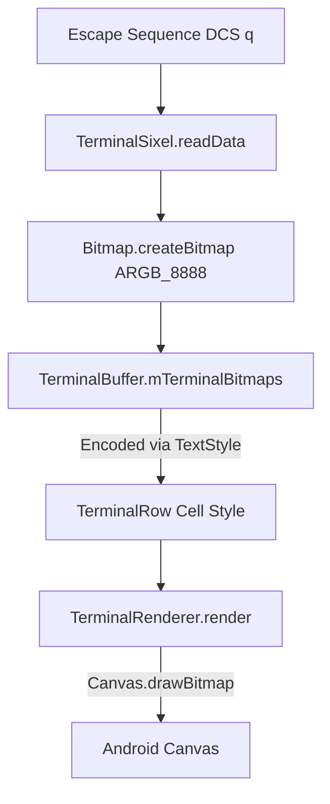

<!-- source: DeepWiki mcp.deepwiki.com · repo termux/termux-app · extra page Screen Buffers and Rendering · fetched 2026-10-26 -->

# Screen Buffers and Rendering

<details>
<summary>Relevant source files</summary>

The following files were used as context for generating this wiki page:

- [terminal-emulator/src/main/java/com/termux/terminal/ITermImage.java](terminal-emulator/src/main/java/com/termux/terminal/ITermImage.java)
- [terminal-emulator/src/main/java/com/termux/terminal/TerminalBitmap.java](terminal-emulator/src/main/java/com/termux/terminal/TerminalBitmap.java)
- [terminal-emulator/src/main/java/com/termux/terminal/TerminalBuffer.java](terminal-emulator/src/main/java/com/termux/terminal/TerminalBuffer.java)
- [terminal-emulator/src/main/java/com/termux/terminal/TerminalColorScheme.java](terminal-emulator/src/main/java/com/termux/terminal/TerminalColorScheme.java)
- [terminal-emulator/src/main/java/com/termux/terminal/TerminalColors.java](terminal-emulator/src/main/java/com/termux/terminal/TerminalColors.java)
- [terminal-emulator/src/main/java/com/termux/terminal/TerminalRow.java](terminal-emulator/src/main/java/com/termux/terminal/TerminalRow.java)
- [terminal-emulator/src/main/java/com/termux/terminal/TerminalSixel.java](terminal-emulator/src/main/java/com/termux/terminal/TerminalSixel.java)
- [terminal-emulator/src/main/java/com/termux/terminal/TextStyle.java](terminal-emulator/src/main/java/com/termux/terminal/TextStyle.java)
- [terminal-emulator/src/main/java/com/termux/terminal/WcWidth.java](terminal-emulator/src/main/java/com/termux/terminal/WcWidth.java)
- [terminal-emulator/src/test/java/com/termux/terminal/ScreenBufferTest.java](terminal-emulator/src/test/java/com/termux/terminal/ScreenBufferTest.java)
- [terminal-view/src/main/java/com/termux/view/TerminalRenderer.java](terminal-view/src/main/java/com/termux/view/TerminalRenderer.java)

</details>


This page details the underlying data structures, text measurement utilities, color management, bitmap/sixel graphic pipelines, and canvas drawing path used by the Termux terminal emulator view.

---

## 1. Terminal Data Structures: `TerminalBuffer` and `TerminalRow`

The terminal screen and scrollback history are managed by a circular buffer of rows implemented in `[terminal-emulator/src/main/java/com/termux/terminal/TerminalBuffer.java]`. 

*   `TerminalBuffer` acts as a circular array of `TerminalRow` objects, mapping logical screen rows to internal circular buffer indices via functions like `externalToInternalRow`. It keeps track of screen height (`mScreenRows`), total allocated rows (`mTotalRows`), column width (`mColumns`), and active transcript rows (`mActiveTranscriptRows`).
*   `TerminalRow` represents an individual line of text and styling on the screen [v: terminal-emulator/src/main/java/com/termux/terminal/TerminalRow.java:1-10]. Each row stores:
    *   `mText`: A `char[]` array containing the raw Java characters for the line [v: terminal-emulator/src/main/java/com/termux/terminal/TerminalRow.java:40-45].
    *   `mStyle`: A `long[]` array storing 64-bit encoded style metadata for each column cell [v: terminal-emulator/src/main/java/com/termux/terminal/TerminalRow.java:48-50].
    *   Combining characters are appended inline within `mText`, bounded by `MAX_COMBINING_CHARACTERS_PER_COLUMN = 15` [v: terminal-emulator/src/main/java/com/termux/terminal/TerminalRow.java:38].

### Diagram: Terminal Buffer and Row Layout Architecture

```mermaid
graph TD
    TB[TerminalBuffer] -->|Circular Array mLines| TR1[TerminalRow Row 0]
    TB -->|Circular Array mLines| TR2[TerminalRow Row N]
    
    subgraph TerminalRow_Structure
        TR2 --> T[mText char[]]
        TR2 --> S[mStyle long[]]
        TR2 --> HW[mHasNonOneWidthOrSurrogateChars]
        TR2 --> BM[mHasTerminalBitmap]
    end

    subgraph TextStyle_Encoding
        S -->|64-bit Packed Long| TS[TextStyle.encode]
    end
```
*Sources: `[terminal-emulator/src/main/java/com/termux/terminal/TerminalBuffer.java:19-96]()`, `[terminal-emulator/src/main/java/com/termux/terminal/TerminalRow.java:10-61]()`*

---

## 2. Character Styles and Unicode Widths

Text appearance, attributes, and column span calculations are handled by `TextStyle` and `WcWidth`.

*   **`TextStyle`**: Packs formatting flags, foreground colors, background colors, and bitmap references into a single 64-bit `long` [v: terminal-emulator/src/main/java/com/termux/terminal/TextStyle.java:5-14].
    *   Bits 0–10 store character attributes (bold, italic, underline, blink, inverse, invisible, strikethrough, protected, dim, truecolor foreground/background) [v: terminal-emulator/src/main/java/com/termux/terminal/TextStyle.java:17-37].
    *   Bits 16–39 and 40–63 store background and foreground color configurations (supporting either 256 indexed colors or 24-bit TrueColor) [v: terminal-emulator/src/main/java/com/termux/terminal/TextStyle.java:10-14].
*   **`WcWidth`**: Implements the Unicode 15 column-width algorithm (`wcwidth`) to determine if a code point occupies 0 columns (combining marks), 1 column (standard characters), or 2 columns (East Asian wide characters and certain emojis) [v: terminal-emulator/src/main/java/com/termux/terminal/WcWidth.java:1-14].

### Table: 64-Bit Style Bit Layout

| Bit Range | Component | Description |
| :--- | :--- | :--- |
| `0–10` | Attributes | Formatting flags (`BOLD`, `ITALIC`, `UNDERLINE`, `DIM`, `TRUECOLOR`, etc.) |
| `16–39` | Background Color | 24-bit RGB or 9-bit color palette index |
| `40–63` | Foreground Color | 24-bit RGB or 9-bit color palette index |
| `15` | Terminal Bitmap Flag | Distinguishes text cells from graphical bitmap slices (`TERMINAL_BITMAP`) |

### Sources: `[terminal-emulator/src/main/java/com/termux/terminal/TextStyle.java:1-116]`, `[terminal-emulator/src/main/java/com/termux/terminal/WcWidth.java:1-14]()`

---

## 3. Color Schemes and Customization

Terminal color rendering depends on `TerminalColorScheme` and `TerminalColors`.

*   **`TerminalColorScheme`**: Maintains the default 256-color palette (plus default foreground, background, and cursor slots) [v: terminal-emulator/src/main/java/com/termux/terminal/TerminalColorScheme.java:15-60]. It parses user overrides from `termux.properties` via `updateWith()` and computes fallback cursor contrast colors using perceived brightness calculations [v: terminal-emulator/src/main/java/com/termux/terminal/TerminalColorScheme.java:72-124].
*   **`TerminalColors`**: Holds the active runtime color array (`mCurrentColors`) which can be dynamically reconfigured by escape sequences such as OSC 4 [v: terminal-emulator/src/main/java/com/termux/terminal/TerminalColors.java:9-16]. It also provides parsing routines for X11-style color strings (`#RGB`, `rgb:r/g/b`) [v: terminal-emulator/src/main/java/com/termux/terminal/TerminalColors.java:37-70].

### Sources: `[terminal-emulator/src/main/java/com/termux/terminal/TerminalColorScheme.java:1-126]`, `[terminal-emulator/src/main/java/com/termux/terminal/TerminalColors.java:1-96]()`

---

## 4. Sixel and Bitmap Graphics

Termux supports graphical outputs embedded directly into the terminal buffer via Sixel data streams and iTerm escape sequences.

*   **`TerminalSixel`**: Processes Device Control Strings (`DCS`) containing Sixel graphic instructions (`ESC_DCS__SIXEL`), accumulating pixel maps into standard ARGB bitmaps with dynamic resizing and palette lookup maps [v: terminal-emulator/src/main/java/com/termux/terminal/TerminalSixel.java:6-77].
*   **`TerminalBitmap`**: Manages bitmap dimensions and memory caps (`MAX_BITMAP_SIZE`) synchronized with Android's `RecordingCanvas` specifications to protect against out-of-memory errors during high-resolution rendering [v: terminal-emulator/src/main/java/com/termux/terminal/TerminalBitmap.java:24-70].
*   **`ITermImage`**: Handles `OSC 1337` inline image protocols, managing multipart stream states (`ImageState`) from arguments parsing to base64 decoding [v: terminal-emulator/src/main/java/com/termux/terminal/ITermImage.java:8-66].

### Diagram: Sixel Ingestion and Rendering Pipeline


*Sources: `[terminal-emulator/src/main/java/com/termux/terminal/TerminalSixel.java:6-94]`, `[terminal-emulator/src/main/java/com/termux/terminal/TerminalBitmap.java:18-70]`, `[terminal-view/src/main/java/com/termux/view/TerminalRenderer.java:60-124]()`*

---

## 5. The Terminal Renderer Drawing Path

The `TerminalRenderer` class inside the `terminal-view` module transforms the logical state of a `TerminalEmulator` into visual pixels on an Android `Canvas` [v: terminal-view/src/main/java/com/termux/view/TerminalRenderer.java:19-23].

*   **Font Metrics**: It initializes an Android `Paint` object using the selected font typeface and size, caching font spacing, ascent dimensions, and character measurement tables (`asciiMeasures`) [v: terminal-emulator/src/main/java/com/termux/terminal/TerminalRow.java:40-58] for monospaced calculations.
*   **The `render()` Flow**:
    1. Determines visible rows based on `topRow` scroll offsets and emulator dimensions [v: terminal-view/src/main/java/com/termux/view/TerminalRenderer.java:61-68].
    2. Iterates through each row, retrieving `TerminalRow` data objects from `TerminalBuffer` [v: terminal-view/src/main/java/com/termux/view/TerminalRenderer.java:77-88].
    3. Iterates across columns, checking cell styles. If a cell contains a bitmap flag (`TextStyle.isTerminalBitmap()`), it fetches the corresponding bitmap and draws it directly via `Canvas.drawBitmap()` [v: terminal-view/src/main/java/com/termux/view/TerminalRenderer.java:105-115].
    4. Otherwise, it groups consecutive characters sharing identical style, cursor, and selection states into optimized text runs, drawing them to the canvas using `Paint` typography primitives.

### Sources: `[terminal-view/src/main/java/com/termux/view/TerminalRenderer.java:1-138]()`

---

