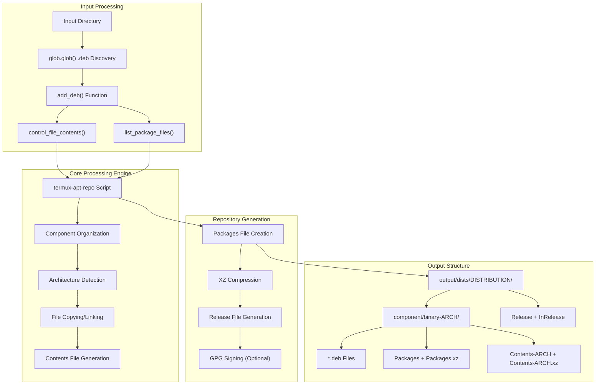
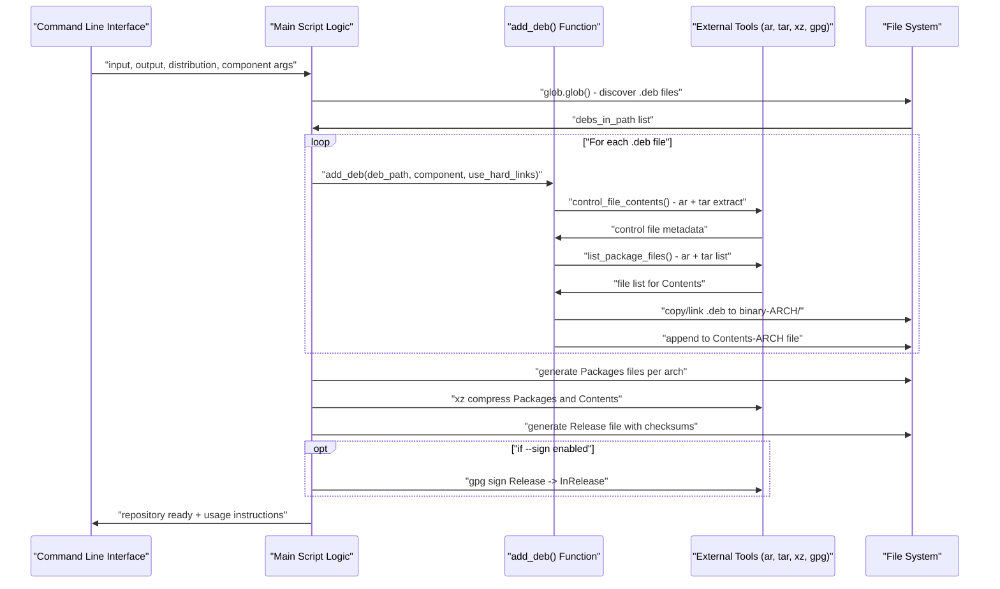
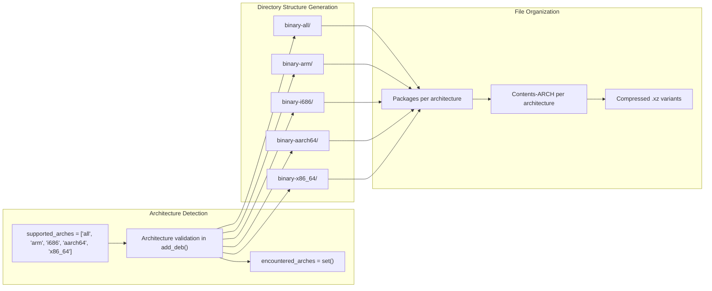

<!-- source: DeepWiki mcp.deepwiki.com · repo termux/termux-apt-repo · page 1 Overview · fetched 2026-10-26 -->

# Overview

<details>
<summary>Relevant source files</summary>

The following files were used as context for generating this wiki page:

- [README.rst](README.rst)
- [termux-apt-repo](termux-apt-repo)

</details>


This document provides a comprehensive technical overview of the `termux-apt-repo` system, which is a Python-based tool for creating APT (Advanced Package Tool) repositories from `.deb` package files specifically designed for the Termux Android terminal environment.

For detailed information about the core script implementation, see [Core System: The termux-apt-repo Script](#2). For installation and usage instructions, see [Installation and Usage](#3). For development information, see [Development Guide](#4).

## Purpose and Scope

The `termux-apt-repo` system serves as a bridge between package creation and distribution in the Termux ecosystem. It transforms collections of `.deb` files into properly structured APT repositories that can be consumed by standard Debian package management tools.

**Primary Functions:**
- Process `.deb` files and extract package metadata
- Generate APT repository directory structures
- Create repository index files (`Packages`, `Contents`, `Release`)
- Support GPG signing for repository authentication
- Handle multiple CPU architectures (ARM, x86_64, i686, AArch64)

**Target Use Cases:**
- Publishing cross-compiled packages from the Termux build system
- Distributing packages created with `termux-create-package`
- Creating custom package repositories for Termux users
- Maintaining private or specialized package collections

Sources: [termux-apt-repo:1-230](), [README.rst:1-76]()

## System Architecture

The `termux-apt-repo` system follows a single-script architecture with clear separation between input processing, repository generation, and output formatting.



Sources: [termux-apt-repo:73-145](), [termux-apt-repo:157-186](), [termux-apt-repo:188-218]()

## Core Components and Code Entities

The system consists of several key components that map directly to functions and data structures in the codebase:

| Component | Code Entity | Purpose | File Reference |
|-----------|-------------|---------|----------------|
| Package Discovery | `glob.glob()` calls | Locate `.deb` files in input directory | [termux-apt-repo:130-132]() |
| Package Processing | `add_deb()` function | Extract metadata and organize files | [termux-apt-repo:73-102]() |
| Metadata Extraction | `control_file_contents()` | Parse control file from `.deb` | [termux-apt-repo:22-44]() |
| File Listing | `list_package_files()` | Extract file lists for Contents | [termux-apt-repo:46-71]() |
| Architecture Management | `supported_arches`, `encountered_arches` | Handle multi-arch support | [termux-apt-repo:6-7]() |
| Component Organization | `COMPONENTS` list | Manage repository components | [termux-apt-repo:5](), [termux-apt-repo:139-140]() |
| Repository Structure | `distribution_path` | Define output directory layout | [termux-apt-repo:125]() |
| Index Generation | Packages file creation loop | Generate APT index files | [termux-apt-repo:158-183]() |
| Compression | `subprocess.check_call()` with `xz` | Compress repository files | [termux-apt-repo:183](), [termux-apt-repo:185]() |
| GPG Signing | `gpg` subprocess call | Sign repository for authenticity | [termux-apt-repo:214-217]() |

Sources: [termux-apt-repo:1-230]()

## Processing Workflow

The system follows a deterministic processing pipeline that transforms input `.deb` files into a complete APT repository:



Sources: [termux-apt-repo:118-145](), [termux-apt-repo:157-186](), [termux-apt-repo:212-218]()

## Architecture and Multi-Platform Support

The system handles multiple CPU architectures through the `supported_arches` list and `encountered_arches` set:



Sources: [termux-apt-repo:6-7](), [termux-apt-repo:77-81](), [termux-apt-repo:84-87]()

## Integration with Termux Ecosystem

The system integrates with the broader Termux ecosystem through several key interfaces:

| Integration Point | Implementation | Code Reference |
|------------------|----------------|----------------|
| Package Input | Accepts `.deb` files from `termux-packages` build system | [termux-apt-repo:130-132]() |
| Package Input | Accepts `.deb` files from `termux-create-package` | [README.rst:8-9]() |
| Installation | Available via `pkg install termux-apt-repo` | [README.rst:14]() |
| Installation | Available via `pip3 install termux-apt-repo` | [README.rst:36]() |
| Client Configuration | Generates `sources.list.d` entries | [termux-apt-repo:223-228]() |
| Repository Structure | Standard Debian APT format | [termux-apt-repo:125]() |
| GPG Integration | Uses system GPG for signing | [termux-apt-repo:214-217]() |
| Compression | Uses `xz` for efficient compression | [termux-apt-repo:183](), [termux-apt-repo:185]() |

The generated repository structure follows the standard Debian format:
```
output/
└── dists/
    └── DISTRIBUTION/
        ├── Release
        ├── InRelease (if signed)
        └── COMPONENT/
            ├── binary-ARCH/
            │   ├── Packages
            │   ├── Packages.xz
            │   └── *.deb
            ├── Contents-ARCH
            └── Contents-ARCH.xz
```

Sources: [termux-apt-repo:125](), [termux-apt-repo:84-87](), [termux-apt-repo:148-155](), [README.rst:1-76]()

## External Dependencies

The system relies on several external tools that must be available in the system PATH:

| Tool | Purpose | Usage in Code |
|------|---------|---------------|
| `ar` | Extract files from `.deb` archives | [termux-apt-repo:23](), [termux-apt-repo:47]() |
| `tar` | Extract control and data files | [termux-apt-repo:38-39](), [termux-apt-repo:62-63]() |
| `xz` | Compress repository index files | [termux-apt-repo:183](), [termux-apt-repo:185]() |
| `gpg` | Sign repository Release files | [termux-apt-repo:214-217]() |

These dependencies are typically available in most Linux distributions and are included in the Termux environment.

Sources: [termux-apt-repo:14-20](), [termux-apt-repo:22-44](), [termux-apt-repo:46-71](), [termux-apt-repo:183](), [termux-apt-repo:185](), [termux-apt-repo:214-217]()

---

