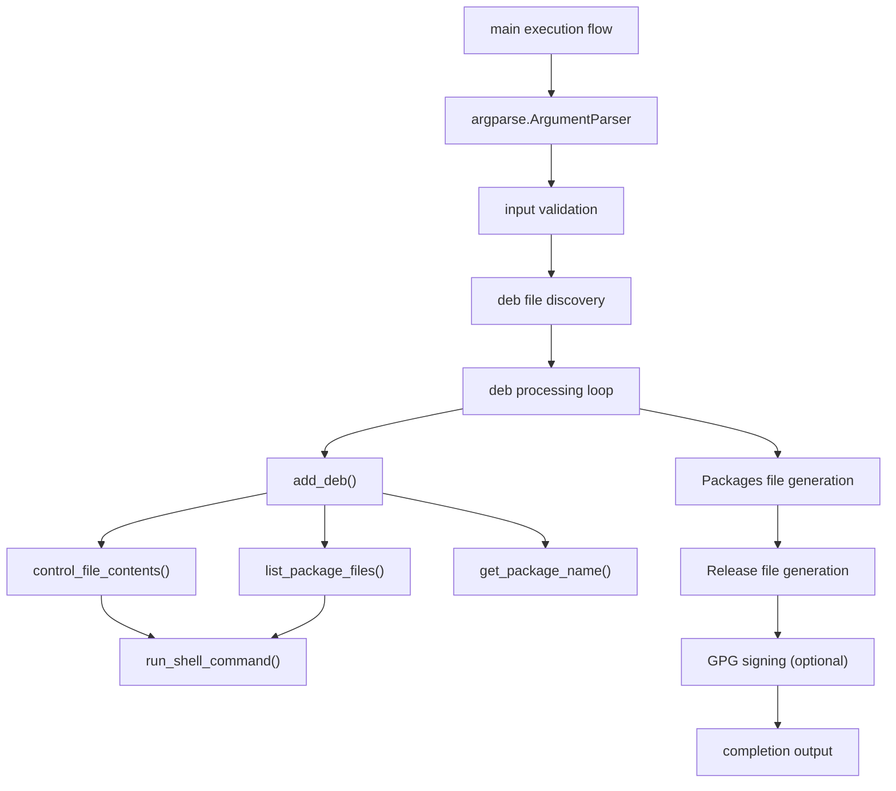
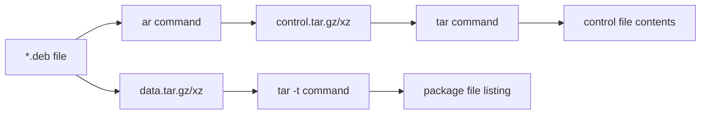
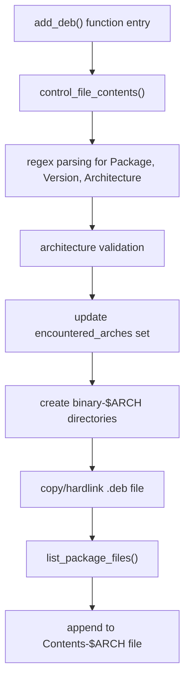
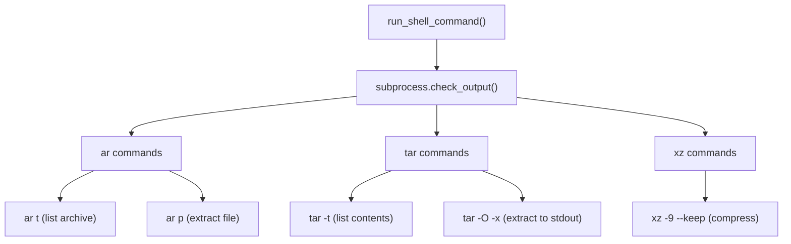
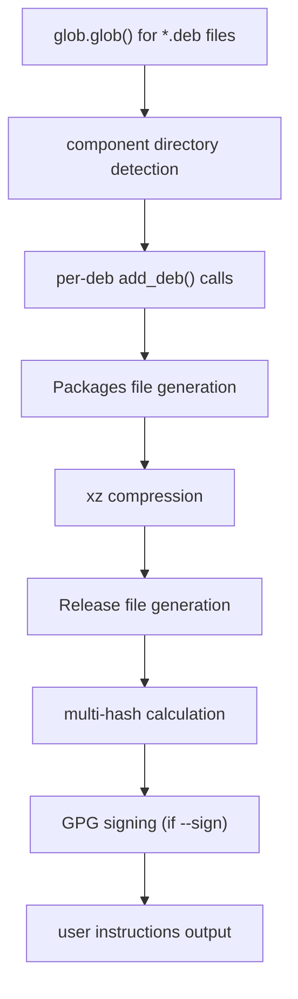

<!-- source: DeepWiki mcp.deepwiki.com · repo termux/termux-apt-repo · page 2 Core System: The termux-apt-repo Script · fetched 2026-10-26 -->

# Core System: The termux-apt-repo Script

<details>
<summary>Relevant source files</summary>

The following files were used as context for generating this wiki page:

- [termux-apt-repo](termux-apt-repo)

</details>


## Purpose and Scope

This document provides comprehensive technical documentation for the core `termux-apt-repo` Python script, which serves as the primary executable component of the termux-apt-repo system. The script processes Debian package files (.deb) and generates APT repository structures compliant with the Debian repository format.

For installation methods and usage examples, see [Installation and Usage](#3). For development environment setup and contributing guidelines, see [Development Guide](#4).

## Script Architecture and Key Components

The `termux-apt-repo` script is implemented as a single Python file with a modular function-based architecture. The script operates through a sequence of distinct processing stages, each handled by specialized functions.

### Core Function Architecture



Sources: [termux-apt-repo:1-230]()

### Global Variables and Constants

The script maintains several global variables that control processing behavior:

| Variable | Type | Purpose |
|----------|------|---------|
| `COMPONENTS` | list | Component directories found during processing |
| `supported_arches` | list | Supported architecture strings: all, arm, i686, aarch64, x86_64 |
| `encountered_arches` | set | Architectures discovered in processed .deb files |
| `hashes` | list | Hash algorithms used for integrity checking: md5, sha1, sha256, sha512 |

Sources: [termux-apt-repo:5-8]()

### Core Processing Functions

#### Package Metadata Extraction



The `control_file_contents()` function extracts package metadata using a two-stage process:
1. **Archive listing**: Uses `ar t` to list archive contents
2. **Control extraction**: Uses `ar p` piped to `tar -O` to extract the control file

The `list_package_files()` function generates file listings for Contents files using `tar -t` on the data archive.

Sources: [termux-apt-repo:22-71]()

#### Package Processing Pipeline



The `add_deb()` function coordinates the processing of individual .deb files through these stages:
1. **Metadata extraction**: Retrieves Package, Version, and Architecture fields
2. **Architecture validation**: Ensures architecture is in `supported_arches`
3. **Directory creation**: Creates `binary-$ARCH` subdirectories as needed
4. **File placement**: Either copies or hard-links the .deb file to the destination
5. **Contents update**: Appends file listings to Contents files

Sources: [termux-apt-repo:73-103]()

## Processing Pipeline and External Dependencies

### Command Execution Framework

The script relies heavily on external Unix tools through the `run_shell_command()` function, which provides centralized subprocess management with error handling.



Sources: [termux-apt-repo:14-20]()

### Repository Generation Workflow

The main processing loop implements a multi-stage workflow:



The script processes files in this sequence:
1. **Discovery**: Scans input directory for .deb files using `glob.glob()`
2. **Component organization**: Determines component names from directory structure
3. **Processing**: Calls `add_deb()` for each discovered .deb file
4. **Metadata generation**: Creates Packages files with complete package metadata
5. **Compression**: Compresses Packages and Contents files using `xz -9`
6. **Release generation**: Creates Release file with repository metadata and file hashes
7. **Signing**: Optionally signs Release file with GPG to create InRelease file

Sources: [termux-apt-repo:130-218]()

## Repository Structure and File Generation

### Generated Directory Structure

The script creates a standard Debian repository structure under the output directory:

```
output/
└── dists/
    └── $DISTRIBUTION/
        ├── Release
        ├── InRelease (if signed)
        └── $COMPONENT/
            ├── Contents-$ARCH
            ├── Contents-$ARCH.xz
            └── binary-$ARCH/
                ├── Packages
                ├── Packages.xz
                └── *.deb files
```

### Metadata File Generation

#### Packages File Creation


The Packages file generation process:
1. **Control parsing**: Extracts existing control file contents
2. **Field augmentation**: Adds Filename, Size, and hash fields (MD5Sum, SHA1, SHA256, SHA512)
3. **File writing**: Writes complete package records to Packages file
4. **Compression**: Creates compressed Packages.xz file

Sources: [termux-apt-repo:157-183]()

#### Release File Generation

The Release file contains repository metadata and file integrity information:

| Field | Source | Description |
|-------|--------|-------------|
| `Codename` | Hard-coded "termux" | Repository codename |
| `Version` | Hard-coded "1" | Repository version |
| `Architectures` | `encountered_arches` | Space-separated architecture list |
| `Description` | `$DISTRIBUTION + " repository"` | Repository description |
| `Suite` | `$DISTRIBUTION` | Repository suite name |
| `Date` | `datetime.datetime.utcnow()` | UTC timestamp |
| `Components` | `COMPONENTS` | Space-separated component list |

The Release file includes hash sections for each supported algorithm, containing hash, size, and path information for all Packages and Contents files.

Sources: [termux-apt-repo:147-210]()

### GPG Signing Integration

When the `--sign` flag is specified, the script invokes GPG to create a signed InRelease file:

```bash
gpg --yes --pinentry-mode loopback --digest-algo SHA256 --clearsign -o $DISTRIBUTION/InRelease $DISTRIBUTION/Release
```

This enables repository authentication without requiring the `[trusted=yes]` directive in APT sources configuration.

Sources: [termux-apt-repo:212-217]()

## Command-Line Interface

The script uses `argparse` for command-line processing with these arguments:

| Argument | Type | Default | Description |
|----------|------|---------|-------------|
| `input` | Required | - | Directory containing .deb files |
| `output` | Required | - | Output directory for repository |
| `distribution` | Optional | "termux" | Distribution name for repository |
| `component` | Optional | "extras" | Default component name |
| `--use-hard-links` | Flag | False | Use hard links instead of copying |
| `--sign` | Flag | False | Sign repository with GPG |

The script supports component auto-detection: .deb files in subdirectories use the subdirectory name as the component, while files in the root use the default component.

Sources: [termux-apt-repo:104-124]()

---

