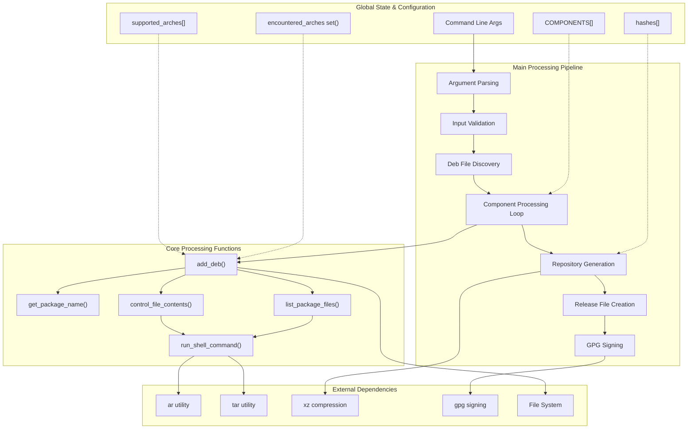
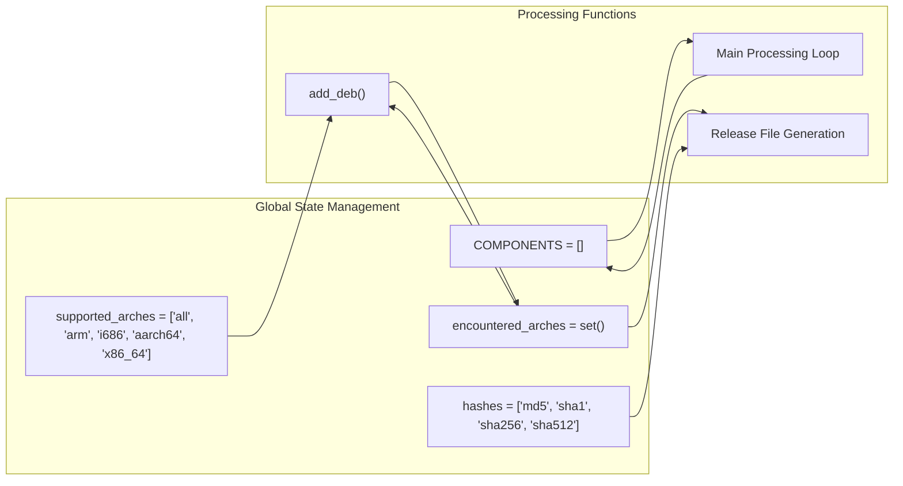
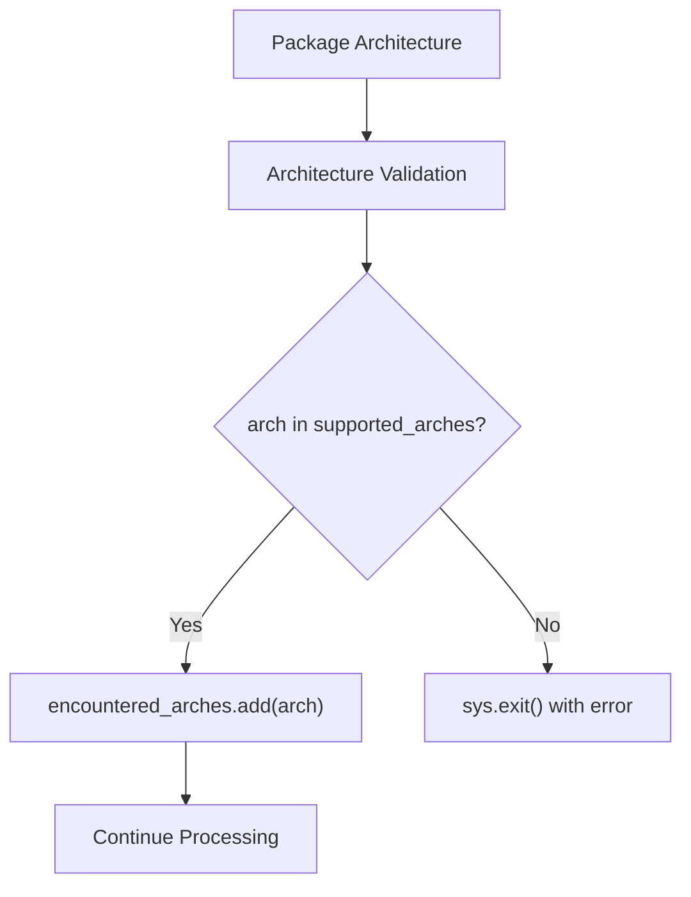
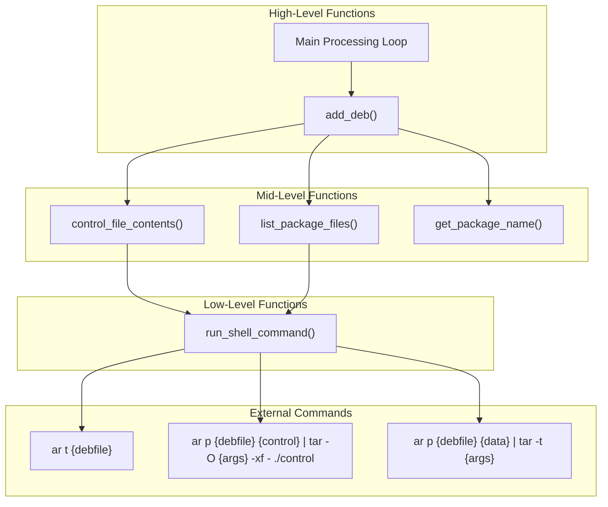
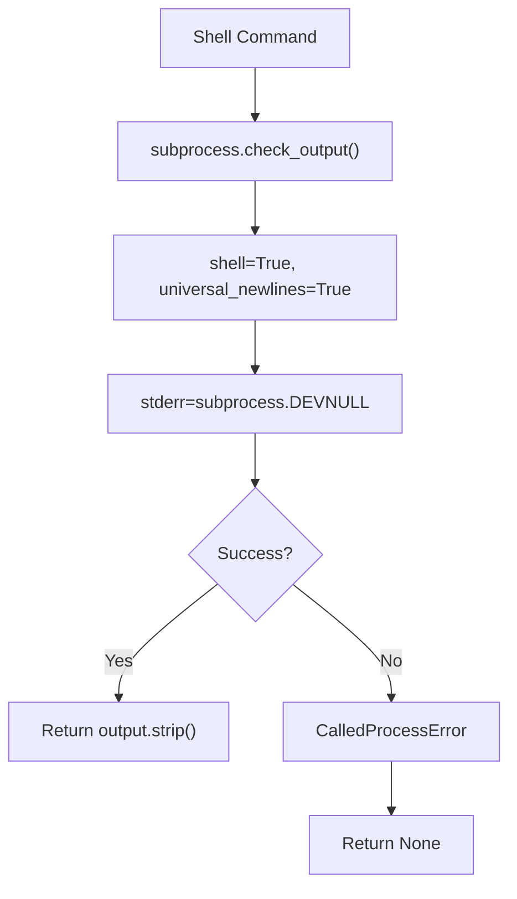
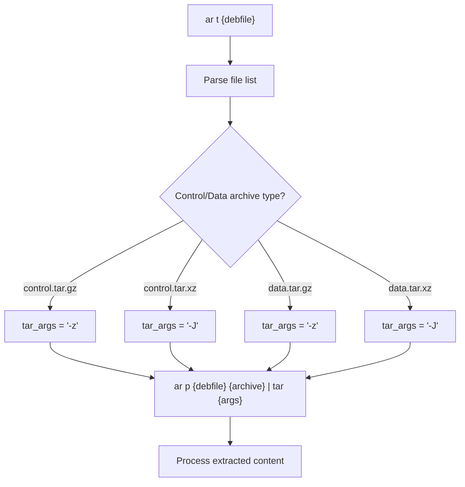
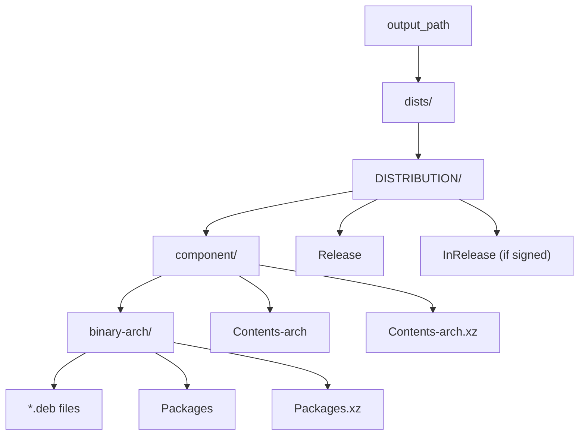
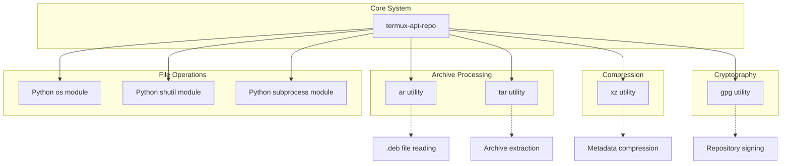
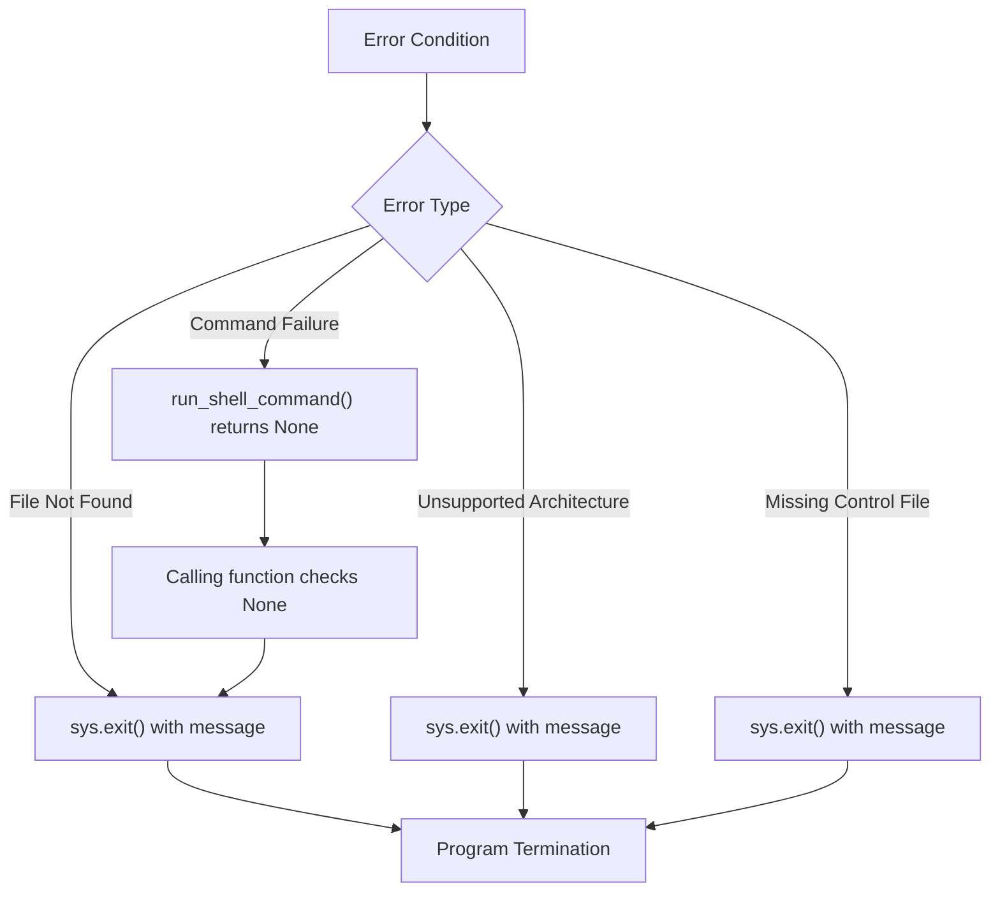
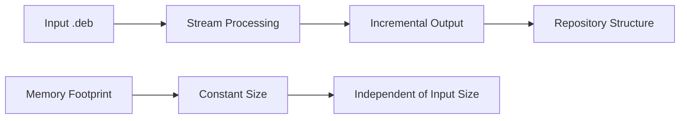

<!-- source: DeepWiki mcp.deepwiki.com · repo termux/termux-apt-repo · page 2.1 Architecture and Internal Design · fetched 2026-10-26 -->

# Architecture and Internal Design

Relevant source files

The following files were used as context for generating this wiki page:

- [termux-apt-repo](termux-apt-repo)

This document provides a comprehensive technical analysis of the internal architecture, data structures, and design patterns used in the core `termux-apt-repo` script. It covers the system's modular design, function relationships, data flow patterns, and external dependencies.

For information about the command-line interface and usage patterns, see [Command-Line Interface and Arguments](#2.2). For details about the processing algorithms and workflows, see [Processing Pipeline and Algorithms](#2.3).

## System Architecture Overview

The `termux-apt-repo` script follows a functional programming paradigm with a single-threaded, sequential processing model. The architecture is built around five core functional modules that operate on shared global state.

Sources: [termux-apt-repo:1-230]()

## Data Structures and Global State

The system maintains several global data structures that serve as the primary state management mechanism throughout the processing pipeline.

### Global Variables

| Variable | Type | Purpose | Scope |
|----------|------|---------|-------|
| `COMPONENTS` | `list` | Tracks repository components discovered during processing | Global, modified during processing |
| `supported_arches` | `list` | Defines valid package architectures | Global, read-only |
| `encountered_arches` | `set` | Accumulates architectures found in processed packages | Global, modified during processing |
| `hashes` | `list` | Defines hash algorithms for repository metadata | Global, read-only |

Sources: [termux-apt-repo:5-8]()

### Architecture Validation

The system enforces strict architecture validation through the `supported_arches` list. Any package with an unsupported architecture causes immediate termination.

Sources: [termux-apt-repo:79-81]()

## Function Architecture and Dependencies

The core processing functions form a dependency hierarchy where higher-level functions orchestrate lower-level operations.

Sources: [termux-apt-repo:10-103]()

### Function Responsibilities

#### `get_package_name(filename)`
- **Purpose**: Extract package name from .deb filename
- **Input**: Filename string following `name_version_arch.deb` pattern
- **Output**: Package name (first underscore-separated component)
- **Pattern**: Pure function with no side effects

#### `run_shell_command(cmd)`
- **Purpose**: Execute shell commands with error handling
- **Input**: Shell command string
- **Output**: Command output or `None` on failure
- **Error Handling**: Catches `CalledProcessError`, suppresses stderr

#### `control_file_contents(debfile)`
- **Purpose**: Extract control file metadata from .deb package
- **Dependencies**: `run_shell_command()`, `ar`, `tar`
- **Processing**: Detects compression format, extracts control file
- **Error Handling**: Terminates on extraction failure

#### `list_package_files(debfile)`
- **Purpose**: List all files contained in .deb package
- **Dependencies**: `run_shell_command()`, `ar`, `tar`
- **Processing**: Extracts data archive, lists contents
- **Output**: List of file paths with directory indicators removed

#### `add_deb(deb_to_add_path, component, use_hard_links)`
- **Purpose**: Process individual .deb package into repository structure
- **Dependencies**: `control_file_contents()`, `list_package_files()`, `get_package_name()`
- **Side Effects**: Creates directories, copies/links files, updates Contents files
- **Architecture Validation**: Enforces supported architecture constraints

Sources: [termux-apt-repo:10-103]()

## Processing Architecture Patterns

### Command Execution Pattern

The system uses a consistent pattern for executing external commands through the `run_shell_command()` function:

Sources: [termux-apt-repo:14-20]()

### Archive Processing Pattern

Both `control_file_contents()` and `list_package_files()` follow the same archive processing pattern:

Sources: [termux-apt-repo:22-71]()

### Repository Structure Generation

The system creates a hierarchical directory structure following Debian repository conventions:

Sources: [termux-apt-repo:84-94](), [termux-apt-repo:125]()

## External Dependencies Architecture

The system has carefully orchestrated dependencies on external Unix utilities:

Sources: [termux-apt-repo:3](), [termux-apt-repo:16-18](), [termux-apt-repo:183](), [termux-apt-repo:214-217]()

## Error Handling Architecture

The system implements a fail-fast error handling strategy with immediate termination on critical errors:

Sources: [termux-apt-repo:19-20](), [termux-apt-repo:25](), [termux-apt-repo:36](), [termux-apt-repo:42](), [termux-apt-repo:49](), [termux-apt-repo:60](), [termux-apt-repo:80](), [termux-apt-repo:128](), [termux-apt-repo:133]()

## Memory and Performance Architecture

The system follows a streaming architecture pattern that minimizes memory usage:

- **File Processing**: Files are processed one at a time without loading entire datasets into memory
- **Contents Generation**: Contents files are written incrementally using append mode
- **Shell Command Execution**: External commands handle heavy lifting (compression, archive extraction)
- **Global State**: Minimal global state with efficient data structures (`set` for architecture tracking)

Sources: [termux-apt-repo:100-102](), [termux-apt-repo:165-181]()

---

