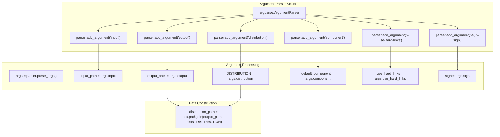
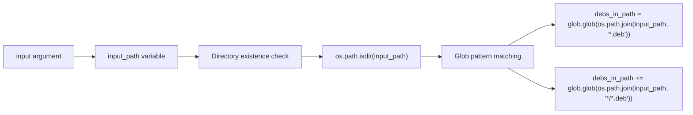
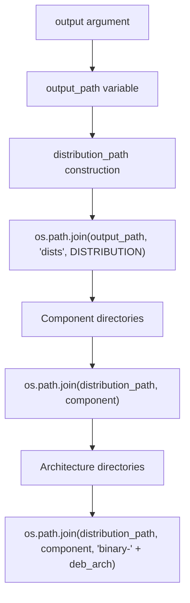
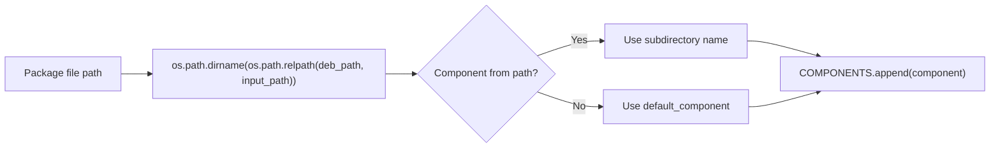
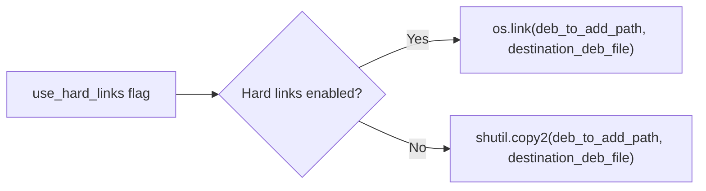
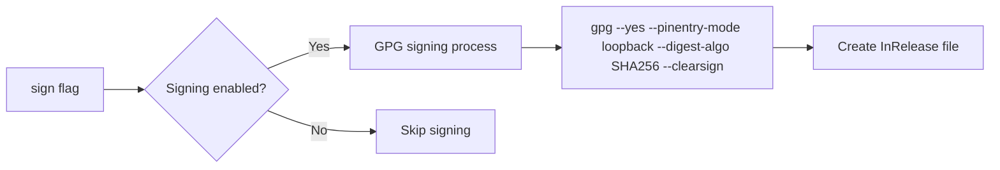
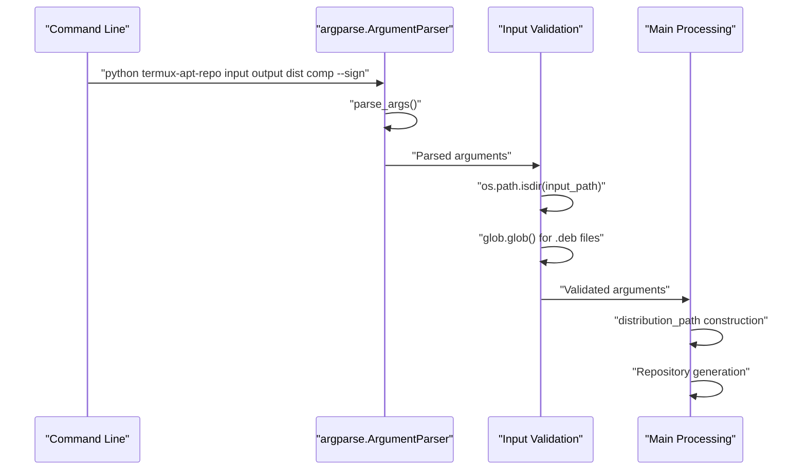
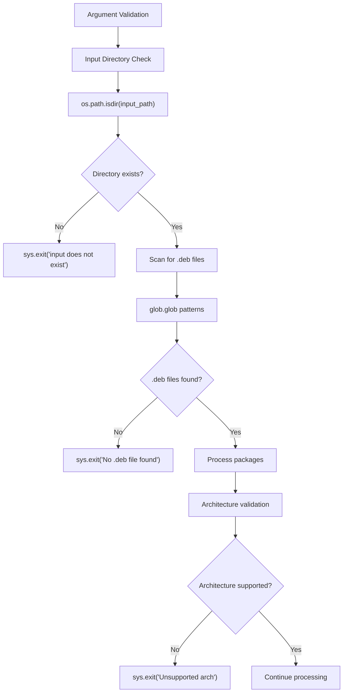

<!-- source: DeepWiki mcp.deepwiki.com · repo termux/termux-apt-repo · page 2.2 Command-Line Interface and Arguments · fetched 2026-10-26 -->

# Command-Line Interface and Arguments

<details>
<summary>Relevant source files</summary>

The following files were used as context for generating this wiki page:

- [README.rst](README.rst)
- [termux-apt-repo](termux-apt-repo)

</details>


This document provides comprehensive documentation of the command-line interface for the `termux-apt-repo` script. It covers all command-line arguments, their validation, processing, and usage patterns within the system.

For information about the internal processing pipeline that uses these arguments, see [Processing Pipeline and Algorithms](#2.3). For details about the repository structure created based on these arguments, see [Repository Structure and File Formats](#2.4).

## Argument Parser Configuration

The `termux-apt-repo` script uses Python's `argparse` module to define and process command-line arguments. The parser configuration establishes the interface contract between users and the repository generation system.



Sources: [termux-apt-repo:104-125]()

## Positional Arguments

### Input Directory (`input`)

| Property | Value |
|----------|--------|
| **Type** | `str` |
| **Required** | Yes |
| **Position** | 1 |
| **Description** | Folder where .deb files are located |
| **Validation** | Must be an existing directory |

The `input` argument specifies the source directory containing `.deb` files to be processed. The script performs recursive scanning to locate all `.deb` files in the specified directory and its subdirectories.



Sources: [termux-apt-repo:105-106](), [termux-apt-repo:119](), [termux-apt-repo:127-133]()

### Output Directory (`output`)

| Property | Value |
|----------|--------|
| **Type** | `str` |
| **Required** | Yes |
| **Position** | 2 |
| **Description** | Folder with repository tree |
| **Structure** | `output/dists/distribution/component/binary-$ARCH/` |

The `output` argument defines the root directory where the APT repository structure will be created. The script constructs the full repository hierarchy under this path.



Sources: [termux-apt-repo:107-108](), [termux-apt-repo:120](), [termux-apt-repo:125]()

### Distribution Name (`dist`)

| Property | Value |
|----------|--------|
| **Type** | `str` |
| **Required** | No |
| **Position** | 3 |
| **Default** | `'termux'` |
| **Description** | Name of distribution folder |

The optional `distribution` argument specifies the distribution name used in the repository structure. This becomes part of the path `output/dists/distribution/component/binary-$ARCH/`.

### Component Name (`comp`)

| Property | Value |
|----------|--------|
| **Type** | `str` |
| **Required** | No |
| **Position** | 4 |
| **Default** | `'extras'` |
| **Description** | Name of component folder |

The optional `component` argument provides the default component name. Individual packages can override this based on their subdirectory structure within the input directory.



Sources: [termux-apt-repo:109-112](), [termux-apt-repo:121-122](), [termux-apt-repo:136-140]()

## Optional Arguments

### Hard Links (`--use-hard-links`)

| Property | Value |
|----------|--------|
| **Type** | `bool` |
| **Default** | `False` |
| **Action** | `store_true` |
| **Description** | Use hard links instead of copying deb files |
| **Limitation** | Will not work on Android devices |

This flag controls the file copying behavior during repository creation. When enabled, the script creates hard links to the original `.deb` files instead of copying them, which saves disk space but requires the source and destination to be on the same filesystem.



Sources: [termux-apt-repo:113-114](), [termux-apt-repo:123](), [termux-apt-repo:95-98]()

### GPG Signing (`-s`, `--sign`)

| Property | Value |
|----------|--------|
| **Type** | `bool` |
| **Default** | `False` |
| **Action** | `store_true` |
| **Short Form** | `-s` |
| **Long Form** | `--sign` |
| **Description** | Sign repository with GPG key |

The signing flag enables GPG signing of the repository Release file, creating an `InRelease` file for enhanced security and trust validation.



Sources: [termux-apt-repo:115-116](), [termux-apt-repo:124](), [termux-apt-repo:212-217]()

## Argument Processing Flow

The argument processing follows a systematic flow from parsing to validation to usage throughout the script execution.



Sources: [termux-apt-repo:118-125](), [termux-apt-repo:127-133]()

## Usage Patterns

### Basic Usage

```bash
termux-apt-repo /path/to/debs /path/to/repo
```

This creates a repository with default distribution name `termux` and component name `extras`.

### Custom Distribution and Component

```bash
termux-apt-repo /path/to/debs /path/to/repo stable main
```

### With Hard Links

```bash
termux-apt-repo /path/to/debs /path/to/repo --use-hard-links
```

### With GPG Signing

```bash
termux-apt-repo /path/to/debs /path/to/repo -s
```

Sources: [README.rst:19-34]()

## Validation and Error Handling

The script performs several validation checks on the provided arguments:

| Validation | Error Message | Exit Condition |
|------------|---------------|----------------|
| Input directory exists | `'input' does not exist` | Directory not found |
| .deb files present | `No .deb file found in input` | No packages to process |
| Architecture support | `Unsupported arch "arch" in filename` | Unsupported architecture |



Sources: [termux-apt-repo:127-133](), [termux-apt-repo:79-81]()

## Global Variables and Constants

The argument processing initializes several global variables and constants used throughout the script:

| Variable | Source | Description |
|----------|--------|-------------|
| `input_path` | `args.input` | Source directory path |
| `output_path` | `args.output` | Repository root path |
| `DISTRIBUTION` | `args.distribution` | Distribution name |
| `default_component` | `args.component` | Default component name |
| `use_hard_links` | `args.use_hard_links` | File copying method |
| `sign` | `args.sign` | GPG signing flag |
| `distribution_path` | Constructed | Full distribution path |
| `supported_arches` | Constant | `['all', 'arm', 'i686', 'aarch64', 'x86_64']` |

Sources: [termux-apt-repo:6](), [termux-apt-repo:118-125]()

---

