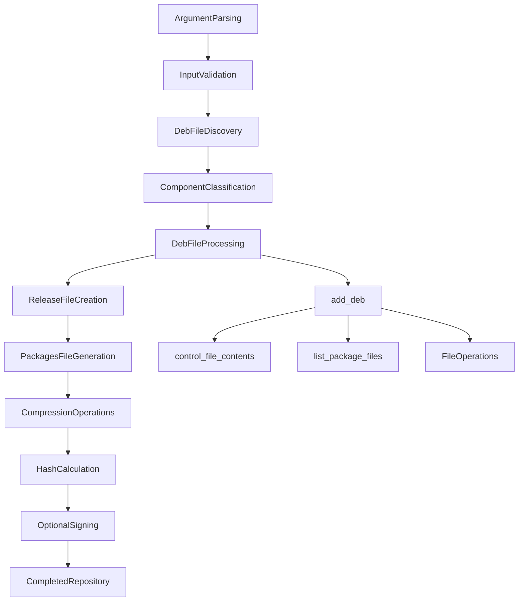
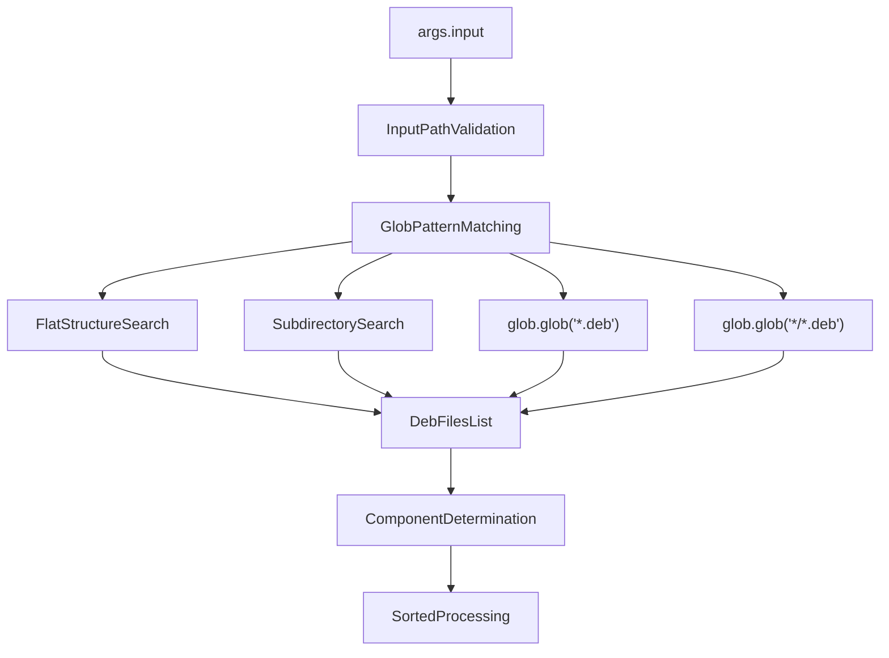
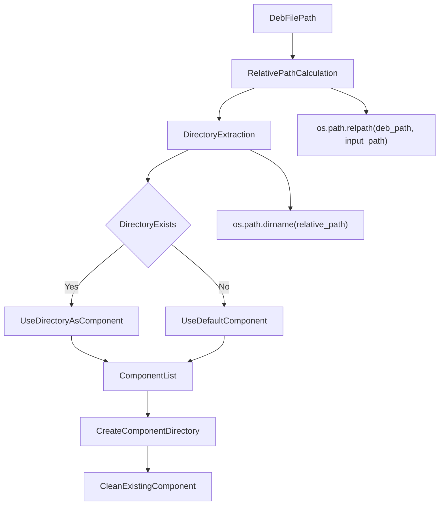
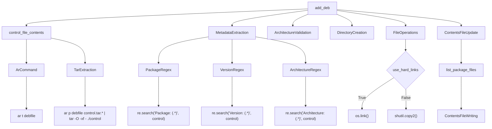
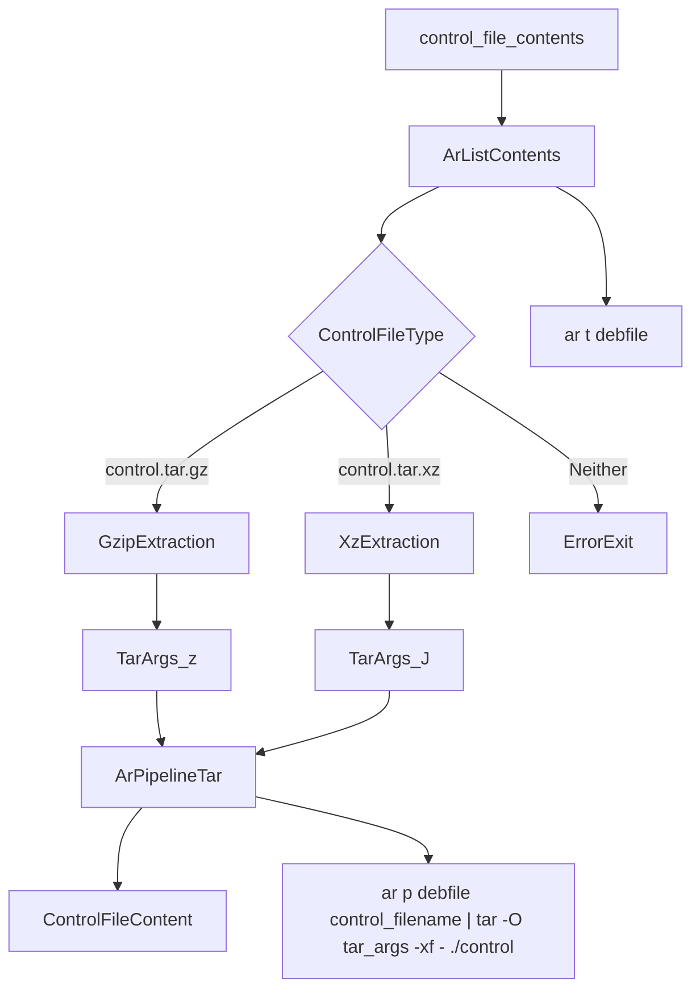
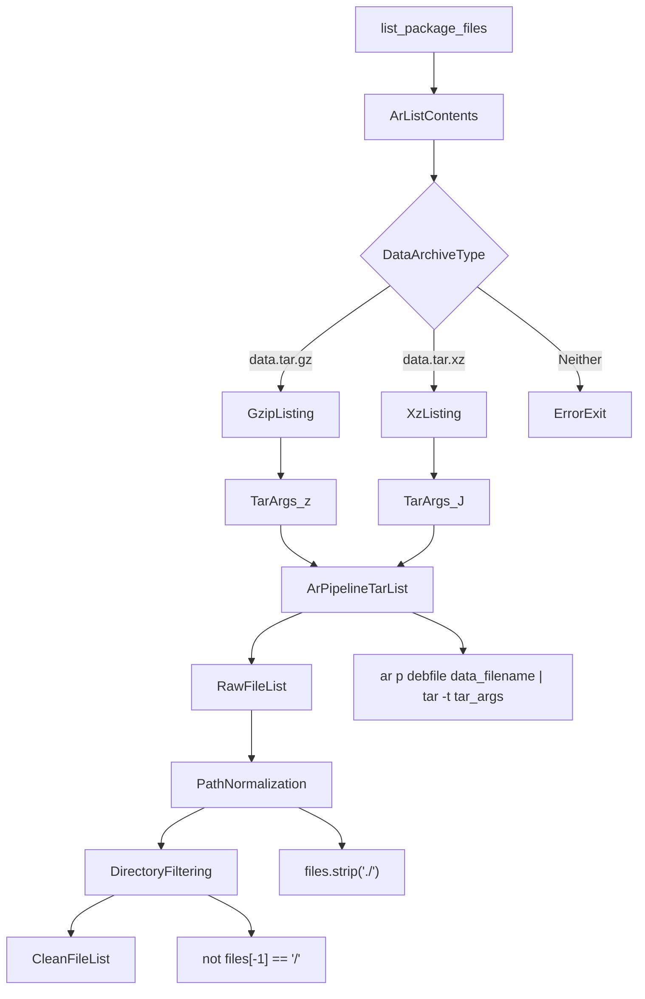
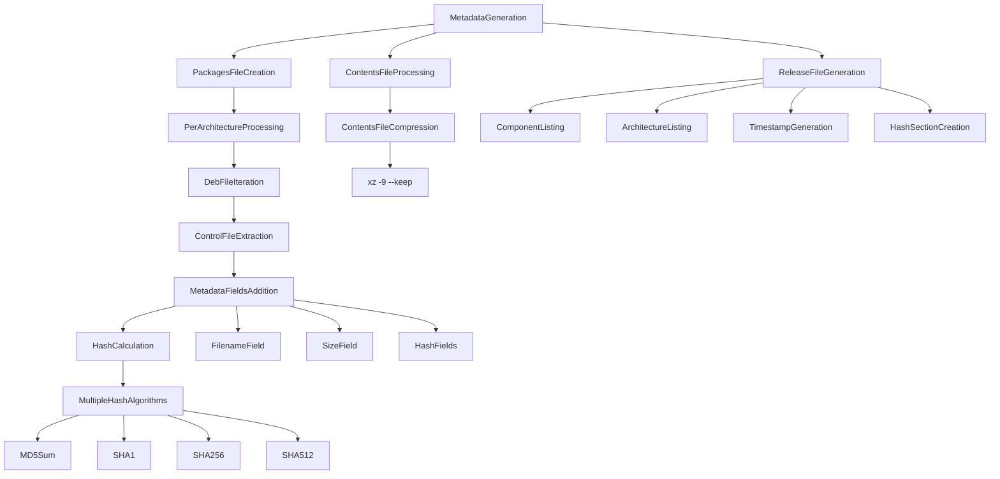
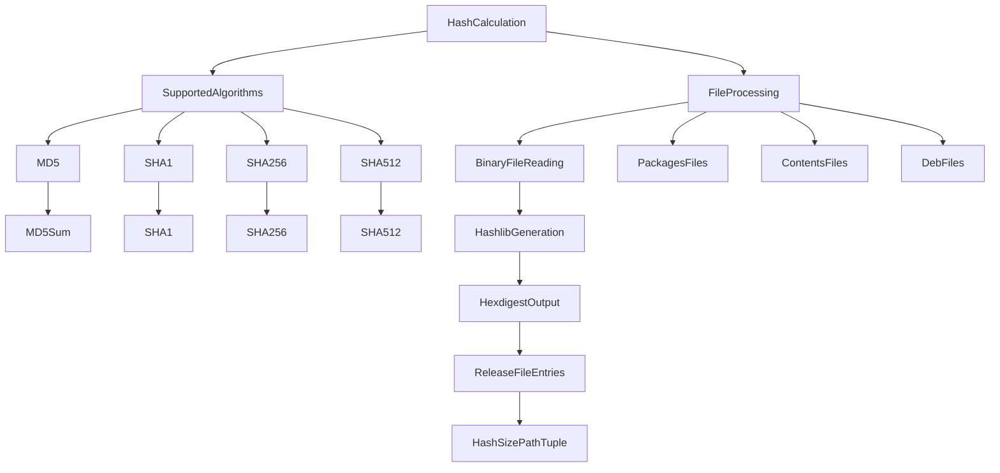
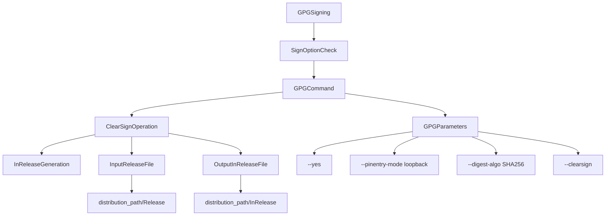

<!-- source: DeepWiki mcp.deepwiki.com · repo termux/termux-apt-repo · page 2.3 Processing Pipeline and Algorithms · fetched 2026-10-26 -->

# Processing Pipeline and Algorithms

<details>
<summary>Relevant source files</summary>

The following files were used as context for generating this wiki page:

- [termux-apt-repo](termux-apt-repo)

</details>


This document provides a detailed technical explanation of the processing pipeline and algorithms used by the `termux-apt-repo` script to transform .deb files into a complete APT repository structure. The content covers the step-by-step workflow from initial file discovery through final repository generation, including metadata extraction, file organization, and cryptographic operations.

For information about the command-line interface and argument handling, see [2.2](#2.2). For details about the generated repository structure and file formats, see [2.4](#2.4).

## Overview of the Processing Pipeline

The `termux-apt-repo` script follows a sequential processing pipeline that transforms input .deb files into a structured APT repository. The pipeline consists of several distinct phases, each handling specific aspects of repository generation.



**Main Processing Pipeline Overview**

Sources: [termux-apt-repo:104-230]()

## Input Discovery and Validation Phase

The processing begins with discovering and validating input .deb files. The script supports both flat directory structures and component-based subdirectories.



**Input File Discovery Algorithm**

The algorithm uses Python's `glob` module to discover .deb files in two patterns:
- Direct files: `*.deb` in the input directory
- Subdirectory files: `*/*.deb` for component-based organization

```python
debs_in_path = glob.glob(os.path.join(input_path, "*.deb"))
debs_in_path += glob.glob(os.path.join(input_path, "*/*.deb"))
```

Sources: [termux-apt-repo:127-133]()

## Component Classification Algorithm

The script determines which repository component each .deb file belongs to based on its directory structure within the input path.



**Component Classification Logic**

Sources: [termux-apt-repo:135-145]()

## .deb File Processing Algorithm

The core processing algorithm for individual .deb files involves metadata extraction, file copying, and content indexing through the `add_deb` function.



**Individual .deb File Processing Workflow**

Sources: [termux-apt-repo:73-103]()

## Control File Extraction Algorithm

The `control_file_contents` function implements a sophisticated algorithm to extract control information from .deb files, handling different compression formats.



**Control File Extraction Algorithm**

The algorithm handles two compression formats:
- `control.tar.gz`: Uses `-z` flag for gzip decompression
- `control.tar.xz`: Uses `-J` flag for xz decompression

Sources: [termux-apt-repo:22-44]()

## Package File Listing Algorithm

The `list_package_files` function extracts the complete file listing from .deb packages for Contents file generation.



**Package File Listing Process**

Sources: [termux-apt-repo:46-72]()

## Repository Metadata Generation

The script generates comprehensive repository metadata including Packages files, Contents files, and Release files with cryptographic hashes.



**Repository Metadata Generation Pipeline**

Sources: [termux-apt-repo:157-186]()

## Hash Calculation Algorithm

The script calculates multiple cryptographic hashes for all repository files to ensure integrity and compatibility with various APT clients.



**Multi-Algorithm Hash Calculation**

The hash calculation supports four algorithms defined in the `hashes` array and processes files using Python's `hashlib` module.

Sources: [termux-apt-repo:8](), [termux-apt-repo:174-179](), [termux-apt-repo:190-209]()

## GPG Signing Pipeline

When the `--sign` option is enabled, the script performs GPG signing of the Release file to create an InRelease file.



**GPG Signing Process**

Sources: [termux-apt-repo:212-217]()

## Error Handling and Validation

The processing pipeline includes comprehensive error handling for various failure scenarios.

| Error Scenario | Detection Method | Action |
|---|---|---|
| Missing input directory | `os.path.isdir()` check | System exit with error message |
| No .deb files found | Empty `debs_in_path` list | System exit with error message |
| Unsupported architecture | Architecture validation against `supported_arches` | System exit with error message |
| Archive extraction failure | `subprocess.CalledProcessError` | System exit with error message |
| Control file missing | Archive content listing | System exit with error message |

**Error Handling Matrix**

Sources: [termux-apt-repo:127-128](), [termux-apt-repo:132-133](), [termux-apt-repo:79-80](), [termux-apt-repo:19-20]()

## Performance Considerations

The script includes several performance optimizations:

- **Hard link support**: Optional hard linking instead of file copying for faster processing
- **Streaming operations**: Uses shell pipelines for efficient archive processing
- **Compression**: Applies maximum compression (`-9`) for space efficiency
- **Sorted processing**: Processes files in sorted order for deterministic output

Sources: [termux-apt-repo:95-98](), [termux-apt-repo:183](), [termux-apt-repo:135]()

---

