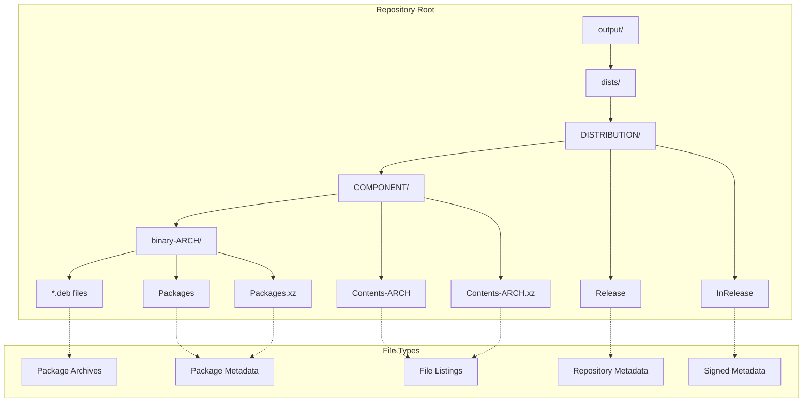
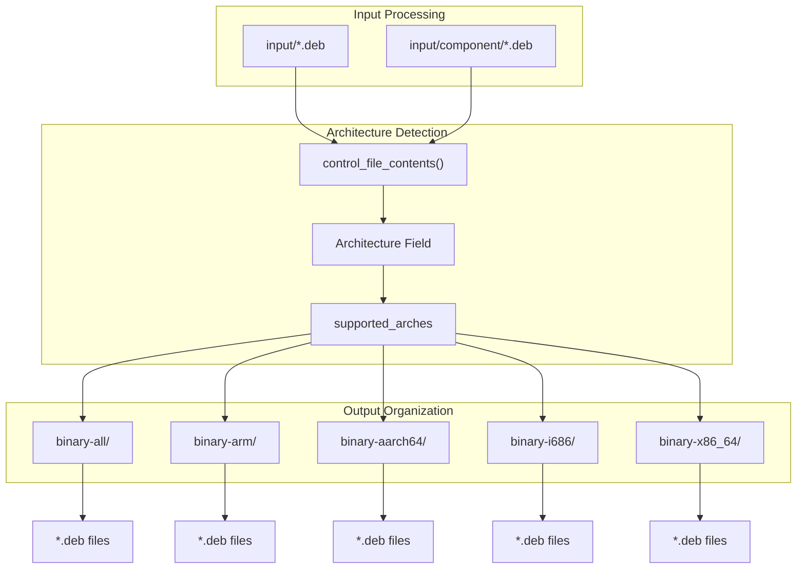
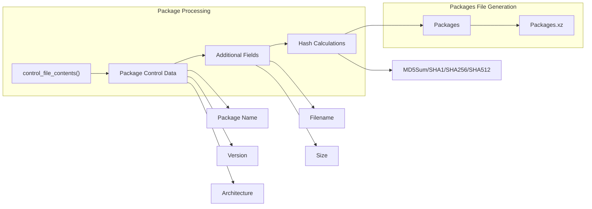
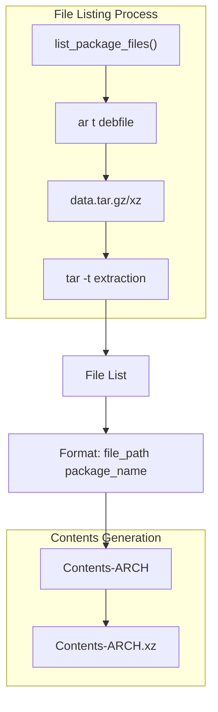
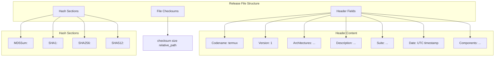
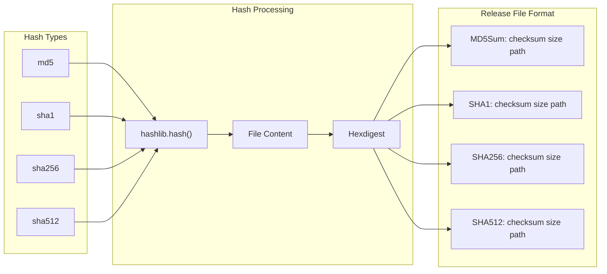
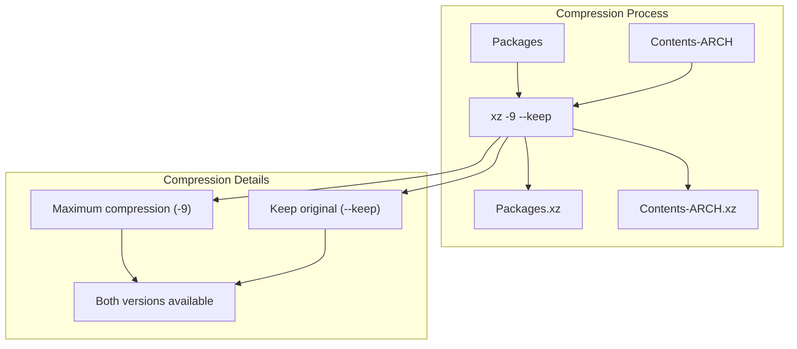
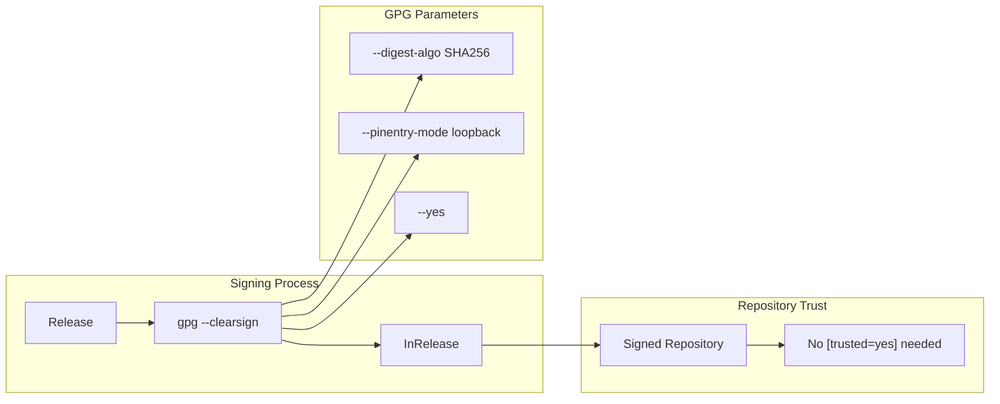
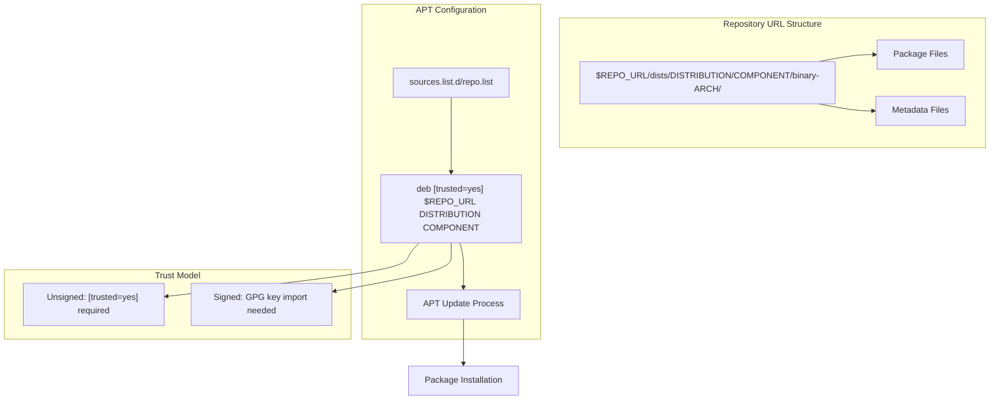

<!-- source: DeepWiki mcp.deepwiki.com · repo termux/termux-apt-repo · page 2.4 Repository Structure and File Formats · fetched 2026-10-26 -->

# Repository Structure and File Formats

<details>
<summary>Relevant source files</summary>

The following files were used as context for generating this wiki page:

- [README.rst](README.rst)
- [termux-apt-repo](termux-apt-repo)

</details>


This page documents the APT repository structure and file formats generated by the termux-apt-repo tool. It covers the directory layout, metadata file formats, and the relationships between different components of the generated repository.

For information about the processing pipeline that creates these files, see [Processing Pipeline and Algorithms](#2.3). For details about command-line arguments that control repository generation, see [Command-Line Interface and Arguments](#2.2).

## Repository Directory Structure

The termux-apt-repo tool generates a standard Debian APT repository structure with the following layout:



**Repository Directory Structure**

The directory structure follows the standard Debian repository format where `DISTRIBUTION` defaults to the distribution name (e.g., "termux"), `COMPONENT` defaults to the component name (e.g., "extras"), and `ARCH` represents the package architecture (e.g., "all", "arm", "aarch64", "i686", "x86_64").

Sources: [termux-apt-repo:109-112](), [termux-apt-repo:125](), [termux-apt-repo:84-87]()

## Package Archive Organization

The tool organizes .deb files into architecture-specific directories based on the package metadata:



**Package File Placement**

Architecture validation ensures only supported architectures are processed, and packages are placed in the appropriate `binary-ARCH` directory.

Sources: [termux-apt-repo:6](), [termux-apt-repo:77-81](), [termux-apt-repo:84-87]()

## Package Metadata Files

### Packages File Format

The `Packages` file contains metadata for all packages in a component/architecture combination:

| Field | Description | Source |
|-------|-------------|--------|
| Package | Package name | Control file |
| Version | Package version | Control file |
| Architecture | Target architecture | Control file |
| Filename | Relative path to .deb file | Generated |
| Size | File size in bytes | Generated |
| MD5Sum | MD5 checksum | Generated |
| SHA1 | SHA1 checksum | Generated |
| SHA256 | SHA256 checksum | Generated |
| SHA512 | SHA512 checksum | Generated |



**Package Metadata Generation**

The tool extracts control file contents from each .deb file and augments it with additional fields required by APT.

Sources: [termux-apt-repo:165-181](), [termux-apt-repo:172-179](), [termux-apt-repo:8]()

### Contents File Format

The `Contents-ARCH` files list all files contained in packages for a specific architecture:

```
FILE_PATH                                                                PACKAGE_NAME
usr/bin/example                                                          example-package
usr/share/doc/example/README                                             example-package
```



**Contents File Generation**

Each line in the Contents file associates a file path with the package that contains it.

Sources: [termux-apt-repo:46-71](), [termux-apt-repo:100-102]()

## Repository Metadata Files

### Release File Format

The `Release` file contains repository-wide metadata and checksums:

| Field | Description | Example |
|-------|-------------|---------|
| Codename | Repository codename | termux |
| Version | Repository version | 1 |
| Architectures | Space-separated architectures | all arm aarch64 |
| Description | Repository description | termux repository |
| Suite | Repository suite name | termux |
| Date | UTC timestamp | Wed, 01 Jan 2025 12:00:00 UTC |
| Components | Space-separated components | extras main |



**Release File Structure**

The Release file serves as the authoritative index of all repository metadata files with their checksums.

Sources: [termux-apt-repo:147-155](), [termux-apt-repo:190-210]()

### Hash Calculation and Verification

The tool generates multiple hash types for integrity verification:



**Hash Generation Process**

All metadata files are hashed using multiple algorithms to ensure integrity across different verification requirements.

Sources: [termux-apt-repo:8](), [termux-apt-repo:174-179](), [termux-apt-repo:190-210]()

## File Compression and Signing

### Compression Strategy

The tool compresses metadata files using xz compression for bandwidth efficiency:



**Metadata Compression**

Both original and compressed versions of metadata files are maintained to support different APT client preferences.

Sources: [termux-apt-repo:183](), [termux-apt-repo:185]()

### GPG Signing Process

When the `--sign` option is used, the tool creates a signed repository:



**Digital Signature Generation**

The InRelease file contains the GPG-signed Release file, enabling cryptographic verification of repository authenticity.

Sources: [termux-apt-repo:212-217]()

## APT Client Configuration

The generated repository structure integrates with APT clients through sources.list configuration:



**APT Integration**

The repository structure enables standard APT workflows for package discovery, download, and installation.

Sources: [termux-apt-repo:221-229]()

---

