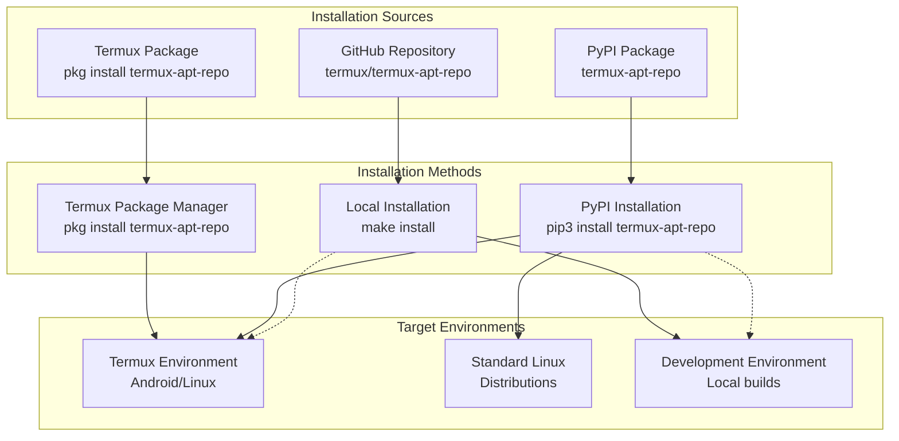
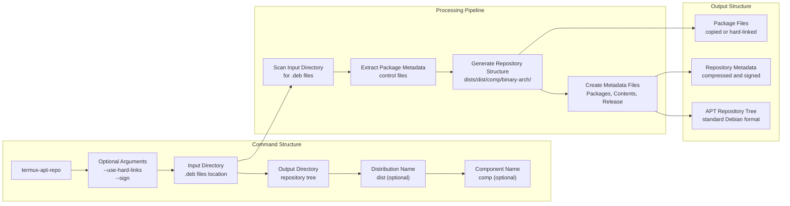
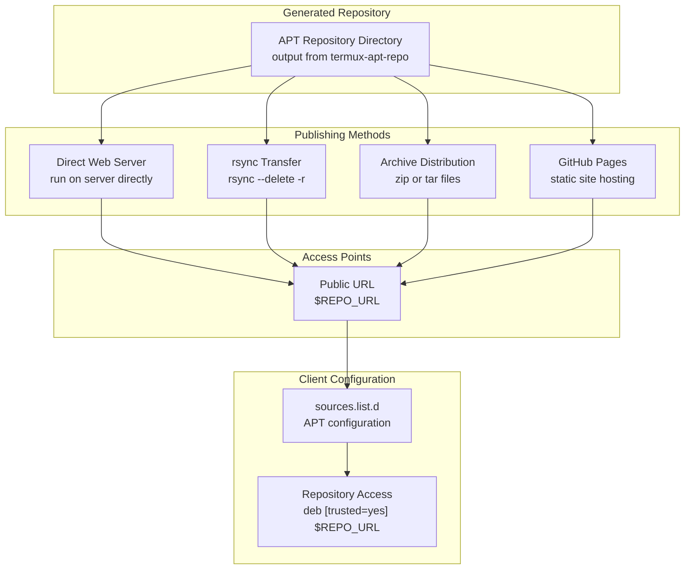
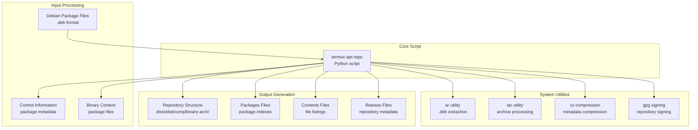

<!-- source: DeepWiki mcp.deepwiki.com · repo termux/termux-apt-repo · page 3 Installation and Usage · fetched 2026-10-26 -->

# Installation and Usage

<details>
<summary>Relevant source files</summary>

The following files were used as context for generating this wiki page:

- [Makefile](Makefile)
- [README.rst](README.rst)
- [setup.py](setup.py)

</details>


This page provides a comprehensive overview of installing and using `termux-apt-repo`, covering the available installation methods, basic usage patterns, and repository publishing workflows. It serves as the entry point for understanding how to integrate this tool into your development and distribution processes.

For detailed installation procedures, see [Installation Methods](#3.1). For step-by-step usage examples, see [Basic Usage and Examples](#3.2). For advanced configuration options and features, see [Advanced Features and Options](#3.3).

## Installation Overview

The `termux-apt-repo` tool can be installed through multiple methods depending on your environment and requirements. The installation process varies between Termux environments and standard Linux distributions.

### Installation Methods Diagram



**Sources:** [README.rst:14-16](), [README.rst:35-36](), [setup.py:8-17](), [Makefile:1-2]()

### Package Distribution Details

The tool is distributed as a Python package with the following characteristics:

| Property | Value | Source |
|----------|-------|---------|
| Package Name | `termux-apt-repo` | [setup.py:9]() |
| Version | `0.5` | [setup.py:10]() |
| Script Name | `termux-apt-repo` | [setup.py:17]() |
| License | Apache License 2.0 | [setup.py:11]() |
| Target Python | Python 3 | [setup.py:21]() |

**Sources:** [setup.py:8-23]()

## Basic Usage Workflow

The core functionality revolves around processing `.deb` files and generating APT repository structures. The tool follows a straightforward input-processing-output workflow.

### Usage Command Structure



**Sources:** [README.rst:19-34]()

### Command-Line Interface

The basic command syntax follows this pattern:

```bash
termux-apt-repo [options] input output [dist] [comp]
```

| Argument | Type | Description | Default |
|----------|------|-------------|---------|
| `input` | Required | Folder containing `.deb` files | - |
| `output` | Required | Output folder for repository tree | - |
| `dist` | Optional | Distribution folder name | - |
| `comp` | Optional | Component folder name | - |
| `--use-hard-links` | Flag | Use hard links instead of copying | Copy files |
| `--sign` | Flag | Sign repository with GPG key | Unsigned |

**Sources:** [README.rst:21-34]()

## Publishing and Distribution

After generating the repository structure, the output directory must be made accessible to APT clients. The tool supports multiple publishing methods to accommodate different deployment scenarios.

### Publishing Methods



**Sources:** [README.rst:42-55](), [README.rst:57-76]()

### Repository Access Configuration

Users access the published repository by configuring their APT sources:

1. **Configuration File Location:** `$PREFIX/etc/apt/sources.list.d/`
2. **Repository Entry Format:** `deb [trusted=yes] $REPO_URL $dist $comp`
3. **Trust Settings:** `[trusted=yes]` required for unsigned repositories

**Sources:** [README.rst:60-76]()

## Core Script Integration

The `termux-apt-repo` script serves as the central processing engine, integrating with system utilities and following standard APT repository conventions.

### System Dependencies and Integration



**Sources:** [README.rst:4-9](), [README.rst:19-34]()

This overview establishes the foundation for understanding `termux-apt-repo` installation and usage. The subsequent sections provide detailed implementations of each aspect covered here, with specific examples and advanced configuration options.

---

