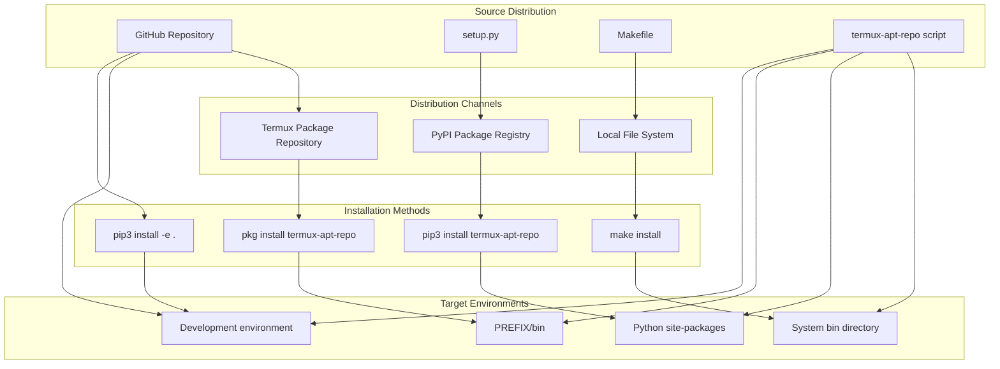
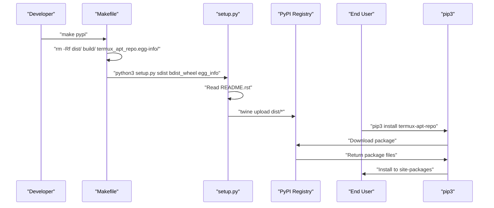
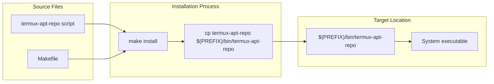
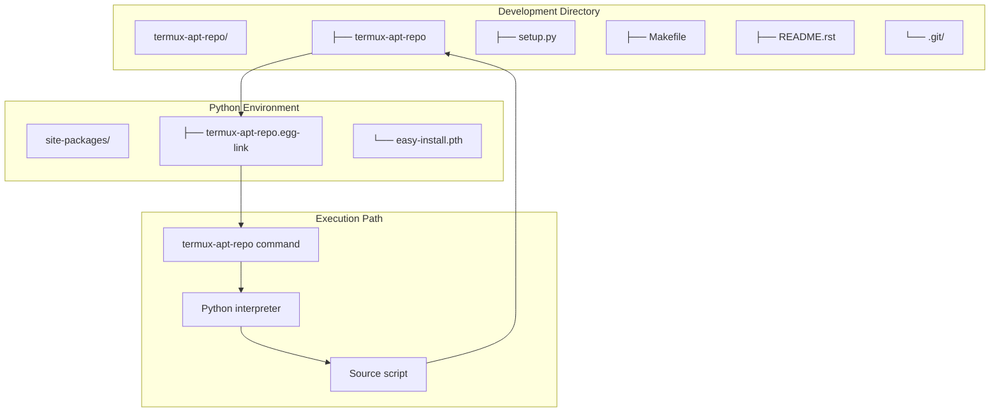
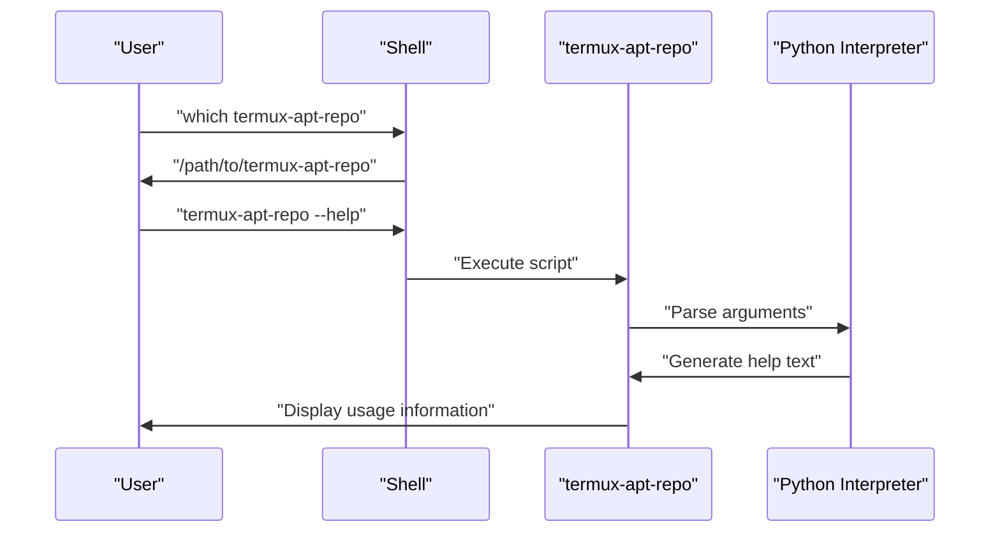

<!-- source: DeepWiki mcp.deepwiki.com · repo termux/termux-apt-repo · page 3.1 Installation Methods · fetched 2026-10-26 -->

# Installation Methods

<details>
<summary>Relevant source files</summary>

The following files were used as context for generating this wiki page:

- [Makefile](Makefile)
- [README.rst](README.rst)
- [setup.py](setup.py)

</details>


This page documents the various methods for installing `termux-apt-repo`, covering both end-user installations and development setups. The installation methods range from package manager installations to building from source code.

For information about using the installed tool, see [Basic Usage and Examples](#3.2). For development workflow and contributing, see [Development Environment Setup](#4.1).

## Installation Methods Overview

The `termux-apt-repo` tool can be installed through several methods, each suited for different use cases and environments.

### Installation Methods Summary

| Method | Environment | Command | Use Case |
|--------|-------------|---------|----------|
| Termux Package Manager | Termux only | `pkg install termux-apt-repo` | End users in Termux |
| PyPI Installation | Any Linux/Unix | `pip3 install termux-apt-repo` | End users outside Termux |
| Local Source Installation | Any Linux/Unix | `make install` | Custom builds, system packages |
| Development Installation | Any Linux/Unix | `pip3 install -e .` | Development and testing |

### Installation Flow Architecture



Sources: [README.rst:14-36](), [setup.py:1-23](), [Makefile:1-9]()

## PyPI Installation

PyPI installation is the standard method for installing `termux-apt-repo` outside of the Termux environment.

### Installation Command

```bash
pip3 install termux-apt-repo
```

### Package Configuration

The PyPI package is configured through `setup.py` with the following key parameters:

- **Package Name**: `termux-apt-repo`
- **Version**: `0.5`
- **License**: Apache License 2.0
- **Script Entry Point**: `termux-apt-repo`

### PyPI Distribution Process



Sources: [setup.py:5-23](), [Makefile:4-7]()

## Local Installation from Source

Local installation allows for custom builds and system-wide installation from source code.

### Installation Process

```bash
# Clone the repository
git clone https://github.com/termux/termux-apt-repo.git
cd termux-apt-repo

# Install using Makefile
make install
```

### Makefile Installation Target

The `install` target in the Makefile performs a simple file copy operation:

```bash
cp termux-apt-repo $(PREFIX)/bin/termux-apt-repo
```

### Local Installation Flow



Sources: [Makefile:1-2]()

## Development Installation

Development installation enables in-place editing and testing of the codebase.

### Development Setup Commands

```bash
# Clone the repository
git clone https://github.com/termux/termux-apt-repo.git
cd termux-apt-repo

# Install in development mode
pip3 install -e .
```

### Development Installation Benefits

- **Editable Installation**: Changes to source code are immediately reflected
- **Development Dependencies**: Includes testing and development tools
- **Debugging Support**: Easier to debug and profile the application

### Development Environment Structure



Sources: [setup.py:8-23]()

## Termux Package Manager Installation

In the Termux environment, the preferred installation method is through the Termux package manager.

### Termux Installation Command

```bash
pkg install termux-apt-repo
```

### Termux Package Integration

The Termux package provides:
- **Native Integration**: Optimized for Termux environment
- **Dependency Management**: Automatic handling of required packages
- **Update Management**: Seamless updates through `pkg upgrade`

### Termux vs External Installation

| Aspect | Termux Installation | External Installation |
|--------|-------------------|----------------------|
| Environment | Termux only | Linux/Unix systems |
| Package Manager | `pkg` | `pip3` |
| Integration | Native Termux | Standard Python |
| Updates | `pkg upgrade` | `pip3 install --upgrade` |
| Dependencies | Automatic | Manual |

Sources: [README.rst:14-15]()

## Installation Verification

After installation, verify that `termux-apt-repo` is properly installed and accessible.

### Verification Commands

```bash
# Check if command is available
which termux-apt-repo

# Display help information
termux-apt-repo --help

# Check version (if available)
termux-apt-repo --version
```

### Expected Command Line Interface

The installed tool should provide the following command structure:

```
termux-apt-repo [-h] [--use-hard-links] [-s] input output [dist] [comp]
```

### Verification Flow



Sources: [README.rst:19-33]()

## Installation Troubleshooting

### Common Installation Issues

| Issue | Cause | Solution |
|-------|-------|----------|
| `pip3: command not found` | Python 3 not installed | Install Python 3 and pip |
| `Permission denied` | Insufficient privileges | Use `sudo` or virtual environment |
| `pkg: command not found` | Not in Termux environment | Use PyPI installation instead |
| `make: command not found` | Build tools not installed | Install build-essential package |

### Environment-Specific Considerations

- **Termux**: Requires access to Termux package repositories
- **Linux Systems**: May require `sudo` for system-wide installation
- **Virtual Environments**: Recommended for development work
- **Android Devices**: Hard links may not work (`--use-hard-links` limitation)

Sources: [README.rst:31-32](), [README.rst:35-36]()

---

