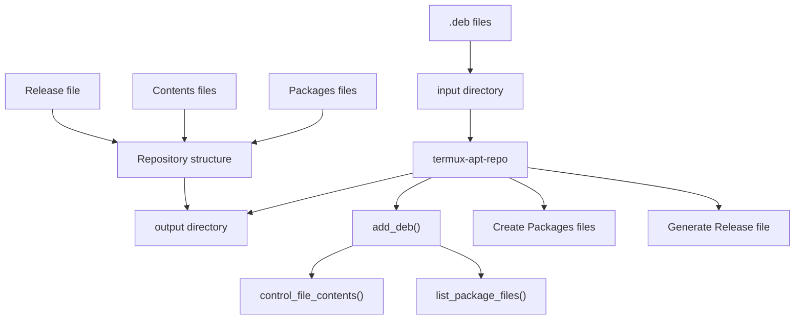
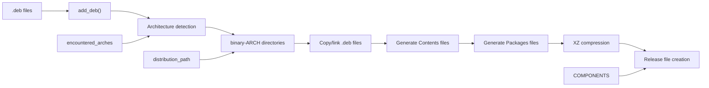
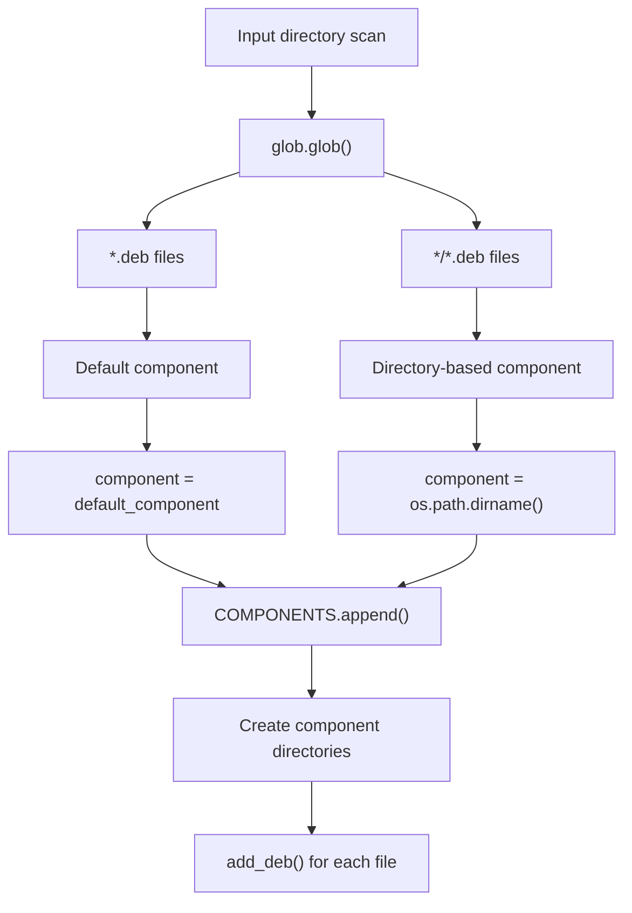
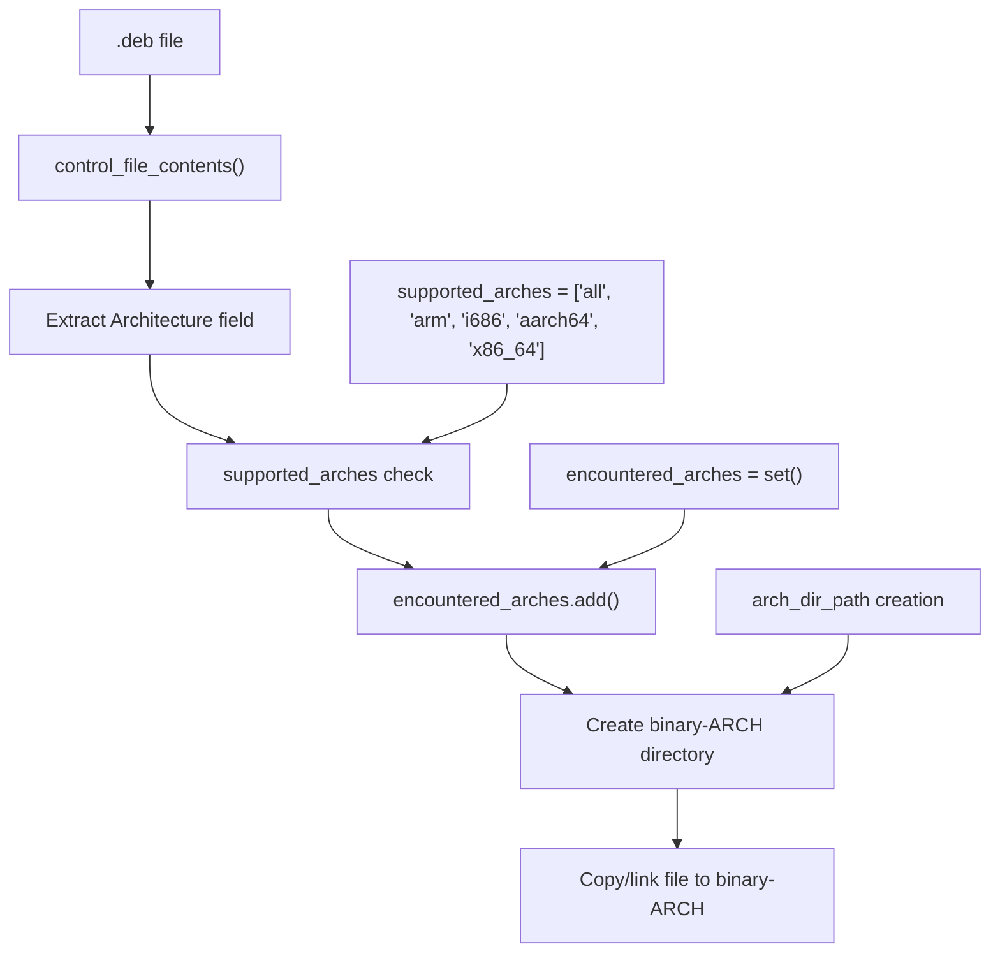
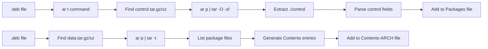
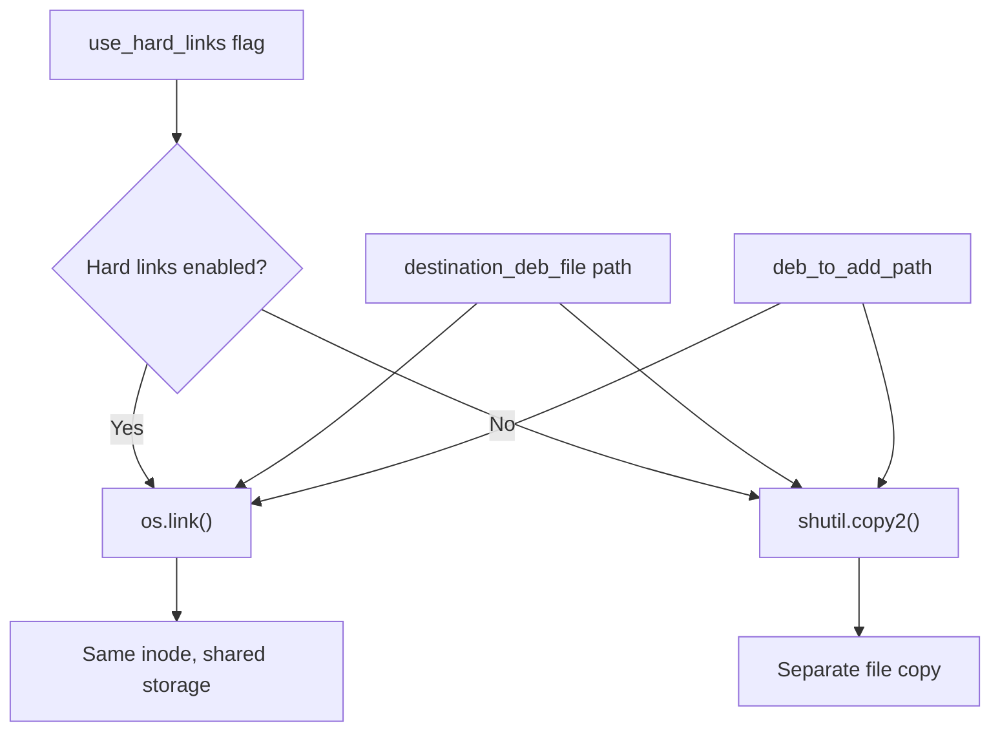
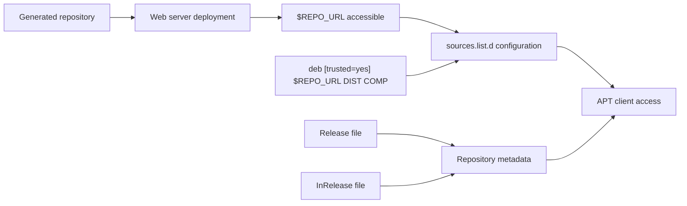

<!-- source: DeepWiki mcp.deepwiki.com · repo termux/termux-apt-repo · page 3.2 Basic Usage and Examples · fetched 2026-10-26 -->

# Basic Usage and Examples

<details>
<summary>Relevant source files</summary>

The following files were used as context for generating this wiki page:

- [README.rst](README.rst)
- [termux-apt-repo](termux-apt-repo)

</details>


This page provides practical examples of using `termux-apt-repo` to create APT repositories from `.deb` files. It covers the fundamental workflow from having `.deb` packages to generating a complete repository structure ready for publication.

For installation methods, see [Installation Methods](#3.1). For advanced features like GPG signing and repository publishing, see [Advanced Features and Options](#3.3).

## Command Syntax and Arguments

The `termux-apt-repo` script follows a straightforward command-line interface defined in [termux-apt-repo:104-117]():

```bash
termux-apt-repo input output [dist] [comp] [--use-hard-links] [-s|--sign]
```

### Argument Overview

| Argument | Type | Default | Description |
|----------|------|---------|-------------|
| `input` | Required | - | Directory containing `.deb` files |
| `output` | Required | - | Target directory for repository tree |
| `dist` | Optional | `termux` | Distribution name (goes in `dists/` path) |
| `comp` | Optional | `extras` | Component name (organizing category) |
| `--use-hard-links` | Flag | False | Use hard links instead of copying files |
| `-s, --sign` | Flag | False | Sign repository with GPG key |

**Basic Workflow Diagram**


Sources: [termux-apt-repo:104-117](), [termux-apt-repo:73-103](), [termux-apt-repo:157-183]()

## Simple Repository Creation Example

### Basic Single-Component Repository

Create a repository with `.deb` files in a single component:

```bash
# Create directory structure
mkdir -p /tmp/my-debs
mkdir -p /tmp/my-repo

# Add some .deb files to input directory
cp package1_1.0_arm.deb /tmp/my-debs/
cp package2_2.0_aarch64.deb /tmp/my-debs/

# Generate repository
termux-apt-repo /tmp/my-debs /tmp/my-repo
```

This creates the following structure as handled by [termux-apt-repo:125-145]():

```
/tmp/my-repo/
└── dists/
    └── termux/           # Default distribution name
        └── extras/       # Default component name
            ├── binary-arm/
            │   ├── package1_1.0_arm.deb
            │   ├── Packages
            │   └── Packages.xz
            ├── binary-aarch64/
            │   ├── package2_2.0_aarch64.deb
            │   ├── Packages
            │   └── Packages.xz
            ├── Contents-arm
            ├── Contents-arm.xz
            ├── Contents-aarch64
            └── Contents-aarch64.xz
        └── Release
```

**Repository Structure Generation**


Sources: [termux-apt-repo:73-103](), [termux-apt-repo:125-145](), [termux-apt-repo:157-183]()

### Custom Distribution and Component Names

```bash
# Create repository with custom names
termux-apt-repo /tmp/my-debs /tmp/my-repo myproject main
```

This creates:
```
/tmp/my-repo/
└── dists/
    └── myproject/        # Custom distribution name
        └── main/         # Custom component name
            └── binary-*/
```

Sources: [termux-apt-repo:109-112](), [termux-apt-repo:121-122]()

## Multi-Component Repository Organization

### Directory-Based Component Organization

The script supports automatic component detection based on subdirectory structure in [termux-apt-repo:135-144]():

```bash
# Organize input files by component
mkdir -p /tmp/organized-debs/main
mkdir -p /tmp/organized-debs/contrib
mkdir -p /tmp/organized-debs/testing

# Place files in component directories
cp core-package_1.0_arm.deb /tmp/organized-debs/main/
cp optional-package_1.0_arm.deb /tmp/organized-debs/contrib/
cp experimental-package_1.0_arm.deb /tmp/organized-debs/testing/

# Generate multi-component repository
termux-apt-repo /tmp/organized-debs /tmp/multi-repo
```

**Multi-Component Processing Flow**


Sources: [termux-apt-repo:130-145](), [termux-apt-repo:135-144]()

### Resulting Multi-Component Structure

```
/tmp/multi-repo/
└── dists/
    └── termux/
        ├── main/
        │   └── binary-arm/
        │       ├── core-package_1.0_arm.deb
        │       ├── Packages
        │       └── Packages.xz
        ├── contrib/
        │   └── binary-arm/
        │       ├── optional-package_1.0_arm.deb
        │       ├── Packages
        │       └── Packages.xz
        ├── testing/
        │   └── binary-arm/
        │       ├── experimental-package_1.0_arm.deb
        │       ├── Packages
        │       └── Packages.xz
        └── Release
```

Sources: [termux-apt-repo:187-189](), [termux-apt-repo:197-204]()

## Architecture Support and Package Processing

### Supported Architecture Detection

The script processes packages for multiple architectures as defined in [termux-apt-repo:6]():

```bash
# Mix of different architectures
cp package-all_1.0_all.deb /tmp/mixed-debs/
cp package-arm_1.0_arm.deb /tmp/mixed-debs/
cp package-arm64_1.0_aarch64.deb /tmp/mixed-debs/
cp package-x86_1.0_i686.deb /tmp/mixed-debs/
cp package-x64_1.0_x86_64.deb /tmp/mixed-debs/

termux-apt-repo /tmp/mixed-debs /tmp/mixed-repo
```

**Architecture Processing Pipeline**


Sources: [termux-apt-repo:6](), [termux-apt-repo:77-81](), [termux-apt-repo:84-87]()

### Package Metadata Extraction

Each `.deb` file is processed to extract control information using [termux-apt-repo:22-44]():

```bash
# The script extracts these fields automatically:
# - Package name
# - Version
# - Architecture
# - Dependencies
# - Description
# - File listings for Contents files
```

**Package Processing Details**


Sources: [termux-apt-repo:22-44](), [termux-apt-repo:46-71](), [termux-apt-repo:100-102]()

## Hard Links vs. File Copying

### Using Hard Links for Efficiency

```bash
# Use hard links instead of copying (Linux/Unix only)
termux-apt-repo --use-hard-links /tmp/my-debs /tmp/my-repo
```

The hard link functionality is implemented in [termux-apt-repo:95-98]():

| Method | Pros | Cons |
|--------|------|------|
| Copy (`shutil.copy2`) | Works on all filesystems | Uses more disk space |
| Hard link (`os.link`) | Saves disk space | Requires same filesystem |

**File Operations Comparison**


Sources: [termux-apt-repo:95-98](), [termux-apt-repo:113-114]()

## Common Usage Patterns

### Development Workflow

```bash
# 1. Build packages (using termux-create-package or cross-compilation)
# 2. Collect .deb files
# 3. Generate repository
termux-apt-repo /path/to/built/packages /var/www/html/repo

# 4. Update repository after adding new packages
termux-apt-repo /path/to/built/packages /var/www/html/repo
```

### Testing and Staging

```bash
# Create testing repository
termux-apt-repo /tmp/test-packages /tmp/test-repo myproject testing

# Create production repository  
termux-apt-repo /tmp/prod-packages /var/www/html/repo myproject main
```

### Repository Output Structure

The final repository structure follows standard APT repository format as generated by [termux-apt-repo:148-230]():

```
output/
└── dists/
    └── DISTRIBUTION/
        ├── COMPONENT1/
        │   ├── binary-ARCH1/
        │   │   ├── *.deb
        │   │   ├── Packages
        │   │   └── Packages.xz
        │   ├── binary-ARCH2/
        │   ├── Contents-ARCH1
        │   └── Contents-ARCH1.xz
        ├── COMPONENT2/
        └── Release
```

**Repository Client Configuration**


Sources: [termux-apt-repo:148-230](), [termux-apt-repo:221-229]()

---

