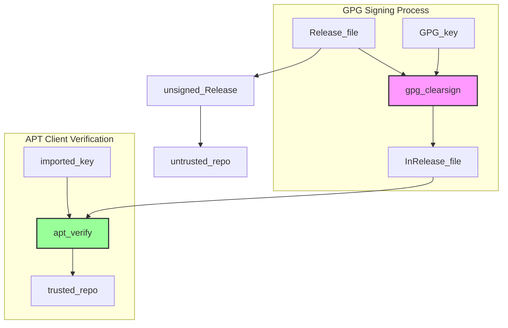
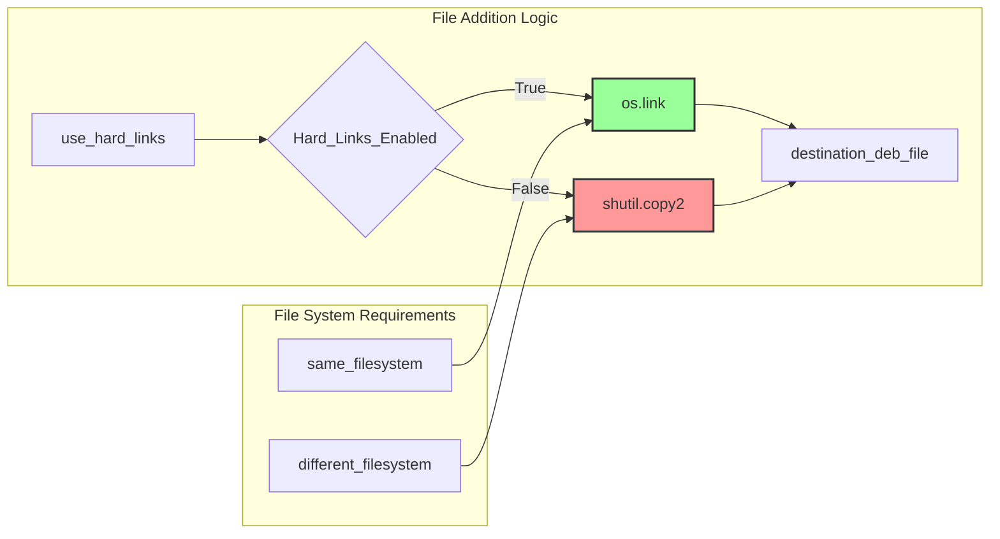
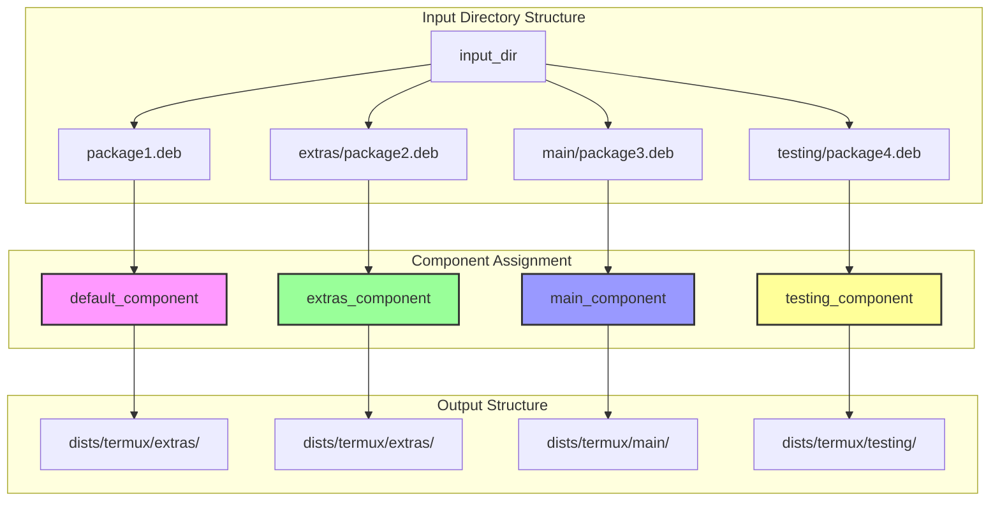
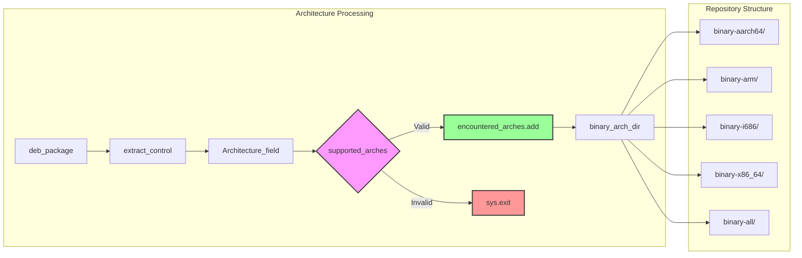
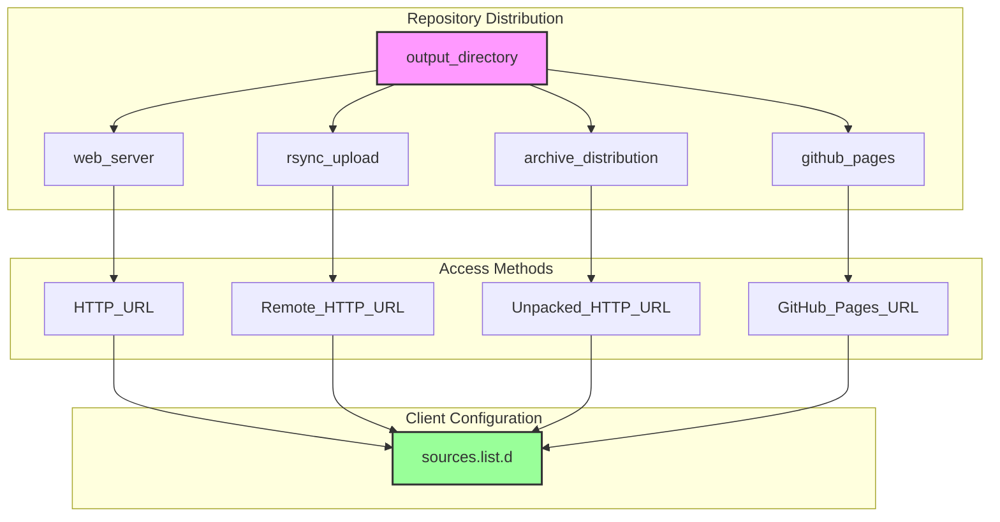
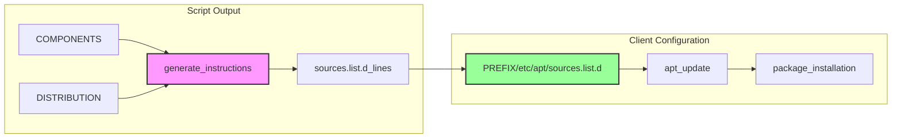

<!-- source: DeepWiki mcp.deepwiki.com · repo termux/termux-apt-repo · page 3.3 Advanced Features and Options · fetched 2026-10-26 -->

# Advanced Features and Options

<details>
<summary>Relevant source files</summary>

The following files were used as context for generating this wiki page:

- [README.rst](README.rst)
- [termux-apt-repo](termux-apt-repo)

</details>


This page covers advanced usage scenarios and configuration options for `termux-apt-repo` beyond basic repository creation. It includes GPG signing, hard link optimization, component organization, multi-architecture support, and repository publishing strategies.

For basic usage examples and installation methods, see [Basic Usage and Examples](#3.2) and [Installation Methods](#3.1).

## GPG Repository Signing

The `termux-apt-repo` script supports GPG signing to create trusted repositories that don't require the `[trusted=yes]` flag in APT sources configuration.

### Enabling GPG Signing

GPG signing is controlled by the `--sign` or `-s` command-line flag:

```bash
termux-apt-repo input_dir output_dir --sign
```

When enabled, the script generates a signed `InRelease` file alongside the standard `Release` file using GPG clear-signing.

### GPG Signing Implementation

The signing process creates an `InRelease` file containing the signed repository metadata:



**GPG Signing Process Flow**

The signing implementation uses specific GPG options for compatibility:

- `--pinentry-mode loopback`: Allows non-interactive signing
- `--digest-algo SHA256`: Uses SHA256 for signature hashing
- `--clearsign`: Creates a clear-signed document
- `--yes`: Automatically confirms operations

*Sources: [termux-apt-repo:212-217]()*

### Client-Side GPG Configuration

For GPG-signed repositories, users must import the signing key:

```bash
# Import the public key
gpg --import public_key.gpg

# Trust the key (optional but recommended)
gpg --edit-key KEY_ID trust
```

The APT sources configuration becomes:

```
deb $REPO_URL termux extras
```

*Sources: [termux-apt-repo:223-229](), [README.rst:67-75]()*

## Hard Link Optimization

The `--use-hard-links` option provides significant performance and storage benefits when creating repositories on the same filesystem as the source `.deb` files.

### Hard Link Benefits

| Feature | Copy Mode | Hard Link Mode |
|---------|-----------|----------------|
| Storage Usage | 2x (source + repo) | 1x (shared inodes) |
| Performance | Full file copy | Instant linking |
| Disk I/O | High | Minimal |
| Android Compatibility | ✓ | ✗ |

### Hard Link Implementation

The hard link logic is implemented in the `add_deb()` function:



**Hard Link vs Copy Decision Flow**

The implementation switches between hard links and file copying based on the command-line flag:

```python
if use_hard_links:
    os.link(deb_to_add_path, destination_deb_file)
else:
    shutil.copy2(deb_to_add_path, destination_deb_file)
```

*Sources: [termux-apt-repo:95-98](), [termux-apt-repo:113-114]()*

### Hard Link Limitations

Hard links have specific filesystem requirements:
- Source and destination must be on the same filesystem
- Not supported on Android devices (as noted in the help text)
- Links share the same inode, so modifying one affects all

*Sources: [termux-apt-repo:113-114]()*

## Component Organization

The script supports automatic component detection and organization based on input directory structure, allowing for complex repository layouts.

### Component Detection Logic

Components are automatically detected from subdirectory structure:



**Component Detection and Assignment**

The component detection algorithm:

1. Extracts relative path from input directory
2. Uses directory name as component name
3. Falls back to default component for root-level files
4. Maintains component list in `COMPONENTS` global variable

*Sources: [termux-apt-repo:136-144]()*

### Component Processing

Each component gets its own directory structure and metadata files:

```
output/
└── dists/
    └── termux/
        ├── extras/
        │   ├── binary-aarch64/
        │   ├── binary-arm/
        │   └── Contents-*
        ├── main/
        │   ├── binary-aarch64/
        │   └── Contents-*
        └── Release
```

*Sources: [termux-apt-repo:84-87](), [termux-apt-repo:158-159]()*

## Multi-Architecture Support

The script supports multiple CPU architectures commonly used in the Termux ecosystem and validates architecture compatibility.

### Supported Architectures

The script defines supported architectures in a global list:

```python
supported_arches = ['all', 'arm', 'i686', 'aarch64', 'x86_64']
```

### Architecture Validation and Tracking



**Architecture Validation and Directory Creation**

The architecture processing includes:

1. **Extraction**: Architecture field parsed from package control file
2. **Validation**: Checked against `supported_arches` list
3. **Tracking**: Added to `encountered_arches` set
4. **Directory Creation**: `binary-$ARCH` directories created as needed

*Sources: [termux-apt-repo:6](), [termux-apt-repo:77-81](), [termux-apt-repo:152]()*

### Architecture-Specific Output

Each architecture gets dedicated metadata files:
- `binary-$ARCH/Packages` and `binary-$ARCH/Packages.xz`
- `Contents-$ARCH` and `Contents-$ARCH.xz`
- Architecture list in `Release` file

*Sources: [termux-apt-repo:84-87](), [termux-apt-repo:100-102]()*

## Repository Publishing Strategies

The script provides guidance and examples for various repository publishing methods after generation.

### Publishing Methods



**Repository Publishing and Access Flow**

### Publishing Options

The script suggests four main publishing approaches:

1. **Direct Web Server**: Running on a web server directly
2. **rsync Synchronization**: Using rsync for remote deployment
3. **Archive Distribution**: Creating zip/tar files for manual deployment
4. **GitHub Pages**: Using GitHub's static hosting service

*Sources: [README.rst:42-55]()*

### rsync Example

```bash
rsync --delete -r <apt-repository-directory> your.host:path/to/folder
```

The `--delete` flag ensures old packages are removed from the remote repository.

*Sources: [README.rst:49-50]()*

## Client Configuration

The script automatically generates usage instructions for end users to configure their APT sources.

### Sources List Generation



**Client Configuration Generation**

The script generates component-specific APT source lines:

```
deb [trusted=yes] $REPO_URL termux extras
deb [trusted=yes] $REPO_URL termux main
deb [trusted=yes] $REPO_URL termux testing
```

*Sources: [termux-apt-repo:223-229]()*

### Trust Configuration

The `[trusted=yes]` flag behavior depends on GPG signing:

| Repository State | APT Configuration | Security Level |
|------------------|-------------------|----------------|
| Unsigned | `deb [trusted=yes] $URL` | Low (bypasses verification) |
| GPG Signed | `deb $URL` | High (requires key import) |

*Sources: [termux-apt-repo:229](), [README.rst:73-75]()*

### Multiple Component Support

When multiple components are detected, the script generates separate source lines for each component, allowing users to selectively enable repository sections.

*Sources: [termux-apt-repo:226-227]()*

---

